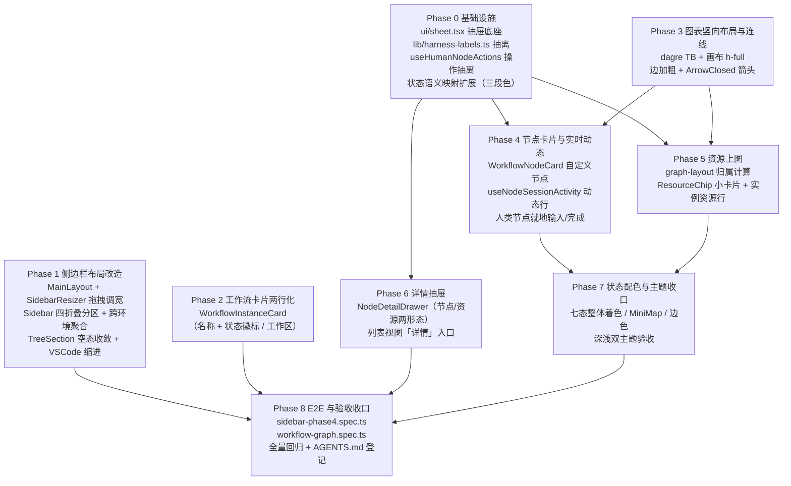

# UI 优化四期（侧边栏与工作流视图） - 实现计划

**关联 Proposal**: `docs/engineering/proposals/20261030-feat-ui-optimization-phase4.md`（v1.0）
**关联 PRD**: `docs/product/draft/20261030-ui-optimization-phase4.md`（v1.0）
**需求总分支（feat-branch）**: `feat/ui-optimization-phase4`（基于 `origin/main` 375d070e，需求总 PR [#372](https://github.com/Deliay/z-agent-gear/pull/372)，评审 APPROVED）
**计划提交分支**: `feat/ui-optimization-phase4`（本文件随需求总分支提交）
**实现分支**: `feat/ui-optimization-phase4-impl`（自需求总分支切出，参考 z-git skill）
**创建日期**: 2026-10-30
**计划版本**: v1.0

**版本说明**：

- v1.0（2026-10-30）首版。需求总 PR #372 评审结论 **APPROVED**（无评审意见、无 inline comment、无修改要求），「Pull Request审核通过」通知按处理要求逐条核对后确认无遗留修改项，按原计划推进本节点。§3 计划期裁决以需求总分支代码事实（f8a5e4e2）为准，重点校正 ① 状态徽标既有色键与提案语义表的差异；② `useSessionStream` 既有 SSE hook 的复用口径；③ 对话渲染重构（20261028）已落地的 `tool-call-state.ts` 合并/标题工具直接复用；④ 图表模式右栏资源面板隐藏的接线位置。

## 1. 实现顺序



依赖说明：

- **Phase 0 是共享底座**：`ui/sheet.tsx`、`lib/harness-labels.ts`、`useHumanNodeActions`、状态语义映射被 Phase 2/4/5/6/7 消费，先行落地（各自独立小步 TDD）。
- **Phase 1（侧边栏）与 Phase 2（工作流卡片）** 与图表侧互不依赖，可与 Phase 3 并行开发；Phase 2 的状态徽标消费 Phase 0 的语义映射。
- **Phase 3（布局骨架）先于 Phase 4/5**：节点卡片与资源小卡片都挂在 React Flow 自定义节点体系上，依赖 dagre TB 与 `nodeTypes` 接线就位。
- **Phase 4/5 相互独立**（文件交集仅 `graph-layout.ts` 的视图模型消费，由 Phase 4 主导、Phase 5 追加资源字段），均依赖 Phase 0/3。
- **Phase 6（抽屉）** 依赖 Phase 0 的 sheet 底座；Phase 4/5 的点击开抽屉在 Phase 6 完成前可先以占位回调接线（`onOpenDetail`），不阻塞并行。
- **Phase 7 为收口性质**：语义色 token 在 Phase 0 定义、在 3/4/5 落地，Phase 7 统一核对卡片/边/MiniMap/资源小卡片全部走 token 并做深浅双主题验收。
- 本期**纯前端、零契约变更、零后端改动**（提案 §3.1 已确认）；工作量集中在 `apps/agent-web` 单一子项目，测试在 `apps/agent-web` 单测与 `tests/e2e`。

### 1.1 开发分支与合并顺序

| 分支 | 范围 | 基于 | 合并目标 |
|------|------|------|---------|
| `feat/ui-optimization-phase4` | PRD / 提案 / 本计划（需求总分支） | `origin/main` | 需求总 PR #372 |
| `feat/ui-optimization-phase4-impl` | 全部实现 + 测试（主实现分支） | 需求总分支 | 需求总分支（评审通过后随需求总 PR 入 main） |
| `impl/ui-optimization-phase4-<track>`（可选） | 单轨道并行开发分支 | `feat/ui-optimization-phase4-impl` | `feat/ui-optimization-phase4-impl` |

- 主实现分支内按 Phase 顺序分提交：`feat(agent-web): 侧边栏折叠分区与拖拽调宽` → `feat(agent-web): 工作流卡片两行化` → `feat(agent-web): 图表竖向布局` → `feat(agent-web): 节点卡片与实时动态` → `feat(agent-web): 资源上图` → `feat(agent-web): 节点/资源详情抽屉` → `refactor(agent-web): 状态语义配色收口` → `test(agent-web): E2E 收口`。
- 可选并行轨道（z-coding「编写实现并行 subagent」）：Track A = Phase 1/2（侧边栏与卡片），Track B = Phase 3/4/5/7（图表体系），Phase 0 先行、Phase 6 由 Track B 承接；两轨文件交集仅 `WorkflowNodeTreeConstants.ts`（Phase 0 已定型，双方只消费不改动）。
- **禁止 rebase/squash，只允许 merge**（z-git 规范）。合并顺序：**Phase 0 → Track A/B → Phase 6 → Phase 8**。

### 1.2 开发模式与规范加载

- 全部 Phase 采用 TDD（红-绿-重构）：先写测试（RED）→ 最小实现（GREEN）→ 重构。重构组件（`Sidebar`/`TreeSection`/`WorkflowGraphView`/`WorkflowNodeTree` 相关）**先更新既有测试至新行为（红），再替换实现（绿）**。
- 编码前加载：`docs/engineering/common-rules.md`、`docs/engineering/frontend-rules.md`；测试阶段加载 `z-test` skill。
- 目录级 `AGENTS.md`：`apps/agent-web/AGENTS.md`、`tests/e2e/AGENTS.md`、`docs/engineering/plan/AGENTS.md`。
- `servers/*`、`apps/admin-web`、`packages/*`、`contracts/` **本期零改动**。

## 2. 命令参考

```bash
# 服务编排（根目录；测试服务只用 Aspire，禁止直接 docker 命令）
aspire start
aspire wait agent-api agent-web
aspire describe agent-web
aspire stop

# agent-web 单测 / 构建 / lint
cd apps/agent-web
npm ci
npm test            # vitest run（单测 + 组件测试）
npm run build       # tsc -b && vite build（strict 类型检查）
npm run lint

# E2E（串行；地址按 aspire describe 替换）
cd tests/e2e
BASE_URL=http://localhost:<agent-web-port> \
API_URL=http://localhost:10001/graphql \
CONTROLLER_API_URL=http://localhost:<controller-api-port> \
npx playwright test sidebar-phase4.spec.ts workflow-graph.spec.ts --workers=1

# 全量 E2E 回归（串行，含既有 workflow/home/responsive-layout/session-*.spec.ts）
npx playwright test --workers=1
```

## 3. 计划期裁决（提案与代码事实偏差的落地口径）

> 以下裁决以**需求总分支代码事实**（f8a5e4e2，2026-10-30）为准。提案中与之不一致或含混的描述在实现期按本节执行，**不回改提案**；验收报告逐条登记。

### 3.1 事实校正（提案描述与代码事实的偏差/补充）

| # | 提案描述 | 代码事实 | 本计划口径 |
|---|---------|----------|-----------|
| F1 | §5.2 实现点 1：`MainLayout.tsx` 桌面端 `grid-cols-[280px_1fr]` 改 `grid-cols-[var(--sidebar-width,20rem)_1fr]` | `MainLayout.tsx:123` 确为 `grid h-screen grid-cols-[280px_1fr]` | 按提案执行；仅桌面 grid 列改 CSS 变量，`Sidebar mobile` 形态与 `useIsMobile` 切换逻辑零改动 |
| F2 | §5.2 实现点 6/11/12：dagre `rankdir:'LR'`、`h-[600px]`、hex `STATUS_COLORS`、边 `stroke:'#94a3b8'` | `WorkflowGraphView.tsx:28` `STATUS_COLORS` hex 常量、`:39` fallback `'#94a3b8'`、`:45` `g.setGraph({ rankdir: 'LR', nodesep: 50, ranksep: 80 })`、`:135` 外层 `h-[600px] w-full rounded-lg border` | 改 `rankdir:'TB'`（`nodesep: 40, ranksep: 70`）；外层改 `h-full min-h-[480px]` 且由 `WorkflowInstancePage` 视图区行填充；`STATUS_COLORS` **整体删除**，色值单一来源收敛进 `WorkflowNodeTreeConstants.ts`（见 F3/裁决 7） |
| F3 | §5.2 实现点 10 语义表：`REJECT 打回 → warning（琥珀）`、`FAILED 失败 → destructive` | `WorkflowNodeTreeConstants.ts:19` `NODE_STATUS_BADGE` 现状为 `REJECT: 'bg-destructive/15 text-destructive'`、`REWORK: 'bg-warning/15 text-warning'`、`FAILED: 'bg-destructive/15 text-destructive'`——即现状 REJECT 与 FAILED 同为 destructive 系，**无法一眼区分** | 以提案语义表为准：`REJECT → warning`（琥珀、静态）、`REWORK → warning`（琥珀 + 脉冲底纹）、`FAILED → destructive`；`NODE_STATUS_BADGE` 类值同步调整为三段映射（`{spine, tint, badge}`）并**保持导出名不变**，列表视图徽标与图表卡片同源（PRD 功能点 7 要求徽标色与状态配色体系一致） |
| F4 | §5.2 实现点 8：「复用 `SessionView` 的 `GET /api/session/:id/stream` 地址与鉴权口径」「SSE 断线沿用既有重试口径（连续 3 次失败置空动态行）」 | `hooks/useSessionStream.ts` 已封装 `EventSource(`${apiBase}/api/session/${id}/stream?token=...`)` + `MAX_CONSECUTIVE_ERRORS = 3` 断线判定 + `onMessage/onHistory/onStatus/onError` 回调 | `useNodeSessionActivity` **直接复用 `useSessionStream`**（不自行 new EventSource、不重复鉴权/重试逻辑）；只在 `onMessage` 内做「最后一条活动 + 最后一条用量」归一，连接生命周期由 hook 的 `useEffect` cleanup 天然覆盖 |
| F5 | §5.2 实现点 8：工具调用标题「`toolCallHeaderTitle` 口径」、消息归一复用 `group-messages.ts`/`tool-call-state.ts` | 对话渲染重构（20261028，已落地）：`tool-call-state.ts` 导出 `MergedToolCall`、`mergeToolCallMessages`（`:56`）、`toolCallTitle`（`:92`）、`toolCallHeaderTitle`（`:103`）；`group-messages.ts` 导出 `parseSessionUpdate`（`:21`） | 动态行直接调用上述导出，**零重复实现**；新增的仅是「尾部截断 + 三类映射」展示层（`NodeLiveActivity`） |
| F6 | §5.2 实现点 7：「把 `SessionHeader.tsx` 的 `acpServerTypeLabels` 抽为 `lib/harness-labels.ts`」 | `SessionHeader.tsx:56` 内联 `acpServerTypeLabels`，`:83` 消费（未知回退原值） | 抽离为 `lib/harness-labels.ts` 导出 `harnessLabel(type?: string): string`，映射逐字迁移；`SessionHeader` 改为消费共享函数（纯重构、渲染输出不变） |
| F7 | §5.2 实现点 4：新增 `ui/sheet.tsx` | `components/ui/` 无 `sheet.tsx`（现有 dialog/badge/collapsible-group 等）；`SessionSidePanel.tsx` 以 Dialog 样式冒充侧边抽屉 | 新增 shadcn Sheet 形态 `ui/sheet.tsx`（右侧滑出、全高、遮罩、Esc/遮罩关闭）；`SessionSidePanel` **本期不迁移**（范围外），仅样式参照 |
| F8 | §5.2 实现点 9：「图表视图下隐藏右栏 `BlackboardPanel`/`WorkflowContextPanel` 展开树（列表视图保留）」 | `WorkflowInstancePage.tsx:204-212` 为 list/graph 二选一主视图，`:222-226` 的 `BlackboardPanel`/`WorkflowContextPanel` 在**两种视图下都渲染**（右栏常驻） | 在 `WorkflowInstancePage` 按 `viewMode === 'graph'` 条件隐藏右栏两面板（列表视图零变化）；数据 props 接线不动 |
| F9 | §5.2 实现点 5：抽出 `WorkflowInstanceItem` 为 `WorkflowInstanceCard` | `Sidebar.tsx:566` `WorkflowInstanceItem` 局部组件、`:588` 渲染 `instanceStatusText(instance)`（`instanceStatusText` 自 `WorkflowNodeTreeConstants.ts` 导入）；活跃/已归档两个渲染点（`:609`/`:626`） | 抽出为 `components/workflow/WorkflowInstanceCard.tsx`，`Sidebar` 两处渲染点同步替换；`instanceStatusText` 语义（执行中节点名列表）压缩进徽标 tooltip（提案口径），执行中显示「执行中：{name}」 |
| F10 | §5.2 实现点 1：「空态不再渲染 `emptyMessage`」 | `TreeSection.tsx:60-61` 是 `emptyMessage` 唯一渲染点（`{!hasActualContent && emptyMessage && <li …>}`） | 空态收敛即该处条件收口（`hasContent === false` 时不渲染占位文字，保留可展开空容器与既有 `hidden` 子级机制）；`Sidebar` 各分区的空文案入参同步清理 |
| F11 | §6.2：`@xyflow/react` ^12.6.0、`@dagrejs/dagre` ^1.1.4 既有依赖不新增 | `package.json` 已含 `@dagrejs/dagre ^1.1.4`、`@xyflow/react ^12.6.0`、`lucide-react`、`sonner` | **本期零新增依赖**（较对话渲染重构期更轻，无 Phase 0 安装步骤）；`ui/sheet.tsx` 用既有 `dialog.tsx` 同款原语自实现，不引第三方 |
| F12 | §8.2 E2E 用例清单未定编号 | `tests/e2e/AGENTS.md` 既有 `E2E-CR1~3`（Check Runs 同步）、`E2E-CREN1~9`（会话渲染）、`E2E-1~6/P2-E2E-*`（工作流）等编号已占用 | 新用例统一 **`E2E-UI4S*`（侧边栏）/ `E2E-UI4G*`（图表）** 前缀，spec 文件 `tests/e2e/src/sidebar-phase4.spec.ts`、`workflow-graph.spec.ts`（均不存在，无冲突）；`tests/e2e/AGENTS.md` 清单同步登记 |

### 3.2 设计裁决（提案留白/含混处）

1. **追加提示词归属的多执行中节点消歧**：提案 §5.2 实现点 9 口径为「归属到渲染时刻处于 RUNNING/REWORK 的节点旁」。裁决：**恰好一个** RUNNING/REWORK 节点时归属该节点旁；**多个并行执行中节点或零个**时归入图顶部「实例资源行」（避免同一资源多节点重复渲染造成归属误导）。归属在 `buildGraphViewModel` 每次渲染期计算，轮询刷新自动迁移。
2. **资源槽位溢出**：同节点资源横排最多 **3 个可见 + 「+N」折叠入口**（提案风险点口径）；「+N」点击打开该节点详情抽屉的资源列表区。实例资源行同样限高限宽（12rem/2 行截断，超长省略）。
3. **动态行截断常量**：思考/文本「结尾截断 40 字符 + 前缀 `…`」收敛为常量 `LIVE_ACTIVITY_TAIL_CHARS = 40`（`hooks/useNodeSessionActivity.ts` 导出，便于单测与后续调整）；单行 `truncate`，永不换行撑高卡片。
4. **动态行无消息中性态**：进行中 AI 节点尚无任何消息时，动态行仅显示转圈图标 + 「等待消息」（PRD 3.5「不显示内容或显示等待中的中性态」取后者，保证行高稳定不抖动）。
5. **SidebarResizer 行为**：热区 4px、`cursor-col-resize`、hover 变色；clamp `[15rem, 28rem]`（240–448px）默认 20rem（提案 §4.2 取值依据）；拖拽期间 `select-none`；`pointerup` 持久化 `localStorage['sidebar-width']`；**双击热区恢复默认 20rem**；移动端不渲染 Resizer。
6. **人类节点操作抽离**：`WorkflowNodeTree.tsx` 的 `HumanNodeActions`（`:51`）抽出为 `hooks/useHumanNodeActions.ts`（含 `workflow-node-draft:{instanceId}:{nodeId}` 草稿、`COMPLETE_HUMAN_NODE`、`REJECT_NODE` Dialog 理由输入），列表视图与卡片/抽屉三处共用，**行为零变化**（重构先红后绿，既有 `WorkflowNodeTree` 测试迁移）。
7. **状态三段色映射单一来源**：`WorkflowNodeTreeConstants.ts` 新增 `NODE_STATUS_VISUAL: Record<WorkflowNodeStatus, { spine, tint, badge }>`（Tailwind 语义类，走 `index.css` 的 `--color-success/warning/info/destructive` oklch 变量），`NODE_STATUS_BADGE` 重导出自该映射的 `badge` 段以保持存量调用方不破；REWORK 的「脉冲底纹」用动画类（`animate-pulse` 或斜纹背景），REJECT 静态，构成提案 §5.2 实现点 10 的双重区分。
8. **React Flow 手势冲突**：自定义卡片根节点加 `nodrag` 类，输入区/按钮 `stopPropagation`；拖拽仅由卡片非交互区触发；点击卡片非交互区开详情抽屉（与拖拽区分：位移阈值内视为点击，或仅头部区可点击——取「头部区点击开抽屉」的保守口径，避免误触）。
9. **节点尺寸与 dagre 测量**：宽固定 280px、高按内容估算 120–220px（按元信息/动态/徽标行有无分档）写入 dagre；±20px 偏差可接受（`nodesep`/`ranksep` 留余量）；如视觉重叠再引入 ResizeObserver 回写（本期不做，记入风险）。
10. **实例资源行位置**：未归属资源固定画布顶部横排，作为 React Flow 之外的 DOM 覆盖层（absolute，不参与 dagre 布局），随画布滚动不跟随（视口顶部常驻）或作为 graph 节点置顶——取**画布容器顶部常驻条**（实现简单、可读性好），不参与缩放。
11. **「详情」入口（列表视图）**：`WorkflowNodeTree` 的 `NodeCard` 头部新增「详情」按钮打开 `NodeDetailDrawer`（PRD 功能点 6 验收「图表视图与列表视图的节点均可打开抽屉」）；列表视图原有操作区不动。
12. **E2E 驱动机制**：沿用 `workflow.spec.ts` 既有 fake controller / GraphQL 直写登记模式（如 `pullRequestLinks` 同步字段直写）构造节点状态与资源；SSE 动态行用例经 fake controller `acp:message` 注入 `sessionUpdate`（同 `session-chat.spec.ts` 机制）；深色主题断言用计算样式（非截图），动画尺寸断言用 `clientWidth`（common-rules 测试陷阱口径）。

## 4. 关键约束（提案 §1.3/§6 与规范，实现期不得回退）

- **纯前端零契约**：不改 `contracts/` 任何文件、不改 GraphQL 查询字段、不改任何后端；数据来源仍为 `HOME_OVERVIEW`（15s 轮询）/`workflowInstance`（5s 轮询）/会话 SSE/既有 mutation。
- **侧边栏交互逻辑零变化**：仅布局与样式（PRD 3.2/5.2）；条目点击导航、设置按钮、新建入口、WorkspaceSwitcher 等行为逐字保留。
- **首页数据流约定**（`apps/agent-web/AGENTS.md`）：不得各自发起信息流查询；聚合数据经 `stores/homeOverview.ts` 消费；加载分支必须 `loading && !data`（Apollo v4 轮询陷阱）；归属字段判空回退「未知工作区」。
- **移动端不回归**：`Sidebar mobile` 形态与 `responsive-layout.spec.ts` 既有断言全绿；不引入拖拽调宽。
- **深色主题零固定配色**：全部色值走 `index.css` oklch 语义变量；删除 `STATUS_COLORS` hex 映射；E2E 计算样式断言卡片非纯白。
- **布局三件套**（frontend-rules）：抽屉/资源小卡片/窄容器 `min-w-0 truncate` / `whitespace-pre-wrap break-all` / `shrink-0` 系统性检查；E2E 断言 `scrollWidth - clientWidth ≤ 1`。
- **输入不丢**（frontend-rules）：人类节点 textarea 沿用 `workflow-node-draft:*` 草稿持久化；5s/15s 轮询刷新不得卸载输入（受控层级不放在条件渲染内）。
- **TDD 纪律**：`graph-layout.ts` 归属纯函数、`useNodeSessionActivity` 归一逻辑、`useHumanNodeActions` 分支覆盖率 100%；重构组件先红后绿并保留记录。
- **z-git**：禁止 rebase/squash；实现 PR（`feat/ui-optimization-phase4-impl` → `feat/ui-optimization-phase4`）评审通过后合并；合并后删除实现分支，不删需求总分支。
- **测试编排**：测试服务只用 Aspire；E2E `workers: 1` 串行；不与 `tests/api` 并行（common-rules 测试陷阱）。

## 5. Phase 计划

### Phase 0：基础设施（1d）

| 文件 | 变更 |
|------|------|
| `apps/agent-web/src/components/ui/sheet.tsx` | **新增**：shadcn Sheet 形态侧边抽屉底座（右侧滑出、全高、遮罩、Esc/遮罩关闭、滑入动画；受控 open/onOpenChange） |
| `apps/agent-web/src/components/ui/__tests__/sheet.test.tsx` | **新增**：T-UI4-SH1~4（开合/遮罩关闭/Esc 关闭/内容渲染） |
| `apps/agent-web/src/lib/harness-labels.ts` | **新增**：`harnessLabel(type?: string)`，映射自 `SessionHeader.tsx:56` 逐字迁移（未知回退原值） |
| `apps/agent-web/src/lib/__tests__/harness-labels.test.ts` | **新增**：已知映射/未知回退 |
| `apps/agent-web/src/components/session/SessionHeader.tsx` | 重构：`acpServerTypeLabels` 改消费 `harnessLabel`（渲染输出不变） |
| `apps/agent-web/src/hooks/useHumanNodeActions.ts` | **新增**：自 `WorkflowNodeTree.tsx` 的 `HumanNodeActions` 抽离（草稿读写、`COMPLETE_HUMAN_NODE`、`REJECT_NODE` + Dialog 理由） |
| `apps/agent-web/src/hooks/useHumanNodeActions.test.tsx` | **新增**：T-UI4-HA1~5（草稿回填/完成回调/打回理由/空理由拦截/提交态） |
| `apps/agent-web/src/components/workflow/WorkflowNodeTree.tsx` | 重构：`HumanNodeActions` 改消费 `useHumanNodeActions`（行为零变化，既有测试迁移先红后绿） |
| `apps/agent-web/src/components/workflow/WorkflowNodeTreeConstants.ts` | 修改：新增 `NODE_STATUS_VISUAL: Record<WorkflowNodeStatus, {spine, tint, badge}>`（F3 语义表：REJECT→warning、REWORK→warning+脉冲、FAILED→destructive、RUNNING→info、DONE→success、INITIALIZING→muted、READY→muted+虚线）；`NODE_STATUS_BADGE` 重导出 `badge` 段 |
| `apps/agent-web/src/components/workflow/__tests__/WorkflowNodeTreeConstants.test.ts` | **新增**：T-UI4-TC1~4（七态齐全/REJECT≠FAILED 色类/REWORK 含脉冲类/导出兼容） |

**完成判据**：`npm ci && npm test && npm run build` 全绿；`SessionHeader`/`WorkflowNodeTree` 渲染输出零变化（既有测试迁移后仍绿）；七态映射单测锚定。

### Phase 1：侧边栏布局改造（2d，PRD 功能点 1–5）

| 文件 | 变更 |
|------|------|
| `apps/agent-web/src/components/SidebarResizer.tsx` | **新增**：4px 热区 + pointer capture 拖拽；clamp `[15rem,28rem]`、默认 20rem；拖拽 `select-none`；`pointerup` 持久化 `localStorage['sidebar-width']`；双击恢复默认；移动端不渲染 |
| `apps/agent-web/src/components/__tests__/SidebarResizer.test.tsx` | **新增**：T-UI4-RES1~5（clamp 上下限/持久化写入/恢复默认/移动端不渲染/拖拽更新 CSS 变量） |
| `apps/agent-web/src/pages/MainLayout.tsx` | 修改：桌面 grid 列改 `grid-cols-[var(--sidebar-width,20rem)_1fr]`（F1）；初始化读 `sidebar-width` 恢复；挂载 `SidebarResizer`；移动端布局不动 |
| `apps/agent-web/src/components/Sidebar.tsx` | 修改：顶层重组为「主机」「工作流」「会话」「网关」四个全宽折叠分区（整行标题 + Chevron + 右侧 actions，hover 高亮）；`SidebarSectionState` 持久化 `localStorage['sidebar-sections-expanded']`（默认 `{hosts:false,workflows:true,sessions:true,gateways:false}`）；「工作流」聚合 `workflowInstances`/`archivedWorkflowInstances` 全量（不按 `controllerId` 过滤，活跃平铺 + 「已归档（N）」自折叠分组沿用 `ControllerWorkflows` 结构）；「会话」`sessions` 全量平铺（沿用 `NavLink` 条目/状态点/工作区名，`title` tooltip 显所属主机名）；「网关」聚合各控制器 `GatewayItem`（仅在线控制器有内容）；条目排序 `updatedAt` 倒序 + id tie-break（防 5s 轮询跳动） |
| `apps/agent-web/src/components/tree/TreeSection.tsx` | 修改：空态不渲染 `emptyMessage`（F10）；标题行全宽；层级缩进统一 `paddingLeft: level * 0.5rem`（≈2 空格） |
| `apps/agent-web/src/components/tree/WorktreeSidebarGroup.tsx` | 修改：缩进量与行样式对齐统一工具类（折叠逻辑 `expandedWorktrees` 不动） |
| 对应 `__tests__/` | **新增/更新**：T-UI4-SEC1~6（四分区默认展开态/持久化/点击切换）、T-UI4-AGG1~4（两主机会话/工作流同列表、点击行为不变、排序稳定）、T-UI4-TREE1~3（空态无占位文字、缩进一致、设置按钮保留） |

**完成判据**：PRD 功能点 1–5 验收标准逐项过；侧边栏既有点击导航/设置按钮/新建入口零回归（`Sidebar.test.tsx` 全绿）；移动端 `responsive-layout.spec.ts` 不回归。

### Phase 2：工作流卡片两行化（0.5d，PRD 功能点 7）

| 文件 | 变更 |
|------|------|
| `apps/agent-web/src/components/workflow/WorkflowInstanceCard.tsx` | **新增**：第一行 `instance.name`（`text-sm font-semibold text-foreground`）+ 状态徽标（`NODE_STATUS_BADGE`，`rounded-full` pill；执行中显示「执行中：{name}」，`instanceStatusText` 语义压缩进 tooltip）；第二行 `instance.workspace?.name ?? '未知工作区'`（`text-xs text-muted-foreground`）；控制器名移入 hover tooltip |
| `apps/agent-web/src/components/__tests__/WorkflowInstanceCard.test.tsx` | **新增**：T-UI4-IC1~4（两行布局/无控制器名/工作区判空回退/徽标色随状态） |
| `apps/agent-web/src/components/Sidebar.tsx` | 修改：`:609`/`:626` 两处 `WorkflowInstanceItem` 渲染点替换为 `WorkflowInstanceCard`；删除局部 `WorkflowInstanceItem`（F9） |

**完成判据**：PRD 功能点 7 验收标准逐项过；100% 卡片两行展示；点击进入详情行为不变。

### Phase 3：图表竖向布局与连线（1d，PRD 功能点 8 / 11 连线部分）

| 文件 | 变更 |
|------|------|
| `apps/agent-web/src/components/workflow/graph/graph-layout.ts` | **新增**：dagre 编排（`g.setGraph({ rankdir: 'TB', nodesep: 40, ranksep: 70 })`）+ 节点尺寸写入（宽 280、高 120–220 分档，裁决 9）+ `buildGraphViewModel(instance)` 骨架（Phase 4/5 补全视图模型字段） |
| `apps/agent-web/src/components/workflow/graph/__tests__/graph-layout.test.ts` | **新增**：T-UI4-GL1~3（TB 竖向坐标单调递增/并行分支同层横排/单节点布局） |
| `apps/agent-web/src/components/workflow/WorkflowGraphView.tsx` | 修改：dagre LR→TB；外层 `h-[600px]` → `h-full min-h-[480px]`（由 `WorkflowInstancePage` 视图区行填充）；`<ReactFlow fitView>` 初始占满；边 `strokeWidth: 2` + `MarkerType.ArrowClosed`（marker 尺寸 12–16）；下游 RUNNING 保留 `animated` 并染状态色；MiniMap/Controls/Background 保留 |
| `apps/agent-web/src/pages/WorkflowInstancePage.tsx` | 修改：图表模式视图区 flex/grid 行填充（高度自适应窗口）；`viewMode === 'graph'` 隐藏右栏 `BlackboardPanel`/`WorkflowContextPanel`（F8） |
| 对应 `__tests__/` | **新增**：T-UI4-GL4~5（边 strokeWidth=2 / markerEnd 存在） |

**完成判据**：PRD 功能点 8 与「连接线加粗带箭头」验收过；节点多时可平移/缩放；画布高度 ≥ 视图区 95%（E2E 断言）。

### Phase 4：节点卡片与实时动态（2d，PRD 功能点 9 / 6 操作部分）

| 文件 | 变更 |
|------|------|
| `apps/agent-web/src/hooks/useNodeSessionActivity.ts` | **新增**：复用 `useSessionStream`（F4）订阅 `node.sessionId`；`onMessage` 内 `parseSessionUpdate` 归一「最后一条活动 + 最后一条用量」：`agent_thought_chunk` → `{kind:'thinking', text:'…'+slice(-40)}`；`tool_call(_update)` → `{kind:'tool_call', text: toolCallHeaderTitle(mergeToolCallMessages(...))}`（F5）；`agent_message_chunk` → `{kind:'text', text:'总结中 …'}`；`usage_update` → `tokenUsage = data.used`；导出 `LIVE_ACTIVITY_TAIL_CHARS`（裁决 3）；无消息中性态（裁决 4） |
| `apps/agent-web/src/hooks/useNodeSessionActivity.test.tsx` | **新增**：T-UI4-NA1~7（三类映射/结尾截断口径/tool_call 标题同会话页/usage 记录与缺失 null/非活动消息忽略/无消息中性态/节点 DONE 后清理） |
| `apps/agent-web/src/components/workflow/graph/WorkflowNodeCard.tsx` | **新增**：React Flow `nodeTypes.custom` 卡片——头部行（状态色左脊 4px + 节点名 truncate + 类型徽标 + `RotateCcw`「返工 N 次」（`reworkCount>0`））；元信息行（AI：Harness + 模型 chip，模型经 `GET_ACP_SERVER_OPTIONS` 映射、取不到显 `modelId` 原值）；动态行（AI 且 RUNNING：`Loader2 spin` + `NodeLiveActivity` 三类文案）；结果行（AI 且 DONE：「已完成 · 消耗 {tokenUsage} tokens」，`null` 时仅「已完成」）；徽标行（PR `prUrl` 可点、检查项 `checkRunUrl`/`lastSyncAt` 有值才显，沿用 `WorkflowNodeTree` L259-277 口径）；人类节点操作区（HUMAN 且 READY/RUNNING/REWORK：textarea + 「完成」+「打回」，复用 `useHumanNodeActions`）；`nodrag` + 输入区 `stopPropagation`（裁决 8）；头部区点击开详情抽屉（`onOpenDetail`） |
| `apps/agent-web/src/components/workflow/graph/__tests__/WorkflowNodeCard.test.tsx` | **新增**：T-UI4-NC1~10（七态渲染/模型 Harness 行/动态行三类型与截断/token 行有无/PR·检查项·返工徽标显隐/人类节点输入完成回调/打回回调/拖拽手势不误触/标题点击回调） |
| `apps/agent-web/src/components/workflow/WorkflowGraphView.tsx` | 修改：`nodeTypes` 注册自定义节点；节点 data 传 `NodeCardViewModel`（含 live，由各节点 hook 驱动）；既有 `useNodesState` 轮询 `setNodes` 机制不变 |
| `apps/agent-web/src/components/workflow/graph/graph-layout.ts` | 修改：`NodeCardViewModel` 补全字段（`harnessLabel/modelLabel/tokenUsage/prLinks/reworkCount`，提案 §3.2） |

**完成判据**：PRD 功能点 9 验收标准逐项过；动态行随消息流更新不引起整图抖动（局部 state，不触发 `setNodes`）；`useHumanNodeActions` 三处共用行为一致。

### Phase 5：资源上图（1d，PRD 功能点 10）

| 文件 | 变更 |
|------|------|
| `apps/agent-web/src/components/workflow/graph/graph-layout.ts` | 修改：资源归属纯函数（裁决 1/2）——黑板 key 前缀 `{nodeId}-{nodeName}-产物-` 解析（与 `WorkflowNodeTree.artifactsOf` 同构，抽共享 `lib/artifact-owners.ts` 或复用导出）；PR 按 `pullRequestLinks[].nodeId` 精确归属；追加提示词单执行中节点归属该节点、否则实例资源行；无法解析的黑板条目入实例资源行；`blackboardTrash` 不渲染 |
| `apps/agent-web/src/components/workflow/graph/ResourceChip.tsx` | **新增**：资源小卡片（类型图标 + 标题单行 truncate，限宽 12rem、限高 2 行）；同节点槽位最多 3 个 + 「+N」（裁决 2）；点击开资源详情抽屉 |
| `apps/agent-web/src/components/workflow/graph/__tests__/graph-layout.resources.test.ts` | **新增**：T-UI4-GL6~10（key 前缀归属/PR nodeId 归属/追加提示词单执行中归属/多执行中入实例行/垃圾桶与未归属兜底） |
| `apps/agent-web/src/components/workflow/graph/__tests__/ResourceChip.test.tsx` | **新增**：T-UI4-RC1~6（三类型渲染/截断样式/「+N」折叠/点击回调/实例资源行横排/垃圾桶不渲染） |
| `apps/agent-web/src/components/workflow/WorkflowGraphView.tsx` | 修改：资源槽位挂自定义卡片右侧（absolute，不干扰 dagre 测量）；实例资源行画布顶部常驻条（裁决 10） |

**完成判据**：PRD 功能点 10 验收标准逐项过；图表视图右栏资源树已隐藏（F8）；列表视图 `BlackboardPanel`/`WorkflowContextPanel` 零变化。

### Phase 6：详情抽屉（1d，PRD 功能点 6）

| 文件 | 变更 |
|------|------|
| `apps/agent-web/src/components/workflow/NodeDetailDrawer.tsx` | **新增**：基于 `ui/sheet.tsx` 两形态——**节点详情**（名称/阶段/状态/说明、`rejectInfo`/`failInfo` 原因、`reworkCount`/`reworkedAt`、该节点黑板产物（`artifactsOf`）、关联 PR 与检查项（`pullRequestLinks` 按 `nodeId`）、操作区复用 `useHumanNodeActions`）；**资源详情**（黑板 key + `MarkdownContent` 渲染 value；追加提示词纯文本 `whitespace-pre-wrap`（与 `WorkflowContextPanel` 口径一致）；PR 卡片含 `prUrl` 链接与检查项行） |
| `apps/agent-web/src/components/workflow/graph/WorkflowNodeCard.tsx` / `ResourceChip.tsx` | 修改：`onOpenDetail` 接线到抽屉（Phase 4/5 占位回调替换为真实打开） |
| `apps/agent-web/src/components/workflow/WorkflowNodeTree.tsx` | 修改：`NodeCard` 头部新增「详情」入口（裁决 11）；既有操作区不动 |
| `apps/agent-web/src/pages/WorkflowInstancePage.tsx` | 修改：抽屉状态提升挂载（单实例，图表/列表共用） |
| 对应 `__tests__/` | **新增**：T-UI4-SH5~8（节点详情字段齐全/打回失败原因展示/资源 Markdown 渲染/关闭后视图位置不变）+ 列表「详情」入口断言 |

**完成判据**：PRD 功能点 6 验收标准逐项过；抽屉内完成/打回链路与列表视图一致；关闭抽屉回到原视图（滚动位置不变）。

### Phase 7：状态配色与主题收口（0.5d，PRD 功能点 11）

| 文件 | 变更 |
|------|------|
| `apps/agent-web/src/components/workflow/WorkflowGraphView.tsx` | 收口：删除 `STATUS_COLORS` hex 常量（F2）；边色/MiniMap `nodeColor`/`maskColor` 全部走 `NODE_STATUS_VISUAL` 与 oklch 变量 |
| `apps/agent-web/src/components/workflow/graph/WorkflowNodeCard.tsx` / `ResourceChip.tsx` | 收口：卡片背景 `bg-card`/`border-border`，左脊/淡底/徽标消费 `NODE_STATUS_VISUAL` 三段 |
| 核对清单 | 深/浅/跟随系统三主题切换即时跟随；REJECT（静态琥珀）vs REWORK（脉冲琥珀）双重区分；六态整体着色一眼可辨；无残留固定色值（`grep -rn "#[0-9a-f]\{6\}"` 组件目录零命中） |

**完成判据**：PRD 功能点 11 与「深色主题下不得出现不随主题变化的固定配色元素」验收过；E2E 计算样式断言（卡片非纯白、六态色值互异）通过。

### Phase 8：E2E 与验收收口（1d）

| 文件 | 变更 |
|------|------|
| `tests/e2e/src/sidebar-phase4.spec.ts` | **新增**：E2E-UI4S1~S6（§6.3） |
| `tests/e2e/src/workflow-graph.spec.ts` | **新增**：E2E-UI4G1~G10（§6.3） |
| `tests/e2e/AGENTS.md` | 测试清单登记两个新套件与编号（F12） |
| `apps/agent-web/AGENTS.md` | 登记本期新口径（侧边栏分区/跨环境聚合/拖拽调宽持久化、图表 TB 布局与节点卡片、动态行复用 `useSessionStream`、状态三段色单一来源、抽屉底座） |
| `docs/engineering/AGENTS.md` | 实现计划索引追加本文件（随本计划提交完成） |
| 全量回归 | `apps/agent-web` 单测 + `tests/e2e` 串行全绿；PRD 11 功能点验收标准逐项核对并登记验收报告 |

**完成判据**：§6 测试矩阵全绿；PRD 3.2 全部功能点验收标准逐项核对通过；`npm run build` 通过、lint 无新增告警。

## 6. 测试矩阵

### 6.1 单元测试（Vitest，纯函数/hook，分支覆盖率 100%）

| 用例 | 文件 | 断言要点 |
|------|------|---------|
| T-UI4-GL1~5 | `graph-layout.test.ts` | TB 竖向坐标单调递增；并行分支同层横排、箭头指向各自下游；单节点；边 strokeWidth=2 且 markerEnd 存在；节点尺寸分档写入 |
| T-UI4-GL6~10 | `graph-layout.resources.test.ts` | 黑板 key 前缀归属（同 `artifactsOf` 同构）；PR 按 nodeId 归属；追加提示词单执行中归属该节点；多执行中/无执行中入实例资源行；垃圾桶不渲染 + 未解析黑板条目入实例行 |
| T-UI4-NA1~7 | `useNodeSessionActivity.test.tsx` | thought→「思考中」+ 结尾 `…`+slice(-40)；tool_call→`toolCallHeaderTitle` 标题（与会话页同口径）；text→「总结中」+ 结尾截断；`usage_update` 记 `used`、缺失为 null；非活动消息忽略；无消息中性态「等待消息」；DONE/卸载后连接清理 |
| T-UI4-HA1~5 | `useHumanNodeActions.test.tsx` | 草稿回填与保存（`workflow-node-draft:*`）；completeHumanNode 入参；rejectNode 理由非空校验；提交态禁用；三处消费方（列表/卡片/抽屉）行为同源 |
| T-UI4-SEC1~6 / T-UI4-AGG1~4 / T-UI4-TREE1~3 / T-UI4-RES1~5 | `Sidebar.test.tsx` 等 | 分区默认展开态与持久化；跨环境聚合（两主机同列表/点击行为不变/排序 tie-break 稳定）；空态无占位文字/缩进一致/设置按钮保留；Resizer clamp/持久化/双击恢复/移动端不渲染 |
| T-UI4-IC1~4 | `WorkflowInstanceCard.test.tsx` | 两行布局；无控制器名（tooltip 迁移）；workspace 判空回退「未知工作区」；徽标色随状态 |
| T-UI4-TC1~4 | `WorkflowNodeTreeConstants.test.ts` | 七态映射齐全；REJECT≠FAILED 色类；REWORK 含脉冲类；`NODE_STATUS_BADGE` 导出兼容 |
| T-UI4-SH1~4 / T-UI4-SH5~8 | `sheet.test.tsx` / `NodeDetailDrawer` 测试 | Sheet 开合/遮罩/Esc；节点详情字段、打回失败原因、资源 Markdown、关闭后状态复位 |

### 6.2 组件测试（Vitest + RTL）

| 用例 | 断言要点 |
|------|---------|
| T-UI4-NC1~10 WorkflowNodeCard | 七态整体着色 class；AI 模型/Harness 行；动态行三类文案与截断；DONE token 行有/无；PR/检查项/返工徽标显隐；人类节点输入→完成回调、打回回调；`nodrag` + 输入区手势隔离；头部点击回调 |
| T-UI4-RC1~6 ResourceChip | 黑板/PR/追加提示词三类型渲染；12rem 限宽/2 行限高 class；「+N」折叠入口；点击回调；实例资源行横排；垃圾桶不渲染 |
| 重构迁移 | `WorkflowNodeTree`（HumanNodeActions 抽离后行为零变化）、`SessionHeader`（harnessLabel 抽离后输出一致）既有测试先红后绿 |

### 6.3 E2E 测试（tests/e2e，Playwright，串行 workers=1）

新套件 `sidebar-phase4.spec.ts`：

| 用例 | 断言要点 |
|------|---------|
| E2E-UI4S1 折叠分区默认态 | 四分区存在；「工作流」「会话」默认展开、「主机」「网关」默认折叠；点击标题行切换且刷新后保持 |
| E2E-UI4S2 跨环境聚合 | 两主机的会话/工作流出现在同一「会话」「工作流」列表；条目点击直达对应会话/工作流 |
| E2E-UI4S3 空态收敛 | 无会话/无工作流/无网关时展开后内容区为空，无「无会话」等占位文字 |
| E2E-UI4S4 拖拽调宽 | 拖动分界线宽度变化且 clamp 在 240–448px；刷新后保持；双击恢复默认 |
| E2E-UI4S5 主机树层级 | 每级缩进一致（≈2 空格，offsetLeft 差值断言）；设置按钮可点击进入配置页 |
| E2E-UI4S6 移动端不回归 | 移动视口沿用现有移动布局、无 Resizer、无横向溢出（`scrollWidth - clientWidth ≤ 1`） |

新套件 `workflow-graph.spec.ts`：

| 用例 | 断言要点 |
|------|---------|
| E2E-UI4G1 竖向布局与画布占满 | 默认图表视图节点自上而下（y 坐标单调）；画布高度 ≥ 视图区 95%；多节点可平移/缩放 |
| E2E-UI4G2 卡片主题跟随 | 深色主题下节点卡片计算样式背景非纯白；切回浅色即时跟随 |
| E2E-UI4G3 状态整体配色 | 六态节点（fixture 构造）卡片脊色/底色互异（计算样式色值断言）；REJECT 与 REWORK 底纹动效差异可见 |
| E2E-UI4G4 连线 | 边 strokeWidth ≥ 2 且 markerEnd 箭头存在、指向下游 |
| E2E-UI4G5 人类节点就地操作 | 图表卡片 textarea 输入 → 「完成」→ 节点状态推进；「打回」弹理由输入并生效 |
| E2E-UI4G6 人类节点详情抽屉 | 点击人类节点头部 → 侧边抽屉展示详情与操作；关闭后回到原视图位置 |
| E2E-UI4G7 进行中动态行 | fake controller 注入 `agent_thought_chunk`/`tool_call`/`agent_message_chunk` → 动态行分别显示「思考中 …（结尾截断）」/工具调用标题/「总结中 …」，前置转圈图标 |
| E2E-UI4G8 完成态 token | 注入 `usage_update` 后节点完成 → 「已完成 · 消耗 N tokens」；无用量节点仅「已完成」 |
| E2E-UI4G9 资源上图 | 黑板/PR/追加提示词小卡片与所属节点同列关联（横向排布）；点击开资源详情抽屉；垃圾桶不显示；图表视图右栏资源树不显示 |
| E2E-UI4G10 徽标行 | 有 PR/检查项/返工记录的节点徽标可见且 PR 可点；无对应信息不显示 |

既有套件回归：`workflow.spec.ts` / `home.spec.ts` / `responsive-layout.spec.ts` / `session-*.spec.ts` 串行通过（含列表视图操作链路 E2E-1~5）。

## 7. 验收 checklist（分阶段）

**Phase 0**

- [ ] `ui/sheet.tsx` 开合/遮罩/Esc 行为达标；`harnessLabel` 抽离后 `SessionHeader` 输出零变化
- [ ] `useHumanNodeActions` 三处消费方行为一致（草稿/完成/打回）
- [ ] 七态语义映射单测锚定（REJECT≠FAILED、REWORK 脉冲）

**Phase 1/2**

- [ ] 四折叠分区默认态与持久化；跨环境聚合列表直达
- [ ] 空态无占位文字；主机树缩进一致且设置按钮保留
- [ ] 拖拽调宽 clamp/持久化/双击恢复；移动端不回归
- [ ] 工作流卡片两行化（名称+徽标 / 工作区），无控制器名

**Phase 3/4/5/6**

- [ ] 图表默认竖向、画布占满、连线加粗带箭头
- [ ] 节点卡片七态着色、模型/Harness、动态行三类、token 行、徽标行
- [ ] 人类节点卡片输入完成/打回可用，手势不误触拖拽
- [ ] 资源小卡片归属正确、限高限宽截断、点击抽屉、垃圾桶不渲染、图表右栏资源树隐藏
- [ ] 节点/资源详情抽屉信息与操作齐全，关闭回原视图

**Phase 7**

- [ ] 深/浅/系统三主题即时跟随；无固定配色残留（组件目录 hex 零命中）
- [ ] 六态整体配色一眼可辨（REJECT 静态琥珀 vs REWORK 脉冲琥珀）

**Phase 8**

- [ ] E2E-UI4S1~S6 / E2E-UI4G1~G10 全绿；既有 workflow/home/responsive/session 套件零回归
- [ ] PRD 11 个功能点验收标准逐项核对通过；窄视口/抽屉无横向溢出
- [ ] `npm test && npm run build && npm run lint` 全绿；`tests/e2e/AGENTS.md`、`apps/agent-web/AGENTS.md` 登记完成

## 8. 风险与回滚

| 风险 | 影响 | 缓解 |
|------|------|------|
| 节点高度估算与实际渲染偏差 | 卡片重叠/间距异常 | 280px 宽固定 + 高度分档 120–220px + `nodesep/ranksep` 余量（裁决 9）；E2E-UI4G1 目测断言兜底；必要时后续 ResizeObserver 回写 |
| 多节点并发 SSE 连接（每个进行中节点 1 个 EventSource） | 连接数增长 | 并发通常 ≤5；DONE/离开视图即 cleanup（复用 `useSessionStream` 既有生命周期）；动态行失败不影响卡片其余信息 |
| `Sidebar` 重组破坏既有交互（设置按钮/新建入口/导航） | 侧边栏回归 | 交互逻辑零变化为硬约束；`Sidebar.test.tsx` 既有用例全量保留 + E2E-UI4S2/S5 锚定 |
| REJECT/REWORK 同琥珀系区分不足 | 状态误读 | 脉冲动效 + 徽标文案双重区分（提案风险点口径）；E2E-UI4G3 色值/类名断言 |
| React Flow 拖拽与卡片内输入手势冲突 | 无法输入/误拖 | `nodrag` + `stopPropagation`（裁决 8）；E2E-UI4G5 输入链路锚定 |
| 资源归属推断与节点实际不符（key 约定变更/历史数据） | 误导展示 | 归属纯函数全覆盖单测；无法解析一律入实例资源行（可见可点，不丢失） |
| 右栏隐藏影响列表视图用户习惯 | 体验回退 | 仅图表模式隐藏（F8），列表视图零变化 |
| 15s/5s 轮询与输入/抽屉交互冲突 | 输入丢失/抽屉闪烁 | 草稿持久化 + 条件渲染不卸载输入（frontend-rules）；抽屉状态提升在轮询数据层之上 |

**回滚策略**：纯前端改动，按 Phase 提交逐段 revert 即可；侧边栏与图表两条线独立，单侧回退不影响另一侧；`NODE_STATUS_VISUAL` 若验收不达预期可整体回退至 `NODE_STATUS_BADGE` 旧类值（导出名未变，调用方零改动）；无数据/契约迁移，无发布顺序约束。

## 9. 相关文档

- [[../proposals/20261030-feat-ui-optimization-phase4.md]] — 本期技术提案（v1.0）
- [[../../product/draft/20261030-ui-optimization-phase4.md]] — 本期 PRD（v1.0）
- 需求来源：[GitHub Issue #345](https://github.com/Deliay/z-agent-gear/issues/345)；需求总 PR：[#372](https://github.com/Deliay/z-agent-gear/pull/372)（评审 APPROVED）
- [[20261028-refactor-conversation-rendering]] — 重构对话渲染（`tool-call-state.ts` 合并/标题口径来源）
- [[20261025-feat-workflow-check-runs-sync]] — 检查项徽标数据来源
- [[20261023-feat-workflow-github-pr-callback]] — PR 关联数据来源
- 开发规范：[[../common-rules.md]]、[[../frontend-rules.md]]

---

## 附录 A：文件变更总览

```text
apps/agent-web/src/
├── pages/
│   ├── MainLayout.tsx                       # 修改 grid-cols-[var(--sidebar-width)_1fr] + Resizer 挂载 + 宽度恢复
│   └── WorkflowInstancePage.tsx             # 修改 图表区 h-full 填充 + 图表模式隐藏右栏 + NodeDetailDrawer 挂载
├── components/
│   ├── Sidebar.tsx                          # 修改 四折叠分区/跨环境聚合/空态收敛 + WorkflowInstanceCard 替换两渲染点
│   ├── SidebarResizer.tsx                   # 新增 拖拽调宽（clamp 15–28rem + localStorage + 双击恢复）
│   ├── __tests__/SidebarResizer.test.tsx    # 新增
│   ├── ui/sheet.tsx                         # 新增 侧边抽屉底座（shadcn Sheet 形态）
│   ├── ui/__tests__/sheet.test.tsx          # 新增
│   ├── tree/TreeSection.tsx                 # 修改 空态无文字/全宽标题行/缩进 0.5rem 统一
│   ├── tree/WorktreeSidebarGroup.tsx        # 修改 缩进与行样式对齐（折叠逻辑不动）
│   └── workflow/
│       ├── WorkflowInstanceCard.tsx         # 新增 两行卡片（名称+状态徽标 / 工作区）
│       ├── __tests__/WorkflowInstanceCard.test.tsx  # 新增
│       ├── WorkflowGraphView.tsx            # 修改 dagre TB / h-full / nodeTypes / 边加粗箭头 / 状态色 token 化 / 右栏隐藏接线
│       ├── WorkflowNodeTreeConstants.ts     # 修改 NODE_STATUS_VISUAL 三段语义色（NODE_STATUS_BADGE 重导出兼容）
│       ├── __tests__/WorkflowNodeTreeConstants.test.ts # 新增
│       ├── WorkflowNodeTree.tsx             # 修改 HumanNodeActions 抽离复用 + 「详情」入口
│       ├── NodeDetailDrawer.tsx             # 新增 节点/资源详情抽屉（ui/sheet 两形态）
│       ├── BlackboardPanel.tsx              # 不改（图表模式由 WorkflowInstancePage 隐藏）
│       ├── WorkflowContextPanel.tsx         # 不改（同上）
│       ├── SessionSidePanel.tsx             # 不改（仅样式参照）
│       └── graph/
│           ├── graph-layout.ts              # 新增 dagre TB 编排 + NodeCardViewModel + 资源归属纯函数
│           ├── graph-layout.test.ts         # 新增 T-UI4-GL1~5
│           ├── graph-layout.resources.test.ts # 新增 T-UI4-GL6~10
│           ├── WorkflowNodeCard.tsx         # 新增 自定义节点卡片（七态/动态行/徽标/人类操作）
│           ├── __tests__/WorkflowNodeCard.test.tsx   # 新增 T-UI4-NC1~10
│           └── ResourceChip.tsx             # 新增 黑板/PR/追加提示词小卡片 + 「+N」
│               └── __tests__/ResourceChip.test.tsx   # 新增 T-UI4-RC1~6
├── hooks/
│   ├── useNodeSessionActivity.ts            # 新增 节点会话实时动态（复用 useSessionStream + tool-call-state 口径）
│   ├── useNodeSessionActivity.test.tsx      # 新增 T-UI4-NA1~7
│   ├── useHumanNodeActions.ts               # 新增 人类节点操作抽离（草稿/完成/打回）
│   └── useHumanNodeActions.test.tsx         # 新增 T-UI4-HA1~5
├── lib/
│   ├── harness-labels.ts                    # 新增 Harness 显示名映射（自 SessionHeader 抽离）
│   └── __tests__/harness-labels.test.ts     # 新增
└── components/session/SessionHeader.tsx     # 修改 acpServerTypeLabels → harnessLabel（输出不变）

tests/e2e/
├── src/sidebar-phase4.spec.ts               # 新增 E2E-UI4S1~S6
├── src/workflow-graph.spec.ts               # 新增 E2E-UI4G1~G10
└── AGENTS.md                                # 修改 新套件与编号登记

docs/engineering/AGENTS.md                   # 修改 实现计划索引（随本计划提交）
apps/agent-web/AGENTS.md                     # 修改 新模块口径登记（Phase 8）
```
