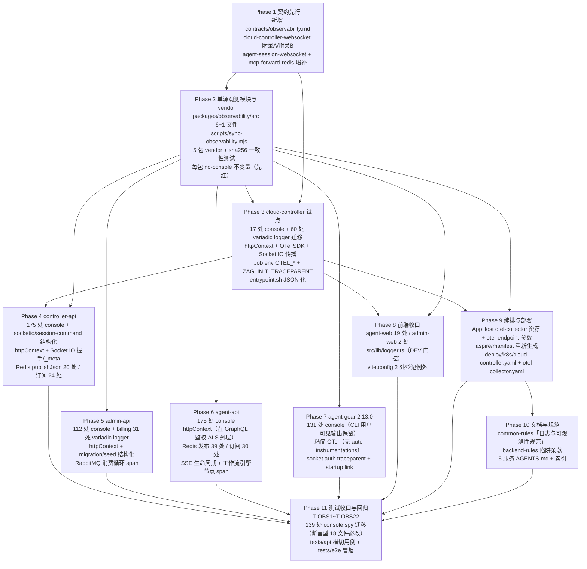
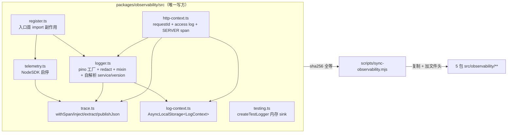

# 规范化日志与全链路可观测性 - 实现计划

**关联 Proposal**: `docs/engineering/proposals/20261030-feat-unified-logging-and-otel.md`（v1.0）
**关联 PRD**: `docs/product/draft/20261030-unified-logging-and-otel.md`（v1.0）
**需求总分支（feat-branch）**: `feat/unified-logging-otel`（基于 `main@375d070e`，需求总 PR [#378](https://github.com/Deliay/z-agent-gear/pull/378)）
**计划提交分支**: `feat/unified-logging-otel`（本文件随需求总分支提交）
**创建日期**: 2026-10-30
**计划版本**: v1.1

**版本说明**：

- v1.1（2026-10-30）复核校正（需求推进至代码实现节点后的方案再走查）：① agent-gear 版本目标 **2.12.0 → 2.13.0** —— `main` 已发布 2.12.0（`526916f9`，同步引入 `MIN_HARNESS_WORKER_VERSION=2.12.0` 门禁与 Dockerfile 预装 pin `agent-gear@2.12.x`），版本号顺延（本计划 R4「不提升门禁」口径不变）；② worker Dockerfile 预装 pin 随发布版本对齐（`2.12.x → 2.13.x`，仓库惯例）补入 Phase 7 任务表（容器内自更新 `npm install -g agent-gear` 语义不变，pin 仅决定预装基线）；③ 登记基线漂移：`main` 在 `375d070e` 之后新增 console 调用（agent-api +5、agent-gear +1，`src` 内合计 631 → 636），Phase 2 红灯清单与验收计数以合并 `main` 后实测为准。其余结论与 v1.0 一致。
- v1.0（2026-10-30）首版。对应 PRD v1.0 / 提案 v1.0（审核通过、无附加修改意见）。§3 计划期裁决以**当前需求总分支代码事实**为准（2026-10-30，`b5178e37`）：重点校正 ① `console.*` 调用点实测 **636** 处（提案 663）；② cloud-controller / admin-api billing 存在 **91 处 variadic 结构 logger 调用**（`(msg, err)` 形态），提案只提到 17 处 console，若直接注入 pino 会**静默丢弃错误对象**（F3/F5）；③ 既有测试的 `spyOn(console)` 实测 **139 处 / 59 个文件**，其中 **18 个文件为断言型**（提案 §8.4 只列 7 个，F6）；④ 提案称 `contracts/agent-session-websocket.md` 「已约定 `_meta.traceparent` 保留」——**不成立**（F7）；⑤ `scripts/` 目录在仓库中**不存在**（F8）；⑥ 新增「服务名/版本由 `package.json` 自解析，实现零 per-package 定制」的 vendor 口径（D2）。

## 1. 实现顺序



依赖说明：

- **Phase 1 契约**是唯一裁决面，独立提交（`docs(contracts): ...`）；契约未合入前不开始任何实现 Phase。理由：`_meta` 保留声明、Job env 变量名、日志字段字典三者会被 5 个运行时与测试同时消费。
- **Phase 2 单源模块**是全部实现的地基，只有它合入后各服务才可并行；`no-console.test.ts` 在 Phase 2 落地时**先红**（此时各包仍满屏 console），由 Phase 3-8 逐个转绿——这是本计划的「示踪子弹」。
- **Phase 3（cloud-controller）**选为试点的三个理由：① console 最少（17 处），② 唯一已具备 `LOG_LEVEL` 与 logger 抽象的运行时（改造面最完整、最能暴露设计问题），③ 它是 Job env 的唯一注入点，云电脑覆盖（PRD 功能点 4）必须先在这里打通。Phase 3 完成后即可验收「一条链路进入容器」。
- **Phase 4/5/6** 三个服务互不依赖，可并行（z-coding「编写实现并行 subagent」）；都只依赖 Phase 2。
- **Phase 7（agent-gear）** 依赖 Phase 3 定稿的 Job env 契约（`ZAG_INIT_TRACEPARENT` 的 span 名与 link 语义）。
- **Phase 8（前端）** 与后端零耦合，可与 Phase 4-7 并行。
- **Phase 9（编排）** 依赖 Phase 3 的 env 名称定稿与 Phase 2 的 vendor 落地（compose 需要把 `OTEL_*` 注入到 5 个资源）。
- **Phase 10（文档）** 依赖 P9（编排口径定稿后再写运维章节）。
- **Phase 11** 在各实现合并回主实现分支后收口。

### 1.1 开发分支与合并顺序

| 分支 | 范围 | 基于 | 合并目标 |
|------|------|------|---------|
| `feat/unified-logging-otel` | PRD / 提案 / 本计划（需求总分支） | `main@375d070e` | 需求总 PR #378 |
| `feat/unified-logging-otel-impl` | 契约 + 全部实现 + 测试（主实现分支） | 需求总分支 | 需求总分支（评审通过后随需求总 PR 入 `main`） |
| `impl/obs-<phase>`（可选） | 单 Phase 并行开发分支 | `feat/unified-logging-otel-impl` | `feat/unified-logging-otel-impl` |

- 主实现分支内按 Phase 顺序分提交：`docs(contracts)` → `feat(observability)`（单源模块 + vendor + 守卫）→ `feat(cloud-controller)` → `feat(controller-api)` → `feat(admin-api)` → `feat(agent-api)` → `feat(agent-gear)` → `feat(agent-web)`/`feat(admin-web)` → `feat(aspire)`/`feat(deploy)` → `docs(rules)` → `test:`。
- **禁止 rebase/squash，只允许 merge**（z-git 规范）。合并顺序：**契约 → observability → cloud-controller → 其余服务 → apps → aspire/deploy → docs → tests**。
- Phase 2 的 vendor 一致性测试会在任一 vendor 文件与单源不一致时失败；**修改共享模块必须走「改 `packages/observability/src` → 跑 `node scripts/sync-observability.mjs` → 提交全部副本」**，不得改副本。

### 1.2 开发模式与规范加载

- 全部 Phase 采用 TDD（红-绿-重构）：先写测试（RED）→ 最小实现（GREEN）→ 重构。Phase 2 先落 `no-console.test.ts`（此时全仓 631 处命中 → 红），再逐个服务转绿。
- 编码前加载：`docs/engineering/common-rules.md`（每次）、`docs/engineering/backend-rules.md`（后端 Phase）、`docs/engineering/frontend-rules.md`（Phase 8）、`docs/engineering/plan/AGENTS.md`。
- 目录级 `AGENTS.md`：`servers/agent-api/AGENTS.md`、`servers/controller-api/AGENTS.md`、`servers/cloud-controller/AGENTS.md`、`packages/agent-controller/AGENTS.md`、`apps/agent-web/AGENTS.md`、`apps/admin-web/AGENTS.md`、`aspire/AgentGear.AppHost/AGENTS.md`、`tests/api/AGENTS.md`、`tests/e2e/AGENTS.md`。
  - `servers/admin-api` **无独立 `AGENTS.md`**，沿用根 `AGENTS.md` + engineering 规范（本期需在 Phase 10 为其补一节，见 §8 E）。
  - `deploy/` 与新建的 `packages/observability`、`scripts/` **无 `AGENTS.md`**，本期一并补最小说明（见 §8 E）。
- **写方纪律**：`packages/observability/src/**` 是唯一写方，5 个运行时的 `src/observability/**` 为生成物（文件头 `GENERATED FROM ... — DO NOT EDIT`）。
- **调用签名纪律**：本期统一到 pino 原生签名 `logger.<level>(objOrMsg, msg?)`，**不引入 variadic 兼容层**（裁决 D1）。新增代码禁止 `logger.info('a' + b)` 式拼接。

## 2. 命令参考

```bash
# 单源模块 → 各包 vendor（唯一合法同步方式）
node scripts/sync-observability.mjs
node scripts/sync-observability.mjs --check   # 只校验不写入（CI / 一致性测试复用）

# 单服务单测 / 构建
cd servers/cloud-controller && npm ci && npm test && npm run build
cd servers/controller-api   && npm ci && npm test && npm run build
cd servers/admin-api        && npm ci && npm test && npm run build
cd servers/agent-api        && npm ci && npm test && npm run build
cd packages/agent-controller && npm ci && npm test && npm run build
cd apps/agent-web  && npm ci && npm test && npm run lint && npm run build
cd apps/admin-web  && npm ci && npm test && npm run lint && npm run build

# 全仓不变量扫描（人工复核用，与 no-console.test.ts 同口径）
grep -rnE "console\.(log|error|warn|info|debug|trace)\(" \
  servers/*/src packages/agent-controller/src --include=*.ts | wc -l   # 收口后应为 0

# 服务编排（根目录；测试服务只用 Aspire，禁止直接 docker 命令）
aspire start
aspire describe cloud-controller
aspire stop

# 本地验证日志与链路（collector debug exporter 直接打 stdout）
docker compose -f aspire/manifest/docker-compose.yaml logs -f otel-collector
LOG_LEVEL=debug LOG_PRETTY=1 aspire start          # 开发环境人类可读输出
OTEL_SDK_DISABLED=true aspire start                # 只验证日志形态、零外发

# 跨服务 API 测试（先 aspire start；地址按 aspire describe 替换）
cd tests/api
API_URL=http://localhost:10001/graphql \
ADMIN_API_URL=http://localhost:10003/graphql \
CONTROLLER_API_URL=http://localhost:<controller-api-port> \
CLOUD_CONTROLLER_URL=http://localhost:10004 \
INTERNAL_API_TOKEN=<与 internal-api-token 一致> \
MONGODB_URI=<aspire describe mongodb；自签 dev cert 追加 tlsAllowInvalidCertificates=true> \
npm test

# E2E（串行，workers=1 已写死；地址按 aspire describe 替换）
cd tests/e2e
BASE_URL=http://localhost:<agent-web-port> \
ADMIN_WEB_URL=http://localhost:<admin-web-port> \
API_URL=http://localhost:10001/graphql \
ADMIN_API_URL=http://localhost:10003/graphql \
INTERNAL_API_TOKEN=<与 internal-api-token 一致> \
MONGODB_URI=<aspire describe mongodb> \
npx playwright test

# entrypoint 脚本测试（JSON 可解析 + 退出码语义）
bash deploy/images/worker/entrypoint.test.sh
```

## 3. 计划期裁决（提案与代码事实偏差的落地口径）

> 以下裁决以**当前需求总分支代码事实**为准（`b5178e37`）。提案中与之不一致或含混的描述在实现期按本节执行，**不回改提案**；验收报告逐条登记（§8 F 记录了核对命令与输出）。

### 3.1 事实校正（提案描述与代码事实的偏差）

| # | 提案描述 | 代码事实 | 本计划口径 |
|---|---------|----------|-----------|
| F1 | §1.1 「直出打印量：admin-api 138、agent-api 179、controller-api 177、cloud-controller 17、agent-gear 131、agent-web 19、admin-web 2」；§1.2「663 处」 | 实测 `console\.(log\|error\|warn\|info\|debug\|trace)\(`：**admin-api 112、agent-api 175、controller-api 175、cloud-controller 17、agent-gear 131、agent-web 19、admin-web 2 = 631**（`src/**` 内）；另有 **5 处**在 `src` 外：`packages/agent-controller/tests/manual/repro-question-tool.ts` 3 处、`apps/agent-web/vite.config.ts` 1 处、`apps/admin-web/vite.config.ts` 1 处 → **合计 636** | 工作量与验收判据按实测 636 计；**`src` 内 631 处必须归零**（no-console 守卫硬门禁）；`src` 外 5 处：3 处手工调试脚本保留并登记例外（不属运行时代码），2 处 `vite.config.ts` 构建期提示保留并登记例外（前端不适用守卫，见 F8/D7） |
| F2 | §5.2.10 未给级别分布 | 级别分布实测：**`console.log` 250 / `console.error` 219 / `console.warn` 164 / `console.info` 3 / `debug`>` 0 / `trace` 0** | 迁移映射固定为：`log`→`info`（生命周期/结果）或 `debug`（高频细节，见 §4.3 判定表）；`error`→`error`（错误对象一律进 `err` 字段）；`warn`→`warn`；`info`→`info`。**级别不得随手升级**（把 `log` 全升 `info` 会让 debug 级别失去收敛能力） |
| F3 | §1.1 「仅 `servers/cloud-controller/src/logger.ts`（`LOG_LEVEL` + console sink，52 行）」+ §5.2.10「cloud-controller 17 处就地替换；删除 `src/logger.ts`」 | 除 17 处 `console.*` 外，cloud-controller 另有 **60 处 `this.logger.<level>?.(msg, err)` variadic 调用**（8 个文件：`index.ts` 8、`socketio-gateway.ts` 14、`status-sync.ts` 11、`container-service.ts` 8、`socket-diagnostics.ts` 7、`workload-dispatcher.ts` 7、`billing-event-publisher.ts` 5，另 `config/index.ts` 仅 import 类型）。`createLogger(level, sink)` 是**阈值过滤 + 透传 variadic** 工厂，`Logger.foo(...args: unknown[])`。pino 的 `logger.warn('msg', err)` 会把 `err` 当作插值参数**静默丢弃** | **必须同批迁移这 60 处**：签名改为 pino 原生 `logger.<level>({ ...fields, ...(err ? { err } : {}) }, 'msg')`；`Logger`/`LoggerSink` 接口删除，统一为 `ObservabilityLogger = Pick<PinoLogger,'debug'\|'info'\|'warn'\|'error'>`；`createLogger` 与 `parseLogLevel` 从 `servers/cloud-controller/src/logger.ts` 移入共享模块（`parseLogLevel` 语义保持：非法值回落 `info`，`config.logLevel` 类型沿用）。**只替换 console 会让错误对象在 cloud-controller 全量丢失**，这是本计划最高优先级的返工点 |
| F4 | §2.3 模块表 + §5.2.2 「`Logger` 结构化接口不变」（针对 admin-api billing） | `Logger` 结构接口在 **5 处**重复声明（`cloud-controller/src/logger.ts:11`、`socketio-gateway.ts:35`、`container-service.ts:51`、`workload-dispatcher.ts:17`、`status-sync.ts:8`）+ agent-api `cloud-host-workload-service.ts:32`；另有 `MqLogger`（admin-api `billing/mq/connection.ts:3`）与 `LoggerSink`。`console` 作为默认 logger 注入共 **18 处**：admin-api 11（`index.ts:210,221`、`billing/mq/{publisher:52,runtime:39,consumers:180,255,connection:19}`、`billing/{scheduler:22,settlement-tick:36,reconciliation:75}`、`routes/billing-openai.ts:323`）、agent-api 1（`cloud-host-workload-service.ts:110`）、cloud-controller 6（`logger.ts:40`、`index.ts:59`、`socketio-gateway.ts:177`、`container-service.ts:184`、`billing-event-publisher.ts:269,399`） | 18 处默认值全部替换为真实 logger（`logger.child({ component })`）；6 处重复接口删除，改为 `ObservationLogger` 单一导出类型；`MqLogger` 保留名字（外部注入面）但类型改为 pino 子集。**测试中已有注入 fake logger 的调用面保持可用**（fake 只需实现 4 个方法） |
| F5 | §5.2.10「billing 的 `logger: console` 注入改为真实 logger（保留 `Logger` 结构化接口不变）」 | admin-api billing 的 `MqLogger` 调用面 **31 处 / 7 文件**（`reconciliation.ts` 8、`mq/consumers.ts` 8、`mq/publisher.ts` 4、`mq/runtime.ts` 4、`settlement-tick.ts` 4、`scheduler.ts` 2、`mq/connection.ts` 1），全部 variadic `(msg, err)` 形态 | 与 F3 同口径：**签名改 pino 原生**，`MqLogger` 类型改为 `Pick<PinoLogger,'debug'\|'info'\|'warn'\|'error'>`。不保留「结构接口不变 + 内部适配」的双口径，避免长期并存两套调用形态 |
| F6 | §8.4「需要同步修改的既有测试（已知清单）」列 7 个文件 | `vi.spyOn(console, ...)` 实测 **139 处 / 59 个测试文件**（其中 admin-api 迁移测试占 18 个）。分两类：**断言型（捕获 console 输出做 expect）18 个文件**：`controller-api/{acp-session-manager,socketio,session-command,harness-login-manager,permission-manager,git-browser,elicitation-manager}.test.ts`、`agent-api/{workflow/instance,session,elicitation-subscriber,tenant-self-check,workflow/pr-event-handler,workflow/pr-handler-registry}.test.ts`、`admin-api/services/auth.test.ts`、`agent-gear/{tests/socketio-client,tests/acp-bridge,tests/acp-spawner,src/gateway,src/acp/bridge}.test.ts`；**静音型（仅 `mockImplementation(()=>{})` 不 assert）约 41 个文件**，集中在 `admin-api/src/migrations/*.test.ts` | **断言型 18 个文件必须迁移**到 `createTestLogger()` 的 `records`（断言结构化字段而非拼接字符串）；**静音型可保留**（`console` 不再被调用后 spy 自然空转，不触发 no-console 守卫），但**推荐**在同一次改动中清理（避免留下误导性 spy）。迁移后**不得降低断言强度**：原断言 `stringContaining('Controller not found')` 改为断言 `msg`/`component` 字段 |
| F7 | §3.2.4「`contracts/agent-session-websocket.md` 已约定 `_meta.traceparent/tracestate/baggage` 保留给 W3C Trace Context」 | `contracts/` 全目录 grep `_meta\|traceparent` 只命中 `agent-session-websocket.md:193`，且该处 `_meta` 是 **ACP 协议自身字段**（说明 raw 快照 16 KiB 上限），与 W3C 无关；`cloud-controller-websocket.md` 无 `_meta` 字样 | 提案「已约定」**不成立**。Phase 1 在 `contracts/observability.md` 与 `agent-session-websocket.md` **新增**「`_meta` 字段为 W3C Trace Context 保留位，本期**不写入** ACP payload」的显式声明（与决策 D12 一致）；`cloud-controller-websocket.md` 新增「worker 事件 `_meta.traceparent` 可选」附录 |
| F8 | §5.2.1「脚本 `scripts/sync-observability.mjs`」；§7 项目结构含 `scripts/` | 仓库**没有** `scripts/` 顶层目录（`ls: cannot access 'scripts/'`）；**没有根 `package.json` / workspace**（每个包独立 `package-lock.json`）；`.github/workflows/publish-agent-gear.yml` 的 paths 仅 `packages/agent-controller/**` | 新建 `scripts/` 顶层目录；`packages/observability/` **不提供 `package.json`**（避免被误当可安装包/触发发布），只含 `README.md` + `src/`；同步脚本用纯 Node ESM（`.mjs`，无第三方依赖）。已核对：新增目录不会触发任何 workflow（publish 的 paths 已限定） |
| F9 | §5.2.2/§5.2.4 示例中 `SERVICE_VERSION`、`./index-logger.js` 未说明来源 | 两类构建形态并存：**admin-api / cloud-controller** 走 `tsc`→`dist`（`node dist/index.js`，`rootDir: src`、`outDir: dist`）；**agent-api / controller-api** 镜像内直接 `node src/index.ts` + 编排注入 `NODE_OPTIONS=--import tsx`（`servers/agent-api/Dockerfile:17`、`servers/controller-api/Dockerfile:17`）。五个包 `tsconfig` 均 `resolveJsonModule: true` 但 `rootDir: ./src`，`import '../../package.json'` 会因超出 `rootDir` 编译失败 | **服务名与版本统一由 `createRequire(import.meta.url)('../../package.json')` 解析**：`src/observability/logger.ts` 与 `dist/observability/logger.js` 的 `../../` 均指向包根（层级一致，已核对）。`service = OTEL_SERVICE_NAME ?? pkg.name`（五个包名恰为 `admin-api`/`agent-api`/`controller-api`/`cloud-controller`/`agent-gear`，与提案字段表完全一致），`serviceVersion = pkg.version`。**因此不需要 per-package `index-logger.ts`**（裁决 D2） |
| F10 | §5.2.6「`agent-api/src/index.ts:57` 挂 httpContext（事件回调与 webhook 路由之前）」 | agent-api 已有请求级 ALS：`services/workspace-context.ts` 的 `runWithRequestAuth` 包裹整条 `/graphql` 链路（`src/index.ts:101-130`）；webhook/事件回调路由（`src/index.ts:63-64`）**必须在 `express.json()` 之前**挂载（原文验签） | `httpContext` 挂在 `src/index.ts:59` 的 `app.use(cors(...))` **之后**、`:63` 的 `eventCallbackRouter` **之前**；**只读 header，不读 body**（不影响验签）。日志上下文**新建独立 ALS**，不复用 `workspace-context.ts`（避免为日志改动鉴权/工作区语义，与提案 §5.2.3 一致），层级为 `httpContext(ALS) → runWithRequestAuth(既有 ALS)` |
| F11 | §5.2.5「高频路径禁令」仅列概念 | 实测高频通道：`session:message` 由 `controller-api/services/acp-persistence.ts:61` 与 `agent-api/services/session.ts:778` **逐条**发布；Redis 发布点 agent-api **39** 处 / controller-api **20** 处、订阅/监听 agent-api **30** 处 / controller-api **24** 处；cloud-controller 与 admin-api 的 `.publish(` 是 **RabbitMQ**（两包均无 `ioredis` 依赖），走 amqplib 自动埋点，**不适用 `_meta` 封套** | 高频路径禁令落成可执行规则：`session:message` / ACP `agent_message_chunk` / 工作负载日志轮询 / 心跳与 watch **不开逐条 span**；在「连接生命周期」「批次」「订阅回调入口」开一个 span 并用属性记录条数（`messaging.batch.message_count`）。`publishJson` 封套**只改 agent-api 39 处 + controller-api 20 处**（RabbitMQ 3 处 admin-api + 2 处 cloud-controller **不改**） |
| F12 | §3.2.5「`ContainerService.buildHarnessJobEnv()` 新增…`zag.container.id=…`」 | `buildHarnessJobEnv(options: StartHarnessOptions)`（`container-service.ts:408-429`）**只收 `options`**，其中**没有** `containerId`；`containerId` 是 `start()` 内部 `repo.create()` 返回的 `created.id`（`:362` 调用点）。`StartHarnessOptions` **已含** `tenantId`（`:148`）与 `workspaceId`（`:150`，多租户二期新增） | `buildHarnessJobEnv(options, containerId, traceparent)` **新增两个入参**（`containerId`、`traceparent`）；`OTEL_RESOURCE_ATTRIBUTES` 追加 `zag.workspace.id`（提案漏列，多租户二期已有该维度）。`jobName` 由 `randomSuffix(6)` 生成、与 `containerId` 不同，**不得**用 jobName 冒充容器标识 |

### 3.2 设计裁决（提案未定或含混处的定稿）

| # | 议题 | 裁决 | 理由 / 影响面 |
|---|------|------|--------------|
| D1 | 日志调用签名 | **统一 pino 原生签名，不引入 variadic 兼容层** | 兼容层会让「字符串拼接 + 错误对象作第二参」长期存活（F3/F5 的 91 处就是历史产物）。一次性机械迁移的收益：grep 可判定、err 永不丢、字段口径唯一。代价：cloud-controller 60 处 + admin-api billing 31 处 + 18 处默认注入需在同一 Phase 内改完（Phase 3 / Phase 5） |
| D2 | vendor 文件清单与服务身份 | vendor **7 个文件**：`logger.ts`、`log-context.ts`、`trace.ts`、`telemetry.ts`、`register.ts`、`http-context.ts`、`testing.ts`。服务名/版本**由 `package.json` 自解析**（F9），因此 7 个文件**逐字节相同**，无需 per-package 定制 | 若保留 per-package `index-logger.ts`，一致性测试要维护「哪些文件必须一致、哪些允许差异」两套规则；自解析后规则收敛为「7 文件全等」 |
| D3 | `register.ts` 是否 `import 'dotenv/config'` | **不加**。dotenv 由各包 `config/index.ts` 首行调用（4 个服务均已有 `dotenv` 依赖与 `dotenv.config()`），`register.ts` 只依赖 `process.env`（编排已注入） | 加 `dotenv/config` 会与 `config/index.ts` 的 `dotenv.config()` 形成两次加载；且 agent-gear 无 `dotenv` 依赖（会直接崩）。`register.ts` 必须对 5 个包同时可用 |
| D4 | pretty 输出实现 | `LOG_PRETTY=1` **且 `NODE_ENV !== 'production'`** 时用 `pino.transport({ target: 'pino-pretty' })`（worker 线程，仅开发）；**production 无条件 JSON + 忽略该值并 `warn` 一次**；`pino-pretty` 只在 `devDependencies`，动态 `require` 失败时降级为 JSON 并 warn | 生产镜像 `admin-api` 用 `npm ci --omit=dev`（不含 `pino-pretty`），必须能安全降级；生产环境禁用 transport 才能保证同步写 fd1（提案 D3） |
| D5 | `x-request-id` 归一化规则 | 入站合法则沿用，非法/缺失生成 UUID v4；合法性 = `/^[A-Za-z0-9._:-]{8,128}$/`；**非法时在日志中标注 `requestIdReplaced: true`**（不静默替换） | PRD 3.5「客户端自带请求标识异常需标注已替换」的落地点；避免日志注入（控制字符）与串号 |
| D6 | entrypoint JSON 实现方式 | 纯 `printf` + `sed` 转义（**不引 `jq`/`python`**），字段与 pino 对齐：`level/time/service/serviceVersion/env/hostname/pid/component/msg`；`service` 固定 `zag-worker`，`serviceVersion` 取 `ZAG_WORKER_VERSION`（缺省 `unknown`） | 镜像瘦身要求（PRD 5.2）+ 不新增依赖；`entrypoint.test.sh` 已存在，追加「每行可 `JSON.parse`」断言 |
| D7 | no-console 守卫范围 | 仅 **5 个运行时包**的 `src/**/*.ts`（**含测试文件**，因为测试里的 `console.*` 调用同样是回潮源；但 `vi.spyOn(console,'log')` 不匹配守卫正则，故静音型 spy 不违规）；前端包与 `deploy/`、`scripts/`、`tests/` **不适用**；例外用行内 `// no-console-allow: <原因>` 白名单，守卫输出白名单条目统计 | 浏览器 console 语义不同（提案 §5.2.11/D14）；测试目录的 console 不进入运行时图。守卫正则为 `/console\.(log|error|warn|info|debug|trace)\(/` |
| D8 | `httpContext` 是否产生访问日志的降噪规则 | `/health` 与 K8s 探针路径以 `debug` 记录（默认 info 级别不可见，排障可放大）；其余请求 `info`；**`/api/session-stream`（SSE）只在连接建立与断开各记一条**，不按事件记 | 探针刷屏是日志成本最大来源；SSE 是长连接，按事件记会放大百倍 |
| D9 | 采样式与时序口径 | 采样器 `parentbased_traceidratio`，`OTEL_TRACES_SAMPLER_ARG` 默认 `1.0`；**日志与采样解耦**：被采样丢弃的请求仍输出完整日志，仅无 `trace_id` 字段 | PRD 3.5「链路采样丢弃了某次请求 → 日志仍完整输出」 |
| D10 | Metrics 默认 | 仅在配置了 `OTEL_EXPORTER_OTLP_ENDPOINT` **且** `OTEL_METRICS_ENABLED !== 'false'` 时启用 `PeriodicExportingMetricReader`（间隔 60s）；否则完全不注册 | 提案 §2.2「默认随追踪一起启用」+ §1.3「不建业务指标」；关闭能力必须存在（部署方只想要 trace 时省带宽） |
| D11 | 契约文件命名 | 新增 `contracts/observability.md`（日志字段字典 + env 契约 + 传播规则 + 脱敏名单 + 审计例外）；通道契约就地增补附录，**不新建**第二份 observability 契约 | 与既有 `contracts/*.md` 风格一致（`cloud-controller-websocket.md` 已有「附录 A」先例） |

## 4. 子项目任务分解

### 4.1 Phase 1 契约先行

**目标**：把「字段字典 / env 名 / 传播位」一次定死，后续 5 个运行时与测试全部对齐同一份契约。

| 路径 | 动作 | 要点 |
|------|------|------|
| `contracts/observability.md` | **新增** | ① 日志记录契约（§3.2.1 字段表逐行落成表格，含类型/必填/示例）；② 环境变量契约（13 个 `LOG_*`/`OTEL_*` 变量、默认值、非法值行为）；③ 传播规则（HTTP `traceparent`、Socket.IO 握手 `auth.traceparent` 与事件 `_meta.traceparent`、Redis 封套 `_meta.traceparent`、Job env `ZAG_INIT_TRACEPARENT`）；④ 脱敏名单（`REDACT_PATHS` 全量）与**唯一审计例外**（`bootstrapAdminPassword`）；⑤ 采样与降级语义（未配置 endpoint = 完全关闭、导出超时 5s 丢弃、父采样跟随） |
| `contracts/cloud-controller-websocket.md` | 修改 | **附录 A**（内部管理 HTTP API）不变；**新增附录 B：worker 事件 `_meta` 可选字段** —— `workload:run`/`workload:result`/`shutdown`/`registered`/`unregistered` 报文允许顶层 `_meta: { traceparent?: string }`，旧 worker 忽略未知字段；**新增 Job env 表**（`OTEL_*` 6 项 + `ZAG_INIT_TRACEPARENT`），标注「未配置采集端时仅注入 `OTEL_SDK_DISABLED=true`」 |
| `contracts/agent-session-websocket.md` | 修改 | 新增「`_meta` 为 W3C Trace Context 保留位，**本期不写入** ACP payload」一句（F7 校正）；握手 `auth.traceparent` 可选（controller-api `/` namespace） |
| `contracts/mcp-forward-redis.md` | 修改 | 新增「平台 Redis 频道报文允许顶层 `_meta: { traceparent?: string }`，消费者必须容忍缺失」；列明受影响频道清单（`session:command`、`session:message`、`session:status`、`permission:*`、`elicitation:*`、`harness:login:*`、`mcp:*`、`pr:check-run`） |

**完成判据**：4 份契约可独立评审；`contracts/observability.md` 的字段表与 §8 A 完全一致；不新增/删除任何 GraphQL 字段。

### 4.2 Phase 2 单源观测模块与 vendor

**目标**：建立「单源 + 全等副本 + 双护栏（一致性 / 防回潮）」的底座，并让 `no-console` 守卫先红。



| 路径 | 动作 | 要点 |
|------|------|------|
| `packages/observability/README.md` | **新增** | 字段字典索引、vendor 流程、**禁止直接改副本**、如何新增一个共享能力（改单源 → 跑脚本 → 提交 5 副本） |
| `packages/observability/src/logger.ts` | **新增** | `REDACT_PATHS`（提案 §5.2.2 全量 + `*.authorization` 一层嵌套）、`parseLogLevel`（非法回落 `info`）、`createLogger({ destination?, component?, pretty? })`、导出单例 `logger` 与 `ObservationLogger` 类型；`timestamp: pino.stdTimeFunctions.isoTime`、`messageKey: 'msg'`、`formatters.level → 字符串`、`serializers.err → pino.stdSerializers.err`、`mixin()` 合并 `readContext()` + `currentTraceIds()`；**同步写 fd1**（`pino.destination({ dest: 1, sync: true })`），生产不用 transport（D4） |
| `packages/observability/src/log-context.ts` | **新增** | `LogContext` 字段：`requestId/userId/tenantId/workspaceId/sessionId/controllerId/cloudHostId/containerId/workflowInstanceId/nodeId`；`runWithLogContext`（合并而非覆盖）、`readContext`（空对象兜底） |
| `packages/observability/src/trace.ts` | **新增** | `withSpan(name, attrs, fn, opts?)`（支持 `links`）、`injectTraceparent(carrier?)`、`extractTraceparent(carrier)`、`currentTraceIds()`、`publishJson(publish, channel, payload)`（注入 `_meta.traceparent`，**不 import ioredis**，以 `(channel, body) => Promise<number>` 回调注入） |
| `packages/observability/src/telemetry.ts` | **新增** | `startTelemetry()`：`OTEL_SDK_DISABLED=true` 或 endpoint 为空 → 立即 return（**不注册 exporter、不开线程**）；`NodeSDK` + `resourceFromAttributes`（service.name/version、deployment.environment、host.name）+ 采样器 + OTLP/HTTP exporter + 可选 metrics reader（D10）；`shutdownTelemetry()` 幂等 + 2s 上限；`SIGTERM/SIGINT` 注册 |
| `packages/observability/src/register.ts` | **新增** | 副作用：`startTelemetry()` → `uncaughtException`（`logger.fatal` 后 `exit(1)`）/`unhandledRejection`（`logger.error`）；**不加 dotenv**（D3）；幂等（`started` 标记） |
| `packages/observability/src/http-context.ts` | **新增** | `httpContext()` 中间件：`normalizeRequestId`（D5）、`extractTraceparent`、`withSpan('METHOD route')`、`runWithLogContext({ requestId })`、`res.on('finish')` 记 `status`/`durationMs`、`/health` 降噪（D8）、**不读 body** |
| `packages/observability/src/testing.ts` | **新增** | `createTestLogger(component?)` → `{ logger, records, reset() }`，`records` 为逐行 `JSON.parse` 后的对象数组（内存 sink） |
| `scripts/sync-observability.mjs` | **新增** | 源→5 目标（`servers/{admin,agent,controller,cloud-controller}/src/observability`、`packages/agent-controller/src/observability`）；写文件头 `// GENERATED FROM packages/observability/src/<file> — DO NOT EDIT`；`--check` 模式只校验退出码；无第三方依赖 |
| 5 个包的 `src/observability/*.ts` | **新增（生成物）** | 由脚本生成，禁止手改 |
| 5 个包的 `src/observability/no-console.test.ts` | **新增** | 递归扫描本包 `src/**/*.ts`；命中 `/console\.(log\|error\|warn\|info\|debug\|trace)\(/` 即失败并输出 `文件:行号` + 正确写法；支持 `// no-console-allow: <原因>` 行内白名单并输出白名单统计；**先红**（Phase 3-8 逐个转绿） |
| 5 个包的 `package.json` | 修改 | 新增 `pino`（dependencies）；`pino-pretty`（devDependencies，仅服务端 4 包）；服务端 4 包新增 `@opentelemetry/{api,sdk-node,resources,semantic-conventions,exporter-trace-otlp-http,exporter-metrics-otlp-http,sdk-metrics,auto-instrumentations-node}`；agent-gear 只加 `pino` + `@opentelemetry/{api,sdk-trace-node,exporter-trace-otlp-http,resources,semantic-conventions}` |
| `tests/api/src/observability/vendor-consistency.test.ts` | **新增** | 逐文件 sha256 与单源比对；不一致时打印 `node scripts/sync-observability.mjs`；同时断言文件头 `DO NOT EDIT` |

**实现要点**：

- `mixin()` 是唯一注入点：业务代码**不手工传** `requestId`/`trace_id`；`component` 通过 `logger.child({ component })` 设置。
- `trace.ts` 只用 `@opentelemetry/api`：无 SDK 时 `withSpan` 退化为直接调用 `fn`（API 默认 NoopTracer），保证「未配置采集端 = 零开销」。
- `publishJson` 的签名固定为 `publishJson((channel, body) => redis.publish(channel, body), channel, payload)`，避免共享模块依赖具体 Redis 客户端实现。
- `testing.ts` 虽是生成物但**不被运行时入口引用**（只被测试引用），编译进 `dist` 无副作用。

**TDD 用例**：T-OBS1（记录 schema）、T-OBS2（级别过滤/非法回落）、T-OBS3（脱敏）、T-OBS3b（审计例外边界）、T-OBS4（错误序列化/循环引用）、T-OBS5（mixin + child + 无上下文）、T-OBS6（pretty 开关：生产仍 JSON）、T-OBS7（no-console 守卫自测：故意留一处 `console.log` 必须失败）、T-OBS8（vendor 一致性）、T-OBS9（traceparent 编解码）、T-OBS10（SDK 关闭态零外发）、T-OBS11（SDK 启动/关闭幂等）、T-OBS12（httpContext）、T-OBS21（`sync --check` 幂等：重复运行无 diff）、T-OBS22（`publishJson` 注入与容错缺失 `_meta`）。

**完成判据**：`node scripts/sync-observability.mjs --check` 通过；`tests/api` 的 vendor 一致性用例通过；5 包 `npm test` 中仅有 `no-console` 用例红（预期）。

### 4.3 Phase 3 cloud-controller 试点（含云电脑 Job 与 entrypoint）

**目标**：在 console 最少的运行时上打通「结构化日志 + 全链路 + 进容器」，形成可复制的改造样板。

| 路径 | 动作 | 要点 |
|------|------|------|
| `src/logger.ts` | **删除** | `createLogger`/`parseLogLevel`/`LogLevel`/`Logger`/`LoggerSink`/`DEFAULT_LOG_LEVEL` 迁入共享模块；`config/index.ts` 的 `import { parseLogLevel, type LogLevel } from '../logger.js'` 改为从 `./observability/logger.js` 导入 |
| `src/index.ts` | 修改 | 首行 `import './observability/register.js'`；`app.use(httpContext())` 紧随 `cors()`；`createCloudControllerApp(deps)` 的 `logger` 默认值 `= console` 删除（改为必填注入）；8 处 logger 调用改 pino 签名 |
| `src/services/socketio-gateway.ts` | 修改 | 删除 `interface Logger`（:35）；`deps.logger ?? console` → `deps.logger`（必填）；14 处 logger 调用改签名（`[worker] handshake attempt id=…` → `logger.info({ event:'handshake', socketId, namespace, transport, from, tokenPresent }, 'handshake attempt')`）；握手 middleware 读取 `socket.handshake.auth?.traceparent` → `withSpan('socket.handshake', attrs, ...)` 并把 `containerId` 写入上下文；`register` 成功后 `runWithLogContext({ containerId })`；`emitToContainer()` 统一注入 `_meta.traceparent`（覆盖 `:195`、`:248`）；`socket.emit('registered'|'error'|'unregistered')` 同样带 `_meta` |
| `src/services/container-service.ts` | 修改 | 删除 `interface Logger`（:51）；`buildHarnessJobEnv(options, containerId, traceparent)`（F12）；`start()` 内以 `withSpan('container.start', { 'zag.container.purpose': purpose, 'zag.cloud.host.id': hostId })` 包裹 Job 创建，span 内取 `injectTraceparent()` 传入 env；8 处 logger 调用改签名；未配置 endpoint 时注入 `OTEL_SDK_DISABLED=true` |
| `src/services/status-sync.ts` | 修改 | 删除 `interface Logger`（:8）；11 处改签名；**每轮巡检一个 span**（`status.sync.tick`，属性记 `checked`/`changed` 条数），**不对每个容器开 span** |
| `src/services/workload-dispatcher.ts` | 修改 | 删除 `interface Logger`（:17）；7 处改签名；`workload:run` 批次下发一个 span（属性 `workload.count`） |
| `src/services/socket-diagnostics.ts` | 修改 | 7 处改签名；`[ws]`/`[http]` 前缀改 `component: 'socket-diagnostics'` |
| `src/services/billing-event-publisher.ts` | 修改 | 5 处改签名；`:269`、`:399` 的 `= console` 删除 |
| `src/services/{internal-api,billing-event-publisher}.ts` 等剩余 17 处 console | 修改 | 按 §3.1 F2 映射表替换 |
| `src/migrations/{runner,001,002}.ts` | 修改 | `[Migration NNN]` → `logger.child({ component: 'migration/NNN' })`；console 5+5+2 处替换 |
| `deploy/images/worker/entrypoint.sh` | 修改 | `log()` → 单行 JSON（D6）；保留退出码 42/自更新/stderr 扫描/信号转发语义**逐字节不变** |
| `deploy/images/worker/entrypoint.test.sh` | 修改 | 追加「每行可 `JSON.parse`」「含引号/反斜杠/控制字符仍可解析」「退出码 42/1/0 与信号语义不变」断言 |
| `deploy/images/worker/Dockerfile` | 检查 | 确认无 `jq` 依赖；`ZAG_WORKER_VERSION` 若未定义则不新增构建参数（缺省 `unknown` 可接受） |

**实现要点**：

- **`logger` 注入链**：`createCloudControllerApp()` 构造 `logger`（根）+ 各 service 用 `logger.child({ component })`；测试通过 `createTestLogger()` 注入。
- **Job env 注入顺序**：`buildHarnessJobEnv` 先写业务 env（既有 9 项），再追加 OTEL env；`OTEL_EXPORTER_OTLP_HEADERS` 只经 env 传递，**禁止**出现在任何日志（测试断言 headers 值不出现在 records 中）。
- **禁忌**：`ZAG_INIT_TRACEPARENT` 只在 `container.start` span 存在时注入（SDK 关闭时为空串 → 不注入，避免容器内建出无效 link）。

**TDD 用例**：T-OBS12（httpContext 在本服务生效）、T-OBS13（Socket.IO 握手/emit `_meta`）、T-OBS15（Job env 注入：配置 endpoint → 7 项 env 正确；未配置 → 仅 `OTEL_SDK_DISABLED`；headers 不入日志）、T-OBS16（entrypoint JSON）、T-OBS7（cloud-controller 的 no-console 转绿）、既有 `k8s-job-manager.test.ts` env 断言同步。

**完成判据**：cloud-controller `npm test` 全绿（含 no-console）；`aspire start` 后 `kubectl logs`/`docker compose logs cloud-controller` 每行可 `JSON.parse`；创建一台云电脑后 collector 能看到 `container.start` span 与容器内 `startup` span 的 link 关系（Phase 7 完成后可整链验证，此阶段先验 env 正确注入）。

### 4.4 Phase 4 controller-api

| 路径 | 动作 | 要点 |
|------|------|------|
| `src/index.ts` | 修改 | 首行 `import './observability/register.js'`；`app.use(httpContext())` 紧随 `cors()`（:30 前）；6 处 console 替换 |
| `src/services/session-command.ts` | 修改 | **41 处** console 按事件分组 child logger（`component: 'session-command'`），`console.error('ACP set-model failed: …')` → `logger.error({ err, keyId }, 'ACP set-model failed')`；`session:command` 消费入口开 `messaging` span（**不逐条**：每批/每命令一条，属性 `sessionId`） |
| `src/services/socketio.ts` | 修改 | **35 处** console → `component: 'socketio'`；事件处理器入口 `runWithLogContext({ userId, controllerId, sessionId })` + 每类事件一个 span；`user:${userId}` room 逻辑不变 |
| `src/services/acp-session-manager.ts` | 修改 | 28 处 console；`agent_message_chunk` **禁止逐条 span**（每条消息只 `logger.debug`，采样下不产生 span） |
| `src/services/harness-login-manager.ts` / `elicitation-manager.ts` / `permission-manager.ts` / `mcp-relay.ts` / `git-browser.ts` / `folder-browser.ts` / `gateway-relay.ts` | 修改 | 共约 42 处 console；`mcp:forward:*` 与 `permission:*` 的发布/订阅加封套与 span |
| `src/services/{heartbeat,disconnect-timer}.ts`、`src/routes/**` | 修改 | 剩余 console；心跳扫描**每轮一个 span**，不逐事件 |
| `src/middleware/redis.ts` | 修改 | 发布 helper 接入 `publishJson`；订阅回调 `withSpan('<channel> handle')` |
| `src/services/mcp-proxy-registry.ts` | 修改 | `/mcp-proxy` namespace 握手 `auth.traceparent` 提取（与 cloud-controller 同型） |

**完成判据**：controller-api `npm test` 全绿；`grep console` 为 0；`/api/session-stream` 之外无逐条 span。

### 4.5 Phase 5 admin-api

| 路径 | 动作 | 要点 |
|------|------|------|
| `src/index.ts` | 修改 | 首行 register import；`app.use(httpContext())` 紧随 `cors()`（:61 后）；10 处 console；`:210`/`:221` 的 `logger: console` → `logger.child({ component: 'billing-mq' })` |
| `src/services/auth.ts` | 修改 | **唯一审计例外**：`logger.warn({ bootstrapAdminPassword: password, userId }, '初始管理员密码（仅首次初始化输出一次，请立即修改；审计例外）')`；7 处 console 其余按映射表替换 |
| `src/services/billing/**`（7 文件 31 处） | 修改 | `MqLogger` 类型改 pino 子集；调用全部改原生签名；11 处 `?? console`/`= console` 删除（`index.ts` 2 + `billing/*` 7 + `routes/billing-openai.ts` 1 + `reconciliation.ts` 1） |
| `src/migrations/**`（19 个迁移文件 + `runner.ts`） | 修改 | console 全部替换为 `child({ component: 'migration/NNN' })`；`runner.ts` 5 处 |
| `src/graphql/resolvers/{tenant,cloud-container,cloud-workload}.ts` | 修改 | 9 + 3 + 3 处 console；resolver 内 `runWithLogContext({ userId, tenantId })`（已有上下文则不覆盖） |
| `src/routes/internal-billing.ts` / `billing-openai.ts` | 修改 | 9 + 1 处 console |
| RabbitMQ 消费/发布 | 修改 | amqplib 自动埋点已覆盖；仅补「消费循环每批一个 span」（`messaging.batch.message_count`），不逐消息 |

**完成判据**：admin-api `npm test` 全绿；`auth.test.ts` 改为断言 `records` 中 `bootstrapAdminPassword` 明文可见 + `msg` 含「审计例外」；`grep console` 为 0。

### 4.6 Phase 6 agent-api

| 路径 | 动作 | 要点 |
|------|------|------|
| `src/index.ts` | 修改 | 首行 register import；`httpContext` 挂在 `cors()` 之后、`eventCallbackRouter` **之前**（F10）；14 处 console 替换 |
| `src/services/cloud-host-service.ts` | 修改 | **15 处** console（全仓最多）；创建/启动/销毁编排每步一个 span（`cloudhost.create`/`cloudhost.start`/`cloudhost.destroy`），属性含 `cloudHostId`/`userId`/`tenantId`/`workspaceId` |
| `src/services/cloud-host-workload-service.ts` | 修改 | 删除 `interface Logger`（:32）；`:110` `?? console` 删除；保留 `sanitizeOperationError` 语义 |
| 7 个 Redis 订阅者（`permission-subscriber`、`elicitation-subscriber`、`harness-login-subscriber`、`mcp-endpoint-subscriber`、`session-lifecycle-subscriber`、`workflow/pr-check-run-subscriber`、`session-sse`） | 修改 | 共约 45 处 console；订阅回调 `extractTraceparent(payload._meta)` → `withSpan('<channel> handle')`；`session:message` **不逐条开 span**（D8/F11） |
| `src/services/{session,cloud-host-github-service,cloud-host-tools}.ts` | 修改 | 39 处发布点接入 `publishJson`（agent-api 共 39）；`session.ts:778` 逐条发布但**不开 span** |
| `src/services/workflow/**`（orchestrator、instance、issues-event-handler、pr-event-handler、pr-check-run-sync、tool-handlers 等） | 修改 | 约 30 处 console；**节点推进**每节点一个 span（`workflow.node.advance`，属性 `workflowInstanceId`/`nodeId`），事件回调入口一个 span |
| `src/services/workflow/issues-event-handler.ts`（trigger runner） | 修改 | 每轮扫描一个 span（属性 `candidateCount`） |
| `src/migrations/**`（21 个迁移文件 + `runner.ts`） | 修改 | console 替换 + `component: 'migration/NNN'` |
| `src/routes/**`（session-stream 等） | 修改 | SSE 连接建立/断开各一条日志（D8）；SSE 首帧不产生 span |

**完成判据**：agent-api `npm test` 全绿；`/graphql` 一次请求在日志中出现 `requestId` + `trace_id`，且 admin-api 侧（billing 调用）日志同 `trace_id`；`grep console` 为 0。

### 4.7 Phase 7 agent-gear 2.13.0

| 路径 | 动作 | 要点 |
|------|------|------|
| `package.json` | 修改 | 版本 `2.11.1 → 2.13.0`（main 已发布 2.12.0，版本顺延，见版本说明 v1.1）；新增 `pino` + 精简 OTel 依赖（D7）；**不加** `auto-instrumentations-node` |
| `deploy/images/worker/Dockerfile` | 修改 | 预装 pin `agent-gear@2.12.x → 2.13.x`（与发布版本对齐，仓库惯例）；容器内自更新（`npm install -g agent-gear`）语义不变，pin 仅决定预装基线 |
| `src/index.ts` | 修改 | 首行 `import './observability/register.js'`（在 `commander` 之前）；6 处 console 替换；`startup` span 以 `links` 关联 `ZAG_INIT_TRACEPARENT` |
| `src/observability/register.ts`（生成物） | — | 读取 `OTEL_*` + `ZAG_INIT_TRACEPARENT`；**服务名解析依赖 `package.json` name = `agent-gear`**（F9 已核对） |
| `src/socketio-client.ts` | 修改 | **64 处** console（单文件最多）按连接/事件/重连分 child；`io(url, { auth: { token, traceparent } })` 注入当前 span；重连时新 span 重新注入；`upgrade agent-controller` 提示保留为用户可见语义（走 `logger.error` 但 `msg` 保持可读） |
| `src/acp/bridge.ts` | 修改 | 13 处 console；`acp child spawn/exit`、`session.prompt`、`mcp tool call` 各一个 span |
| `src/commands/mcp-proxy.ts` | 修改 | **16 处 console 需分类**：用户可见输出（打印代理地址/进度）**保持纯文本 stdout**（判定标准：给使用者的结果 vs 给运维的排障信息）；排障信息走 logger |
| `src/{mcp/local-server,mcp/relay,gateway,acp/spawner}.ts`、`src/commands/{harness,mcp}.ts`、`src/github/*.ts` | 修改 | 剩余约 20 处 |
| `src/cloud-host/supervisor.ts` | 修改 | 保活/重启循环每轮一个 span（属性 `attempt`），不逐进程事件 |
| `tests/**` + `src/*.test.ts` | 修改 | 5 个断言型文件（F6）迁移到 `createTestLogger()` |

**完成判据**：agent-gear `npm test` 全绿；`npm pack` 体积增量 < 1 MB（精简依赖）；`--version` 输出 `2.13.0`；容器内 `agent-gear` 启动日志为 JSON 且 `service: 'agent-gear'`。

### 4.8 Phase 8 前端收口

| 路径 | 动作 | 要点 |
|------|------|------|
| `apps/agent-web/src/lib/logger.ts` | **新增** | 仅 `import.meta.env.DEV` 或 `VITE_LOG_LEVEL` 允许输出；生产默认静默；内部唯一 `console` 调用点 |
| `apps/agent-web/src/**`（19 处） | 修改 | 按 §4.8 清单替换（`SessionPage`、`useSessionStream`、`SessionView`、`ElicitationDialog`、`HarnessLoginDialog`、`HistorySessionDialog`、`McpRegistrySection`、`Sidebar`、`DirectoryPicker`、`PermissionDialog`、`main.tsx`） |
| `apps/admin-web/src/lib/logger.ts` | **新增** | 同上 |
| `apps/admin-web/src/**`（2 处） | 修改 | `ImportModelsDialog`、`main.tsx` |
| `apps/{agent,admin}-web/vite.config.ts`（2 处） | 保留 | 构建期提示，登记为例外（D7：前端不适用守卫） |

**完成判据**：前端 `npm run build` 通过；生产构建的产物中 `console.` 调用仅存在于 `logger` 内部；开发模式下误信息仍可见。

### 4.9 Phase 9 编排与部署

| 路径 | 动作 | 要点 |
|------|------|------|
| `aspire/AgentGear.AppHost/AppHost.cs` | 修改 | 新增 `otel-collector` 资源（`otel/opentelemetry-collector-contrib`，配置挂载 `aspire/otel-collector/config.yaml`，暴露 4317/4318）；新增参数 `otel-endpoint`（**默认空 = 关闭**）、`otel-sample-arg`（默认 `1.0`）；5 个资源（4 服务 + agent-controller）统一 `.WithEnvironment("OTEL_EXPORTER_OTLP_ENDPOINT", ...)`；`LOG_LEVEL` 参数化 |
| `aspire/otel-collector/config.yaml` | **新增** | OTLP receiver（4317/4318）→ `debug` exporter（dev 可直读 stdout）；预留 `otlphttp` exporter 段（注释态） |
| `aspire/manifest/docker-compose.yaml` | 重新生成 | `aspire publish -o aspire/manifest` 后 `rm -f aspire/manifest/*.Dockerfile`；核对 5 个服务的 `OTEL_*` 与 `LOG_LEVEL` 已在 env 块 |
| `deploy/k8s/cloud-controller.yaml` | 修改 | 新增 `OTEL_EXPORTER_OTLP_ENDPOINT`（ConfigMap 引用，默认空）、`OTEL_TRACES_SAMPLER_ARG`、`LOG_LEVEL` 注释说明扩展；`OTEL_EXPORTER_OTLP_HEADERS` 走 Secret（不上明文） |
| `deploy/k8s/otel-collector.yaml` | **新增（可选）** | Deployment + Service（4317/4318）+ ConfigMap；供无现成采集端的集群自建 |
| `aspire/AgentGear.AppHost/AGENTS.md` | 修改 | Managed Resources 增 `otel-collector`；Dev Commands 增「看 collector 输出」「`OTEL_SDK_DISABLED=true` 关追踪」 |

**完成判据**：`aspire start` 后 collector 容器运行且收到 4 服务 span；`docker compose up` 在 `otel-endpoint` 为空时**零外发**（collector 无日志、服务正常）；`aspire publish` 后 compose 可启动。

### 4.10 Phase 10 文档与规范

| 路径 | 动作 | 要点 |
|------|------|------|
| `docs/engineering/common-rules.md` | 修改 | 新增「## 日志与可观测性规范」章节：字段字典引用、`logger` 用法正反例、禁止事项（不用 `console`、不用 variadic、不逐条开 span、不打印 headers/body）、`no-console` 守卫与白名单流程、vendor 修改流程 |
| `docs/engineering/backend-rules.md` | 修改 | 「Pitfalls & Lessons」新增：① `mixin` 与 AsyncLocalStorage 的生效边界（Socket.IO `emit` 回调不自动延续，需在处理器入口显式 `runWithLogContext`）；② pino 第二参数是插值参数，`logger.warn('msg', err)` 会丢错误；③ SDK 必须在入口首个 import（否则 express/mongoose 已 require，instrumentation 失效） |
| `servers/agent-api/AGENTS.md`、`servers/controller-api/AGENTS.md`、`servers/cloud-controller/AGENTS.md`、`packages/agent-controller/AGENTS.md` | 修改 | 各新增「日志与可观测性」小节：本服务 span 清单、Handshake/封套位置、env 变量、排障命令 |
| `apps/agent-web/AGENTS.md`、`apps/admin-web/AGENTS.md` | 修改 | 「日志」小节：`src/lib/logger.ts` 是唯一出口、生产静默 |
| `servers/admin-api/AGENTS.md` | **新增** | 本期为此前无 AGENTS.md 的服务补最小说明（Tech Stack / Architecture / 日志与可观测性 / Dev Commands / Related Rules） |
| `packages/observability/README.md`、`scripts/README.md` | **新增** | 单源模块的契约说明与同步流程 |
| `docs/engineering/AGENTS.md` | 修改 | 「实现计划（`plan/`）」索引新增本文件条目 |
| `tests/api/AGENTS.md`、`tests/e2e/AGENTS.md` | 修改 | 测试清单新增 T-OBS 系列与 `OTEL_*` 环境变量要求 |

**完成判据**：所有文档索引可解析（`[[...]]` 链接有效）；`common-rules.md` 与契约字段表一致。

### 4.11 Phase 11 测试收口与回归

| 类别 | 任务 |
|------|------|
| 新增单测 | T-OBS1~T-OBS22（分布见 §5） |
| 既有断言型 spy 迁移 | 18 个文件（F6 清单）：全部改 `createTestLogger()` + 断言 `records` 结构化字段 |
| 既有静音型 spy | 41 个文件：可保留；**推荐**清理为注入 `createTestLogger().logger`（清理后测试更快且不再误导） |
| `tests/api` 横切 | T-OBS19：四服务 `/health` 与 GraphQL 响应带 `x-request-id`；入站合法值沿用、非法值重生成；错误响应 join 后不含 token/password 明文 |
| `tests/e2e` 冒烟 | T-OBS20：compose 启动后四服务首屏日志可 `JSON.parse`；一次 GraphQL 请求的 `trace_id` 在 agent-api 与 admin-api 日志中同时出现 |
| 覆盖率 | `observability/*.ts` ≥ 90%（各包 `vitest.config.ts` 的 `exclude` 只排除 `index.ts`/`*.test.ts`，`register.ts` 随 index 被排除，其余必须覆盖） |
| 回归 | 各服务 `npm test` + `npm run build`；`tests/api` 全量；关键 E2E（`session.spec.ts`、`cloud-host.spec.ts`、`workflow.spec.ts`、`auth.spec.ts`） |

## 5. 测试矩阵

| 编号 | 用例 | 断言要点 | 归属 Phase |
|---|---|---|---|
| T-OBS1 | logger 记录 schema | 单行 JSON；`level/time/service/serviceVersion/env/hostname/pid/msg` 齐备；`time` 可 `Date.parse`；`level` 为字符串 | 2 |
| T-OBS2 | 级别过滤 | `LOG_LEVEL=warn` 时 info/debug 不输出；非法值回落 `info`（表驱动） | 2 |
| T-OBS3 | 脱敏 | `authorization`/`cookie`/`token`/`password`/`secret`/`apiKey` 及一层嵌套 → `[REDACTED]`；`err.config.headers.authorization` 脱敏 | 2 |
| T-OBS3b | 审计例外边界 | `bootstrapAdminPassword` 明文可见；其余 `*Password`/`password` 键必脱敏 | 2 / 5 |
| T-OBS4 | 错误序列化 | `err` 含 `type/message/stack`；循环引用不抛；`code` 透传 | 2 |
| T-OBS5 | mixin 与 child | `runWithLogContext` 内自动带 `requestId/userId/...`；child `component` 合并；上下文外为空对象不报错 | 2 |
| T-OBS6 | pretty 开关 | 生产 + `LOG_PRETTY=1` → 仍 JSON 且只 warn 一次；开发 + `LOG_PRETTY=1` → 人类可读；`pino-pretty` 缺失时降级 | 2 |
| T-OBS7 | no-console 不变量 | 每包扫描命中即失败；行内白名单生效；白名单条目被统计输出；**守卫自测**（故意新增一处必须红） | 2（红）→ 3~8（转绿） |
| T-OBS8 | vendor 一致性 | 5 包 7 文件 sha256 与单源一致；文件头含 `DO NOT EDIT` | 2 |
| T-OBS9 | traceparent 编解码 | inject/extract 往返一致；非法格式（长度/字符/版本）忽略返回 undefined；大小写/空白容错 | 2 |
| T-OBS10 | SDK 关闭态 | 无 endpoint → 不创建 exporter、无网络调用、`currentTraceIds()` 为空、业务零异常 | 2 |
| T-OBS11 | SDK 启停 | 有 endpoint → InMemory 导出器收到 span；`shutdownTelemetry()` 幂等且 2s 内返回 | 2 |
| T-OBS12 | httpContext | 入站 `x-request-id` 沿用/非法重生成/缺失生成 UUID；响应头存在；访问日志含 status/durationMs；`/health` 为 debug；span 名含方法与路由 | 2 / 3 |
| T-OBS13 | Socket.IO 传播 | 握手 `auth.traceparent` → 服务端 span 父一致；emit 报文含 `_meta.traceparent`；缺失不报错 | 3 / 4 |
| T-OBS14 | Redis 封套 | `publishJson` 注入 `_meta`；订阅回调 span 父一致；历史无 `_meta` 报文正常处理 | 2 / 4 / 6 |
| T-OBS15 | Job env 注入 | 配置 endpoint → 6 个 `OTEL_*` + `ZAG_INIT_TRACEPARENT` + `zag.container.id/cloud.host.id/user.id/tenant.id/workspace.id` 均正确；未配置 → 仅 `OTEL_SDK_DISABLED=true`；headers 值不出现在日志 | 3 |
| T-OBS16 | entrypoint JSON | 每行可 `JSON.parse`；含 `level/time/service/msg`；引号/反斜杠/控制字符仍可解析；退出码 42/自更新/信号语义不变 | 3 |
| T-OBS17 | 采样 | `OTEL_TRACES_SAMPLER_ARG=0` 无 span；父已采样则子跟随（parentbased） | 2 / 6 |
| T-OBS18 | worker startup link | `ZAG_INIT_TRACEPARENT` 存在时 `startup` span 的 `links[0].context.traceId` 与注入值一致 | 7 |
| T-OBS19 | API 横切 | 四服务 `/health` 与 GraphQL 响应带 `x-request-id`；错误响应 join 后不含 token/password 明文 | 11 |
| T-OBS20 | E2E 冒烟 | compose 启动后四服务首屏日志均 JSON；一次 GraphQL 请求的 `trace_id` 在 agent-api 与 admin-api 日志同时出现 | 11 |
| T-OBS21 | 同步脚本幂等 | `sync-observability.mjs --check` 重复运行无 diff；缺失目标目录时自动创建 | 2 |
| T-OBS22 | 封套覆盖巡检 | agent-api 39 / controller-api 20 处发布点全部经 `publishJson`（以静态扫描 + 白名单断言：`redis.publish(` 直接调用数为 0） | 4 / 6 |

## 6. 风险与回滚

| # | 风险 | 影响 | 缓解 |
|---|------|------|------|
| R1 | **pino + tsx 的 instrumentation 时序**：agent-api/controller-api 镜像直接 `node src/index.ts` + `NODE_OPTIONS=--import tsx`，ESM 加载由 tsx 接管；OTel 的 ESM hook 可能与 tsx loader 冲突，导致 express/graphql 自动埋点缺失 | 链路缺入口 span（日志与手工 span 仍正常） | Phase 2 先做「最小验证脚本」证明 `--import tsx` + register 首 import 下 `express`/`mongoose` 能产生 span；若失败，回退方案 = 两服务改 `tsc`→`dist`（与 admin-api 同构），该改动独立可回滚 |
| R2 | **91 处 variadic logger 迁移遗漏** | 错误对象静默丢失，排障能力**下降**（比不改还差） | 迁移判据：`grep -rn "logger[^ ]*\.\(debug\|info\|warn\|error\)(" ` 逐条人工确认无「第二参数为 Error」残留；Phase 3/5 的 code review checklist 强制勾选 |
| R3 | **控制台输出被用户/脚本消费**：agent-gear 的 `mcp-proxy` 打印代理地址、`harness prepare` 进度被上游脚本解析 | CLI 行为破坏（PRD 兼容性） | §4.7 判定标准（结果 vs 排障）；改动的 `mcp-proxy` 输出**逐条人工确认**并补 CLI 级测试断言 stdout 纯文本 |
| R4 | **云电脑旧容器不认 `OTEL_*`** | 无影响（设计如此） | 不提升 `MIN_WORKER_VERSION`/`MIN_HARNESS_VERSION_BY_TYPE`；`OTEL_SDK_DISABLED` 兜底；旧容器仅日志为旧格式 |
| R5 | **导出放大请求时延**：collector 不可达且未配超时 | p99 超标（PRD ≤ 5%） | 强制 `OTEL_EXPORT_TIMEOUT_MS=5000` + 批量异步 + 有界队列 + 丢弃最旧；collector 不可达时只 `debug` 记一条，不重试放大 |
| R6 | **日志量激增**（debug 长开 / SSE 刷屏） | 存储成本、容器日志被轮转 | `LOG_LEVEL` 默认 `info`；SSE 只记连接级（D8）；高频路径禁 span（F11）；单行 JSON 便于按行恢复 |
| R7 | **vendor 副本漂移** | 5 个运行时行为分叉（最隐蔽的长期风险） | 一致性测试 + 同步脚本双护栏；CI 门禁（`npm test`）自动拦截；`packages/observability/README.md` 写明唯一流程 |
| R8 | **迁移期双形态并存**（部分服务已改、部分未改） | 日志口径短期不一致，易误判 | 发布顺序按 §9.3 六阶段灰度（提案）+ 本计划 Phase 顺序；每阶段可独立回滚到上一镜像 |

**回滚策略**：

- 单服务：回滚镜像即可（无数据库变更、无数据迁移，**不涉及回滚脚本**）。
- 追踪：`OTEL_SDK_DISABLED=true` 可在不回滚的情况下关闭导出。
- 日志级别：`LOG_LEVEL` 随时收敛。
- 共享模块：`packages/observability/src` 回滚 + 重跑 `sync-observability.mjs`（一次提交）。
- 契约：`contracts/observability.md` 与 3 份增补均为可加性变更，删除不影响既有调用方。

## 7. 验收 checklist

**Phase 1 契约**
- [ ] `contracts/observability.md` 评审通过（字段字典 / env 契约 / 传播规则 / 脱敏名单 / 审计例外）
- [ ] `cloud-controller-websocket.md` 附录 B（`_meta` + Job env 表）评审通过
- [ ] `agent-session-websocket.md`、`mcp-forward-redis.md` `_meta` 保留位声明评审通过

**Phase 2 单源模块**
- [ ] `node scripts/sync-observability.mjs --check` 通过，5 包 7 文件全等
- [ ] T-OBS1~T-OBS6、T-OBS9~T-OBS11、T-OBS21 全绿
- [ ] 5 包 `no-console.test.ts` 已落地（此时预期红，红灯清单与 §3.1 F1 的 631 一致；v1.1：合并 `main` 后以实测为准，见版本说明漂移登记）

**Phase 3-8 运行时迁移**
- [ ] 631 处 `src` 内 console 归零（守卫硬门禁全绿；v1.1：基线 631，合并 `main` 后以实测为准）
- [ ] 91 处 variadic 结构 logger 调用全部改原生签名（cloud-controller 60 / admin-api billing 31）
- [ ] 18 处 `console` 默认注入替换为真实 logger
- [ ] agent-gear `2.13.0` 发布可用，精简依赖体积增量 < 1 MB
- [ ] 前端生产构建默认静默

**Phase 9 编排**
- [ ] `aspire start` 后 collector 收到 4 服务 + agent-controller 的 span
- [ ] `otel-endpoint` 为空时**外发请求数为 0**、服务与业务零影响
- [ ] `aspire publish` 生成的 compose 可直接 `up`；`deploy/k8s/*` 清单可 apply

**Phase 10 文档**
- [ ] `common-rules.md`/`backend-rules.md` 章节落地
- [ ] 5 服务 + 2 前端 `AGENTS.md` 更新；`servers/admin-api/AGENTS.md` 新建
- [ ] `docs/engineering/AGENTS.md` 索引含本计划

**Phase 11 测试收口**
- [ ] T-OBS1~T-OBS22 全绿；`observability/*.ts` 覆盖率 ≥ 90%
- [ ] 139 处 console spy 处理完毕（18 个断言型必改，41 个静音型已清理或保留且不失效）
- [ ] `tests/api` 全量通过（含 T-OBS19 与既有端点零回归）
- [ ] `tests/e2e` 冒烟通过（T-OBS20）
- [ ] 性能对照：p99 增幅 ≤ 5%（PRD 4.1）
- [ ] 脱敏验收：固定清单校验明文出现次数为 0，审计例外仅 1 处

## 8. 附录

### A. 日志字段字典（与 `contracts/observability.md` 一致）

| 字段 | 类型 | 必填 | 来源 |
|---|---|---|---|
| `level` | string | ✅ | pino `formatters.level`（字符串） |
| `time` | string | ✅ | `pino.stdTimeFunctions.isoTime` |
| `service` | string | ✅ | `OTEL_SERVICE_NAME` ?? `package.json.name` |
| `serviceVersion` | string | ✅ | `package.json.version` |
| `env` | string | ✅ | `NODE_ENV`（缺省 `development`） |
| `hostname` | string | ✅ | pino 默认（K8s 下即 Pod 名） |
| `pid` | number | ✅ | pino 默认 |
| `msg` | string | ✅ | `messageKey: 'msg'` |
| `component` | string | ⬜ | `logger.child({ component })` |
| `trace_id` / `span_id` | string | ⬜ | `mixin()` 从活跃 span 取 |
| `requestId` | string | ⬜ | `httpContext` → `runWithLogContext` |
| `userId`/`tenantId`/`workspaceId`/`sessionId`/`controllerId`/`cloudHostId`/`containerId`/`workflowInstanceId`/`nodeId` | string | ⬜ | `runWithLogContext` |
| `err` | object | ⬜ | `{ type, message, stack, code? }`（`pino.stdSerializers.err`） |
| `durationMs` | number | ⬜ | 访问日志与耗时事件 |

### B. 环境变量契约

| 变量 | 默认 | 说明 |
|---|---|---|
| `LOG_LEVEL` | `info` | `debug\|info\|warn\|error`；非法回落 `info` |
| `LOG_PRETTY` | 空 | `1` = pretty（仅非生产；生产忽略并 warn 一次） |
| `OTEL_SDK_DISABLED` | 空 | `true` = 强制关闭 SDK |
| `OTEL_EXPORTER_OTLP_ENDPOINT` | 空 | 空 = 不启用导出（完全关闭） |
| `OTEL_EXPORTER_OTLP_PROTOCOL` | `http/protobuf` | 固定 HTTP |
| `OTEL_EXPORTER_OTLP_HEADERS` | 空 | 采集端鉴权（不打印、不入日志） |
| `OTEL_SERVICE_NAME` | 包名 | 覆盖服务名 |
| `OTEL_RESOURCE_ATTRIBUTES` | 空 | 追加资源属性（k=v 逗号分隔） |
| `OTEL_TRACES_SAMPLER` | `parentbased_traceidratio` | 采样器 |
| `OTEL_TRACES_SAMPLER_ARG` | `1.0` | 采样比例 |
| `OTEL_METRICS_ENABLED` | `true`（有 endpoint 时） | 关闭基础指标 |
| `OTEL_EXPORT_TIMEOUT_MS` | `5000` | 单次导出超时 |
| `ZAG_INIT_TRACEPARENT` | 空 | cloud-controller 生成，Job 级注入（非人工配置） |

### C. console → logger 迁移计数与映射

| 包 | `src` 内 console | 其中 log / error / warn / info | 其它必改项 |
|---|---:|---|---|
| `servers/agent-api` | 175 | 按级别统计（合计 636 全体） | 订阅 30 / 发布 39；`?? console` 1 |
| `servers/controller-api` | 175 | 同上 | 订阅 24 / 发布 20 |
| `servers/admin-api` | 112 | 同上 | `MqLogger` 31 处 + `?? console` 11 处 |
| `servers/cloud-controller` | 17 | 同上 | 结构 logger 60 处 + `?? console` 6 处 + 删除 `src/logger.ts` |
| `packages/agent-controller` | 131 | 同上 | CLI 用户可见输出需人工甄别 |
| `apps/agent-web` | 19 | 同上 | 新增 `src/lib/logger.ts` |
| `apps/admin-web` | 2 | 同上 | 新增 `src/lib/logger.ts` |
| **合计（src）** | **631** | `log 250 / error 219 / warn 164 / info 3` | — |
| `src` 外（例外） | 5 | — | 3 手工调试脚本 + 2 `vite.config.ts` |

级别映射（固定）：`console.log` → `info`（生命周期/结果）/`debug`（高频细节）；`console.error` → `error` + `{ err }`；`console.warn` → `warn`；`console.info` → `info`。

**「高频细节」判定标准**（决定 `log` 落 `info` 还是 `debug`）：该行在**正常业务一次操作**中会被打印多次（>1 次/请求或按消息/按分片/按轮询）→ `debug`；一次操作至多一次 → `info`。

### D. 需要同步修改的既有测试（实测清单）

**断言型（18 个文件，必改）**

| 文件 | 现状 | 改法 |
|---|---|---|
| `servers/admin-api/src/services/auth.test.ts:46,71` | `spyOn(console,'log')` + 拼接 banner 断言含「初始密码」 | `createTestLogger()`，断言 `records` 中 `bootstrapAdminPassword` 明文 + `msg` 含「审计例外」 |
| `servers/controller-api/src/services/socketio.test.ts:467,493` | 断言 `[socket] connected id=…` | 断言 `{ component:'socketio', event:'connected', socketId }` |
| `servers/controller-api/src/services/session-command.test.ts:608,621` | 断言 `'ACP set-model failed: …'` | 断言 `{ err }` + `msg:'ACP set-model failed'` |
| `servers/controller-api/src/services/acp-session-manager.test.ts:1357,1609,1621` | `warn` spy + `stringContaining('invalid sessionId')` | 断言 `msg` + `sessionId` 字段 |
| `servers/controller-api/src/services/harness-login-manager.test.ts:85,96,138,191,206` | `warn` spy 计数 | 断言 `records` 中对应 level 条数 |
| `servers/controller-api/src/services/permission-manager.test.ts:114,121` | `consoleSpy` `stringContaining` | 断言字段 |
| `servers/controller-api/src/services/git-browser.test.ts:95,107` | `stringContaining('Controller not found'/'offline')` | 断言 `msg` + `controllerId` |
| `servers/controller-api/src/services/elicitation-manager.test.ts:125` | `stringContaining('not found')` | 断言字段 |
| `servers/agent-api/src/services/workflow/instance.test.ts:881,886` | `errorSpy` 被调用 | 断言 `level==='error'` + `err` |
| `servers/agent-api/src/services/session.test.ts:929,933` | `warnSpy` + `stringContaining` | 断言字段 |
| `servers/agent-api/src/services/elicitation-subscriber.test.ts:127,222` | 两处 spy + 断言 | 断言字段 |
| `servers/agent-api/src/services/tenant-self-check.test.ts:56,69,83` | `warn` spy | 断言字段/条数 |
| `servers/agent-api/src/services/workflow/pr-event-handler.test.ts:198` | `warn` 被调用 | 同上 |
| `servers/agent-api/src/services/workflow/pr-handler-registry.test.ts:134` | `warn` 被调用 | 同上 |
| `packages/agent-controller/tests/socketio-client.test.ts:1083` | `stringContaining('upgrade agent-controller')` | 断言 `msg`（保持可读文案） |
| `packages/agent-controller/tests/acp-bridge.test.ts:630` | `stringContaining('elic_unknown')` | 断言 `elicitationId` 字段 |
| `packages/agent-controller/tests/acp-spawner.test.ts:80,89` | `consoleLogSpy` 断言两处 | 断言 `component:'acp-spawner'` + `msg` |
| `packages/agent-controller/src/gateway.test.ts:242`、`src/acp/bridge.test.ts:146,211` | `warnSpy` 断言 | 断言字段 |

**静音型（约 41 个文件，可保留）**：`servers/admin-api/src/migrations/*.test.ts`（18 个）、`servers/cloud-controller/src/{migrations/*,routes/internal-api.test.ts,services/billing-events.test.ts}`（4 个）、`servers/agent-api/src/**` 与 `servers/controller-api/src/**` 中除上述断言型外的 spyOn，以及 `packages/agent-controller` 剩余的 spyOn 文件。建议在触碰该文件时顺手清理。

### E. AGENTS.md / 索引更新清单

| 文件 | 动作 |
|---|---|
| `docs/engineering/AGENTS.md` | 「实现计划（`plan/`）」新增本文件条目 |
| `docs/engineering/common-rules.md` | 新增「日志与可观测性规范」 |
| `docs/engineering/backend-rules.md` | 新增 3 条陷阱（mixin 边界 / pino 第二参数 / 首个 import） |
| `servers/admin-api/AGENTS.md` | **新建** |
| `servers/agent-api/AGENTS.md` | 新增「日志与可观测性」 |
| `servers/controller-api/AGENTS.md` | 新增「日志与可观测性」 |
| `servers/cloud-controller/AGENTS.md` | 新增「日志与可观测性」（含 Job env） |
| `packages/agent-controller/AGENTS.md` | 新增「日志与可观测性（2.13.0）」 |
| `apps/agent-web/AGENTS.md`、`apps/admin-web/AGENTS.md` | 新增「日志出口」 |
| `aspire/AgentGear.AppHost/AGENTS.md` | Managed Resources 增 `otel-collector` |
| `tests/api/AGENTS.md`、`tests/e2e/AGENTS.md` | 新增 T-OBS 清单与 `OTEL_*` 说明 |
| `packages/observability/README.md`、`scripts/README.md` | **新建** |

### F. 代码事实核对记录（本次规划执行）

| 核对项 | 命令 / 依据 | 结果 |
|---|---|---|
| console 调用点 | `grep -rE "console\.(log\|error\|warn\|info\|debug\|trace)\(" <pkg>/src` | 631（`src`）；另 5 处 `src` 外 |
| 级别分布 | 同上按级别分组 | log 250 / error 219 / warn 164 / info 3 |
| `console` 作为 logger | `grep -rnE "\?\? console\b\|=\s*console\b\|:\s*console\b"` | 18 处（admin-api 11 / agent-api 1 / cloud-controller 6） |
| 结构 logger 调用 | `grep -cE "logger[^ ]*\.(debug\|info\|warn\|error)"` | cloud-controller 60（8 文件）；admin-api billing 31（7 文件） |
| 重复 `Logger` 接口 | `grep -rn "interface Logger"` | 6 处（含 agent-api 1 处） |
| console spy | `grep -rn "spyOn(console" --include=*.test.ts` | 139 处 / 59 文件 |
| `_meta` 契约现状 | `grep -rn "_meta\|traceparent" contracts/` | 仅 `agent-session-websocket.md:193`（ACP 自有字段） |
| `scripts/` | `ls scripts/` | 不存在 |
| 根 workspace | `ls package.json` | 不存在（各包独立 lock） |
| 构建形态 | `servers/*/Dockerfile` ENTRYPOINT + tsconfig rootDir/outDir | admin-api/cloud-controller `dist`；agent-api/controller-api `src` + tsx |
| 端点挂载点 | `grep -n "app.use(" servers/*/src/index.ts` | admin-api :61/:63、agent-api :59/:63/:65、controller-api :30、cloud-controller :84 — 与提案一致 |
| Job env 现状 | `k8s-job-manager.ts:118-122`、`container-service.ts:408-429` | `ZAG_SERVER_ENDPOINT`/`ZAG_CONTROLLER_KEY` + 9 项 harness env；**无 `OTEL_*`** |
| `containerId` 可得性 | `container-service.ts:325,362` | `created.id` 在调用点可得，`buildHarnessJobEnv` 需新增入参 |
| Redis 发布/订阅 | `grep -rc "\.publish("`、`subscribe\(`/`on\('message'` | agent-api 39/30、controller-api 20/24；cloud-controller 2 与 admin-api 4 为 RabbitMQ（两包无 `ioredis`） |
| CI 门禁 | `.github/workflows/build-agent-api-image.yml:32-33` | `npm ci && npm test`（每服务目录独立） |
| package 版本 | `packages/agent-controller/package.json` | `agent-gear@2.11.1` → 本期 `2.13.0`（v1.1：原定 2.12.0 已被 main `526916f9` 占用，顺延） |
| 发布 workflow 触发面 | `.github/workflows/publish-agent-gear.yml:7-10` | paths 仅 `packages/agent-controller/**`（新增目录不触发） |

### G. 相关文档

- 关联 Proposal：[[../proposals/20261030-feat-unified-logging-and-otel.md]]
- 关联 PRD：[[../../product/draft/20261030-unified-logging-and-otel.md]]
- 需求来源：[Issue #376](https://github.com/Deliay/z-agent-gear/issues/376)
- 新增契约：`contracts/observability.md`
- 通道契约：`contracts/cloud-controller-websocket.md`（附录 A/B）、`contracts/agent-session-websocket.md`、`contracts/mcp-forward-redis.md`
- 开发规范：[[../common-rules.md]]、[[../backend-rules.md]]、[[AGENTS.md]]
- 相关既有计划：[[20261025-feat-cloud-host-keepalive.md]]（entrypoint 保活与退出码语义）、[[20261028-feat-multi-tenant-phase2.md]]（`tenantId`/`workspaceId` 维度口径）、[[20261025-feat-workflow-check-runs-sync.md]]（`session:message` 中央订阅与高频通道）、[[20261027-feat-dsh-header-masq.md]]（agent-gear 版本门禁与容器内安装口径）
