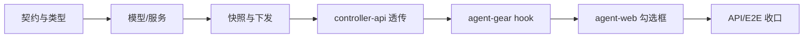

# Commit 与 bot 共同提交 - 实现计划

**功能名称**: Commit 与 bot 共同提交（Worktree Co-Author）
**关联 PRD**: `docs/product/draft/20261031-commit-with-bot-coauthor.md`
**关联提案**: `docs/engineering/proposals/20261031-feat-commit-with-bot-coauthor.md`
**计划版本**: v1.0
**创建日期**: 2026-10-31
**作者**: ZeroAsh Agent
**feat-branch**: `feat/commit-with-bot-coauthor`

## 1. 实施顺序

严格按「契约 → 数据 → 服务 → 下发 → 容器 → 前端 → 测试收口」推进，每个切片先写失败测试再实现：



## 2. 变更清单

### 2.1 契约

| 文件 | 变更 |
|--|--|
| `contracts/github.graphql` | `CommitSettings.commitWithBot: Boolean!`；`CommitSettingsInput.commitWithBot: Boolean`；注释写明仅 `CUSTOM` 生效、`UNSET` 归一 `false` |
| `contracts/agent-session-websocket.md` | §3.12 `committer` 追加可选 `coAuthorName/coAuthorEmail`，说明缺省不下发、旧 worker 忽略 |

### 2.2 agent-api

| 文件 | 变更 |
|--|--|
| `src/models/user-commit-setting.ts` | 新增 `commitWithBot: { type: Boolean, default: false }` |
| `src/services/commit-settings-service.ts` | 输入/视图增加 `commitWithBot`；`UNSET` 归一 `false`；upsert 写入；`resolveWorktreeCommitter` 在 `commitWithBot` 时解析 bot 并追加 `coAuthorName/coAuthorEmail`（失败降级） |
| `src/models/workflow-instance.ts` | 新增 `worktreeCoAuthorName/Email`（String, default null） |
| `src/services/workflow/instance.ts` | 快照类型与落库增加共同作者；显式传入类型扩展 |
| `src/services/workflow/orchestrator.ts` | 节点级 Worktree 复用实例快照时携带共同作者 |
| `src/services/session.ts` | 实时解析结果透传（类型扩展） |
| `src/services/workflow/issues-event-handler.ts` | 触发人解析结果类型扩展；回退 GitHub 身份时不带共同作者 |
| `src/graphql/schemas/github.ts` | 同步契约字段 |

### 2.3 controller-api

| 文件 | 变更 |
|--|--|
| `src/services/session-command.ts` | `committer` 类型扩展 `coAuthorName?/coAuthorEmail?`，原样透传 |
| `src/services/worktree-service.ts` | `handleAdd` 类型扩展并原样下发 |

### 2.4 agent-gear

| 文件 | 变更 |
|--|--|
| `src/worktree-handler.ts` | `WorktreeCommitter` 增加共同作者；`normalizeCommitter` 校验成对字段与非法字符；新增 `applyWorktreeCoAuthor`：`rev-parse --git-common-dir` → 写 `<common>/zag-hooks/prepare-commit-msg` → `--worktree core.hooksPath` + `zag.coAuthorName/Email`；失败只告警 |
| `src/socketio-client.ts` | payload 类型扩展 |
| `package.json` | 版本 `2.12.0 → 2.13.0` |

### 2.5 agent-web

| 文件 | 变更 |
|--|--|
| `src/graphql/types.ts` | `CommitSettings` / `CommitSettingsInput` 增加 `commitWithBot` |
| `src/components/settings/GitSettingsSection.tsx` | 新增 checkbox；`UNSET` 时禁用并提示；保存携带字段；本地 dirty/回显同步 |

### 2.6 文档

| 文件 | 变更 |
|--|--|
| `docs/product/draft/20261031-commit-with-bot-coauthor.md` | 产品方案 |
| `docs/engineering/proposals/20261031-feat-commit-with-bot-coauthor.md` | 技术提案 |
| `docs/engineering/plan/20261031-feat-commit-with-bot-coauthor.md` | 本计划 |
| `docs/product/AGENTS.md` / `docs/engineering/AGENTS.md` | 索引登记 |
| 各模块 `AGENTS.md` | 口径同步（agent-api / controller-api / agent-controller / agent-web） |

## 3. TDD 测试矩阵

### 3.1 服务层（`commit-settings-service.test.ts`）

| ID | 断言 |
|--|--|
| T-CB1 | 从未保存：`commitWithBot=false` |
| T-CB2 | 保存 `commitWithBot=true` → 回读 `true`，upsert `$set` 含字段 |
| T-CB3 | `committerType=UNSET` + `commitWithBot=true` → 归一 `false` |
| T-CB4 | `custom + true + bot 可用` → `{name,email,coAuthorName,coAuthorEmail}` |
| T-CB5 | `custom + true + bot 不可用` → `{name,email}`（无 coAuthor） |
| T-CB6 | `custom + false` → `{name,email}`；非法/未设置 → `null` |

### 3.2 下发与快照

| ID | 文件 | 断言 |
|--|--|--|
| T-CB-S1 | `session.test.ts` | 解析结果带共同作者时原样进入 `git:worktree:add` |
| T-CB-I1 | `workflow/instance.test.ts` / 相关实例化测试 | `worktreeCoAuthorName/Email` 落库 |
| T-CB-O1 | `workflow/orchestrator.test.ts` | 节点会话携带快照共同作者 |
| T-CB-IS1 | `issues-event-handler.runner.test.ts` | 触发人设置带共同作者时透传；回退 GitHub 身份时不带 |
| T-CB-C1 | `controller-api/session-command.test.ts` | `coAuthor*` 原样透传；无 committer 不发明字段 |
| T-CB-C2 | `controller-api/worktree-service.test.ts` | payload 携带共同作者 |

### 3.3 agent-gear（`worktree-handler.test.ts`）

| ID | 断言 |
|--|--|
| T-WTC5 | 带共同作者：写身份后执行 `rev-parse --git-common-dir`、写 hook 文件、`--worktree core.hooksPath`、`zag.coAuthorName/Email` |
| T-WTC6 | 共同作者只有一半 / 含换行 → 视为未提供，不写 hook |
| T-WTC7 | hook 内容包含 `# zag-managed`、`grep -qF`、`interpret-trailers`，且无未转义插值 |
| T-WTC8 | hook 写入失败只告警，worktree 创建仍成功 |

### 3.4 API / 前端 / E2E

| ID | 文件 | 断言 |
|--|--|--|
| T-CB-API1 | `tests/api/src/agent-api/github.test.ts` | 默认 `commitWithBot=false` |
| T-CB-API2 | 同上 | 保存 / 回读 `commitWithBot` |
| T-CB-API3 | 同上 | `UNSET` 归一 `false` |
| T-CB-UI1 | `GitSettingsSection.test.tsx` | 默认不勾选；勾选保存携带 `true` |
| T-CB-UI2 | 同上 | `未设置` 时禁用并提示「设置提交人后可勾选」 |
| T-CB-UI3 | 同上 | 服务端回显 `true` 时正确勾选 |
| E2E-CB1 | `tests/e2e/src/settings-git.spec.ts` | 勾选保存、刷新回显、未设置置灰 |

## 4. 关键实现细节

### 4.1 服务归一

```ts
const commitWithBot = type === 'custom' ? input.commitWithBot === true : false;
```

`toView` 同样按 `committerType` 归一，历史行缺字段自然为 `false`。

### 4.2 共同作者解析

```ts
async resolveWorktreeCommitter(userId: string): Promise<ResolvedWorktreeCommitter | null> {
  // custom 合法校验 ...
  const base = { name: custom.name, email: custom.email };
  if (setting.commitWithBot !== true) return base;
  const bot = await githubService.resolveAppBotIdentity();
  if (!bot) {
    console.warn('[CommitSettings] bot identity unavailable, co-author skipped');
    return base;
  }
  return { ...base, coAuthorName: bot.name, coAuthorEmail: bot.email };
}
```

### 4.3 Worktree hook 安装

- `normalizeCommitter` 仅在 `coAuthorName/coAuthorEmail` 都是非空、无 `\n\r\0` 的字符串时保留；
- `git rev-parse --git-common-dir` 失败 / 文件写入失败 / `git config` 失败 → `console.warn`，不阻断；
- hook 文件固定内容，不含用户数据；共同作者身份写入 worktree 配置；
- `core.hooksPath` 使用绝对路径，避免 worktree 相对路径歧义。

### 4.4 兼容

- 旧 worker：未知字段忽略，仅写 `user.name/email`；
- 旧数据：字段缺失 = `false`；
- 云电脑自身：`commit-identity` 端点不变；
- 本地控制器：无 Worktree 提交人链路，行为不变。

## 5. 验证命令

```bash
# agent-api
cd servers/agent-api && npx vitest run src/services/commit-settings-service.test.ts src/services/session.test.ts

# controller-api
cd servers/controller-api && npx vitest run src/services/session-command.test.ts src/services/worktree-service.test.ts

# agent-gear
cd packages/agent-controller && npx vitest run src/worktree-handler.test.ts

# agent-web
cd apps/agent-web && npx vitest run src/components/settings/__tests__/GitSettingsSection.test.tsx
```

## 6. 验收清单

- [ ] 「Git」区块出现「与 bot 共同提交」，默认不勾选；
- [ ] 「未设置」时置灰并提示，保存不保留勾选；
- [ ] `custom + 勾选` 保存 / 回读正确；
- [ ] Worktree 创建载荷包含 bot 的帐号名与 noreply 邮箱；
- [ ] 容器内 worktree 提交 author 为成员、trailer 为 bot，重复提交不叠加；
- [ ] bot 不可用 / 旧 worker / 云电脑自身提交均无回归；
- [ ] 单元、API、E2E 测试通过。

## 7. 风险与回滚

| 风险 | 缓解 |
|--|--|
| worktree 级 `core.hooksPath` 覆盖用户仓库既有 hooks | 仅在该 Worktree 生效；hook 只做 trailer 追加，不阻断提交；文档注明 |
| hook 内容被用户修改 | 每次创建 Worktree 重写受管文件；不改用户其他 hook |
| 共同作者重复追加 | `grep -qF` exact-trailer 幂等，`--amend` 不叠加 |
| 旧 worker 静默无效果 | PRD 已声明降级；可通过 worker 版本升级获得能力 |

回滚：移除前端勾选项与服务端字段写入即可；已生成 Worktree 的 hook 配置随 Worktree 删除自然消失，不影响主仓。
