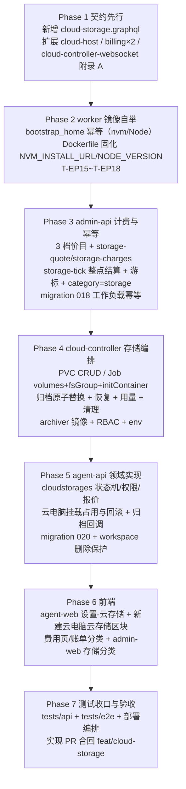
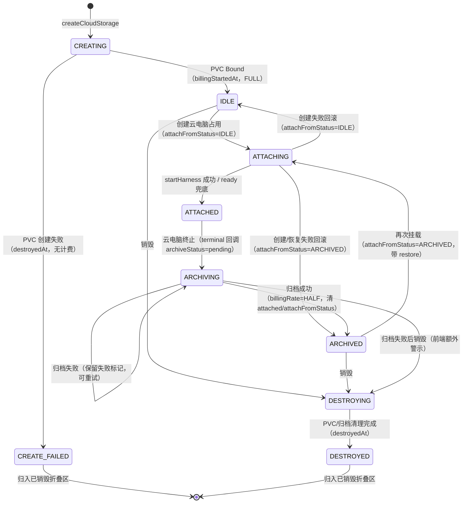

# 云电脑支持申请存储（云存储）- 实现计划

**关联 PRD**: `docs/product/draft/20261102-cloud-storage.md`（v1.1，Issue #405）
**关联 Proposal**: `docs/engineering/proposals/20261102-feat-cloud-storage.md`（v1.1）
**需求总分支（feat-branch）**: `feat/cloud-storage`（需求总 PR #406）
**实现分支**: `feat/cloud-storage-impl`（基于 `feat/cloud-storage`，实现 PR 合回需求总分支）
**创建日期**: 2026-11-02
**计划版本**: v1.0

## 实现顺序



依赖说明：

- **Phase 1 契约先行**（z-coding：技术方案 → 更新 Contract → 开发分支 → 实现）；无契约不写实现代码。
- **Phase 2 与 Phase 3 可并行**：Phase 2 只改镜像，Phase 3 只改 admin-api；二者互不依赖。但 Phase 2 必须先于 Phase 4 镜像发布（§9.4 发布顺序）。
- **Phase 4 依赖 Phase 1 的 storage/restore 报文口径**与 Phase 2 的新 worker 镜像（本地 `K8S_ENABLED=false` 时用 InMemory，不阻塞单测）。
- **Phase 5 依赖 Phase 3 的内部计费端点**（报价/出账）与 Phase 4 的存储/归档/用量内部端点。
- **Phase 6 依赖 Phase 5 的 GraphQL 契约落地**（schema 可先按契约手写类型，运行时需服务端就绪）。
- **Phase 7 在实现分支合并回需求总分支后收口**（`feat/cloud-storage`）。

开发模式采用 TDD（红-绿-重构）：每个 Phase 内先写测试（RED）→ 实现（GREEN）→ 重构收口；编码前加载 `docs/engineering/common-rules.md`、`backend-rules.md` / `frontend-rules.md` 与对应子项目 `AGENTS.md`。`tests/api` / `tests/e2e` 只允许 Aspire 编排（禁止裸 docker），重跑从 `aspire start` 重来。

### 关键约束（提案 §1.3 / §6，实现期不得回退）

- **K8s 单一事实源**：PVC/Job 只由 cloud-controller 操作；agent-api 不直连 K8s，admin-api 不直连 K8s。
- **挂载点固定 `/home/worker`**：整块存储即 worker 主目录，挂载先于 entrypoint 与一切工作负载脚本（K8s 卷挂载天然先于容器启动）。
- **零回归**：请求不带 `storage` / `storageId` 时，Job manifest、创建/销毁报文、计费与 UI 行为与现状**逐字节等价**（无 volumes/volumeMounts/securityContext/initContainers 字段）。
- **归档只在销毁云电脑时触发**，单份归档原子替换（写 `.tmp` → 成功删旧 → rename），中断清理临时文件且旧归档不丢。
- **写入单一**：`cloudstorages` 只由 agent-api 写（admin-api 只读镜像）；`cloudcontainers` 只由 cloud-controller 写（agent-api 只读镜像）；`storagebillingcursors` 只由 admin-api 写。
- **计费口径**：累计分档（≤10Gi 固定 5 credits/小时；10~25Gi 每 Gi 1 credit/小时；25~30Gi 每 Gi 3 credits/小时）；已归档半价；一小时内状态切换按**结算时刻**费率。
- **迁移只增不改**：admin-api 018 对工作负载脚本按字节匹配刷新（定制/删除不覆盖）；agent-api 020 只建索引、不回填存量。
- **禁止 rebase/squash**（z-git）：只允许 merge；跨需求冲突用 merge 协调。
- **实现计划文档提交到需求总分支**（本文件落 `feat/cloud-storage`）；实现代码在 `feat/cloud-storage-impl`，经实现 PR 合回需求总分支。

---

## 计划期裁决（提案留白 / 不自洽处的实现口径）

> 以下为本计划对提案的**落地修正**，均不改变产品结论；实现完成后回写提案勘误（不重开评审）。

1. **迁移编号核对**：需求总分支现状 —— agent-api 最新迁移 `019-commit-settings-per-member`、admin-api 最新 `017-workload-pnpm-scripts`，故 agent-api 用 **020**、admin-api 用 **018**（与提案一致）。实现启动前再次核对；若被并行需求占用则顺延，后合入方 merge 协调并顺延编号，禁止 rebase。
2. **`cloudstorages` 不加入 `TENANT_ID_COLLECTIONS`**：该常量（19 项）的测试不变量要求「schema 同时声明 `userId` + `tenantId` 且查询按 `{userId}` 注入租户」。存储用 `createdBy`（创建人）而非 `userId`，加入会破坏不变量且注入无意义。落点：
   - 模型仅挂 `applyWorkspaceScope({ workspaceField: 'resourceWorkspaceId' })`；
   - `tenantId` 在 service 内显式写入（来自 `getWorkspaceContext().tenantId`），不走 `applyTenantScope`；
   - 隔离覆盖改为在 `workspace-isolation.test.ts` 增加 `cloudstorages` 专项用例（**不修改** `015-team-workspaces.ts` 的 `WORKSPACE_ID_COLLECTIONS`，那是迁移回填范围）。
3. **新增 `attachFromStatus` 字段**（提案 §4.1 遗漏）：`'IDLE' | 'ARCHIVED' | null`，标记本次挂载来源，用于①创建失败回滚到挂载前状态；②前端「正在恢复数据」判定（裁决 10）。归档成功或销毁时清空。
4. **携带 `storageClass` 参与重建**：`ARCHIVED` 再挂载需重建同名 PVC，而提案的 `storage` 报文只有 `sizeGi`，会用当前环境默认 StorageClass，与创建时的显式 class 可能不一致。修正：`storage.storageClass?: string | null`（1~63、`^[a-z0-9]([-a-z0-9.]*[a-z0-9])?$`），由 agent-api 从 `cloudstorages.storageClass` 快照下发；空则回退 `CLOUD_STORAGE_CLASS` / 集群默认。
5. **PVC ensure 冲突语义**：`POST /internal/storages` 幂等（已存在返回 `created:false`）；若已存在 PVC 的 **容量或 StorageClass 与请求不一致** → `409 STORAGE_PVC_CONFLICT`（本期不支持扩容，禁止静默复用错误规格）。
6. **归档文件名统一 ASCII 安全化**（修正提案内不自洽：示例 `我的云电脑-….tar.gz2` 与 restore 路径正则 `[A-Za-z0-9._-]+` 冲突）：
   - `sanitizeArchiveName(hostName)`：保留 `[A-Za-z0-9._-]`，其余字符替换为 `-`，连续 `-` 折叠，去首尾 `-`，空则回退 `cloud-host`，截断 64 字符；
   - 最终文件名 `<safe>-<YYYYMMDD-HHmmss>.tar.gz2`；
   - 路径 `/archive/<workspaceId>/<storageId>/<fileName>`，其中两段 id 均为 24 位 hex；
   - 校验正则统一为 `^/archive/[a-f0-9]{24}/[a-f0-9]{24}/[A-Za-z0-9._-]{1,120}\.tar\.gz2$`。
7. **计费小时桶锚点 = `billingStartedAt`**：第 n 桶 `[billingStartedAt + n·1h, +1h)`；`rate` 取**桶末时刻**镜像的 `billingRate`（结算时刻口径）；`idempotentKey = cloud_storage.hour:<storageId>:<bucketEndEpochHour>`，`bucketEndEpochHour = floor(bucketEnd / 1h)`（相邻桶恒不撞键）；`periodStart/periodEnd` 恒差 1 小时。销毁尾段按 `ceil((destroyedAt - billingStartedAt)/1h)` 补齐后写 `closedAt`。
8. **存储出账走独立服务**（不改既有 `/charges` 单条目形态）：新增 `StorageChargeService`，与 `one-time-charge.ts` 同构直接调用 `invoicingService.createInvoice`（`category='storage'`、`refType='cloud_storage'`、`refId=storageId`、`items` 三档明细）+ `paymentService.charge` + `creditCheckService`；幂等键 `invoice:cloud_storage.hour:<storageId>:<bucketEndEpochHour>`。`CreditCheckRef.type` 扩展 `'cloud_storage'`；同时写一条 `MeteringRecord`（`productId='cloud_storage.base.hour'`、`quantity=1`、`refId=storageId`）供对账/汇总。
9. **`includeDestroyed` 默认值改为 `false`**（提案默认 `true` 会让主列表默认含已销毁，与 PRD「主列表/折叠区分离」矛盾）：主列表不传或传 `false`，折叠区显式 `true`。
10. **恢复中提示**：不新增云电脑状态。`CloudHost.storageRestoring: Boolean!` 为字段级 resolver，口径 `host.status === 'STARTING' && storage != null && storage.currentArchive != null`（仅从归档恢复时存在当前归档）；前端在云电脑状态旁展示「正在恢复数据」。同时新建对话框在选择「已归档」存储时静态提示耗时。
11. **能力开关**：新增 `cloudStorageCapabilities { enabled }` 查询承载 `CLOUD_STORAGE_ENABLED`（不复用 `cloudHostCapabilities`，避免语义耦合）；前端 `enabled=false` 时隐藏设置区块与创建区块，服务端仍为权威拦截（`storage feature is disabled`）。
12. **归档触发点单一收敛**：仅 `ContainerService.maybeStartStorageArchive(container)` 触发，接入 `destroyLocked`（含终态重入、`forceDestroy`、必须失败、欠费强拆）、`markFailed`（status-sync 的 Job 消失/失败收口）；幂等条件 `storageId != null && storageArchiveStatus ∈ {null, failed}` 时 CAS 到 `pending`；归档任务在**容器互斥锁外**执行（`KeyedMutex` 非可重入）。
13. **归档成功后的源 PVC 释放顺序**：`解析用量标记行成功 → CAS succeeded → 删除源 PVC（最多 3 次）→ 回调 SUCCEEDED`；删除失败不阻断回调，回调带 `sourcePvcReleased:false` 并记入 `currentArchive`。为消除「残留源 PVC + 再次挂载」风险：**从 `ARCHIVED` 挂载恢复时，cloud-controller 先删除同名 PVC（若存在）再创建**，保证恢复目标为空卷（避免旧数据残留与 tar 覆盖语义歧义）。本期**不单独实现孤儿 PVC 巡检回收**，以「再挂载先删后建」作为残留源的收口方式（`sourcePvcReleased` 留痕供运维排查）。
14. **归档 Job 结果解析**：每 5s 轮询 Job 状态 + 读取 Pod 日志（`readNamespacedPodLog`），解析 `ZAG_ARCHIVE_RESULT={"usageBytes":N}` 标记行；Job `succeeded` 但标记行缺失/不可解析 → 判 `failed`（`failureReason='用量标记行缺失'`），**不删除源 PVC、不替换旧归档**。
15. **`usage-refresh` 仅 `ATTACHED`**：du Job 以 `nodeName` 直指云电脑 Pod 所在节点（RWO 同节点），只读挂载源 PVC；失败/超时保留上一次值并返回 `accepted:true`（异步语义，前端仅提示「已发起刷新」）。
16. **工作负载幂等（admin-api 018）验收可行性**：真实「容器内旧环境重跑」只能在内网集群手工验收，单测做**静态不变量 + 选中脚本的可执行性**：
    - 静态：每条预制脚本含开头锚点判定与结尾硬校验；`bash -n` 通过；
    - 动态：对 `MongoDB` / `Playwright` / 三条 harness 的 `harness prepare` 等**可离线重入**脚本，在本地夹具上跑「已安装」分支断言命中锚点（不依赖下载）；
    - 迁移本身按 017 的字节匹配 `refresh()` 形态实现（`oldScripts` 全链 → `newScript`，定制/删除 warn 跳过），核查结果为全部合规时为空操作并记录说明。
17. **`cloudstorages` 只读镜像不加插件**：admin-api 镜像模型仅声明 `collection: 'cloudstorages'` 与读取所需字段（`status/sizeGi/billingRate/billingStartedAt/destroyedAt/billingAccountId/currentArchive`），不挂 scope 插件、不建索引、不写；索引由 agent-api 迁移 020 拥有。
18. **前端「已销毁」折叠区**：默认折叠（`open=false`，不写 localStorage）；仅展示名称/容量/最终状态/创建人/销毁或失败时间，无操作入口；`CREATE_FAILED` 与 `DESTROYED` 同区。
19. **部署编排**：`deploy/k8s/cloud-controller.yaml` 增加 `persistentvolumeclaims` 读写与 `pods`/`pods/log` 只读；新增 `CLOUD_STORAGE_CLASS` / `CLOUD_ARCHIVE_STORAGE_CLASS` / `CLOUD_ARCHIVE_PVC_SIZE` / `CLOUD_ARCHIVE_ACCESS_MODE` / `ARCHIVER_IMAGE` / `ARCHIVE_TIMEOUT_MS` / `STORAGE_PVC_PREFIX` / `ARCHIVE_PVC_PREFIX`；Aspire dev 保持 `K8S_ENABLED=false`（InMemory），但补齐上述 env 默认值以便 API/E2E 全链路走 mock。
20. **测试编号**：`entrypoint.test.sh` 现有 T-EP0~T-EP14，新增自举用例顺延 **T-EP15~T-EP18**；cloud-controller / agent-api / admin-api 既有用例编号（T-CC*/T-IA*/T-BILL*）若冲突，后写方顺延并在实现 PR 描述中标注（参照上一需求「实现期勘误」做法）。
21. **文档生命周期**：PRD 保持 `docs/product/draft/`、提案保持 `docs/engineering/proposals/`，验收后按既有流程归档；本计划落 `docs/engineering/plan/` 并登记 `docs/engineering/AGENTS.md` 索引。
22. **与「工作流只初始化一次」的关系**：容器内 `initCompletedAt` / `hasSettledInit` 语义不变；幂等保证的是「新容器 + 旧主目录」场景（挂载已归档存储），不重放同一容器内的 init 批次。

---

## Phase 1: 契约先行（contracts）

开发分支：`feat/cloud-storage-impl`。

### 文件修改

| 文件 | 操作 | 说明 |
|------|------|------|
| `contracts/cloud-storage.graphql` | 新增 | `CloudStorageStatus`（CREATING/IDLE/ATTACHING/ATTACHED/ARCHIVING/ARCHIVED/DESTROYING/DESTROYED/CREATE_FAILED）、`CloudStorageArchiveStatus`、`CloudStorageArchive`、`CloudStorageCreator`、`CloudStorage`（含 `usageBytes/usageUpdatedAt/hourlyCredits/hourlyCreditsFull/hourlyCreditsArchived/attached*/currentArchive/archiveSpace/failureReason/destroyedAt`）、`CloudStorageArchiveSpace`、`CloudStoragePriceTier`/`CloudStorageRateQuote`/`CloudStorageBillingQuote`、`CreateCloudStorageInput`、`CloudStorageCapabilities`；Query `cloudStorages(onlyAttachable, includeDestroyed=false)` / `cloudStorage(id)` / `cloudStorageBillingQuote(sizeGi)` / `cloudStorageCapabilities`；Mutation `createCloudStorage` / `destroyCloudStorage` / `retryCloudStorageArchive` / `refreshCloudStorageUsage`；错误文案表（提案 §3.1.1 + 裁决 11 `storage feature is disabled`） |
| `contracts/cloud-host.graphql` | 修改 | `CreateCloudHostInput.storageId: ID`（可选，缺省不改变报文）；`CloudHost.storage: CloudStorageSummary`；`CloudHost.storageRestoring: Boolean!`（裁决 10）；`CloudStorageSummary{ id/name/sizeGi/status/usageBytes/hourlyCredits }` |
| `contracts/cloud-controller-websocket.md` | 修改 | **A.2.2** 增加 `storage`/`restore` 字段与校验（含 `storageClass`，裁决 4/6）；**附录 A** 增加存储端点（`POST/GET/DELETE /internal/storages`、`POST/GET /internal/containers/:id/archive`、`POST /internal/storages/:id/usage-refresh`、`POST /internal/storages/:id/cleanup`）与回调（`POST /internal/cloud-storages/:id/archives`、`/usage`）；terminal 回调体新增 `storage { id, archiveStatus }`；错误码表（`409 STORAGE_IN_USE/ARCHIVE_RUNNING/CONTAINER_ACTIVE/NO_STORAGE/STORAGE_PVC_CONFLICT`、`400 INVALID_HARNESS`） |
| `contracts/billing.graphql`、`contracts/admin-billing.graphql` | 修改 | `enum BillingCategory` 增加 `storage`；账单 `items` 分档与半价描述口径注释 |
| `contracts/cloud-host.graphql`（计费注记） | 修改 | `cloudHostBillingQuote` 注释补充「挂载云存储的每小时存储费用不计入创建报价，由 `cloudStorageBillingQuote` 单独展示」 |
| `docs/engineering/AGENTS.md` | 修改 | 「实现计划（`plan/`）」索引追加本计划 |

### 验收 checklist

- [ ] 契约文件与提案 §3.1/§3.2 逐条对应；裁决 4/6/9/10/11 的修正已落入契约文字
- [ ] `git diff --stat contracts/` 仅目标文件；`cloud-host.graphql` 除 `storageId`/`storage`/`storageRestoring` 外无字段变更
- [ ] 附录 A 端点/错误码/回调字段可直接作为 Phase 4/5 的实现清单
- [ ] 既有 GraphQL 客户端（agent-web 现有查询）不因新增字段而破坏

---

## Phase 2: worker 镜像幂等自举（deploy/images/worker）

开发分支：`feat/cloud-storage-impl`。TDD：先写 `entrypoint.test.sh` T-EP15~T-EP18（RED）→ 实现（GREEN）。

### 文件修改

| 文件 | 操作 | 说明 |
|------|------|------|
| `deploy/images/worker/entrypoint.sh` | 修改 | 新增 `bootstrap_home()`（在 `ensure_pnpm` 之前调用）：① `$WORKER_NVM_DIR/nvm.sh` 不可 source → `curl "$NVM_INSTALL_URL" \| PROFILE=/dev/null METHOD=script bash`；② `$WORKER_NVM_DIR/current/bin/node` 不可执行 → `nvm install --default "$NODE_VERSION"` + `nvm alias default` + 重建 `current` 软链 + `run_as_worker npm config set registry "$NPM_REGISTRY"`；③ pnpm/agent-gear 交给既有 `ensure_pnpm` / `update_agent_gear`（幂等）。判定基于「产物可执行」。`ZAG_STORAGE_HOME=1` 时任一步失败 `log` + 非零退出（fail-fast，Job 失败 → 创建失败 → 存储回滚）；未挂载时为 no-op。 |
| `deploy/images/worker/Dockerfile` | 修改 | `ARG NVM_INSTALL_URL` / `ARG NODE_VERSION` 之外追加同名 `ENV`（运行时可见，供 `bootstrap_home` 使用）；`NPM_REGISTRY` / `NVM_NODEJS_ORG_MIRROR` 已是运行时 ENV 不变；不改变既有 nvm/pnpm/agent-gear 安装流程 |
| `deploy/images/worker/entrypoint.test.sh` | 修改 | 新增 T-EP15~T-EP18；沿用既有 `PATH` stub（curl/nvm/npm/pnpm stub）与 `bash -n` 检查 |
| `deploy/images/worker/BUILD.md` | 修改 | 「手工验收」补：空 `/home/worker` 起容器 → nvm/Node/pnpm/agent-gear 自举成功；`ZAG_STORAGE_HOME=1` 下断网 → 入口非零退出 |

### 测试用例（对齐提案 §8.2 / 裁决 20）

| # | 用例 | 预期 |
|---|------|------|
| T-EP15 | 完整镜像环境 | `nvm.sh` 与 `current/bin/node` 可用 → `bootstrap_home` 为 no-op（不触发 curl/nvm install）；入口流程与既有 T-EP0~14 行为不变 |
| T-EP16 | 缺 nvm | 触发一次 `curl`（`NVM_INSTALL_URL`）+ `nvm install --default $NODE_VERSION` + 重建 `current` 软链 + 设置 npm registry；再次执行跳过（幂等） |
| T-EP17 | 仅缺 node（nvm 在） | 不重复安装 nvm；仅补 node 与 `current` 软链、registry；日志含锚点分支说明 |
| T-EP18 | 下载失败 | `ZAG_STORAGE_HOME=1` + curl 非零 → 入口非零退出（不进入保活循环）；未设置 `ZAG_STORAGE_HOME` 且镜像完整时不受影响 |

### 命令参考

```bash
bash -n deploy/images/worker/entrypoint.sh
bash deploy/images/worker/entrypoint.test.sh   # T-EP0~T-EP18 全绿
```

### 验收 checklist

- [ ] T-EP15~T-EP18 通过；T-EP0~T-EP14 断言随新增分支校准后全绿
- [ ] `bootstrap_home` 位于 `ensure_pnpm` 之前、早于任何工作负载脚本下发；判定全部基于「产物存在且可执行」
- [ ] `ZAG_STORAGE_HOME=1` 失败 fail-fast，未挂载时 no-op（`bash -n` + 测试桩断言）
- [ ] Dockerfile 仅新增两个运行时 `ENV`，`ARG` 与既有安装步骤不变

---

## Phase 3: admin-api 计费与工作负载幂等迁移

开发分支：`feat/cloud-storage-impl`。TDD：先写 `storage-pricing.test.ts` / `storage-charge.test.ts` / `storage-tick.test.ts` / `019-workload-idempotent-anchors.test.ts`（RED）→ 实现（GREEN）。

### 文件修改

| 文件 | 操作 | 说明 |
|------|------|------|
| `servers/admin-api/src/services/billing/pricing.ts` | 修改 | `ensureDefaultPrices()` 追加 3 档存储价目（`$setOnInsert`，不改既有档）：`cloud_storage.base.hour`=500 分、`cloud_storage.tier1.gib_hour`=100 分、`cloud_storage.tier2.gib_hour`=300 分；导出 `DEFAULT_CLOUD_STORAGE_*_CENTS` |
| `servers/admin-api/src/services/billing/storage-pricing.ts` | 新增 | 纯函数 `quoteStorageHourly(sizeGi)`（分）：`base=500`、`tier1=max(0,min(sizeGi,25)-10)*100`、`tier2=max(0,sizeGi-25)*300`、`full=base+tier1+tier2`、`archived=full/2`；`StoragePricingService.quote(sizeGi)` 读价目、缺档回退默认并 warn，产出 `{full, archived}`（含 `items`） |
| `servers/admin-api/src/services/billing/storage-charge.ts` | 新增 | `StorageChargeService.chargeHour({accountId, storageId, sizeGi, rate, periodStart, periodEnd, idempotentKey, description})`：生成三档 items（HALF 时单价/金额减半）→ `invoicingService.createInvoice`（`category='storage'`、`refType='cloud_storage'`）+ `paymentService.charge`（幂等键）+ 一条 `MeteringRecord`；余额不足抛 `InsufficientBalanceError`（复用 `one-time-charge.ts` 语义） |
| `servers/admin-api/src/services/billing/storage-tick.ts` | 新增 | `tick()` 扫描 `cloudstorages` 只读镜像（`status ∈ IDLE/ATTACHING/ATTACHED/ARCHIVING/ARCHIVED` 且 `billingStartedAt != null`；`destroyedAt != null` 且游标未关账）；按 `storageId` upsert `storagebillingcursors`；`due = ceil((end - billingStartedAt)/1h)`（`end` = `destroyedAt ?? now`）；单次最多 24 小时；逐桶按桶末 `billingRate` 出账；失败即停并记 `lastError`；销毁尾段落账后 `closedAt` |
| `servers/admin-api/src/services/billing/scheduler.ts` | 修改 | 注册存储结算定时器（`STORAGE_BILLING_TICK_MS`，默认 300000）；`unref()` 与既有定时器同口径 |
| `servers/admin-api/src/models/cloud-storage.ts` | 新增 | 只读镜像（裁决 17）：`collection: 'cloudstorages'`，字段 `name/sizeGi/status/billingRate/billingStartedAt/destroyedAt/billingAccountId/tenantId/resourceWorkspaceId/currentArchive`；无插件、无索引、无写入 |
| `servers/admin-api/src/models/storage-billing-cursor.ts` | 新增 | `storagebillingcursors`：`{storageId unique, accountId, tenantId, sizeGi, billingStartedAt, chargedHours, lastRate, lastChargedAt, closedAt, lastError, timestamps}` |
| `servers/admin-api/src/models/billing-invoice.ts` | 修改 | `INVOICE_CATEGORIES` 增加 `'storage'` |
| `servers/admin-api/src/graphql/schemas/billing.ts` | 修改 | `enum BillingCategory` 增加 `storage` |
| `servers/admin-api/src/routes/internal-billing.ts` | 修改 | `GET /internal/billing/storage-quote?sizeGi=`（返回 full/archived 与 items）；`POST /internal/billing/storage-charges`（校验 `periodEnd - periodStart === 1h`、`rate ∈ FULL/HALF`、`sizeGi 1..30`；映射 `404 ACCOUNT_NOT_FOUND`/`409 INSUFFICIENT_BALANCE`/`400 INVALID_BODY`） |
| `servers/admin-api/src/config/index.ts` | 修改 | `STORAGE_BILLING_TICK_MS`（正整数，默认 300000） |
| `servers/admin-api/src/migrations/019-workload-idempotent-anchors.ts` | 新增 | 按 017 形态的字节匹配 `refresh()`：逐条核查 10 个预制脚本（001/002/003/004/006/007/009/010/012/013/015/016/017 的当前导出常量），对不满足「锚点判定 + 结尾硬校验 + 可重复执行」的脚本按字节匹配刷新；`oldScripts` 含全部已知历史版本；定制/删除 warn 跳过；全部合规时为空操作并记录说明 |
| `servers/admin-api/src/migrations/019-workload-idempotent-anchors.test.ts` | 新增 | T-MIG-I1~I4 |
| `servers/admin-api/src/index.ts` | 修改 | `runMigrations([...])` 追加 `019-workload-idempotent-anchors`（顺序在 017 之后） |

### 测试用例

| # | 用例 | 预期 |
|---|------|------|
| T-BILL-S1 | 报价边界 | 1/10/11/15/20/25/26/30Gi 全价 → 5/5/6/10/15/20/23/35 credits；半价 → 2.5/2.5/3/5/7.5/10/11.5/17.5；缺价目回退默认并 warn |
| T-BILL-S2 | 整点结算 | 首桶出账、跨桶补结算、单次 24 桶上限、剩余下次继续 |
| T-BILL-S3 | 幂等 | 同 `storageId + bucketEndEpochHour` 重放不重复出账（`BillingPayment.idempotentKey` 命中返回首个结果） |
| T-BILL-S4 | 余额不足 | 不推进 `chargedHours`、记 `lastError`，下 tick 重试；充值后补扣成功 |
| T-BILL-S5 | 销毁尾段 | 销毁时对不完整尾桶向上取整结算，之后 `closedAt` 非空且不再扫描 |
| T-BILL-S6 | 账单形态 | `category='storage'`、`items` 三档明细、HALF 时单价/金额减半、描述含「（归档半价）」、`refType='cloud_storage'` |
| T-BILL-S7 | 费率切换 | FULL 桶与 HALF 桶分别按桶末费率出账（结算时刻口径） |
| T-MIG-I1 | 字节匹配刷新 | 库内文本 = 已知历史版本之一 → 刷新为新版本；断言锚点/硬校验保留 |
| T-MIG-I2 | 已是最新 | 库内 = 新版本 → 无写入（幂等重跑） |
| T-MIG-I3 | 管理员定制保留 | 库内 ≠ 任何已知版本 → `console.warn` 跳过、不覆盖；已删除负载静默跳过 |
| T-MIG-I4 | 脚本不变量 | 全部新版本脚本 `bash -n` 通过；每条含锚点分支与结尾硬校验；不含重复追加形态 |
| 回归 | 既有计费 | 容器分钟/模型 token/一次性扣费/对账全绿；`BillingCategory` 旧值不变 |

### 命令参考

```bash
cd servers/admin-api
npx vitest run src/services/billing/storage-pricing.test.ts src/services/billing/storage-charge.test.ts src/services/billing/storage-tick.test.ts src/migrations/019-workload-idempotent-anchors.test.ts
npm run build && npx vitest run
```

### 验收 checklist

- [ ] T-BILL-S1~S7、T-MIG-I1~I4 全部通过；admin-api 全量单测与 `npm run build` 通过
- [ ] 价目默认档 `$setOnInsert` 不覆盖既有调价；半价恒为整数分
- [ ] `storage-charges` 单次只结算 1 桶；幂等键与 `periodStart/periodEnd` 校验严格
- [ ] `cloudstorages` 镜像零写入、零索引；游标集合唯一键 `{storageId}`
- [ ] `018` 只增不改、重跑幂等；`index.ts` 注册顺序在 017 之后

---

## Phase 4: cloud-controller 存储编排（含 archiver 镜像与部署）

开发分支：`feat/cloud-storage-impl`。TDD：先写 `k8s-client.test.ts` / `k8s-storage-manager.test.ts` / `storage-service.test.ts` / `container-service.test.ts` / `internal-api.test.ts` 新分支（RED）→ 实现（GREEN）。

### 文件修改

| 文件 | 操作 | 说明 |
|------|------|------|
| `servers/cloud-controller/src/services/k8s-client.ts` | 修改 | `K8sClient` 新增 `createPersistentVolumeClaim/getPersistentVolumeClaim/deletePersistentVolumeClaim/listPersistentVolumeClaims` 与 `readPodNodeName/readPodLogs`；`K8sJobManifest.spec.template.spec` 新增 `securityContext{fsGroup,fsGroupChangePolicy}`、`initContainers[]`、`volumes[]`，主容器新增 `volumeMounts[]`；`RealK8sClient` 增加 `CoreV1Api`（`ensureInitialized` 内 `makeApiClient`）；404 归一 `null`；`InMemoryK8sClient` 增加 `pvcs` Map、`createdPvcManifests`、`podLogs`、`podNodes` 与测试辅助（`getPvc`/`setPodLog`/`setPodNode`/`failCreatePvcTimes` 等） |
| `servers/cloud-controller/src/services/k8s-storage-manager.ts` | 新增 | PVC manifest（源卷 `zag-storage-<id>`、归档卷 `zag-archive-<workspaceId>`，标签 `app/zag.cloud/storage-id\|workspace-id\|tenant-id`）、`storageClassName` 空则整段省略、`ensure()`（存在则比对容量/class，冲突抛 `StoragePvcConflictError`）、`delete()`（404 视为成功）、名称/文件名安全化工具（`sanitizeArchiveName`） |
| `servers/cloud-controller/src/services/storage-service.ts` | 新增 | PVC 生命周期；归档 Job（`tar -cf - -C /source . \| pbzip2 -9 > .tmp` → `rm -f *.tar.gz2` → `mv` → `ZAG_ARCHIVE_RESULT` 标记行）、源卷先删后回调（裁决 13）、Job 轮询 + 日志解析（裁决 14）、按工作区 `KeyedMutex` 串行；恢复（先删残留 PVC 再 ensure + 仅注入 initContainer，不建独立 Job）；用量 du Job（`nodeName` 固定，裁决 15）；清理 Job（删源 PVC + 归档目录）；状态持久化到 `cloudcontainers.storageArchive*`；回调 `notifyStorageArchive/notifyStorageUsage` |
| `servers/cloud-controller/src/services/container-service.ts` | 修改 | `start()` 接收 `StartHarnessOptions.storage`（`{id,pvcName,sizeGi,workspaceId,storageClass?,restore?}`），ensure PVC、Job manifest 挂 `/home/worker` + `fsGroup:1000` + `fsGroupChangePolicy:'OnRootMismatch'` + `ZAG_STORAGE_HOME=1`，归档恢复时注入 `storage-restore` initContainer（先删残留 PVC 再建）；落库 `storage*`；`destroyLocked` 末尾锁外调用 `maybeStartStorageArchive`；`markFailed` 同样接入（裁决 12）；无 storage 时 manifest 与现状逐字节一致 |
| `servers/cloud-controller/src/services/status-sync.ts` | 修改 | 巡检 `storageArchiveStatus ∈ {pending,running}` 超 `ARCHIVE_TIMEOUT_MS` → 标 `failed` 并回调；已完成但回调未送达 → 重投（幂等）；Job 消失/失败收口路径接入归档触发 |
| `servers/cloud-controller/src/models/cloud-container.ts` | 修改 | 新增 `storageId/storagePvcName/storageSizeGi/storageWorkspaceId/storageStorageClass/storageRestorePath/storageArchiveStatus/storageArchiveId/storageArchiveFileName/storageArchiveUsageBytes/storageArchiveStartedAt/storageArchiveFinishedAt/storageArchiveFailure`（历史行 null 容忍，§4.2） |
| `servers/cloud-controller/src/routes/internal-api.ts` | 修改 | `parseHarnessRequest` 解析/校验 `storage`（缺省合法；`id/pvcName/workspaceId` 非空；`sizeGi 1..30`；`pvcName ^zag-storage-[a-z0-9-]+$`；`storageClass` 可选且合法；`restore.archivePath` 按裁决 6 正则且禁 `..`）；新增 6 个端点（提案 §3.2.1b）+ `POST /internal/containers/:id/archive` / `GET .../archive`；`DELETE /containers/:id` 保持现状 |
| `servers/cloud-controller/src/services/agent-api-client.ts` | 修改 | `notifyTerminal` 报文增加 `storage: {id, archiveStatus}`；新增 `notifyStorageArchive` / `notifyStorageUsage`（Bearer `INTERNAL_API_TOKEN`，4 次退避重试同口径） |
| `servers/cloud-controller/src/services/worker-version.ts` | 不变 | 复用门禁常量 |
| `servers/cloud-controller/src/config/index.ts` | 修改 | `CLOUD_STORAGE_CLASS`、`CLOUD_ARCHIVE_STORAGE_CLASS`、`CLOUD_ARCHIVE_PVC_SIZE`（默认 `100Gi`）、`CLOUD_ARCHIVE_ACCESS_MODE`（默认 `ReadWriteOnce`）、`ARCHIVER_IMAGE`（缺失启动告警）、`ARCHIVE_TIMEOUT_MS`（默认 1800000）、`STORAGE_PVC_PREFIX`、`ARCHIVE_PVC_PREFIX` |
| `servers/cloud-controller/src/index.ts` | 修改 | 实例化 `StorageService` 并注入 `ContainerService` / `StatusSyncService` / `createInternalRouter` |
| `deploy/images/archiver/Dockerfile`、`BUILD.md`、`entrypoint.sh` | 新增 | ubuntu minimal + `tar` + `pbzip2`（`bzip2` 回退）+ `coreutils`；以 root 运行；脚本按 `MODE=archive\|restore\|usage\|cleanup` 分流（便于复用同一镜像与测试） |
| `deploy/k8s/cloud-controller.yaml` | 修改 | Role 增加 `persistentvolumeclaims: get/list/watch/create/delete` 与 `pods`/`pods/log: get/list`；Deployment env 增加裁决 19 的变量 |
| `aspire/AgentGear.AppHost/AppHost.cs`、`aspire/manifest/docker-compose.yaml` | 修改 | cloud-controller 增加存储相关 env（dev 默认值，`K8S_ENABLED=false` 走 InMemory） |

### 测试用例（对齐提案 §8.2 / 裁决 20）

| # | 用例 | 预期 |
|---|------|------|
| T-CC-P1 | PVC manifest | 名称/标签/容量/RWO；`storageClass` 空时字段整段省略；归档卷 100Gi 与访问模式可配 |
| T-CC-P2 | PVC 幂等 | 已存在且规格一致 → `created:false`；删除 404 视为成功 |
| T-CC-P3 | 规格冲突与占用 | 存在但容量/class 不同 → `409 STORAGE_PVC_CONFLICT`；仍有活跃容器引用 → `409 STORAGE_IN_USE` |
| T-CC-J1 | Job 挂载 | 带 storage：PVC 挂 `/home/worker`、`ZAG_STORAGE_HOME=1`、`fsGroup=1000/OnRootMismatch`；不带 storage：manifest 与现状逐字段一致（快照断言） |
| T-CC-J2 | 隐藏 env/卷 | 带 storage 时 volumes/volumeMounts/securityContext 齐全；restore 缺省时不注入 initContainers |
| T-CC-J3 | storage 校验 | 缺省/null 合法；缺字段/非法 `pvcName`/`sizeGi` 越界/非法 `restore` 路径/非法 `storageClass` → 400 `INVALID_HARNESS` 且不创建 Job |
| T-CC-RS1 | 已归档恢复 | 先删残留同名 PVC（若存在）→ ensure 重建（原容量/class）→ initContainer（archive RO、target RW、`tar -xjf`） |
| T-CC-RS2 | 恢复失败 | initContainer 失败 → Job 失败 → redis 状态落 `failed`，上层回滚到 ARCHIVED |
| T-CC-AR1 | 归档 Job manifest | source 只读、archive 可写、文件名安全化（ASCII）、脚本顺序 `rm -f *.tmp` → 压缩 → `rm -f *.tar.gz2` → `mv` → 标记行 |
| T-CC-AR2 | 归档成功 | 解析用量标记行 → 删源 PVC（重试 3 次）→ 回调 SUCCEEDED（含 `usageBytes`）→ 状态 `succeeded` |
| T-CC-AR3 | 归档失败/超时/标记行缺失 | 标 `failed` + `failureReason`；临时文件由下次归档清理；旧归档与源 PVC 保留 |
| T-CC-AR4 | 归档幂等 | 重复触发不产生第二个 Job；重启后巡检补收口；回调重投 |
| T-CC-AR5 | 按工作区串行 | 同工作区并发归档排队；不同工作区并行 |
| T-CC-U1 | 用量刷新 | du Job 落容器所在 `nodeName`、只读挂载、解析标记行并回调 `/usage`；失败保留上次值 |
| T-CC-D1 | cleanup | 删除源 PVC（若存在，404 幂等）+ 清理 Job 删除归档目录；归档进行中 → 409 |

### 命令参考

```bash
cd servers/cloud-controller
npx vitest run src/services/k8s-client.test.ts src/services/k8s-job-manager.test.ts src/services/storage-service.test.ts src/services/container-service.test.ts src/routes/internal-api.test.ts
npm run build && npx vitest run
# archiver 镜像本地构建（内网环境执行）
docker build -t archiver:dev deploy/images/archiver
```

### 验收 checklist

- [ ] T-CC-P*/J*/RS*/AR*/U1/D1 全部通过；cloud-controller 全量单测与 `npm run build` 通过
- [ ] 不带 storage 的 Job manifest 与改动前快照逐字段一致（含 labels/资源/env 顺序）
- [ ] 归档任务在容器锁外执行；`pending/running` 超时巡检与回调重投生效
- [ ] 归档成功先删源 PVC 再回调；`sourcePvcReleased:false` 场景再次挂载时先删后建（裁决 13）
- [ ] RBAC 仅新增 PVC 与 Pod 只读；不授予 PV/StorageClass 写权限
- [ ] archiver 镜像 `MODE=archive|restore|usage|cleanup` 四态脚本 `bash -n` 通过并附 BUILD.md

---

## Phase 5: agent-api 领域实现（cloudstorages 状态机 + 云电脑挂载编排）

开发分支：`feat/cloud-storage-impl`。TDD：先写 `cloud-storage-service.test.ts` / `.real.test.ts` / `cloud-host-service.test.ts` / `internal-cloud-storage.test.ts`（RED）→ 实现（GREEN）。

### 文件修改

| 文件 | 操作 | 说明 |
|------|------|------|
| `servers/agent-api/src/models/cloud-storage.ts` | 新增 | §4.1 字段（含裁决 3 `attachFromStatus`）；索引：`{resourceWorkspaceId,nameKey}` unique `partialFilterExpression:{destroyedAt:null}`、`{attachedCloudHostId}` unique partial `{$type:'objectId'}`、`{tenantId}`、`{resourceWorkspaceId,status}`、`{status,billingStartedAt}`；仅挂 `applyWorkspaceScope({workspaceField:'resourceWorkspaceId'})`（裁决 2） |
| `servers/agent-api/src/models/cloud-host.ts` | 修改 | 新增 `storageId: ObjectId \| null`（ref `CloudStorage`，index）；其余字段不变 |
| `servers/agent-api/src/models/cloud-container.ts` | 修改 | 只读镜像新增 §4.2 的 `storage*` 字段（写方仍为 cloud-controller） |
| `servers/agent-api/src/migrations/020-cloud-storage-indexes.ts` | 新增 | 显式创建上述索引（`ensureIndex` 幂等，生产 `autoIndex=false` 兜底）；不回填存量；不涉及既有集合 |
| `servers/agent-api/src/migrations/020-cloud-storage-indexes.test.ts` | 新增 | T-MIG-CS1~CS3（索引存在/幂等/唯一约束） |
| `servers/agent-api/src/index.ts` | 修改 | 注册迁移 020（顺序在 019 之后）与 `internalCloudStorageRouter` |
| `servers/agent-api/src/services/cloud-storage-service.ts` | 新增 | 创建（名称/容量/只读工作区/重名/余额校验 → `CREATING` → PVC → `IDLE` + `billingStartedAt` + `billingRate=FULL`；失败 `CREATE_FAILED` + `destroyedAt`）、列表/详情、销毁（权限 + 状态 + `DESTROYING ↔ DESTROYED` + cleanup）、重试归档、用量刷新、`attach/release` CAS、`handleArchiveCallback`（终态单调）、`handleUsageCallback`、`reconcileARCHIVING`；状态迁移全部 `findOneAndUpdate({_id,status:from})`（§实现点 10） |
| `servers/agent-api/src/services/cloud-controller-client.ts` | 修改 | 新增 `createStorage/getStorage/deleteStorage/cleanupStorage/triggerArchive/getArchive/refreshUsage` |
| `servers/agent-api/src/services/cloud-host-service.ts` | 修改 | `create()` 接入 `storageId`（裁决 11 顺序）：校验工作区/状态/容量 → 首小时余额校验 → `CAS IDLE/ARCHIVED→ATTACHING`（写 `attachedCloudHostId/attachedBy/attachedAt/attachFromStatus`）→ 既有扣费/Key/Controller/CloudHost(`storageId`) 落库 → `startHarness` 携带 `storage`（ARCHIVED 带 `restore.archivePath` + `storageClass`）→ `CAS ATTACHING→ATTACHED`；任一后续失败按既有逆序回滚 + `releaseStorage` 回 `attachFromStatus`；`handleTerminal` 释放未 ready 的存储；`handleReady` 幂等兜底 `ATTACHING→ATTACHED` |
| `servers/agent-api/src/routes/internal-cloud-storage.ts` | 新增 | `POST /internal/cloud-storages/:storageId/archives`、`POST /internal/cloud-storages/:storageId/usage`（Bearer `INTERNAL_API_TOKEN`，按 `archiveId` 幂等、终态单调） |
| `servers/agent-api/src/routes/internal-cloud-host.ts` | 修改 | terminal 报文消费 `storage {id, archiveStatus}` → 存储 `ATTACHED→ARCHIVING`（幂等） |
| `servers/agent-api/src/services/workspace-service.ts` | 修改 | `hasResources` 增加 `CloudStorage.countDocuments({resourceWorkspaceId, destroyedAt: null})`（10→11，T-WSP1） |
| `servers/agent-api/src/graphql/schemas/cloud-storage.ts` | 新增 | 按 `contracts/cloud-storage.graphql` 实现 |
| `servers/agent-api/src/graphql/resolvers/cloud-storage.ts` | 新增 | 查询/变更/字段级 resolver（`hourlyCredits*` 由报价服务计算；`archiveSpace` 返回容量与 `usedGi=null`）；`CloudStorage.status` 原样透出 |
| `servers/agent-api/src/graphql/schemas/index.ts`、`resolvers/index.ts` | 修改 | 登记 schema 与 `Query/Mutation/CloudStorage`（**必须登记 `CloudHost` 键**：`storage`/`storageRestoring`） |
| `servers/agent-api/src/graphql/schemas/cloud-host.ts`、`resolvers/cloud-host.ts` | 修改 | `CloudHost.storage` 字段级 resolver（按 `storageId` 查当前工作区可见集，缺失返回 null）；`CloudHost.storageRestoring`（裁决 10）；`CreateCloudHostInput.storageId` |
| `servers/agent-api/src/graphql/schemas/billing.ts` | 修改 | `BillingCategory` 增加 `storage` |
| `servers/agent-api/src/services/billing-client.ts` | 修改 | 新增 `getStorageQuote(sizeGi)`；`getPriceQuote(refType)` 支持存储 |
| `servers/agent-api/src/services/tenant-scope.ts` / `workspace-scope.ts` | 不变 | 复用（裁决 2） |

### 状态机（实现口径，对齐提案 §实现点 10）



### 测试用例（对齐提案 §8.2 / 裁决 20）

| # | 用例 | 预期 |
|---|------|------|
| T-CS1 | 创建校验 | 名称 trim 1~64、容量 1~30 通过；空/超长/越界拒绝（错误文案与契约一致） |
| T-CS2 | 重名 | 同工作区重名（含大小写）拒绝；不同工作区同名允许；销毁后同名允许 |
| T-CS3 | 只读工作区 | 全局工作区 + developer 创建/销毁拒绝（`global workspace is read-only`） |
| T-CS4 | 创建结果 | PVC 成功 → `IDLE` + `billingStartedAt` + `billingRate=FULL`；PVC 失败 → `CREATE_FAILED` + `destroyedAt` + 无计费 |
| T-CS5 | 列表口径 | 仅当前工作区；`onlyAttachable` 仅 `IDLE`+`ARCHIVED`；`includeDestroyed=false` 排除 `DESTROYED/CREATE_FAILED`（裁决 9） |
| T-CS6 | 销毁权限/状态 | 仅 `IDLE/ARCHIVED`（及 `ARCHIVING`+最近失败）可销毁；`ATTACHED/ARCHIVING(进行中)` 拒绝；非创建人/非管理员拒绝 |
| T-CS7 | 销毁落库 | `DESTROYED` + `destroyedAt`、停止计费；cleanup 调删除 PVC 与归档目录（404 幂等） |
| T-CS8 | 工作区保护 | 存在未销毁存储时删除工作区返回 `workspace is not empty` |
| T-CS-A1 | 挂载 CAS | `IDLE/ARCHIVED → ATTACHING`；并发两请求只有一个成功（另一请求 `storage is not attachable`） |
| T-CS-A2 | 挂载校验 | 跨工作区/已销毁/非可挂载状态拒绝；不扣费、不建云电脑 |
| T-CS-A3 | 挂载成功 | 云电脑创建成功 → `ATTACHED`；ready 回调幂等不重复推进 |
| T-CS-A4 | 创建失败回滚 | 容器未创建/恢复失败 → 回滚 `attachFromStatus`、清 `attached*`、归档不丢、创建费退款 |
| T-CS-A5 | 未 ready 终止 | 释放存储（`releaseStorage`），不残留「已挂载」 |
| T-CS-AR1 | 终止触发归档 | terminal 回调携带 `storage.archiveStatus=pending` → `ATTACHED→ARCHIVING` |
| T-CS-AR2 | 归档成功 | `ARCHIVED` + `billingRate=HALF`、`currentArchive` 更新、`usageBytes` 写入、清 attached/attachFromStatus |
| T-CS-AR3 | 归档失败 | 保持 `ARCHIVING` + 失败标记；`retryCloudStorageArchive` 生成新 archiveId |
| T-CS-AR4 | 回调乱序 | SUCCEEDED 后迟到 RUNNING 被忽略（终态单调）；按 archiveId 幂等 |
| T-CS-AR5 | 重试前置 | 无历史容器/无失败归档 → `no archive to retry` |
| T-MIG-CS1~CS3 | 迁移 020 | 索引按规格创建；重跑幂等；`{resourceWorkspaceId,nameKey}` 与 `{attachedCloudHostId}` 唯一约束生效 |
| T-WSP1 | 工作区资源口径 | `hasResources` 集合数 10→11，`destroyedAt != null` 的存储不阻塞删除 |
| T-WSP2 | 工作区隔离 | `cloudstorages` 跨工作区不可见/不可写（workspace-isolation 专项，裁决 2） |

### 命令参考

```bash
cd servers/agent-api
npx vitest run src/services/cloud-storage-service.test.ts src/services/cloud-storage-service.real.test.ts src/services/cloud-host-service.test.ts src/routes/internal-cloud-storage.test.ts src/migrations/020-cloud-storage-indexes.test.ts src/models/workspace-isolation.test.ts
npm run build && npx vitest run
```

### 验收 checklist

- [ ] T-CS1~CS8、T-CS-A1~A5、T-CS-AR1~AR5、T-MIG-CS1~3、T-WSP1~2 全部通过；agent-api 全量单测与 `npm run build` 通过
- [ ] 全部状态迁移为 CAS；并发挂载唯一索引兜底；`ATTACHING` 失败必回滚
- [ ] `CloudHost.storage/storageRestoring` 已在 `resolvers/index.ts` 的 `CloudHost` 键登记（否则线上恒 null）
- [ ] 未传 `storageId` 时创建报文与现状一致（请求体快照断言）
- [ ] `cloudstorages` 仅挂 workspace scope（裁决 2），`TENANT_ID_COLLECTIONS` 保持 19 项

---

## Phase 6: 前端（agent-web / admin-web）

开发分支：`feat/cloud-storage-impl`。TDD：先写组件测试（RED）→ 实现（GREEN）。

### 文件修改

| 文件 | 操作 | 说明 |
|------|------|------|
| `apps/agent-web/src/components/settings/CloudStorageSection.tsx` | 新增 | 主列表（名称/容量/状态徽标/实际占用+更新时间/当前每小时费用/创建人/创建时间/挂载的云电脑/详情/销毁）+ 「已销毁」折叠区（默认折叠，裁决 18）+ 空态 |
| `apps/agent-web/src/components/settings/NewCloudStorageDialog.tsx` | 新增 | 名称/容量（1~30Gi，默认 10）、`cloudStorageBillingQuote` 防抖 300ms 展示全价/归档半价/分档明细、「创建成功即开始计费」提示、错误文案映射 |
| `apps/agent-web/src/components/settings/CloudStorageDetailDialog.tsx` | 新增 | 基本信息、状态、实际占用（「刷新用量」仅 ATTACHED）、当前归档（文件名/大小/时间/状态/失败原因）、「重试归档」、「销毁」（状态与权限规则） |
| `apps/agent-web/src/components/cloud-host/NewCloudHostDialog.tsx` | 修改 | 「云存储」区块：checkbox + `cloudStorages(onlyAttachable:true)` 下拉（名称/容量/状态/费用/创建人）+「新建…」复用对话框并自动选中 + 已归档恢复提示 + 收费详情增加存储每小时费用；未勾选不发送 `storageId`（报文形状不变） |
| `apps/agent-web/src/components/cloud-host/cloud-host-status.ts` | 修改 | `STARTING` 且 `storageRestoring` 时文案追加「（正在恢复数据）」 |
| `apps/agent-web/src/graphql/queries.ts` / `mutations.ts` / `types.ts` | 修改 | 新增 `CLOUD_STORAGES`/`CLOUD_STORAGE`/`CLOUD_STORAGE_QUOTE`/`CLOUD_STORAGE_CAPABILITIES` 与创建/销毁/重试/刷新用量 mutation；`CloudHost` 片段增加 `storage { ... }`、`storageRestoring` |
| `apps/agent-web/src/pages/SettingsPage.tsx` | 修改 | 导航新增「云存储」（`HardDrive` 图标）与 `#storage-section`；`capabilities.enabled=false` 时隐藏 |
| `apps/agent-web/src/pages/BillingPage.tsx` | 修改 | 账单分类映射增加「存储」；描述透传服务端文案（含「（归档半价）」） |
| `apps/admin-web/src/components/billing/InvoiceTable.tsx` | 修改 | 分类映射增加「存储」 |
| `apps/agent-web/src/pages/ControllerConfigPage.tsx`（云电脑配置） | 修改 | RUNNING/STOPPED 时展示已挂载存储（名称/容量/状态/跳转设置） |

### 测试用例（对齐提案 §8.2，编号沿用 T-WEB*）

| # | 用例 | 预期 |
|---|------|------|
| T-WEB1 | 列表与空态 | 主列表字段齐全；已销毁折叠区默认折叠且无操作入口；空态引导「新建云存储」；切换工作区只显示当前工作区 |
| T-WEB2 | 新建对话框 | 名称/容量校验（空/越界禁用提交）；报价防抖后展示全价+半价+分档；提交中禁用重复提交 |
| T-WEB3 | 挂载下拉 | 勾选后下拉仅含 `IDLE`+`ARCHIVED`；展示名称/容量/状态/费用/创建人；提交携带 `storageId` |
| T-WEB4 | 「新建…」回填 | 创建成功后自动选中新存储，无需离开创建流程 |
| T-WEB5 | 报文形状 | 未勾选时请求体不含 `storageId`（快照断言） |
| T-WEB6 | 销毁入口 | `ATTACHED/ARCHIVING(进行中)` 无销毁入口；`ARCHIVING`+失败时展示「数据尚未成功归档」额外警示；二次确认文案 |
| T-WEB7 | 详情与恢复提示 | 详情展示实际占用/归档信息；刷新用量按钮仅 ATTACHED 可用；选中 ARCHIVED 展示恢复耗时提示；STARTING 且恢复中展示「正在恢复数据」 |

### 命令参考

```bash
cd apps/agent-web
npx vitest run src/components/settings/__tests__/CloudStorageSection.test.tsx src/components/settings/__tests__/NewCloudStorageDialog.test.tsx src/components/settings/__tests__/CloudStorageDetailDialog.test.tsx src/components/cloud-host/__tests__/NewCloudHostDialog.test.tsx
npm run build && npx vitest run
cd ../../apps/admin-web && npm run build
```

### 验收 checklist

- [ ] T-WEB1~T-WEB7 全部通过；agent-web 全量单测与 `npm run build` 通过
- [ ] 移动端区块可达、对话框不横向溢出
- [ ] 未勾选/未启用时既有新建云电脑流程零变化（快照断言）
- [ ] 错误文案映射：`storage is not attachable` / `storage name already exists` / `insufficient balance` / `storage size must be between 1 and 30 Gi`

---

## Phase 7: 测试收口、部署编排与验收

开发分支：`feat/cloud-storage-impl`。

### 文件修改

| 文件 | 操作 | 说明 |
|------|------|------|
| `tests/api/src/agent-api/cloud-storage.test.ts` | 新增 | 创建→挂载→终止→归档回调→再挂载→销毁全链路；跨工作区拒绝；并发抢挂；`onlyAttachable`/`includeDestroyed`；权限矩阵 |
| `tests/api/src/agent-api/cloud-storage-billing.test.ts` | 新增 | 报价边界、账单 `category=storage`、半价标识、幂等 |
| `tests/api/src/cloud-controller/cloud-storage.test.ts` | 新增 | InMemory K8s：PVC 幂等/冲突、Job 挂载/fsGroup/initContainer、归档脚本顺序、用量回调、cleanup |
| `tests/api/src/agent-api/workspace.test.ts` | 修改 | 工作区资源口径 10→11（存在未销毁存储时 `workspace is not empty`） |
| `tests/api/src/agent-api/schema-index-invariants.test.ts` | 修改 | 如涉及固定集合清单/索引断言，补 `cloudstorages` 索引断言 |
| `tests/api/AGENTS.md` | 修改 | 用例表补存储链路与计费行 |
| `tests/e2e/src/cloud-storage.spec.ts` | 新增 | E2E-CS1~CS2（创建→挂载→停止→归档完成（已归档/半价）→再挂载恢复→销毁→折叠区；已挂载不出现在其他下拉、销毁拦截） |
| `tests/e2e/AGENTS.md` | 修改 | 补云存储用例与数据依赖（Aspire + `K8S_ENABLED=false`） |
| `aspire/manifest/docker-compose.yaml` | 修改 | 由 `aspire publish -o aspire/manifest` 生成，提交产物 |
| `docs/engineering/AGENTS.md` | 已随本计划提交 | 索引登记 |

### 测试收口清单

| 类型 | 范围 |
|------|------|
| API 集成 | 存储创建/列表/销毁/重试；云电脑挂载占用与回滚；terminal→归档→ARCHIVED→再挂载恢复；用量刷新；工作区删除保护；计费报价/出账/幂等 |
| E2E | 设置页创建与已销毁折叠区；新建云电脑挂载与「新建…」；归档→已归档半价→恢复→销毁；错误文案 |
| 回归 | 未挂载存储的云电脑创建/停止/计费/会话；既有计费分类；工作负载 10 项预置计数不变 |

### 命令参考

```bash
# 各服务全量
cd servers/admin-api && npm run build && npx vitest run
cd servers/agent-api && npm run build && npx vitest run
cd servers/cloud-controller && npm run build && npx vitest run
cd apps/agent-web && npm run build && npx vitest run
# API 回归（Aspire 编排；端口以 aspire describe 输出为准）
aspire start && aspire wait admin-api agent-api cloud-controller controller-api
cd tests/api && API_URL=http://localhost:10001/graphql \
  ADMIN_API_URL=http://localhost:10003/graphql \
  CONTROLLER_API_URL=<aspire describe controller-api> pnpm test
# E2E
cd tests/e2e && aspire wait agent-web admin-web && npx playwright test cloud-storage.spec.ts cloud-host.spec.ts billing.spec.ts --workers=1
```

### 内网 K8s 手工验收（对齐 PRD §1.3 / 提案 §9）

前置：RBAC 与 StorageClass 就绪；archiver 镜像与新版 worker 镜像已推送；admin-api / cloud-controller / agent-api / agent-web 按 §9.4 顺序发布；`CLOUD_STORAGE_ENABLED=true`。

- [ ] 设置-云存储创建 1/10/15/30Gi，状态「待挂载」，费用与 PRD 阶梯表一致（含归档半价）
- [ ] 云电脑挂载全新存储：`/home/worker` 整块来自 PVC（`df` 可见），worker 可读写，环境初始化正常完成
- [ ] 工作负载在已恢复环境上重复安装不报错（幂等；覆盖 MongoDB/Playwright/三条 harness prepare）
- [ ] 停止云电脑：停止接口快速返回；存储进入「归档中」，归档完成后「已归档」+ 半价；归档空间占用可见（`usedGi` 可为 null）
- [ ] 归档原子替换：新归档成功后旧文件消失，仅一份 `.tar.gz2`；中断（手动删 Job）后临时文件被清理、旧归档与源卷保留、手动重试成功
- [ ] 已归档存储再次挂载：initContainer 恢复完成，主目录与上次一致；「正在恢复数据」可见
- [ ] 一块存储同时只能挂一台云电脑；并发创建仅一台成功，另一台报「已被其他云电脑挂载」且不扣创建费
- [ ] 销毁存储：仅创建人/管理员；二次确认；成功后停止计费并进入已销毁折叠区（默认折叠）
- [ ] 跨工作区不可见/不可挂载；工作区存在未销毁存储时删除被拒绝
- [ ] 欠费：创建/挂载被拒且存储不被删除；已挂载云电脑欠费强拆后归档照常执行
- [ ] 未挂载存储的既有云电脑创建/停止/计费/会话零回归
- [ ] 实现分支 PR 合并回 `feat/cloud-storage`，需求总 PR #406 自动更新；本计划文档保留在需求总分支

### 总体验收 checklist（对齐提案 §10）

- [ ] 契约、服务端、前端、测试矩阵、AGENTS 索引同步
- [ ] 全部 T-CS*/T-CC*/T-BOOT/T-WL/T-BILL/T-WEB/T-WSP/T-MIG 用例通过
- [ ] 各服务 `npm run build` 与全量单测通过；`tests/api` / `tests/e2e` 通过
- [ ] `git diff` 确认：不带 storage 的报文/manifest 零变化；`TENANT_ID_COLLECTIONS` 仍 19；预置工作负载计数仍 10
- [ ] 内网集群验收全项通过；裁决 1/4/6/13 等修正已回写提案勘误

---

## 风险与回滚

| 风险 | 缓解 |
|------|------|
| 主目录被 PVC 遮蔽导致容器无 node（起不来） | Phase 2 `bootstrap_home` 幂等自举 + `ZAG_STORAGE_HOME=1` fail-fast；镜像先于 agent-api 发布（§9.4）；未更新镜像的工作区不开放挂载入口（capabilities） |
| `fsGroup` 在某些 CSI 不生效（PVC 根不可写） | 单测断言 `fsGroup/OnRootMismatch`；内网验收专项验证 worker 写入；如未生效，补 fallback initContainer `chown 1000:1000 /target`（不改协议） |
| 归档中断/worker 抢占导致数据不一致 | 临时文件 + 「成功后才删旧/改名」；Job 与 workspace 串行；下次归档开头 `rm -f *.tmp`；旧归档在成功前绝不被删 |
| 归档成功但源 PVC 删除失败 | 回调带 `sourcePvcReleased:false` 并记入 `currentArchive` 留痕；再次挂载时先删后建（裁决 13）；本期不单独巡检回收孤儿 PVC（以再挂载先删后建收口） |
| ARCHIVED 再挂载时恢复缓慢/失败 | initContainer 失败即 Job 失败 → 云电脑创建失败 → 存储回滚 ARCHIVED（归档不丢）；前端明确提示与「正在恢复数据」 |
| 归档 PVC RWO 跨节点 attach 排队 | 同工作区归档串行；恢复与归档不并发；必要时 `CLOUD_ARCHIVE_ACCESS_MODE=ReadWriteMany`（StorageClass 须支持） |
| 计费重复/漏计 | 幂等键 `storageId+桶末 epochHour`；游标 `chargedHours` 单调；失败即停不跨桶部分成功；每日对账加「存储」线 |
| 一小时内状态切换口径争议 | 统一按桶末时刻 `billingRate`（PRD 已声明）；单测覆盖 FULL/HALF 混合桶 |
| 余额不足导致挂载/出账卡住 | 创建/挂载前置校验；出账失败不阻断业务与数据，下 tick 重试；不自动删除存储 |
| 并发创建抢挂同一存储 | agent-api CAS + `{attachedCloudHostId}` 唯一索引；cloud-controller 409 纵深防御 |
| 并发销毁与归档交叉 | `ARCHIVING` 进行中禁止销毁；归档失败后销毁需二次警示；cleanup 与归档共用 workspace 锁 |
| 迁移编号与并行需求撞号 | 实现启动前复核（agent-api 020 / admin-api 018）；占用则顺延并 merge 协调，禁止 rebase |
| 工作负载脚本被管理员定制 | 018 字节匹配刷新，定制/删除 warn 跳过（T-MIG-I3） |
| 存量数据/旧版本兼容 | 新字段全部 null 容忍；旧 agent-api 不下发 storage；旧 cloud-controller 不识别 storage（发布顺序保证）；回滚先关 `CLOUD_STORAGE_ENABLED` 再回滚 controller |
| 归档容量 100Gi 不足 | 归档失败并提示「归档空间不足」，旧归档与原数据保留；用户销毁不再需要的存储释放空间（本期不自动清理） |
| `CloudHost.storage` resolver 漏登记 | `graphql/resolvers/index.ts` 必须登记 `CloudHost` 键（agent-api AGENTS 陷阱：字段级 resolver 未登记线上恒 null） |

## 相关文档

- 关联 PRD：`docs/product/draft/20261102-cloud-storage.md`（Issue #405）
- 关联 Proposal：`docs/engineering/proposals/20261102-feat-cloud-storage.md`
- 口径来源：`docs/engineering/plan/20261027-feat-unlimited-cloud-hosts.md`（创建扣费/退款）、`plan/20261028-feat-multi-tenant-phase2.md`（工作区/角色/隔离）、`plan/20261025-feat-cloud-host-keepalive.md`（worker 用户与 entrypoint）、`plan/20261029-feat-pnpm-workload-and-harness-optional.md`（entrypoint pnpm 预装与工作负载幂等标准）、`plan/20261023-feat-cloud-container-optimization-phase2.md`（ephemeral-storage）
- 既有实现：`servers/agent-api/src/services/cloud-host-service.ts` / `billing-client.ts` / `workspace-service.ts` / `migrations/019-*`；`servers/cloud-controller/src/services/{k8s-client,k8s-job-manager,container-service,status-sync,agent-api-client}.ts`；`servers/admin-api/src/services/billing/{pricing,one-time-charge,invoicing,scheduler}.ts` / `migrations/017-*`；`deploy/images/worker/{entrypoint.sh,entrypoint.test.sh,Dockerfile}`；`apps/agent-web/src/{pages/SettingsPage.tsx,components/cloud-host/NewCloudHostDialog.tsx}`
- 契约：`contracts/cloud-storage.graphql`（新）、`contracts/cloud-host.graphql`、`contracts/cloud-controller-websocket.md`（附录 A）、`contracts/billing.graphql`、`contracts/admin-billing.graphql`
- 开发规范：`docs/engineering/common-rules.md`、`backend-rules.md`、`frontend-rules.md`、`docs/engineering/plan/AGENTS.md`
- 测试规范：`tests/api/AGENTS.md`、`tests/e2e/AGENTS.md`（只用 Aspire 编排）
