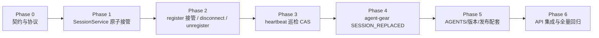

# 云控制器重复登录新连接接管 - 实现计划

**功能名称**: 云控制器重复登录接管（踢出旧连接）
**关联 PRD**: [`docs/product/draft/20261102-controller-session-takeover.md`](../../product/draft/20261102-controller-session-takeover.md)
**关联提案**: [`docs/engineering/proposals/20261102-feat-controller-session-takeover.md`](../proposals/20261102-feat-controller-session-takeover.md)
**计划版本**: v1.0
**创建日期**: 2026-11-02
**作者**: ZeroAsh Agent
**feat-branch**: `feat/controller-session-takeover`
**关联 PR**: https://github.com/Deliay/z-agent-gear/pull/404

## 1. 实施顺序

严格按「契约 → 服务端会话层 → 服务端连接层 → 巡检 → 客户端 → 文档/版本 → 测试收口」推进，每个切片先写失败测试再实现：



**关键路径**：Phase 1/2 是需求核心（重启后重连不再被 `KEY_ALREADY_ONLINE` 拒绝）；Phase 3 是重启场景的第二个坑（过期巡检不能把刚接管的新连接再踢下线），必须与 Phase 2 同一版本发布，否则「接管成功后又掉线」。Phase 4 决定云电脑客户端被替换后的最终行为（不抢登、不清 Key），先于服务端发布。

## 2. 代码事实核对（计划期确认）

以下事实基于当前分支 `feat/controller-session-takeover`（含 PR #404 文档提交）实际代码：

| # | 事实 | 位置 | 对计划的影响 |
|---|------|------|--------------|
| F1 | `acquireSession` 在 session 存在且 `resumeToken` 不匹配时返回 `false` | `servers/controller-api/src/services/session.ts:8-25` | 直接删除该「拒绝」路径，替换为 `takeoverSession` |
| F2 | register 在 `acquired === false` 时下发 `KEY_ALREADY_ONLINE` 并 `disconnect(true)` | `servers/controller-api/src/services/socketio.ts:204-220` | 改为接管分支；旧 socket 通知与断开在此处插入 |
| F3 | `disconnect` 处理器**无条件** `removeSession(keyId)` 且无条件置 Controller `offline` | `servers/controller-api/src/services/socketio.ts:768-774` | 改 `releaseSession` 所有权校验，仅释放成功才 offline |
| F4 | `unregister` 无所有权校验，直接删 Controller / ControllerKey / 整份 session | `servers/controller-api/src/services/socketio.ts:305-320` | 增加当前 session 校验，旧 socket 无权注销新连接 |
| F5 | `heartbeat` 处理器没有会话所有权校验，只按 keyId 刷新 session TTL 与 `lastHeartbeatAt` | `servers/controller-api/src/services/socketio.ts:288-300` | 刷新的是同一 `session:<keyId>` 的 TTL，不会覆盖 socketId；本期不加逐次 GET（见 D5） |
| F6 | 巡检是「`find` 快照 → `updateMany` 无条件 offline → `getSocketId` → `cleanupKey`」 | `servers/controller-api/src/services/heartbeat.ts:44-61` | 改为逐条 `findOneAndUpdate` CAS + 使用 CAS 前捕获的 socketId 释放 |
| F7 | `command.ts` 的 `shutdown` 指令按 `getSocketId` 定位当前 socket，再 `cleanupKey` | `servers/controller-api/src/services/command.ts:59-73` | 定向的是**当前**会话，接管后自动指向新连接；本期不改（见 D4） |
| F8 | 客户端 `KEY_ALREADY_ONLINE` 分支在云电脑模式按 1s→30s 退避重连，本地模式仅 disconnect | `packages/agent-controller/src/socketio-client.ts:581-595` | 保留旧服务端兼容分支；新增 `SESSION_REPLACED` 前置分支 |
| F9 | 客户端通用错误分支：云电脑 `notifyShutdown({reason:'error: CODE'})`，本地 `exit(1)`；`shutdown` 分支会 `clearConfigKey` | `packages/agent-controller/src/socketio-client.ts:557-630` | `SESSION_REPLACED` 不能走通用分支（会清 Key / 云电脑按失败重启），需独立分支 |
| F10 | `resolveShutdownExitCode` 的 42 仅识别 `unregistered` 与 `error: INVALID_TOKEN`，其余默认 42 | `packages/agent-controller/src/exit-codes.ts` | `reason: 'session_replaced'` 走默认 42，无需改分类函数；需补契约与测试锚点 |
| F11 | `agent-gear` 当前版本 `2.15.0`，worker 镜像固定 `agent-gear@2.15.x`；`packages/agent-controller/AGENTS.md` 版本段仍写 `2.13.0` | `packages/agent-controller/package.json`、`deploy/images/worker/Dockerfile:128`、`deploy/images/worker/BUILD.md:299`、`packages/agent-controller/AGENTS.md` | 客户端行为变更需新版本发布；本计划顺带修正 AGENTS 版本口径（见 D6） |
| F12 | 仓库内此前无 ioredis `eval` 调用 | `servers/` 全量检索 | Lua 脚本为本期首次引入，需在单测中 mock `eval` 并按真实返回类型断言 |
| F13 | `session.test.ts` mock 仅含 `get/set/del/expire`；`socketio.test.ts` mock 含 `acquireSession`；`heartbeat.test.ts` mock 为 `find + updateMany + cleanupKey` | 三个单测文件 | 三个测试文件随实现同步改写，不能只加新用例 |
| F14 | API 集成测试已具备 `ioredis` 依赖与 `REDIS_URL` 约定，但 `controller-api/websocket.test.ts` 尚未直连 Redis | `tests/api/package.json`、`tests/api/AGENTS.md:81` | 重启残留用例按 `workflow.test.ts` 模式用 `new Redis(REDIS_URL)` 预置 `session:<keyId>` |

## 3. 变更清单

### 3.1 Phase 0：契约与协议（先于代码）

| 文件 | 变更 |
|------|------|
| `contracts/agent-controller-websocket.md` | §2.2 `register` 说明「校验通过后新连接接管既有 session，`resumeToken` 不再作为抢占判据」；§2.4 `error` 错误码表新增 `SESSION_REPLACED`（并把 `KEY_ALREADY_ONLINE` 标注 deprecated / 服务端不再下发）；§3.3「单 session 控制」改为「新连接接管 + 旧连接收到替换通知后断开」；§3.7 退出码表在 42 语义中补 `SESSION_REPLACED`（服务端终止、入口不重启） |
| `contracts/cloud-controller-websocket.md` | §「错误码」注记补 `SESSION_REPLACED` 同属本地 controller 场景、`/worker` 通道不使用 |

> 契约先行：先提交契约改动并让下游按新枚举实现；`KEY_ALREADY_ONLINE` 枚举保留不删，避免旧客户端/旧日志解析断裂。

### 3.2 Phase 1：controller-api `SessionService`

| 文件 | 变更 |
|------|------|
| `servers/controller-api/src/services/session.ts` | 新增 `takeoverSession(keyId, socketId): Promise<string \| null>`（Lua 原子 `GET + SET EX 90`，返回旧 socketId）；新增 `releaseSession(keyId, socketId): Promise<boolean>`（Lua compare-and-delete）；删除 `acquireSession`；`removeSession` 保留为 `cleanupKey` 内部实现与既有调用面；`SESSION_TTL` 不变 |
| `servers/controller-api/src/services/session.test.ts` | 重写 `acquireSession` 两段用例为 `takeoverSession`（T-ST1/T-ST2）与 `releaseSession`（T-ST3/T-ST4）；`resumeToken` 相关用例改为「不再参与接管判据」；mock 增加 `eval` |

Lua 脚本（与提案 §4.2 逐字一致）：

```lua
-- takeoverSession
local previous = redis.call('GET', KEYS[1])
redis.call('SET', KEYS[1], ARGV[1], 'EX', ARGV[2])
return previous
```

```lua
-- releaseSession
if redis.call('GET', KEYS[1]) == ARGV[1] then
  return redis.call('DEL', KEYS[1])
end
return 0
```

### 3.3 Phase 2：controller-api 注册/断线/注销

| 文件 | 变更 |
|------|------|
| `servers/controller-api/src/services/socketio.ts` | ① register 校验通过后调用 `takeoverSession(keyId, socket.id)`；`previousSocketId` 存在且不等于当前 socket 时，向旧 socket `emit('error', withTraceMeta({ code: 'SESSION_REPLACED', ... }))` 后 `disconnect(true)`，并记录 `event: 'session_replaced'`；② register 成功时把 `hostname`/`version` 写入 `socket.data`（供接管日志读取旧连接信息，缺失时为 `null`）；③ disconnect 改 `releaseSession`，仅释放成功才置 Controller `offline`；④ unregister 增加当前 session 所有权校验（`current && current !== socket.id` 时直接断开返回） |
| `servers/controller-api/src/services/socketio.test.ts` | 原 `KEY_ALREADY_ONLINE` 用例改写为接管用例（T-ST5）；新增旧 socket 通知/断开、同 socket 重复 register 不自踢、disconnect 不删新 session（T-ST6）、旧 socket unregister 被拒（T-ST7）、非法 Key/凭据/版本不接管（T-ST8）；mock 改 `takeoverSession` / `releaseSession` / `getSocketId` |
| `servers/controller-api/src/services/socketio-trace.test.ts` | 同步 mock 改名（仅机械替换，行为断言不变） |

实现骨架（register 接管段）：

```ts
const previousSocketId = await sessionService.takeoverSession(keyId, socket.id);
if (previousSocketId && previousSocketId !== socket.id) {
  const previous = io.sockets.sockets.get(previousSocketId);
  if (previous) {
    logger.info(
      {
        event: 'session_replaced',
        keyId,
        previousSocketId,
        newSocketId: socket.id,
        previousHostname: previous.data.hostname ?? null,
        newHostname: hostname ?? null,
        previousVersion: previous.data.version ?? null,
        newVersion: version ?? null,
      },
      'session replaced by newer login',
    );
    previous.emit('error', withTraceMeta({
      code: 'SESSION_REPLACED',
      message: 'Key has been logged in from another connection',
    }));
    previous.disconnect(true);
  }
  // previous 为空：重启残留 session，仅覆盖，不报错
}
```

实现骨架（disconnect）：

```ts
if (socket.data.keyId) {
  const released = await sessionService.releaseSession(socket.data.keyId, socket.id);
  if (released) {
    await Controller.updateOne(
      { keyId: socket.data.keyId, status: { $ne: 'unbound' } },
      { status: 'offline' },
    );
  }
}
// 其余 mcpRelay / acpSessionSync / elicitation / harnessLogin / acpSessionManager 清理保持原样
```

实现骨架（unregister 前置）：

```ts
const current = await sessionService.getSocketId(keyId);
if (current && current !== socket.id) {
  socket.disconnect(true);
  return;
}
```

### 3.4 Phase 3：心跳巡检 CAS + 所有权释放

| 文件 | 变更 |
|------|------|
| `servers/controller-api/src/services/heartbeat.ts` | `find` 候选集保留；删除一次性 `updateMany`，改为逐条：**先捕获** `sessionService.getSocketId(keyId)` → `Controller.findOneAndUpdate({ _id, status: 'online', lastHeartbeatAt: { $lt: threshold } }, { status: 'offline' })` → 未命中直接跳过 → 命中后只处理捕获的 socketId（发 `shutdown { reason: 'heartbeat_timeout' }` + `disconnect(true)`，再 `releaseSession`；`released === true` 才 `removeHeartbeat` / `removeResumeToken`）；捕获不到 socketId 时只清 heartbeat/resume，**不删 session** |
| `servers/controller-api/src/services/heartbeat.test.ts` | mock 改 `findOneAndUpdate`；新增 T-ST9（接管后清理旧 socketId，新 session 保留）、T-ST13（CAS 不命中不 offline / 不断开 / 不清理）、T-ST14（已捕获旧 socketId 后发生接管，`releaseSession` 失败，新 session/heartbeat 保留）；保留「无候选不写」用例 |

实现骨架：

```ts
for (const candidate of offlineControllers) {
  const keyId = candidate.keyId.toString();
  // 先捕获所有权：后续只认这个 socketId，不重新读取
  const socketId = await sessionService.getSocketId(keyId);

  const markedOffline = await Controller.findOneAndUpdate(
    {
      _id: candidate._id,
      status: 'online',
      lastHeartbeatAt: { $lt: threshold },
    },
    { status: 'offline' },
    { returnDocument: 'after' },
  );
  if (!markedOffline) continue; // 新连接已刷新心跳 → CAS 不命中，整体跳过

  if (socketId && this.io) {
    this.io.to(socketId).emit('shutdown', withTraceMeta({ reason: 'heartbeat_timeout' }));
    this.io.sockets.sockets.get(socketId)?.disconnect(true);
  }

  if (!socketId) {
    // 无会话：只清理心跳/恢复凭据，避免误删并发写入的新 session
    await sessionService.removeHeartbeat(keyId);
    await sessionService.removeResumeToken(keyId);
    continue;
  }

  const released = await sessionService.releaseSession(keyId, socketId);
  if (released) {
    await sessionService.removeHeartbeat(keyId);
    await sessionService.removeResumeToken(keyId);
  }
}
```

> 60s 无心跳阈值、15s 巡检周期保持不变；只把「先快照后无条件更新」收窄为「逐条 CAS + 捕获所有权」。

### 3.5 Phase 4：agent-gear 客户端

| 文件 | 变更 |
|------|------|
| `packages/agent-controller/src/socketio-client.ts` | `socket.on('error')` 最前面新增 `SESSION_REPLACED` 分支：记 `event: 'session_replaced'`（不输出 Key）→ `socket.disconnect()`（停止 Socket.IO 自动重连）→ 云电脑模式 `notifyShutdown({ reason: 'session_replaced' })`，本地模式 `process.exit(EXIT_SERVER_SHUTDOWN)`；**不调用** `clearConfigKey` / `clearResumeTokenFromConfig` |
| `packages/agent-controller/src/socketio-client.test.ts` | 新增 T-ST10：本地模式不重连、不清 Key、退出 42；云电脑模式 `onShutdown({reason:'session_replaced'})` 且不被当成失败类；保留既有 `KEY_ALREADY_ONLINE` 退避用例（旧服务端兼容） |
| `packages/agent-controller/src/exit-codes.test.ts` | 补 `resolveShutdownExitCode('session_replaced') === 42`（防未来误改分类） |
| `packages/agent-controller/package.json` | 版本 `2.15.0 → 2.16.0`（见 D6） |

客户端分支（与提案 §5.2 实现点 6 一致）：

```ts
if (data.code === 'SESSION_REPLACED') {
  log.info({ event: 'session_replaced' }, 'connection replaced by a newer login');
  socket.disconnect();
  if (options?.onShutdown) {
    notifyShutdown({ reason: 'session_replaced' });
    return;
  }
  process.exit(EXIT_SERVER_SHUTDOWN);
  return;
}
```

### 3.6 Phase 5：文档、版本与发布配套

| 文件 | 变更 |
|------|------|
| `servers/controller-api/AGENTS.md` | 新增「重复登录接管（SESSION_REPLACED）」小节：原子 takeover、旧 socket 通知与断开、断线/注销所有权、巡检 CAS 口径；同步单实例约束（多副本需 Redis adapter，另立提案） |
| `packages/agent-controller/AGENTS.md` | 云电脑模式小节补充 `SESSION_REPLACED` 语义（不重连、不清 Key、42 退出）；更新版本段（`2.13.0 → 2.16.0`，说明 `SESSION_REPLACED` 自 2.16.0 起）；保留 `KEY_ALREADY_ONLINE` 退避说明为「旧服务端兼容」 |
| `tests/api/AGENTS.md` | 「Controller WebSocket API」表格中 `session 独占 - 重复 key` 行改为「第二连接接管、第一连接收到 SESSION_REPLACED 并断开」；新增重启残留/巡检行 |
| `deploy/images/worker/Dockerfile` / `deploy/images/worker/BUILD.md` | `agent-gear@2.15.x → 2.16.x`（随客户端发布同步；不提升 cloud-controller harness 版本门禁——旧客户端仅降级重连，不阻断连接） |
| `docs/engineering/AGENTS.md` | 「实现计划」索引登记本文件 |
| `docs/product/AGENTS.md` | 「草稿文档」索引补登 `draft/20261102-controller-session-takeover.md`（上游 PR #404 遗漏） |

**发布顺序（提案 §9.3）**：

1. 发布 `agent-gear@2.16.0`（识别 `SESSION_REPLACED`）；
2. 发布 `controller-api`（开始下发 `SESSION_REPLACED`）；
3. 更新 worker 镜像到 `agent-gear@2.16.x`。

> `controller-api` 启动时**不批量清空** `session:*`：重启后由客户端重连触发按 Key 接管即可恢复。

### 3.7 Phase 6：API / 集成测试

| 文件 | 变更 |
|------|------|
| `tests/api/src/controller-api/websocket.test.ts` | ① 改写 `session exclusivity`：client1 注册成功后 client2 同 Key 注册 → client2 收到 `registered`，client1 收到 `SESSION_REPLACED` 且断开，client2 心跳后持续在线（T-ST11）；② 新增「重启残留」用例：直连 Redis（`REDIS_URL`）写入 `session:<keyId>=dead-socket-id`，client 不带 `resumeToken` 注册 → 收到 `registered` 且全程无 `KEY_ALREADY_ONLINE`（T-ST12）；③ 新增端到端重启/巡检用例：残留 session 接管后，等待心跳巡检窗口（或将 controller 的 `lastHeartbeatAt` 置为超时）验证 controller 仍为 online、socket 未被 shutdown（T-ST15） |
| `tests/api/AGENTS.md` | 同步用例清单（见 Phase 5） |

> T-ST15 在 API 层以「预置残留 + 接管 + 触发一次巡检」实现；不真正重启进程，避免测试不可控。真实重启由 Phase 6 手工验收 checklist 覆盖。

## 4. TDD 测试矩阵

### 4.1 单元测试

| 编号 | 文件 | 断言 |
|------|------|------|
| T-ST1 | `session.test.ts` | `takeoverSession` 无旧 session → 返回 `null`；`eval` 参数为 key + 新 socketId + TTL 90 |
| T-ST2 | `session.test.ts` | `takeoverSession` 有旧 session → 返回旧 socketId 并覆盖 |
| T-ST3 | `session.test.ts` | `releaseSession` socketId 匹配 → `eval` 返回 1 → `true` |
| T-ST4 | `session.test.ts` | `releaseSession` socketId 不匹配 → `eval` 返回 0 → `false` |
| T-ST5 | `socketio.test.ts` | 同 Key 第二次 register → 新 socket `registered`；旧 socket 收到 `SESSION_REPLACED` 且 `disconnect(true)`；日志 `event: 'session_replaced'` 含新旧 socketId |
| T-ST5b | `socketio.test.ts` | `previousSocketId === socket.id` → 不自踢（同一 socket 重复 register） |
| T-ST6 | `socketio.test.ts` | 接管后旧 socket disconnect → `releaseSession=false` → 不调用 `Controller.updateOne` offline |
| T-ST7 | `socketio.test.ts` | 旧 socket `unregister` → `getSocketId !== socket.id` → 直接断开；Controller/ControllerKey/`cleanupKey` 零调用 |
| T-ST8 | `socketio.test.ts` | 非法 Key / bcrypt 失败 / 版本不兼容 → 不调用 `takeoverSession`，旧 socket 不收 `SESSION_REPLACED` |
| T-ST9 | `heartbeat.test.ts` | 巡检捕获旧 socketId，`releaseSession` 返回 false → 新 session/heartbeat 不被删；不向新 socket 发 shutdown |
| T-ST10 | `socketio-client.test.ts` | `SESSION_REPLACED` → 本地不重连、不清 Key、`process.exit(42)`；云电脑 `notifyShutdown({reason:'session_replaced'})` |
| T-ST10b | `exit-codes.test.ts` | `resolveShutdownExitCode('session_replaced') === 42` |
| T-ST13 | `heartbeat.test.ts` | 候选快照过期但 `findOneAndUpdate` 未命中（新心跳已刷新）→ 不 offline、不发 shutdown、不清理 |
| T-ST14 | `heartbeat.test.ts` | CAS 命中后、`releaseSession` 前发生接管 → `releaseSession` 返回 false → 不删 heartbeat/resume，新 session 保留 |

### 4.2 API / 集成测试

| 编号 | 文件 | 断言 |
|------|------|------|
| T-ST11 | `tests/api/src/controller-api/websocket.test.ts` | 真实 Redis + Socket.IO：client1 在线 → client2 同 Key 注册成功 → client1 收到 `SESSION_REPLACED` 并断开 → client2 心跳后保持在线 |
| T-ST12 | 同上 | Redis 预置 `session:<keyId>`=不存在的 socketId，register 不携带 `resumeToken` → `registered`，无 `KEY_ALREADY_ONLINE` |
| T-ST15 | 同上 | 残留 session 接管后触发巡检（将 `lastHeartbeatAt` 置为超时）→ 新连接仍 online、未收到 `shutdown`、`session:<keyId>` 仍为新 socketId |

### 4.3 回归

| 范围 | 要求 |
|------|------|
| `session.test.ts` | 既有 `refreshSession` / `removeSession` / `getSocketId` / `storeResumeToken` / `cleanupKey` 用例保持通过 |
| `socketio.test.ts` | 既有 register 成功/非法 Key/版本不匹配、heartbeat、unregister 正常路径、disconnect 匿名连接诊断用例保持通过 |
| `heartbeat.test.ts` | 60s 超时口径、15s 周期、空候选零写入保持通过 |
| `socketio-client.test.ts` | 既有 `KEY_ALREADY_ONLINE` 退避、`shutdown` / `unregistered` / `INVALID_TOKEN` 退出码行为不变 |
| `tests/api` | 其余 controller-api / agent-api 套件串行全量通过 |

## 5. 计划期裁决

| 编号 | 裁决 | 理由 |
|------|------|------|
| D1 | 删除 `acquireSession`，不保留 deprecated 包装 | 仓库内唯一调用点是 register，保留双 API 会留下「可能拒绝」的第二条路径；`resumeToken` 仅兼容保留（继续下发、不再判据） |
| D2 | `SESSION_REPLACED` 用 `error` 事件而非 `shutdown` | `shutdown` 现有语义会 `clearConfigKey`（本地）且云电脑按 reason 分类；新增错误码可精确表达「被替换」，且旧客户端不会误清 Key |
| D3 | `KEY_ALREADY_ONLINE` 枚举与客户端退避分支**保留** | 新旧混部时旧服务端仍可能下发；删除会让旧服务端场景退化。契约标注 deprecated，服务端不再下发 |
| D4 | `command.ts` 的 `shutdown`/注销链路不改 | 该链路按 `getSocketId` 定位**当前**会话，接管后自动指向新连接；改它属于扩大范围 |
| D5 | heartbeat 处理器不加逐次所有权 GET | 旧 socket 在接管时已被 `disconnect(true)`，不会继续发送心跳；即使有在途心跳，它只刷新同一 `session:<keyId>` 的 TTL 与 `lastHeartbeatAt`，不会覆盖 socketId。逐次 GET 会给所有在线控制器增加每 30s 的 Redis 读，收益不足 |
| D6 | agent-gear 版本 `2.15.0 → 2.16.0`，worker 镜像固定 `2.16.x` | 客户端新增协议分支属于功能变更，按仓库惯例走 minor；不提升 `MIN_HARNESS_WORKER_VERSION`（旧客户端仅降级重试，不影响连接与容器生命周期） |
| D7 | 巡检对「无 socketId」只清 heartbeat/resume、不删 session | 避免巡检与并发 register 竞争时误删刚写入的新 session（提案 §5.2 实现点 5） |
| D8 | 旧 socket 的 disconnect 仍执行 ACP/MCP/elicitation 清理 | 旧 socket 的资源必须回收；只阻断「删 session / 置 offline」两项会伤害新连接的副作用。ACP 活跃会话按既有 `disconnected` + `acp:reconcile` 语义恢复 |
| D9 | 不新增 Mongo/GraphQL 字段、不加配置项 | 纯运行时行为调整；`SESSION_TTL=90`、巡检阈值与周期不变 |
| D10 | T-ST15 不真正重启进程 | API 套件共享服务，杀进程不可控；以「预置残留 session + 触发巡检」等价覆盖，真实重启放入手工验收 |
| D11 | 单副本约束写入 AGENTS | `io.sockets.sockets.get(previousSocketId)` 仅本实例可寻址；跨副本接管需 Redis adapter，另立提案 |

## 6. 风险与回滚

| 风险 | 影响 | 缓解 |
|------|------|------|
| `emit('error')` 后立即 `disconnect(true)` 可能丢包 | 旧客户端收不到替换通知，退化为普通断线 | 沿用既有 `INVALID_KEY`/`VERSION_MISMATCH` 同一时序；T-ST5/T-ST11 断言旧客户端确实收到事件；实测丢包则改为 `disconnect(false)` 或先 flush 连接 |
| 旧版本客户端收到未知 `SESSION_REPLACED` | 本地 `exit(1)`；云电脑按失败类重启一次 | Key 按主机唯一分配，同 Key 两个存活进程属异常，不形成持续互踢；发布说明提示升级；服务端不回滚到拒绝新连接 |
| 巡检逐条 CAS 写放大 | 候选集通常很小（仅异常控制器），开销可忽略 | 保留一次性 `find` 候选集；T-ST13/T-ST14 固化语义 |
| 多副本部署 | 旧 socket 可能不在本实例，无法通知/断开 | 当前 Aspire 与 deploy 均单副本；D11 在 AGENTS 与提案中标注约束 |
| 新连接接管后旧 ACP 会话短暂 `disconnected` | 用户需按既有方式恢复会话 | 与现有网络重连语义一致；`acp:reconcile` 保留进程 |
| 回滚 | — | 服务端回滚到旧版本即恢复「拒绝新连接」；客户端 2.16.0 对旧服务端的 `KEY_ALREADY_ONLINE` 分支保留，可安全回退 |

## 7. 命令参考

```bash
# 依赖安装（仓库已迁移 pnpm）
pnpm install

# controller-api
cd servers/controller-api && pnpm test
cd servers/controller-api && pnpm run build

# agent-gear
cd packages/agent-controller && pnpm test
cd packages/agent-controller && pnpm run build

# API 集成（需 Aspire 全量服务就绪）
aspire start
aspire wait controller-api agent-api
cd tests/api && pnpm test
# 仅 controller-api 套件
cd tests/api && pnpm exec vitest run src/controller-api/websocket.test.ts

# 覆盖率
cd servers/controller-api && pnpm run test:coverage
cd packages/agent-controller && pnpm run test:coverage
```

## 8. 验收 checklist

### 8.1 Phase 1/2（会话与连接层）

- [ ] `takeoverSession` / `releaseSession` 单测通过，无 `acquireSession` 残留引用
- [ ] 同 Key 第二次 register：新连接 `registered`，旧 socket 收到 `SESSION_REPLACED` 并断开
- [ ] 旧 socket 断线回调不删新 session、不置 Controller offline
- [ ] 旧 socket `unregister` 被拒，Key/Controller/session 不被删除
- [ ] 非法 Key / 错误凭据 / 版本不兼容不触发接管

### 8.2 Phase 3（巡检）

- [ ] CAS 不命中时 controller 保持 online、无 shutdown、无清理
- [ ] CAS 命中时只断开/释放捕获的旧 socketId
- [ ] 捕获不到 socketId 时不删 session

### 8.3 Phase 4（客户端）

- [ ] 本地模式：不重连、不清 Key、42 退出
- [ ] 云电脑模式：`notifyShutdown({reason:'session_replaced'})`，最终 42 退出、入口不重启
- [ ] 旧服务端 `KEY_ALREADY_ONLINE` 退避行为保持

### 8.4 Phase 6（重启核心场景，手工 + 集成）

- [ ] Redis 保留 `session:<keyId>` 残留、旧 socket 已关闭 → 云容器客户端重连成功，无「已在线」提示
- [ ] 重启后第一轮心跳巡检不把新连接置 offline / 断开 / 删 session
- [ ] 控制器列表在线来源为新连接
- [ ] 后续心跳、指令、ACP 会话操作正常
- [ ] 契约与各 AGENTS.md 已同步

## 9. 相关文档

- [产品需求 v1.1](../../product/draft/20261102-controller-session-takeover.md)
- [技术提案 v1.1](../proposals/20261102-feat-controller-session-takeover.md)
- [控制器 WebSocket 契约](../../../contracts/agent-controller-websocket.md)
- [controller-api AGENTS](../../../servers/controller-api/AGENTS.md)
- [agent-controller AGENTS](../../../packages/agent-controller/AGENTS.md)
- [测试规范 AGENTS](../../../tests/api/AGENTS.md)
- [需求来源：GitHub Issue #386](https://github.com/Deliay/z-agent-gear/issues/386)
- [关联 PR #404](https://github.com/Deliay/z-agent-gear/pull/404)
