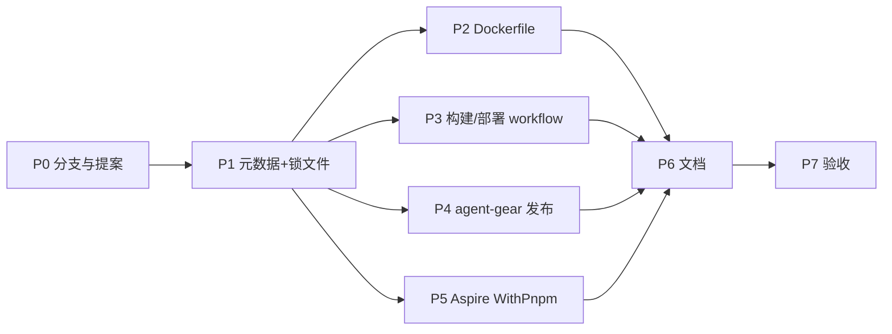

# 全仓 npm 包管理迁移 pnpm - 实现计划

**功能名称**: 全仓 npm 包管理迁移 pnpm（含 Dockerfile、GitHub Actions、Aspire 编排、agent-controller 发布）
**关联 PRD**: 无（工程效能/基础设施改造）
**关联提案**: `docs/engineering/proposals/20261102-feat-pnpm-migration.md`
**计划版本**: v1.0
**创建日期**: 2026-11-02
**作者**: ZeroAsh Agent
**feat-branch**: `feat/pnpm-migration`

## 1. 实施顺序

严格按「项目元数据/锁文件 → Dockerfile → CI → 发布 → Aspire → 文档 → 验收」推进。P1 是所有后续阶段的前置；P2/P3/P5 可在 P1 完成后并行，P4 依赖 P1 与 npmjs Trusted Publisher 配置。



## 2. 前置条件

| 条件 | 说明 |
|---|---|
| Node.js | 22.12+ / 24；本地推荐 24（与 CI 一致） |
| pnpm | 12.16.1；`corepack enable` 或 `npm install -g pnpm@12.16.1` |
| Docker | 本地可选；CI 使用 buildx，必须支持 `--mount=type=cache` |
| npmjs | `agent-gear` 已存在；Trusted Publisher 指向 `Deliay/z-agent-gear` + `publish-agent-gear.yml`，允许 `npm publish` |
| 分支 | `feat/pnpm-migration`（需求分支）；实现分支 `feat/pnpm-migration-impl` 基于需求分支 |

## 3. P1：项目元数据与锁文件

### 3.1 统一 `package.json` 变更

9 个项目：

- `apps/admin-web/package.json`
- `apps/agent-web/package.json`
- `packages/agent-controller/package.json`
- `servers/admin-api/package.json`
- `servers/agent-api/package.json`
- `servers/controller-api/package.json`
- `servers/cloud-controller/package.json`
- `tests/api/package.json`
- `tests/e2e/package.json`

每个文件增加：

```json
"packageManager": "pnpm@12.16.1"
```

`packages/agent-controller/package.json` 额外增加：

```json
"publishConfig": {
  "access": "public",
  "registry": "https://registry.npmjs.org/"
}
```

### 3.2 每项目 `pnpm-workspace.yaml`

pnpm 12 不再读取 `package.json#pnpm`，构建脚本白名单必须放在项目根的 `pnpm-workspace.yaml`。省略 `packages` 字段表示只包含当前项目，不建立跨项目 workspace。

```yaml
# apps/admin-web / apps/agent-web / tests/api / tests/e2e
allowBuilds:
  fsevents: true
```

```yaml
# packages/agent-controller
allowBuilds:
  esbuild: true
  fsevents: true
```

```yaml
# servers/admin-api / servers/agent-api / servers/cloud-controller
allowBuilds:
  esbuild: true
  protobufjs: true
  fsevents: true
  mongodb-memory-server: false
```

```yaml
# servers/controller-api
allowBuilds:
  esbuild: true
  protobufjs: true
  fsevents: true
```

> 实施时以 `pnpm install` 实际报错为准补充白名单；`mongodb-memory-server` 必须保持 `false`，不得改为 `true`。

### 3.3 锁文件生成

逐项目执行（顺序不可颠倒）：

```bash
cd <project>

# 1) 写入 pnpm-workspace.yaml（见 3.2）
# 2) 从 npm 锁导入精确版本
pnpm import

# 3) 删除 npm 锁文件
git rm package-lock.json

# 4) 冻结安装验证
pnpm install --frozen-lockfile
```

验收：`pnpm-lock.yaml` 中的直接依赖版本与删除前的 `package-lock.json` 一致；如出现差异，记录原因并确认无行为风险后再继续。

### 3.4 P1 测试

逐项目：

```bash
pnpm install --frozen-lockfile
pnpm test
```

可构建项目追加：

```bash
cd apps/admin-web && pnpm run lint && pnpm run build
cd apps/agent-web && pnpm run lint && pnpm run build
cd servers/admin-api && pnpm run build
cd servers/agent-api && pnpm run build
cd servers/controller-api && pnpm run build
cd servers/cloud-controller && pnpm run build
cd packages/agent-controller && pnpm run build
```

### 3.5 文件清单

| 项目 | 修改 | 新增 | 删除 |
|---|---|---|---|
| apps/admin-web | `package.json` | `pnpm-lock.yaml`、`pnpm-workspace.yaml` | `package-lock.json` |
| apps/agent-web | `package.json` | 同上 | 同上 |
| packages/agent-controller | `package.json` | 同上 | 同上 |
| servers/admin-api | `package.json` | 同上 | 同上 |
| servers/agent-api | `package.json` | 同上 | 同上 |
| servers/controller-api | `package.json` | 同上 | 同上 |
| servers/cloud-controller | `package.json` | 同上 | 同上 |
| tests/api | `package.json` | 同上 | 同上 |
| tests/e2e | `package.json` | 同上 | 同上 |

## 4. P2：Dockerfile

### 4.1 统一模板

```dockerfile
# syntax=docker/dockerfile:1
FROM node:<22|24>-alpine AS build

ARG PNPM_VERSION=12.16.1
WORKDIR /app
RUN corepack enable && corepack prepare pnpm@${PNPM_VERSION} --activate
COPY package.json pnpm-lock.yaml pnpm-workspace.yaml ./
RUN --mount=type=cache,id=pnpm-store,target=/pnpm/store \
    pnpm install --frozen-lockfile --store-dir=/pnpm/store
COPY . .
RUN pnpm run build

FROM node:<22|24>-alpine AS runtime

ARG PNPM_VERSION=12.16.1
WORKDIR /app
ENV NODE_ENV=production
RUN corepack enable && corepack prepare pnpm@${PNPM_VERSION} --activate
COPY package.json pnpm-lock.yaml pnpm-workspace.yaml ./
RUN --mount=type=cache,id=pnpm-store,target=/pnpm/store \
    pnpm install --prod --frozen-lockfile --store-dir=/pnpm/store
COPY --from=build /app/dist ./dist

USER node
ENTRYPOINT ["node", "dist/index.js"]
```

### 4.2 逐文件

| 文件 | 基础镜像 | 特殊点 |
|---|---|---|
| `apps/admin-web/Dockerfile` | build `node:24-alpine`，runtime `nginx:1.27-alpine` | 只需 build 阶段 pnpm；保留 `ARG VITE_ADMIN_API_URL` 与 `pnpm run build`；新增 `# syntax` |
| `servers/admin-api/Dockerfile` | `node:24-alpine` | build + runtime 双阶段；runtime `--prod`；保留 `EXPOSE 4002` |
| `servers/cloud-controller/Dockerfile` | `node:24-alpine` | 同上；保留 `EXPOSE 4003` |
| `servers/agent-api/Dockerfile` | `node:22-alpine` | build 阶段装全量依赖；runtime 沿用 `COPY --from=build /app /app` + `node src/index.ts` |
| `servers/controller-api/Dockerfile` | `node:22-alpine` | 同 agent-api |
| `deploy/images/worker/Dockerfile` | — | **不改**（npm 自举链） |

### 4.3 P2 验证

```bash
# 有 Docker 的机器
docker build -f apps/admin-web/Dockerfile -t zag/admin-web:pnpm apps/admin-web
docker build -f servers/admin-api/Dockerfile -t zag/admin-api:pnpm servers/admin-api
docker build -f servers/agent-api/Dockerfile -t zag/agent-api:pnpm servers/agent-api
docker build -f servers/controller-api/Dockerfile -t zag/controller-api:pnpm servers/controller-api
docker build -f servers/cloud-controller/Dockerfile -t zag/cloud-controller:pnpm servers/cloud-controller
```

无 Docker 环境时由 P3 的 CI workflow 验证；P7 检查 CI 结果。

## 5. P3：构建/部署 workflow

### 5.1 统一替换

每个 workflow：

```yaml
- uses: pnpm/action-setup@v6.1.0
  with:
    version: 12.16.1

- uses: actions/setup-node@v4
  with:
    node-version: '24'
    cache: pnpm
    cache-dependency-path: <project>/pnpm-lock.yaml
```

命令替换：

| 原命令 | 新命令 |
|---|---|
| `npm ci` | `pnpm install --frozen-lockfile` |
| `npm test` | `pnpm test` |
| `npx vitest run` | `pnpm exec vitest run` |
| `npm run lint` | `pnpm run lint` |
| `npm run build` | `pnpm run build` |

### 5.2 逐文件

| 文件 | 变更 |
|---|---|
| `.github/workflows/build-admin-api-image.yml` | 安装/测试改 pnpm；`MONGOMS` 缓存键改 `servers/admin-api/pnpm-lock.yaml`；保留 `node node_modules/mongodb-memory-server/postinstall.js`；注释「npm ci 会清空 node_modules」改为 pnpm 口径 |
| `.github/workflows/build-admin-web-image.yml` | 安装 + lint + 测试改 pnpm；`cache: pnpm` |
| `.github/workflows/build-agent-api-image.yml` | 安装 + 测试改 pnpm；`cache: pnpm` |
| `.github/workflows/build-cloud-controller-image.yml` | 同上 |
| `.github/workflows/build-controller-api-image.yml` | 同上 |
| `.github/workflows/deploy-agent-web.yml` | 安装 + 构建改 pnpm |
| `.github/workflows/publish-agent-gear.yml` | 见 P4 |

### 5.3 检查

```bash
grep -rn "npm ci\|cache: npm\|npx " .github/workflows/
grep -rn "pnpm/action-setup" .github/workflows/
```

除 `publish-agent-gear.yml` 的版本检查（`npm view`）外，不应有残留 npm 安装命令。

## 6. P4：agent-gear 发布 workflow

完整 YAML 见提案 §5.2 实现点 7。落地检查：

1. `pnpm/action-setup@v6.1.0` 在 `actions/setup-node` 之前。
2. `permissions` 保留 `contents: read` + `id-token: write`。
3. 不注入 `NPM_TOKEN` / `NODE_AUTH_TOKEN`。
4. `env.NPM_CONFIG_REGISTRY=https://registry.npmjs.org/`。
5. `pnpm publish --access public --no-git-checks`。
6. 版本检查步骤对已发布版本跳过。
7. `packages/agent-controller/package.json#publishConfig` 指向 npmjs。

本地预检：

```bash
cd packages/agent-controller
pnpm install --frozen-lockfile
pnpm run build
pnpm test
pnpm pack --dry-run
pnpm publish --dry-run --no-git-checks --access public
```

检查 `pnpm pack` 输出包含 `dist/index.js`、`package.json`、README 等，且 `bin.agent-gear` 指向 `dist/index.js`。

## 7. P5：Aspire AppHost

### 7.1 修改 `aspire/AgentGear.AppHost/AppHost.cs`

在以下资源创建后立即追加 `.WithPnpm()`：

| 资源 | API |
|---|---|
| `controller-api` | `AddNodeApp(...)` |
| `agent-api` | `AddNodeApp(...)` |
| `cloud-controller` | `AddNodeApp(...)` |
| `agent-controller` | `AddNodeApp(...)` |
| `admin-api` | `AddNodeApp(...)` |
| `agent-web` | `AddViteApp(...)`（仅非 publish 模式） |
| `admin-web` | `AddViteApp(...)`（仅非 publish 模式） |

示例：

```csharp
var controllerApi = builder.AddNodeApp("controller-api", "../../servers/controller-api", "src/index.ts")
    .WithPnpm()
    .WithEnvironment("NODE_OPTIONS", "--import tsx")
    // ...
```

```csharp
var agentWeb = builder.AddViteApp("agent-web", "../../apps/agent-web")
    .WithPnpm()
    .WithEnvironment("VITE_CONTROLLER_API_URL", controllerApi.GetEndpoint("http"))
    // ...
```

### 7.2 验证

```bash
dotnet build aspire/AgentGear.AppHost/AgentGear.AppHost.csproj
aspire start
aspire describe
```

观察点：

- 每个 Node/Vite 资源出现 pnpm install 步骤，且使用 `pnpm-lock.yaml`。
- 服务均能启动；`agent-web` / `admin-web` Vite dev server 正常。
- 无 `npm install` 资源。

## 8. P6：文档

逐文件替换安装/启动命令：

| 文件 | 重点 |
|---|---|
| `README.md` | 手动启动改为 `pnpm install` / `pnpm run dev`；补充 pnpm 前置 |
| `apps/admin-web/README.md` | 安装、构建、Docker 说明 |
| `apps/admin-web/AGENTS.md` | Dev Commands |
| `apps/agent-web/AGENTS.md` | Dev Commands |
| `servers/admin-api/AGENTS.md` | Dev Commands 与排障命令 |
| `servers/agent-api/AGENTS.md` | Dev Commands |
| `servers/controller-api/AGENTS.md` | Dev Commands |
| `servers/cloud-controller/AGENTS.md` | Dev Commands |
| `packages/agent-controller/AGENTS.md` | Dev Commands + 发布说明 |
| `tests/api/AGENTS.md` | 测试命令表 |
| `tests/e2e/AGENTS.md` | 测试命令表 |

保留不动的 npm 引用：

- `deploy/images/worker/`（镜像自举与自更新）；
- `apps/agent-web/src/lib/command-template.ts`（面向用户的安装提示）；
- `servers/admin-api/src/migrations/*` 中的工作负载脚本（云电脑内 pnpm 工作负载，已由 017 迁移覆盖）。

## 9. P7：验收矩阵

| 验收项 | 命令/方式 | 期望 |
|---|---|---|
| 锁文件完整性 | `git ls-files '*package-lock.json'` | 空 |
| pnpm 锁文件 | `git ls-files '*pnpm-lock.yaml' \| wc -l` | 9 |
| 干净安装 | 每项目 `pnpm install --frozen-lockfile` | 全部成功 |
| 单元测试 | 每项目 `pnpm test` | 全部通过 |
| 前端 lint/build | `pnpm run lint && pnpm run build` | 通过 |
| 后端 build | `pnpm run build` | 通过 |
| Docker 镜像 | 5 个 Dockerfile | 构建通过；冒烟通过 |
| CI workflow | `grep` + PR 运行 | 无 `npm ci` / `cache: npm` 残留 |
| 发布包 | `pnpm pack --dry-run` | 包含 dist 与 bin |
| 发布 dry-run | `pnpm publish --dry-run --no-git-checks` | 通过 |
| Aspire | `dotnet build` + `aspire start` | 7 个资源使用 pnpm 并启动 |
| 文档 | 全文搜索 `npm install` / `npm run` | 仅保留白名单引用 |

## 10. 回滚

- 回滚合并提交，恢复 `package-lock.json` 与 npm 命令。
- 本次无数据迁移、无运行时协议变更，回滚不影响已发布镜像与 npm 包。
- 若仅 Docker/CI 出问题，可先回滚对应 workflow/Dockerfile，保留 P1 的 pnpm 项目迁移。
