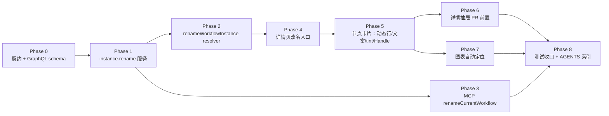

# 工作流迭代 - 实现计划

**功能名称**: 工作流迭代（实例改名 / 节点卡片与图表视图展示修复）
**关联 PRD**: [`docs/product/draft/20261103-workflow-iteration.md`](../../product/draft/20261103-workflow-iteration.md)（v1.0）
**关联提案**: [`docs/engineering/proposals/20261103-feat-workflow-iteration.md`](../proposals/20261103-feat-workflow-iteration.md)（v1.0）
**计划版本**: v1.0
**创建日期**: 2026-11-03
**作者**: z-agent-bot
**feat-branch**: `feat/workflow-iteration`（需求总分支）
**关联 PR**: https://github.com/Deliay/z-agent-gear/pull/418
**需求来源**: GitHub Issue [Deliay/z-agent-gear#414](https://github.com/Deliay/z-agent-gear/issues/414)

## 1. 实施顺序

严格按「契约 → 后端改名 → MCP 工具 → 前端改名入口 → 卡片展示修复 → 抽屉排序 → 图表自动定位 → 测试与文档收口」推进；每个切片先写失败测试再实现（TDD）。



**关键路径**：

- Phase 1 是唯一带状态写入的后端改动，必须先于 resolver 与 MCP 工具；两个入口共用同一份名称校验，禁止各写一份。
- Phase 5 的「补 Handle」是连线不可见问题的**根因修复**，与 E2E-UI4G4（当前红）同一改动转绿；其余三项为纯展示调整。
- Phase 7 是唯一有「时序/防抖动」风险的改动，依赖 Phase 5 后的稳定卡片高度（`estimateNodeHeight` 口径不变，无需调整）。
- 全量改动落在需求总分支 `feat/workflow-iteration`，PR #418 随提交更新。

## 2. 代码事实核对（计划期确认）

以下事实基于当前分支 `feat/workflow-iteration`（HEAD `cccd019a`）实际代码：

| # | 事实 | 位置 | 对计划的影响 |
|---|------|------|--------------|
| F1 | `type Mutation` 已含 `archiveWorkflowInstance` / `deleteWorkflowInstance` / 追加提示词两条，**无改名 mutation** | `contracts/workflow.graphql:336-366` | Phase 0 在 `archiveWorkflowInstance` 之后插入 `renameWorkflowInstance` |
| F2 | agent-api 的 GraphQL schema 是**手写模板字符串**并靠注释「对齐 contracts」，不是 codegen | `servers/agent-api/src/graphql/schemas/workflow.ts:298-317` | 契约与 schema 必须两处同步，漏改 schema 运行时直接 `Cannot query field` |
| F3 | `setArchived` 的归属/软删除口径：`findOne({_id, ...actorFilter(userId), deletedAt:null})` → 未命中抛「工作流实例不存在或无权限」；`updateOne` 落库 | `servers/agent-api/src/services/workflow/instance.ts:656-670` | `rename` 复用同口径，但需**单独区分已删除**（PRD 要求明确提示），故查询不先过滤 `deletedAt` |
| F4 | `WorkflowInstance.name` 仅 `{type:String, required:true}`，**无长度/空白校验**；实例化直接落 `input.name` | `servers/agent-api/src/models/workflow-instance.ts:44`、`instance.ts:184,233` | 1~64 与 trim 为**新增**规则，仅作用于改名入口，不改变实例化历史行为（D2） |
| F5 | `actorFilter(userId)` 在有请求工作区上下文时返回 `{}`（交给 workspace-scope 插件），无上下文时回退 `{userId}` | `servers/agent-api/src/services/workspace-context.ts:84-86` | GraphQL 入口走工作区归属；MCP 入口无 ALS 时按创建者校验，与 `loadScopeContext` 现有口径一致，无新增越权面 |
| F6 | resolver 统一 `wrap()` 把 service 的 `Error.message` 透传为 `GraphQLError` | `servers/agent-api/src/graphql/resolvers/workflow.ts:173-180` | service 抛的中英文文案可原样到前端，无需 `rethrowAsGraphQLError` 映射表 |
| F7 | `workflowResolvers.Mutation` 已在 `resolvers/index.ts` 整体 spread | `resolvers/index.ts:39-55` | 新增 mutation 只在 `workflow.ts` 的 Mutation 对象内登记即可；`index.ts` 的「类型字段登记」规则针对 `WorkflowInstance` 等类型键，与 Mutation 无关 |
| F8 | 平台 MCP 工具定义共 **13** 个；单测断言「提供全部 13 个工具」 | `services/workflow/tool-handlers.ts:48-165`、`tool-handlers.test.ts:107` | 新增 `renameCurrentWorkflow` 后为 14，测试断言与工具数同步更新 |
| F9 | `callWorkflowTool` 先 `loadScopeContext`，`WorkflowInstance.findById` **不过滤 `deletedAt`**，且要求 `scope.nodeId` 存在于实例 | `tool-handlers.ts:172-205,285-290` | 改名分支必须显式判 `deletedAt`（否则与 PRD「已删除实例不可改名」冲突）；工具仅节点会话可用，符合 PRD 场景 |
| F10 | 卡片动态行 `activityText` 拼接 thinking/text 尾部文本；完成态文案「已完成 · 消耗 N tokens」；卡片底色取 `visual.tint` | `apps/agent-web/src/components/workflow/graph/WorkflowNodeCard.tsx:12-16,42,96-112` | 三处均在本文件；`activityText` 可整段删除 |
| F11 | `useNodeSessionActivity` 同时产出 `activity` 与 `tokenUsage`，运行中建立 SSE，DONE 首屏走一次性快照 | `apps/agent-web/src/hooks/useNodeSessionActivity.ts:133-183` | 卡片只需忽略 `activity.text`，仍保留 `active` 以捕获完成前的 `usage_update`（D5） |
| F12 | 全仓库**无** React Flow `Handle` 渲染（`grep Handle` 仅命中按钮变量名） | `components/workflow/graph/` | 自定义节点无连接点时边不渲染 = 连线不可见根因；E2E-UI4G4 断言 `.react-flow__edge-path` 数量 2，当前应红，补 Handle 后转绿 |
| F13 | `NODE_STATUS_VISUAL.tint` 仅被 `WorkflowNodeCard` 消费；列表视图 `WorkflowNodeTree` 只用 `NODE_STATUS_BADGE`，卡片容器无底色 | `WorkflowNodeTreeConstants.ts:30-69`、`WorkflowNodeTree.tsx:59,89` | tint 改 `bg-card` 只影响图表卡片，列表视图零影响（D7） |
| F14 | 详情抽屉中「产物」区块在「关联 Pull Request」之前 | `NodeDetailDrawer.tsx:93-154` | 纯 JSX 顺序调整；单测 T-UI4-SH5 未断言顺序，需补顺序断言 |
| F15 | `WorkflowGraphView` 仅用 `<ReactFlow fitView fitViewOptions={{padding:0.2}}>` 做整图适配，无 `onInit`/实例引用；每次 `instance` 变化重建节点对象并 `setNodes` | `WorkflowGraphView.tsx:61-87,113-137`、`graph-layout.ts:277-315` | 自动定位需 `onInit` 保存实例；定位 effect 依赖必须是「执行中 id 集合」而非节点对象，否则 5s 轮询每轮重新 fitView（D9） |
| F16 | `layoutGraphNodes` 返回含 `y` 的左上角坐标（dagre `rankdir:'TB'`） | `graph-layout.ts:216-243` | `pickFocusWindow` 直接按 `position.y`（同层 `x`）排序即可，无需新增布局 |
| F17 | 实例页 `GET_WORKFLOW_INSTANCE` 5s 轮询且 `notifyOnNetworkStatusChange:false`；标题渲染 `instance.name` | `pages/WorkflowInstancePage.tsx:52-59,131` | 改名成功后即使缓存未命中，5s 内也会刷新；mutation 返回带 `id` 可被 Apollo 归一化 |
| F18 | 现有 E2E 断言需同步：G2 主题、G4 连线、G7 动态行文本、G8「消耗」文案；fixture 为**3 节点**（前后不足 2 个） | `tests/e2e/src/workflow-graph.spec.ts:91-152,202-262`、`phase4-helpers.ts:105-121` | G7/G8 改写；自动定位需新建 7 节点实例（`instantiatePhase4Workflow(..., nodes)` 已支持自定义节点） |
| F19 | `tests/api` 已有 `callWorkflowTool(fake.client, sessionId, mcpToken, name, args)` 与实例/归档用例模式 | `tests/api/src/agent-api/workflow.test.ts:426-460,1851` | 改名 API 用例可同时覆盖 GraphQL 与 MCP 两个入口，无需新基建 |

## 3. 变更清单

### 3.1 Phase 0：契约与 GraphQL schema（先于代码）

| 文件 | 变更 |
|------|------|
| `contracts/workflow.graphql` | `type Mutation` 在 `archiveWorkflowInstance` 后新增：`# 修改工作流实例名称（trim 后 1~64 字符；已删除实例拒绝）\n renameWorkflowInstance(id: ID!, name: String!): WorkflowInstance!` |
| `servers/agent-api/src/graphql/schemas/workflow.ts` | `extend type Mutation` 同步新增同签名（注释同步）；**漏改即运行时字段不存在**（F2） |

错误口径（原样透传，沿用提案 §3.1）：

| 场景 | 文案 |
|------|------|
| 未登录 | `Not authenticated`（`requireUser` 既有行为） |
| 实例不存在 / 非本人 / 不在当前工作区 | `Workflow instance not found` |
| 实例已软删除 | `Workflow instance is deleted` |
| 名称为空 / 纯空白 / 超长 | `invalid workflow name` |

### 3.2 Phase 1：agent-api 改名服务

| 文件 | 变更 |
|------|------|
| `servers/agent-api/src/services/workflow/instance.ts` | 新增导出常量 `WORKFLOW_NAME_MAX_LENGTH = 64` 与纯函数 `normalizeWorkflowName(raw: string): string`（trim → 空或 >64 抛 `invalid workflow name`）；`WorkflowInstanceService` 新增 `rename(userId, id, rawName)`：① 归一名称；② `findOne({_id:id, ...actorFilter(userId)})`（**不过滤 deletedAt**）未命中抛 `Workflow instance not found`；③ `instance.deletedAt` 非空抛 `Workflow instance is deleted`；④ `updateOne({_id:id, deletedAt:null}, {$set:{name}})`，`matchedCount===0` 同样按已删除处理；⑤ 返回更新后的 lean 文档 |
| `servers/agent-api/src/services/workflow/instance.test.ts` | 新增 describe `WorkflowInstanceService.rename`：T-RN1 成功（trim 后落库、返回新名称、`updatedAt` 刷新）；T-RN2 空/纯空白/65 字符拒绝且**不写库**；T-RN3 他人实例拒绝；T-RN4 已删除实例拒绝且文案为 `Workflow instance is deleted`；T-RN5 名称首尾空格被 trim；T-RN6 64 字符边界通过、65 字符拒绝 |

实现骨架：

```ts
export const WORKFLOW_NAME_MAX_LENGTH = 64;
export const WORKFLOW_NAME_INVALID = 'invalid workflow name';

export function normalizeWorkflowName(raw: string): string {
  const name = typeof raw === 'string' ? raw.trim() : '';
  if (!name || name.length > WORKFLOW_NAME_MAX_LENGTH) throw new Error(WORKFLOW_NAME_INVALID);
  return name;
}

async rename(userId: string, id: string, rawName: string) {
  const name = normalizeWorkflowName(rawName);
  const instance = await WorkflowInstance.findOne({ _id: id, ...actorFilter(userId) }).lean();
  if (!instance) throw new Error('Workflow instance not found');
  if (instance.deletedAt) throw new Error('Workflow instance is deleted');
  const result = await WorkflowInstance.updateOne({ _id: id, deletedAt: null }, { $set: { name } });
  if (result.matchedCount === 0) throw new Error('Workflow instance is deleted');
  return WorkflowInstance.findById(id).lean();
}
```

> 返回类型 `lean()` 结果为 `null` 的窗口极小（同一请求内），仍以 `updatedAt` 刷新后的文档返回；resolver/MCP 侧对 `null` 做兜底（抛 `Workflow instance not found`）。

### 3.3 Phase 2：resolver

| 文件 | 变更 |
|------|------|
| `servers/agent-api/src/graphql/resolvers/workflow.ts` | `Mutation` 新增 `renameWorkflowInstance: async (_parent, args: {id:string; name:string}, context)`：`requireUser(context)` → `wrap(async () => mapInstance((await workflowInstanceService.rename(userId, args.id, args.name)) as unknown as Doc))`；位置紧随 `archiveWorkflowInstance` |
| `servers/agent-api/src/graphql/resolvers/workflow.test.ts` | 若已有 resolver 直测则补一条「未登录 `Not authenticated`」用例；其余覆盖交由 `tests/api`（服务层单测已覆盖业务分支） |

### 3.4 Phase 3：MCP `renameCurrentWorkflow`

| 文件 | 变更 |
|------|------|
| `servers/agent-api/src/services/workflow/tool-handlers.ts` | ① `TOOL_DEFINITIONS` 新增工具（见下）；② `callWorkflowTool` 的 switch 新增 `renameCurrentWorkflow` 分支：`requireString(args,'name', ...)` → `workflowInstanceService.rename(toolScope.userId, toolScope.instanceId, name)` → 返回 `{ workflowInstanceId, name }`；③ 错误按文案映射：`invalid workflow name` → `INVALID_PARAMS`，`Workflow instance is deleted` → `INVALID_STATE`，`Workflow instance not found` → `NOT_FOUND`，其余 → `INVALID_STATE` |
| `servers/agent-api/src/services/workflow/tool-handlers.test.ts` | 工具总数 13 → 14 并补工具名；新增 describe `renameCurrentWorkflow`：T-RNM1 成功（调用服务并返回新名称）；T-RNM2 空名称 `INVALID_PARAMS`；T-RNM3 已删除实例 `INVALID_STATE`；T-RNM4 服务抛「not found」→ `NOT_FOUND`；mock 增补 `./instance.js` 的 `workflowInstanceService.rename` |

工具定义（与提案 §3.2 一致）：

```ts
{
  name: 'renameCurrentWorkflow',
  description:
    '修改当前工作流实例的名称。当你完成了一个阶段的标志性产物、或人类在对话中要求更新工作流名称时调用；新名称会同步展示在工作流列表与详情页。',
  inputSchema: {
    type: 'object',
    properties: { name: { type: 'string', description: '新名称（trim 后 1~64 字符）' } },
    required: ['name'],
  },
}
```

> 复用同一 service（D4）：MCP 与 GraphQL 的名称校验、归属与软删除门禁完全同源，避免规则漂移。

### 3.5 Phase 4：agent-web 详情页改名入口

| 文件 | 变更 |
|------|------|
| `apps/agent-web/src/graphql/workflow.ts` | 新增 `RENAME_WORKFLOW_INSTANCE`：`mutation RenameWorkflowInstance($id: ID!, $name: String!) { renameWorkflowInstance(id: $id, name: $name) { id name } }`（返回 `id` 供 Apollo 归一化，标题/侧边栏随缓存更新） |
| `apps/agent-web/src/pages/WorkflowInstancePage.tsx` | 标题区 `h1` 后新增「重命名」按钮（`aria-label="重命名实例"`，`Pencil` 图标 + 文案），点击打开 `Dialog`：`Input` 预填当前名称、`maxLength` 不硬截断（超长由校验提示）、提交前 trim 校验 1~64，非法时禁用提交并内联提示「名称不能为空」/「名称最多 64 个字符」；提交调用 mutation，成功 `toast.success('实例名称已更新')` 并关闭；失败原样展示服务端文案；提交中禁用按钮 |
| `apps/agent-web/src/pages/__tests__/WorkflowInstancePage.test.tsx` | 新增：T-RNWEB1 点击入口弹出对话框且预填当前名称；T-RNWEB2 空白名称提交禁用并提示；T-RNWEB3 提交后调用 mutation 且入参为 trim 后名称、成功 toast；T-RNWEB4 服务端错误文案展示且对话框保持打开 |

> 不改侧边栏与列表：`HOME_OVERVIEW`（15s 轮询）与 `GET_WORKFLOW_INSTANCE`（5s 轮询）均按 `id` 归一，改名后自动同步（F17）。

### 3.6 Phase 5：节点卡片（动态行 / token 文案 / 不透明 / Handle）

| 文件 | 变更 |
|------|------|
| `apps/agent-web/src/components/workflow/graph/WorkflowNodeCard.tsx` | ① 删除 `activityText` 函数；② 动态行改为 `<Loader2 className="size-3 shrink-0 animate-spin" /> + <span>正在思考</span>`，保留 `data-testid={node-live-activity-${nodeId}}`，不再渲染 `activity.text`；③ 完成态文案改 `已完成 · ${tokenUsage} tokens`，容器加 `title="该数值为会话当前上下文长度"`；④ 从 `@xyflow/react` 引入 `Handle, Position`，在根 `div` 内渲染 `<Handle type="target" position={Position.Top} isConnectable={false} className="...pointer-events-none/透明" />` 与 `<Handle type="source" position={Position.Bottom} ... />` |
| `apps/agent-web/src/components/workflow/WorkflowNodeTreeConstants.ts` | `NODE_STATUS_VISUAL[*].tint` 七个状态统一改为 `'bg-card'`（不透明语义色），`spine`/`badge`/`NODE_STATUS_COLOR_VAR` 不变 |
| `apps/agent-web/src/components/workflow/graph/__tests__/WorkflowNodeCard.test.tsx` | T-UI4-NC3 改写为「动态行恒为『正在思考』」：注入 thinking/tool_call/text 三种 activity 时文案不变且**不包含**注入文本；T-UI4-NC4 断言「已完成 · 3210 tokens」且不含「消耗」、`title` 存在；新增 T-WFI-NC9 断言渲染出 `.react-flow__handle-top`（target）与 `.react-flow__handle-bottom`（source） |
| `apps/agent-web/src/components/workflow/__tests__/WorkflowNodeTreeConstants.test.ts` | 断言每个状态 `tint === 'bg-card'`，且不含 `/[0-9]+\/`（无透明度后缀） |

Handle 实现要点：

```tsx
{/* 依赖连线连接点：视觉隐藏但保留几何尺寸，不拦截卡片点击 */}
<Handle
  type="target"
  position={Position.Top}
  isConnectable={false}
  className="pointer-events-none !size-1 !min-h-0 !min-w-0 !border-0 !bg-transparent"
/>
{/* …卡片内容… */}
<Handle
  type="source"
  position={Position.Bottom}
  isConnectable={false}
  className="pointer-events-none !size-1 !min-h-0 !min-w-0 !border-0 !bg-transparent"
/>
```

### 3.7 Phase 6：详情抽屉 PR 区块前置

| 文件 | 变更 |
|------|------|
| `apps/agent-web/src/components/workflow/NodeDetailDrawer.tsx` | `NodeDetail` 中把「关联 Pull Request」`div`（现 `:107-154`）整体上移到「产物」`div`（现 `:93-105`）之前；其余内容与顺序不变 |
| `apps/agent-web/src/components/workflow/__tests__/NodeDetailDrawer.test.tsx` | 新增 T-WFI-SH9：同时存在产物与 PR 时，PR 区块标题的 DOM 位置在产物标题之前（`compareDocumentPosition`） |

### 3.8 Phase 7：图表视图自动定位执行中节点

| 文件 | 变更 |
|------|------|
| `apps/agent-web/src/components/workflow/graph/graph-layout.ts` | 新增纯函数 `pickFocusWindow(nodes: Array<{id:string; position:{x:number;y:number}}>, activeIds: string[], before = 2, after = 2): string[]`：按 `position.y` 升序（同 y 按 `x`）排序 → 找到排序后**第一个**属于 `activeIds` 的节点下标 → 返回 `[i-before, i+after]` 切片内的 id（索引越界自动收敛）；无执行中节点返回 `[]` |
| `apps/agent-web/src/components/workflow/WorkflowGraphView.tsx` | ① `useRef<ReactFlowInstance>` + `useState(false) rfReady`；`onInit` 保存实例并置 ready；② 计算 `activeIds = nodes.filter(n => n.data.status === 'RUNNING' \|\| n.data.status === 'REWORK').map(n => n.id)`，`activeKey = activeIds.join(',')`；③ `useEffect` 依赖 **仅** `[rfReady, activeKey]`：`activeIds` 为空直接返回（保留 `<ReactFlow fitView>` 整图行为）；否则 `pickFocusWindow` 取窗口，`requestAnimationFrame` 内调用 `fitView({ nodes: ids.map(id => ({ id })), padding: 0.2, duration: 首次 ? 0 : 300 })`；④ 用 `nodesRef` 保存最新节点列表供 effect 读取，**不进入依赖** |
| `apps/agent-web/src/components/workflow/graph/__tests__/graph-layout.test.ts` | 新增 T-WFI1~T-WFI5：单执行中居中取前后各 2；执行中在首/尾时越界收敛；多执行中取 y 最靠前者；无执行中返回 `[]`；同层按 x 稳定排序 |

实现骨架：

```ts
export function pickFocusWindow(
  nodes: Array<{ id: string; position: { x: number; y: number } }>,
  activeIds: string[],
  before = 2,
  after = 2,
): string[] {
  if (activeIds.length === 0) return []
  const ordered = [...nodes].sort((a, b) => a.position.y - b.position.y || a.position.x - b.position.x)
  const index = ordered.findIndex((node) => activeIds.includes(node.id))
  if (index < 0) return []
  const start = Math.max(0, index - before)
  const end = Math.min(ordered.length - 1, index + after)
  return ordered.slice(start, end + 1).map((node) => node.id)
}
```

```tsx
const flowRef = useRef<ReactFlowInstance | null>(null)
const [rfReady, setRfReady] = useState(false)
const nodesRef = useRef(initialNodes)
nodesRef.current = initialNodes
const activeIds = initialNodes
  .filter((node) => node.data.status === 'RUNNING' || node.data.status === 'REWORK')
  .map((node) => node.id)
const activeKey = activeIds.join(',')

useEffect(() => {
  if (!rfReady || !flowRef.current) return
  if (activeIds.length === 0) return
  const windowIds = pickFocusWindow(nodesRef.current, activeIds)
  if (windowIds.length === 0) return
  const raf = requestAnimationFrame(() => {
    flowRef.current?.fitView({
      nodes: windowIds.map((id) => ({ id })),
      padding: 0.2,
      duration: firstFocusRef.current ? 0 : 300,
    })
    firstFocusRef.current = false
  })
  return () => cancelAnimationFrame(raf)
  // 仅「执行中节点集合」变化时重新定位，避免 5s 轮询打断用户平移缩放
}, [rfReady, activeKey])
```

### 3.9 Phase 8：E2E、API 测试与文档收口

| 文件 | 变更 |
|------|------|
| `tests/e2e/src/workflow-graph.spec.ts` | ① **G2** 补「背景不透明」断言：卡片 `backgroundColor` 为 `rgb(...)`（禁止 `rgba(..., <1)`）；② **G4** 保留 strokeWidth/marker-end，补 `toBeVisible()` 与 `.react-flow__edge` 数量 2；③ **G7** 改写为「动态行恒为『正在思考』」：注入 thinking/tool_call/text 后文案不变，负向断言不含注入文本（替代原「思考中/Tool Call/总结中」）；④ **G8** 文案改「已完成 · 4321 tokens」并负向断言不含「消耗」；⑤ 新增 **G11 自动定位窗口**（7 节点实例，中间节点 RUNNING）：执行中卡片中心落在画布中心 ±15% 内、前 2/后 2 可见、首尾节点被裁出视口；⑥ 新增 **G12 执行中切换重新定位**（直写状态从 n3 RUNNING 切到 n4 RUNNING，视图中心跟随）；⑦ 新增 **G13 抽屉 PR 前置**（同时 seed PR 与产物，断言「关联 Pull Request」区块在「产物」之前） |
| `tests/api/src/agent-api/workflow.test.ts` | 新增 describe `Workflow Instance Rename (A35)`：A35a GraphQL 改名成功（trim 落库、`workflowInstance`/`workflowInstances` 均返回新名）；A35b 空白与 65 字符返回 `invalid workflow name` 且名称不变；A35c 他人实例 `Workflow instance not found`；A35d 软删实例 `Workflow instance is deleted`；A35e 节点会话 MCP `renameCurrentWorkflow` 成功改名（`callWorkflowTool`） |
| `tests/api/AGENTS.md` | 工作流表格补 A35 行（GraphQL + MCP 双入口、非法名称、已删除拒绝） |
| `tests/e2e/AGENTS.md` | Workflow Graph 表格更新 G2/G4/G7/G8 口径，新增 G11/G12/G13 |
| `servers/agent-api/AGENTS.md` | 工作流段补「实例改名」：`renameWorkflowInstance` + `agent-workflow-tools.renameCurrentWorkflow`，共用 `normalizeWorkflowName` 与软删除门禁 |
| `apps/agent-web/AGENTS.md` | 新增「工作流迭代」小节：详情页改名入口、卡片动态行静态化与 token 文案口径、Handle 连接点（勿删）、tint `bg-card`、图表自动定位窗口与防抖动约束（effect 依赖仅执行中集合） |
| `docs/engineering/AGENTS.md` | 「实现计划」索引登记本文件 |

## 4. TDD 测试矩阵

### 4.1 单元 / 组件测试

| 编号 | 文件 | 断言 |
|------|------|------|
| T-RN1 | `instance.test.ts` | `rename` 成功：名称 trim 后落库、返回新名称 |
| T-RN2 | `instance.test.ts` | 空 / 纯空白 / 65 字符 → `invalid workflow name`，`updateOne` 零调用 |
| T-RN3 | `instance.test.ts` | 他人实例 → `Workflow instance not found` |
| T-RN4 | `instance.test.ts` | `deletedAt` 非空 → `Workflow instance is deleted` |
| T-RN5 | `instance.test.ts` | 首尾空格被 trim；64 字符边界通过 |
| T-RN6 | `instance.test.ts` | 更新瞬间已删除（`matchedCount=0`）→ `Workflow instance is deleted` |
| T-RNM1 | `tool-handlers.test.ts` | `renameCurrentWorkflow` 定义存在、入参必填 `name`；工具总数 14 |
| T-RNM2 | `tool-handlers.test.ts` | 成功分支调用共用 service 并返回新名称 |
| T-RNM3 | `tool-handlers.test.ts` | 空名称 → `INVALID_PARAMS` |
| T-RNM4 | `tool-handlers.test.ts` | 已删除 → `INVALID_STATE`；未找到 → `NOT_FOUND` |
| T-RNWEB1 | `WorkflowInstancePage.test.tsx` | 重命名入口打开对话框并预填当前名称 |
| T-RNWEB2 | `WorkflowInstancePage.test.tsx` | 空白名称禁用提交并提示 |
| T-RNWEB3 | `WorkflowInstancePage.test.tsx` | 提交 trim 后名称、成功 toast、对话框关闭 |
| T-RNWEB4 | `WorkflowInstancePage.test.tsx` | 服务端错误文案展示、不关闭对话框 |
| T-WFI-NC1 | `WorkflowNodeCard.test.tsx` | 运行中仅显示「正在思考」，三种 activity 均不泄露文本 |
| T-WFI-NC2 | `WorkflowNodeCard.test.tsx` | 完成态「已完成 · N tokens」，无「消耗」，`title` 说明上下文长度 |
| T-WFI-NC3 | `WorkflowNodeCard.test.tsx` | 渲染 target(上)/source(下) Handle 且不拦截点击（`pointer-events-none`） |
| T-WFI-TC1 | `WorkflowNodeTreeConstants.test.ts` | 七态 `tint === 'bg-card'` 且无透明度后缀；`spine`/`badge` 语义不变 |
| T-WFI-SH1 | `NodeDetailDrawer.test.tsx` | 同时有产物与 PR 时 PR 区块在前 |
| T-WFI1~5 | `graph-layout.test.ts` | `pickFocusWindow` 窗口切片、首尾收敛、多执行中取最靠前、无执行中返回空、同层稳定排序 |

### 4.2 API / 集成测试

| 编号 | 文件 | 断言 |
|------|------|------|
| A35a | `tests/api/src/agent-api/workflow.test.ts` | GraphQL `renameWorkflowInstance` 成功，`workflowInstance`/`workflowInstances` 返回新名 |
| A35b | 同上 | 空白 / 65 字符 → `invalid workflow name`，名称不变 |
| A35c | 同上 | 他人实例 → `Workflow instance not found` |
| A35d | 同上 | 软删实例 → `Workflow instance is deleted` |
| A35e | 同上 | 节点会话 MCP `renameCurrentWorkflow` 成功改名 |

### 4.3 E2E

| 编号 | 文件 | 断言 |
|------|------|------|
| E2E-UI4G2 | `workflow-graph.spec.ts` | 卡片背景不透明（无 alpha），深浅主题均非透明 |
| E2E-UI4G4 | 同上 | 2 条边可见、strokeWidth ≥ 2、带箭头（Handle 修复后转绿） |
| E2E-UI4G7 | 同上 | 注入 thinking/tool_call/text 后动态行恒为「正在思考」且无注入文本 |
| E2E-UI4G8 | 同上 | 完成态「已完成 · 4321 tokens」，无「消耗」 |
| E2E-WFI1 | 同上 | 7 节点实例中 RUNNING 节点居中，前后各 2 可见、首尾被裁出 |
| E2E-WFI2 | 同上 | 执行中节点切换后视图自动重新定位 |
| E2E-WFI3 | 同上 | 节点详情 PR 区块位于产物之前 |

### 4.4 回归

| 范围 | 要求 |
|------|------|
| `servers/agent-api` | 工作流全部既有单测通过（实例化、节点编辑、完成/打回、引擎、tool-handlers 其余 13 工具、PR 联动） |
| `apps/agent-web` | 工作流相关组件测试、`WorkflowInstancePage.test.tsx`、`useNodeSessionActivity.test.tsx` 全绿；lint 通过 |
| `tests/api` | 工作流套件串行全量通过（含 A10~A34 历史用例） |
| `tests/e2e` | `workflow-graph.spec.ts` 全量通过；`workflow.spec.ts`、`sidebar-phase4.spec.ts` 零回归（卡片点击/人类操作/资源小卡片） |
| 契约一致性 | `contracts/workflow.graphql` 与 `schemas/workflow.ts` 签名一致（F2） |

## 5. 计划期裁决

| 编号 | 裁决 | 理由 |
|------|------|------|
| D1 | 改名错误文案按提案：`invalid workflow name` / `Workflow instance not found` / `Workflow instance is deleted` | 提案 §3.1 已定稿，前后端同一口径；前端原样展示，不新增本地化映射 |
| D2 | 名称 1~64 与 trim 仅约束**改名入口**，实例化保持现状 | 变更实例化校验会拒绝历史调用方与存量长名称数据，超出本次范围（PRD 仅要求改名不可为空） |
| D3 | 已**归档**实例允许改名 | PRD 只禁止已删除实例；归档实例仍在「已归档」分组展示，改名有实际价值 |
| D4 | MCP 工具复用 `workflowInstanceService.rename`，不复制校验 | 两个入口共用一份规则，避免长度/软删除口径漂移 |
| D5 | 卡片保留 `useNodeSessionActivity` 连接，仅不消费 `activity.text` | `tokenUsage` 仍用于完成态（F11）；移除连接会导致完成前最后一条 `usage_update` 丢失 |
| D6 | Handle 视觉透明（`bg-transparent` + 1px）但保留几何尺寸，`isConnectable={false}` + `pointer-events-none` | 边需要真实连接点坐标（F12）；`pointer-events-none` 保证卡片点击/人类节点操作不被拦截 |
| D7 | `tint` 七态统一 `bg-card`，不新增不透明浅语义色板 | 零新增色板；状态语义已由 `spine`/`badge` 承载；列表视图本无底色，零影响（F13） |
| D8 | 自动定位的「前后」按布局 `y` 升序（同层按 `x`）切片 | dagre TB 布局下 `y` 即执行顺序；同层并行分支按 `x` 稳定排序，结果可单测 |
| D9 | 定位 effect 依赖仅 `[rfReady, activeKey]`，节点列表用 ref 读取 | 5s 轮询每次重建节点对象；若依赖 nodes/instance 会每轮 fitView（PRD 明确禁止抖动） |
| D10 | 无执行中节点不主动调用 `fitView` | 保留 `<ReactFlow fitView>` 整图首屏行为（PRD「保持现有整体视野」） |
| D11 | 首次定位 `duration: 0`，执行中切换 `duration: 300` | 首屏避免动画闪烁；切换保留 300ms 平滑过渡 |
| D12 | 多执行中节点取布局序最靠前者作为定位中心 | PRD 明确「定位首个执行中节点」；顺序定义收口到 D8 |
| D13 | 不改数据模型、不加索引/迁移、不新增依赖与环境变量 | `name` 为既有字段（F4）；纯 agent-api + agent-web 改动 |
| D14 | 不改 agent-gear / worker 镜像版本 | 未触及客户端协议与容器行为；harness 门禁无需提升 |

## 6. 风险与回滚

| 风险 | 影响 | 缓解 |
|------|------|------|
| Handle 吞掉卡片点击（名称按钮/人类节点输入框不可点） | 图表内完成/打回失效 | `pointer-events-none` + `isConnectable={false}`；T-WFI-NC3 与 E2E-UI4G5/G6 回归守卫 |
| `fitView` 在节点未测量时调用无效 | 首屏未居中 | `onInit` 置 `rfReady` 后再触发 + `requestAnimationFrame`；E2E-WFI1 断言 |
| 轮询重建节点触发反复 fitView | 画布抖动、打断手动浏览 | effect 依赖只含 `activeKey`（D9）；代码注释固化约束并写入 `apps/agent-web/AGENTS.md` |
| 小图（≤5 节点）窗口等于全图 | 与整图 fitView 行为等价 | 预期行为，无需特判；`padding:0.2` 与默认一致 |
| 自动定位后用户手动缩放，下一轮轮询被拉回 | 体验倒退 | 集合不变不触发（D9/D11）；仅在执行中节点切换时重新定位 |
| 改名后缓存未即时更新 | 标题/侧边栏短暂旧名 | mutation 返回 `id` 由 Apollo 归一化；`GET_WORKFLOW_INSTANCE` 5s + `HOME_OVERVIEW` 15s 轮询兜底 |
| 并发改名 | 后者覆盖前者（last-write-wins） | 与归档/删除同级的轻量操作，不引入版本号；PRD 无冲突诉求 |
| MCP 改名在团队工作区非创建人场景 | 无 ALS 时按创建者校验，可能拒绝 | 与既有 13 个工具的限制一致（F5/F9）；不在本次扩大范围 |
| 回滚 | — | 前端改动可独立回滚（无数据变更）；契约新增 mutation 与 MCP 工具回滚后旧前端不受影响（纯新增，无删除/改签名） |

## 7. 命令参考

```bash
# 依赖
pnpm install

# agent-api
cd servers/agent-api && pnpm test
cd servers/agent-api && pnpm run build

# agent-web
cd apps/agent-web && pnpm test
cd apps/agent-web && pnpm run lint
cd apps/agent-web && pnpm run build

# 全量服务（Aspire）
aspire start
aspire wait agent-api agent-web controller-api

# API 集成（工作流套件）
cd tests/api && pnpm exec vitest run src/agent-api/workflow.test.ts

# E2E（工作流图表）
cd tests/e2e && BASE_URL=<agent-web> API_URL=<agent-api>/graphql \
  CONTROLLER_API_URL=<controller-api> MONGODB_URI=<mongo-uri> \
  pnpm exec playwright test src/workflow-graph.spec.ts --workers=1
```

## 8. 验收 checklist

### 8.1 Phase 0/1/2/3（契约与后端）

- [ ] 契约与 `schemas/workflow.ts` 均含 `renameWorkflowInstance`，签名一致
- [ ] `rename` 单测覆盖成功/非法名称/他人/已删除/边界
- [ ] GraphQL 改名成功且标题、列表、侧边栏同步
- [ ] 节点会话内 Agent 可调 `renameCurrentWorkflow` 改名，工具数断言为 14
- [ ] 空名称、已删除实例均被拒绝且提示明确

### 8.2 Phase 4（前端改名入口）

- [ ] 详情页标题区有「重命名」入口，提交后名称即时更新、刷新保持
- [ ] 空白/超长名称被前端拦截并提示；服务端错误原样展示
- [ ] 对话框关闭/取消不产生写请求

### 8.3 Phase 5/6（卡片与抽屉）

- [ ] 执行中卡片仅显示「正在思考」，注入思考/工具/文本均无内容泄露
- [ ] 完成态显示「已完成 · N tokens」且不含「消耗」；无用量仅「已完成」
- [ ] 卡片底色不透明，深浅主题文字清晰；状态色脊/徽标语义不变
- [ ] 每条依赖边渲染且带箭头，执行中节点入边高亮/动画
- [ ] 详情抽屉中关联 PR 区块在黑板产物之前；仅一类信息时展示正常

### 8.4 Phase 7（自动定位）

- [ ] 有执行中节点时首屏居中，视野容纳前后各 2 个卡片
- [ ] 执行中节点切换时视图自动跟随
- [ ] 无执行中节点保持整图视野
- [ ] 手动平移/缩放期间轮询不重新定位（集合不变）

### 8.5 Phase 8（测试与文档）

- [ ] agent-api / agent-web 单测与组件测试全绿，lint 通过
- [ ] `tests/api` 工作流套件（含 A35）通过
- [ ] `tests/e2e` 工作流图表套件（含新增 WFI 用例）通过，`workflow.spec.ts` / `sidebar-phase4.spec.ts` 零回归
- [ ] 契约、`servers/agent-api/AGENTS.md`、`apps/agent-web/AGENTS.md`、`tests/api/AGENTS.md`、`tests/e2e/AGENTS.md`、`docs/engineering/AGENTS.md` 已同步

## 9. 相关文档

- [产品需求 v1.0](../../product/draft/20261103-workflow-iteration.md)
- [技术提案 v1.0](../proposals/20261103-feat-workflow-iteration.md)
- [工作流契约](../../../contracts/workflow.graphql)
- [agent-api AGENTS](../../../servers/agent-api/AGENTS.md)
- [agent-web AGENTS](../../../apps/agent-web/AGENTS.md)
- [API 测试规范](../../../tests/api/AGENTS.md)
- [E2E 测试规范](../../../tests/e2e/AGENTS.md)
- [需求来源：GitHub Issue #414](https://github.com/Deliay/z-agent-gear/issues/414)
- [关联 PR #418](https://github.com/Deliay/z-agent-gear/pull/418)
