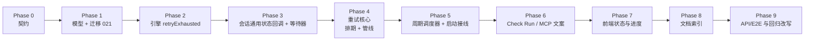
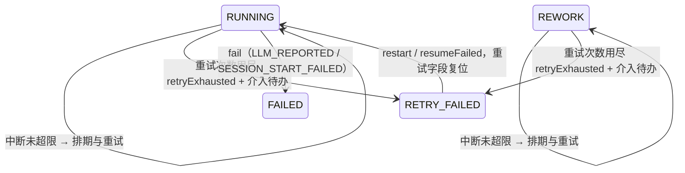
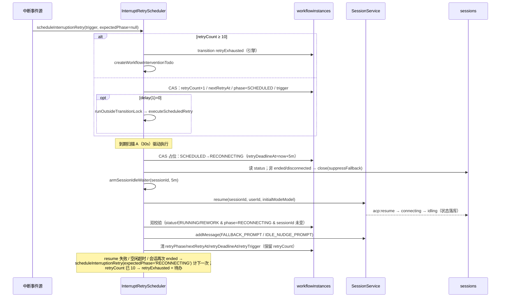

# 工作流节点中断处理迭代 - 实现计划

**功能名称**: 工作流节点中断处理迭代（自动重试 1→10 + RETRY_FAILED）
**关联 PRD**: [`docs/product/draft/20261103-workflow-node-interrupt-retry.md`](../../product/draft/20261103-workflow-node-interrupt-retry.md)
**关联提案**: [`docs/engineering/proposals/20261103-feat-workflow-node-interrupt-retry.md`](../proposals/20261103-feat-workflow-node-interrupt-retry.md)
**计划版本**: v1.0
**创建日期**: 2026-11-03
**作者**: ZeroAsh Agent
**需求总分支**: `prd/workflow-node-interrupt-retry`
**feat-branch**: `feat/workflow-node-interrupt-retry`
**需求总 PR**: https://github.com/Deliay/z-agent-gear/pull/419

## 1. 实施顺序

严格按「契约 → 模型/迁移 → 状态机 → 会话通道 → 重试核心 → 调度器 → 投影/文案 → 前端 → 测试收口」推进，每个切片先写失败测试再实现：



**关键路径**：Phase 4/5 是需求核心（10 次预算 + 退避 + 抗重启）。Phase 3 的等待器是管线能否「真正等到会话可用」的唯一判据，必须先于 Phase 4 完成并单测锁定。Phase 2 的 `retryExhausted` 与「重试字段复位」是状态语义的唯一出口，必须早于编排实现，否则重试字段会随人工操作泄漏到下一轮。

**回归重灾区**：`orchestrator.test.ts`（约 15 处 `fallbackSent` 断言）、`tests/api` 的 A23/A34、`tests/e2e` 的 E2E-4 —— 这三处按旧「1 次兜底」语义编写，必须与实现同批改写（见 §6.4）。

## 2. 代码事实核对（计划期确认）

以下事实基于当前分支 `prd/workflow-node-interrupt-retry`（HEAD `50e19e6c`）实际代码：

| # | 事实 | 位置 | 对计划的影响 |
|---|------|------|--------------|
| F1 | 中断入口三个：`handleSessionEnded`（仅 RUNNING）、`handleSessionIdled`（RUNNING/REWORK）、`handleSessionRemoved`（立即 `fail`） | `servers/agent-api/src/services/workflow/orchestrator.ts:86-173,455-510` | 前两者重写为「排期」；`handleSessionRemoved` 维持原语义（提案 D6） |
| F2 | `fallbackSent` 只在 `restart` 转移中复位 | `orchestrator.ts:95,121-138,464-496`、`engine.ts:21,376`、`models/workflow-instance.ts:56` | 需整体替换为 5 个重试字段；`engine.test.ts:445-454` 同步改写 |
| F3 | 排期用字段级 `updateOne` + `$elemMatch`（N-1④/N-5 口径），不用整文档 `save()` | `orchestrator.ts:123-137,481-495` | 新排期/占位沿用同一口径，CAS 条件需补 `retryPhase` 与 `retryCount` 预期值 |
| F4 | `transitionOrDefer` 的 `event` 形参硬编码为 `'fail'`，`TransitionPayload` 只带 `reason/source` | `orchestrator.ts:431-448` | 提案 5.1.1「经既有 `transitionOrDefer` 转 `retryExhausted`」**编译不通过**：需放宽事件类型（见 D4） |
| F5 | 提案 5.1.1 步骤 3 要求排期 CAS 带 `retryPhase: null` 防重，但 5.1.3 的失败重排、5.1.4 的扫描 B 都要从 `RECONNECTING` 再排期 | 提案 §5.1.1 / §5.1.3 / §5.1.4 | 提案内部不一致：排期入口必须支持 `expectedPhase: null \| 'RECONNECTING'`（见 D3） |
| F6 | `engine.transition` 由 `KeyedMutex` 按实例串行，非可重入；`runOutsideTransitionLock` 是「等待释放 + 退出 ALS，不预取锁」 | `engine.ts:172-193`、`services/keyed-mutex.ts:15-90` | 调度器在锁外执行，直接 `transition` 即可；异常重入时按既有 defer 口径退避重试 |
| F7 | `SessionService` 已有 `onSessionEnded/onSessionRemoved/onSessionIdled` 三个单槽回调 | `services/session.ts:61-89` | 新增 `onSessionStatus` 为平行通道，既有三回调口径与注册点零改动 |
| F8 | subscriber 过滤 `status==='removed'` 或 `idling && promptCompleted===true`；`notifySessionStatus` 需在解析出合法 `sessionId+status` 后**先于**该过滤触发 | `services/session-lifecycle-subscriber.ts:37-59` | 裸 `idling`（resume 落空闲）不触发 `notifySessionIdled`，必须由通用通道承接（提案实现点 2 成立） |
| F9 | `resumeSession` 成功路径发布 `idling`（**不带** `promptCompleted`，`acp-session-manager.ts:676`）；失败路径发布 `ended` 且带 `error`（`ACP_RESUME_FAILED`） | `servers/controller-api/src/services/acp-session-manager.ts:594-680` | 「等待空闲」可用 `idling` 兑现；`ended+error` 可快速失败 |
| F10 | 控制器离线时 `acp:resume` 直接发布 `ended` 且带 `error='CONTROLLER_OFFLINE'`，**不经过** `connecting` | `servers/controller-api/src/services/session-command.ts:329-349` | 等待器不能只靠「先 connecting 再 ended」判失败，否则控制器离线要空等 5 分钟（见 D5） |
| F11 | 生命周期命令 `acp:start/resume/stop` 在 controller-api 按 sessionId 串行链处理；`stopSessionWithAck` 会自行发布一次 `ended`（无 `error`） | `session-command.ts:58-61,143-155`、`acp-session-manager.ts:1065-1150` | 重试管线 close→resume 的顺序有保证；但「close 引起的 ended」会晚于我们发出 resume，等待器必须能忽略它（见 D5） |
| F12 | `close(suppressFallback:true)` 才跳过 `sessionEndedCallback`；GraphQL `closeSession` 不传该参数 | `session.ts:590-621`、`graphql/resolvers/session.ts:196` | 人工在会话页点「关闭」= 一次中断触发（见 D9 风险） |
| F13 | `resume` 仅接受 `ended/disconnected`，close 后立即 resume 可行；`addMessage` 只落库 + publish | `session.ts:527-581,770-816` | 管线顺序成立；发送前仍需双校验避免误发到新会话 |
| F14 | `loadNodeConfig`/`loadConfiguredNode`/`initialModeModel` 为 orchestrator 私有方法 | `orchestrator.ts:260-266,594-627` | 调度器也要用：抽到 `services/workflow/node-config.ts`，避免 orchestrator↔调度器循环依赖（见 D6） |
| F15 | 模型层 `WORKFLOW_NODE_STATUSES` 为状态枚举单一来源，`lastNodeStatus` 复用同一枚举 | `models/workflow-instance.ts:6,47,109` | 加 `RETRY_FAILED` 后实例级状态文案自动跟随 |
| F16 | 前端 `WorkflowNodeStatus` 只定义在 `apps/agent-web/src/graphql/workflow.ts:11-18`，`graphql/types.ts` 无该类型 | 前端 | 提案「（及 `graphql/types.ts`）」为笔误，实际只改 `workflow.ts` |
| F17 | 前端「重启」入口只在列表视图 `WorkflowNodeTree.tsx:148`（`RUNNING/REWORK/FAILED`）与 `EditInstanceNodeDialog(restartMode)`；详情抽屉 `NodeDetailDrawer.tsx` 无重启入口，页面也不持有该对话框 | 前端 | `RETRY_FAILED` 的抽屉重启需要页面级 `restartTarget` 状态（见 Phase 7） |
| F18 | 巡检/定时器既有范式：`scanning` 互斥 + `timer.unref?.()` + `start()/stop()`；云存储对账同样 unref | `services/workflow/issues-event-handler.ts:187-245`、`services/cloud-storage-service.ts:1084-1094` | 调度器照此实现，`index.ts` 在 `issuesTriggerRunner.start()` 同侧挂载 |
| F19 | `handleSessionEnded` 现有测试依赖「第二次停止即 FAILED」，且 E2E/API 用 `closeSession` 模拟中断 | `orchestrator.test.ts`、`tests/api/src/agent-api/workflow.test.ts:1361-1410`、`tests/e2e/src/workflow.spec.ts:923-1000` | 旧语义用例必须改写，不能只加新用例 |
| F20 | 迁移编号 020 已占用，`runMigrations` 按 name 幂等跳过；`ensureIndex` 兼容 Mongoose 默认名 | `src/migrations/020-cloud-storage-indexes.ts`、`runner.ts`、`index-utils.ts` | 新迁移编号 021；部分索引用 `ensureIndex` 建同名索引 |

## 3. 数据模型与状态机

### 3.1 节点字段（`models/workflow-instance.ts` 的 `instanceNodeSchema`）

| 字段 | 类型 | 默认 | 说明 |
|------|------|------|------|
| `status` | enum | `INITIALIZING` | 枚举追加 `RETRY_FAILED` |
| ~~`fallbackSent`~~ | — | — | **移除**（迁移 021 转换后 `$unset`） |
| `retryCount` | Number | `0` | 当前中断 episode 已排期的重试次数（成功发送提示词也**不**复位，见 D1） |
| `nextRetryAt` | Date | `null` | 下一次重试计划时间；`null` = 已发送/未排期 |
| `retryPhase` | String | `null` | `SCHEDULED`（已排期待执行）/ `RECONNECTING`（已占位、close→resume→等空闲中） |
| `retryDeadlineAt` | Date | `null` | `RECONNECTING` 的空闲等待截止（占位时间 + 5 分钟） |
| `retryTrigger` | String | `null` | `ENDED` / `IDLED`，决定重发哪条提示词 |

索引：`workflowInstanceSchema.index({ 'nodes.nextRetryAt': 1 }, { partialFilterExpression: { 'nodes.nextRetryAt': { $exists: true } } })`，并在迁移 021 用 `ensureIndex` 以固定名 `workflow_instance_node_next_retry` 兜底创建（生产 `autoIndex=false`）。

### 3.2 状态机变更（`engine.ts`）

```ts
const TRANSITIONS: Record<WorkflowEvent, { from: string[]; to: string }> = {
  // ……既有不变……
  retryExhausted: { from: ['RUNNING', 'REWORK'], to: 'RETRY_FAILED' },
  fail:           { from: ['RUNNING'], to: 'FAILED' },                       // 不变
  resumeFailed:   { from: ['FAILED', 'RETRY_FAILED'], to: 'RUNNING' },       // + RETRY_FAILED
  restart:        { from: ['RUNNING', 'REWORK', 'FAILED', 'RETRY_FAILED'], to: 'RUNNING' }, // + RETRY_FAILED
};
```

- `retryExhausted`：`status='RETRY_FAILED'`、`failInfo={reason,source:'RETRY_EXHAUSTED',at}`、清 `retryPhase/nextRetryAt/retryDeadlineAt/retryTrigger`、**保留** `retryCount`；不触发会话 hook（同 `fail`）。
- **重试字段复位**：`complete / completeRework / reject / rework / resume / resumeFailed / restart` 统一 `resetRetryState(node)`（5 字段归零）；`fail`、`retryExhausted` 只清调度字段、保留 `retryCount`。
- `refreshCurrentNodeNames` 只认 `RUNNING` → `RETRY_FAILED` 天然阻断下游激活（非 `DONE`）。



### 3.3 退避序列（`interruptRetryDelayMs`）

| 重试次数 N | 1 | 2 | 3 | 4 | 5 | 6 | 7 | 8 | 9 | 10 |
|---|---|---|---|---|---|---|---|---|---|---|
| 延迟 | 0 | 1m | 2m | 4m | 8m | 16m | 30m | 30m | 30m | 30m |

`delay(N) = N === 1 ? 0 : Math.min(2 ** (N - 2), 30) * 60_000`；10 次重试总窗口 ≈ 121 分钟（PRD 4.1「约 2 小时」）。

## 4. 核心时序



## 5. 变更清单

### 5.1 Phase 0：契约（先于代码）

| 文件 | 变更 |
|------|------|
| `contracts/workflow.graphql` | ① `enum WorkflowNodeStatus` 追加 `RETRY_FAILED`（带语义注释：自动重试 10 次用尽、阻断流程、`restartNode`/MCP `resumeFailedNode` 恢复）；② `WorkflowNode` 追加 `retryCount: Int!`（当前 episode 已用重试次数，推进/人工操作复位）与 `nextRetryAt: String`（下次重试计划时间，无排期 null）；③ `WorkflowNodeFailInfo.source` 注释补 `RETRY_EXHAUSTED`；④ `restartNode` 注释补 `RETRY_FAILED` 来源 |
| `servers/agent-api/src/graphql/schemas/workflow.ts` | 同步枚举（:20-31）、`retryCount/nextRetryAt` 字段（:120-138）、`restartNode` 注释（:310） |
| `servers/agent-api/src/graphql/resolvers/workflow.ts` | `mapInstanceNode`（:78-118）追加 `retryCount: node.retryCount ?? 0`、`nextRetryAt: toIso(node.nextRetryAt)` |

> 契约先行：服务端先按新枚举实现，前端随后接入；`FAILED` 语义与既有枚举值一律不变。

### 5.2 Phase 1：模型与迁移 021

| 文件 | 变更 |
|------|------|
| `servers/agent-api/src/models/workflow-instance.ts` | ① `WORKFLOW_NODE_STATUSES` 追加 `RETRY_FAILED`（:6）；② 移除 `fallbackSent`（:56），新增 5 个重试字段（含注释与枚举）；③ 新增 `nodes.nextRetryAt` 部分索引（:126-131 区块）；④ `engine.ts` 的 `WorkflowNodeDoc` 同步字段（见 §5.3） |
| `servers/agent-api/src/migrations/021-workflow-interrupt-retry.ts`（新增） | ① 逐实例遍历节点：`fallbackSent===true → retryCount=1`，其余缺 `retryCount` 的节点补 `0`（**必做**，否则 `retryCount` 参与 CAS 的旧实例永不命中）；② 所有节点 `$unset fallbackSent`；③ `ensureIndex` 建 `nodes.nextRetryAt` 部分索引；④ 幂等可重入，日志 `component: 'migration/021-workflow-interrupt-retry'` |
| `servers/agent-api/src/migrations/021-workflow-interrupt-retry.test.ts`（新增） | 真库用例（同 `020` 风格）：转换、回填、`$unset`、索引存在、重复执行无副作用 |
| `servers/agent-api/src/index.ts` | `runMigrations` 数组追加 `migration021WorkflowInterruptRetry`（:178-200） |

**回填口径**（避免 CAS 空转的硬要求）：

```ts
// 阶段一：fallbackSent=true → retryCount=1
await collection.updateMany(
  { 'nodes.fallbackSent': true },
  { $set: { 'nodes.$[n].retryCount': 1 } },
  { arrayFilters: [{ 'n.fallbackSent': true }] },
);
// 阶段二：缺 retryCount → 0（含阶段一刚转换的节点保持 1）
await collection.updateMany(
  { 'nodes.retryCount': { $exists: false } },
  { $set: { 'nodes.$[n].retryCount': 0 } },
  { arrayFilters: [{ 'n.retryCount': { $exists: false } }] },
);
// 阶段三：清除旧字段
await collection.updateMany({ 'nodes.fallbackSent': { $exists: true } }, { $unset: { 'nodes.$[n].fallbackSent': '' } },
  { arrayFilters: [{ 'n.fallbackSent': { $exists: true } }] });
```

### 5.3 Phase 2：引擎（`services/workflow/engine.ts`）

| 变更 | 细节 |
|------|------|
| `WorkflowEvent` | 追加 `'retryExhausted'`；`EVENT_LABEL` 追加「重试失败」 |
| `TRANSITIONS` | 按 §3.2 |
| `apply` 新分支 | `case 'retryExhausted'`：置 `RETRY_FAILED` + `failInfo{source:'RETRY_EXHAUSTED'}` + 清调度字段 + `markLastNode` |
| `resetRetryState` | 新私有方法：`retryCount=0/nextRetryAt=null/retryPhase=null/retryDeadlineAt=null/retryTrigger=null`；在 `complete/completeRework/reject/rework/resume/resumeFailed/restart` 分支调用（`restart` 原 `fallbackSent=false` 删除） |
| `fail` 分支 | 不清 `retryCount`（保留展示与排查），只清调度字段 |
| `WorkflowNodeDoc` | `fallbackSent?: boolean` → 5 个新字段 |

### 5.4 Phase 3：会话通用状态回调与空闲等待器

| 文件 | 变更 |
|------|------|
| `services/session.ts` | 新增 `onSessionStatus(cb: (evt: SessionStatusEvent) => void \| Promise<void>)` 与 `notifySessionStatus(evt)`；`type SessionStatusEvent = { sessionId: string; status: string; promptCompleted?: boolean; error?: string }`。既有三回调保持单槽语义与注册点不变 |
| `services/session-lifecycle-subscriber.ts` | 解析出合法 `sessionId+status` 后**先** `await sessionService.notifySessionStatus(parsed)`，再走既有 `handled` 过滤（:39-59 口径零改动）；通用通道按高频豁免口径只记结构化日志、不逐条开 span |
| `services/session-idle-waiter.ts`（新增） | `armSessionIdleWaiter(sessionId, timeoutMs): { promise: Promise<boolean>; cancel(): void }`。实现要点见下 |

等待器实现（`Map<sessionId, waiter>`，一次性）：

```ts
// 关键：close 自身会触发一次 controller 侧 ended（无 error），resume 又可能立刻
// 因控制器离线返回 ended（带 error），因此不能用「看到 ended 就失败」的简单判据。
onSessionStatus((evt) => {
  const w = waiters.get(evt.sessionId); if (!w) return;
  if (evt.status === 'removed') return settle(false);
  if (evt.status === 'idling') {
    // 防「上一轮残留 idling」误判：以 DB 会话状态复核一次
    void sessionService.getSessionStatusRaw(evt.sessionId).then((s) => s === 'idling' && settle(true));
    return;
  }
  if (evt.status === 'ended') {
    if (evt.error) return settle(false);        // CONTROLLER_OFFLINE / ACP_RESUME_FAILED
    if (w.sawConnecting) return settle(false);  // resume 起来后又结束 = 本次重试失败
    return;                                     // close 引起的 ended：忽略
  }
  if (evt.status === 'connecting' || evt.status === 'running') w.sawConnecting = true;
});
// 兜底心跳：pub/sub 至多一次，事件丢失时以 15s 间隔读 DB 状态（idling→true；ended/缺失→false）
```

> `getSessionStatusRaw` 用 `Session.findById(...).select('status')` 直读（不经 user 作用域），仅新增一个内部只读方法。

### 5.5 Phase 4：重试核心（新增 `services/workflow/interrupt-retry.ts`）

先做一次**无行为变更的抽取**，避免 orchestrator 与调度器循环依赖：

| 文件 | 变更 |
|------|------|
| `services/workflow/node-config.ts`（新增） | 从 orchestrator 原样搬出 `ConfiguredNodeLike`、`loadNodeConfig`、`loadConfiguredNode`、`initialModeModel`；orchestrator 改为 import（F14） |
| `services/keyed-mutex.ts` | 导出 `isReentrantLockError(err)`（现为 orchestrator 私有，:60-62），两处复用 |
| `services/workflow/interrupt-retry.ts`（新增） | 常量、退避纯函数、排期 `scheduleInterruptionRetry`、执行 `executeScheduledRetry`、失败重排、超限转 `RETRY_EXHAUSTED` 与待办 |

对外接口：

```ts
export type InterruptionTrigger = 'ENDED' | 'IDLED';
export const INTERRUPT_RETRY_MAX = 10;
export const INTERRUPT_RETRY_IDLE_TIMEOUT_MS = 5 * 60_000;
export function interruptRetryDelayMs(retryNo: number): number;

/** 排期（字段级 CAS）。expectedPhase 允许从 RECONNECTING（本次重试失败）重排。 */
export async function scheduleInterruptionRetry(args: {
  instanceId: string;
  nodeId: string;
  sessionId: string;
  trigger: InterruptionTrigger;
  expectedPhase?: null | 'RECONNECTING';
}): Promise<'scheduled' | 'exhausted' | 'skipped'>;

/** 执行一次已到期重试（调度器与「首次立即」共用）。 */
export async function executeScheduledRetry(instanceId: string, nodeId: string): Promise<void>;
```

排期 CAS（防重复、防覆盖并发转移）：

```ts
const update = await WorkflowInstance.updateOne(
  {
    _id: instanceId,
    deletedAt: null,
    nodes: {
      $elemMatch: {
        nodeId,
        sessionId,
        status: { $in: ['RUNNING', 'REWORK'] },
        retryPhase: expectedPhase,      // null 匹配「缺失或 null」
        retryCount: currentCount,       // 与快照一致才写，避免与 restart/rework 的复位竞争
      },
    },
  },
  {
    $set: {
      'nodes.$.retryCount': nextCount,
      'nodes.$.nextRetryAt': new Date(Date.now() + interruptRetryDelayMs(nextCount)),
      'nodes.$.retryPhase': 'SCHEDULED',
      'nodes.$.retryTrigger': trigger,
      'nodes.$.retryDeadlineAt': null,
    },
  },
);
if (!update.modifiedCount) return 'skipped';
if (nextCount === 1) {
  void workflowEngine.runOutsideTransitionLock(instanceId, () => executeScheduledRetry(instanceId, nodeId));
}
```

执行管线（要点）：

1. **占位**：`SCHEDULED + nextRetryAt<=now + status∈RUNNING/REWORK` → `RECONNECTING` + `retryDeadlineAt=now+5m`；`modifiedCount===0` 直接返回（单赢家）。
2. 重读实例/节点；`sessionId` 缺失或会话文档缺失 → 计为本次失败。
3. 读会话状态：**已是 `ended`/`disconnected` 则跳过 close**（PRD 3.2.2），否则 `close(suppressFallback:true, reason:'workflow_interruption_retry')`（F11 保证顺序，F12 避免自递归）。
4. `armSessionIdleWaiter(...)` 必须在 `resume` **之前**布防（覆盖事件早到与 close 侧 ended）。
5. `resume(sessionId, userId, initialModeModel(await loadNodeConfig(...)))`：配置读取失败不阻断（沿用现口径）；`success===false` → 计失败。
6. `await waiter`：`false` → 计失败。
7. **发送前双校验**：实例未删除 + 节点 `status∈RUNNING/REWORK` + `sessionId` 未变 + `retryPhase==='RECONNECTING'`；不满足则放弃（人工 restart/rework/删除后不得误发）。
8. `addMessage(prompt)`：`retryTrigger==='ENDED' → FALLBACK_PROMPT`，`'IDLED' → IDLE_NUDGE_PROMPT`（文案不改）。
9. 清理 `retryPhase/nextRetryAt/retryDeadlineAt/retryTrigger`，保留 `retryCount`（D1）。
10. 失败重排：`scheduleInterruptionRetry({ expectedPhase: 'RECONNECTING', trigger })`；若 `retryCount>=10` → `transition('retryExhausted')` + `createWorkflowInterventionTodo`（reason 含「中断自动重试 10 次仍未推进」）。

### 5.6 Phase 5：周期调度器（新增 `services/workflow/interrupt-retry-scheduler.ts`）

| 项 | 实现 |
|----|------|
| 形态 | `class InterruptRetryScheduler`，仿 `IssuesTriggerRunner`（F18）：`scanning` 互斥、`timer.unref?.()`、`start()/stop()`、`POLL_INTERVAL_MS=30_000` |
| 扫描 A | `{ deletedAt: null, nodes: { $elemMatch: { status: { $in: ['RUNNING','REWORK'] }, retryPhase: 'SCHEDULED', nextRetryAt: { $lte: now } } } }`，`limit(50)`，逐实例逐节点 `executeScheduledRetry` |
| 扫描 B | `{ deletedAt: null, nodes: { $elemMatch: { status: { $in: ['RUNNING','REWORK'] }, retryPhase: 'RECONNECTING', retryDeadlineAt: { $lte: now } } } }` → `scheduleInterruptionRetry({ expectedPhase: 'RECONNECTING' })`（进程重启丢等待器的兜底） |
| 并发 | 每条 `KeyedMutex.runExclusive('interrupt-retry:<instanceId>:<nodeId>')`；单条失败 `catch` 后只告警，不拖垮整轮 |
| 日志 | `component: 'interrupt-retry-scheduler'`，字段 `event`（`scan` / `retry-executed` / `retry-failed` / `retry-exhausted` / `scan-failed`），不逐条开 span |
| 单实例约束 | 与 `KeyedMutex` 同口径，写入 AGENTS（多副本会重复执行） |

`services/workflow/orchestrator.ts` 改造：

- `register()` 保持三回调注册不变。
- `handleSessionEnded`：前置过滤（实例未删、节点 `RUNNING`、`sessionId` 匹配）→ `scheduleInterruptionRetry({trigger:'ENDED'})`；删除 `fallbackSent` 分支与内联 `resume/addMessage`。
- `handleSessionIdled`：前置过滤（`RUNNING/REWORK`）→ `scheduleInterruptionRetry({trigger:'IDLED'})`；删除直接补发提示词的分支。
- `handleSessionRemoved` / `deferSessionFallback` / `notifyFallbackExhausted` / `transitionOrDefer`：语义不变，`transitionOrDefer` 的事件类型放宽为 `'fail' | 'retryExhausted'` 并透传 `source`（F4，虽然新链路不再走它，但保留给 removed 与未来路径）。
- `WorkflowInstanceDoc` 上的会话事件不再需要 `attempt` 参数——保留形参（`attempt = 0`）以兼容既有测试入口。

`servers/agent-api/src/index.ts`：`issuesTriggerRunner.start()`（:206）之后 `interruptRetryScheduler.start()`。

### 5.7 Phase 6：投影与工具文案

| 文件 | 变更 |
|------|------|
| `services/workflow/pr-check-run-sync.ts` | `mapNodeStatusToCheckRun`（:169-187）追加 `case 'RETRY_FAILED': return { status:'completed', conclusion:'action_required', label:'重试失败，待人工处理' }`（与 `REJECT` 同 conclusion，D7） |
| `services/workflow/tool-handlers.ts` | `resumeFailedNode` 描述改为「操作当前节点『恢复运行』（FAILED/RETRY_FAILED→RUNNING）。仅在人类已在对话中给出明确处理指示后调用」（:136-141）；`transition()` 事件联合类型不变 |

### 5.8 Phase 7：前端（`apps/agent-web`）

| 文件 | 变更 |
|------|------|
| `src/graphql/workflow.ts` | `WorkflowNodeStatus` 联合类型追加 `'RETRY_FAILED'`（:11-18）；`WorkflowNodeData` 追加 `retryCount: number`、`nextRetryAt: string \| null`（:93-110）；实例节点 fragment 追加 `retryCount`/`nextRetryAt`（:385-396） |
| `src/components/workflow/WorkflowNodeTreeConstants.ts` | `NODE_STATUS_LABELS.RETRY_FAILED='重试失败'`；`NODE_STATUS_VISUAL.RETRY_FAILED` 沿用 destructive 色族（spine/tint/badge 与 `FAILED` 同族、文案区分）；`NODE_STATUS_COLOR_VAR.RETRY_FAILED='var(--color-destructive)'`；新增导出 `WORKFLOW_INTERRUPT_RETRY_MAX = 10` 与 `retryProgressText(node, now)` 纯函数 |
| 同上（`retryProgressText`） | `nextRetryAt===null → null`；未来 → `自动重试 {n}/10 · 下次 {HH:mm}`；已过期 → `自动重试 {n}/10 · 正在恢复会话`（无需新契约字段，D10） |
| `src/components/workflow/WorkflowNodeTree.tsx` | 重启按钮条件追加 `RETRY_FAILED`（:148）；`failInfo` 展示条件由 `status==='FAILED'` 放宽为 `FAILED \|\| RETRY_FAILED`，文案区分（:196）；节点行展示 `retryProgressText` |
| `src/components/workflow/NodeDetailDrawer.tsx` | 新增可选 `onRestartNode?: (node: WorkflowNodeData) => void`；AI 节点 `RUNNING/REWORK/FAILED/RETRY_FAILED` 展示「重启节点」（与列表同源，F17）；`failInfo` 条件放宽；新增「自动重试进度」区块（`Field` 形式） |
| `src/pages/WorkflowInstancePage.tsx` | ① `failedNodes` 拆成 `blockedNodes = FAILED \| RETRY_FAILED`，banner 文案分档（`RETRY_FAILED`：「中断自动重试已用尽，流程已阻断，可重启节点或在会话中给出指示后恢复」）；② toast 对 `RETRY_FAILED` 单独文案、每节点一次（:69）；③ 页面级 `restartTarget` 状态 + `EditInstanceNodeDialog restartMode`（F17），把 `onRestartNode` 传给抽屉 |
| `src/components/workflow/graph/WorkflowNodeCard.tsx` | 状态徽标/色脊经 `NODE_STATUS_VISUAL`/`NODE_STATUS_LABELS` 自动生效；进行中动态行条件（:29）保持 `RUNNING/REWORK`（重试等待期不建 SSE 连接） |
| `src/components/session/SessionView.tsx` | `WORKFLOW_CONTINUE_PROMPT`（:62-67）由「若节点为 FAILED …」改为「若节点为 FAILED 或 RETRY_FAILED …」（人工恢复指引一致） |

### 5.9 Phase 8：文档与索引

| 文件 | 变更 |
|------|------|
| `docs/engineering/AGENTS.md` | 「实现计划（plan/）」索引登记本文件 |
| `servers/agent-api/AGENTS.md` | 新增「工作流节点中断自动重试」小节：10 次预算与退避表、`retryPhase` 状态机、调度器 30s 单实例约束、`RETRY_FAILED` 语义与人工入口、`onSessionStatus` 高频豁免、人工关闭会话仍视为中断的已知取舍（D9） |
| `tests/api/AGENTS.md` | 「Agent Workflow API」表追加中断重试用例（T-WFIR1~9）；改写 A23/A34 描述 |
| `tests/e2e/AGENTS.md` | 「Workflow E2E」表改写 E2E-4 描述（自动重试管线 + 进度可见），注明 RETRY_FAILED 端到端由 API 侧覆盖 |

### 5.10 Phase 9：测试收口

见 §6 矩阵；实现顺序按 Phase 逐切片 RED→GREEN。

## 6. TDD 测试矩阵

### 6.1 单元（agent-api，Vitest）

| 编号 | 文件 | 断言 |
|------|------|------|
| T-ENG1 | `engine.test.ts` | `retryExhausted`：RUNNING→RETRY_FAILED，`failInfo.source='RETRY_EXHAUSTED'`，`retryCount` 保留、调度字段清空 |
| T-ENG2 | `engine.test.ts` | `retryExhausted`：REWORK→RETRY_FAILED |
| T-ENG3 | `engine.test.ts` | `retryExhausted` 从 DONE/FAILED/RETRY_FAILED → 抛「不允许执行」 |
| T-ENG4 | `engine.test.ts` | `resumeFailed`：RETRY_FAILED→RUNNING，`failInfo=null`，5 个重试字段全部复位 |
| T-ENG5 | `engine.test.ts` | `restart`：RETRY_FAILED→RUNNING，重试字段复位（替换原 `fallbackSent=false` 用例 :445-454） |
| T-ENG6 | `engine.test.ts` | `complete/completeRework/reject/rework/resume` 各自复位重试字段（表驱动） |
| T-ENG7 | `engine.test.ts` | `fail` 保留 `retryCount`、清调度字段 |
| T-RETRY1 | `interrupt-retry.test.ts` | `interruptRetryDelayMs`：0/1/2/4/8/16/30/30/30/30 分钟；越界 N≤0 与 N>10 的收敛 |
| T-RETRY2 | 同上 | 首次中断：`retryCount=1`、`nextRetryAt≈now`、`retryPhase='SCHEDULED'`、`retryTrigger` 正确；并触发一次立即执行（`runOutsideTransitionLock` 被调用） |
| T-RETRY3 | 同上 | 第 2 次中断：`retryCount=2`、`nextRetryAt≈now+60s`，不立即执行 |
| T-RETRY4 | 同上 | `retryPhase='SCHEDULED'` 时再排期（expectedPhase=null）→ CAS 不命中 → `skipped`，`retryCount` 不变 |
| T-RETRY5 | 同上 | `retryCount=9` → 排到第 10 次；`retryCount=10` → 直接 `retryExhausted` + 待办，不再排期 |
| T-RETRY6 | 同上 | `executeScheduledRetry` 正常路径：占位 → close → resume → 等 idle → addMessage，调用顺序与参数（`suppressFallback:true`、`reason:'workflow_interruption_retry'`） |
| T-RETRY7 | 同上 | 会话 `ended` → 跳过 close，直接 resume |
| T-RETRY8 | 同上 | `resume.success=false` → 从 RECONNECTING 重排（count+1，phase=SCHEDULED） |
| T-RETRY9 | 同上 | 等待空闲 false（超时/ended+error）→ 重排 |
| T-RETRY10 | 同上 | 发送前双校验失败（节点已 DONE / sessionId 变更 / deletedAt 非空）→ 不 addMessage、不重排 |
| T-RETRY11 | 同上 | 占位 CAS 未命中 → 无任何会话动作（单赢家） |
| T-RETRY12 | 同上 | 重排时 `retryCount=10` → `retryExhausted` + `createWorkflowInterventionTodo`（reason 含重试次数） |
| T-RETRY13 | 同上 | 超限转移遇到 re-entrant 锁错 → 退避后重试，最终成功；非重入异常只告警不重试 |
| T-IDLE1 | `session-idle-waiter.test.ts` | 裸 `idling`（`promptCompleted` 缺省）→ true，且 DB 复核为 `idling` |
| T-IDLE2 | 同上 | close 引起的 `ended`（无 error，未见过 connecting）→ 忽略，继续等待 |
| T-IDLE3 | 同上 | `ended + error='CONTROLLER_OFFLINE'` → 立即 false |
| T-IDLE4 | 同上 | 见过 `connecting` 后 `ended` → false |
| T-IDLE5 | 同上 | `removed` → false；超时 → false |
| T-IDLE6 | 同上 | 事件丢失时 15s DB 心跳兜底（fake timers）→ true/false |
| T-IDLE7 | 同上 | `cancel()` 后不再 settle、监听器与定时器全部清理（无泄漏） |
| T-SES1 | `session.test.ts` | `onSessionStatus/notifySessionStatus` 注册与分发；未注册时静默 |
| T-SES2 | `session-lifecycle-subscriber.test.ts` | 裸 `idling`：`notifySessionStatus` 被调用、`notifySessionIdled` **不**被调用 |
| T-SES3 | 同上 | `removed` / `idling+promptCompleted`：既有三回调口径与 span 名不变；`error` 字段透传 |
| T-SCH1 | `interrupt-retry-scheduler.test.ts` | 扫描 A：到期计划被执行；未到期跳过 |
| T-SCH2 | 同上 | 扫描 B：`RECONNECTING` 且 deadline 过期 → 重排（count+1） |
| T-SCH3 | 同上 | 单轮不重叠（`scanning` 互斥）；单条异常不影响其余条目 |
| T-SCH4 | 同上 | `start()` 立即扫一轮；`stop()` 清理定时器；定时器 `unref` |
| T-SCH5 | 同上 | `deletedAt` 非空 / 节点已非 RUNNING、REWORK → 跳过 |
| T-SCH6 | 同上 | 同一节点并发执行被 `KeyedMutex` 串行化，只产生一次 `acp:resume` |
| T-PRJ1 | `pr-check-run-sync.test.ts` | `RETRY_FAILED → completed/action_required/重试失败，待人工处理`；其余状态映射不变 |
| T-MIG1 | `migrations/021-...test.ts` | `fallbackSent:true → retryCount:1` 且 `fallbackSent` 已删除 |
| T-MIG2 | 同上 | 无 `fallbackSent` 的节点补 `retryCount:0` |
| T-MIG3 | 同上 | 部分索引存在（名/键/partialFilterExpression）且重复执行幂等 |

### 6.2 前端（Vitest + RTL）

| 编号 | 文件 | 断言 |
|------|------|------|
| T-FE1 | `WorkflowNodeTreeConstants.test.ts` | `RETRY_FAILED` 标签「重试失败」、三张映射全覆盖、`NODE_STATUS_BADGE` 派生不缺失；`retryProgressText` 三态（null/未来/过期） |
| T-FE2 | `NodeDetailDrawer.test.tsx` | `RETRY_FAILED` 节点：独立状态徽标 + 失败原因 + 「重启节点」按钮（点击回调 `onRestartNode`）；重试进度字段渲染 |
| T-FE3 | `NodeDetailDrawer.test.tsx` | `retryCount>0 && nextRetryAt=null` 时**不**展示重试进度（无排期的节点不展示） |
| T-FE4 | `pages/__tests__/WorkflowInstancePage.test.tsx` | `RETRY_FAILED` 进入阻断 banner 且文案区别于 `FAILED`；toast 每节点仅一次；抽屉「重启节点」打开 `EditInstanceNodeDialog(restartMode)` |

### 6.3 API / E2E

| 编号 | 文件 | 断言 |
|------|------|------|
| T-WFIR1 | `tests/api/src/agent-api/workflow-interrupt-retry.test.ts`（新增） | `workflowInstance` 查询透出 `retryCount=0` / `nextRetryAt=null` |
| T-WFIR2 | 同上 | publish `session:status {status:'ended'}` → 立即重试：fake controller 收到 `acp:stop`（ackRequired）与 `acp:resume`；会话消息含 `FALLBACK_PROMPT`；节点仍 RUNNING、`retryCount=1`、`nextRetryAt=null` |
| T-WFIR3 | 同上 | 再次 publish ended → `retryCount=2`、`nextRetryAt` 为未来 1 分钟、`acp:resume` 次数不增加（未到点不执行） |
| T-WFIR4 | 同上 | 直连 Mongo 预置 `retryCount=10` → publish ended → 节点 `RETRY_FAILED`、`failInfo.source='RETRY_EXHAUSTED'`、`getTodoList` 出现 `workflow_intervention` 且 `priority=immediate`；不再产生 `acp:resume` |
| T-WFIR5 | 同上 | `restartNode` 于 `RETRY_FAILED` → RUNNING、`retryCount=0`、`acp:start` 新会话 |
| T-WFIR6 | 同上 | 预置 `retryPhase='SCHEDULED'` + `nextRetryAt=now-1s` → 30s 内执行管线（扫描 A） |
| T-WFIR7 | 同上 | 预置 `retryPhase='RECONNECTING'` + `retryDeadlineAt=now-1s` → 30s 内重排（`retryCount+1`、`nextRetryAt` 未来、无重复提示词） |
| T-WFIR8 | 同上 | `deletedAt` 非空的实例 → 扫描不执行、无 `acp:resume` |
| T-WFIR9 | 同上 | `resumeFailedNode`（MCP）于 `RETRY_FAILED` → RUNNING、`retryCount=0`、`failInfo=null` |
| E2E-4A | `tests/e2e/src/workflow.spec.ts`（改写原 E2E-4） | 关闭执行中会话 → 平台自动 `acp:stop`（ack）→ `acp:resume` → 会话回到 idling 后收到提醒提示词；节点仍 RUNNING、`retryCount=1` |
| E2E-4B | 同上 | 再次关闭 → `retryCount=2`、`nextRetryAt` 非空；UI 节点卡展示「自动重试 2/10 · 下次 HH:mm」（不等待 1 分钟真实触发） |
| E2E-4C | 同上 | 原「FAILED → 会话内指示 → resumeFailedNode → RUNNING」链路改用 `failCurrentNode` 制造 FAILED 后验证（保持旧人工恢复回归；RETRY_FAILED 端到端由 T-WFIR4 覆盖，D11） |

### 6.4 回归改写清单（必须同批）

| 位置 | 现状 | 改写 |
|------|------|------|
| `orchestrator.test.ts`（O10、N-1、idled 相关等约 15 处） | 断言 `fallbackSent` 置位/升级 FAILED | 改为 `retryCount` 排期断言；`handleSessionIdled` 不再直接 `addMessage`（改由 `interrupt-retry` 单测覆盖管线） |
| `engine.test.ts:445-454` | `restart` 复位 `fallbackSent` | 复位 5 个重试字段 |
| `tests/api/.../workflow.test.ts` A23 | 二次停止 → FAILED | 首次 → 立即重试管线；二次 → 排期 +1m（`retryCount=2`）；超限用例改由 T-WFIR4 |
| `tests/api/.../workflow.test.ts` A34 | 二次停滞 → FAILED + 待办 | 首次停滞 → 重试管线（`IDLE_NUDGE_PROMPT`）；二次 → 排期；超限待办由 T-WFIR4 |
| `tests/api` fake controller | 无 `acp:stop` ack、无自动 `acp:resume:result` | 新增 `acp:stop` → `acp:stopped` 自动 ack（`ackRequired` 时）与可开关的自动 resume 应答，保证管线测试秒级完成 |
| `tests/e2e/src/workflow.spec.ts` E2E-4 | 依赖 1 次兜底语义 | 按 E2E-4A/4B/4C 拆分 |

## 7. 计划期裁决

| 编号 | 裁决 | 理由 |
|------|------|------|
| D1 | 重试成功发送提示词后**不**复位 `retryCount` | 否则「提示词无效 → 再次中断 → 计数归零」会无限循环（`fallbackSent` 防死循环初衷）；PRD 3.5 已声明该取舍 |
| D2 | 排期入口统一为 `scheduleInterruptionRetry(expectedPhase)`，`null` 与 `'RECONNECTING'` 两态合法 | 修正提案 F5 的内部矛盾：首次中断与「本次重试失败」都要走同一 CAS，`retryPhase` 条件由入参决定 |
| D3 | 排期 CAS 同时锁定 `retryCount` 快照值 | 与 `restart/rework` 的复位竞争时可自然放弃；代价是迁移 021 必须回填 `retryCount:0`（否则旧实例永不命中） |
| D4 | `retryExhausted` 由 `interrupt-retry` 直接 `transition`，并自带 re-entrant 退避重试；orchestrator 的 `transitionOrDefer` 仅放宽事件类型 | 避免 scheduler↔orchestrator 循环依赖；`retryExhausted` 触发点都在实例锁之外，直接调用即可；重入属防御性分支 |
| D5 | 等待空闲采用「事件优先 + `ended.error` 判别 + 15s DB 心跳兜底」，而不是纯事件或纯轮询 | F10/F11 证明纯事件会误判（close 侧 ended、控制器离线 ended 无 connecting）；pub/sub 至多一次，必须有 DB 兜底才能保证 5 分钟内必定 settle |
| D6 | 抽取 `services/workflow/node-config.ts`（`loadNodeConfig`/`loadConfiguredNode`/`initialModeModel`） | 调度器与 orchestrator 都需要节点初始 mode/model；抽取是零行为变更，避免循环依赖 |
| D7 | `RETRY_FAILED` 的 Check Run 用 `action_required` | 语义「需人工动作」，与 `REJECT` 同族；`failure` 留给 LLM 主动报告失败（提案 D7 沿用） |
| D8 | 立即执行（N=1）由 `scheduleInterruptionRetry` 内部 `runOutsideTransitionLock → executeScheduledRetry` 触发，不另设内存定时器 | 该触发只做会话动作、不持锁；`nextRetryAt` 已落库，进程崩溃后扫描器仍会拾起 |
| D9 | 人工在会话页点「关闭」（GraphQL `closeSession`）仍计为一次中断、纳入自动重试 | 平台不区分关闭来源（回调只带 sessionId），且工作流节点会话本就由平台托管；与旧口径同类，仅次数放大。**风险已登记**（§8），如需区分须另立提案（建议后续为工作流节点会话的「关闭」加二次确认或在节点侧提示） |
| D10 | 前端只消费 `retryCount/nextRetryAt`，不新增 `retryPhase` 契约字段 | 三态文案（无排期/未来/已过期）已能表达「排期中/恢复中」，避免为纯展示扩张契约 |
| D11 | E2E 不真实等待退避：只覆盖「首次立即重试 + 进度可见」；`RETRY_FAILED` 端到端放 `tests/api`（直连 Mongo 预置 `retryCount`） | 10 次退避总窗口约 2 小时，E2E 不可控；扫描型语义由 T-WFIR6/7 以「预置到期时间」等价覆盖 |
| D12 | `handleSessionRemoved` 维持立即 `FAILED`（`SESSION_START_FAILED`） | 会话文档已删除，`close→resume` 无对象（提案 D6 沿用） |
| D13 | 会话通用状态通道按「高频豁免」只记结构化日志，不逐条开 span | 与 `pr-check-run-subscriber` 同口径（契约 §7） |

## 8. 风险与回滚

| 风险 | 影响 | 缓解 |
|------|------|------|
| 人工「关闭」节点会话被当作中断，最多自动复活 10 次 / 约 2 小时 | 用户意图与系统行为不一致 | D9 登记；人工 restart/打回/删除实例均会即时取消排期；建议后续为工作流节点会话的「关闭」加确认或节点侧提示（另立提案） |
| 等待器误判导致空等 5 分钟 | 单次重试变慢、消耗预算 | `ended.error` 快判 + 15s DB 心跳（D5）；T-IDLE2~7 锁定 |
| pub/sub 丢事件（Redis 重连） | 等待器永不 settle | DB 心跳兜底；进程重启由扫描 B 兜底 |
| 退避期间进程重启 | 排期丢失 | 全量落库 + 30s 扫描（提案实现点 3）；T-SCH4 覆盖「启动即扫」 |
| 多副本部署重复执行 | 同一节点被多次 resume | 单实例约束写入 AGENTS；CAS 占位 + `KeyedMutex` 双保险；README/AGENTS 标注 |
| 迁移 021 未回填 `retryCount` | 旧实例排期 CAS 永不命中（重试静默失效） | 迁移测试 T-MIG2 强制断言；执行时 `node.retryCount ?? 0` 双保险读取 |
| 重试字段与人工操作并发覆盖 | 节点被人工 restart 后又被自动 resume | 全部写路径为字段级 CAS（含 `retryCount` 与 `retryPhase` 预期值）+ 发送前双校验 |
| 旧前端（未升 `RETRY_FAILED`） | 状态文案落空/徽标空白 | `NODE_STATUS_LABELS` 为 `Record<WorkflowNodeStatus,string>`，后端先发；同仓一次性发布，无跨版本混跑 |
| 回滚 | — | 服务端回滚到上一版本即恢复「1 次兜底 + FAILED」；`retryCount` 字段与索引为增量、无需回滚；`RETRY_FAILED` 仅新数据出现 |

## 9. 命令参考

```bash
# 依赖（仓库已迁移 pnpm）
pnpm install

# agent-api 单测 / 覆盖率 / 构建
cd servers/agent-api && pnpm test
cd servers/agent-api && pnpm exec vitest run src/services/workflow/interrupt-retry.test.ts
cd servers/agent-api && pnpm run test:coverage
cd servers/agent-api && pnpm run build

# agent-web 单测 / 构建
cd apps/agent-web && pnpm test
cd apps/agent-web && pnpm exec vitest run src/components/workflow/__tests__/NodeDetailDrawer.test.tsx
cd apps/agent-web && pnpm run build

# 服务编排（API/E2E 前置）
aspire start
aspire wait agent-api controller-api

# API 集成（需 MONGODB_URI / REDIS_URL）
cd tests/api && pnpm exec vitest run src/agent-api/workflow-interrupt-retry.test.ts
cd tests/api && pnpm exec vitest run src/agent-api/workflow.test.ts

# E2E
cd tests/e2e && pnpm exec playwright test src/workflow.spec.ts
```

## 10. 验收 checklist

### 10.1 Phase 0~1（契约/模型/迁移）

- [ ] `contracts/workflow.graphql` 含 `RETRY_FAILED`、`retryCount`、`nextRetryAt`、`RETRY_EXHAUSTED` 注释
- [ ] 模型枚举与 5 个重试字段就位，`fallbackSent` 已移除且无残留引用
- [ ] 迁移 021：`fallbackSent→retryCount`、缺失补 0、`$unset`、部分索引、幂等
- [ ] `pnpm run build` 通过（无 `fallbackSent` 编译错误）

### 10.2 Phase 2~3（状态机/会话通道）

- [ ] `retryExhausted` 从 RUNNING/REWORK 可用、其余拒绝；`restart/resumeFailed` 接受 RETRY_FAILED
- [ ] 各人工/推进转移复位 5 个重试字段；`fail`/`retryExhausted` 保留 `retryCount`
- [ ] 裸 `idling` 触发通用回调、不触发 `notifySessionIdled`；既有三回调零回归
- [ ] 等待器：idling→true、close 侧 ended 忽略、`ended+error` 快速失败、超时 false、无泄漏

### 10.3 Phase 4~5（重试核心/调度器）

- [ ] 首次中断立即执行完整管线（关闭→继续→等空闲→重发），顺序与参数被测试锁定
- [ ] 会话已 ended 时跳过关闭；resume 失败/空闲超时按退避重排
- [ ] 第 10 次用尽 → `RETRY_FAILED` + `failInfo.source=RETRY_EXHAUSTED` + 介入待办，且不再自动执行
- [ ] 发送前双校验拦截人工 restart/rework/删除后的误发
- [ ] 扫描 A/B 各 30s 生效；`start()` 即扫一轮；`stop()` 清理；单实例约束写入 AGENTS

### 10.4 Phase 6~7（投影/前端）

- [ ] Check Run `RETRY_FAILED → action_required / 重试失败，待人工处理`
- [ ] `resumeFailedNode` 文案含 `RETRY_FAILED→RUNNING`
- [ ] 前端：状态标签/配色、重试进度三态文案、`RETRY_FAILED` 重启入口（列表 + 抽屉）、阻断 banner 与 toast 文案分档
- [ ] 无排期节点不展示重试信息

### 10.5 Phase 9（测试与回归）

- [ ] 单测矩阵 T-ENG/T-RETRY/T-IDLE/T-SES/T-SCH/T-PRJ/T-MIG 全绿，新增逻辑行覆盖 ≥ 80%
- [ ] `tests/api` T-WFIR1~9 全绿；A23/A34 已按新语义改写并通过
- [ ] E2E-4A/4B/4C 通过；`workflow.spec.ts` 其余用例无回归
- [ ] `orchestrator.test.ts` / `engine.test.ts` / `session-lifecycle-subscriber.test.ts` 全绿
- [ ] `docs/engineering/AGENTS.md`、`servers/agent-api/AGENTS.md`、`tests/*/AGENTS.md` 已同步

## 11. 相关文档

- [产品需求 v1.0](../../product/draft/20261103-workflow-node-interrupt-retry.md)
- [技术提案 v1.0](../proposals/20261103-feat-workflow-node-interrupt-retry.md)
- [工作流契约](../../../contracts/workflow.graphql)
- [agent-api AGENTS](../../../servers/agent-api/AGENTS.md)
- [agent-web AGENTS](../../../apps/agent-web/AGENTS.md)
- [测试规范（API）](../../../tests/api/AGENTS.md)
- [测试规范（E2E）](../../../tests/e2e/AGENTS.md)
- [需求来源：GitHub Issue #407](https://github.com/Deliay/z-agent-gear/issues/407)
- [需求总 PR #419](https://github.com/Deliay/z-agent-gear/pull/419)
