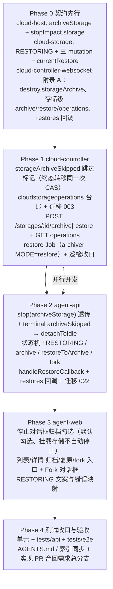
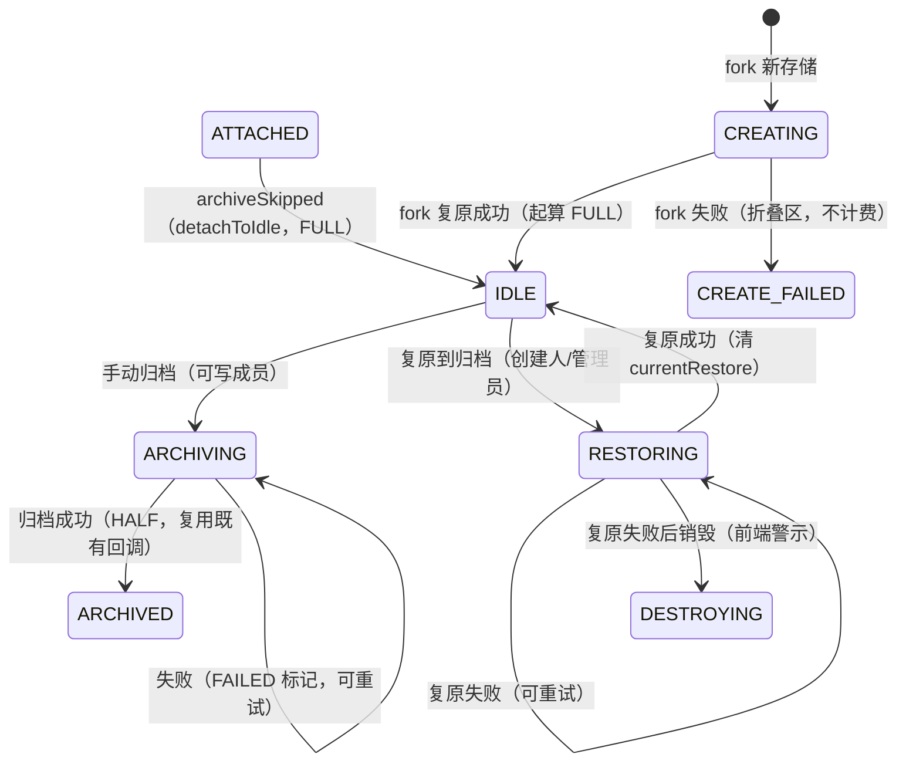

# 云存储归档优化 - 实现计划

**关联 PRD**: `docs/product/draft/20261104-cloud-storage-archive-optimization.md`（v1.0，Issue #434）
**关联 Proposal**: `docs/engineering/proposals/20261104-feat-cloud-storage-archive-optimization.md`（v1.0）
**需求总分支（prd-branch）**: `prd/cloud-storage-archive-optimization`（需求总 PR #439，基于 `origin/main` `313436a1`）
**实现分支**: `impl/cloud-storage-archive-optimization`（基于 `prd/cloud-storage-archive-optimization`，实现 PR 合回需求总分支）
**创建日期**: 2026-11-04
**计划版本**: v1.0

## 实现顺序



依赖说明：

- **Phase 0 契约先行**（z-coding：技术方案 → 更新 Contract → 开发分支 → 实现）；契约未改不写实现。
- **Phase 1 与 Phase 2 可并行开发**，但**发布顺序必须 cloud-controller → agent-api → agent-web**（提案 §9.2）。Phase 2 依赖 Phase 1 的三类端点与 terminal `archiveSkipped` 字段；Phase 1 不依赖 Phase 2（旧 agent-api 不会调用新端点）。
- **Phase 3 依赖 Phase 2 的 GraphQL 契约落地**（schema 可先按契约手写，运行时需服务端就绪）。
- **Phase 4 在实现分支合并回需求总分支后收口**。

开发模式 TDD（红-绿-重构）：每个 Phase 内先写测试（RED）→ 实现（GREEN）→ 重构。编码前加载 `docs/engineering/common-rules.md`、`backend-rules.md` / `frontend-rules.md` 与对应子项目 `AGENTS.md`。`tests/api` / `tests/e2e` 只允许 Aspire 编排（禁止裸 docker），重跑从 `aspire start` 重来。

### 关键约束（提案 §1.3 / §6，实现期不得回退）

- **写入单一**：`cloudstorages` 只由 agent-api 写（admin-api 只读镜像）；`cloudcontainers`、`cloudstorageoperations` 只由 cloud-controller 写。
- **归档触发仍单一收敛**在 `ContainerService.prepareStorageArchive` → `StorageService.maybeStartArchive`；本期只增加「跳过标记」与「存储级触发点」，不新增第二条自动归档链路。
- **零回归**：`stopCloudHost` 不传 `archiveStorage`、`destroy` 不传 `storageArchive`、未挂载存储的容器，报文与行为**逐字节等价**（不得新增必填字段/改写既有状态回滚分支）。
- **旧归档不丢**：手动归档失败/中断必须保留旧归档与源数据（Job 脚本 `.tmp` → 删旧 → `mv` 顺序不动）；复原失败不删归档。
- **计费零结构变更**：`billingRate` 仍只有 `FULL/HALF`；`ATTACHED → IDLE` 保持 `FULL` 且不改 `billingStartedAt`；fork 新存储 `CREATING` 不写 `billingStartedAt`、`IDLE` 时起算。
- **迁移只增不改**：agent-api 022 只建索引；cloud-controller 003 只建集合索引。
- **禁止 rebase/squash**（z-git）：只允许 merge；并行需求冲突用 merge 协调并顺延迁移编号。
- **实现计划文档提交到需求总分支**（本文件落 `prd/cloud-storage-archive-optimization`）；实现代码在 `impl/cloud-storage-archive-optimization`。

---

## 代码事实核对（F1~F12）

> 提案对现状的描述整体准确（行号可作为实现锚点）；以下为核对结论与**提案未覆盖但实现必须处理**的点。

| 编号 | 事实 | 对计划的影响 |
|------|------|-------------|
| F1 | 自动归档收敛在 `ContainerService.prepareStorageArchive`（`container-service.ts:711`）→ `StorageService.maybeStartArchive`（`storage-service.ts:400`），条件 `storageId != null && connectedAt != null && storageArchiveStatus ∈ {null, failed}`；`destroy()` 在容器锁外 `triggerStorageArchive(current)`，`markExited/markFailed` 在锁内调用 | 跳过标记必须在 `destroying` CAS 同一次写入；两处入口统一读标记（D2） |
| F2 | `DELETE /internal/containers/:id` 现支持 `reason`（body 优先、query 回退），`destroyLocked` 内完成 `destroying` CAS、Job 删除、`exited` CAS | 沿用同结构扩展 `storageArchive`，不改 `reason` 语义 |
| F3 | terminal 报文由 `index.ts` 的 `onDestroyed` 钩子组装（`terminalStorage = {id, archiveStatus, archiveId}`），`AgentApiClient.notifyTerminal` 仅 `storage` 非空时携带 | 新增 `archiveSkipped` 同样只在 `true` 时携带 |
| F4 | agent-api `syncStorageOnTerminal`（`cloud-host-service.ts:942`）**首分支**是 `!host.readyAt → releaseStorage`（953-956），归档状态判定在其后 | `archiveSkipped` 分支必须**放在 `!host.readyAt` 之后**（D3），否则「未就绪即停止」会把 ARCHIVED 来源错误置为 IDLE |
| F5 | `handleArchiveCallback`（`cloud-storage-service.ts:705`）按 `archiveId` 幂等、终态单调；SUCCEEDED 只接受 `ATTACHED/ARCHIVING`；`markArchiving`（637）用 archiveId 开新周期 | 手动归档复用同一回调零改动；新周期占位语义可直接沿用 |
| F6 | `retryArchive`（420）依赖 `lastContainerId` 且要求 `ARCHIVING + currentArchive.status=FAILED`；`reconcileARCHIVING`（904）用 `lastContainerId → getArchive(containerId)` 对账 | 存储级来源**不能用 `lastContainerId` 判别**（D6/D7）：停止不归档会保留 `lastContainerId` |
| F7 | `CloudStorage.archive` 子文档已有 `containerId/path/status/usageBytes/sourcePvcReleased`，但**没有 `operationId`** | 必须新增 `currentArchive.operationId`（D5），否则 agent-api 无法按操作单查询对账 |
| F8 | `StopCloudHostDialog` 在 `activeSessionCount === 0` 时自动 `handleStop(false)`（`useEffect`），用户根本看不到可交互的确认 | 挂载存储时必须取消自动停止（D1），否则 PRD 功能点 1 的「勾选项」对无活动会话场景永远不可选 |
| F9 | `CloudHostStopImpact` 现仅 `activeSessionCount/sessionsWillBeLost/sessions` | 新增 `storage: CloudStorageSummary`；`cloudStorageService.getSummary()` 已可直接复用 |
| F10 | cloud-controller 归档 Job 的 manifest/labels/轮询/`ZAG_ARCHIVE_RESULT` 解析全部就绪（`executeArchive`）；`prepareForStart` 的「删残留 → 轮询消失 → ensure」三段在 316-350 | 抽取 `recreateStoragePvc` 复用；restore Job 只需新增 manifest 与标记行 |
| F11 | `ARCHIVE_PATH_PATTERN`（`internal-api.ts:334`）是**通用** `[a-f0-9]{24}/[a-f0-9]{24}` 前缀，不校验与目标存储 id 一致 | fork 以「源存储归档路径」请求目标存储复原不会被误拒（无需放宽正则） |
| F12 | 迁移编号：agent-api 最新 `021-workflow-interrupt-retry`、cloud-controller 最新 `002-cloudcontainers-workspace-id`；`onlyAttachable` 恒为 `IDLE + ARCHIVED` | 022 / 003 编号成立；`RESTORING` 天然不可挂载，无需改查询 |

---

## 计划期裁决（提案留白 / 不自洽处的实现口径）

> 均为落地口径，不改变产品结论；实现完成后回写提案勘误（不重开评审）。

1. **D1 挂载存储时不自动停止**：`StopCloudHostDialog` 的自动停止条件改为「`activeSessionCount === 0` **且** `impact.storage == null`」。挂载了云存储时必须展示确认区（含勾选项），由用户点「继续停止」提交。
2. **D2 跳过标记的写入时机与幂等**：`container-service.destroy(id, {reason, storageArchive})` 仅在 `storageArchive === false && container.storageId != null && 活跃状态 → destroying` 的那次 `repo.update` 中写 `storageArchiveSkipped: true`；**不改写**终态幂等分支（已终态容器已在终态时触发过归档，事后改标记无意义）。`prepareStorageArchive`/`triggerStorageArchive`/`maybeStartArchive` 统一前置 `storageArchiveSkipped !== true`。`startArchive`（用户显式重试）不受标记限制。
3. **D3 `archiveSkipped` 分支位置**：`syncStorageOnTerminal` 顺序固定为 ①`!host.readyAt → releaseStorage` ②`input.storage?.archiveSkipped === true → detachToIdle` ③`archiveStatus=pending/running → markArchiving` ④既有 reconcile/release 兜底。理由见 F4（未就绪即停止时源卷内容不可信，必须回 `attachFromStatus`）。
4. **D4 `archiveStorage` 报文口径**：agent-api 仅在 `host.storageId != null && archiveStorage === false` 时下发 `storageArchive:false`；`true`/`undefined`/`null` 均不下发（保持旧报文形状）。`destroyContainer(id, {storageArchive})` 第二参数缺省时不带 body 字段。
5. **D5 `currentArchive.operationId` 必加**：`ArchiveCallbackInput`/`archiveSchema`/契约 `CloudStorageArchive` 之外的内部字段，存储级归档与复原共用操作单号；`handleArchiveCallback` 仅在缺失时忽略，不参与幂等判定（仍以 `archiveId` 为准）。
6. **D6 重试来源判别用 `currentArchive.containerId == null`**：为空 = 存储级（手动归档/fork/复原来源），走 `POST /internal/storages/:id/archive` 新单；非空 = 容器级，保持现状 `POST /internal/containers/:id/archive`。**不得**用 `lastContainerId` 判别。
7. **D7 `ARCHIVING` / `RESTORING` 对账分流**：`currentArchive.containerId == null` 或 `doc.currentRestore` 非空时，按 `operationId` 调 `GET /internal/storages/:id/operations/:opId`；否则保持既有 `getArchive(containerId)`。超时阈值复用 `ARCHIVING_RECONCILE_AFTER_MS = 10min`。
8. **D8 手动归档失败必须恢复旧归档快照**：`archive()` 先 CAS `IDLE → ARCHIVING` 并写入新 `currentArchive` 占位（PENDING），同时把「上一次归档快照」留在内存；控制面调用同步失败时回滚 `ARCHIVING → IDLE` **并回写旧 `currentArchive`**。否则一次触发失败会抹掉 fork/复原所依赖的可用归档。
9. **D9 fork 跳过 `POST /internal/storages`**：restore 端点本身内含「删残留 → 轮询 → ensure 重建」，两步会「刚建即删」。fork 只创建 `cloudstorages` 记录（`CREATING`）后直接调 restore，并在报文携带 `tenantId/workspaceId/sizeGi/storageClass`，保证新 PVC 标签与规格完整（对产品无差异）。
10. **D10 `operationId` 形态统一 24 位 hex**：agent-api 用 `new mongoose.Types.ObjectId().toString()` 生成；cloud-controller 以同值 `new mongoose.Types.ObjectId(operationId)` 作为台账 `_id`，非法形态 400 `INVALID_BODY`。
11. **D11 台账唯一进行中约束用部分唯一索引**：`cloudstorageoperations` 建 `{storageId:1}` 唯一索引 + `partialFilterExpression: {status: {$in:['pending','running']}}`，插入撞键即 409 `OPERATION_RUNNING`（无需读后写，天然抗并发）。`cloudcontainers` 侧 `findInflightArchive(storageId)` 同时纳入本台账（`deleteStorage`/`cleanup` 的 409 防线）。
12. **D12 restore Job 形态**：新增 `buildRestoreJobManifest()`（archiver `MODE=restore`、`RESTORE_FILE`、卷 `archive RO + target RW`、标签 `zag.cloud/storage-op-id` + `archive-role=restore`），Job 名 `zag-restore-<storageId 前 8 位>`；轮询状态 + 读 Pod 日志校验 `ZAG_RESTORE_DONE` 标记行；超时复用 `ARCHIVE_TIMEOUT_MS`（不新增 env）。
13. **D13 复原触发失败的回滚口径**：`restoreToArchive` 同步调用失败 → `RESTORING → IDLE` + `currentRestore = null` + 抛可读文案（用户可再次点击）；异步失败由 `restores` 回调置 `FAILED` 并**保持 RESTORING**（可重试/警示后销毁）。fork 同步失败 → `CREATING → CREATE_FAILED + destroyedAt` + best-effort 删 PVC。
14. **D14 `RESTORING` 的状态门槛集中一处**：`attachStorage` 只允许 `IDLE/ARCHIVED`（不改）；`archive` 只允许 `IDLE`；`restore` 只允许 `IDLE + SUCCEEDED 归档`，重试只允许 `RESTORING + currentRestore.FAILED`；`fork` 只允许源 `currentArchive=SUCCEEDED && status ∈ {IDLE, ARCHIVED}`；`destroy` 在既有规则上追加「`RESTORING + FAILED` 允许（前端额外警示）」。
15. **D15 复原/归档来源的展示字段**：手动归档记录 `cloudHostId=null`、`cloudHostName=null`、`fileName = buildArchiveFileName(storage.name)`；前端归档卡片对 `cloudHostName == null` 展示「手动归档」。
16. **D16 fork 并发读取归档的失败语义**：fork 的 `archivePath` 取自触发时刻 `currentArchive.path` 快照；同工作区归档类操作由 `archiveMutex` 串行，若快照文件已被新归档原子替换，restore Job 读取失败 → fork 失败（`CREATE_FAILED`，可重试），**不静默降级为空环境**。

---

## Phase 0: 契约先行（contracts）

开发分支：`impl/cloud-storage-archive-optimization`。

### 文件修改

| 文件 | 操作 | 说明 |
|------|------|------|
| `contracts/cloud-host.graphql` | 修改 | `CloudHostStopImpact.storage: CloudStorageSummary`（未挂载为 `null`，停止对话框据此展示勾选项）；`stopCloudHost(id: ID!, force: Boolean, archiveStorage: Boolean)` 与注释（缺省 = 归档；`false` = `ATTACHED → IDLE`、保持全价、数据保留；非主动销毁不走该入口） |
| `contracts/cloud-storage.graphql` | 修改 | ①`CloudStorageStatus` + `RESTORING`（复原中，含复原失败待重试）；②`CloudStorageRestoreStatus`（PENDING/RUNNING/SUCCEEDED/FAILED）与 `CloudStorageRestore`；③`CloudStorage.currentRestore`、`CloudStorage.forkedFromStorageId`；④`ForkCloudStorageInput.name`；⑤三 mutation `archiveCloudStorage` / `restoreCloudStorageToArchive` / `forkCloudStorage`（含状态门槛、权限、幂等注释）；⑥头注释状态机补 4 条路径；⑦错误文案表（§3.1.2 六条 + 既有白名单） |
| `contracts/cloud-controller-websocket.md` | 修改 | ①**A.2.3** destroy body 增 `storageArchive?: boolean`（缺省/true = 归档；false = 落跳过标记）与语义；②**新增 A.2.11 存储级归档**（`POST /internal/storages/:storageId/archive`）；③**新增 A.2.12 存储级复原**（`POST /internal/storages/:storageId/restore`，fork 复用）；④**新增 A.2.13 操作查询与 restores 回调**（`GET .../operations/:opId`、`POST /internal/cloud-storages/:id/restores`）；⑤**A.2.10** terminal `storage` 增 `archiveSkipped` 与 restores 回调口径；⑥**A.3** CloudContainer 表增 `storageArchiveSkipped`；⑦错误码表增 `OPERATION_RUNNING`/`STORAGE_IN_USE`/`INVALID_BODY` 口径 |
| `docs/engineering/AGENTS.md` | 修改 | 「实现计划（`plan/`）」索引追加本计划 |

> 新增小节采用 **A.2.11~A.2.13 追加**而非重排 A.2.7~A.2.10，避免既有实现引用（代码注释多处写 `A.2.7 ~ A.2.9`）失效。

### 验收 checklist

- [ ] 契约与提案 §3.1/§3.2 逐条对应，D4/D5/D6/D14 的修正已落入文字
- [ ] `git diff --stat contracts/` 仅上述三个文件；`cloud-host.graphql` 除 `archiveStorage` 与 `stopImpact.storage` 外无字段变更
- [ ] 附录 A 新端点/错误码/回调字段可直接作为 Phase 1 实现清单
- [ ] 既有前端查询（`CLOUD_STORAGES`/`CLOUD_HOST_STOP_IMPACT`）不因新增字段破坏

---

## Phase 1: cloud-controller（跳过标记 + 存储级操作）

开发分支：`impl/cloud-storage-archive-optimization`。TDD：先补 `storage-service.test.ts` / `container-service-storage.test.ts` / `internal-api.test.ts`（RED）→ 实现（GREEN）。

### 文件修改

| 文件 | 操作 | 说明 |
|------|------|------|
| `servers/cloud-controller/src/models/cloud-container.ts` | 修改 | +`storageArchiveSkipped: { type: Boolean, default: null }`（历史行 null 容忍） |
| `servers/cloud-controller/src/repositories/container-repository.ts` | 修改 | 实体与映射补 `storageArchiveSkipped`（`CloudContainerEntity` 与 `toEntity`/写回映射） |
| `servers/cloud-controller/src/services/container-service.ts` | 修改 | ①`destroy(id, options?: {reason?, storageArchive?})`；②`destroyLocked` 的 `destroying` CAS 同一次写入 `storageArchiveSkipped: options.storageArchive === false && container.storageId ? true : undefined`（未挂载/true 不写）；③`prepareStorageArchive` 前置跳过判断；④`triggerStorageArchive` 前置跳过判断 |
| `servers/cloud-controller/src/models/cloud-storage-operation.ts` | 新增 | 集合 `cloudstorageoperations`：`_id`(ObjectId=operationId)、`storageId/workspaceId/tenantId/type('archive'\|'restore')/status('pending'\|'running'\|'succeeded'\|'failed')/archiveId/fileName/archivePath/sizeGi/storageClass/usageBytes/startedAt/finishedAt/failureReason/callbackDeliveredAt`；索引见 D11 |
| `servers/cloud-controller/src/repositories/storage-operation-repository.ts` | 新增 | `create`（撞键→`OperationRunningError`）、`findById`、`findInflight(storageId)`、`markRunning`、`markSucceeded`、`markFailed`、`markCallbackDelivered`、`findStale(now, timeoutMs)`、`findUndelivered()`（全部 CAS 或 `updateOne` 幂等） |
| `servers/cloud-controller/src/services/storage-service.ts` | 修改 | ①`startStorageArchive(storageId, input)`/`startStorageRestore(storageId, input)`/`getOperation(storageId, opId)`；②`runStorageArchive`/`runStorageRestore`（锁外 spawn、`archiveMutex` + `awaitCleanup` 串行）；③`recreateStoragePvc()`（抽取自 `prepareForStart` 的删 → 轮询 → ensure 三段，`prepareForStart` 改为调用它）；④`buildRestoreJobManifest()`；⑤`finishStorageOpSuccess/Failure` + 回调（含 `callbackDeliveredAt`）；⑥`reconcileStorageOperations()`；⑦`findInflightArchive` 扩展纳入台账；⑧`buildArchiveJobManifest` 支持存储级标签（可选 `containerId`/`opId`） |
| `servers/cloud-controller/src/services/agent-api-client.ts` | 修改 | +`notifyStorageRestore(storageId, body)`（`POST /internal/cloud-storages/:id/restores`，同 4 次退避重试）；`TerminalStorageState` +`archiveSkipped?: boolean` |
| `servers/cloud-controller/src/services/status-sync.ts` | 修改 | `reconcileArchives` 内部调用 `reconcileStorageOperations`（复用同一 15s 巡检步骤与 `status.sync.tick` span，不新增 option 字段） |
| `servers/cloud-controller/src/routes/internal-api.ts` | 修改 | ①destroy 解析 `storageArchive`（仅接受 boolean，其它 400 `INVALID_BODY`）；②`POST /storages/:storageId/archive`（`operationId` hex24 + `archiveId` + `fileName` 校验，`ARCHIVE_FILE_NAME_PATTERN`）；③`POST /storages/:storageId/restore`（`operationId/workspaceId/tenantId/sizeGi(1..30)/archivePath` 校验，`storageClass` 复用 `STORAGE_CLASS_PATTERN`）；④`GET /storages/:storageId/operations/:operationId`；⑤`respondStorageError` 增 `OperationRunningError` → 409 `OPERATION_RUNNING` |
| `servers/cloud-controller/src/migrations/003-cloud-storage-operations.ts` | 新增 | 幂等建索引：`uniq_storage_op_inflight`（部分唯一）、`{status:1, updatedAt:1}`、`{storageId:1, createdAt:-1}` |
| `servers/cloud-controller/src/index.ts` | 修改 | 组装 `StorageOperationRepository` → `StorageService` deps；迁移 003 注册 |
| `servers/cloud-controller/AGENTS.md` | 修改 | 补存储级操作/跳过标记/台账口径 |

### 关键实现要点

1. **跳过标记时序（T-SKIP4）**：`destroying` CAS 与标记同一次 `repo.update`，不存在「已 destroying 但未打标记」窗口；`destroyLocked` 的终态幂等分支与 `markExited/markFailed` 路径不写标记（D2）。`maybeStartArchive` 读到的正是最新快照（`repo.update` 返回 after）。
2. **存储级归档（T-AR2/AR4）**：`startStorageArchive` 先校验 `storageId` 无活跃容器（`findActiveByStorage`）与无进行中操作 → 台账 `create`（`pending`）→ 锁外 `spawn` → 锁内 `runStorageArchive`：`pending → running` CAS → 回调 `RUNNING` → `ensureArchivePvc` → 建归档 Job（源 PVC RO + 归档卷 RW）→ 轮询 → 读日志解析 `ZAG_ARCHIVE_RESULT` → CAS `running → succeeded` → 删源 PVC（3 次重试，`sourcePvcReleased` 留痕）→ 回调 `SUCCEEDED`（含 `operationId`）→ 删 Job。失败/超时/标记行缺失 → `failed` + 回调 `FAILED`，**不删源 PVC、不动旧归档**。
3. **存储级复原（T-RS4）**：`startStorageRestore`：台账 `create` → spawn → `recreateStoragePvc(storageId, sizeGi, storageClass)`（删残留 → 轮询消失 → ensure）→ 建 restore Job（`archive RO` + `target RW`，`RESTORE_FILE=archivePath`）→ 轮询 + 校验 `ZAG_RESTORE_DONE` → CAS `succeeded` → 回调 restores `SUCCEEDED`；失败 → `failed` + 回调 `FAILED`（目标 PVC 可能是半恢复态，重试整体删除重建，D12）。
4. **互斥（T-OP1）**：存储级操作与容器级归档/用量/清理共用 `archiveMutex`（key = workspaceId）与 `awaitCleanup`；同存储进行中由部分唯一索引拒绝（409 `OPERATION_RUNNING`）。`deleteStorage`/`cleanup` 的 `findInflightArchive` 同时查台账，避免删除正在被归档/复原的卷。
5. **巡检（T-OP1/T-OP2）**：`reconcileStorageOperations(now)`：`pending/running` 超 `ARCHIVE_TIMEOUT_MS` → `failed` + 回调；本进程无执行任务（重启）→ 重跑（归档：源卷未删，安全；复原：整体删重建）；终态且 `callbackDeliveredAt=null` → 重投一次。

### 验收 checklist

- [ ] `destroy` 不传 `storageArchive`：`cloudcontainers` 记录与 terminal 报文与现状逐字段一致（无 `storageArchiveSkipped`、无 `archiveSkipped`）
- [ ] `storageArchive:false`：终态前落标记，`maybeStartArchive`/巡检均不触发归档；显式 `POST /containers/:id/archive` 仍可执行
- [ ] 存储级归档：原子替换（Job 脚本未改）、成功删源 PVC、失败保留旧归档与源卷
- [ ] 存储级复原：先删后建、`sizeGi/storageClass` 快照生效、失败不删归档
- [ ] 同存储并发第二单返回 409 `OPERATION_RUNNING`；同 `operationId` 重投返回既有状态
- [ ] 迁移 003 幂等（二次 run 零变更），`autoIndex=false` 下索引存在

---

## Phase 2: agent-api（状态机 + 回调 + 迁移）

开发分支：`impl/cloud-storage-archive-optimization`。TDD：先补 `cloud-storage-service.test.ts`、`cloud-host-service.test.ts`、`routes/internal-cloud-storage.test.ts`、`migrations/022-*.test.ts`（RED）→ 实现（GREEN）。

### 文件修改

| 文件 | 操作 | 说明 |
|------|------|------|
| `servers/agent-api/src/models/cloud-storage.ts` | 修改 | ①`CLOUD_STORAGE_STATUSES` + `RESTORING`；②`archiveSchema` + `operationId: String\|null`（D5）；③新增 `restoreSchema`（`operationId/status/startedAt/finishedAt/failureReason`，`_id:false`）；④`currentRestore: restoreSchema\|null`；⑤`forkedFromStorageId: ObjectId\|null` |
| `servers/agent-api/src/models/cloud-container.ts` | 修改 | 只读镜像 +`storageArchiveSkipped: Boolean\|null` |
| `servers/agent-api/src/services/cloud-controller-client.ts` | 修改 | ①`destroyContainer(id, options?: {storageArchive?: boolean})`（仅 false 时带 body）；②`archiveStorageOperation(storageId, input)`；③`restoreStorageOperation(storageId, input)`；④`getStorageOperation(storageId, operationId)`；⑤相关 wire 类型 |
| `servers/agent-api/src/services/cloud-host-service.ts` | 修改 | ①`stopImpact` 返回 +`storage`（`storageService.getSummary(host.storageId)`）；②`TerminalCallbackInput.storage` +`archiveSkipped`；③`syncStorageOnTerminal` 按 D3 顺序新增 `detachToIdle` 分支；④`stop(id, userId, force, archiveStorage)`（D4 口径） |
| `servers/agent-api/src/services/cloud-storage-service.ts` | 修改 | ①`detachToIdle`；②`archive`/`restoreToArchive`/`fork`/`handleRestoreCallback`；③`retryArchive` 存储级分支（D6）；④`reconcileARCHIVING` 分流 + 新增 `reconcileRESTORING`；⑤`destroy` 支持 `RESTORING+FAILED`；⑥`mapStorage` + `currentRestore`/`forkedFromStorageId`；⑦错误白名单 |
| `servers/agent-api/src/routes/internal-cloud-storage.ts` | 修改 | +`POST /:storageId/restores`（解析 `operationId/status/usageBytes/startedAt/finishedAt/failureReason`，非法 400，404/500 同 archives） |
| `servers/agent-api/src/graphql/schemas/cloud-storage.ts` | 修改 | 与契约同步（`RESTORING`、`CloudStorageRestoreStatus`、`CloudStorageRestore`、`currentRestore`、`forkedFromStorageId`、`ForkCloudStorageInput`、三 mutation） |
| `servers/agent-api/src/graphql/schemas/cloud-host.ts` | 修改 | `CloudHostStopImpact.storage`；`stopCloudHost(archiveStorage)` |
| `servers/agent-api/src/graphql/resolvers/cloud-storage.ts` | 修改 | 三 mutation resolver（`wrap` 原样透传白名单文案） |
| `servers/agent-api/src/graphql/resolvers/cloud-host.ts` | 修改 | `stopCloudHost` 透传 `archiveStorage`；`CloudHostStopImpact.storage` 已在 service 返回 |
| `servers/agent-api/src/graphql/resolvers/index.ts` | 修改 | 确认 `Mutation`/类型登记（resolver 新增键必须登记，否则运行时无效） |
| `servers/agent-api/src/migrations/022-cloud-storage-fork.ts` | 新增 | 幂等建 `{resourceWorkspaceId:1, forkedFromStorageId:1}` 稀疏索引（`partialFilterExpression: {forkedFromStorageId: {$type:'objectId'}}`），不回填 |
| `servers/agent-api/src/index.ts` | 修改 | 注册迁移 022；`scheduleCloudStorageReconcile` 内同时调度 `reconcileRESTORING` |
| `servers/agent-api/AGENTS.md` | 修改 | 补归档优化口径（三条路径、`detachToIdle`、台账对账） |

### 状态机与 CAS 口径（实现点 5）



| 方法 | CAS 过滤 | 写入 |
|------|---------|------|
| `detachToIdle(storageId, hostId)` | `{_id, status:'ATTACHED', attachedCloudHostId: hostId}` | `IDLE`、`billingRate:'FULL'`、清 `attached*`/`attachFromStatus`；保留 `lastContainerId`/`usageBytes` |
| `archive(id, userId)` | `{_id, status:'IDLE', destroyedAt:null}` → `ARCHIVING` | 新 `currentArchive`（PENDING，`containerId:null`、`operationId`、`archiveId`、`fileName`、`path`） |
| `restoreToArchive(id, userId)` | `{_id, status:'IDLE', 'currentArchive.status':'SUCCEEDED'}` 或 `{_id, status:'RESTORING', 'currentRestore.status':'FAILED'}` | `RESTORING` + `currentRestore`（PENDING）；重试时换新 `operationId` |
| `fork(id, input, userId)` | 源查询 + 名称唯一 + CAS 建记录 | 新 `CREATING` 记录（`sizeGi=源`、`forkedFromStorageId`、`currentRestore` PENDING、不写 `billingStartedAt`） |
| `handleRestoreCallback` | `{_id, 'currentRestore.operationId': opId, 'currentRestore.status': {$ne:'SUCCEEDED'}}` | RESTORING→IDLE / CREATING→IDLE（写 `billingStartedAt`）；FAILED 保持状态并记 `failureReason` |

### 关键实现要点

1. **`archive` 失败回滚（D8）**：控制面同步失败 → `ARCHIVING → IDLE` 并**回写旧 `currentArchive`**；错误映射 `storage is not archivable`（非 IDLE）、`storage is archiving`（控制面 409）。
2. **`retryArchive` 分流（D6）**：`currentArchive.containerId == null` → 生成新 `operationId`/`archiveId`/`fileName`，调 `archiveStorageOperation`，成功后占位 `currentArchive`（PENDING，保留 `operationId`）；否则走既有 `triggerArchive(containerId)`。
3. **`reconcileARCHIVING` / `reconcileRESTORING`（D7）**：存储级来源按 `operationId` 查询补齐；容器级来源保持 `getArchive`。均限 20 条/轮、异常吞掉并 warn。
4. **terminal 幂等**：`detachToIdle` 只命中 `ATTACHED`，terminal 重投/乱序不重复推进；`archiveSkipped` 与 `archiveStatus` 同时存在时以 `archiveSkipped` 优先（cloud-controller 不会同时产出，防御式）。
5. **权限**：`archive`/`fork` → `assertWorkspaceWritable`（全局工作区 developer 只读拒绝）；`restore` → `createdBy === userId || context.role === 'admin'`（复用销毁同级判定）；全部服务端权威。
6. **计费**：`detachToIdle` 不动 `billingStartedAt`（tick 连续按 FULL 出账）；`RESTORING` 恒 FULL；fork `CREATING` 不计费、`IDLE` 起算（与 `create` 同口径）。
7. **对账节奏**：`scheduleCloudStorageReconcile` 已按 `intervalMs`（≥60s）跑 `reconcileARCHIVING`，本期在同一次 tick 内串行调用 `reconcileRESTORING`（避免新增定时器）。

### 验收 checklist

- [ ] `stopCloudHost(id, force, archiveStorage:false)` → destroy 请求带 `storageArchive:false`；`true`/缺省/未挂载不带（报文逐字段断言）
- [ ] `terminal{storage:{archiveSkipped:true}}` → `IDLE`、`FULL`、attached* 清空；未就绪即停止仍回 `attachFromStatus`
- [ ] 手动归档：`IDLE → ARCHIVING`，成功 `ARCHIVED + HALF`，失败保留旧归档且可重试（含无容器来源）
- [ ] 复原：门槛/权限/二次确认语义；成功回 `IDLE` 且 `usageBytes` 取归档占用；失败保持 `RESTORING` 可重试、可销毁
- [ ] fork：新存储 `sizeGi=源`、`forkedFromStorageId=源`、`CREATING → IDLE + billingStartedAt`；失败 `CREATE_FAILED` 不计费、源零影响
- [ ] `RESTORING` 不可挂载/不可归档/fork；`onlyAttachable` 回归不变
- [ ] 迁移 022 幂等；错误文案全部命中白名单（未命中不泄露内部错误）

---

## Phase 3: agent-web（交互与状态）

开发分支：`impl/cloud-storage-archive-optimization`。TDD：先补/加 `StopCloudHostDialog.test.tsx`、`CloudStorageSection.test.tsx`、`CloudStorageDetailDialog.test.tsx`、新增 `ForkCloudStorageDialog.test.tsx`（RED）→ 实现（GREEN）。

### 文件修改

| 文件 | 操作 | 说明 |
|------|------|------|
| `apps/agent-web/src/graphql/queries.ts` | 修改 | `CLOUD_HOST_STOP_IMPACT` + `storage { id name sizeGi status usageBytes hourlyCredits }`；`CLOUD_STORAGE_FIELDS` + `currentRestore { id status startedAt finishedAt failureReason }`、`forkedFromStorageId` |
| `apps/agent-web/src/graphql/mutations.ts` | 修改 | `STOP_CLOUD_HOST` + `$archiveStorage`；新增 `ARCHIVE_CLOUD_STORAGE` / `RESTORE_CLOUD_STORAGE_TO_ARCHIVE` / `FORK_CLOUD_STORAGE` |
| `apps/agent-web/src/graphql/types.ts` | 修改 | `CloudHostStopImpactData.storage: CloudStorageSummaryData \| null`；`CloudStorageStatus` + `'RESTORING'`；`CloudStorageRestoreData`/`CloudStorageData.currentRestore`/`forkedFromStorageId`；三 mutation 返回类型 |
| `apps/agent-web/src/lib/cloud-storage.ts` | 修改 | ①状态文案 `RESTORING→复原中` + 徽标 variant；②`canArchiveStorage`（`IDLE`）、`canRestoreStorage`（`IDLE && currentArchive=SUCCEEDED`；`RESTORING && FAILED` 仅为「重试」）、`canForkStorage`（`(IDLE\|ARCHIVED) && SUCCEEDED 归档`）；③`hasFailedRestore`；④`RESTORE_DESTRUCTIVE_WARNING`；⑤错误映射白名单 |
| `apps/agent-web/src/components/cloud-host/StopCloudHostDialog.tsx` | 修改 | ①`impact.storage` 非空时渲染勾选项（`aria-label="归档云存储"`，默认勾选）与说明「勾选：归档后按半价计费；不勾选：存储回到待挂载并继续全价计费，数据原样保留」；②D1：挂载存储时**不自动停止**；③提交 `stopCloudHost(id, force, archiveStorage)`；④`storage.status !== 'ATTACHED'` 时勾选禁用并提示「存储尚未挂载完成，停止后按原状态回滚（不归档）」，且不下发该字段 |
| `apps/agent-web/src/components/settings/CloudStorageSection.tsx` | 修改 | 行操作：`IDLE` →「归档」+（有可用归档时）「复原到归档」「fork」；`ARCHIVED` →「fork」；`ATTACHED/ARCHIVING/RESTORING` 不展示；既有「详情」「销毁」不变；操作成功后 `refetchAll`；`flex-wrap` 折行 |
| `apps/agent-web/src/components/settings/CloudStorageDetailDialog.tsx` | 修改 | 同款操作入口（含复原二次确认 destructive 文案）；`currentRestore` 状态/失败原因/重试入口；`RESTORING+FAILED` 销毁警示；归档卡片 `cloudHostName == null` → 「手动归档」（D15） |
| `apps/agent-web/src/components/settings/ForkCloudStorageDialog.tsx` | 新增 | 名称输入（trim 1~64、重名由服务端权威）、容量只读展示「与源一致：x Gi」、`cloudStorageBillingQuote(source.sizeGi)` 报价、提示「创建成功即开始计费」；提交后关闭并刷新列表 |
| `apps/agent-web/src/components/settings/ConfirmDialog` 复用 | — | 归档（提示转半价）/复原（destructive）复用既有 `ConfirmDialog`，不新增组件 |

### 验收 checklist

- [ ] 挂载存储的停止对话框：勾选默认 true、费用说明、无自动停止、提交携带；未挂载：不渲染、报文旧形状
- [ ] 按钮可见性与服务端门槛一致（`IDLE/ARCHIVED/ATTACHED/ARCHIVING/RESTORING` 六态矩阵）
- [ ] fork 对话框：容量只读、名称校验、报价、成功后列表自动刷新
- [ ] `RESTORING` 徽标「复原中」；复原失败可重试、可警示后销毁
- [ ] 移动端操作按钮折行不溢出（既有 `flex-wrap` 行布局回归）

---

## Phase 4: 测试收口与验收

### 文件修改

| 文件 | 操作 | 说明 |
|------|------|------|
| `tests/api/src/agent-api/cloud-storage-archive-optimization.test.ts` | 新增 | 不归档停止全链路、手动归档、复原、fork（API-CSO1/2） |
| `tests/api/src/cloud-controller/cloud-storage-archive-optimization.test.ts` | 新增 | destroy `storageArchive:false`、存储级 archive/restore/operations（InMemory K8s） |
| `tests/e2e/src/cloud-storage-archive-optimization.spec.ts` | 新增 | 停止对话框勾选/不勾选、设置页三操作（E2E-CSO1/2） |
| `docs/engineering/AGENTS.md` / `docs/product/AGENTS.md` | 修改 | 索引同步（proposal 已在；plan 追加；PRD 保持 `draft/`，验收后按流程归档） |
| `servers/agent-api/AGENTS.md`、`servers/cloud-controller/AGENTS.md`、`apps/agent-web/AGENTS.md` | 修改 | 本次新增口径入档 |

### 命令参考

```bash
# 单测（各自子项目）
cd servers/agent-api      && pnpm test -- cloud-storage-service cloud-host-service
cd servers/cloud-controller && pnpm test -- storage-service container-service internal-api
cd apps/agent-web         && pnpm test -- cloud-storage StopCloudHostDialog

# 类型/构建
cd servers/agent-api && pnpm build
cd servers/cloud-controller && pnpm build
cd apps/agent-web && pnpm lint && pnpm build

# 编排（API/E2E 前置；禁止裸 docker）
aspire start
cd tests/api && pnpm test
cd tests/e2e && pnpm test -- cloud-storage-archive-optimization
```

### 测试矩阵（TDD 先红后绿）

| 编号 | 用例 | 落点 |
|------|------|------|
| T-SKIP1a | `stopCloudHost(archiveStorage:false)` 且挂载存储 → destroy 请求 body 含 `storageArchive:false` | `cloud-host-service.test.ts` |
| T-SKIP1b | `archiveStorage:true/缺省`、未挂载存储 → 不携带该字段（报文逐字段等价） | 同上 |
| T-SKIP2a | terminal `archiveSkipped:true` → `ATTACHED→IDLE`、`FULL`、attached* 清空 | `cloud-host-service.test.ts` / `cloud-storage-service.test.ts` |
| T-SKIP2b | 未就绪即终态（`readyAt=null`）即便带 `archiveSkipped` 仍 `releaseStorage` 回 `attachFromStatus` | `cloud-host-service.test.ts` |
| T-SKIP2c | terminal 重投两次，第二次无副作用（CAS 幂等） | 同上 |
| T-SKIP3 | 缺省/true 归档链路回归（markArchiving → ARCHIVED + HALF） | `cloud-storage-service.test.ts` |
| T-SKIP4a | `destroy({storageArchive:false})` 在 `destroying` CAS 同一次写 `storageArchiveSkipped` | `container-service-storage.test.ts` |
| T-SKIP4b | `maybeStartArchive`/`reconcileArchives` 尊重标记；`startArchive` 不受限 | `storage-service.test.ts` |
| T-SKIP4c | 未挂载存储 / `storageArchive:true` 不写标记；terminal 报文不含 `archiveSkipped` | 同上 + `internal-api.test.ts` |
| T-AR1 | `archiveCloudStorage` 仅 IDLE；非 IDLE/只读拒绝；CAS → ARCHIVING | `cloud-storage-service.test.ts` |
| T-AR2 | 归档成功回调 → ARCHIVED + HALF + usageBytes（复用既有回调零改动） | 同上 |
| T-AR3a | 触发同步失败 → 回滚 IDLE 且**恢复旧 currentArchive** | 同上 |
| T-AR3b | `ARCHIVING+FAILED` 且 `currentArchive.containerId=null` → 走存储级端点新 operationId | 同上 |
| T-AR4 | cloud-controller：同 operationId 重投返回既有；同存储并发 → 409 `OPERATION_RUNNING` | `storage-service.test.ts` / `internal-api.test.ts` |
| T-RS1 | 复原门槛（IDLE+SUCCEEDED+创建人/管理员）；无归档 → `storage has no archive` | `cloud-storage-service.test.ts` |
| T-RS2 | 复原成功回调 → RESTORING→IDLE、清 currentRestore、usageBytes=归档占用 | 同上 |
| T-RS3a | 复原失败 → 保持 RESTORING + failureReason；同 mutation 重试（新 operationId）成功 | 同上 |
| T-RS3b | `RESTORING+FAILED` 可销毁（警示口径）；`RESTORING` 进行中不可销毁/挂载/归档/fork | 同上 |
| T-RS4 | cloud-controller restore：先删目标 PVC 并轮询消失 → 重建（sizeGi/storageClass）→ Job（archive RO/target RW）→ `ZAG_RESTORE_DONE`；失败不删归档 | `storage-service.test.ts` |
| T-FORK1 | 源无归档/状态非法/重名/余额不足/只读 → 对应错误 | `cloud-storage-service.test.ts` |
| T-FORK2 | fork 成功：`sizeGi=源`、`forkedFromStorageId=源`、`CREATING→IDLE+billingStartedAt`、restore 调用 `archivePath=源 currentArchive.path` | 同上 |
| T-FORK3 | 任一步失败 → `CREATE_FAILED+destroyedAt` + best-effort 删 PVC；源零影响 | 同上 |
| T-OP1 | 台账巡检：超时 → failed + 回调；终态未送达重投一次（幂等） | `storage-service.test.ts` |
| T-OP2 | agent-api 对账：存储级 ARCHIVING / RESTORING 超 10min 按 operationId 查询补齐 | `cloud-storage-service.test.ts` |
| T-WEB1 | 停止对话框：勾选默认 true、说明文案、挂载存储不自动停止、提交携带；未挂载旧形状 | `StopCloudHostDialog.test.tsx` |
| T-WEB2 | 列表/详情按钮状态门槛六态矩阵 + 确认对话框文案 | `CloudStorageSection.test.tsx` / `CloudStorageDetailDialog.test.tsx` |
| T-WEB3 | fork 对话框：容量只读、名称校验、报价、成功刷新 | `ForkCloudStorageDialog.test.tsx` |
| T-WEB4 | 错误文案映射（not archivable/not restorable/has no archive/not forkable/is restoring/not allowed to restore storage） | 组件测试 + `lib` 单测 |
| API-CSO1 | 不归档停止全链路：停止 → IDLE → 再挂载无需 restore | `tests/api` |
| API-CSO2 | 手动归档 → 半价；复原 → 回 IDLE 内容=归档；fork → 新存储 IDLE | `tests/api` |
| E2E-CSO1 | 停止对话框不勾选 → 待挂载；勾选 → 已归档 | `tests/e2e` |
| E2E-CSO2 | 设置页三操作各一次成功路径 | `tests/e2e` |

---

## 风险与回滚

| 风险 | 影响 | 处置 |
|------|------|------|
| 发布倒挂（新 agent-api + 旧 cloud-controller） | `storageArchive:false` 被忽略 → 仍归档（不丢数据，仅行为回旧） | 严格按 cloud-controller → agent-api → agent-web 发布；回滚先回 agent-api |
| 跳过标记写入时序错误 | 用户选择「不归档」仍被归档 | D2 同一次 CAS + T-SKIP4a 断言；巡检/手动重试双入口统一读标记 |
| `lastContainerId` 误用导致存储级归档重试打到旧容器 | 重试失败或归档到错误目标 | D6 以 `currentArchive.containerId` 判别 + T-AR3b |
| 一次失败的归档抹掉旧归档 | fork/复原失去可用归档 | D8 失败回滚旧快照 + T-AR3a |
| restore 目标 PVC 半恢复被挂载使用 | 数据不一致 | 失败保持 RESTORING（不可挂载），重试整体删重建（D12/D14） |
| fork 读取归档时被同工作区新归档替换 | fork 失败 | 产品允许失败重试；D16 不静默降级为空环境 |
| 台账与容器级归档并发 | 同工作区 RWO 归档卷写冲突 | 复用 `archiveMutex` + `awaitCleanup` + 部分唯一索引（D11） |
| 计费口径漂移 | 账单错误 | 零结构变更；`detachToIdle` 不动 `billingStartedAt`；T-SKIP2a/T-AR2/T-FORK2 断言 `billingRate`/`billingStartedAt` |

**回滚**：`CLOUD_STORAGE_ENABLED=false` 隐藏前端入口并由服务端拒绝三 mutation；已执行的停止/归档/复原/fork 结果保持（不回滚数据）。cloud-controller 回滚前必须先回滚 agent-api。

---

## 验收 checklist（对齐 PRD §3.2 与提案 §10）

- [ ] 停止挂载云存储的云电脑出现「归档云存储」勾选（默认勾选）+ 费用说明；**无活动会话也不自动跳过确认**（D1）
- [ ] 不勾选停止：存储「待挂载」、数据原样、继续全价出账、再次挂载无需恢复
- [ ] 勾选停止 / 未挂载存储停止 / 非主动销毁：与现状完全一致（零回归）
- [ ] 「待挂载」可手动归档：原子替换、释放数据卷、转半价；失败可重试且旧归档不丢
- [ ] 有归档的「待挂载」可「复原到归档」：二次确认、丢弃当前内容、回到「待挂载」；失败可重试/警示后销毁；仅创建人/管理员
- [ ] 有归档的存储可 fork：名称自定、容量与源一致不可调、内容为源归档、「待挂载」起算全价、源零影响、失败不定计费
- [ ] 已挂载/归档中/复原中无三操作入口；跨工作区不可见不可操作；只读角色全部拒绝
- [ ] 契约三文件与实现一致；`AGENTS.md` 索引同步
- [ ] T-SKIP/T-AR/T-RS/T-FORK/T-OP/T-WEB/API-CSO/E2E-CSO 全绿；未挂载存储链路零回归

## 相关文档

- [关联 PRD](../../product/draft/20261104-cloud-storage-archive-optimization.md)
- [关联 Proposal](../proposals/20261104-feat-cloud-storage-archive-optimization.md)
- [云存储一期实现计划](./20261102-feat-cloud-storage.md)
- [cloud-controller 契约](../../../contracts/cloud-controller-websocket.md)
- [需求来源：GitHub Issue #434](https://github.com/Deliay/z-agent-gear/issues/434)
