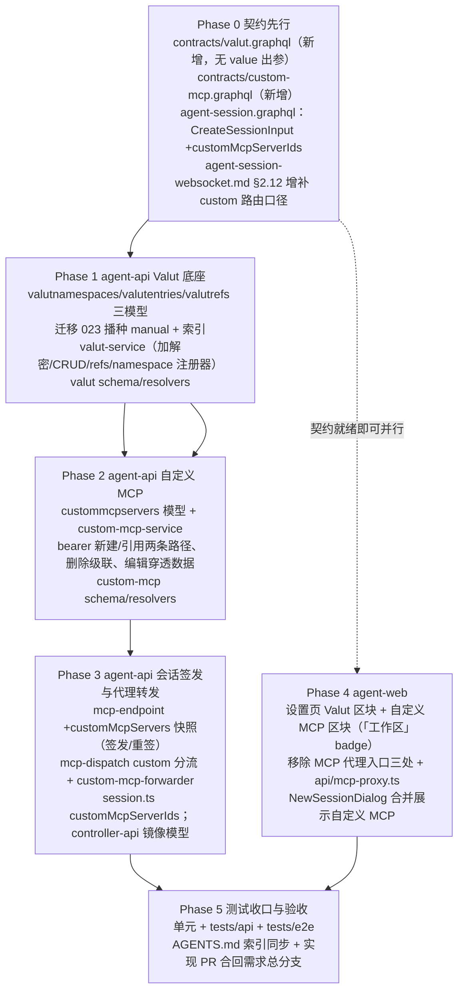

# MCP+Valut 功能迭代 - 实现计划

**关联 PRD**: `docs/product/draft/20261104-mcp-valut-iteration.md`（v1.1，Issue #448）
**关联 Proposal**: `docs/engineering/proposals/20261104-feat-mcp-valut-iteration.md`（v1.1，评审已通过，PR #458 APPROVED）
**需求总分支（feat-branch）**: `feat/mcp-valut-iteration`（需求总 PR #458，基于 `origin/main` `d4128396`）
**实现分支**: `impl/mcp-valut-iteration`（基于 `feat/mcp-valut-iteration`，实现 PR 合回需求总分支）
**创建日期**: 2026-11-05
**计划版本**: v1.0

## 实现顺序



依赖说明：

- **Phase 0 契约先行**（z-coding：技术方案 → 更新 Contract → 开发分支 → 实现）；契约未改不写实现。
- **Phase 1 → Phase 2 → Phase 3 严格顺序**：Phase 2 的 bearer 联动依赖 Phase 1 的 `valut-service`；Phase 3 的转发器依赖 Phase 2 的 `custommcpservers` 模型与 `resolveValue`。
- **Phase 4 可与 Phase 1~3 并行开发**（schema 按契约手写先行），运行时联调需 Phase 1~3 就绪；合并前全部转绿。
- **Phase 5 在实现分支合并回需求总分支前收口**（测试全绿是合并前提）。
- 发布顺序：**agent-api（迁移 023 随启动执行）→ agent-web**；controller-api 仅镜像模型加字段，可与 agent-api 同批或先发于 agent-web 均无依赖风险（无新端点，旧版不读新字段）。

开发模式 TDD（红-绿-重构）：每个 Phase 内先写测试（RED）→ 实现（GREEN）→ 重构。编码前加载 `docs/engineering/common-rules.md`、`backend-rules.md` / `frontend-rules.md` 与对应子项目 `AGENTS.md`。`tests/api` / `tests/e2e` 只允许 Aspire 编排（禁止裸 docker），重跑从 `aspire start` 重来。

### 关键约束（PRD §5.2 / 提案 §6，实现期不得回退）

- **明文不出服务端（安全红线）**：GraphQL 契约不存在 value 明文出参；解密仅 `valut-service.resolveValue`，唯一消费点是 `custom-mcp-forwarder` 的内存请求头组装；任何日志/响应/页面不出现明文。
- **平台代理转发（评审口径）**：自定义 MCP 对会话只暴露既有 loopback 代理地址（`/mcp/<sessionId>/<name>`）+ 会话 Bearer key；真实 endpoint、customHeaders、bearer token 不出服务端；Agent 侧与 ACP 协议零变更。
- **密钥随会话生灭**：复用 `mcp-endpoint` 会话密钥机制（JWT + Redis 状态 + 终态 revoke subscriber）；会话离线/关闭即失效；本期仅云容器对话场景签发。
- **删除即全端点失效**：转发路径按 MCP id 每次请求实时存在性校验，删除后一律 410，无需逐会话回收 key。
- **「MCP 代理」仅前端移除**：controller-api 代理路由（`/api/mcp-proxy*`）、`mcp-proxy-key` 模型与既有代理链路不动；`tests/e2e/src/mcp-session.spec.ts`（直打后端 REST）零改动保留。
- **工作区权限复用二期体系**：全局工作区写 = 仅 admin（插件 readOnly 拦截 developer，`global workspace is read-only`）；普通工作区 = 成员可读写；跨工作区一律 `Not found`。
- **namespace 全局跨租户唯一**：`valutnamespaces.name` 全局唯一索引；`manual` 由迁移播种；`service-mcp-bearer-tokens` 启动自检创建；不提供用户侧 namespace 管理入口。
- **禁止 rebase/squash**（z-git）：只允许 merge；并行需求冲突用 merge 协调并顺延迁移编号（023 若被占用则顺延并同步修正本文与提案）。
- **实现计划文档提交到需求总分支**（本文件落 `feat/mcp-valut-iteration`）；实现代码在 `impl/mcp-valut-iteration`。

---

## 代码事实核对（F1~F15）

> 提案对现状的描述整体准确；以下为核对结论与**提案未覆盖但实现必须处理**的点（F3/F4/F5/F7/F12 为对提案落点的修正或补强）。

| 编号 | 事实 | 对计划的影响 |
|------|------|-------------|
| F1 | `services/crypto.ts`：AES-256-GCM（iv 16B/ciphertext/tag），密钥 `config.credentialEncryptionKey`，**未配置即抛错**（不静默降级，与 PRD 一致）；`EncryptedData{iv,ciphertext,tag}` 全 hex | 直接复用 `encrypt/decrypt`，不新增加密模块（D1 成立） |
| F2 | `workspaceAccess` 在 `src/index.ts` yoga context 工厂经 `resolveWorkspaceAccess` + `enterWithWorkspace` ALS 建立；接口 `{id,tenantId,type,role,readOnly}` 定义于 `graphql/resolvers/auth.ts`；`assertWorkspaceWritable`（`workspace-context.ts:101`）与 `applyWorkspaceScope` 插件（独占/共享两档读、写收敛当前工作区、readOnly 抛 `global workspace is read-only`）齐备 | Valut/自定义 MCP 权限零新机制；resolver 层按既有惯例（`wrap` 透传白名单文案） |
| F3 | **relay 路由实际落点是 `services/mcp-dispatch.ts` 的 `dispatch()`**，`mcp-relay-consumer.ts` 只做 Redis 消费与响应发布。dispatch 顺序：JWT 校验 → sessionId 匹配 → `getStatus=active`（会话在线）→ serverName 解析（path ?? params.serverName ?? serverNames[0]）→ **`payload.serverNames.includes(serverName)` 作用域校验**（不命中返回 200 + `SERVER_NOT_FOUND` JSON-RPC error）→ `McpServer.findOne({userId,name,enabled:true})`（**落空即 SERVER_NOT_FOUND**）→ platform / registered_proxy 分流 | 提案「mcp-relay-consumer 路由扩展」修正为 **mcp-dispatch 分流**（D1）；custom 名必须并入 JWT `serverNames` 才能过作用域校验；custom MCP 不在 `mcpservers` 集合，必须在 McpServer 查询前分流 |
| F4 | `mcp_session_endpoints` 为共写集合但两侧模型不一致：agent-api 版有 `workflowInstanceId`、`expiresAt default null`、**无 TTL 索引**（注释明示保留文档供 reissue）；controller-api 镜像版 `expiresAt required` 且声明 TTL 索引 `{status,expiresAt}`（`expireAfterSeconds:0`） | 两侧模型都加 `customMcpServers`；**不得**借本期改动 controller-api 侧的 expiresAt/TTL 语义（避免存量行为漂移）；不一致现状记入已知差异，不在本期收敛 |
| F5 | `reissueEndpoint`（mcp-endpoint.ts:85）以 `endpoint.mcpServerIds` 非空为前提，空数组直接返回 `null`；`session.ts:416` 仅在 `mcpServerIds.length > 0` 时调用 `createEndpoint` | **custom-only 会话**（mcpServerIds=[] 但选了自定义 MCP）必须仍可签发/重签——触发条件与 reissue 空判定都要纳入 `customMcpServers`（D2），否则「只勾自定义 MCP」的会话拿不到代理地址 |
| F6 | 迁移最新编号 `022-cloud-storage-fork`（注册于 `index.ts` runMigrations 数组行 204）；迁移形态 = 具名 `name` + `run()` + `ensureIndex` 幂等 + 同目录 `.test.ts`；runner 带锁 | 023 编号成立（提案口径）；若合并前被并行需求占用则顺延 |
| F7 | 前端「MCP 代理」入口实际有**三处**：`SettingsPage.tsx:214` 区块标题 `<h2>MCP 代理</h2>`、行 63 NAV 组 label「MCP 代理」（组内项 NAV_ITEMS[6] label「MCP 管理」指向 `#mcp-section`）、`McpProxyKeySection` 组件 + `api/mcp-proxy.ts`；`McpRegistrySection.tsx:90` 空态文案提及「使用 MCP 代理密钥注册」 | 移除范围 = 组件 + api 封装 + 标题/组名改名（D5）；空态文案改中性 |
| F8 | `tests/e2e/src/settings-mcp-proxy.spec.ts` 断言设置页「MCP 代理」标题与 Proxy Key 区块——**整体删除**；`tests/e2e/src/mcp-session.spec.ts` 直打 controller-api REST `/api/mcp-proxy-keys`/`/api/mcp-proxy/register`（后端链路保留）——零改动 | 删除仅限前者；后者是「后端不下线」的回归守卫 |
| F9 | `NewSessionDialog` 的 `onCreate` 为 **9 个位置参数**，调用点三处（`Sidebar`、`SessionPage`、`WorktreeSidebarGroup`），agent-web AGENTS.md 明示「每个调用点保留映射单测，防止位置参数演进漏改」；MCP 数据源 `GET_MCP_SERVERS`（queries.ts:642），过滤 `enabled && name !== agent-cloud-host-tools` | 新增第 10 个位置参数 `customMcpServerIds?: string[]`，三调用点同步透传 + 各自映射单测更新（D9） |
| F10 | 会话拉起经 `publish('session:command', {type:'acp:start', ..., mcpEndpoint})`（session.ts:438-447），载荷 `mcpEndpoint:{token,serverNames}`；Agent 侧按 serverNames 拼 loopback 地址 | custom 名并入 `serverNames` 即完成下发，Agent/ACP 零变更（提案结论成立） |
| F11 | 会话终态 revoke 双通道：`SessionService` 直接 `revokeEndpoint`（session.ts:645/762）+ `mcp-endpoint-subscriber` 订阅 `session:status`（`ended/removed`）兜底；`getStatus` 有 Redis 快路径 | 「会话离线即失效」机制既有，零新增；转发链路在 dispatch 的 `getStatus` 校验处自然 401 |
| F12 | relay 协议文档落点是 `contracts/agent-session-websocket.md` §2.12.1/2.12.2（`mcp:request`/`mcp:response`，**status 枚举已含 410**）；`contracts/mcp-forward-redis.md` 是 registered_proxy 的 `mcp:forward:*` 频道文档，custom 转发**不经过**该频道 | 提案「mcp-forward-redis.md 增补注释」修正：custom 路由口径写入 agent-session-websocket.md §2.12；mcp-forward-redis.md 仅加一行「custom MCP 不经本频道」防误读 |
| F13 | `REDACT_PATHS` 在 `observability/logger.ts:30`（含 `token`/`*.token`/`secrets.*` 等）；直接加裸 `*.value` 会误伤计费/计量等含 `value` 字段的正常日志 | 脱敏用**精确路径**（D4）：`*.newToken`、`*.input.value`、`*.input.newToken`；单测断言生效且既有字段不误伤 |
| F14 | 设置页无现成「工作区」badge 组件（`ResourceSourceBadge` 是资源来源徽标，语义不同；`WorkspaceContextBanner` 是只读提示条）；`components/ui/badge` 的 `Badge` 可直接用 | 两新区块标题后渲染 `<Badge>工作区</Badge>`；全局工作区 + developer 的只读收敛沿用「隐藏编辑入口」前端口径（服务端插件权威拦截不变） |
| F15 | controller-api `mcp-relay.ts` 仅做 sessionId 归属校验后把 `{requestId,sessionId,serverName,token,body}`  publish 到 `mcp:relay:request`，不感知 serverName 语义 | custom 分流零 controller-api 变更（仅镜像模型加字段，F4）；`mcp:response` status 枚举已含 410（F12），410/502 透传无协议障碍 |

---

## 计划期裁决（提案留白 / 与现状对齐处的实现口径）

> 均为落地口径，不改变产品结论；实现完成后回写提案勘误（不重开评审）。

1. **D1 custom 分流点在 mcp-dispatch**：`dispatch()` 在 `serverNames` 包含校验通过后、`McpServer.findOne` **之前**，按 `sessionId` 读 `mcp_session_endpoints.customMcpServers` 快照，name 命中 → `custom-mcp-forwarder`；未命中走既有 McpServer 路径（**custom 优先于同名个人 MCP**，与提案 §2.3 一致）。快照查询用 `findOne({sessionId}).lean()`（sessionId 唯一索引；relay 消费链路无 ALS workspace store，`applyWorkspaceScope` 不注入，存在性/归属安全边界由签发期校验 + 会话密钥承担）。
2. **D2 custom-only 会话可签发/重签**：`session.ts` 触发 `createEndpoint` 的条件改为 `mcpServerIds.length > 0 || customMcpServers.length > 0`；`createEndpoint` 增加第 5 参 `customMcpServers?: {id,name}[]`（缺省 `[]`），JWT `serverNames` = 个人 MCP 名 ∪ custom 名，落库 `mcp_session_endpoints.customMcpServers` 快照；`reissueEndpoint` 空判定改为「`mcpServerIds` 与 `customMcpServers` 均空才返回 null」，重签沿用两份快照（含既有 workflow 作用域保留逻辑）。
3. **D3 作用域插件挂载口径**：`valutentries`/`custommcpservers` 挂 `applyWorkspaceScope`（**独占型**，非 shared——提案 D3）；`valutnamespaces` 全局注册表**不挂**任何 scope 插件（无 tenantId/workspaceId 字段，跨租户唯一）；`valutrefs` 不挂插件（始终经 entry 间接访问，服务层按 entry 的 workspaceId 校验，与提案 §5.2 实现点 2 一致）。
4. **D4 脱敏精确路径**：`REDACT_PATHS` 追加 `*.newToken`、`*.input.value`、`*.input.newToken`（覆盖两处契约入参嵌套形态），**禁止裸 `*.value`**（避免误伤计费/计量日志）；`valut-service.test.ts` 断言含 `input.value` 的日志对象被脱敏、普通 `value` 字段不受影响。转发器对真实 endpoint 的响应体/错误体统一 sanitize（mcp-relay-consumer 已有「响应正文不入日志」同口径遵守）。
5. **D5 「MCP 代理」移除后的命名**：`#mcp-section` 区块标题「MCP 代理」→「MCP 管理」、NAV 组 label「MCP 代理」→「MCP」（与组内项 label「MCP 管理」对齐，F7）；`McpRegistrySection` 空态文案改为「暂无已注册的 MCP 服务」（去掉代理密钥引导）；删除 `McpProxyKeySection.tsx`、`api/mcp-proxy.ts` 及其引用。
6. **D6 转发错误语义对齐 relay 口径**：name 不在会话作用域沿用既有 `200 + SERVER_NOT_FOUND`（dispatch serverNames 校验天然覆盖，**不新增 403**）；MCP 已删除 → **410**（`mcp:response` status 枚举已含）；真实 endpoint 不可达/30s 超时 → **502**；会话 key 失效 → dispatch `getStatus` 处 401（既有）。诊断优先级 401 > 作用域 > 410 > 502。
7. **D7 通知（无 id）转发形态**：与 registered_proxy 同口径——`request.id` 缺失时 fire-and-forget（立即 202，后台转发失败仅 warn 日志），不阻塞 MCP 握手。
8. **D8 bearer 解密注入边界**：`resolveValue(bearerValutEntryId)` 返回值只参与内存请求头组装；`Authorization: Bearer <明文>` 与展开后的 customHeaders 不进入任何日志字段、不进转发响应体回显；自建条目被级联删除后 `resolveValue` 失败 → 按 410 同口径（MCP 记录与条目同生灭，正常路径不可达，防御式）。
9. **D9 NewSessionDialog 合并展示**：自定义 MCP 与个人级 MCP 同列表分组——「MCP 服务」组（既有 `GET_MCP_SERVERS` 过滤口径不变）+「自定义 MCP（工作区）」组（新查询 `customMcpServers`）；勾选状态两组独立，提交时 `onCreate` 增加第 10 参 `customMcpServerIds?: string[]`（缺省 `undefined` = 不注入；显式 `[]` = 不注入，语义与 mcpServerIds 正交）；`Sidebar`/`SessionPage`/`WorktreeSidebarGroup` 三调用点同步透传并更新各自映射单测。**自定义 MCP 无「控制器默认注入」语义**（defaultMcp 仅作用于个人级集合，提案/PRD 未提默认勾选，缺省不选）。
10. **D10 Valut 编辑交互**：编辑对话框 key 只读、value 为空待重填（placeholder「输入新值（旧值不可见）」），提交走 `updateValutEntry(id, value)`；任何界面不回显旧值（契约无 value 出参，前端天然拿不到）。
11. **D11 穿透链接落点**：`/settings?section=valut&entry=<bearerEntryId>`；`ValutSection` 挂载时读 `searchParams`：`section=valut` 时滚动到区块，`entry` 命中时自动展开该条目的编辑对话框；`CustomMcpSection` 编辑对话框在 `bearerEntryManaged=false` 时展示「前往 Valut 编辑」链接（`react-router` 导航）。
12. **D12 迁移 023 内容一次性落地**：播种 `manual` namespace（displayName「自定义密钥」，managed=false，幂等 upsert）；建索引——`valutnamespaces.name` 全局唯一、`valutentries {workspaceId,namespace,key}` 唯一、`valutrefs {feature,refId}` 唯一 + `{valutEntryId}` 普通、`custommcpservers {workspaceId,name}` 唯一；全部 `ensureIndex` 幂等，可重跑零变更。
13. **D13 namespace 注册器落点**：`valut-service.ensureNamespace(feature, displayName)` 在 agent-api 启动序列调用（迁移完成之后、就绪之前，失败只告警不阻塞——与「不阻塞服务就绪」的 PRD 非功能要求一致）；本期登记 `ensureNamespace('mcp-bearer-tokens', 'MCP Bearer Tokens')` → `service-mcp-bearer-tokens`（managed=true）。`valutrefs.feature` 存功能点名（`mcp-bearer-tokens`，不带 `service-` 前缀）。
14. **D14 并发删除防双级联**：`deleteCustomMcpServer` 以 `_id` 删除结果 `deletedCount===1` 为「执行级联」凭证（提案 §5.2 实现点 3）；`createManagedEntry` 顺序写 entry → ref，失败补偿删除 entry（Mongo 单库多文档按既有服务惯例顺序写+回滚，不引入事务）。

---

## Phase 0: 契约先行（contracts）

开发分支：`impl/mcp-valut-iteration`。

### 文件修改

| 文件 | 操作 | 说明 |
|------|------|------|
| `contracts/valut.graphql` | 新增 | 按提案 §3.1 契约 1 逐字落地：`ValutNamespace`/`ValutRef`/`ValutEntry`（**无 value 字段**）/`ValutNamespaceGroup`；Query `valutEntries`（按 namespace 聚合、当前工作区独占可见集）、`valutManualOptions`（仅 manual + 当前工作区）；Mutation `createValutEntry`/`updateValutEntry(id,value)`/`deleteValutEntry`；头注释写明安全红线（无 value 出参、编辑=重写、解密仅服务端内部）与「工作区」权限口径、错误文案表 |
| `contracts/custom-mcp.graphql` | 新增 | 按提案 §3.1 契约 2：`CustomMcpAuthType`/`CustomMcpHeader`（同名多值）/`CustomMcpServer`（含 `bearerEntryId`/`bearerEntryManaged`）/三组 input；Query `customMcpServers`/`customMcpServer(id)`；Mutation `createCustomMcpServer`/`updateCustomMcpServer`/`deleteCustomMcpServer`；头注释写明 bearer 两路径、删除级联、编辑穿透、代理转发口径（真实 endpoint/凭据不出服务端、删除即 410 全端点失效）与错误文案表 |
| `contracts/agent-session.graphql` | 修改 | `CreateSessionInput` + `customMcpServerIds: [ID!]`（注释：缺省/显式 `[]` 均不注入；与 `mcpServerIds` 正交可叠加；经平台代理转发提供，会话仅获得代理地址与会话密钥） |
| `contracts/agent-session-websocket.md` | 修改 | §2.12.1 增补口径注释：serverName 先匹配会话端点 `customMcpServers` 快照（命中 → agent-api `custom-mcp-forwarder` 服务端直连真实 endpoint，删除后 410；未命中走既有 mcpservers 路由）；§2.12.2 status 枚举已含 410 无需改表，补一句 410 = 自定义 MCP 已删除 |
| `contracts/mcp-forward-redis.md` | 修改 | 概述段加一行：自定义 MCP 代理转发**不经** `mcp:forward:*` 频道（该频道仅 registered_proxy），路由口径见 agent-session-websocket.md §2.12（F12） |
| `docs/engineering/AGENTS.md` | 修改 | 「实现计划（`plan/`）」索引追加本计划 |

### 验收 checklist

- [ ] 契约与提案 §3.1/§3.2 逐条对应；`valut.graphql` 全文不存在 value 明文出参（含错误信息字段）
- [ ] `git diff --stat contracts/` 仅上述五个文件；`agent-session.graphql` 除 `customMcpServerIds` 外无字段变更
- [ ] 两份新契约的 input 校验约束（key 1..128 禁空白控制字符 / value 1..16384 / name 1..64 / endpoint http(s) ≤1024 / headers ≤32 条 value ≤4096）与提案 §4.1 字段表一致
- [ ] D6/D9 的口径已落入注释（410 语义、两组独立勾选）

---

## Phase 1: agent-api Valut 底座（模型 + 迁移 + 服务 + GraphQL）

开发分支：`impl/mcp-valut-iteration`。TDD：先写 `models/workspace-isolation` 风格断言、`valut-service.test.ts`、`migrations/023-valut-foundations.test.ts`、resolver 测试（RED）→ 实现（GREEN）。

### 文件修改

| 文件 | 操作 | 说明 |
|------|------|------|
| `servers/agent-api/src/models/valut-namespace.ts` | 新增 | `valutnamespaces`：`name`（全局唯一索引，跨租户）、`displayName`、`managed`、timestamps；**不挂** scope 插件（D3） |
| `servers/agent-api/src/models/valut-entry.ts` | 新增 | `valutentries`：`tenantId`（`applyTenantScope`）+ `workspaceId`（`applyWorkspaceScope` 独占型）、`namespace`、`key`、`valueEncrypted{iv,ciphertext,tag}`、`editable`/`deletable`（默认 true）、`createdBy`、timestamps；唯一索引 `{workspaceId,namespace,key}` 声明与迁移同名 |
| `servers/agent-api/src/models/valut-ref.ts` | 新增 | `valutrefs`：`valutEntryId`（索引）、`feature`、`refId`、`refLabel`、冗余 `tenantId/workspaceId`、timestamps；唯一索引 `{feature,refId}`；不挂 workspace 插件（D3），挂 `applyTenantScope` |
| `servers/agent-api/src/migrations/023-valut-foundations.ts`(+test) | 新增 | D12：播种 manual + 四集合索引，`ensureIndex` 幂等；编号被占用则顺延并同步本文与提案 |
| `servers/agent-api/src/services/valut-service.ts`(+test) | 新增 | 唯一读写口：`ensureNamespace(feature, displayName?)`（幂等 upsert `service-{feature}`）；`listGrouped()`（按 namespace 聚合 + refs 反查装配）；`listManualOptions()`（强制当前工作区 + manual）；`createManualEntry(key,value)`（加密落库）；`updateValue(id,value)`（仅重写值，editable=false 拒绝）；`deleteEntry(id)`（deletable=false 拒绝；manual 有 refs 拒绝 `valut entry has refs`）；`createManagedEntry({feature,refId,refLabel,key,value,editable,deletable,...})`（缺 ref 参数直接抛错；顺序写 entry→ref、失败补偿删 entry，D14）；`resolveValue(id)`（仅服务端内部）；`removeRef(feature,refId)`/`deleteEntryCascade(entryId)` 删除联动原语 |
| `servers/agent-api/src/graphql/schemas/valut.ts` | 新增 | 与契约逐字段一致；登记 `schemas/index.ts` |
| `servers/agent-api/src/graphql/resolvers/valut.ts` | 新增 | Query/Mutation resolver，`wrap()` 透传白名单文案（契约错误表）；未认证 `Not authenticated`；登记 `resolvers/index.ts`（Mutation/Query 键，漏登记运行时无效——backend-rules 陷阱） |
| `servers/agent-api/src/observability/logger.ts` | 修改 | `REDACT_PATHS` 追加 D4 三条精确路径 |
| `servers/agent-api/src/index.ts` | 修改 | 注册迁移 023；启动序列调用 `ensureNamespace('mcp-bearer-tokens','MCP Bearer Tokens')`（D13，失败告警不阻塞） |
| `servers/agent-api/AGENTS.md` | 修改 | 新增「Valut 工作区密钥管理」段（三集合/明文边界/注册器/权限口径） |

### 关键实现要点

1. **明文边界**：`encrypt` 在 `createManualEntry`/`createManagedEntry`/`updateValue` 内调用；`resolveValue` 不被任何 resolver 引用（Phase 3 仅 forwarder 内部调用）；所有 list/get 装配显式不含 `valueEncrypted`。单测断言 GraphQL 响应体任意路径无 value 明文（含错误信息）。
2. **权限**：读走插件独占型可见集；写由插件 `assertWritable` + 写过滤统一拦截（全局工作区 developer → `global workspace is read-only`）；跨工作区 id 访问 → `Not found`（不泄露存在性）；`valutManualOptions` 服务层强制 `workspaceId=当前工作区` 条件（防 id 猜测）。
3. **校验**：key trim 后 1..128、禁空白与控制字符（`valut key already exists`/`invalid valut key`）；value 1..16384（`invalid valut value`）；namespace 不存在拒绝（防御式，正常路径不会触发）。
4. **refs 装配**：`listGrouped` 内按 entryId 批量反查 `valutrefs`（`{valutEntryId:{$in:[...]}}` 一次查询，避免 N+1），按 entry 聚合为 `refs[]`。

### 验收 checklist

- [ ] 迁移 023 幂等（二次 run 零变更），manual 播种存在、`service-mcp-bearer-tokens` 启动后自检创建
- [ ] 加密往返正确；库内文档无 value 明文（直接读集合断言）
- [ ] 工作区权限矩阵全绿（对照 T-WS 模式新增 T-VAL：全局 developer 读通写拒 / admin 写通；普通工作区成员读写通；非成员/跨租户 Not found）
- [ ] manual 条目有 refs 删除拒绝、service 条目 deletable=false 拒绝、editable=false 更新拒绝
- [ ] `valutManualOptions` 仅 manual 且仅当前工作区
- [ ] REDACT_PATHS 生效且不误伤既有字段（D4 单测）

---

## Phase 2: agent-api 自定义 MCP（模型 + 服务 + GraphQL）

开发分支：`impl/mcp-valut-iteration`。依赖 Phase 1 的 `valut-service`。TDD：先写 `custom-mcp-service.test.ts` 与 resolver 测试（RED）→ 实现（GREEN）。

### 文件修改

| 文件 | 操作 | 说明 |
|------|------|------|
| `servers/agent-api/src/models/custom-mcp-server.ts` | 新增 | `custommcpservers`：`tenantId`（`applyTenantScope`）+ `workspaceId`（`applyWorkspaceScope` 独占型）、`name`（trim 1..64，唯一索引 `{workspaceId,name}`）、`description?`（≤512）、`endpoint`（仅 http/https，≤1024）、`authType`（none\|bearer）、`customHeaders`（Map<String,[String]>，key 禁空白/冒号，value ≤4096，≤32 条）、`bearerValutEntryId`（ObjectId ref ValutEntry，bearer 必填）、`createdBy`、timestamps |
| `servers/agent-api/src/services/custom-mcp-service.ts`(+test) | 新增 | CRUD + bearer 联动：create（none 直接落库；bearer+newToken → `createManagedEntry('mcp-bearer-tokens', mcpId, name, key=name, value=token, editable=true, deletable=false)`；bearer+existingEntryId → 校验条目存在、当前工作区可见、namespace=manual，否则 `bearer entry must be manual namespace`，仅建 ref）；update（name/description/endpoint/customHeaders 直改；auth 省略不动；bearer+newToken → 自建条目 `resolveValue` 同级内部路径重写值（不回显）；bearer+existingEntryId → 换绑=先删旧 ref 再建新 ref；**manual 引用就地改值拒绝** `bearer entry not editable in place`）；delete（D14：读 MCP → 判条目 namespace → 自建级联删 ref+entry / 引用仅删 ref → 删 MCP，`deletedCount===1` 为级联凭证）；`bearerEntryManaged` 派生（条目 namespace===`service-mcp-bearer-tokens`） |
| `servers/agent-api/src/graphql/schemas/custom-mcp.ts` | 新增 | 与契约逐字段一致；登记 `schemas/index.ts` |
| `servers/agent-api/src/graphql/resolvers/custom-mcp.ts` | 新增 | resolver + `wrap()` 白名单透传；登记 `resolvers/index.ts` |
| `servers/agent-api/AGENTS.md` | 修改 | 补「自定义 MCP」段（bearer 两路径/级联/穿透/与 Valut 的联动不变量） |

### 关键实现要点

1. **创建时序**：bearer+newToken 路径需先落 MCP 拿到 `_id` 再 `createManagedEntry`（refId=MCP id）——顺序：校验 → 落 MCP（bearerValutEntryId 暂空）→ 建 entry+ref → 回写 MCP.bearerValutEntryId；中途失败补偿删 MCP（D14 同惯例）。或先建 entry（refId 用预生成 ObjectId）再落 MCP——**采用预生成 MCP `_id`** 一次成型，无中间态。
2. **删除级联 namespace 判定**：以条目实际 `namespace` 为准（`service-mcp-bearer-tokens` → 级联删；`manual` → 仅删 ref），不以前端标记为准。
3. **校验**：`invalid mcp name`/`invalid mcp endpoint`/`invalid custom headers`/`bearer token is required`/`bearer entry must be manual namespace`/`custom mcp server not found` 全部进白名单；endpoint 仅允许 `http://`/`https://`  scheme 校验。
4. **换绑语义**：update 把 bearer 从自建改为引用（或反向）时，旧关联按删除同口径处理（自建旧条目级联删除、manual 旧引用仅删 ref），再按新值建立关联——避免孤儿条目。

### 验收 checklist

- [ ] bearer 新建：Valut 条目落在 `service-mcp-bearer-tokens`、ref 指向 MCP、editable=true/deletable=false
- [ ] bearer 引用：仅 manual 可选，非 manual 拒绝；多条 MCP 引用同一条目各自独立 ref
- [ ] 删除：自建 token 级联删 entry+ref；引用 manual 仅删 ref 条目保留；并发删除只级联一次
- [ ] 编辑：自建 token 就地更新值（旧值不回显）；manual 引用返回 `bearerEntryManaged=false` 供穿透；换绑两方向无孤儿
- [ ] 工作区权限矩阵（T-CMCP）与 Valut 同口径全绿

---

## Phase 3: agent-api 会话签发与代理转发（v1.1 评审口径核心）

开发分支：`impl/mcp-valut-iteration`。依赖 Phase 2 的模型与 Phase 1 的 `resolveValue`。TDD：先写 `mcp-endpoint.test.ts` 扩展用例、`mcp-dispatch.test.ts` 分流用例、`custom-mcp-forwarder.test.ts`、`session.test.ts` 签发用例（RED）→ 实现（GREEN）。

### 文件修改

| 文件 | 操作 | 说明 |
|------|------|------|
| `servers/agent-api/src/models/mcp-session-endpoint.ts` | 修改 | +`customMcpServers: [{id:String, name:String}]`（缺省 `[]`，`_id:false` 子文档）；其余字段与索引不动 |
| `servers/agent-api/src/services/mcp-endpoint.ts` | 修改 | `createEndpoint(sessionId, userId, mcpServerIds, workflow?, customMcpServers=[])`（D2）：JWT `serverNames` 并入 custom 名；落库 `customMcpServers` 快照；`reissueEndpoint` 空判定改为两快照均空才 null、重签沿用两份快照；TTL/revoke/workflow 口径零改动 |
| `servers/agent-api/src/services/custom-mcp-forwarder.ts`(+test) | 新增 | `forward({sessionId, snapshotEntry, body})`：按 `snapshotEntry.id` **每次请求实时** `CustomMcpServer.findById`（无 ALS 插件注入，D1）→ 不存在 `410`；存在 → 组装请求（customHeaders 同名多值展开；`authType=bearer` → `Authorization: Bearer <resolveValue(bearerValutEntryId)>`，解密仅内存，D8）→ POST 真实 endpoint（30s 超时，失败/超时 `502`）→ 回传 `{status, body}`；响应体/错误体 sanitize 不入日志（D4/D8） |
| `servers/agent-api/src/services/mcp-dispatch.ts` | 修改 | F3 分流（D1）：`serverNames` 校验通过后，读端点 `customMcpServers` 快照按 name 命中 → `custom-mcp-forwarder`（通知形态 202 fire-and-forget，D7）；未命中走既有 McpServer 路径；`getStatus` 401 校验位置不动 |
| `servers/agent-api/src/services/session.ts` | 修改 | `CreateSessionInput` +`customMcpServerIds?: string[]`：校验条目存在且当前工作区可见（独占型同 §2.3 权限矩阵，不可见 id → `custom mcp server not found`）→ 组装 `[{id,name}]` 快照并入 `createEndpoint`（触发条件 D2）；失败 fail-fast 删会话（与既有 mcpEndpoint 失败路径同形态）；工作流节点会话同口径（reissue 保留快照已由 D2 覆盖） |
| `servers/controller-api/src/models/mcp-session-endpoint.ts` | 修改 | 只读镜像 +`customMcpServers`（F4；**不改** expiresAt/TTL 语义） |
| `servers/controller-api/AGENTS.md` | 修改 | 补镜像字段口径一行 |

### 关键实现要点

1. **签发**：`serverNames` = 个人 MCP 名 ∪ custom 名（去重）；快照落库与 tokenHash 同一次 `findOneAndUpdate`（沿用 upsert 形态）；custom 快照 name 用于路由、id 用于实时配置加载（提案 D10）。
2. **分流成本**：快照查询仅在 relay 请求路径发生一次 `findOne({sessionId}).lean()`（唯一索引），低频链路可接受；不引入 Redis 快照缓存（删除即时失效语义优先于省一次查询）。
3. **410 语义**：删除自定义 MCP 后，所有会话的该 name 调用统一 410——无需逐会话回收 key；会话本身终态仍由既有 revoke 双通道兜底（F11）。
4. **改名/改配置实时生效**：路由用快照 name、配置按 id 实时加载——MCP 改名不影响存量会话路由，endpoint/headers/token 编辑后新调用立即用新值（PRD 功能点 8 验收标准）。

### 验收 checklist

- [ ] `customMcpServerIds` 不可见/不存在 id → 拒绝且不建会话；可见 id → 快照落库且 `serverNames` 含 custom 名
- [ ] custom-only 会话（mcpServerIds 空）正常签发；`reissueEndpoint` 重签保留 custom 快照
- [ ] 会话终态（ended/removed）后转发 401；name 不在作用域 → 200+SERVER_NOT_FOUND（既有口径）；MCP 删除后 → 410（全端点同时失效）
- [ ] bearer 解密注入 `Authorization` 且 customHeaders 同名多值展开；转发报文与日志无凭据明文（含 relay 载荷与访问日志断言）
- [ ] 真实 endpoint 不可达/超时 → 502；通知（无 id）202 不阻塞
- [ ] Agent 侧 `acp:start` 载荷形态与既有完全一致（仅 serverNames 集合变大）

---

## Phase 4: agent-web（两新区块 + 代理入口移除 + 会话对话框合并）

开发分支：`impl/mcp-valut-iteration`（契约 Phase 0 就绪后可并行）。TDD：先写组件测试（RED）→ 实现（GREEN）。

### 文件修改

| 文件 | 操作 | 说明 |
|------|------|------|
| `apps/agent-web/src/graphql/queries.ts` | 修改 | 新增 `GET_VALUT_ENTRIES`（namespace 聚合 + refs + editable/deletable，**无 value**）、`GET_VALUT_MANUAL_OPTIONS`、`GET_CUSTOM_MCP_SERVERS` |
| `apps/agent-web/src/graphql/mutations.ts` | 修改 | 新增 `CREATE_VALUT_ENTRY`/`UPDATE_VALUT_ENTRY`/`DELETE_VALUT_ENTRY`、`CREATE_CUSTOM_MCP_SERVER`/`UPDATE_CUSTOM_MCP_SERVER`/`DELETE_CUSTOM_MCP_SERVER` |
| `apps/agent-web/src/graphql/types.ts` | 修改 | 对应手写类型（含 `CustomMcpAuthType='none'\|'bearer'`、`CustomMcpHeaderData`、`ValutNamespaceGroupData` 等） |
| `apps/agent-web/src/components/settings/ValutSection.tsx`(+test) | 新增 | 标题「Valut」+ `<Badge>工作区</Badge>`；按 namespace 聚合表格（组头 displayName，值不回显）；「新增条目」对话框（key 单行、value 多行）；行内编辑（D10：value 空待重填）/删除（受 editable/deletable 收敛，`service-*` 条目无删除入口）；refs 展开查看；`searchParams` 穿透定位（D11）；只读（全局工作区 developer）隐藏编辑入口；错误文案映射白名单 |
| `apps/agent-web/src/components/settings/CustomMcpSection.tsx`(+test) | 新增 | 标题「自定义 MCP」+ `<Badge>工作区</Badge>`；列表（名称/endpoint/验证方式）；新增/编辑对话框（名称、描述、endpoint、自定义请求头编辑器同名多值、验证方式二选一；Bearer 下「填写 token / 选择 token」二选一，选择态数据源 `GET_VALUT_MANUAL_OPTIONS` 仅 manual）；编辑时 `bearerEntryManaged=true` 就地重填 token、`false` 展示「前往 Valut 编辑」穿透链接（D11）；删除二次确认（自建 token 提示联动删除） |
| `apps/agent-web/src/components/settings/McpProxyKeySection.tsx` | 删除 | 连同其对 `api/mcp-proxy.ts` 的引用 |
| `apps/agent-web/src/api/mcp-proxy.ts` | 删除 | 后端 REST 封装随前端入口一并移除（后端路由保留，F8） |
| `apps/agent-web/src/pages/SettingsPage.tsx` | 修改 | 挂载两新 section（Valut、自定义 MCP，建议紧随 `#mcp-section` 之后）；`#mcp-section` 标题「MCP 代理」→「MCP 管理」、NAV 组「MCP 代理」→「MCP」（D5）；NAV 增加两项；移除 McpProxyKeySection 引用 |
| `apps/agent-web/src/components/settings/McpRegistrySection.tsx` | 修改 | 空态文案去代理密钥引导（D5） |
| `apps/agent-web/src/components/session/NewSessionDialog.tsx` | 修改 | MCP 选择分两组展示（D9）；`onCreate` 第 10 参 `customMcpServerIds`；未选时不传（保持旧报文形状） |
| `apps/agent-web/src/components/Sidebar.tsx`、`pages/SessionPage.tsx`、`components/WorktreeSidebarGroup.tsx` | 修改 | 三调用点透传第 10 参（F9），各自映射单测同步 |
| `apps/agent-web/AGENTS.md` | 修改 | 新增「Valut / 自定义 MCP（设置页）」段与代理入口移除口径 |

### 关键实现要点

1. **权限收敛为前端展示层**：只读场景（全局工作区 developer）隐藏新增/编辑/删除入口；服务端插件仍是权威（误操作兜底 `global workspace is read-only` 文案映射）。
2. **工作区切换**：两区块数据随 `x-workspace-id` 上下文自动切换（既有 apollo workspaceLink），无需额外状态；`cache-and-network` + 切工作区 `resetStore` 沿用既有口径。
3. **空态**：Valut 空态「暂无密钥条目」；自定义 MCP 空态「暂无自定义 MCP」；均提供新增入口（有权限时）。
4. **新建会话默认勾选**：自定义 MCP 组缺省不勾选（D9）；用户手动调整后轮询不覆盖（与既有默认 MCP 预选同纪律）。

### 验收 checklist

- [ ] 设置页出现 Valut 与自定义 MCP 区块（标题带「工作区」badge），内容随工作区切换
- [ ] Valut：新增/编辑/删除/ refs 展开全链路；任何状态不见 value；`service-mcp-bearer-tokens` 组无删除入口
- [ ] 自定义 MCP：新增（无验证/Bearer 两路径）/编辑（自建就地改 token、manual 穿透链接跳转并展开）/删除（自建提示联动）
- [ ] 「MCP 代理」标题、导航组、Proxy Key 区块与相关请求全部消失；MCP 管理列表无回归
- [ ] NewSessionDialog 两组展示、勾选独立、提交携带 `customMcpServerIds`；三调用点单测更新
- [ ] 移动端布局不横向溢出（沿用既有 section 宽度约束）

---

## Phase 5: 测试收口与验收

### 文件修改

| 文件 | 操作 | 说明 |
|------|------|------|
| `tests/api/src/agent-api/valut.test.ts` | 新增 | T-VAL 系列（契约 + 权限矩阵 + 无明文断言） |
| `tests/api/src/agent-api/custom-mcp.test.ts` | 新增 | T-CMCP/T-CF 系列（CRUD 联动 + 会话签发 + 转发鉴权/失效矩阵，mock 真实 endpoint） |
| `tests/api/AGENTS.md` | 修改 | 测试清单追加两套件说明 |
| `tests/e2e/src/settings-valut.spec.ts` | 新增 | E2E-VAL：设置页新增/编辑/删除 Valut 条目（值全程不可见）、refs 展示 |
| `tests/e2e/src/settings-custom-mcp.spec.ts` | 新增 | E2E-CMCP：新增 Bearer 两路径、删除联动、穿透链接、代理入口不存在 |
| `tests/e2e/src/settings-mcp-proxy.spec.ts` | 删除 | 入口已移除（F8） |
| `tests/e2e/AGENTS.md` | 修改 | 测试清单同步（删 proxy 段、增两套件段） |
| `docs/engineering/AGENTS.md` / `servers/agent-api/AGENTS.md` / `apps/agent-web/AGENTS.md` / `servers/controller-api/AGENTS.md` | 修改 | 索引与口径最终收口（各 Phase 已随改，本 Phase 复核） |

### 命令参考

```bash
# 单测（各自子项目）
cd servers/agent-api && pnpm test -- valut custom-mcp mcp-endpoint mcp-dispatch session
cd apps/agent-web  && pnpm test -- Valut CustomMcp NewSessionDialog SettingsPage

# 类型/构建
cd servers/agent-api && pnpm build
cd servers/controller-api && pnpm build
cd apps/agent-web && pnpm lint && pnpm build

# 编排（API/E2E 前置；禁止裸 docker）
aspire start && aspire wait agent-api && aspire wait agent-web
cd tests/api && pnpm test -- valut custom-mcp
cd tests/e2e && BASE_URL=... API_URL=... pnpm exec playwright test settings-valut settings-custom-mcp
```

### 测试矩阵（TDD 先红后绿）

| 编号 | 用例 | 落点 |
|------|------|------|
| T-MIG23 | 023 播种 manual 幂等、四集合索引齐备、重复执行零变更 | `migrations/023-valut-foundations.test.ts` |
| T-VAL1 | 加密往返；库内无明文；`CREDENTIAL_ENCRYPTION_KEY` 缺失即抛错 | `valut-service.test.ts` |
| T-VAL2 | `ensureNamespace` 幂等（重复调用单行）、`service-` 前缀 managed=true | 同上 |
| T-VAL3 | `createManagedEntry` 缺 ref 参数抛错；entry+ref 成对写入、失败补偿删除 | 同上 |
| T-VAL4 | 手动 CRUD：重 key 拒绝、更新仅值、deletable=false 拒绝、manual 有 refs 拒绝 | 同上 + resolver 测试 |
| T-VAL5 | 权限矩阵：全局 developer 读通写拒（`global workspace is read-only`）/ admin 写通；普通工作区成员读写；非成员/跨租户 Not found | `tests/api` T-VAL + 插件两档单测 |
| T-VAL6 | `valutManualOptions` 仅 manual 且仅当前工作区（id 猜测不可越权） | `tests/api` T-VAL |
| T-VAL7 | GraphQL 响应任意路径无 value 明文（含错误分支）；REDACT 精确路径生效不误伤 | `tests/api` + `logger` 相关单测 |
| T-CMCP1 | bearer 新建：entry 落 `service-mcp-bearer-tokens`、editable/deletable 正确、ref 指向 MCP | `custom-mcp-service.test.ts` |
| T-CMCP2 | bearer 引用：非 manual 拒绝；多条 MCP 共引一条目各自独立 ref | 同上 |
| T-CMCP3 | 删除：自建级联删 entry+ref；引用仅删 ref；并发删除只级联一次（`deletedCount` 凭证） | 同上 |
| T-CMCP4 | 编辑：自建 token 就地更新（旧值不回显）；manual 就地改值拒绝；换绑两方向无孤儿 | 同上 |
| T-CMCP5 | 校验矩阵：name/endpoint/headers/token 缺失错误逐字命中白名单 | 同上 + `tests/api` |
| T-CF1 | 签发：`customMcpServerIds` 不可见 id 拒绝；快照落库 `serverNames` 合并；custom-only 会话可签发 | `session.test.ts` / `mcp-endpoint.test.ts` |
| T-CF2 | 重签：`reissueEndpoint` 保留 custom 快照（含 workflow 作用域） | `mcp-endpoint.test.ts` |
| T-CF3 | 转发鉴权：终态会话 401；name 不在作用域 200+SERVER_NOT_FOUND；MCP 删除 410（全端点失效） | `mcp-dispatch.test.ts` / `custom-mcp-forwarder.test.ts` |
| T-CF4 | 转发注入：bearer 解密注入 Authorization、customHeaders 同名多值展开；真实 endpoint 不可达/超时 502；通知 202 | `custom-mcp-forwarder.test.ts`（mock fetch） |
| T-CF5 | 无明文：转发报文/日志/会话文档/relay 载荷均无 token 明文 | `custom-mcp-forwarder.test.ts` + `tests/api` 断言 |
| T-CF6 | 改名不影响路由；编辑 endpoint/headers/token 后新调用即时生效 | `mcp-dispatch.test.ts` |
| T-WEB1 | ValutSection：聚合渲染、新增/编辑（不回显）/删除、refs 展开、只读收敛、穿透定位 | `ValutSection.test.tsx` |
| T-WEB2 | CustomMcpSection：两路径新增、编辑穿透链接、删除确认、错误映射 | `CustomMcpSection.test.tsx` |
| T-WEB3 | SettingsPage：代理三处移除、新 NAV 项、MCP 管理区块回归 | `SettingsPage` 相关测试 |
| T-WEB4 | NewSessionDialog：两组展示、勾选独立、onCreate 第 10 参三调用点透传 | `NewSessionDialog.test.tsx` + 三调用点映射单测 |
| API-VAL | tests/api：Valut 契约全链路与权限矩阵 | `tests/api/src/agent-api/valut.test.ts` |
| API-CMCP | tests/api：自定义 MCP CRUD 联动 + 会话签发 + 转发失效矩阵（mock 真实 endpoint） | `tests/api/src/agent-api/custom-mcp.test.ts` |
| E2E-VAL | 设置页 Valut 全流程（值不可见） | `tests/e2e/src/settings-valut.spec.ts` |
| E2E-CMCP | 自定义 MCP 新增/删除联动/穿透/代理入口不存在 | `tests/e2e/src/settings-custom-mcp.spec.ts` |

---

## 风险与回滚

| 风险 | 影响 | 处置 |
|------|------|------|
| 明文泄漏（日志/响应/页面） | 安全红线失守 | 契约无出参 + REDACT 精确路径 + T-VAL7/T-CF5 断言；评审卡点逐条核对 |
| 迁移编号与并行需求冲突 | 023 撞号 | 合并前检查主分支最新编号，顺延并同步本文/提案/AGENTS（z-git merge 协调） |
| custom-only 会话漏签发 | 只选自定义 MCP 的会话无代理入口 | D2 触发条件改造 + T-CF1 锚定 |
| 同名冲突路由错配 | custom 名与个人 MCP 同名 | custom 优先（D1，提案口径）；签发期 serverNames 去重 |
| 转发器直连出网失败面 | 真实 endpoint 不可达/慢 | 30s 超时 502 + relay 60s 双层兜底；失败语义可诊断（D6 优先级） |
| 删除级联中途失败留孤儿 entry | 存储残留（不可见） | 最终一致可接受（提案 §5.2）；`deletedCount` 凭证防双级联 |
| 会话密钥泄露面扩大 | key 可访问 custom MCP | key 仍随会话生灭（F11）；作用域快照限制只可访问签发时授权集合 |
| 发布倒挂（新前端 + 旧 agent-api） | 新区块查询报错 | 发布顺序 agent-api → agent-web；回滚先回前端 |

**回滚**：agent-web 回滚即隐藏新区块与恢复代理入口（前端单回滚不影响后端）；agent-api 回滚前确认无 `service-mcp-bearer-tokens` 运行期依赖（全新集合，回滚后数据保留无害）；迁移 023 只增不改，回滚不需要反向迁移。

---

## 验收 checklist（对齐 PRD §1.3 与提案 §10）

- [ ] 技术方案与契约评审通过（PR #458 已 APPROVED；本计划随契约评审）
- [ ] Valut 三集合与迁移 023 落地：manual 播种、namespace 全局唯一、`service-mcp-bearer-tokens` 启动自检创建
- [ ] 值加密存储、任何接口/页面/日志无明文；编辑=重写不回显；加密 key 来自环境变量、未配置明确报错
- [ ] 工作区权限矩阵通过（全局=全员读/admin 写；普通=成员读写；跨工作区 Not found）
- [ ] refs 独立成集合、可多条、界面可展示；托管写入强制带 ref；manual 删除有 refs 拒绝
- [ ] 对外选择已存在 secret 仅限 manual
- [ ] 自定义 MCP CRUD 与 bearer 两条路径、删除级联、编辑穿透链接全部按 PRD 通过
- [ ] 前端「MCP 代理」入口三处与请求移除，其余 MCP 区块零回归（`mcp-session.spec.ts` 后端链路不动）
- [ ] 平台代理转发：会话仅获得代理地址+会话密钥，真实 endpoint/凭据不出服务端；key 在线可用、终态失效；删除自定义 MCP 后所有会话入口同时失效（410）
- [ ] T-VAL/T-CMCP/T-CF/T-WEB/API/E2E 全绿；agent-api/controller-api/agent-web 构建通过
- [ ] AGENTS.md 索引同步（engineering plan 索引 + 各子项目口径）

## 相关文档

- [关联 PRD](../../product/draft/20261104-mcp-valut-iteration.md)（v1.1）
- [关联 Proposal](../proposals/20261104-feat-mcp-valut-iteration.md)（v1.1）
- [多租户二期实现计划](./20261028-feat-multi-tenant-phase2.md)（workspaceAccess/workspace-scope 权限基础）
- [MCP 代理服务配置提案](../proposals/20260530-feat-mcp-proxy-config.md)（本期前端入口移除对象）
- [需求总 PR #458](https://github.com/Deliay/z-agent-gear/pull/458) / [Issue #448](https://github.com/Deliay/z-agent-gear/issues/448)
