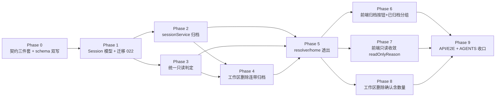

# 会话管理优化 - 实现计划

**功能名称**: 会话管理优化（会话归档 / 删除工作区连带归档 / 缺失运行环境只读）
**关联 PRD**: [`docs/product/draft/20261104-session-management-optimization.md`](../../product/draft/20261104-session-management-optimization.md)（v1.0）
**关联提案**: [`docs/engineering/proposals/20261104-feat-session-management-optimization.md`](../proposals/20261104-feat-session-management-optimization.md)（v1.0）
**计划版本**: v1.0
**创建日期**: 2026-11-05
**作者**: z-agent-bot
**需求总分支**: `prd/session-management-optimization`（本文档与上游产物所在分支）
**feat-branch**: `feat/session-management-optimization`（编码阶段创建，基于需求总分支）
**关联 PR**: https://github.com/Deliay/z-agent-gear/pull/457（需求阶段产物，已 APPROVED）
**需求来源**: GitHub Issue [Deliay/z-agent-gear#447](https://github.com/Deliay/z-agent-gear/issues/447)

## 1. 实施顺序

严格按「契约 → 模型/迁移 → 服务层（归档 → 只读 → 连带）→ resolver 透出 → 前端（归档 → 只读 → 删除确认）→ 测试与文档收口」推进；每个切片先写失败测试再实现（TDD 红-绿-重构）。



**关键路径**：

- Phase 0 契约先行（z-coding 流程），schema 为手写模板串必须双写，漏改即运行时 `Cannot query field`（F2/F3）。
- Phase 1 的 `controllerWorkspaceId` 落库点共 3 处：`session.create`、`session-import`（批量导入）两处写入路径 + 模型/迁移，必须先于 Phase 4（连带精确匹配依赖新字段）。
- Phase 3 与 Phase 2 可并行，但 `resume` 收敛（删重复云电脑判定）必须与 Phase 3 同切片提交，避免两份判定长期并存。
- Phase 4 的 `archiveByWorkspace` 复用 Phase 2 的归档写入与 Phase 3 的匹配口径，`workspaceArchiveImpact` 与连带共用同一匹配函数（提示数量 = 实际归档数量）。
- Phase 7 前端只读收敛以 `readOnlyReason` 为唯一判定来源后，既有 `readOnlyCloudHost` 逻辑删除，云电脑只读行为不回退（回归由 T-RO/E2E-SRO1 守卫）。
- 全量编码落在开发分支 `feat/session-management-optimization`（基于需求总分支 `prd/session-management-optimization` 创建）。

## 2. 代码事实核对（计划期确认）

以下事实基于需求总分支 `prd/session-management-optimization`（HEAD `a2277fb6`）实际代码：

| # | 事实 | 位置 | 对计划的影响 |
|---|------|------|--------------|
| F1 | `Session` schema 无 `archivedAt`/`controllerWorkspaceId`；既有 `userId/tenantId/workspaceId/controllerId/cwd/worktreePath/worktreeBranch/status/workflowInstanceId/workflowNodeId` 等；索引 `{userId,createdAt}` `{controllerId,status}` `{tenantId,workspaceId}`；同时挂 `applyTenantScope` 与 `applyWorkspaceScope` | `servers/agent-api/src/models/session.ts:15-57` | Phase 1 新增两字段（default null）；归档更新经 `_id + actorFilter` 显式条件，不受 scope 插件注入影响（D6） |
| F2 | agent-api GraphQL schema 为**手写模板串**：`Session` type 在 `schemas/session.ts:121`（`controllerType:127`、`cloudHost:129`），`sessions(controllerId: ID, includeWorkflowSessions: Boolean)` 在 `:247`；`HomeOverview` 在 `schemas/home.ts:3-20` | `servers/agent-api/src/graphql/schemas/session.ts`、`schemas/home.ts` | 契约与 schema 必须两处同步（提案 §3.1 已列目标形状），漏改运行时直接 `Cannot query field` |
| F3 | 契约现状：`contracts/agent-session.graphql` `Session` 在 `:266`、`sessions` 查询 `:407`、`Mutation` `:422`（`sendSessionMessage:426` / `cancelGeneration:427` / `resumeSession:428`）；`contracts/home.graphql` `HomeOverview` 在 `:11-28`；`contracts/controller-workspace.graphql` `Mutation` `:64-67` | `contracts/` | Phase 0 按提案 §3.1 在既有块内追加字段/参数/mutation，`deleteWorkspace/clearWorkspaces` 仅注释更新形状不变 |
| F4 | `findAllByUser(userId, options)` 现签名 `{includeWorkflowSessions?, controllerId?}`，默认 `workflowInstanceId: null` 排除节点会话 | `services/session.ts:130-143` | Phase 2 增加 `archived` 选项：`archivedAt: archived ? {$ne:null} : null`，与既有排除口径正交组合 |
| F5 | `assertSessionWritable`（`:156-160`）委托私有 `assertControllerWritable`（`:162-182`），**仅覆盖云电脑**：`controller?.type !== 'cloud'` 直接 return——控制器缺失（findOne 为空）与项目工作区缺失两条路径不拦截 | `services/session.ts:156-182` | Phase 3 扩展为三场景：控制器缺失即拒绝；cloud 维持既有口径；本地/GitHub 增加工作区缺失判定（精确 + cwd 回退） |
| F6 | `resume` 自带一份重复的云电脑判定（`:576-595`），返回 `{success:false, status:'ended', error:'session is ended'}`；`cancelGeneration`（`:551-564`）已接入 `assertControllerWritable`；`sendSessionMessage` 经 resolver 调 `assertSessionWritable` | `services/session.ts:551-620`、`graphql/resolvers/session.ts:226` | Phase 3 收敛 `resume` 为调用统一判定（ended/disconnected 门禁保留在 resume 内），重复代码删除，拒绝文案统一 `session is ended` |
| F7 | `close(id, userId, opts)`：置 `status=ended/endedAt` → 删 `session:{id}:status` → 普通会话撤销 MCP endpoint → publish `acp:stop`（`reason` 可传）→ `suppressFallback` 跳过 `sessionEndedCallback` | `services/session.ts:629-660` | Phase 4「先结束」逐个 `close(id, userId, {suppressFallback:true, reason:'workspace_deleted'})`；普通会话撤销 endpoint 符合预期 |
| F8 | `controllerWorkspaceService.delete` = `findOneAndDelete({_id,userId})`（`:100-103`）；`clear` = `deleteMany({controllerId,userId})`（`:105-108`），均不处理会话；resolver `deleteWorkspace/clearWorkspaces` 直接透传（无 try/catch） | `services/controller-workspace.ts:100-108`、`graphql/resolvers/controller-workspace.ts:105-124` | Phase 4 删除前插入连带归档；归档失败抛错中止删除（resolver 透传即 GraphQLError） |
| F9 | `ControllerWorkspace` 模型仅挂 `applyTenantScope`（**无** workspace-scope 插件）；字段 `userId/tenantId/controllerId/name/path/isEnabled/isGitRepo/defaultBranch` | `models/controller-workspace.ts:4-19` | 连带匹配查询沿用服务内既有 `{controllerId, userId}` 口径（与 delete/clear 一致），不引入 scope 变化 |
| F10 | `homeOverview` 薄聚合：`degrade()` 逐分支兜底；sessions 分支 `findAllByUser({includeWorkflowSessions:false})`（`:59-66`），`sessionTotalCount = sessions.length`（`:99`） | `graphql/resolvers/home.ts:16-23,44-107` | Phase 5 新增 `archivedSessions` 分支（同样 degrade 兜底 `[]`）；`sessionTotalCount` 口径随 sessions 变为未归档计数并在契约注释说明 |
| F11 | `Session` 字段级 resolver 现有 `controllerType`（`:18`）/`cloudHost`（`:29`）；`resolvers/index.ts:65-67` 为 `Session: { ...sessionResolvers.Session }` 整体 spread | `graphql/resolvers/session.ts:15-46`、`graphql/resolvers/index.ts:65-67` | `readOnlyReason` 必须加进 `sessionResolvers.Session`（spread 即登记，backend-rules 陷阱守卫）；`archived` 随 `mapSession` 透出无需字段 resolver |
| F12 | 迁移目录最新为 `021-workflow-interrupt-retry.ts`（含 `.test.ts`），022 未被占用 | `servers/agent-api/src/migrations/` | Phase 1 迁移编号 022，「先建后用」幂等建索引 |
| F13 | worktree 工具三件套已存在：`resolveEffectiveWorktreeDir`（`:16`）、`normalizeForCompare`（`:36`）、`worktreeScopePrefix`（`:46`）；`worktreeService.list` 归组用 scope 前缀匹配，且 `homeDir` 缺失时 scope 退化为 null（不按 scope 归组） | `services/workflow/worktree-utils.ts`、`services/worktree.ts:105-116` | Phase 3/4 回退匹配复用同口径（含 homeDir 缺失退化规则），避免口径分叉（提案 §6.2 依赖） |
| F14 | 工作流归档参照实现：`workflowInstanceService.list(userId,{archived})` 过滤 `archivedAt: archived ? {$ne:null} : null`（`:88-108`）、`setArchived`（`:704-714`） | `services/workflow/instance.ts` | Phase 2 对齐该模式；会话侧额外拒绝工作流节点会话（`workflowInstanceId != null`） |
| F15 | `session.create` 经 `ControllerWorkspace.findOne({_id: input.workspaceId, userId, controllerId})` 定位工作区（`:259`），`cwd = workspace.path`（`:270`）；导入路径 `session-import.ts:54`（单个）与 `:166`（批量）同模式 | `services/session.ts:259-270`、`services/session-import.ts:54,166` | `controllerWorkspaceId` 落库点 3 处：create 直接存 `input.workspaceId`；import 两处存入参 `workspaceId`；旧数据为 null 走回退匹配 |
| F16 | `SessionHeader` props 含 `readOnly`（`:49`）控制「继续」显隐；按钮组（`:94-150`）顺序：能力清单(Info) → 导出(Download) → 关闭 → 继续 → 删除；本地 `Session` interface（`:12-25`）无 `archived` | `apps/agent-web/src/components/session/SessionHeader.tsx` | Phase 6 新增「归档/取消归档」按钮（`Archive`/`ArchiveRestore` 图标）紧随「导出对话」之后；`Session` interface 与 props 增补归档字段与回调 |
| F17 | `SessionView` 只读现状：`readOnlyCloudHost`（`:480-481`）= `isCloudSession && (cloudHost == null || isReadOnlyCloudHost(cloudHost))`；提示条 `data-testid="cloud-host-readonly-notice"`（`:579-583`）；`InputBox` 由 `!readOnlyCloudHost` 门控（`:592`）；`GET_SESSION`（`graphql/queries.ts:86-126`）已含 `controllerType/cloudHost` | `apps/agent-web/src/components/session/SessionView.tsx`、`apps/agent-web/src/graphql/queries.ts` | Phase 7 `GET_SESSION` 补 `archived/readOnlyReason`；只读判定收敛为 `readOnlyReason != null`（保留 controllerType/cloudHost 查询兼容），提示条按原因三态分文案，testid 保留并新增统一 testid |
| F18 | `Sidebar` 会话分区（`:533-580`）数据源 `data?.sessions`（`:155`）；`ArchivedWorkflowGroup` 为文件内联组件（`:727-750`）：`useState` 自折叠 + `Archive` 图标 + 「已归档（N）」 | `apps/agent-web/src/components/Sidebar.tsx` | Phase 6 新增 `ArchivedSessionGroup`（复刻同款交互）挂在会话分区列表尾部；活跃列表随服务端过滤自动变为未归档 |
| F19 | `WorkspaceSection`：`DELETE_WORKSPACE/CLEAR_WORKSPACES`（`:51-52`）；单删 `handleDelete`（`:126-132`）**无任何确认**直接执行；清空有内联确认面板（`:396-408`） | `apps/agent-web/src/components/settings/WorkspaceSection.tsx` | Phase 8 删除前 `workspaceArchiveImpact(id)` 取数：N>0 弹确认（文案含数量）；N=0 保持现状不弹；清空沿用既有确认框追加会话数量（D9） |
| F20 | `HOME_OVERVIEW`（`graphql/home.ts:35+`）含 `sessions`（`:69`）与 `archivedWorkflowInstances`（`:114`），`pollInterval: 15000`，经 `stores/homeOverview.ts` 单源下发 | `apps/agent-web/src/graphql/home.ts` | Phase 6 查询体新增 `archivedSessions`；`sessionTotalCount` 消费点口径同步（服务端口径变化随查询自动生效） |
| F21 | API 测试现有 `session-readonly.test.ts`（云电脑只读，`seedCloudController` + `mongoDb()` DB 断言模式）、`session.test.ts`、`home.test.ts`、`workspace.test.ts`；E2E 有 `session.spec.ts`、`sidebar-phase4.spec.ts`、`workspace.spec.ts`、`settings-workspace.spec.ts` | `tests/api/src/agent-api/`、`tests/e2e/src/` | Phase 9 新增 `session-archive.test.ts`，扩充 `session-readonly.test.ts`（控制器/工作区缺失用例）；E2E 用例落 `session.spec.ts`/新建 `session-archive.spec.ts`，侧边栏断言进 `sidebar-phase4.spec.ts` 同口径文件 |

## 3. 变更清单

### 3.1 Phase 0：契约与 GraphQL schema 双写（先于代码）

| 文件 | 变更 |
|------|------|
| `contracts/agent-session.graphql` | ① `Session` 新增 `archived: Boolean!` 与 `readOnlyReason: SessionReadOnlyReason`（注释：归档仅分组展示差异；只读原因三场景统一）；② 新增 `enum SessionReadOnlyReason { WORKSPACE_MISSING CONTROLLER_MISSING CLOUD_HOST_DESTROYED }`；③ `sessions` 查询新增可选参数 `archived: Boolean`（缺省/false=活跃，与 `includeWorkflowSessions` 正交）；④ `Mutation` 新增 `archiveSession(id: ID!, archived: Boolean!): Boolean!`（工作流节点会话拒绝 `ARCHIVE_WORKFLOW_SESSION_UNSUPPORTED`）与 `workspaceArchiveImpact(id: ID!): WorkspaceArchiveImpact!`；⑤ 新增 `type WorkspaceArchiveImpact { sessionCount: Int! }` |
| `contracts/home.graphql` | `HomeOverview` 新增 `archivedSessions: [Session!]!`（注释：侧边栏「已归档」折叠分组；`sessions` 注释口径同步为「未归档活跃会话」，`sessionTotalCount` 同口径） |
| `contracts/controller-workspace.graphql` | `deleteWorkspace/clearWorkspaces` **形状不变**，注释更新行为：删除/清空前将其下普通会话（`workflowInstanceId == null`）先结束后归档（幂等，归档失败中止删除） |
| `servers/agent-api/src/graphql/schemas/session.ts` | 手写 schema 串同步 ①②③④⑤（F2） |
| `servers/agent-api/src/graphql/schemas/home.ts` | 手写 schema 串同步 `archivedSessions` 与注释 |

错误口径（原样透传，沿用提案）：

| 场景 | 文案 |
|------|------|
| 未登录 | `Not authenticated`（`requireUser` 既有行为） |
| 会话不存在 / 非本人 / 不在当前工作区 | `Session not found` |
| 工作流节点会话归档 | `ARCHIVE_WORKFLOW_SESSION_UNSUPPORTED` |
| 只读会话写操作（resume/send/cancel） | `session is ended` |

### 3.2 Phase 1：Session 模型与迁移 022

| 文件 | 变更 |
|------|------|
| `servers/agent-api/src/models/session.ts` | schema 新增：`archivedAt: { type: Date, default: null }`；`controllerWorkspaceId: { type: ObjectId, ref: 'ControllerWorkspace', default: null }`（F1）；索引声明追加 `{ userId: 1, archivedAt: 1, createdAt: -1 }` 与 `{ controllerId: 1, controllerWorkspaceId: 1 }` |
| `servers/agent-api/src/migrations/022-session-archive-indexes.ts` | 新增迁移：`sessions` 集合显式创建上述两索引（「先建后用」，autoIndex 关闭环境幂等——已存在不报错） |
| `servers/agent-api/src/migrations/022-session-archive-indexes.test.ts` | T-MIG22：迁移执行幂等（重复执行不报错、索引存在） |
| `servers/agent-api/src/services/session.ts` | `create` 落库时写入 `controllerWorkspaceId: input.workspaceId`（F15） |
| `servers/agent-api/src/services/session-import.ts` | 两处导入落库（`:54` 单条、`:166` 批量）写入 `controllerWorkspaceId: workspaceId` |

- 存量数据零回填：`archivedAt` 缺省即未归档；`controllerWorkspaceId` 为 null 的旧会话走 Phase 3/4 的回退匹配口径（提案 §4.1）。

### 3.3 Phase 2：sessionService 归档

| 文件 | 变更 |
|------|------|
| `servers/agent-api/src/services/session.ts` | ① `findAllByUser` options 增加 `archived?: boolean`：filter 追加 `archivedAt: options.archived ? { $ne: null } : null`（F4）；② 新增 `setArchived(userId, id, archived)`：`findOne({_id, ...actorFilter(userId)})` 未命中抛 `Session not found`；`workflowInstanceId != null` 抛 `ARCHIVE_WORKFLOW_SESSION_UNSUPPORTED`；`updateOne` `$set archivedAt = archived ? now : null`（幂等）；③ `mapSession` 输出追加 `archived: Boolean(session.archivedAt)`（不追加 `archivedAt` 原文，契约无此字段） |
| `servers/agent-api/src/services/session.test.ts` | T-ARCH1~4：正常归档/取消归档（`archivedAt` 往返、幂等）；他人会话 `Session not found`；节点会话拒绝；`findAllByUser(archived)` 三档口径（默认活跃 / archived=true 仅已归档 / 与 includeWorkflowSessions 正交） |

### 3.4 Phase 3：统一只读判定（三场景）

| 文件 | 变更 |
|------|------|
| `servers/agent-api/src/services/session.ts` | ① 扩展 `assertControllerWritable` 为三场景（保留函数名兼容调用点）：**控制器缺失**（`Controller.findOne({_id, ...actorFilter})` 为空）→ 抛 `session is ended`；**cloud** 维持既有口径（host 缺失/软删除/STOPPING/STOPPED/FAILED → 拒绝）；**本地/GitHub** 工作区缺失判定（见下）；② `resume` 删除重复云电脑判定（`:576-595`），收敛为 `assertSessionWritable` 同函数调用（保留 ended/disconnected 门禁与原有返回形状：捕获拒绝转 `{success:false, status:'ended', error:'session is ended'}`）；③ 新增 `resolveSessionReadOnlyReason(session): Promise<'WORKSPACE_MISSING'\|'CONTROLLER_MISSING'\|'CLOUD_HOST_DESTROYED'\|null>`（同一判定函数的只读版，供字段 resolver 使用） |
| 工作区缺失判定口径 | `session.controllerWorkspaceId` 非空 → `ControllerWorkspace.exists({_id})` 不存在即缺失；为空（旧数据）→ 回退：根目录会话（`worktreePath == null`）按 `cwd == ws.path` 或 `cwd` 前缀 `ws.path + '/'` 匹配该控制器任一工作区，匹配不到即缺失；worktree 会话（`worktreePath != null`）无法可靠判定时**放行**（避免误伤，worktree 删除已有真删除语义） |
| `servers/agent-api/src/services/session.test.ts` | T-RO1~7：控制器缺失拒绝；云电脑三终态 + 软删拒绝（回归）；工作区缺失拒绝（新字段精确）；工作区缺失拒绝（cwd 前缀回退）；工作区存在放行；worktree 旧数据放行不误伤；`resume` 收敛后行为不变（门禁、文案） |

### 3.5 Phase 4：工作区删除连带归档

| 文件 | 变更 |
|------|------|
| `servers/agent-api/src/services/session.ts` | 新增 `archiveByWorkspace(userId, workspace): Promise<number>`：① **匹配**（共用函数 `matchWorkspaceSessions(workspace)`，供连带与 impact 同口径）：精确 `{controllerId: ws.controllerId, controllerWorkspaceId: ws._id}`；回退（`controllerWorkspaceId == null` 旧数据）根目录会话按 `cwd` 等值/前缀匹配，worktree 会话按 worktree scope 前缀匹配（复用 `resolveEffectiveWorktreeDir`/`worktreeScopePrefix`/`normalizeForCompare`，含 homeDir 缺失退化规则，F13）；两类均排除 `workflowInstanceId != null`；② **先结束**：非 `ended` 会话逐个 `close(id, userId, {suppressFallback: true, reason: 'workspace_deleted'})`，单会话失败仅记录日志不阻断（对齐 deleteInstance 口径）；③ **后归档**：`updateMany({_id: {$in: ids}, archivedAt: null}, {$set: {archivedAt: now}})` 幂等，返回归档数量 |
| `servers/agent-api/src/services/controller-workspace.ts` | `delete(id, userId)`：`findOne` 取工作区 → `sessionService.archiveByWorkspace`（**失败抛错中止删除**，F8）→ `deleteOne`；`clear(controllerId, userId)`：先 `find({controllerId, userId})` 逐个连带，任一失败中止 → `deleteMany` |
| `servers/agent-api/src/services/session.test.ts` / `controller-workspace.test.ts` | T-WSARC1~5：精确匹配 / cwd 前缀回退 / worktree scope 回退；排除节点会话；活跃会话先 close（断言 acp:stop 与 ended）后归档；幂等（重复执行零增量）；`clear` 连带；归档失败中止删除（工作区行仍在） |

### 3.6 Phase 5：resolver 与 home 透出

| 文件 | 变更 |
|------|------|
| `servers/agent-api/src/graphql/resolvers/session.ts` | ① `Query.sessions` 透传 `archived` 参数（`:69-81`）；② `Mutation` 新增 `archiveSession`（调 `setArchived`，位置紧随既有归档类 mutation）与 `workspaceArchiveImpact`（调共用匹配函数计数）；③ `Session` 类型新增 `readOnlyReason` 字段 resolver（调 `resolveSessionReadOnlyReason`），**必须落在 `sessionResolvers.Session` 内**（spread 登记，F11） |
| `servers/agent-api/src/graphql/resolvers/home.ts` | `homeOverview` 新增 `archivedSessions` 分支：`sessionService.findAllByUser(userId, {includeWorkflowSessions: false, archived: true})`，`degrade` 兜底 `[]`（F10）；活跃 `sessions` 分支 options 追加 `archived: false` |
| `servers/agent-api/src/graphql/resolvers/session.test.ts` / `home.test.ts` | 补：未认证拒绝；`archived` 参数透传；`readOnlyReason` 四态映射（null/WORKSPACE_MISSING/CONTROLLER_MISSING/CLOUD_HOST_DESTROYED）；`archivedSessions` 与活跃互补且单分支失败降级 |

### 3.7 Phase 6：agent-web 会话归档交互

| 文件 | 变更 |
|------|------|
| `apps/agent-web/src/graphql/queries.ts` | `GET_SESSION` 新增 `archived`、`readOnlyReason`（F17）；`GET_SESSIONS` 如需归档过滤参数同步（消费点确认后决定，默认不加） |
| `apps/agent-web/src/graphql/mutations.ts` | 新增 `ARCHIVE_SESSION`：`mutation ArchiveSession($id: ID!, $archived: Boolean!) { archiveSession(id: $id, archived: $archived) }` |
| `apps/agent-web/src/graphql/home.ts` | `HOME_OVERVIEW` 新增 `archivedSessions { id controllerId status title updatedAt cwd worktreePath }`（字段对齐活跃 sessions 消费口径，F20） |
| `apps/agent-web/src/graphql/types.ts` | `SessionData` 增补 `archived: boolean`、`readOnlyReason?: 'WORKSPACE_MISSING'\|'CONTROLLER_MISSING'\|'CLOUD_HOST_DESTROYED'\|null`；`HomeOverviewData` 增补 `archivedSessions` |
| `apps/agent-web/src/components/session/SessionHeader.tsx` | 本地 `Session` interface 增补 `archived?: boolean`；props 新增 `onArchiveToggle?: () => void`、`archiving?: boolean`；按钮组在「导出对话」之后插入「归档/取消归档」图标按钮（`Archive`/`ArchiveRestore`，lucide）；已归档会话在状态徽标旁显示「已归档」徽标 |
| `apps/agent-web/src/components/session/SessionView.tsx` | 归档按钮接线：调 `ARCHIVE_SESSION`；归档成功 toast 并返回 `/sessions`（对齐工作流实例归档后导航）；取消归档就地生效（refetch `GET_SESSION`）；归档按钮对工作流节点会话不渲染（`workflowInstanceId` 判空） |
| `apps/agent-web/src/components/Sidebar.tsx` | 会话分区列表尾部新增 `ArchivedSessionGroup`（复刻 `ArchivedWorkflowGroup` 自折叠交互：默认折叠、`Archive` 图标、「已归档（N）」，F18）；数据源 `data?.archivedSessions`；条目渲染复用活跃会话条目结构（点击可打开） |
| 组件测试 | `SessionHeader`/`SessionView`/`Sidebar` 测试：按钮渲染与回调、归档后导航、已归档分组折叠与计数、活跃列表不含已归档 |

### 3.8 Phase 7：agent-web 只读收敛（readOnlyReason）

| 文件 | 变更 |
|------|------|
| `apps/agent-web/src/components/session/SessionView.tsx` | 只读判定收敛：`readOnly = session.readOnlyReason != null`（替代 `readOnlyCloudHost` 计算，F17）；保留 `GET_SESSION` 的 `controllerType/cloudHost` 查询字段兼容；提示条按原因分文案：`WORKSPACE_MISSING`「工作区已不存在，会话记录仅供只读回看。」/`CONTROLLER_MISSING`「控制器已不存在，会话记录仅供只读回看。」/`CLOUD_HOST_DESTROYED`「云电脑已销毁，会话记录仅供只读回看。」；保留 `data-testid="cloud-host-readonly-notice"`（回归）并对三态统一生效（或新增 `session-readonly-notice` 统一 testid，旧 testid 在云电脑场景保留）；`InputBox` 与「继续」由统一 `readOnly` 门控 |
| 组件测试 | `SessionView` 测试：三态提示文案、`InputBox` 隐藏、「继续」隐藏、云电脑回归（`cloud-host-readonly-notice`） |

### 3.9 Phase 8：工作区删除确认（含连带数量）

| 文件 | 变更 |
|------|------|
| `apps/agent-web/src/graphql/queries.ts` | 新增 `WORKSPACE_ARCHIVE_IMPACT`：`query WorkspaceArchiveImpact($id: ID!) { workspaceArchiveImpact(id: $id) { sessionCount } }` |
| `apps/agent-web/src/components/settings/WorkspaceSection.tsx` | 单删（`:327-334`）：点击「删除」先 `workspaceArchiveImpact(id)` 取数，N>0 弹确认框「删除工作区将同时归档其下 N 个会话，是否继续？」，N=0 保持现状直接删除（F19）；清空（`:396-408`）：沿用既有内联确认面板，追加各工作区连带合计数量文案「将同时归档其下 N 个会话」（取数失败时不阻断，降级为不展示数量） |
| 组件测试 | `WorkspaceSection` 测试：N>0 出现确认且文案含数量、确认后调用 `deleteWorkspace`、取消不调用；N=0 直接删除；清空确认文案含合计数量 |

### 3.10 Phase 9：API/E2E 测试与文档收口

| 文件 | 变更 |
|------|------|
| `tests/api/src/agent-api/session-archive.test.ts` | 新增套件（复用 `createFrontUser`/`mongoDb` 模式，F21）：T-ARCH-API1 未认证拒绝；T-ARCH-API2 归档/取消归档往返（DB 断言 `archivedAt`）；T-ARCH-API3 节点会话拒绝 + `sessions(archived)` 列表口径；T-ARCH-API4 `homeOverview.archivedSessions` 与活跃 `sessions` 互补；T-WSARC-API1 `deleteWorkspace` 连带归档（DB 断言 `archivedAt` 非空、活跃会话 ended、工作区行删除）；T-WSARC-API2 `workspaceArchiveImpact` 数量 = 实际归档数量 |
| `tests/api/src/agent-api/session-readonly.test.ts` | 扩充：T-RO-API1 删除控制器后 `resume`/`sendSessionMessage` 拒绝 `session is ended`；T-RO-API2 删除工作区后同口径；T-RO-API3 `session.readOnlyReason` 三态透出（既有云电脑用例保持绿） |
| `tests/e2e/src/session-archive.spec.ts`（新增） | E2E-SARCH1：会话页归档 → 活跃列表消失、「已归档（1）」出现、打开可查看、取消归档恢复；E2E-SARCH2：删除工作区确认文案含会话数量 → 确认后会话出现在「已归档」分组 |
| `tests/e2e/src/session.spec.ts` 或 `sidebar-phase4.spec.ts` | E2E-SRO1：云电脑销毁只读（回归，沿用既有形态）；构造工作区删除会话的只读提示条与「继续」隐藏 |
| `servers/agent-api/AGENTS.md` | 新增「会话归档与只读」小节：归档字段/契约、统一只读三场景判定与接入点、`archiveByWorkspace` 连带口径、迁移 022 |
| `apps/agent-web/AGENTS.md` | 新增「会话归档与只读」小节：归档按钮/已归档分组、`readOnlyReason` 统一只读口径（替代 `readOnlyCloudHost` 计算）、工作区删除确认数量 |
| `tests/api/AGENTS.md` / `tests/e2e/AGENTS.md` | 登记新套件与用例编号口径 |
| `docs/engineering/AGENTS.md` | 「实现计划」索引登记本文件 |

## 4. TDD 测试矩阵

### 4.1 单元 / 组件测试

| 编号 | 文件 | 断言 |
|------|------|------|
| T-MIG22 | `migrations/022-session-archive-indexes.test.ts` | 迁移幂等：重复执行不报错，两索引存在 |
| T-ARCH1 | `services/session.test.ts` | `setArchived` 归档/取消归档往返（`archivedAt` 置位/置空），重复操作幂等 |
| T-ARCH2 | 同上 | 他人会话 `Session not found`；节点会话 `ARCHIVE_WORKFLOW_SESSION_UNSUPPORTED` 且**不写库** |
| T-ARCH3 | 同上 | `mapSession` 输出 `archived` 与 `archivedAt` 映射正确 |
| T-ARCH4 | 同上 | `findAllByUser(archived)`：默认活跃、archived=true 仅已归档、与 `includeWorkflowSessions` 正交 |
| T-RO1 | 同上 | 控制器缺失（unbind 删除）→ `assertSessionWritable` 抛 `session is ended` |
| T-RO2 | 同上 | 云电脑 STOPPING/STOPPED/FAILED + 软删拒绝（回归） |
| T-RO3 | 同上 | 工作区缺失拒绝：`controllerWorkspaceId` 精确命中删除场景 |
| T-RO4 | 同上 | 工作区缺失拒绝：旧数据 cwd 等值/前缀回退匹配 |
| T-RO5 | 同上 | 工作区存在放行；worktree 旧数据（`worktreePath != null` 无法判定）放行不误伤 |
| T-RO6 | 同上 | `resolveSessionReadOnlyReason` 四态映射（null / 三枚举） |
| T-RO7 | 同上 | `resume` 收敛后：非 ended/disconnected 拒绝、云电脑拒绝文案 `session is ended`、成功路径不变 |
| T-WSARC1 | 同上 | `archiveByWorkspace` 精确匹配（新字段）与 cwd 前缀/worktree scope 回退匹配；排除节点会话 |
| T-WSARC2 | 同上 | 活跃会话先 close（断言 acp:stop publish、`status=ended`）后归档；已 ended 直接归档 |
| T-WSARC3 | 同上 | 幂等：重复执行第二次零增量（`archivedAt` 不刷新） |
| T-WSARC4 | `services/controller-workspace.test.ts` | `clear` 清空对每个工作区连带；`delete` 归档失败中止删除（工作区行仍在） |
| T-WSARC5 | `services/session.test.ts` | close 单会话失败仅记录日志不阻断整体连带 |
| T-RES1~3 | `graphql/resolvers/session.test.ts` / `home.test.ts` | 未认证拒绝；`archived` 参数透传；`readOnlyReason` 透出；`archivedSessions` degrade 兜底 |
| T-WEB1~3 | `components/session/__tests__/`、`components/__tests__/Sidebar.test.tsx` | 归档按钮渲染/回调/导航；已归档分组折叠计数；只读三态文案与入口隐藏 |
| T-WEB4 | `components/settings/__tests__/WorkspaceSection.test.tsx` | 删除确认含数量（N>0 弹/N=0 不弹）；清空确认追加数量 |

### 4.2 API / 集成测试

| 编号 | 文件 | 断言 |
|------|------|------|
| T-ARCH-API1 | `tests/api/src/agent-api/session-archive.test.ts` | 未认证 `archiveSession` → `Not authenticated` |
| T-ARCH-API2 | 同上 | 归档/取消归档成功，DB `archivedAt` 往返 |
| T-ARCH-API3 | 同上 | 节点会话拒绝 `ARCHIVE_WORKFLOW_SESSION_UNSUPPORTED`；`sessions(archived:true/false)` 列表口径 |
| T-ARCH-API4 | 同上 | `homeOverview.archivedSessions` 与活跃 `sessions` 互补、`sessionTotalCount` 为未归档计数 |
| T-WSARC-API1 | 同上 | `deleteWorkspace` 连带：DB 断言会话 `archivedAt` 非空、活跃会话 ended、工作区行删除 |
| T-WSARC-API2 | 同上 | `workspaceArchiveImpact.sessionCount` = 实际连带归档数量 |
| T-RO-API1 | `tests/api/src/agent-api/session-readonly.test.ts` | 控制器删除后 `resume`/`sendSessionMessage` 拒绝 `session is ended` |
| T-RO-API2 | 同上 | 工作区删除后同口径（取消归档的会话同样只读） |
| T-RO-API3 | 同上 | `session.readOnlyReason` 三态透出；运行环境完好会话为 null |

### 4.3 E2E

| 编号 | 文件 | 断言 |
|------|------|------|
| E2E-SARCH1 | `tests/e2e/src/session-archive.spec.ts` | 归档 → 活跃列表消失、「已归档（1）」出现；打开可查看；取消归档恢复活跃 |
| E2E-SARCH2 | 同上 | 删除工作区确认文案含数量 → 确认后该工作区会话在「已归档」分组可见可打开 |
| E2E-SRO1 | `tests/e2e/src/session.spec.ts` / `sidebar-phase4.spec.ts` | 云电脑销毁只读（回归）；工作区删除会话只读提示条 + 「继续」隐藏、历史消息完整 |

### 4.4 回归

| 范围 | 要求 |
|------|------|
| `servers/agent-api` | 既有单测全绿（会话/工作区/工作流/云电脑/首页聚合）；`pnpm run build` 通过 |
| `apps/agent-web` | 既有组件测试全绿（SessionView.cloudHost、Sidebar、WorkspaceSection）；`pnpm run lint` 与 `pnpm run build` 通过 |
| `tests/api` | 既有套件串行全量通过（session/session-readonly/home/workspace 零回归） |
| `tests/e2e` | `session*.spec.ts`、`sidebar-phase4.spec.ts`、`workspace*.spec.ts` 零回归 |
| 契约一致性 | 三份契约与手写 schema 串签名一致（F2/F3） |

## 5. 计划期裁决

| 编号 | 裁决 | 理由 |
|------|------|------|
| D1 | 归档语义对齐工作流：`archivedAt` 时间字段（非新状态），不终止进程、不触发任何 acp 命令、不影响 `session:status` 通道 | 提案决策表已定稿；归档中运行会话状态如实展示 |
| D2 | 工作流节点会话拒绝手动归档（`ARCHIVE_WORKFLOW_SESSION_UNSUPPORTED`），连带归档同样排除 | 节点会话生命周期由工作流实例管理（PRD §3.5） |
| D3 | `controllerWorkspaceId` 只在 create/import 3 处落库，存量零回填 | 避免强制迁移；旧数据经 cwd 前缀/worktree scope 回退匹配（提案 §4.1/§5.2） |
| D4 | 统一只读错误文案 `session is ended`，原因展示由 `readOnlyReason` 字段承担 | 与云电脑既有口径一致；前端已有映射，不新增错误文案矩阵 |
| D5 | `readOnlyReason` 为字段级 resolver 实时计算（与写路径同一判定函数的只读版），不落库 | 运行环境现状即时生效（PRD 兼容性要求）；规则集中后端，前端零规则重复 |
| D6 | 归档/连带更新均经 `_id + actorFilter` 显式条件，不依赖 scope 插件注入 | 多租户二期口径（F1/F9）；`ControllerWorkspace` 无 workspace-scope 插件，沿用服务内 `{controllerId, userId}` 既有口径 |
| D7 | 连带「先结束后归档」：close 单会话失败仅记录不阻断；**归档失败中止删除** | 对齐 `deleteInstance` 清理口径；避免「工作区没了、会话未归档」中间态（提案决策表） |
| D8 | worktree 旧数据（`worktreePath != null` 且 `controllerWorkspaceId == null`）只读判定放行、连带归档按 scope 前缀匹配 | worktree 删除已有真删除语义，误伤代价高于漏判；scope 口径与侧边栏归组同源（F13） |
| D9 | 单删工作区 N=0 不弹确认（保持现状），N>0 才弹；清空沿用既有确认面板追加合计数量 | 最小交互变更；现状单删本即无确认（F19），避免给无会话工作区引入新摩擦 |
| D10 | 只读提示条 testid：三态统一生效；`cloud-host-readonly-notice` 在云电脑场景保留 | E2E 回归守卫（F17/F21）；新场景断言新 testid 或按文案断言 |
| D11 | 不新增配置项/feature flag；迁移 022 随 agent-api 启动 runner 执行 | 提案 §9.2；行为直接上线，旧数据兼容 |
| D12 | `GET_SESSIONS`/侧边栏活跃列表不加归档参数消费，活跃过滤由服务端默认口径承担 | `HOME_OVERVIEW` 单源下发（F20）；避免前端各自传参导致口径漂移 |

## 6. 风险与回滚

| 风险 | 影响 | 缓解 |
|------|------|------|
| 手写 schema 串漏改（契约已加字段、schema 未同步） | 运行时 `Cannot query field`，首页聚合整体失败 | Phase 0 双写为同一提交；`resolvers/index.ts` spread 登记检查列入 checklist（F2/F11） |
| `homeOverview` 新分支失败拖垮整次查询 | 首页/侧边栏全空 | `archivedSessions` 必须走 `degrade` 兜底 `[]`（F10），组件测试覆盖 |
| worktree scope 前缀误伤同名工作区会话 | 连带归档范围放大 | scope 含工作区名清洗结果，与侧边栏归组口径同源（F13）；提案已记录为可接受并留档 |
| 删除工作区与「用户正在使用会话」TOCTOU | close 后用户点继续 | 可接受：close 后 resume 被新只读拦截（工作区已删除），服务端兜底 |
| `assertSessionWritable` 热路径新增至多 2 次点查 | `sendSessionMessage` 延迟增加 | 均为 `_id` 主键查询，开销可忽略；不引入缓存避免「删除后仍可写」窗口（提案 §5.2） |
| 前端 `readOnlyReason` 未透出（字段 resolver 漏登记） | 只读会话不拦截（界面层失效，服务端仍拦截） | spread 登记检查 + resolver 单测 + API 用例 T-RO-API3 三重守卫 |
| 取消归档已删工作区的会话 | 回到活跃列表但不可写 | 预期行为：只读判定即时生效（PRD §3.5）；E2E/API 覆盖 |
| 回滚 | — | 契约与字段为纯新增（无删除/改签名），回滚代码后旧前端不受影响；`archivedAt`/`controllerWorkspaceId` 与迁移 022 索引可保留无害 |

## 7. 命令参考

```bash
# 依赖
pnpm install

# agent-api（单元测试 + 构建）
cd servers/agent-api && pnpm test
cd servers/agent-api && pnpm run build

# agent-web（组件测试 + lint + 构建）
cd apps/agent-web && pnpm test
cd apps/agent-web && pnpm run lint
cd apps/agent-web && pnpm run build

# 全量服务（Aspire）
aspire start
aspire wait agent-api agent-web controller-api

# API 集成
cd tests/api && pnpm exec vitest run src/agent-api/session-archive.test.ts
cd tests/api && pnpm exec vitest run src/agent-api/session-readonly.test.ts

# E2E
cd tests/e2e && BASE_URL=<agent-web> API_URL=<agent-api>/graphql \
  CONTROLLER_API_URL=<controller-api> MONGODB_URI=<mongo-uri> \
  pnpm exec playwright test src/session-archive.spec.ts --workers=1
```

## 8. 验收 checklist

### 8.1 Phase 0/1（契约与模型）

- [ ] 三份契约与手写 schema 串同步，签名一致；`pnpm run build` 通过
- [ ] `Session` 新增 `archivedAt`/`controllerWorkspaceId` 字段与索引声明；迁移 022 幂等（T-MIG22 绿）
- [ ] create/import 3 处落库 `controllerWorkspaceId`

### 8.2 Phase 2/3/4（服务层）

- [ ] `setArchived` 正常/他人/节点会话三口径（T-ARCH1~2 绿）
- [ ] `findAllByUser(archived)` 过滤正交（T-ARCH4 绿）
- [ ] 统一只读三场景接入 `resume`/`sendSessionMessage`/`cancelGeneration`，`resume` 重复判定已删除（T-RO1~7 绿）
- [ ] `archiveByWorkspace` 精确 + 回退匹配、先结束后归档、幂等、失败中止删除（T-WSARC1~5 绿）

### 8.3 Phase 5（透出）

- [ ] `archiveSession`/`sessions(archived)`/`workspaceArchiveImpact`/`Session.archived`/`Session.readOnlyReason`/`homeOverview.archivedSessions` 全部可用
- [ ] `readOnlyReason` 已登记 `sessionResolvers.Session`（spread），线上非恒 null

### 8.4 Phase 6/7/8（前端）

- [ ] 会话页「归档/取消归档」按钮对齐工作流实例页交互；归档后返回列表，取消归档就地生效
- [ ] 侧边栏「已归档（N）」自折叠分组（默认折叠），条目可打开；活跃列表不含已归档
- [ ] 只读三态提示条分文案；`InputBox` 与「继续」隐藏；云电脑只读行为不回退
- [ ] 工作区删除 N>0 弹确认含数量、N=0 直接删除；清空确认追加合计数量

### 8.5 Phase 9（测试与文档）

- [ ] 单元/组件/API/E2E 全绿，回归范围零退化
- [ ] `servers/agent-api/AGENTS.md`、`apps/agent-web/AGENTS.md`、`tests/api/AGENTS.md`、`tests/e2e/AGENTS.md`、`docs/engineering/AGENTS.md` 已同步
- [ ] PRD §1.3 成功标准逐条验收

## 9. 相关文档

- [产品需求 v1.0](../../product/draft/20261104-session-management-optimization.md)
- [技术提案 v1.0](../proposals/20261104-feat-session-management-optimization.md)
- [会话契约](../../../contracts/agent-session.graphql)
- [首页契约](../../../contracts/home.graphql)
- [工作区契约](../../../contracts/controller-workspace.graphql)
- [agent-api AGENTS](../../../servers/agent-api/AGENTS.md)
- [agent-web AGENTS](../../../apps/agent-web/AGENTS.md)
- [API 测试规范](../../../tests/api/AGENTS.md)
- [E2E 测试规范](../../../tests/e2e/AGENTS.md)
- [需求来源：GitHub Issue #447](https://github.com/Deliay/z-agent-gear/issues/447)
- [关联 PR #457](https://github.com/Deliay/z-agent-gear/pull/457)
