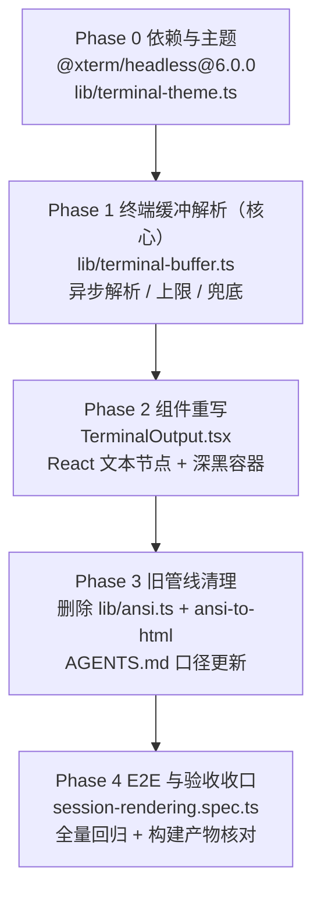

# 会话窗口中工具调用展示优化 - 实现计划

**功能名称**: 工具调用终端输出渲染优化（终端仿真渲染 + 深黑色主题）
**关联 PRD**: [`docs/product/draft/20261104-tool-call-terminal-rendering.md`](../../product/draft/20261104-tool-call-terminal-rendering.md)（v1.0）
**关联提案**: [`docs/engineering/proposals/20261104-feat-tool-call-terminal-rendering.md`](../proposals/20261104-feat-tool-call-terminal-rendering.md)（v1.0）
**需求来源**: GitHub Issue [Deliay/z-agent-gear#420](https://github.com/Deliay/z-agent-gear/issues/420)
**需求总分支（feat-branch）**: `feat/tool-call-terminal-rendering`（基于 `origin/main` 3bc5818c）
**需求总 PR**: https://github.com/Deliay/z-agent-gear/pull/436（评审 **APPROVED**，2026-11-04T08:44:07Z，审核人 Deliay；review body 为空、inline comment 为 0 条 → **无返工项**）
**计划提交分支**: `feat/tool-call-terminal-rendering`（本文件随需求总分支提交）
**计划版本**: v1.0
**创建日期**: 2026-11-04
**作者**: Agent Gear Workflow

**版本说明**：

- v1.0（2026-11-04）首版。对应 PRD / 提案 v1.0。PR #436 评审通过且未提出修改意见，本计划按原方案拆解，无评审返工项。
- 本计划 §3 以**需求总分支当前代码事实**（`3bc5818c`）为准；提案中与代码事实不一致或留白的部分在实现期按 §3 执行，**不回改已评审提案**，验收报告逐条登记。

## 1. 实现顺序



依赖说明：

- **Phase 1 是本期核心**：终端语义（光标/擦除/覆写/清屏）正确性全部由 `lib/terminal-buffer.ts` 承载，Phase 2 只是它的展示层消费者。先完成解析层与测试，再接组件。
- **Phase 0 的 `terminal-theme.ts` 与 Phase 1 可并行**：主题模块是纯数据与颜色换算，不依赖 xterm；但 Phase 1 的颜色断言依赖 Phase 0 的调色板口径，落地时先完成 Phase 0。
- **Phase 3 必须在 Phase 2 通过后执行**：`ansi.ts` 与 `terminal-buffer.ts` 在过渡期共存，确认新管线全绿后再删除旧管线与依赖，避免同时失去两条渲染路径。
- **Phase 4 收口**：E2E 依赖构建产物与 Aspire 服务，放在最后。
- 本期**纯前端、零契约变更、零后端改动**（提案 §3.1），改动集中在 `apps/agent-web` 单一子项目，另加 `tests/e2e` 用例与文档索引。

### 1.1 开发分支与合并顺序

| 分支 | 范围 | 基于 | 合并目标 |
|------|------|------|---------|
| `feat/tool-call-terminal-rendering` | PRD / 提案 / 本计划（需求总分支） | `origin/main` | 需求总 PR #436 |
| `feat/tool-call-terminal-rendering-impl` | 全部实现 + 测试（实现分支） | 需求总分支 | 需求总分支（评审通过后随需求总 PR 入 main） |

- 实现分支内按 Phase 顺序分提交：`chore(agent-web): add xterm headless` → `feat(agent-web): terminal theme` → `feat(agent-web): terminal buffer` → `refactor(agent-web): terminal output` → `chore(agent-web): drop ansi-to-html` → `test(e2e): terminal rendering`。
- **禁止 rebase / squash，只允许 merge**（z-git 规范）；实现 PR 合并目标为需求总分支，不直接进 `main`。
- 实现分支合并后删除（远端与本地），不删除需求总分支。

### 1.2 开发模式与规范加载

- 全部 Phase 采用 TDD（红-绿-重构）：先写失败测试 → 最小实现 → 重构。`lib/terminal-buffer.ts` / `lib/terminal-theme.ts` 为纯函数（异步/同步），**分支覆盖率 100%**；`TerminalOutput` 保留组件测试。
- 编码前加载：`docs/engineering/common-rules.md`、`docs/engineering/frontend-rules.md`、`apps/agent-web/AGENTS.md`；测试阶段加载 `z-test` skill。
- 目录级规范：`tests/e2e/AGENTS.md`（E2E 清单与串行约束）、`docs/engineering/plan/AGENTS.md`（计划文档规范）。
- `servers/*`、`apps/admin-web`、`packages/*`、`contracts/` **本期零改动**。

## 2. 命令参考

```bash
# 服务编排（根目录；测试服务只用 Aspire，禁止直接 docker 命令）
aspire start
aspire wait agent-api agent-web
aspire describe agent-web
aspire stop

# agent-web 依赖 / 单测 / 构建 / lint（在 apps/agent-web 内，独立 pnpm 工程）
cd apps/agent-web
pnpm install
pnpm add --save-exact @xterm/headless@6.0.0
pnpm remove ansi-to-html
pnpm test            # vitest run（单测 + 组件测试）
pnpm run build       # tsc -b && vite build（strict 类型检查 + 异步 chunk 核对）
pnpm run lint

# E2E（串行；地址按 aspire describe 替换）
cd tests/e2e
BASE_URL=http://localhost:<agent-web-port> \
API_URL=http://localhost:10001/graphql \
CONTROLLER_API_URL=http://localhost:<controller-api-port> \
pnpm exec playwright test session-rendering.spec.ts --workers=1

# 全量 E2E 回归（串行）
pnpm exec playwright test --workers=1
```

## 3. 计划期裁决（提案与代码事实偏差的落地口径）

> 以下裁决以**需求总分支代码事实**（`3bc5818c`，2026-11-04）与本地构建/运行时冒烟结果为准。提案中不一致或未覆盖的描述按本节执行，**不回改提案**；验收报告逐条登记。

### 3.1 事实校正（提案描述与代码事实的偏差）

| # | 提案描述 | 代码事实 / 冒烟结果 | 本计划口径 |
|---|---------|--------------------|-----------|
| F1 | §3.2 内部接口：`function renderTerminalOutput(raw: string): TerminalLine[]`（同步纯函数） | `@xterm/headless` 的 `Terminal.write()` **异步**：写入后立即读 `buffer.active` 为空，回调在后续 tick 才触发（本地 Node 22 + 6.0.0 实测：`write('hello')` 同步读取为空、`setTimeout(50)` 后回调 `called=true`）；无同步 `parse()` 公开 API（`term.parser` 只有 handler 注册） | 解析函数改为 **`async function renderTerminalOutput(raw, options?): Promise<TerminalLine[]>`**，内部用 `term.write(data, resolve)` 包 Promise；`TerminalOutput` 用 `useEffect` + state 消费（D1） |
| F2 | §2.2 / §6.2：新增依赖 `xterm-headless` | npm 上 `xterm-headless@5.3.0` 已 **deprecated**（"Move to @xterm/headless instead"）；官方包为 `@xterm/headless`，最新稳定 `6.0.0`（2025-12-22） | 使用 **`@xterm/headless@6.0.0`**（`--save-exact` 精确锁定，理由见 D2/D3），不引入已废弃的 `xterm-headless` |
| F3 | §5.2 实现点 1 风险点：`xterm-headless` gzip ≈ 90KB | 本地 Vite 8.0.12 + `@xterm/headless@6.0.0` 生产构建实测：动态 import 生成独立 chunk `xterm-headless-*.js` = **180.97 kB raw / 46.89 kB gzip**（6 modules transformed，主包 2.95 kB） | 体积按实测登记（约提案值一半）；仍保持 `import('@xterm/headless')` 动态导入，构建后核对独立 chunk |
| F4 | 提案未提及换行语义 | 不设 `convertEol` 时，裸 `\n` 只下移不回车，文本呈阶梯状缩进；工具输出（非 PTY）普遍只带 `\n` | Terminal 构造固定 `convertEol: true`，使 `\n` 等价 `\r\n`（D2）；`\r` 覆写仍由终端原生处理 |
| F5 | §2.3 / §5.2：`TerminalOutput` 调用方仅 `ContentBlockRenderer`，「调用方零改动」 | 实际有 **3 处**消费：`ContentBlockRenderer.tsx:120`（`type: 'terminal'` 内容块）、`ToolCallCard.tsx:132`（execute 终态 `rawOutput.output`）、`ToolCallCard.tsx:186`（execute 执行中增量输出） | props 保持 `{ output, maxHeight? }` 不变，**3 处调用方零改动**；但执行中输出会**流式变化**，组件必须处理重复解析与竞态（D1） |
| F6 | 提案未评估既有测试的同步假设 | `TerminalOutput.test.tsx` T-TO1~6、`ToolCallCard.test.tsx:119-137`、`ContentBlockRenderer.test.tsx:109` 均同步 `getByTestId(...).textContent` 断言；改为异步解析后首帧为空 | 相关断言统一改 `await screen.findBy...` / `waitFor`；组件在解析期间保留上一次结果（D1），避免闪烁与断言抖动 |
| F7 | 提案 §8.1 仅要求「保留 T-TO 系列语义」 | T-TO2 断言 `innerHTML` 含 `<b>`；T-TO5 断言容器 class 含 `whitespace-pre-wrap`；新渲染用内联 `fontWeight: 700` 与逐行 `whitespace-pre` | 按**语义**而非实现改写：加粗断言 `style.fontWeight`；换行断言改为「行容器 `whitespace-pre` + 容器 `overflow-auto`」；T-TO 编号保留、语义不缩水 |
| F8 | §5.2 实现点 3：先确认 `ansiToHtml` 无其他消费方 | `ansiToHtml` 仅被 `TerminalOutput.tsx:2` 与 `lib/__tests__/ansi.test.ts` 引用；`ansi-to-html` 仅 `package.json` 一处依赖（`^0.7.2`），无其他业务引用 | 确认无外部消费方后删除 `lib/ansi.ts`、`lib/__tests__/ansi.test.ts` 与依赖；其中**控制序列剥离正则**迁移到 `terminal-buffer.ts` 的兜底路径（D8/D10），测试语义随之迁移 |
| F9 | 提案未说明 buffer API 的 proposed 开关 | `@xterm/headless@6.0.0` 的 `terminal.buffer` getter 内部调用 `_checkProposedApi()`，未开 `allowProposedApi` 直接抛错 | 构造参数固定 `allowProposedApi: true`（仅读取 buffer，不使用其他实验 API），并精确锁版本（D2） |
| F10 | 提案 §5.2：按 fg/bg 模式（默认/调色板/RGB）映射 | `IBufferCell` 暴露 `isFgDefault()/isFgPalette()/isFgRGB()`（bg 同构）与 `getFgColor()/getBgColor()`；数值模式位为内部实现（实测 palette `16777216`、P256 `33554432`、RGB `50331648`），未导出常量 | 只用布尔判定方法 + 数值取值，**不硬编码模式位**；调色板索引 0-255 由主题模块换算（D6） |
| F11 | 提案 §8.2：E2E 增补终端渲染用例 | 既有 `session-rendering.spec.ts` E2E-CREN4 已覆盖 ANSI 颜色/私有模式/DCS 不泄漏；`tests/e2e/AGENTS.md:281` 有对应清单 | **改写并扩展 E2E-CREN4**（新增动态输出收敛、深黑底色断言），新增 **E2E-CREN10**（深浅模式解耦），同步更新 `tests/e2e/AGENTS.md` |
| F12 | 提案 §7：`lib/ansi.ts` 直接移除 | `ansi.ts` 中的 OSC/DCS/C1/截断序列正则经过多轮缺陷修复（R-9 P5~P8），是异常输入的兜底资产 | 删除文件但**迁移正则到 `terminal-buffer.ts` 的 `stripTerminalSequences()`**，作为解析失败/模块加载失败时的降级路径；对应测试迁移，不丢覆盖 |

### 3.2 设计裁决（提案留白/含混处）

1. **D1 解析异步化与竞态**：`renderTerminalOutput` 返回 Promise；`TerminalOutput` 内 `useEffect` 以 `output` 为依赖，**60ms 防抖**（流式输出时合并高频更新）+ `cancelled` 标记丢弃过期结果；解析期间**保留上一次 `lines`**，不闪空。空字符串直接置 `[]`，不加载模块。
2. **D2 终端尺寸与选项**：`cols = 80`、`rows = 24`、`scrollback = 5000`、`convertEol = true`、`allowProposedApi = true`、`logLevel = 'off'`（避免 xterm 内部 `console.*` 绕过 `lib/logger.ts` 唯一出口）。`cols` 固定 80 的理由：抓取的工具输出无真实 TTY 宽度，80 是传统终端默认值，进度条类输出通常按 80 列生成；不按容器测量重排（避免 resize 重解析与光标语义漂移）。
3. **D3 输入上限与截断方向**：`MAX_INPUT_CHARS = 2_000_000`（约 2MB）。超限时**保留尾部**（`raw.slice(-MAX_INPUT_CHARS)`）并前置一行「…（输出过长，已截断前 N 字符）」提示。理由：终端语义关注「最终画面」，尾部信息价值更高；与 `scrollback=5000` 的「丢头部」行为一致。
4. **D4 渲染行数上限**：`MAX_RENDER_LINES = 2000`（与 `lib/diff.ts` 的 2000 行口径一致）。超过时保留**最后 2000 行**并前置「…（共 N 行，仅显示最后 2000 行）」提示。理由：数万行 × 每行多 span 会让 React 建树卡死，PRD「不卡死」优先；终端最终画面天然是尾部。
5. **D5 换行与滚动策略**：每个 buffer 行渲染为独立 `<div className="whitespace-pre">`，**不再 CSS 自动换行**（终端已在 `cols` 处换行，二次折行会破坏光标定位与列对齐）；容器 `overflow-auto`（双向）+ `maxHeight` 内滚动；内层 `w-max min-w-full`，父级补 `min-w-0`，保证只出现终端内部横向滚动、不撑破页面（E2E-CREN7 仍断言页面无横向溢出）。
6. **D6 颜色与样式映射**：
   - 默认前景 → `TERMINAL_THEME.foreground`；默认背景 → 不输出 `backgroundColor`（容器底色透出）。
   - 调色板 0-15 → 主题 16 色；16-231 → 6×6×6 色立方（`[0,95,135,175,215,255]`）；232-255 → 灰度 `8 + (i-232)*10`。
   - RGB → `rgb(r,g,b)`。
   - 加粗 + 调色板 0-7 → 使用亮色变体（8-15），与 xterm `drawBoldTextInBrightColors` 默认行为一致；同时保留 `fontWeight: 700`。
   - `dim` → `opacity: 0.6`；`italic`/`underline`/`strikethrough`/`overline` → 对应 CSS；`inverse` → 交换前景/背景（背景缺省用主题底色、前景缺省用主题前景）；`invisible` → 输出等宽空格；`blink` 静态快照忽略（不做动画）。
   - 宽字符：`getWidth() === 0` 的续格跳过，避免重复输出；`getChars()` 为空按单空格处理。
7. **D7 注入面收敛**：组件不再使用 `dangerouslySetInnerHTML`，全部内容作为 React 文本节点渲染；HTML 特殊字符由 React 自动转义，XSS 面归零。保留 `data-testid="terminal-output"`。
8. **D8 永不抛异常**：`renderTerminalOutput` 内部 try/catch；动态 import 失败、Terminal 构造/写入失败、buffer 读取异常统一降级为 `stripTerminalSequences()` 的纯文本行（保留 `\r` 覆写近似与截断提示），并 `logger.warn`（不 `console`）。
9. **D9 组件可测性**：新增 `data-testid="terminal-line"`（每行）与 `aria-label="终端输出"`；容器 `data-terminal-theme="dark"` 便于 E2E/单测断言主题；`maxHeight` 仍作用于最外层容器。
10. **D10 旧管线删除范围**：删除 `lib/ansi.ts`、`lib/__tests__/ansi.test.ts`；`package.json` 移除 `ansi-to-html` 并更新 `pnpm-lock.yaml`。`lib/export-thread.ts` 等纯文本导出逻辑不消费 `ansi.ts`，零改动。
11. **D11 模块加载位置**：动态 `import('@xterm/headless')` 放在 `terminal-buffer.ts` 内部（不在组件层），保证只有真正渲染终端时才加载；Vite 自动产出独立异步 chunk（F3 已实测）。
12. **D12 兼容与回滚**：无 feature flag、无后端开关；渲染输入仍是 ACP `terminal.output` / `rawOutput.output` 字符串，历史会话升级后按新效果渲染。回滚方式为 `git revert` 本需求实现提交（恢复 `ansi.ts` + 旧 `TerminalOutput`），不涉及数据迁移。

## 4. 关键约束（实现期不得回退）

- **纯前端零契约**：不改 ACP 协议、消息存储、GraphQL 契约与 `contracts/`；不新增后端字段。
- **单一 console 出口**：xterm 以 `logLevel: 'off'` 静音；业务异常走 `lib/logger.ts`。
- **主题与界面模式解耦**：终端底色/前景/调色板只来自 `lib/terminal-theme.ts`；禁止在组件内写死 hex 或使用 `dark:` 变体。
- **安全**：不使用 `dangerouslySetInnerHTML`；不把输出拼接为 HTML；不引入可执行链接（OSC-8 超链接按纯文本展示，不生成 `<a>`）。
- **性能**：输入 ≤2MB、渲染 ≤2000 行、滚动容器内滚动；`pnpm run build` 后核对 xterm chunk 与首屏分离。
- **布局三件套**（frontend-rules）：终端容器 `min-w-0` + 内层 `w-max` + 行 `whitespace-pre`；E2E 断言页面 `scrollWidth - clientWidth ≤ 1`。
- **测试编排**：测试服务只用 Aspire；E2E `workers: 1` 串行。
- **z-git**：禁止 rebase/squash；实现 PR 评审通过后合并回需求总分支。

## 5. Phase 计划

### Phase 0：依赖与深黑主题（0.5d）

| 文件 | 变更 |
|------|------|
| `apps/agent-web/package.json` / `pnpm-lock.yaml` | 新增 `@xterm/headless`，**精确版本 `6.0.0`**（`pnpm add --save-exact`） |
| `apps/agent-web/src/lib/terminal-theme.ts` | **新增**：`TERMINAL_THEME`（`background: '#050505'`、`foreground: '#E8E8E8'`、16 色调色板）+ `paletteColor(index: number): string`（0-255：16 色 / 6×6×6 / 灰度）+ `resolveFg` / `resolveBg` 纯函数（默认/调色板/RGB + 加粗亮色 + inverse 交换） |
| `apps/agent-web/src/lib/__tests__/terminal-theme.test.ts` | **新增**：T-TT1~6（§6.1） |
| 工程冒烟 | `pnpm run build` 确认 `xterm-headless-*.js` 为独立异步 chunk；核对 `@xterm/headless` 6.0.0 的 `module` 字段指向不存在的 `lib/xterm.mjs` 时 Vite 回退 `main`（本地已实测通过）；若 CI 解析失败，在 `vite.config.ts` 增加 `resolve.alias` 指向 `@xterm/headless/lib-headless/xterm-headless.mjs`（仅兜底，默认不加） |

**完成判据**：`pnpm install && pnpm test && pnpm run build` 全绿；主题纯函数分支覆盖 100%；构建产物含独立 xterm chunk（约 181KB raw / 47KB gzip）。

### Phase 1：终端缓冲解析（1.5d，核心）

| 文件 | 变更 |
|------|------|
| `apps/agent-web/src/lib/terminal-buffer.ts` | **新增**：`TerminalCellStyle` / `TerminalSpan` / `TerminalLine` / `TerminalRenderOptions` 类型；常量 `TERMINAL_COLS=80`、`TERMINAL_ROWS=24`、`TERMINAL_SCROLLBACK=5000`、`TERMINAL_MAX_INPUT_CHARS=2_000_000`、`TERMINAL_MAX_RENDER_LINES=2000`；`async renderTerminalOutput(raw, options?): Promise<TerminalLine[]>`（D1~D8）；`stripTerminalSequences(raw): string` 兜底（迁移 `ansi.ts` 正则，F12） |
| `apps/agent-web/src/lib/__tests__/terminal-buffer.test.ts` | **新增**：T-TB1~18（§6.1） |

内部接口（实现以本契约为准，类型可再细分但字段语义不变）：

```ts
// lib/terminal-buffer.ts
export interface TerminalCellStyle {
  fg?: string;              // CSS 颜色；缺省 = 主题前景
  bg?: string;              // CSS 颜色；缺省 = 不覆盖容器底色
  bold?: boolean;
  italic?: boolean;
  underline?: boolean;
  dim?: boolean;
  strikethrough?: boolean;
  overline?: boolean;
  inverse?: boolean;
  invisible?: boolean;
}

export interface TerminalSpan {
  text: string;
  style: TerminalCellStyle;
}

export interface TerminalLine {
  spans: TerminalSpan[];    // 按同样式合并后的连续片段
  wrapped?: boolean;        // 该 buffer 行是否由上一行折行而来（来自 IBufferLine.isWrapped）
}

export interface TerminalRenderOptions {
  cols?: number;
  rows?: number;
  scrollback?: number;
  maxInputChars?: number;
  maxRenderLines?: number;
}

/** 解析原始终端输出为最终画面行；永不 reject（内部降级），调用方仍应 catch 兜底 */
export async function renderTerminalOutput(
  raw: string,
  options?: TerminalRenderOptions,
): Promise<TerminalLine[]>;

/** 解析失败/模块加载失败时的纯文本降级（迁移自 lib/ansi.ts 的剥离正则） */
export function stripTerminalSequences(raw: string): string;
```

**实现要点**：

1. 空/仅空白输入 → 立即返回 `[]`，不加载模块。
2. 超限裁剪（保留尾部 + 提示行）→ `const { Terminal } = await import('@xterm/headless')` → `new Terminal({ cols, rows, scrollback, convertEol: true, allowProposedApi: true, logLevel: 'off' })`。
3. `await new Promise<void>((resolve) => term.write(text, resolve))`；`term.dispose()` 放 `finally`。
4. 读取 `buffer.active`：`for y in 0..length-1`，`line.getCell(x, nullCell)` 复用 cell 对象；`getWidth()===0` 跳过；行尾空白裁剪；尾部空行裁剪。
5. 连续同样式单元格合并为 span；样式 key 含 fg/bg/bold/italic/underline/dim/strike/inverse/invisible。
6. 行数超 `MAX_RENDER_LINES` 保留尾部并前置提示行；提示行样式 `{ dim: true, italic: true }`。
7. 任何异常 → `stripTerminalSequences` 降级 + `logger.warn({ err }, 'terminal parse failed')`。

**完成判据**：T-TB 全绿；`renderTerminalOutput` 分支覆盖 100%；进度条/光标上移+擦除/清屏/备用屏进出均收敛为最终画面；截断 ESC/DCS/OSC 不产生乱码；2MB 输入解析不阻塞交互（本地实测 3.1MB/5 万行写入约 107ms、读取约 27ms，2MB 上限留有余量）。

### Phase 2：TerminalOutput 组件重写（1d）

| 文件 | 变更 |
|------|------|
| `apps/agent-web/src/components/session/TerminalOutput.tsx` | **重写**：`useEffect` + 60ms 防抖 + 取消标记（D1）；`lines` state；逐行 `<div data-testid="terminal-line" className="whitespace-pre">` + 逐 span 内联样式；容器内联 `backgroundColor/color` 取自主题、`overflow-auto`、`maxHeight`、`min-w-0`、`aria-label`、`data-terminal-theme="dark"`；**移除 `dangerouslySetInnerHTML`** |
| `apps/agent-web/src/components/session/__tests__/TerminalOutput.test.tsx` | **改写**：T-TO1~10（§6.2），同步断言改 `findBy`/`waitFor`；新增深黑底色、动态输出收敛、解析失败降级、主题解耦断言 |
| `apps/agent-web/src/components/session/__tests__/ToolCallCard.test.tsx` | 更新 `:119-137` 两处终端断言为异步（F6） |
| `apps/agent-web/src/components/session/__tests__/ContentBlockRenderer.test.tsx` | 保留 terminal 占位用例；新增「terminal + output」异步渲染用例 |

**完成判据**：T-TO 全绿；组件测试无 `act` 警告；执行中输出连续更新只保留最后一次解析结果（无闪烁、无竞态覆盖）；浅色/深色 `documentElement` 切换下容器底色恒为 `#050505`。

### Phase 3：旧管线清理与规范更新（0.5d）

| 文件 | 变更 |
|------|------|
| `apps/agent-web/src/lib/ansi.ts` | **删除**（能力已由 `terminal-buffer.ts` 覆盖，正则已迁移） |
| `apps/agent-web/src/lib/__tests__/ansi.test.ts` | **删除**；控制序列剥离语义迁移进 T-TB（F12） |
| `apps/agent-web/package.json` / `pnpm-lock.yaml` | `pnpm remove ansi-to-html`（F8 已确认无其他消费方） |
| `apps/agent-web/AGENTS.md` | 「会话渲染层（对话渲染重构一期）」章节：`lib/ansi.ts` 段落替换为 `lib/terminal-buffer.ts` + `@xterm/headless` 口径（异步解析、80 列、2MB/2000 行上限、兜底、主题模块、无 `dangerouslySetInnerHTML`）；「测试入口」同步为 terminal-buffer/terminal-theme |
| `docs/engineering/AGENTS.md` | 实现计划索引新增本文件（plan 列表） |

**完成判据**：全仓 `grep -r "ansi-to-html\|ansiToHtml" apps/agent-web` 无结果；`pnpm test && pnpm run build && pnpm run lint` 全绿；AGENTS.md 描述与实现一致。

### Phase 4：E2E 与验收收口（0.5d）

| 文件 | 变更 |
|------|------|
| `tests/e2e/src/session-rendering.spec.ts` | **改写 E2E-CREN4**：注入颜色 + 进度条 `\r` + 光标上移/行擦除 + 私有模式 + DCS；断言颜色 span 存在、最终画面只保留收敛结果（`progress 100%` 可见、`progress 10%` 不可见）、无 `?25`/`?2004`/`~`/`tmux` 泄漏、容器计算背景为 `rgb(5, 5, 5)`。**新增 E2E-CREN10**：`documentElement.classList` 切 `dark` 前后终端底色恒为 `rgb(5, 5, 5)` |
| `tests/e2e/AGENTS.md` | Session Rendering 清单更新 CREN4 描述并新增 CREN10 |
| 验收 | 按 §8 checklist 逐项执行，产出验收报告（后续节点） |

**完成判据**：`session-rendering.spec.ts` 全绿（含既有 CREN1~9 无回归）；全量 E2E 串行回归通过；`pnpm run build` 产物核对 xterm 异步 chunk。

## 6. 测试矩阵

### 6.1 纯函数测试（Vitest / jsdom 环境，无需 DOM API）

| 用例 | 输入 | 期望 |
|------|------|------|
| T-TT1 | `paletteColor(0..15)` | 与 `TERMINAL_THEME.palette` 逐项相等 |
| T-TT2 | `paletteColor(16/21/231/232/255)` | `rgb(0,0,0)` / `rgb(0,0,255)` / `rgb(255,255,255)` / `rgb(8,8,8)` / `rgb(238,238,238)` |
| T-TT3 | 默认前景/背景 | 前景 = 主题前景；背景 = `undefined`（不覆盖容器） |
| T-TT4 | 调色板 0-7 + bold | 返回 8-15 亮色变体 |
| T-TT5 | RGB 单元格 | `rgb(r,g,b)` 精确值（如 `0x0A141E` → `rgb(10,20,30)`） |
| T-TT6 | inverse | 前景/背景交换；缺省侧回落主题色 |
| T-TB1 | `\x1b[31mred\x1b[0m` | span 前景 = 主题调色板 1；文本 `red` |
| T-TB2 | `\x1b[44m` / `\x1b[1m` / `\x1b[3m` / `\x1b[4m` / `\x1b[2m` | 背景/加粗/斜体/下划线/dim 属性正确 |
| T-TB3 | `\x1b[38;5;200m` / `\x1b[38;2;10;20;30m` | 256 色与真彩色解析正确（F10） |
| T-TB4 | `progress 10%\rprogress 55%\rprogress 100%` | 单行 `progress 100%`，无堆叠 |
| T-TB5 | 多行输出 + `\x1b[3A` + `\x1b[2K` 重绘 | 与真实终端一致（上移后擦除再写入，旧内容不残留） |
| T-TB6 | `\x1b[2J\x1b[H` 清屏 | 只保留清屏后内容 |
| T-TB7 | 进入/退出备用屏（`\x1b[?1049h/l`） | 退出后恢复主屏内容，备用屏内容不残留 |
| T-TB8 | 200 字符长行（cols=80） | 3 行（80/80/40），`isWrapped` 标记正确，内容不丢 |
| T-TB9 | `''` / `'   \n  '` | `[]` |
| T-TB10 | 裸 `\n` 多行 | 每行从行首开始（`convertEol` 生效，F4） |
| T-TB11 | 截断 ESC（`abc\x1b[31`） | 不抛异常，输出 `abc`，无控制符 |
| T-TB12 | OSC 标题/OSC-8、DCS、APC/PM、8-bit C1、私有模式 | 全部剥离，正文保留（F12 迁移用例） |
| T-TB13 | CJK / emoji 宽字符 | 不重复、不丢字（`getWidth()===0` 跳过） |
| T-TB14 | HTML 特殊字符 `` | 原样文本返回（由 React 转义，不执行） |
| T-TB15 | 输入超 2MB | 保留尾部 + 前置截断提示 |
| T-TB16 | 行数超 2000 | 保留最后 2000 行 + 前置提示 |
| T-TB17 | Tab 字符 | 按终端制表位展开（xterm 原生行为） |
| T-TB18 | 动态 import / Terminal 构造抛错（`vi.mock`） | 降级为 `stripTerminalSequences` 文本行，不抛异常 |

### 6.2 组件测试（Vitest + RTL）

| 用例 | 断言 |
|------|------|
| T-TO1 | 颜色输出 → 存在 `span[style*="color"]`，文本正确（异步等待） |
| T-TO2 | 加粗 → span `style.fontWeight === '700'`（不再断言 `<b>`） |
| T-TO3 | `\x1b[2K\x1b[?25l...` → 文本含正文、不含 `?25` 与 ESC |
| T-TO4 | XSS 输入 → 无 `` 元素、`textContent` 含原始标记字符串 |
| T-TO5 | 空行保留、`maxHeight` 生效、容器含 `overflow-auto`、行容器 `whitespace-pre` |
| T-TO6 | 空输出不崩溃、无行节点 |
| T-TO7 | 进度条输出 → 仅最终画面文本 |
| T-TO8 | 容器计算样式 `backgroundColor` 为 `rgb(5, 5, 5)`，且不受 `documentElement` 主题类影响 |
| T-TO9 | 解析失败（mock 模块抛错）→ 降级文本可见，不空白 |
| T-TO10 | `output` 更新 → 旧结果保留至新结果就绪，最终渲染新内容（无竞态） |

### 6.3 E2E（Playwright，串行）

| 用例 | 断言 |
|------|------|
| E2E-CREN4（改写） | 颜色 span 存在；`progress 100%` 可见、`progress 10%` 不可见；无 `?25`/`?2004`/`~`/`>4;2m`/`tmux`；终端背景 `rgb(5, 5, 5)` |
| E2E-CREN10（新增） | 切换 `html.dark` 前后终端背景恒为 `rgb(5, 5, 5)`；彩色文本仍可读 |
| E2E-CREN1~3/5~9（回归） | 既有代码块/Mermaid/差异/生命周期/滚动/导出用例零回归 |

## 7. 风险与回滚

| # | 风险 | 影响 | 缓解 |
|---|------|------|------|
| R1 | 异步解析首帧空白/闪烁 | 体验退化 | 解析期间保留上次结果；初始容器 `min-h` 占位；60ms 防抖合并流式更新 |
| R2 | `@xterm/headless@6.0.0` 的 `module` 字段指向缺失文件 | 构建解析失败 | 本地 Vite 8 已实测回退 `main` 成功；CI 若失败按 Phase 0 兜底 alias；精确锁版本 |
| R3 | buffer API 依赖 `allowProposedApi` | 大版本升级破坏 | 精确锁 `6.0.0`；AGENTS.md 记录升级需重跑 T-TB |
| R4 | 固定 80 列与真实输出宽度不一致 | 光标定位类输出画面与原始终端有差异 | 工具输出无真实 TTY 宽度，80 列为业界默认；文档登记，后续可评估容器测量 |
| R5 | 超长输出解析占用主线程 | 页面卡顿 | 2MB 输入上限 + 2000 行渲染上限 + 尾部截断提示；实测 3.1MB 写入约 107ms |
| R6 | 终端内部横向滚动影响移动端 | 布局溢出 | 容器 `min-w-0` + `overflow-auto`；E2E-CREN7 断言页面无横向溢出 |
| R7 | 旧测试同步断言大面积失败 | 阻塞开发 | Phase 2 一次性按语义改写（F6/F7），先红后绿 |

**回滚**：`git revert` 实现提交即可恢复 `ansi-to-html` 管线；无数据迁移、无契约变更、无配置项，回滚零残留。

## 8. 验收 checklist

- [ ] PRD 功能点 1：含颜色/加粗输出样式正确，无裸露转义记号（T-TB1~3、T-TO1~2、E2E-CREN4）
- [ ] PRD 功能点 1：进度条/行内覆写/光标移动收敛为最终画面，不重复堆叠（T-TB4~5、T-TO7、E2E-CREN4）
- [ ] PRD 功能点 1：纯文本输出与现状一致，无回归（T-TB9~10、E2E 回归）
- [ ] PRD 功能点 1：截断/不完整控制序列优雅降级（T-TB11~12、T-TO9）
- [ ] PRD 功能点 2：终端区域深黑背景、文字与彩色输出清晰可读（T-TT、T-TO8、E2E-CREN4）
- [ ] PRD 功能点 2：浅色/深色模式切换终端保持深黑（T-TO8、E2E-CREN10）
- [ ] PRD 功能点 2：边距/圆角/滚动不破坏布局，移动端无页面横向溢出（E2E-CREN7、T-TO5）
- [ ] PRD 异常边界：空输出、超长输出、HTML 特殊字符、不可显示字符（T-TB9/14~16、T-TO4/6）
- [ ] 非功能：千行级输出无感知卡顿；超长输出不阻塞交互（R5 实测 + 上限策略）
- [ ] 非功能：输出按不可信内容处理，无脚本执行面（无 `dangerouslySetInnerHTML`，T-TO4）
- [ ] 兼容性：历史会话旧输出按新效果渲染（纯展示层，无数据迁移）
- [ ] `ansi-to-html` 依赖与 `lib/ansi.ts` 已移除（Phase 3 完成判据）
- [ ] `pnpm test` / `pnpm run build` / `pnpm run lint` 全绿；E2E 串行全绿
- [ ] `apps/agent-web/AGENTS.md`、`tests/e2e/AGENTS.md`、`docs/engineering/AGENTS.md` 索引与口径同步

## 9. 文档与索引收口

| 文档 | 变更 |
|------|------|
| 本文件 `docs/engineering/plan/20261104-feat-tool-call-terminal-rendering.md` | 新增（随需求总分支提交） |
| `docs/engineering/AGENTS.md` | plan 索引新增本文件 |
| `apps/agent-web/AGENTS.md` | 「会话渲染层」章节终端口径更新（Phase 3） |
| `tests/e2e/AGENTS.md` | Session Rendering 清单更新 CREN4、新增 CREN10（Phase 4） |

## 10. 相关文档

- 关联 PRD: [`docs/product/draft/20261104-tool-call-terminal-rendering.md`](../../product/draft/20261104-tool-call-terminal-rendering.md)
- 关联提案: [`docs/engineering/proposals/20261104-feat-tool-call-terminal-rendering.md`](../proposals/20261104-feat-tool-call-terminal-rendering.md)
- 关联 Issue: https://github.com/Deliay/z-agent-gear/issues/420
- 需求总 PR: https://github.com/Deliay/z-agent-gear/pull/436
- 渲染层现状来源: [`docs/engineering/plan/20261028-refactor-conversation-rendering.md`](20261028-refactor-conversation-rendering.md)（ansi-to-html 管线引入背景）
- 开发规范: [`docs/engineering/common-rules.md`](../common-rules.md)、[`docs/engineering/frontend-rules.md`](../frontend-rules.md)
- 目录规范: [`docs/engineering/plan/AGENTS.md`](AGENTS.md)、[`apps/agent-web/AGENTS.md`](../../../apps/agent-web/AGENTS.md)、[`tests/e2e/AGENTS.md`](../../../tests/e2e/AGENTS.md)
