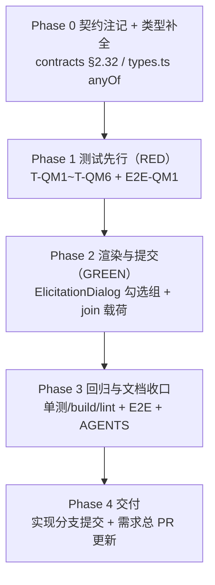

# question 工具多选题呈现修复 - 实现计划

**关联 Proposal**: `docs/engineering/proposals/20261104-fix-question-tool-multi-select.md`（v1.0）
**关联 PRD**: `docs/product/draft/20261104-question-tool-multi-select.md`（v1.0）
**需求总分支（feat-branch）**: `prd/question-tool-multi-select`（需求总 PR [#454](https://github.com/Deliay/z-agent-gear/pull/454)，上游 Issue [#445](https://github.com/Deliay/z-agent-gear/issues/445)）
**实现分支**: `fix/question-tool-multi-select-impl`（基于需求总分支）
**创建日期**: 2026-11-04
**计划版本**: v1.0

**上游评审结论**：产品文档与技术提案经「审核产品文档与技术方案」人类节点于 2026-11-04 通过（节点 DONE、无打回记录）；需求总 PR #454 当前无 review 记录与 inline comment。本计划按 PRD v1.0 / 提案 v1.0 推进。

**版本说明**：

- v1.0 首版：把提案 §5.2 的 4 个实现点拆成 4 个 Phase；给出「代码探查关键事实」12 条、「上游文档 × 代码现状差异」6 条、「计划期裁决」10 条，收敛提案留白但会阻塞实现的口径（选项说明渲染、契约注记落点、非字符串 const 拼接、测试编号与 fixture 隔离）。
- 不改变 PRD 产品口径；不新增/删除契约字段（仅注记）；后端零改动；前端不引入新依赖。

## 实现顺序



依赖说明：

- **P0 先行**：`types.ts` 的 `anyOf` 声明是测试 fixture 能通过 TypeScript 编译的前提；契约注记是「提交值形态」的书面依据，先落口径再写测试。
- **P1 → P2**：严格 TDD。`T-QM1/QM1b/QM2/QM2b/QM3/QM6` 必须在旧实现上失败（RED：无勾选组、提交值为数组/缺失、纯函数不存在），再改实现（GREEN）；`T-QM4/QM5` 是回归基线，旧实现上即应为绿，改完后必须仍绿。
- **P3 依赖 P0~P2**：纯前端改动，回归以 `apps/agent-web` 单测 + build/lint 与 `tests/e2e/src/elicitation.spec.ts` 为准；真实 OpenCode 会话的答案消费在验收节点手工验证（E2E 的 fake controller 只验证协议形态）。
- **P4 依赖 P3**：实现分支 → 需求总分支（不直推 `main`）。

开发模式采用 TDD（红-绿-重构）。编码前加载 `docs/engineering/common-rules.md`、`docs/engineering/frontend-rules.md`、`apps/agent-web/AGENTS.md`；本需求不触碰后端，无需加载后端规范。

### 关键约束（实现期不得回退）

- **唯一行为改动点**：`apps/agent-web/src/components/ElicitationDialog.tsx`（渲染分支 + 提交载荷构造）；`apps/agent-web/src/graphql/types.ts` 仅补类型声明。
- **后端与契约结构零改动**：`controller-api` / `agent-api` / `agent-controller` 不改一行；`contracts/agent-session-websocket.md` 仅增注记，字段/类型/可空性不动。
- **join 作用域收窄**：只有 `type==='array'` 且 `items.anyOf` 且**不含** `items.enum` / `items.oneOf` 的字段参与逗号拼接；`items.enum` / `items.oneOf` 数组字段提交形态保持数组。
- **edits 始终以数组承载勾选状态**：join 只发生在 `handleRespond` 构造提交载荷的那一刻。若在 `setValue`/渲染层就把数组转字符串，会连带破坏草稿恢复、`isEmptyValue` 必答校验与「勾选/取消」交互。
- **零新增依赖**：复用既有 `Checkbox`（`@base-ui/react/checkbox`）与 Tailwind 样式，不引入第三方表单库。
- **禁止 rebase/squash**：遵循 z-git 规范，仅允许 merge。

### 代码探查关键事实（实现时以现状为准）

- **F1**：数组多选分支现状为 `if (prop.type === 'array' && (prop.items?.enum || prop.items?.oneOf))`（`ElicitationDialog.tsx:265`）；选项映射在 `266-268`（oneOf → `{value:o.const,label:o.title||optionLabel(o.const)}`，enum → `optionLabel(v)`），勾选交互在 `278-286`（`Checkbox checked={selected.includes(option.value)} onCheckedChange={checked => toggleArrayValue(name, option.value, checked === true)}`）。
- **F2**：`items.anyOf` 字段当前落到 `292-311` 的「其他 string：文本框」兜底：`value={typeof value === 'string' ? value : ''}`，`onChange` 写入字符串。即多选字段渲染为空文本框且无法勾选（Issue #445 现象）。
- **F3**：`ElicitationSchemaProperty.items` 仅声明 `enum` / `oneOf`（`types.ts:894-897`）；选项结构 `ElicitationSchemaOneOfOption { const, title?, description? }`（`types.ts:876-880`）与 `items.anyOf` 元素同构，可直接复用。
- **F4**：`handleRespond`（`ElicitationDialog.tsx:147-168`）当前直接提交 `values`（`{...defaults, ...edits}`）；`values` 仅在 `action==='accept' && data.mode==='form'` 时下发，其余为 `null`。
- **F5**：`isEmptyValue`（`50-52`）已把 `[]` 视为空，`missingRequired`（`95`）→ 提示（`367-371`）与提交按钮禁用（`379-384`）共用同一判定。多选必答空选**无需新增校验代码**，只要 edits 保持数组。
- **F6**：`toggleArrayValue`（`141-145`）以 `[...current, option]` 追加、`filter(v => v !== option)` 移除，顺序 = 勾选顺序（T-QM2 的拼接顺序依据）；`optionLabel`（`54-56`）对非字符串 `JSON.stringify`。
- **F7**：草稿按 `requestId` 存于内存 Map（`stores/elicitationDialog.ts:23-27`，上限 50，无 localStorage），数组可直接存取，无序列化迁移问题。
- **F8**：提交值全链路原样透传：agent-api `respondElicitation` 仅校验归属与终态后 `publish('elicitation:response', { requestId, action, content: args.values })`（`resolvers/todo.ts:90-94`）；controller-api 仅按 `requestId` 匹配 pending 后 `socket.emit('acp:elicitation:response', { requestId, action, content })`（`elicitation-manager.ts:162-180`）。前端把数组换成字符串不会被任何一层拦截或改写。
- **F9**：问询待办标题 = `Agent请求输入：${requestedSchema.title || '填写信息'}`（`servers/agent-api/src/services/todo-service.ts:167`）；E2E 若要断言标题必须给 fixture 带 `title`。
- **F10**：`ElicitationDialog.test.tsx` 的共享 fixture `formTodo` 只含 1 个 boolean 勾选框，既有用例用 `screen.getByRole('checkbox')` **单匹配**断言（`:100-103`）。若把多选字段塞进 `formTodo`，该断言会因多匹配直接失败（见裁决 8）。
- **F11**：既有 E2E `FORM_SCHEMA`（`tests/e2e/src/elicitation.spec.ts:89-97`）为 `strategy` 单选 enum + `dryRun` boolean，并断言 `content` 全等（`:159`）；新增用例必须使用**独立 schema 与独立 test**，不改既有断言。
- **F12**：`Checkbox` 为 Base UI 受控组件（`checked` + `onCheckedChange(checked: boolean)`），`<label>` 包裹时点击文字即可切换；`apps/agent-web` 无横向溢出/视觉快照测试，选项说明为纯文本新增行，不影响布局断言。

## 上游文档 × 代码现状差异

| # | 上游表述 | 代码现状（证据） | 本计划处置 |
|---|----------|------------------|------------|
| D1 | PRD §3.4 要求多选项展示「选项名称与选项说明（如有）」；提案 §5.2 只映射 label | 现有数组分支完全不渲染 `description`（F1），只有单选分支渲染（`213-216`） | 数组分支统一渲染 `option.description`（additive，仅在有值时多一行），见裁决 4 |
| D2 | 提案 §3.1 把值形态注记写在契约 §2.31 | `content` 字段实际在 §2.32 `acp:elicitation:response`（`contracts/agent-session-websocket.md:853-863`） | 注记落在 §2.32，并在 §2.31 末尾加一句交叉引用，见裁决 7 |
| D3 | 提案 §3.2 用 `v.join(',')` 拼接 | `items.anyOf[].const` 类型为 `unknown`（F3），非字符串会得到 `[object Object]` | 改为 `value.map(optionLabel).join(',')`；question 场景 const 恒为字符串，行为等价，见裁决 3 |
| D4 | 调查报告 §8 回归建议「提交值为数组」 | Issue #445 与提案 D1 明确要求 `.join(',')` | 以 Issue（需求方最新决定）为准，本计划不重开该决策；仅将数组形态限定在 `items.enum/oneOf` |
| D5 | 调查报告引用 `types.ts:618-634` | 当前实际位置为 `types.ts:894-897`（F3） | 以现状行号为准，不回改调查报告 |
| D6 | 提案 §8 的 T-QM3 描述「提交按钮禁用并提示」 | 两件事共用 `missingRequired`，无需改代码（F5） | 用例同时断言「按钮禁用」与「提示含题目标题」，锁定既有行为 |

## 计划期裁决（提案留白 / 含混处的实现口径）

1. **测试编号与落点**：组件单测统一 `T-QM1~T-QM6`，追加到 `apps/agent-web/src/components/ElicitationDialog.test.tsx` 的新 `describe('ElicitationDialog - 多选 anyOf')`；E2E 用例命名 `E2E-QM1`，追加到 `tests/e2e/src/elicitation.spec.ts` 的新 `test(...)`，不改既有 4 个用例。
2. **选项来源优先级**：`items.oneOf` → `items.anyOf` → `items.enum`（与现状 `oneOf` 优先一致）；真实 question 报文只有 `anyOf`（调查报告 §4.5），同时存在多形态时按上述顺序取第一个，避免语义歧义。
3. **提交值形态**：`joinMultiSelectValues` 只处理 `type==='array' && items.anyOf && !items.enum && !items.oneOf`；`Array.isArray(v) && v.length > 0` 时 `v.map(optionLabel).join(',')`；空数组保持 `[]`（不拼成空串，避免被 Agent 当作「已作答且答案为空」）；非数组值（历史草稿/异常报文）原样透传，不抛错。
4. **选项说明渲染**：数组分支的 `<span>` 内按单选分支同构渲染 `option.description`（`block text-xs text-muted-foreground`）。该改动对 `items.enum/oneOf` 既有字段是**仅新增可见文本**（无 description 时零变化），满足 PRD §3.4。
5. **无障碍定位**：多选容器补 `role="group"` + `aria-label={label}`（与单选 `radiogroup` 对齐），不改变视觉；同时给测试一个稳定锚点（`getByRole('group', { name })`）。
6. **必答校验零改动**：勾选状态始终以数组存于 edits，`isEmptyValue([]) === true` 已覆盖；不得在渲染层把数组转字符串（见关键约束）。
7. **契约注记**：§2.32 `content` 行下方补一段值形态说明（逐字见 Phase 0）；§2.31 `requestedSchema` 行下方补一句「多选字段（`type:'array'` + `items.anyOf`）的响应值形态见 §2.32」。零字段变更。
8. **测试 fixture 隔离**：新增独立 `multiTodo` / `mixedTodo` fixture，**不复用也不修改** `formTodo`（F10）；新 fixture 的 `requestId` 唯一（如 `el-req-multi`），`afterEach` 的 `resetElicitationDialog()` 已清理草稿。
9. **E2E 断言口径**：真实 question schema = `q0`（`string` + `oneOf` 单选）+ `q0_custom`（`string`）+ `q1`（`array` + `items.anyOf`）+ `q1_custom`（`string`），`required: ['q0','q1']`、`title: '实施选项'`；只填 `q0`/`q1`，断言 `content` 恰为 `{ q0, q1 }`（`q0_custom`/`q1_custom` 未填不出现）且 `q1 === '自动跑测试,生成文档'`（顺序 = 点击顺序）。
10. **文档收口范围**：本节点只提交计划文档与 `docs/engineering/AGENTS.md` 的「实现计划」索引；`apps/agent-web/AGENTS.md` 的行为口径说明随实现提交（Phase 3），避免文档先于代码描述未实现行为。

### 目标实现代码（Phase 2 基准）

```ts
// 模块内纯函数（同文件导出，供 T-QM6 直测边界）
function isMultiSelectAnyOf(prop: ElicitationSchemaProperty): boolean {
  return prop.type === 'array' && Boolean(prop.items?.anyOf) && !prop.items?.enum && !prop.items?.oneOf;
}

export function joinMultiSelectValues(
  values: Record<string, unknown>,
  properties: Record<string, ElicitationSchemaProperty>,
): Record<string, unknown> {
  const payload: Record<string, unknown> = { ...values };
  for (const [name, prop] of Object.entries(properties)) {
    if (!isMultiSelectAnyOf(prop)) continue;
    const value = payload[name];
    if (Array.isArray(value) && value.length > 0) {
      payload[name] = value.map(optionLabel).join(',');
    }
  }
  return payload;
}
```

```tsx
// renderField：array 分支（替换现状 264-290）
if (prop.type === 'array' && (prop.items?.enum || prop.items?.oneOf || prop.items?.anyOf)) {
  const options = prop.items.oneOf
    ? prop.items.oneOf.map((o) => ({ value: o.const, label: o.title || optionLabel(o.const), description: o.description }))
    : prop.items.anyOf
      ? prop.items.anyOf.map((o) => ({ value: o.const, label: o.title || optionLabel(o.const), description: o.description }))
      : (prop.items.enum ?? []).map((v) => ({ value: v, label: optionLabel(v), description: undefined }));
  const selected = Array.isArray(value) ? value : [];
  return (
    <div key={name} className="space-y-2" role="group" aria-label={label}>
      <Label>{label}{required && <span className="text-destructive">*</span>}</Label>
      {prop.description && <p className="text-xs text-muted-foreground">{prop.description}</p>}
      <div className="space-y-1">
        {options.map((option) => (
          <label key={option.label} className="flex items-center gap-2 text-sm cursor-pointer">
            <Checkbox
              checked={selected.includes(option.value)}
              onCheckedChange={(checked) => toggleArrayValue(name, option.value, checked === true)}
            />
            <span>
              {option.label}
              {option.description && (
                <span className="block text-xs text-muted-foreground">{option.description}</span>
              )}
            </span>
          </label>
        ))}
      </div>
    </div>
  );
}
```

```ts
// handleRespond：构造提交载荷（替换现状 153-159 的 variables.values 取值）
const payload = data.mode === 'form' ? joinMultiSelectValues(values, properties) : null;
await respondElicitation({
  variables: {
    requestId: data.requestId,
    action,
    values: action === 'accept' && data.mode === 'form' ? payload : null,
  },
});
```

---

## Phase 0: 契约注记 + 类型补全

| 文件 | 操作 | 说明 |
|------|------|------|
| `contracts/agent-session-websocket.md` | 修改 | §2.32 `content` 行下方新增：「`type: 'array'` 且 `items.anyOf` 的字段（ACP question 工具多选题）由客户端将所选值以逗号拼接为字符串回传（如 `"A,B"`，顺序同勾选顺序）；其余 array 字段（`items.enum` / `items.oneOf`）仍按数组回传。」；§2.31 `requestedSchema` 行下方新增交叉引用一句 |
| `apps/agent-web/src/graphql/types.ts` | 修改 | `ElicitationSchemaProperty.items` 增加 `anyOf?: ElicitationSchemaOneOfOption[]`（复用现有选项结构） |

验收：`git diff` 确认契约无字段/类型/可空性增删改；`apps/agent-web` `pnpm run build` 类型检查通过。

## Phase 1: 测试先行（RED）

| 文件 | 操作 | 用例 |
|------|------|------|
| `apps/agent-web/src/components/ElicitationDialog.test.tsx` | 追加 describe + fixture | T-QM1、T-QM1b、T-QM2、T-QM2b、T-QM3、T-QM4、T-QM5、T-QM6 |
| `tests/e2e/src/elicitation.spec.ts` | 追加 test | E2E-QM1 |

RED 预期：

- T-QM1 / T-QM1b / T-QM2 / T-QM2b / T-QM3：旧实现下 `role="group"` 不存在、`checkbox` 数量为 0、提交值缺失或为数组 → 失败。
- T-QM6：`joinMultiSelectValues` 尚不存在 → 导入/编译失败（失败即红）。
- T-QM4 / T-QM5：回归基线，旧实现下即为绿，改完必须仍绿。

## Phase 2: 渲染与提交（GREEN）

| 文件 | 操作 | 说明 |
|------|------|------|
| `apps/agent-web/src/components/ElicitationDialog.tsx` | 修改 | ① 新增 `isMultiSelectAnyOf` / `joinMultiSelectValues`（导出纯函数）；② array 分支条件扩展 `items.anyOf`、选项映射补 `anyOf` 与 `description`、容器补 `role="group" aria-label`；③ `handleRespond` 用 `joinMultiSelectValues` 构造 `values` |

验收：T-QM1~T-QM6 全绿；`items.enum/oneOf` 数组提交仍为数组（T-QM4）。

## Phase 3: 回归与文档收口

| 动作 | 命令 / 落点 | 验收 |
|------|-------------|------|
| 组件单测 | `cd apps/agent-web && pnpm run test` | 全绿（含既有终态/草稿/url 用例） |
| 类型与构建 | `cd apps/agent-web && pnpm run build` | 通过（`tsc -b` + vite build） |
| Lint | `cd apps/agent-web && pnpm run lint` | 无新增告警/错误 |
| E2E | `aspire start && aspire wait agent-api && aspire wait agent-web` 后按 `tests/e2e/AGENTS.md` 注入端口执行 `pnpm exec playwright test src/elicitation.spec.ts --workers=1` | 既有 4 用例 + E2E-QM1 全绿 |
| 前端行为口径 | `apps/agent-web/AGENTS.md`「会话能力门控与能力面板」段 | 补一条：多选识别 `items.enum/oneOf/anyOf`；仅 `anyOf` 提交前逗号拼接，enum/oneOf 保持数组；`*_custom` 仍为文本框 |
| 计划索引 | `docs/engineering/AGENTS.md`「实现计划（plan/）」 | 已由本节点补入 |

## 测试矩阵

| 用例 | 层次 | 断言 | 旧实现 |
|------|------|------|--------|
| T-QM1 | 单测 | `type:array + items.anyOf` 渲染 `role="group"`，组内 checkbox 数 = 选项数、标签取 `title`；不存在对应文本框（`container.querySelector('#<name>') === null`） | 红 |
| T-QM1b | 单测 | 选项 `description` 可见（PRD §3.4） | 红 |
| T-QM2 | 单测 | 依次勾选 A、B 后提交，`variables.values.<name> === 'A,B'`（顺序 = 勾选顺序） | 红 |
| T-QM2b | 单测 | 勾选 A、B 再取消 A 后提交 → `'B'`；勾选后再全部取消 → `[]`（不变成空串） | 红 |
| T-QM3 | 单测 | 必答 anyOf 空选：提交按钮禁用 + 提示「请填写必填项：<标题>」 | 红（无勾选组即无法作答） |
| T-QM4 | 单测（回归） | 同 schema 中 `items.enum` / `items.oneOf` 数组字段提交值仍为数组 | 绿 |
| T-QM5 | 单测（回归） | `string + oneOf` 单选、`string` 自由文本（含 `q*_custom`）提交行为不变 | 绿 |
| T-QM6 | 单测（纯函数） | `joinMultiSelectValues`：空数组保持 `[]`、含逗号值原样拼接、非字符串 const 走 `optionLabel`、非 anyOf 字段不受影响 | 红（不存在） |
| E2E-QM1 | E2E | 真实 question schema 弹窗：勾选 `q0` 单选 + `q1` 两项 → 提交 → `acp:elicitation:response.content` 恰为 `{ q0, q1 }` 且 `q1 === '自动跑测试,生成文档'`，弹窗关闭 | 红 |

## 命令参考

```bash
# 单测（先红后绿）
cd apps/agent-web && pnpm run test -- src/components/ElicitationDialog.test.tsx
cd apps/agent-web && pnpm run test

# 类型 / 构建 / Lint
cd apps/agent-web && pnpm run build
cd apps/agent-web && pnpm run lint

# E2E（端口以 aspire describe 为准，见 tests/e2e/AGENTS.md）
cd tests/e2e && BASE_URL=<agent-web> API_URL=<agent-api>/graphql \
  CONTROLLER_API_URL=<controller-api> pnpm exec playwright test src/elicitation.spec.ts --workers=1
```

## 验收 checklist

- [ ] 多选问询在弹窗中呈现为勾选组（含选项说明），不再是文本框（T-QM1/QM1b、E2E-QM1）。
- [ ] 勾选多个选项提交后，Agent 侧收到逗号拼接字符串（T-QM2、E2E-QM1）。
- [ ] 必答多选空选不可提交并提示补全（T-QM3）。
- [ ] `items.enum` / `items.oneOf` 数组提交仍为数组，单选/自由文本/数字/布尔/url/终态/草稿零回归（T-QM4/QM5 + 既有用例）。
- [ ] `apps/agent-web` `pnpm run build` + `pnpm run test` + `pnpm run lint` 全绿。
- [ ] E2E `elicitation.spec.ts` 既有 4 用例 + E2E-QM1 全绿。
- [ ] 契约仅增注记（零结构变更），后端零改动。
- [ ] 真实 OpenCode 会话手工验收（验收节点）：多选作答后 Agent 继续执行且答案可读。

## 风险与回滚

| # | 风险 | 缓解 |
|---|------|------|
| R1 | join 作用域写宽，误把通用 MCP 的 enum/oneOf 数组改成字符串 | `isMultiSelectAnyOf` 显式排除 enum/oneOf + T-QM4 回归锁定 |
| R2 | 在渲染层转字符串导致必答校验/草稿/取消勾选失效 | 关键约束：edits 恒数组，join 只在 `handleRespond` 构造载荷时发生；T-QM2b/T-QM3 |
| R3 | Agent 对 `[]` 或字符串答案的消费口径与预期不同 | E2E 只验证协议形态；真机 OpenCode 会话在验收节点验证；如需调整仅改 `joinMultiSelectValues` 一处 |
| R4 | 非字符串 `const` 拼接出 `[object Object]` | 统一 `optionLabel` 序列化 + T-QM6 边界用例 |
| R5 | 选项说明新增文本影响既有 oneOf 数组视觉 | 仅 `description` 存在时多渲染一行，无值时零变化；项目无视觉快照断言 |
| R6 | 新 fixture 污染既有 `formTodo` 单匹配断言 | 裁决 8：独立 fixture、独立 describe |

**回滚**：本需求为单文件行为改动 + 类型声明 + 测试，直接 revert 实现 commit 即可恢复；无数据迁移、无后端、无发布顺序依赖。

## 实施记录（v1.1，2026-11-04）

- **落点调整（计划期裁决 1 之外的偏差）**：`isMultiSelectAnyOf` / `joinMultiSelectValues` / `optionLabel` 未按「同文件导出」实现，而是抽取为 `apps/agent-web/src/lib/elicitation-multi-select.ts`。原因：`ElicitationDialog.tsx` 若导出非组件符号会触发 `eslint react-refresh/only-export-components` 错误（`pnpm run lint` 失败），而计划要求 lint 零新增问题；测试落点仍在 `ElicitationDialog.test.tsx`（T-QM6 从 lib 导入纯函数）。
- **实际执行结果**：T-QM1/QM1b/QM2/QM2b/QM3/QM4/QM6 在旧实现上为红（无 `role="group"`、无勾选组、`joinMultiSelectValues` 不存在），实现后全绿；`apps/agent-web` `pnpm run test`（123 文件 / 1140 用例）、`pnpm run build`、`pnpm run lint`（0 error，仅存既有 5 warning）通过。
- **契约注记**：落在 `contracts/agent-session-websocket.md` §2.32（值形态说明）与 §2.31（交叉引用），零字段/类型变更。
