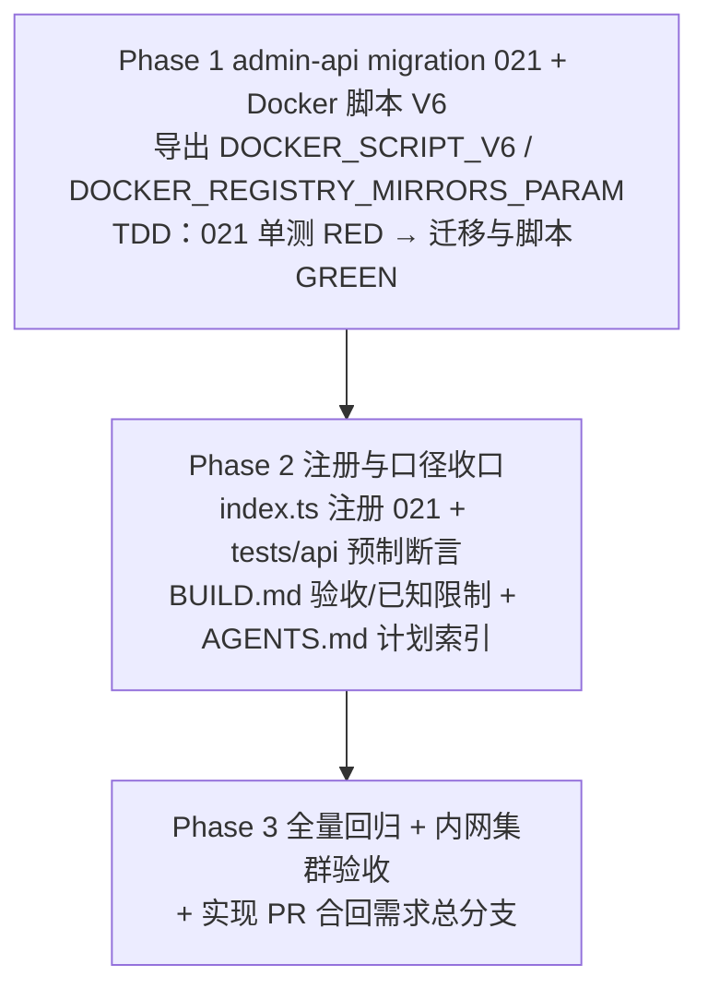

# 「Docker」工作负载取消镜像引用规范化脚本改用 registry-mirrors - 实现计划

**关联 Proposal**: `docs/engineering/proposals/20261105-feat-docker-registry-mirrors.md`（v1.1）
**关联 PRD**: `docs/product/draft/20261105-docker-registry-mirrors.md`（v1.0）
**需求总分支（feat-branch）**: `prd/docker-registry-mirrors`（需求总 PR [#464](https://github.com/Deliay/z-agent-gear/pull/464)，上游 Issue [#463](https://github.com/Deliay/z-agent-gear/issues/463)）
**实现分支**: `impl/docker-registry-mirrors`（基于需求总分支切出）
**创建日期**: 2026-11-05
**计划版本**: v1.0

**版本说明**：

- v1.0 首版：把提案 §1.3 / §5.2 的实现点拆成 3 个 Phase；给出「代码探查关键事实」15 条、「上游文档 × 代码现状差异」8 条、「计划期裁决」16 条，收敛提案留白但会阻塞实现的口径（迁移编号与脚本版本号冲突、删除预置项是否重建、空 env 语义、daemon.json 归属与测试切片）。
- **不改变 PRD 产品口径**；技术实现以本计划裁决 1/2 的编号校正为准（提案正文的 `020` / `v5` 已被主干占用，见 D1/D2）。

**上游评审结论**：提案 v1.1 已处理需求总 PR #464 首轮 `CHANGES_REQUESTED`（`docker_registry_mirrors` 默认值补 `docker-hub-proxy` 后缀），当前 review 无新增未处理 inline comment；本计划按 PRD v1.0 + 提案 v1.1 推进。

## 实现顺序



依赖说明：

- 本期**只有 admin-api 一个服务代码变更**（脚本与参数均为库内数据），其余为 `tests/api` 断言与 `deploy/images/worker/BUILD.md` 文档口径更新；无跨服务/跨仓并行。
- Phase 1 内严格 TDD：先写 `021-docker-registry-mirrors.test.ts`（RED）→ 实现 `021-docker-registry-mirrors.ts`（GREEN）→ 重构收口。
- Phase 2 依赖 Phase 1 落定的常量名、脚本锚点与参数定义；`tests/api` 是活着服务的集成断言，必须在 migration 021 已被 admin-api 启动链路执行后运行。
- Phase 3 在实现分支合并回需求总分支后收口（不直推 `main`）。

开发模式采用 TDD（红-绿-重构）。编码前加载 `docs/engineering/common-rules.md`、`docs/engineering/backend-rules.md`、`servers/admin-api/AGENTS.md`；`tests/api` 变更遵循 `tests/api/AGENTS.md`（只用 Aspire 编排，禁止裸 docker）。`tests/api` 与 `tests/e2e` 不新增本需求的用例集，仅同步既有预制项断言。

### 关键约束（提案 §1.3/§6，实现期不得回退）

- **无契约变更**：不动 `contracts/`；`workload:run.items[].params` → `WORKLOAD_PARAM_<KEY_UPPER>` 注入约定已完整支持 `docker_registry_mirrors`。
- **无 worker 镜像变更**：不改 `deploy/images/worker/Dockerfile` / `entrypoint.sh`，无需重建 worker 镜像；部署 admin-api 即生效。
- **无 GraphQL schema / admin-web 变更**：`paramSchema` 既有字段类型（`key/label/type/options/defaultValue`）即可承载新参数；启动对话框默认值预填与工作负载管理页参数编辑均为既有能力。
- **不改 001 / 002 / 003 / 012 / 019 / 020 迁移源码**：历史版本常量是「未定制」比对的唯一事实源；021 只读复用 `DOCKER_SCRIPT_V1~V5`。
- **不覆盖管理员定制**：`initScript` 不在 V1~V5 与 V6 之内一律 `log.warn` 跳过，且**不补参数**。
- **地址为空 = 合法配置**：不配置镜像加速、不快速失败；只清理本脚本管理的 `daemon.json`，环境自管的配置保留并告警。
- **不做可达性校验**：镜像地址在拉取时由 dockerd 消费，与 Docker 原生口径一致。
- **不提高 `MIN_WORKER_VERSION`**：参数注入需 agent-gear ≥2.3.0（现网镜像已满足）；极老 worker 上参数不注入时 V6 行为 = 不配置镜像加速，不引入新失败。
- **禁止 rebase/squash**：遵循 z-git 规范，仅允许 merge。

## 代码探查关键事实（实现时以现状为准）

- **F1**：`servers/admin-api/src/migrations/020-docker-shim-value-options.ts` 已占用迁移编号 `020`，并导出 `DOCKER_SCRIPT_V5`（在 V4 基础上修复 shim 的带值选项解析）；`index.ts` 注册链末尾已是 `migration020DockerShimValueOptions`。
- **F2**：Docker 预制脚本当前版本链为 `V1`（001）→ `V2`（002）→ `V3`（003，参数化 `docker_apt_url`）→ `V4`（012，sudo 形态 + `dockerd -G worker`）→ `V5`（020，shim 带值选项修复）。`V5` 仍包含完整 shim（`SHIM_PATH`、`normalize_image`、`HARBOR_PROXY`、`<<'SHIM'`）。
- **F3**：`019-workload-idempotent-anchors.ts` 的 Docker 目标为 `oldScripts=[V1,V2,V3]`、`newScript=V4`；`020` 的已知链为 `[V1,V2,V3,V4]`、目标 `V5`。两者均已执行/记账，021 必须把 `V5` 也纳入已知链，不能只认到 V4。
- **F4**：V4/V5 的 shim 段落起点为注释 `# 2) 装配镜像引用规范化 shim`，终点后紧跟 `# 3) 启动 dockerd 并等待就绪（已就绪则跳过）`；`SHIM_PATH="${ZAG_DOCKER_SHIM_PATH:-/usr/local/bin/docker}"` 位于脚本头部。删除 shim 必须以这两个注释锚点切分，避免误删安装段。
- **F5**：工作负载脚本由 agent-gear 以 `bash -c` 执行，进程身份为容器内 **worker**（`packages/agent-controller/src/workload-executor.ts:229`）；所有 root 写操作必须走 `${SUDO}`（012 引入的 `SUDO=sudo; command -v sudo >/dev/null || SUDO=` 形态）。现网启动命令为 `${SUDO} sh -c 'nohup dockerd -G worker >/var/log/dockerd.log 2>&1 &'`。
- **F6**：参数注入为 `WORKLOAD_PARAM_DOCKER_REGISTRY_MIRRORS`（TEXT 字符串原样注入，`workload-executor.ts:219-222`）；`docker_registry_mirrors` 满足键名正则 `^[a-z][a-z0-9_]{0,31}$`，默认值长度 < 1024。
- **F7**：003 的参数常量形态为 `{ key, label, type, options, defaultValue }`（`WorkloadParamDefinition`），写库字段为 `paramSchema`；GraphQL 对外映射为 `TEXT`。新参数沿用同一形态即可。
- **F8**：迁移 runner（`runner.ts`）按 `admin_migrations.name` 记账，已执行跳过、失败仅记日志且下轮重试；`index.ts` 的注册数组顺序决定全新环境链路。
- **F9**：020 的最新口径是「管理员已删除的预置项不恢复（迁移只增不改/删除即尊重）」：`findDockerWorkload()` 返回 `null` 时直接 `return`，不 `create`。021 应沿用该更保守口径（PRD 也未要求恢复被删除项）。
- **F10**：迁移日志必须使用 `logger.child({ component: 'migration/021-docker-registry-mirrors' })`（`servers/admin-api/AGENTS.md`），`no-console` 守卫扫描全部 `src`（含 `migrations`）。
- **F11**：`tests/api/src/admin-api/cloud-workload.test.ts` 的 `T-IA` 目前只断言 10 个预制项名称/数量、Aspire 依赖、Node.js 参数等，**尚未断言 Docker 的 `paramSchema` 与 `initScript` 内容**；本期在既有 `T-IA` 内补断言，不新增预制项计数。
- **F12**：`deploy/images/worker/BUILD.md` 仍保留 shim 时代口径：手工验收的 `docker pull ghcr.io/...` 走代理（第 320~321、382~383 行）、入口说明「CLI、镜像代理 shim、dockerd」（第 468~469 行）、已知限制「镜像代理 shim 由 Docker 工作负载脚本装配」（第 507 行）——均需改为 registry-mirrors 口径。
- **F13**：worker 镜像不保证 `jq` / `python3` 可用（提案 §6.2 约束）；`daemon.json` 的生成、比较与归属判定必须用纯 bash + `grep` / `tr` / `printf`。
- **F14**：`docker info --format '{{json .RegistryConfig.Mirrors}}'` 输出 JSON 数组字符串，可直接用 bash `case` / `grep -F` 断言逐项出现；`docker info` 的 Go template 中不含 bash 变量，无需 `$` 转义。
- **F15**：`servers/admin-api` 使用 pnpm + vitest（`pnpm run build` / `pnpm test`）；`tests/api` 独立 `pnpm test`，依赖 Aspire 先启动。

## 上游文档 × 代码现状差异

| # | 上游表述 | 代码现状（证据） | 本计划处置 |
|---|----------|------------------|------------|
| D1 | 提案 §1.2/§1.3/§7：新增迁移 `020-docker-registry-mirrors` | 迁移 `020-docker-shim-value-options` 已合入 main 并注册（F1） | 本计划改为 `021-docker-registry-mirrors`（裁决 1） |
| D2 | 提案 §1.2：Docker 脚本升级 `v4 → v5` | `DOCKER_SCRIPT_V5` 已被 020 占用（F2） | 本计划改为 `V6`，从 `V5` 派生（裁决 2） |
| D3 | 提案 §5.2 实现点 2：两者都不存在 → 防御创建 | 020 最新口径为「删除即尊重、不恢复」（F9） | 本计划改为告警跳过，不 `create`（裁决 6） |
| D4 | 提案 §5.2：取值优先级「env > 参数 > 空」 | 提案未定义「env 显式为空」的语义；`DOCKER_APT_URL` 用 `:-` 会回退参数 | 采用 `${VAR-${PARAM-}}`：env 只要被设置（含空串）即为最高优先级，显式空可清空（裁决 7） |
| D5 | 提案 §5.2：daemon.json 归属正则 `^\{"registry-mirrors":\[[^]]*\]\}$` | 实现需先去掉文件空白，且地址含引号/反斜杠会破坏 JSON | 先 `tr -d '[:space:]'` 再匹配；地址校验拒绝引号/反斜杠/内部空白（裁决 7/8） |
| D6 | 提案 §5.2：地址为空时「断言脚本管理的 daemon.json 已移除」 | 环境可能有自管 daemon.json，此时 `docker info` 仍可能显示 mirrors | 仅在「脚本管理文件被移除」时硬断言文件不存在；环境自管文件保留并告警（裁决 10） |
| D7 | 提案 §8：`tests/api` 同步 Docker 参数与脚本口径 | 现有 `T-IA` 未断言 Docker 参数/脚本（F11） | 在既有 `T-IA` 内新增断言，不改预制项数量（Phase 2） |
| D8 | 提案 §9.3：运行中的旧容器重建后才使用新配置 | 与现状一致；旧容器重跑初始化时 V6 会清理历史 shim | 保持提案口径，不新增运行时开关（裁决 16） |

## 计划期裁决（提案留白 / 含混处的实现口径）

1. **迁移编号**：使用 `021-docker-registry-mirrors`。实现启动前再次核对 `servers/admin-api/src/migrations/` 与 `origin/main` 的实际占用；若 021 在合并前被并行需求占用，按「下一个空闲编号」顺延并同步文件名、`name`、`index.ts` 注册、单测引用与 AGENTS 索引，禁止改写已合入的历史迁移。
2. **脚本版本号**：新常量为 `DOCKER_SCRIPT_V6`，由 `DOCKER_SCRIPT_V5` 定点变换生成（保留版本链 V1→…→V6）；**不修改 020**，`DOCKER_SCRIPT_V5` 继续作为历史常量导出。
3. **已知脚本链**：`[DOCKER_SCRIPT_V1, V2, V3, V4, V5]`；`V6` 视作幂等目标。全新环境链路：001 V1 → 002 V2 → 003 V3 → 012 V4 → 019 V4（no-op）→ 020 V5 → 021 V6。
4. **参数常量**（与 003 同形态）：
   ```ts
   export const DOCKER_REGISTRY_MIRRORS_DEFAULT =
     'https://core.harbor.internal.fffdan.com/docker-hub-proxy';
   export const DOCKER_REGISTRY_MIRRORS_PARAM: WorkloadParamDefinition = {
     key: 'docker_registry_mirrors',
     label: '镜像仓库镜像地址',
     type: 'text',
     options: [],
     defaultValue: DOCKER_REGISTRY_MIRRORS_DEFAULT,
   };
   ```
   默认值无尾斜杠；脚本内**不内置**默认地址（单一事实源是参数默认值）。
5. **参数合并规则**：只按 `key` 判存在；缺失才 `[...existing, DOCKER_REGISTRY_MIRRORS_PARAM]`。已存在则完全不动（含管理员改过的默认值）；保留既有 `docker_apt_url` 与其他参数及其顺序。**仅对脚本命中的预置项补参数**，定制脚本不补。
6. **缺失预置项**：`presetKey='docker'` 不存在时按精确 `name='Docker'` 再查一次；命中则告警跳过；两者都不存在时**不创建**，`log.warn` 记录「preset missing, not recreating」（对齐 020 的删除即尊重口径）。
7. **地址解析**（脚本内标记为可测试切片）：
   - 取值：`REGISTRY_MIRRORS_RAW="${DOCKER_REGISTRY_MIRRORS-${WORKLOAD_PARAM_DOCKER_REGISTRY_MIRRORS-}}"`；
   - 按英文逗号切分为数组；逐项 trim、去掉**尾部**斜杠、丢弃空段；
   - 非空项必须以 `http://` 或 `https://` 开头，且不含双引号、反斜杠、空格/制表符；非法项 `exit 2` 并打印指引；
   - 全空（空串 / 仅空白 / 仅逗号）得到空数组，视为「不配置镜像加速」。
8. **daemon.json 生成与归属**：
   - 纯 bash 生成紧凑 JSON：`{"registry-mirrors":["<m1>","<m2>"]}`；
   - 「脚本管理」判定：读取文件（`${SUDO} cat`）→ `tr -d '[:space:]'` → `grep -Eq '^\{"registry-mirrors":\[[^]]*\]\}$'`；
   - 文件不存在 → 写入；存在且与目标一致 → 跳过（幂等）；存在、符合脚本管理形态但不一致 → 覆写；
   - 存在且不符合脚本管理形态（含其他键）→ `cp -p` 备份为 `/etc/docker/daemon.json.pre-zag-<YYYYmmddHHMMSS>-<pid>` 后覆写，并打印醒目告警；
   - 地址为空：脚本管理文件存在则删除；环境自管文件保留并告警；打印「未配置镜像加速，Docker Hub 将默认直连」。
9. **dockerd 启停**：
   - 仅当 `daemon.json` 有变更且 `docker info` 成功（已运行）时重启：`${SUDO} pkill -TERM -x dockerd || true` → 最多等 10s 至 `docker info` 失败 → 仍存活则 `${SUDO} pkill -KILL -x dockerd || true` → 重新用 `${SUDO} sh -c 'nohup dockerd -G worker >/var/log/dockerd.log 2>&1 &'` 启动；
   - 配置无变化且已运行 → 不重启（幂等收敛）；配置有变化但未运行 → 直接按新配置启动；
   - 就绪等待沿用 30s 与 `tail -n 50 /var/log/dockerd.log` 失败诊断；
   - 重启会中断容器内已运行的用户 docker 容器，初始化阶段无用户容器，执行记录打印明确日志。
10. **结尾硬校验**：地址非空时逐项断言 `docker info --format '{{json .RegistryConfig.Mirrors}}'` 输出包含该地址，缺失 `exit 1`；地址为空且脚本管理文件被删除时断言文件不存在；环境自管文件场景只打印告警，不做「无 mirror」硬断言。
11. **历史 shim 清理**：`/usr/local/bin/docker` 存在且 `grep -q 'normalize_image'` 才 `${SUDO} rm -f`；存在但无标记则告警保留（不误删环境内容）。清理发生在 CLI 安装之后、dockerd 启动之前。
12. **可测试切片**：脚本用固定注释标记包裹三段纯逻辑，供单测抽取执行，避免启动 apt/dockerd/写真实 `/etc`：
    - `# [zag:mirrors-parse-begin]` … `# [zag:mirrors-parse-end]`：取值/切分/校验；
    - `# [zag:mirrors-json-begin]` … `# [zag:mirrors-json-end]`：`render_registry_mirrors_json` 与 `is_managed_daemon_json` 函数；
    - `# [zag:mirrors-apply-begin]` … `# [zag:mirrors-apply-end]`：写/删/备份判定（测试把 `DAEMON_JSON=/etc/docker/daemon.json` 替换为临时路径、`SUDO=`）。
13. **测试编号与落点**：迁移单测统一 `T-MIG-RM1~T-MIG-RM12`，落在 `servers/admin-api/src/migrations/021-docker-registry-mirrors.test.ts`；mock 形态沿用 `020-docker-shim-value-options.test.ts`（`vi.mock('../models/cloud-workload.js')` + `findOne`/`create`/`markModified`/`save`，日志走 `createTestLogger`）。
14. **日志与错误**：迁移使用 `logger.child` 结构化日志；脚本的用户可见输出保持纯文本 `echo`（执行记录直接展示），失败信息带可操作指引（地址形态示例 `https://<harbor-host>/<proxy-project>`），不打印敏感信息。
15. **文档范围**：本节点只提交实现计划与 `docs/engineering/AGENTS.md` 计划索引；`deploy/images/worker/BUILD.md` 与 `tests/api` 变更随实现提交（Phase 2），避免文档先于代码描述未实现行为。PRD/提案本期保持原目录，验收后按既有流程归档。
16. **不新增运行时开关**：不引入 `ZAG_DOCKER_DAEMON_JSON_PATH` 等生产环境变量（测试通过文本替换临时路径）；`ZAG_DOCKER_SHIM_PATH` 随 shim 退役，V6 不再读取。

---

## Phase 1: admin-api migration 021（Docker 脚本 V6 + docker_registry_mirrors 参数）

开发分支：`impl/docker-registry-mirrors`。TDD 顺序：先写 `021-docker-registry-mirrors.test.ts`（RED）→ 实现 `021-docker-registry-mirrors.ts`（GREEN）→ 重构收口。

### 文件修改

| 文件 | 操作 | 说明 |
|------|------|------|
| `servers/admin-api/src/migrations/021-docker-registry-mirrors.ts` | 新增 | `name`；`DOCKER_REGISTRY_MIRRORS_DEFAULT`、`DOCKER_REGISTRY_MIRRORS_PARAM`（裁决 4）；`DOCKER_SCRIPT_V6`（裁决 2/3/7~12）；`run()` 按裁决 5/6 实现刷新、补参数、定制跳过与缺失跳过 |
| `servers/admin-api/src/migrations/021-docker-registry-mirrors.test.ts` | 新增 | 覆盖 `T-MIG-RM1`~`T-MIG-RM12`（下表）；mock 形态沿用 020 单测 |
| `servers/admin-api/src/migrations/020-docker-shim-value-options.ts` | 不变 | 继续导出 `DOCKER_SCRIPT_V5` 供 021 比对/派生 |
| `001` / `002` / `003` / `012` / `019` 迁移 | 不变 | 历史常量只读复用，不改写库行为 |

### 021 迁移逻辑（伪代码）

```ts
export const name = '021-docker-registry-mirrors';
export const DOCKER_REGISTRY_MIRRORS_DEFAULT =
  'https://core.harbor.internal.fffdan.com/docker-hub-proxy';
export const DOCKER_REGISTRY_MIRRORS_PARAM = { /* 裁决 4 */ };

export async function run(): Promise<void> {
  const byKey = await CloudWorkload.findOne({ presetKey: 'docker' });
  if (!byKey) {
    const byName = await CloudWorkload.findOne({ name: 'Docker' });
    if (byName) {
      log.warn({ name: 'Docker' }, 'workload exists without presetKey, skipping');
    } else {
      log.warn({ presetKey: 'docker' }, 'preset workload missing, not recreating');
    }
    return; // 裁决 6：不 create
  }

  const doc = byKey as unknown as MutableWorkload;
  const knownScripts = [V1, V2, V3, V4, V5];
  const isStock = doc.initScript === DOCKER_SCRIPT_V6 || knownScripts.includes(doc.initScript ?? '');
  if (!isStock) {
    log.warn({ presetKey: 'docker' }, 'script modified by admin, skipping');
    return; // 裁决 5：不覆盖、不补参数
  }

  let changed = false;
  if (doc.initScript !== DOCKER_SCRIPT_V6) {
    doc.initScript = DOCKER_SCRIPT_V6;
    doc.markModified?.('initScript');
    changed = true;
  }
  const params = doc.paramSchema ?? [];
  if (!params.some((p) => p.key === 'docker_registry_mirrors')) {
    doc.paramSchema = [...params, DOCKER_REGISTRY_MIRRORS_PARAM];
    changed = true;
  }
  if (changed) {
    await doc.save();
    log.info({ presetKey: 'docker' }, 'docker preset refreshed to v6 / docker_registry_mirrors ensured');
  } else {
    log.info({ presetKey: 'docker' }, 'docker preset already up-to-date, skipping');
  }
}
```

### V6 生成方式（裁决 2/3/4）

```ts
function toV6(script: string): string {
  const shimStart = script.indexOf('# 2) 装配镜像引用规范化 shim');
  const startSection = script.indexOf('# 3) 启动 dockerd 并等待就绪（已就绪则跳过）');
  if (shimStart < 0 || startSection <= shimStart) {
    throw new Error('021 migration: shim/start anchors not found in docker preset script');
  }
  const withoutShim = script.slice(0, shimStart) + script.slice(startSection);
  const withoutShimPath = withoutShim.replace(
    'SHIM_PATH="${ZAG_DOCKER_SHIM_PATH:-/usr/local/bin/docker}"\n',
    '',
  );
  const withHeader = withoutShimPath.replace(
    '# Docker 工作负载初始化脚本 v3（自包含）：apt 安装 → 装配镜像代理 shim → 启动并就绪 dockerd → 校验。',
    '# Docker 工作负载初始化脚本 v6：apt 安装 → 清理历史 shim → 配置 registry-mirrors → 启动/重启 dockerd → 校验。',
  );
  return withHeader.replace(
    '# 3) 启动 dockerd 并等待就绪（已就绪则跳过）',
    `${MIRRORS_AND_SHIM_SECTION}# 3) 启动 dockerd 并等待就绪（已就绪则跳过）`,
  );
}

export const DOCKER_SCRIPT_V6 = toV6(DOCKER_SCRIPT_V5);
```

> 每个 `replace` 后断言结果已变化（锚点漂移即抛错）；TS 模板字符串中的 `${...}` 必须转义为 `\${...}`（同 003/012/020 写法）。

### 脚本 V6 关键片段（新「2)」段，位于安装段之后、启动段之前）

```bash
# 2) 清理历史镜像引用规范化 shim，并配置 Docker 原生镜像仓库镜像（registry-mirrors）

# [zag:mirrors-parse-begin]
REGISTRY_MIRRORS_RAW="${DOCKER_REGISTRY_MIRRORS-${WORKLOAD_PARAM_DOCKER_REGISTRY_MIRRORS-}}"
REGISTRY_MIRRORS=()
if [ -n "${REGISTRY_MIRRORS_RAW//[[:space:]]/}" ]; then
  IFS=',' read -r -a _mirror_items <<< "$REGISTRY_MIRRORS_RAW"
  for _item in "${_mirror_items[@]}"; do
    _item="${_item#"${_item%%[![:space:]]*}"}"
    _item="${_item%"${_item##*[![:space:]]}"}"
    while [ "${_item%/}" != "$_item" ]; do _item="${_item%/}"; done
    [ -z "$_item" ] && continue
    case "$_item" in
      http://*|https://*) ;;
      *) echo "镜像仓库镜像地址非法（需以 http:// 或 https:// 开头）：$_item" >&2; exit 2 ;;
    esac
    case "$_item" in
      *\"*|*\\*|*[[:space:]]*) echo "镜像仓库镜像地址包含非法字符：$_item" >&2; exit 2 ;;
    esac
    REGISTRY_MIRRORS+=("$_item")
  done
fi
# [zag:mirrors-parse-end]

LEGACY_SHIM="/usr/local/bin/docker"
if [ -f "$LEGACY_SHIM" ] && grep -q 'normalize_image' "$LEGACY_SHIM" 2>/dev/null; then
  ${SUDO} rm -f "$LEGACY_SHIM"
  echo "已清理历史镜像引用规范化 shim：$LEGACY_SHIM"
elif [ -e "$LEGACY_SHIM" ]; then
  echo "警告：$LEGACY_SHIM 存在但非本平台 shim，保留不动" >&2
fi

# [zag:mirrors-json-begin]
render_registry_mirrors_json() {
  local first=1 item out='{"registry-mirrors":['
  for item in "$@"; do
    if [ "$first" -eq 1 ]; then first=0; else out+=','; fi
    out+="\"$item\""
  done
  out+=']}'
  printf '%s' "$out"
}

is_managed_daemon_json() {
  local file="$1" compact
  [ -f "$file" ] || return 1
  compact="$(${SUDO} cat "$file" | tr -d '[:space:]')" || return 1
  printf '%s' "$compact" | grep -Eq '^\{"registry-mirrors":\[[^]]*\]\}$'
}
# [zag:mirrors-json-end]

# [zag:mirrors-apply-begin]
DAEMON_JSON=/etc/docker/daemon.json
DAEMON_CHANGED=0
DAEMON_MANAGED_REMOVED=0
if [ "${#REGISTRY_MIRRORS[@]}" -eq 0 ]; then
  echo "未配置镜像加速，Docker Hub 将默认直连"
  if is_managed_daemon_json "$DAEMON_JSON"; then
    ${SUDO} rm -f "$DAEMON_JSON"
    DAEMON_CHANGED=1
    DAEMON_MANAGED_REMOVED=1
  elif [ -e "$DAEMON_JSON" ]; then
    echo "警告：$DAEMON_JSON 非本平台生成，保留既有配置" >&2
  fi
else
  TARGET_JSON="$(render_registry_mirrors_json "${REGISTRY_MIRRORS[@]}")"
  if is_managed_daemon_json "$DAEMON_JSON"; then
    CURRENT_JSON="$(${SUDO} cat "$DAEMON_JSON" | tr -d '[:space:]')"
    if [ "$CURRENT_JSON" != "$TARGET_JSON" ]; then
      ${SUDO} tee "$DAEMON_JSON" >/dev/null <<< "$TARGET_JSON"
      DAEMON_CHANGED=1
    fi
  elif [ -e "$DAEMON_JSON" ]; then
    BACKUP="$DAEMON_JSON.pre-zag-$(date +%Y%m%d%H%M%S)-$$"
    ${SUDO} cp -p "$DAEMON_JSON" "$BACKUP"
    echo "警告：$DAEMON_JSON 含非本平台配置，已备份为 $BACKUP 并写入镜像加速配置" >&2
    ${SUDO} tee "$DAEMON_JSON" >/dev/null <<< "$TARGET_JSON"
    DAEMON_CHANGED=1
  else
    ${SUDO} mkdir -p /etc/docker
    ${SUDO} tee "$DAEMON_JSON" >/dev/null <<< "$TARGET_JSON"
    DAEMON_CHANGED=1
  fi
  echo "已配置镜像加速：${REGISTRY_MIRRORS[*]}"
fi
# [zag:mirrors-apply-end]
```

启动/重启段（替换 V5 的「3)」段，其余诊断逻辑保留）：

```bash
# 3) 启动 dockerd 并等待就绪（配置变更且已运行时先重启；已就绪且无变更则跳过）
dockerd_running() { /usr/bin/docker info >/dev/null 2>&1; }
if [ "$DAEMON_CHANGED" -eq 1 ] && dockerd_running; then
  echo "镜像加速配置已变更，重启 dockerd 生效"
  ${SUDO} pkill -TERM -x dockerd || true
  for _ in $(seq 1 10); do dockerd_running || break; sleep 1; done
  if dockerd_running; then ${SUDO} pkill -KILL -x dockerd || true; sleep 1; fi
fi
if dockerd_running; then
  echo "dockerd 已在运行"
else
  ${SUDO} sh -c 'nohup dockerd -G worker >/var/log/dockerd.log 2>&1 &'
  for _ in $(seq 1 30); do
    if dockerd_running; then echo "dockerd 已就绪"; break; fi
    sleep 1
  done
fi
if ! dockerd_running; then
  echo "dockerd 未在 30s 内就绪" >&2
  tail -n 50 /var/log/dockerd.log >&2 || true
  exit 1
fi
```

校验段（追加在 `docker buildx version` 之后）：

```bash
if [ "${#REGISTRY_MIRRORS[@]}" -gt 0 ]; then
  INFO_MIRRORS="$(/usr/bin/docker info --format '{{json .RegistryConfig.Mirrors}}')"
  for _m in "${REGISTRY_MIRRORS[@]}"; do
    case "$INFO_MIRRORS" in
      *"$_m"*) ;;
      *) echo "镜像加速配置未生效：docker info 未包含 $_m（当前：$INFO_MIRRORS）" >&2; exit 1 ;;
    esac
  done
  echo "镜像加速已生效：${REGISTRY_MIRRORS[*]}"
elif [ "$DAEMON_MANAGED_REMOVED" -eq 1 ] && [ -e "$DAEMON_JSON" ]; then
  echo "镜像加速配置清理失败：$DAEMON_JSON 仍存在" >&2
  exit 1
fi
```

### 测试用例（对齐提案 §8 并扩展）

| # | 用例 | 预期 |
|---|------|------|
| T-MIG-RM1 | 迁移名暴露 | `migration.name === '021-docker-registry-mirrors'` |
| T-MIG-RM2 | V4 脚本 → V6 + 补参数 | `initScript === DOCKER_SCRIPT_V6`；`paramSchema` 追加 `docker_registry_mirrors`（`defaultValue === DOCKER_REGISTRY_MIRRORS_DEFAULT`）；`docker_apt_url` 保留；`save()` 一次 |
| T-MIG-RM3 | V1/V2/V3/V5 脚本 | 同样刷新为 V6 并补参数；各一次 `save()` |
| T-MIG-RM4 | 已 V6 且参数已存在 | 幂等：不 `save()`、不 `create()`、字段不变 |
| T-MIG-RM5 | 已 V6 但参数缺失 | 只追加参数、脚本保持 V6；`save()` 一次 |
| T-MIG-RM6 | 管理员定制脚本 | 不覆盖、不补参数、`log.warn`；不 `save()` |
| T-MIG-RM7a | `presetKey` 缺失、精确 `name='Docker'` 存在 | `log.warn` 跳过、不 `create()` |
| T-MIG-RM7b | 两者都不存在 | `log.warn` 跳过、不 `create()`（D3/裁决 6） |
| T-MIG-RM8 | 脚本不变量 + `bash -n` | 含 `registry-mirrors`、`daemon.json`、`docker info --format`、`pkill`、`dockerd -G worker`；**不含** `normalize_image` / `HARBOR_PROXY` / `SHIM_PATH` / `ZAG_DOCKER_SHIM_PATH` / `<<'SHIM'`；`bash -n` 退出 0 |
| T-MIG-RM9 | 地址解析切片 | env 覆盖参数、`env=''` 显式清空覆盖参数、逗号切分/trim/空段丢弃、尾斜杠去除、非 http(s) `exit 2`、含引号/反斜杠/空白 `exit 2`、双空得空 |
| T-MIG-RM10 | JSON 生成与归属判定 | `render_registry_mirrors_json` 输出精确紧凑 JSON；`is_managed_daemon_json` 对带空白的脚本草图返回 0，对 `{"debug":true}` / 草图+其他键返回非 0 |
| T-MIG-RM11 | daemon.json 落盘行为切片 | 临时路径下：不存在→写入；一致→不写；脚本管理但不一致→覆写；环境自管→备份+覆写+告警；空+脚本管理→删除；空+环境自管→保留+告警 |
| T-MIG-RM12 | 历史 shim 清理切片 | 含 `normalize_image` 的临时 shim 被删除；无标记文件保留；不存在时无操作 |
| 回归 | 001/002/003/012/019/020/runner | 全绿；`DOCKER_SCRIPT_V5` 未被改动 |
| 约束 | `no-console` 扫描 | `src`（含 migrations）零 `console`；覆盖率 ≥80% |

### 命令参考

```bash
cd servers/admin-api
pnpm vitest run src/migrations/021-docker-registry-mirrors.test.ts   # 先 RED，再 GREEN
pnpm vitest run src/migrations                                      # 迁移目录回归（含 020）
pnpm run build                                                      # strict TS 编译
pnpm vitest run --coverage                                          # 覆盖率 ≥80%
```

### 验收 checklist

- [ ] `T-MIG-RM1`~`T-MIG-RM12` 全部通过；001/002/003/012/019/020/runner 既有测试全绿
- [ ] `pnpm run build` strict 通过；`Migration` 接口未变（`name` + `run`）
- [ ] 021 只写 `cloudworkloads` 的 `presetKey='docker'` 文档；不存在时不 `create`
- [ ] `DOCKER_SCRIPT_V6` 不含任何 shim 残留，`DOCKER_SCRIPT_V5` 保持原样
- [ ] 定制脚本路径只告警、不写库、不补参数
- [ ] 地址解析/JSON/落盘/清理四段切片测试不接触真实 `/etc`、不启动 dockerd

---

## Phase 2: 注册与口径收口

开发分支：`impl/docker-registry-mirrors`。

### 文件修改

| 文件 | 操作 | 说明 |
|------|------|------|
| `servers/admin-api/src/index.ts` | 修改 | 导入 `* as migration021DockerRegistryMirrors`；`runMigrations([...])` 末尾追加 021（顺序必须在 020 之后） |
| `tests/api/src/admin-api/cloud-workload.test.ts` | 修改 | 在既有 `T-IA` 内补 Docker 参数与脚本断言（不新增预制项计数） |
| `deploy/images/worker/BUILD.md` | 修改 | 见下方口径同步清单 |
| `docs/engineering/AGENTS.md` | 修改 | 「实现计划（`plan/`）」索引新增本文件 |
| `servers/admin-api/AGENTS.md` | 不改 | 架构与日志口径已覆盖 migrations，无需新增章节 |

### `tests/api` 断言（追加到 `T-IA` 的 Docker 段）

```ts
expect(docker.paramSchema?.map((field) => field.key)).toEqual([
  'docker_apt_url',
  'docker_registry_mirrors',
]);
expect(docker.paramSchema?.[1]).toMatchObject({
  type: 'TEXT',
  defaultValue: 'https://core.harbor.internal.fffdan.com/docker-hub-proxy',
});
expect(docker.initScript).toContain('registry-mirrors');
expect(docker.initScript).toContain('/etc/docker/daemon.json');
expect(docker.initScript).not.toContain('normalize_image');
expect(docker.initScript).not.toContain('HARBOR_PROXY');
expect(docker.initScript).not.toContain('SHIM_PATH');
```

> 预置项仍是 10 个；`presetIds(all)).toHaveLength(10)` 不改。若测试库中 Docker 参数顺序因管理员调整而不同，应改为「按 key 查找」断言，不把顺序写成产品约束（见裁决 5）。

### BUILD.md 口径同步清单（对照 F12）

- [ ] **手工验收命令**（第 316~324 行区域）：
  - 保留 `docker info`、`pgrep -a dockerd`、`docker version`、`docker buildx version`；
  - 新增 `docker info --format '{{json .RegistryConfig.Mirrors}}'`，期望显示 `["https://core.harbor.internal.fffdan.com/docker-hub-proxy"]`；
  - 新增 `test ! -e /usr/local/bin/docker`（默认/历史 shim 环境重跑后）；
  - `docker pull ubuntu:24.04` 改为「经 mirror 拉取」；删除 `docker pull ghcr.io/<owner>/<image>` 走代理的旧断言，改为「按原生行为直连；需要代理时显式写 `core.harbor.internal.fffdan.com/ghcr/<owner>/<image>`」。
- [ ] **逐项核对**（第 380~383 行区域）：
  - 「拉取 Docker Hub 镜像走代理」改为「`docker info` 可见 mirror 地址；`docker pull ubuntu:24.04` 与 `docker build`（base image）均经 mirror 完成」；
  - 删除 ghcr 自动走代理项，替换为「非 Docker Hub 仓库不再自动改写；显式 Harbor 前缀可用」；
  - 新增「清空 `docker_registry_mirrors`：初始化成功、`docker info` 无脚本管理的 mirror、执行记录含『未配置镜像加速』」；
  - 新增「历史 shim 环境重跑后 `/usr/local/bin/docker` 消失；非平台同路径文件保留并告警」。
- [ ] **入口说明**（第 468~469 行）：「CLI、镜像代理 shim、dockerd」改为「CLI、registry-mirrors 配置、dockerd」。
- [ ] **已知限制**（第 507 行）：删除 shim 带值选项描述，改为「镜像加速由 dockerd 原生 `registry-mirrors` 提供，仅覆盖 Docker Hub；`ghcr.io`/`lscr.io` 等按原生行为直连，需要代理时显式书写 Harbor 代理项目前缀；清空工作负载参数即回退直连」。
- [ ] **静态校验段**（第 152~166 行）：保持不变（仍只检查 Dockerfile/entrypoint 不含 shim 预装残留；本期不改镜像）。
- [ ] **安装来源段**（第 384 行附近）：`docker_apt_url` 口径不变，不把 `docker_registry_mirrors` 混入 apt 源说明。

### 命令参考

```bash
cd servers/admin-api && pnpm run build
cd tests/api && pnpm test -- src/admin-api/cloud-workload.test.ts   # 需先 aspire start
grep -n "shim\|HARBOR_PROXY\|ghcr.io" deploy/images/worker/BUILD.md   # 人工核对旧口径是否清理干净
```

### 验收 checklist

- [ ] `index.ts` 注册链顺序正确（… → 019 → 020 → 021），`pnpm run build` 通过
- [ ] `tests/api` 的 `T-IA` 通过，预制项仍为 10 个
- [ ] BUILD.md 不再出现「ghcr 自动走代理」「镜像代理 shim 由工作负载装配」等过期口径
- [ ] BUILD.md 新增的 mirror 命令、清空语义、历史 shim 清理与实现一致
- [ ] `docs/engineering/AGENTS.md` 计划索引含本文件

---

## Phase 3: 全量回归 + 内网集群验收 + PR

### 命令参考

```bash
# admin-api 全量
cd servers/admin-api && pnpm run build && pnpm test && pnpm vitest run --coverage

# tests/api（Aspire 编排已启动）
cd tests/api && pnpm test -- src/admin-api/cloud-workload.test.ts

# 本期未改镜像，回归确认无意外影响
cd deploy/images/worker && bash -n entrypoint.sh && bash entrypoint.test.sh

# 静态确认无契约/镜像/admin-web 变更
git diff --stat -- contracts/ deploy/images/worker/Dockerfile deploy/images/worker/entrypoint.sh apps/
```

### 内网 K8s 手工验收（对齐提案 §10 / PRD §1.3）

前置：admin-api 已部署含 migration 021 的镜像；worker 内 `agent-gear` ≥ `2.3.0`；内网 Harbor `docker-hub-proxy` 以 mirror 形态可达。

- [ ] 全新环境首次启动：`cloudworkloads` 中「Docker」为 `DOCKER_SCRIPT_V6` 且 `paramSchema` 含 `docker_apt_url` + `docker_registry_mirrors`（默认值 = `https://core.harbor.internal.fffdan.com/docker-hub-proxy`）
- [ ] 存量未定制环境升级后与上条一致；定制脚本不被覆盖且日志出现 `script modified by admin, skipping`
- [ ] 管理员已删除「Docker」预置项的环境：021 不重建、仅日志提示
- [ ] 后台「工作负载管理」可见「镜像仓库镜像地址」参数及默认值，可编辑；启动对话框勾选 Docker 后预填默认值
- [ ] 按默认参数启动：初始化成功；`docker info --format '{{json .RegistryConfig.Mirrors}}'` 含默认地址；`docker pull ubuntu:24.04` 与 `docker build`（base image）均经 mirror；`/usr/local/bin/docker` 不存在
- [ ] 启动时改为第二个合法地址：`docker info` 反映新地址；清空地址：初始化成功、无脚本管理的 mirror、执行记录含「未配置镜像加速」
- [ ] 历史 shim 环境重跑：shim 被清理、docker 恢复原生行为；`/usr/local/bin/docker` 为非平台内容时保留并告警
- [ ] 非 Docker Hub 镜像（ghcr.io）：不再自动改写；显式 `core.harbor.internal.fffdan.com/ghcr/<owner>/<image>` 可拉取
- [ ] daemon.json 环境自管场景：首次写入前备份为 `daemon.json.pre-zag-*`，告警可见
- [ ] 重复执行初始化：配置无变化不重启 dockerd；重复执行迁移不产生重复变更
- [ ] 实现分支 PR 合并回 `prd/docker-registry-mirrors`，需求总 PR #464 自动更新；实现计划文档保留在需求总分支

### 总体验收 checklist（对齐提案 §10 / PRD §1.3）

- [ ] `T-MIG-RM1`~`T-MIG-RM12` 全部通过，既有迁移/runner 测试全绿，覆盖率 ≥80%
- [ ] 无契约变更、无 worker 镜像变更、无 GraphQL schema 与 admin-web 变更
- [ ] `deploy/images/worker/BUILD.md` 验收口径与实现一致
- [ ] 上述内网集群验收全项通过

## 风险与回滚

| 风险 | 缓解 |
|------|------|
| 迁移编号/脚本版本号与并行需求再次冲突 | 实现启动前核对最新 `origin/main`；按裁决 1 顺延编号并同步全部引用；禁止 rebase/squash |
| 误覆盖管理员定制脚本 | 严格相等比对 V1~V5/V6；非命中一律 warn 不覆盖、不补参数（裁决 5，T-MIG-RM6） |
| 误删环境自管 daemon.json | 只有去空白后匹配脚本草图才覆写/删除；其他内容先 `cp -p` 备份再写（裁决 8，T-MIG-RM11） |
| 地址含引号/反斜杠导致 daemon.json 非法、dockerd 拒绝启动 | 写入前校验并 `exit 2`，错误信息含非法项（裁决 7，T-MIG-RM9） |
| 配置变更重启 dockerd 中断运行中的用户容器 | 仅在初始化阶段执行且配置确有变化才重启；日志明确提示；运行中容器不在本脚本生命周期内 |
| 空地址被误判成失败 | 空数组走「未配置镜像加速」合法分支；不做可达性校验（裁决 7/10） |
| 历史 shim 未清理导致命令仍被拦截 | 按 `normalize_image` 标记清理并加入验收检查；非平台文件保留告警（裁决 11，T-MIG-RM12） |
| `docker info` 字段/模板在旧版 Docker 不可用 | 使用 Docker 官方 `--format '{{json .RegistryConfig.Mirrors}}'`；失败按硬校验失败处理并保留 `tail dockerd.log` 诊断 |
| 迁移失败阻断启动 | 沿用 runner 语义：失败只记日志、下轮启动重试，不阻断服务 |
| 运行中的旧容器仍用旧脚本 | 沿用既有发布口径：需重建容器才使用新配置；旧容器重跑初始化时自动清理 shim（提案 §9.3） |

## 相关文档

- 关联 PRD：`docs/product/draft/20261105-docker-registry-mirrors.md`
- 关联 Proposal：`docs/engineering/proposals/20261105-feat-docker-registry-mirrors.md`
- 直接前因（四期 shim 下沉）：`docs/engineering/plan/20261018-feat-workload-phase4.md`
- 参数化与迁移先例：`docs/engineering/plan/20261018-fix-docker-ce-apt-source.md`
- 幂等标准：`docs/engineering/plan/20261102-feat-cloud-storage.md`（迁移 018/019）
- 既有实现：`servers/admin-api/src/migrations/001-preset-workloads.ts`、`002-refresh-docker-preset-script.ts`、`003-docker-apt-source.ts`、`012-worker-user-scripts.ts`、`019-workload-idempotent-anchors.ts`、`020-docker-shim-value-options.ts`、`runner.ts`、`servers/admin-api/src/index.ts`
- 参数链路参考：`servers/admin-api/src/services/workload-plan.ts`、`servers/cloud-controller/src/services/workload-dispatcher.ts`、`packages/agent-controller/src/workload-executor.ts`
- 镜像构建与自验：`deploy/images/worker/BUILD.md`
- 开发规范：`docs/engineering/common-rules.md`、`docs/engineering/backend-rules.md`、`servers/admin-api/AGENTS.md`
- 需求来源：GitHub Issue [Deliay/z-agent-gear#463](https://github.com/Deliay/z-agent-gear/issues/463)
