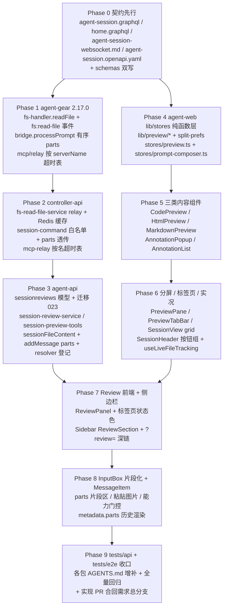

# 新版会话交互与内容预览 - 实现计划

**关联 Proposal**: `docs/engineering/proposals/20261105-feat-session-interaction-content-preview.md`（v1.0）
**关联 PRD**: `docs/product/draft/20261105-session-interaction-content-preview.md`（v1.0）
**需求总分支（feat-branch）**: `prd/session-interaction-content-preview`（需求总 PR [#467](https://github.com/Deliay/z-agent-gear/pull/467)，上游 Issue [#461](https://github.com/Deliay/z-agent-gear/issues/461)）
**实现分支**: `impl/session-interaction-content-preview`（基于需求总分支切出，参考 z-git 与仓库 `prd/<slug>` + `impl/<slug>` 惯例）
**创建日期**: 2026-11-05
**计划版本**: v1.0

**版本说明**：

- v1.0 首版：把提案 §5.2 的 12 个实现点拆成 Phase 0~9；给出「代码探查关键事实」22 条、「上游文档 × 代码现状差异」8 条、「计划期裁决」18 条，收敛提案留白但会阻塞实现的口径（zustand 并不存在、迁移 022 双占用、`express.json()` 默认 100kb 与图片片段冲突、monaco 版本号、store 隔离形态等）。
- **不改变 PRD 产品口径**；技术实现以提案 v1.0 + 本计划裁决为准。

**上游评审结论**：需求总 PR #467 当前无未处理的 `CHANGES_REQUESTED`；本计划按 PRD v1.0 + 提案 v1.0 推进。PRD 与提案本期保持原目录（draft/proposals），验收后按既有流程归档。

## 实现顺序



依赖说明：

- **契约先行（Phase 0）**：双写口径是所有后端与前端工作的共同输入；前端纯函数层（Phase 4）只依赖契约类型，可与 Phase 1~3 并行。
- **后端自底向上（Phase 1→2→3）**：`fs:read-file` 与 `mcp:request` 按名超时均为跨服务协议，按 agent-gear → controller-api → agent-api 的顺序实现，每一层 TDD 先红后绿；协议变更必须两端测试对齐（controller-api AGENTS.md「跨服务协议必须有双向集成测试」教训）。
- **前端自纯函数向组件（Phase 4→5→6）**：`lib/preview/*` 与 `reduceTabs` 为 100% 单测的纯函数，先行落地；组件层只消费 seam（`monaco-loader`）与 store。
- **Review 闭环（Phase 7）**同时依赖 Phase 3（SessionReview 领域/SSE/MCP）与 Phase 5/6（组件与标签页）。
- **InputBox（Phase 8）**依赖 Phase 0 契约与 Phase 3 `sendSessionMessage.parts`；`prompt-composer` 在 Phase 4 已就位。
- Phase 9 在实现分支合并回需求总分支后收口（不直推 `main`）。

开发模式采用 TDD（红-绿-重构）。编码前加载 `docs/engineering/common-rules.md`、`backend-rules.md`、`frontend-rules.md` 及各子项目 `AGENTS.md`；`tests/api` / `tests/e2e` 变更遵循各自 AGENTS.md（只用 Aspire 编排，禁止裸 docker，串行执行）。

### 关键约束（提案 §1.3/§6，实现期不得回退）

- **契约双写**：`contracts/agent-session.graphql` ↔ `servers/agent-api/src/graphql/schemas/session.ts`、`contracts/home.graphql` ↔ `schemas/home.ts` 必须一致（手写 schema，漏改即运行时 `Cannot query field`）；新增 Query/Mutation/类型级 resolver 必须登记 `graphql/resolvers/index.ts`（backend-rules 陷阱）。
- **不做**：LSP 接入、Monaco 各语言 worker、音频/视频片段、跨工作区评审、Review 结果落 GitHub PR、会话消息存储结构变更（`user_message_chunk` 形态不变，仅 `metadata` 扩展）、MCP 默认 60s 超时的整体治理。
- **不引入 zustand**：提案 §2.2 误把 Zustand 列为现状依赖（见 D1）；新 store 一律沿用现有 `useSyncExternalStore` 手写模式。
- **多租户**：`sessionreviews` 声明 `tenantId` 并 `applyTenantScope(schema)`，注册 `models/tenant-isolation.test.ts` 矩阵；查询经 `actorFilter(userId)`，禁止显式写 `userId`（多租户二期口径）。
- **单实例前提**：Review 等待器为进程内 `Map`，与 `KeyedMutex` / 中断重试调度器同前提，注释固化。
- **frontend-rules**：容器 `min-w-0` 溢出三件套、Apollo `loading && !data`、动态 import 懒加载（monaco 对齐 MermaidBlock 先例）、`src/lib/logger.ts` 为唯一 console 出口。
- **旧版本优雅降级**：agent-gear <2.17.0 忽略 `parts`（退化为合并文本）、Review 60s 后 504；**不提升** cloud-controller harness 门禁与 `MIN_WORKER_VERSION`。
- **禁止 rebase/squash**：遵循 z-git 规范，仅允许 merge。

## 代码探查关键事实（实现时以现状为准）

- **F1**：`apps/agent-web/src/components/session/SessionView.tsx:578` 根容器为 `flex h-full flex-col`，依次为 `SessionHeader`（:584）、`MessageList`（:629）、`InputBox`（:638）；分屏改造点在 SessionView 布局层。
- **F2**：`InputBox.tsx:19` 现有签名 `onSend: (content: string) => void`，唯一调用点为 `SessionView`；草稿键前缀 `STORAGE_PREFIX = 'session_input_'`（:39）；`:104` 发送时 `onSend(input.trim())`。
- **F3**：`servers/agent-api/src/graphql/resolvers/session.ts:283` `sendSessionMessage` 实参仅 `{sessionId, content, type}`——契约 `agent-session.graphql:453` 声明的 `attachments` **实参被丢弃**；追加 `parts` 走同一透传路径。
- **F4**：`services/session.ts` `addMessage`（:1011 区域）签名 `{direction, type, content, metadata?: string}`；`content` 为 string 时尝试 `JSON.parse`，失败回退 `{sessionUpdate:'user_message_chunk', content:{type:'text',text}}`；首条 input 消息提取标题（≤50 字符）；`metadata` 已落库。
- **F5**：云工具装配在 `services/session.ts:369-373`——仅 `controller.type === 'cloud'` 才 `ensureCloudHostToolsServer` 并入；「全部已启用」候选排除为 `name: {$ne: CLOUD_HOST_TOOLS_SERVER_NAME}`（session.ts:355）；`services/controller.ts` 默认 MCP 校验同 `$ne` 口径 + `MCP_SERVER_NOT_SELECTABLE` 专用错误（:135 区域）。
- **F6**：`services/mcp-dispatch.ts` platform 直发分支按 `serverName` 链式分发（`ADMIN_PLATFORM_SERVER_NAME` → `PLATFORM_SERVER_NAME` → `CLOUD_HOST_TOOLS_SERVER_NAME` → 其余 `Unsupported platform server`），并经 `workspaceService.buildSessionWorkspaceContext` + `runWithWorkspace` 建立租户上下文。
- **F7**：`services/cloud-host-tools.ts` `ensureCloudHostToolsServer(userId)` 为幂等 upsert（`findOneAndUpdate + $setOnInsert`，`transport/source='platform'`，工具清单仅 name/description）。
- **F8**：MCP 转发超时两侧均为 `REQUEST_TIMEOUT_MS = 60_000`：`packages/agent-controller/src/mcp/relay.ts:28`、`servers/controller-api/src/services/mcp-relay.ts:12`；超时分别回 503/504。
- **F9**：agent-gear `src/fs-handler.ts` 为白名单模型（`registerAllowedPath` / `unregisterAllowedPath` / `removeDir`）；`socketio-client.ts` 在 `acp:start`（:805）与进程注册表回放（:476）处注册会话 cwd；`fs:remove-dir` 事件在 :1530，`fs:mkdir` 在 :1489——`fs:read-file` 复用同一白名单助手。
- **F10**：controller-api `services/fs-mkdir-service.ts` 为 relay 标准形态：`handleX(requestId, controllerId, ...)` 查 Controller → `sessionService.getSocketId(keyId)` → `socket.emit`（带 `withTraceMeta`）；结果写 Redis `fs:mkdir:{requestId}`（`EX 30`）。
- **F11**：controller-api `services/session-command.ts:156` 已有 `fs:browse` 白名单分发分支（`command.type === 'fs:browse' && requestId && controllerId`）；`fs:read-file` 同型追加。
- **F12**：用户级 SSE 出口为 `services/session-sse.ts` `sessionSSEService.pushToUser(userId, {type, data})`（`harness_login_required` 先例，`harness-login-subscriber.ts:122`）。
- **F13**：`services/workflow/orchestrator.ts:455` 区域 `ensureWorkflowToolsServer(userId)` 幂等 upsert 工作流工具并经 `session.create` 建节点会话——`sessionService.create` 是覆盖普通 + 云 + 节点会话的统一装配点。
- **F14**：`services/session.ts` 提供 `onSessionStatus(callback)`（:119，返回注销函数）与 `notifySessionStatus`（:127）通用通道；`cancelBySession` 经此接入 `close` / `ended`（对齐中断重试接法）。
- **F15**：`mergeToolCallMessages` 位于 `apps/agent-web/src/components/session/tool-call-state.ts:9`（**非 `lib/`**），`MergedToolCall` 含 `kind` / `locations?: ToolCallLocation[]` / `content?: ToolCallContent[]`；`MessageList.tsx:246` 在分组 memo 后统一合并；`kind === 'edit'` 已有标签（:34 区域）。
- **F16**：`apps/agent-web/src/lib/diff.ts` 导出 `computeDiff(oldText, newText): DiffLine[]`（:45），`DiffLine` 带新旧行号；`MAX_DIFF_LINES = 2000`；CRLF/CR→LF 先归一。
- **F17**：agent-api 迁移编号现状：`022-session-archive-indexes` 与 `022-cloud-storage-fork` **双占用**（`src/index.ts:47-48, 205-206` 注册）；`023` 空闲。runner 按 `admin_migrations` 同型记账、幂等「先建后用」。
- **F18**：agent-gear 当前版本 `2.16.0`（`packages/agent-controller/package.json:3`）；`acp/bridge.ts` `sendInput/processPrompt`（:714-760）现状：`attachments` 逐项 push 后追加 `{type:'text', text: content}`，队列在 `activePrompt` 期间缓存。
- **F19**：agent-web **无 zustand 依赖**；`src/stores/`（auth/workspace/elicitationDialog/harnessLoginDialog/homeOverview）均为 `useSyncExternalStore` 手写 store（范例 `stores/workspace.ts`）。
- **F20**：`agentCapabilities.promptCapabilities.image` 经 `hooks/useAgentCapabilities.ts` 以 feature id `prompt.image` 门控（测试先例 `useAgentCapabilities.test.ts:37`）；GraphQL `queries.ts:162` 已查询 `promptCapabilities`。
- **F21**：`contracts/agent-session.openapi.yaml` 存在，是用户级 SSE 事件的契约落点（`harness_login_required` 已在其中）。
- **F22**：agent-api `src/index.ts:81` 为裸 `app.use(express.json())`——默认 body 上限 100kb；图片片段（合计 ≤10MB，base64 ≈13.4MB）必须提升该 limit（webhook/事件回调路由在 :78-81 之前挂载、读原始报文验签，不受影响）。

## 上游文档 × 代码现状差异

| # | 上游表述 | 代码现状（证据） | 本计划处置 |
|---|----------|------------------|------------|
| D1 | 提案 §2.2 技术栈：「Zustand / 现有」 | agent-web 无 zustand 依赖；stores 为 `useSyncExternalStore` 手写（F19） | 不引入 zustand；新 store 沿用现有手写模式（裁决 1） |
| D2 | 提案 §5.2 实现点 7 引用 `group-messages.ts` / `tool-call-state.ts` | 两者位于 `components/session/`（F15），不在 `lib/` | 实况 hook 从 `components/session/` 导入（裁决 3） |
| D3 | 提案 §3.1.2：`fs:read-file` 结果缓存 TTL 60s | `fs:mkdir` 结果缓存 TTL 30s（F10） | 按提案 60s（读取体积更大、轮询窗口 15s；裁决 4） |
| D4 | 提案 §4.1：迁移 `023-session-reviews`（接续 022） | 022 已被两条并行迁移双占用（F17） | 使用 `023-session-reviews`；实现前复核 `origin/main`，被占则顺延（裁决 2） |
| D5 | 提案 §5.2 实现点 12：发送组装 `[...parts, text]` | `onSend(content: string)` 单调用点（F2） | `onSend` 签名改为 `(parts: PromptPart[])`，SessionView 同步（裁决 6） |
| D6 | 提案 §5.2 实现点 12：图片合计 ≤10MB | `express.json()` 默认 100kb（F22） | `express.json({ limit: '20mb' })` + 服务端 parts 体积上限（裁决 8） |
| D7 | 提案 §5.2 实现点 9：preview tools 全会话装配 | 云工具仅 `controller.type==='cloud'` 装配（F5） | 装配点放 `sessionService.create` 公共路径，不依赖 controller.type（裁决 5） |
| D8 | 提案 §2.2/§6.2：monaco-editor「精确锁版本」未给版本 | npm 最新稳定 `0.57.0` | 锁 `monaco-editor@0.57.0`（无 `^`；裁决 7） |

## 计划期裁决（提案留白 / 含混处的实现口径）

1. **不引入 zustand**：`stores/preview.ts` 与 `stores/prompt-composer.ts` 采用现有 `useSyncExternalStore` 手写 store 模式（参考 `stores/workspace.ts` / `stores/homeOverview.ts`）。按 sessionId 隔离形态：模块级 `Map<sessionId, StoreApi>` 工厂 `usePreviewStore(sessionId)` / `usePromptComposer(sessionId)`，`SessionView` 卸载时 `destroy(sessionId)` 清理防泄漏。
2. **迁移编号**：`023-session-reviews`（幂等建索引，`{userId,status,createdAt:-1}` + `{sessionId,status}`）。实现启动前复核 `servers/agent-api/src/migrations/` 与 `origin/main`；若 023 被并行需求占用，按下一个空闲编号顺延并同步文件名、`name`、`index.ts` 注册与全部测试引用，禁止改写已合入迁移。
3. **实况数据源**：`hooks/useLiveFileTracking.ts` 必须从 `components/session/group-messages.ts` + `components/session/tool-call-state.ts` 的 `mergeToolCallMessages` 复用合并口径（F15），禁止另写解析；首个差异行用 `lib/diff.ts` 的 `computeDiff`（F16）。
4. **fs:read-file 缓存**：Redis key `fs:read-file:{requestId}`，TTL 60s；agent-api 轮询 500ms × 30（约 15s），超时文案 `Controller offline or file read timeout`。
5. **preview tools 装配**：`sessionService.create` 公共路径追加 `ensureSessionPreviewToolsServer(userId)` 并入去重（普通/云/节点会话全覆盖，与 controller.type 无关）；`session.ts` 与 `controller.ts` 的排除/校验口径由 `$ne: CLOUD_HOST_TOOLS_SERVER_NAME` 改为 `$nin: [CLOUD_HOST_TOOLS_SERVER_NAME, SESSION_PREVIEW_TOOLS_SERVER_NAME]`，`MCP_SERVER_NOT_SELECTABLE` 分支同改；`mcp-dispatch.ts` 增加 `SESSION_PREVIEW_TOOLS_SERVER_NAME` platform 直发分支。
6. **InputBox 接口**：`onSend(parts: PromptPart[])`；`PromptPart = {id, type:'text'|'image', text?, data?, mimeType?, name?, origin?}`。SessionView 调 `sendSessionMessage` 时 `content` 传合并文本（`\n\n` 连接非空文本片段；兼容首条标题提取与旧渲染），`parts` 透传契约参数。草稿键：文本沿用 `session_input_{id}`，片段新增 `session_input_parts_{id}`（>2MB 不持久化）。
7. **Monaco 引入**：`monaco-editor@0.57.0` 精确锁定；`lib/preview/monaco-loader.ts` 为唯一加载 seam（动态 `import()`，注册 `editor.worker?worker`，`self.MonacoEnvironment`）；Vite `manualChunks` 单列 `monaco`；仅 editor core + `basic-languages`，`wordBasedSuggestions: 'currentDocument'`；主题跟随 `vs` / `vs-dark`。
8. **请求体与文档体积**：agent-api `express.json({ limit: '20mb' })`（:81 处，webhook 路由保持其前）；服务端 `addMessage` 计算 `JSON.stringify(parts)` 体积，>12MB 抛 `BAD_USER_INPUT`（Mongo 16MB 文档上限安全余量）；前端单图片 ≤5MB、片段合计 ≤10MB、超限 toast 阻止。
9. **MCP 按名超时**：两侧新增 `SERVER_TIMEOUT_OVERRIDES = { 'agent-session-preview-tools': MCP_REVIEW_TIMEOUT_MS }`，`MCP_REVIEW_TIMEOUT_MS` 默认 `1_800_000`（env 可调）；其余 server 保持 60s；旧 agent-gear 60s 后 504 优雅降级。
10. **Review 等待器**：进程内 `Map<reviewId, {resolve, timer}>`，`timer.unref()`；30min 到点自行 CAS `PENDING→CANCELLED(timeout)` 并按 `cancelled/timeout` 唤醒；服务注释固化单实例前提（对齐 `KeyedMutex` 注释口径）。
11. **SessionReview 模型**：`tenantId` 声明 + `applyTenantScope`；注册 `models/tenant-isolation.test.ts` 集合矩阵；无唯一索引；查询一律 `actorFilter(userId)`。
12. **sessionFileContent 守卫**：resolver 侧 `path.resolve(session.worktreePath ?? session.cwd, path)` 归一后必须以会话根为前缀，否则 `BAD_USER_INPUT`；controller 侧 fs-handler 白名单双保险；只读会话**允许**读取；错误文案白名单（`file too large` / `binary file` / `not found` / `permission denied` / `Controller offline or file read timeout`）。
13. **Review 深链**：`SessionView` 读 `searchParams.review` → `openReview(id)`；当前为 `chat` 时按宽度临时切 `horizontal`/`vertical`（不写偏好），关闭最后一个 Review 标签后回退；消费后 `setSearchParams` 清参防重复打开。
14. **图片能力门控**：`session.promptCapabilities.image === false`（`useAgentCapabilities` 的 `prompt.image` 语义，仅「有快照且明确 unsupported」才拦截）时隐藏图片添加入口，发送前把既有图片片段降级为占位文本 `[图片 name]`。
15. **agent-gear 版本**：`2.16.0 → 2.17.0`；**不提升** cloud-controller `HARNESS_MIN_AGENT_GEAR_VERSION` / `MIN_WORKER_VERSION`（旧 worker 忽略 `parts` 与不放宽超时，功能降级可用）；worker 镜像跟随常规发布节奏。
16. **历史消息渲染**：`MessageItem` 用户消息在 `metadata.parts` 存在时追加渲染图片缩略（点击放大）与片段分隔；`content.text` 现状渲染不变；`group-messages.ts` 零改动。
17. **测试落点**：`tests/api/src/agent-api/session-review.test.ts`（Review 生命周期）与 `session-content-preview.test.ts`（parts / fileContent / home 聚合）；`tests/e2e/src/session-preview.spec.ts`（分屏/实况/批注回传/Review 闭环/溢出断言）；遵循各自 AGENTS.md（Aspire 编排、串行、`INTERNAL_API_TOKEN` 开户）。
18. **文档范围**：本节点只提交本计划与 `docs/engineering/AGENTS.md` 计划索引；各子项目 AGENTS.md 增补（agent-web 预览子系统、agent-api SessionReview、controller-api fs:read-file、agent-gear 2.17.0 口径）随对应 Phase 的实现提交；PRD/提案保持原目录，验收后按既有流程归档。

---

## Phase 0: 契约先行（contracts × 4 + schemas 双写）

开发分支：`impl/session-interaction-content-preview`。契约评审先于代码。

### 文件修改

| 文件 | 操作 | 说明 |
|------|------|------|
| `contracts/agent-session.graphql` | 修改 | `PromptPartType{text,image}` / `PromptPartInput`；`sendSessionMessage` 追加 `parts: [PromptPartInput!]`；`SessionReviewStatus`（PENDING/APPROVED/REJECTED/COMMENTED/CANCELLED）/ `SessionReviewAction{approve,reject,comment}` / `SessionReview` / `SessionFileContent` / `SubmitSessionReviewInput`；`Query.sessionReview/sessionReviews/sessionFileContent`、`Mutation.submitSessionReview`（提案 §3.1.1 全文） |
| `contracts/home.graphql` | 修改 | `HomeOverview.sessionReviews: [SessionReview!]!`（PENDING 在前，终态按 resolvedAt 倒序，上限 20，单分支失败降级 `[]`） |
| `contracts/agent-session-websocket.md` | 修改 | §2.6 `acp:message` 增加可选 `parts: AcpPromptPart[]`（`{type:'text',text}` / `{type:'image',data,mimeType}`，`content` 保留合并文本兼容）；§2.12.1 增补按 serverName 放宽注记；§3 新增 `fs:read-file` / `fs:read-file:result` 事件表与约束（白名单同 §3.18、`maxBytes` 缺省 512KiB/硬上限 2MiB、前 8KiB NUL 判二进制、Redis 缓存 TTL 60s） |
| `contracts/agent-session.openapi.yaml` | 修改 | 用户级 SSE 新增 `session_review_requested` / `session_review_updated`（数据 `{review: SessionReview}`） |
| `servers/agent-api/src/graphql/schemas/session.ts` | 修改 | 与 `agent-session.graphql` 双写（手写 schema 串） |
| `servers/agent-api/src/graphql/schemas/home.ts` | 修改 | 与 `home.graphql` 双写 |

### 验收 checklist

- [ ] 四处契约与两份手写 schema 双写一致；`pnpm run build`（agent-api）通过
- [ ] `sendSessionMessage` 既有参数（`content/type/attachments`）形态不变，`parts` 为可选追加
- [ ] 音频/视频未进入 `PromptPartType`（类型预留不开放）

---

## Phase 1: agent-gear 2.17.0（fs:read-file handler + bridge 有序块 + mcp 按名超时）

TDD 顺序：每文件先写失败测试（RED）→ 实现（GREEN）→ 重构。

### 文件修改

| 文件 | 操作 | 说明 |
|------|------|------|
| `packages/agent-controller/src/fs-handler.ts` | 修改 | 新增 `readFile(path, maxBytes?)`：白名单校验复用 `registerAllowedPath` 集合（`path.resolve` + 前缀校验 + `realpath` 防符号链接逃逸）；`createReadStream` 限量读（默认 512KiB、硬上限 2MiB 钳制）；首 8KiB NUL 检测判二进制；产出 `{success, content, truncated, sizeBytes}` 或 `{success:false, error}`（文案白名单） |
| `packages/agent-controller/src/socketio-client.ts` | 修改 | 注册 `fs:read-file` 事件（对齐 :1530 `fs:remove-dir` 形态）→ `fsHandler.readFile` → emit `fs:read-file:result {requestId, ...result}` |
| `packages/agent-controller/src/acp/bridge.ts` | 修改 | `QueuedInput`/`sendInput`/`processPrompt` 扩展可选 `parts`：`parts` 非空时按序映射 `text→{type:'text',text}` / `image→{type:'image',data,mimeType}`，**保序**且不再追加 content 文本块；为空沿用旧形态 `[...attachments, {type:'text',text: content}]`（零回归） |
| `packages/agent-controller/src/mcp/relay.ts` | 修改 | `SERVER_TIMEOUT_OVERRIDES` 常量表 + 按 serverName 取超时（裁决 9）；`MCP_REVIEW_TIMEOUT_MS` 默认 1_800_000，env 可调 |
| `packages/agent-controller/package.json` | 修改 | version `2.17.0` |

### 测试用例

| # | 用例 | 预期 |
|---|------|------|
| T-RF1 | 白名单内文本文件 | `success:true`、内容一致、`truncated:false`、`sizeBytes` 正确 |
| T-RF2 | 越界路径（`..` 逃逸 / 绝对路径出域） | `success:false, error:'not found'` 口径拒绝，不读盘 |
| T-RF3 | 符号链接逃逸 | `realpath` 后前缀校验拒绝 |
| T-RF4 | 二进制（前 8KiB 含 NUL） | `success:false, error:'binary file'` |
| T-RF5 | 超 maxBytes | 截断 + `truncated:true`，`sizeBytes` 为原始大小 |
| T-RF6 | `maxBytes` 钳制 | 传 10MiB 按 2MiB 硬上限生效 |
| T-RF7 | 不存在 / 无权限 | `not found` / `permission denied` |
| T-RF8 | socketio 事件 | `fs:read-file` → `fs:read-file:result` 回包 requestId 与结果透传 |
| T-BR1 | parts 非空保序 | `[text,image,text]` 顺序与内容精确一致；不追加 content 块 |
| T-BR2 | parts 为空 | 旧形态 `[...attachments, {type:'text',text}]` 零回归 |
| T-BR3 | activePrompt 排队 | parts 报文入队后按序消费 |
| T-RLY1 | preview-tools 按名超时 | 超时常量取 1_800_000；其余 server 60s |
| T-RLY2 | env 覆盖 | `MCP_REVIEW_TIMEOUT_MS` 环境变量生效 |

### 命令参考

```bash
cd packages/agent-controller
pnpm vitest run src/fs-handler.test.ts src/socketio-client.test.ts src/acp/bridge.test.ts src/mcp/relay.test.ts
pnpm run build
```

### 验收 checklist

- [ ] T-RF1~8 / T-BR1~3 / T-RLY1~2 先红后绿全部通过；`pnpm run build` strict 通过
- [ ] `fs:read-file` 不扩张白名单（仅复用已注册 cwd/worktree 集合）
- [ ] `bridge` 无 parts 时与 2.16.0 行为逐字一致

---

## Phase 2: controller-api（fs:read-file relay + parts 透传 + mcp 按名超时）

### 文件修改

| 文件 | 操作 | 说明 |
|------|------|------|
| `servers/controller-api/src/services/fs-read-file-service.ts` | 新增 | 对齐 `fs-mkdir-service.ts` 形态（F10）：`handleReadFile(requestId, controllerId, path, maxBytes?)` → Controller 查询 → socketId → `socket.emit('fs:read-file', withTraceMeta({requestId, path, maxBytes}))`；`handleReadFileResult` 写 Redis `fs:read-file:{requestId}`（`EX 60`，裁决 4） |
| `servers/controller-api/src/services/socketio.ts` | 修改 | 注册 `fs:read-file:result` 监听 → `fsReadFileService.handleReadFileResult`（对齐 mkdir result 接法） |
| `servers/controller-api/src/services/session-command.ts` | 修改 | 白名单新增 `fs:read-file` 分支（对齐 :156 `fs:browse`）→ `handleReadFile`；`handleInputMessage` 载荷白名单追加 `parts` 并透传至 `acpSessionManager.forwardToController`（`acp:message` 携带 parts） |
| `servers/controller-api/src/services/mcp-relay.ts` | 修改 | `SERVER_TIMEOUT_OVERRIDES` 常量表 + 按 serverName 取超时（裁决 9，与 agent-gear 同常量同默认） |

### 测试用例

| # | 用例 | 预期 |
|---|------|------|
| T-FSR1 | 白名单分发 | `session:command {type:'fs:read-file'}` → emit 到正确 socket，载荷含 requestId/path/maxBytes |
| T-FSR2 | 控制器离线 | 记录 error，不写 Redis、不崩溃 |
| T-FSR3 | 结果缓存 | `fs:read-file:result` 写 Redis key 与 TTL=60 |
| T-FSR4 | 非法 command（缺 requestId/controllerId/path） | 忽略不分发 |
| T-SCMD1 | input 消息带 parts | `acp:message` 透传 parts 原文；不带 parts 旧形状不变 |
| T-MRL1 | preview-tools 按名超时 | 30min 内不 504；其余 server 60s 504 零回归 |
| T-MRL2 | env 覆盖 | 可调生效 |

### 命令参考

```bash
cd servers/controller-api
pnpm vitest run src/services/fs-read-file-service.test.ts src/services/session-command.test.ts src/services/mcp-relay.test.ts
pnpm run build
```

### 验收 checklist

- [ ] T-FSR1~4 / T-SCMD1 / T-MRL1~2 先红后绿全部通过；`pnpm run build` 通过
- [ ] 跨服务协议测试与 agent-gear 侧 fixture 对齐（`fs:read-file:result` 字段名逐字一致）

---

## Phase 3: agent-api（SessionReview 领域 + 平台 MCP + sessionFileContent + addMessage parts）

### 文件修改

| 文件 | 操作 | 说明 |
|------|------|------|
| `src/models/session-review.ts` | 新增 | `sessionreviews` 集合：`userId` / `tenantId`（`applyTenantScope`，裁决 11）/ `sessionId` / `controllerId` / `files:[{path,absPath}]` / `summary` / `status` / `fileReviews`(Mixed) / `comment` / `cancelReason` / `createdAt` / `resolvedAt` |
| `src/migrations/023-session-reviews.ts` | 新增 | 幂等建索引 `{userId,status,createdAt:-1}`、`{sessionId,status}`（裁决 2） |
| `src/models/tenant-isolation.test.ts` | 修改 | 集合矩阵注册 `sessionreviews` |
| `src/services/session-review-service.ts` | 新增 | `createForMcp`（PENDING + `session_review_requested` SSE，经 `sessionSSEService.pushToUser`）；`listByUser`（PENDING 优先、终态 resolvedAt 倒序、上限 20）；`submit`（`actorFilter` + `status:'PENDING'` CAS → 终态 + 唤醒等待器 + `session_review_updated` SSE；未命中抛 `Review not found or already resolved`）；`cancelBySession`（批量 CAS → CANCELLED；接入 `sessionService.onSessionStatus`，对齐中断重试接法）；进程内等待器（裁决 10） |
| `src/services/session-preview-tools.ts` | 新增 | `SESSION_PREVIEW_TOOLS_SERVER_NAME='agent-session-preview-tools'`；`ensureSessionPreviewToolsServer` 幂等 upsert（对齐 F7 形态）；`handleSessionPreviewToolRequest` 实现 `initialize`/`notifications/*`/`ping`/`tools/list`（唯一工具 `review`，提案 §3.2 schema）/`tools/call`（归属校验 → 文件解析 ≤50 越界剔除标注 `skipped` → `createForMcp` → `waitForResolution(reviewId, MCP_REVIEW_TIMEOUT_MS)` → 按终态组装结果 JSON / 取消 JSON） |
| `src/services/session.ts` | 修改 | `create` 公共路径装配 preview tools（裁决 5）；`$ne` → `$nin` 排除口径；`addMessage` 扩展 `{parts?}`：服务端再过滤 trim 空文本片段、全空抛 `BAD_USER_INPUT('empty prompt')`、合并文本写 `content`（首条标题提取不受影响）、`metadata=JSON.stringify({parts})`、体积 >12MB 拒绝（裁决 8）、Redis 发布载荷带 `parts` |
| `src/services/controller.ts` | 修改 | 默认 MCP 校验 `$nin`（裁决 5） |
| `src/services/mcp-dispatch.ts` | 修改 | 新增 `SESSION_PREVIEW_TOOLS_SERVER_NAME` platform 直发分支 |
| `src/graphql/resolvers/session.ts` | 修改 | `sendSessionMessage` 透传 `parts`（F3 同路径）；新增 `sessionReview` / `sessionReviews` / `sessionFileContent`（裁决 12）/ `submitSessionReview`（`wrap()` 透传文案） |
| `src/graphql/resolvers/home.ts` | 修改 | `homeOverview.sessionReviews` 薄聚合分支（`degrade` 兜底 `[]`） |
| `src/graphql/resolvers/index.ts` | 修改 | 登记新增 resolver（backend-rules 陷阱） |
| `src/index.ts` | 修改 | `express.json({ limit: '20mb' })`（裁决 8）；注册迁移 023 |

### 测试用例

| # | 用例 | 预期 |
|---|------|------|
| T-MIG-SR1~3 | 迁移幂等 | 索引存在；重复执行零变更；名称 `023-session-reviews` |
| T-SR1 | createForMcp | PENDING 文档 + SSE `session_review_requested` 载荷含 review |
| T-SR2 | submit 正常 | PENDING→APPROVED/REJECTED/COMMENTED 三态；写 fileReviews/comment/resolvedAt；唤醒等待器；SSE `session_review_updated` |
| T-SR3 | 重复提交 / 与取消竞争 | CAS 未命中抛 `Review not found or already resolved` |
| T-SR4 | 超时 | 30min 到点（fake timers）CAS→CANCELLED，`cancelReason='timeout'`，等待器按 cancelled 唤醒 |
| T-SR5 | cancelBySession | 会话 close/ended → PENDING 批量 CANCELLED(`session_closed`) |
| T-SR6 | listByUser | PENDING 在前、终态 resolvedAt 倒序、上限 20 |
| T-SR7 | 租户隔离 | 团队/个人上下文互不可见（tenant-isolation 矩阵含 sessionreviews） |
| T-SPT1 | initialize/tools/list | 唯一工具 `review`、schema 与提案一致 |
| T-SPT2 | review 归属校验 | 非本会话/非本人拒绝 `UNAVAILABLE` |
| T-SPT3 | 文件解析 | 相对→会话根 resolve；越界剔除并标注 `skipped`；去重；>50 拒绝 |
| T-SPT4 | 通过/驳回/评论回包 | `{file_reviews, comment, status:'Approve'/'Reject'/'Comment'}` |
| T-SPT5 | 取消回包 | `{cancelled:true, reason:'timeout'/'session_closed'}`（isError=false） |
| T-SPT6 | 装配 | 普通/云/节点会话 create 后 mcpServerIds 含 preview tools 且去重 |
| T-SPT7 | 排除口径 | 「全部已启用」候选与 `setControllerDefaultMcp` 校验均排除两个平台服务；选平台服务报 `MCP_SERVER_NOT_SELECTABLE` |
| T-FC1 | 正常读取 | relay 发布 `session:command fs:read-file` → 轮询命中 → `{path, content, truncated, sizeBytes}` |
| T-FC2 | 越界 | `..`/绝对路径出域 → `BAD_USER_INPUT`（不发布 command） |
| T-FC3 | 只读会话 | 允许读取 |
| T-FC4 | 非归属用户 | `Session not found` |
| T-FC5 | 超时 | 文案 `Controller offline or file read timeout` |
| T-PARTS1 | parts 过滤 | trim 空文本片段被滤；全空 `BAD_USER_INPUT('empty prompt')` |
| T-PARTS2 | 持久化 | content=合并文本（`\n\n`）；metadata.parts 全量含图片；首条标题取自合并文本 |
| T-PARTS3 | 发布 | Redis `session:message` 载荷带 parts |
| T-PARTS4 | 体积 | parts JSON >12MB 拒绝 |
| T-PARTS5 | 兼容 | 无 parts 旧调用逐字不变 |
| T-HOME1 | home 聚合 | `homeOverview.sessionReviews` 排序/上限/降级 `[]` |

### 命令参考

```bash
cd servers/agent-api
pnpm vitest run src/services/session-review-service.test.ts src/services/session-preview-tools.test.ts \
  src/services/session.test.ts src/graphql/resolvers/session.test.ts src/migrations/023-session-reviews.test.ts \
  src/models/tenant-isolation.test.ts
pnpm run build
```

### 验收 checklist

- [ ] 上表全部用例先红后绿通过；`pnpm run build` strict 通过
- [ ] resolver 全部登记 `resolvers/index.ts`（含 `SessionReview` 类型字段）
- [ ] `sessionreviews` 在 tenant-isolation 矩阵内；等待器注释含单实例前提
- [ ] 云会话 cloud tools 装配行为零回归（`$nin` 改造后 T-SPT7 覆盖）

---

## Phase 4: agent-web lib/stores 纯函数层

### 文件修改

| 文件 | 操作 | 说明 |
|------|------|------|
| `src/lib/preview/types.ts` | 新增 | `ReviewAnchor`（code/html/markdown 三型）/ `ReviewComment` / `AnnotationBatch`（提案 §3.2） |
| `src/lib/preview/html-selector.ts` | 新增 | selector 计算：`#id` → `[data-testid]` → `tag:nth-of-type(n)` 链至 body；与注入脚本同源生成 |
| `src/lib/preview/html-inject.ts` | 新增 | srcDoc 注入模板（选择脚本 + 随机令牌；`</body>` 前置或尾部追加） |
| `src/lib/preview/markdown-sourcepos.ts` | 新增 | `lineToOffset` 表与 sourcepos ↔ 源文 offset 映射；不可映射判定 |
| `src/lib/preview/annotations-to-part.ts` | 新增 | `AnnotationBatch` → 文本片段（Markdown 形态：代码带 `L12-L14`、HTML 带 selector + innerHtml ≤200 字符、Markdown 带原文引用块；总体意见收尾） |
| `src/lib/preview/prompt-parts.ts` | 新增 | parts 组装 / trim 过滤 / 图片大小上限（5MB/10MB）/ 草稿序列化（>2MB 不持久化）/ 合并文本（`\n\n`） |
| `src/lib/preview/monaco-loader.ts` | 新增 | monaco 动态加载 seam（裁决 7），测试可 mock |
| `src/lib/split-prefs.ts` | 新增 | `getSplitMode(sessionId)` / `setSplitMode`；key `session-split-mode:{sessionId}`；非法值回退 `chat` |
| `src/stores/preview.ts` | 新增 | `reduceTabs(state, action)` 纯函数 + `usePreviewStore(sessionId)` 工厂（裁决 1）：写→pinned tab 就地更新、读→单共享 preview tab 替换、review→幂等打开、关闭激活回退 |
| `src/stores/prompt-composer.ts` | 新增 | `appendPart`（origin 标注）/ `removePart` / `clear`；按 sessionId 工厂（裁决 1） |

### 测试用例（Vitest，100% 分支覆盖）

| # | 用例 |
|---|------|
| T-SEL1~6 | selector：id / data-testid / nth-of-type 深层链 / body 终止 / 无 id 回退 / 产物可 `querySelector` 复现 |
| T-SPOS1~6 | sourcepos：行内 / 跨块并集 / 代码块不可映射 / 表格边界 / 图片 / offset 换算精确 |
| T-ANN1~5 | 三来源组装 / 总体意见 / innerHtml 截断 / 空批注 / 标题行格式 |
| T-PP1~8 | 组装顺序 / trim 过滤 / 5MB 单文件 / 10MB 合计 / 草稿序列化 2MB 阈值 / 合并文本 / base64 去前缀 / 空数组 |
| T-TABS1~6 | 读→替换共享 tab / 写→常开就地更新 / 读后写并存 / 写后读并存 / 关闭激活回退 / review 幂等 |
| T-SPLIT1~4 | 读写 / 非法值回退 / 按 sessionId 隔离 / 缺省 chat |

### 命令参考

```bash
cd apps/agent-web
pnpm vitest run src/lib/preview src/lib/__tests__/split-prefs.test.ts src/stores
```

### 验收 checklist

- [ ] 全部纯函数用例先红后绿；分支覆盖 100%
- [ ] store 不引入任何新依赖（裁决 1）

---

## Phase 5: 三类内容组件（CodePreview / HtmlPreview / MarkdownPreview + 批注层）

### 文件修改

| 文件 | 操作 | 说明 |
|------|------|------|
| `src/components/session/preview/CodePreview.tsx` | 新增 | Monaco editor core（裁决 7）：行定位 `revealLineInCenter` + 高亮装饰（3s 淡出保留常驻标记）；DiffEditor（`oldText=null` 按新建）；`getLineChanges()` 首差异块聚焦；批注模式（行号区/内容区点击选行、Shift 连选、React overlay 批注编辑器、glyph margin 标记、批注列表、总体意见、「确认回传」输出 `AnnotationBatch{source:'code'}`）；`readOnly` 支持；`truncated` 顶部提示条；model 按 filePath 复用保留 viewState；容器 `min-w-0` |
| `src/components/session/preview/HtmlPreview.tsx` | 新增 | `iframe sandbox="allow-scripts"`（无 `allow-same-origin`）；`srcDoc` 注入（裁决：经 `html-inject.ts` 带令牌）；批注模式 hover 高亮 + click 采集 `{selector, innerHtml(≤4000)}`；`postMessage` 父级校验 `event.source` + `token`；多选/取消；「确认回传」`AnnotationBatch{source:'html'}`；内容变更重建 iframe |
| `src/components/session/preview/MarkdownPreview.tsx` | 新增 | 复用 `MarkdownContent` 管线；批注模式注入 `data-sourcepos`；`onMouseUp` 选区 → 源文切片（原文含标记符号）→ 高亮覆盖层；不可映射 toast「该选择无法映射到原文」；「确认回传」`AnnotationBatch{source:'markdown'}`；预览模式零开销 |
| `src/components/session/preview/AnnotationPopup.tsx` | 新增 | 批注输入弹层（确认追加 / 取消） |
| `src/components/session/preview/AnnotationList.tsx` | 新增 | 批注列表（锚点摘要 + 删除单条） |

### 测试用例（Vitest + RTL；monaco 经 seam mock，真实渲染走 E2E）

| # | 用例 |
|---|------|
| T-CP1~8 | 行定位与高亮 / diff 首块聚焦 / 选行与 Shift 连选 / 批注新增删除 / 总体意见回传 / readOnly / truncated 提示 / 主题跟随 |
| T-HTML1~6 | postMessage 令牌校验（错令牌/错 source 拒绝）/ 单选多选取消 / innerHtml 截断 / srcDoc 变更重建 / 批注回传 / sandbox 属性无 allow-same-origin |
| T-MDP1~6 | 选区映射原文 / 跨块并集 / 不可映射 toast / 高亮覆盖 / 批注回传 / 预览模式无 sourcepos 注入 |
| T-ANNP1~2 | 弹层确认取消 / 列表删除 |

### 命令参考

```bash
cd apps/agent-web
pnpm vitest run src/components/session/preview
pnpm run build   # 验证 monaco chunk 与懒加载产物
```

### 验收 checklist

- [ ] 组件用例全部通过；`pnpm run build` 产物中 monaco 为独立 chunk 且首屏不加载
- [ ] 三组件「确认回传」产物均为合法 `AnnotationBatch`（types 单测互校）
- [ ] iframe 无 `allow-same-origin`；XSS 面为零（批注文本经 React 转义渲染）

---

## Phase 6: 分屏 / 标签页 / 实况跟随

### 文件修改

| 文件 | 操作 | 说明 |
|------|------|------|
| `src/components/session/preview/PreviewPane.tsx` | 新增 | 标签栏 + 内容区容器；按 tab 渲染组件/ReviewPanel |
| `src/components/session/preview/PreviewTabBar.tsx` | 新增 | 常开/共享预览/Review 标签；Review 图标四态色（PENDING 黄 / APPROVED 绿 / REJECTED 红 / COMMENTED·CANCELLED 灰） |
| `src/components/session/SessionView.tsx` | 修改 | 根容器按模式切 CSS Grid（`chat` 单列；`horizontal` `grid-cols-[4fr_6fr]`；`vertical` `grid-rows-[3fr_7fr]`）；挂载 PreviewPane；`?review=` 深链（裁决 13）；卸载清理 store（裁决 1） |
| `src/components/session/SessionHeader.tsx` | 修改 | 布局切换按钮组（lucide `MessageSquare`/`Columns2`/`Rows2`）+「实况」开关（`Activity`，仅非 chat 渲染）；宽度门控 `useMediaQuery('(min-width: 1024px)')`：不足隐藏「左右分栏」；偏好 horizontal 但宽度不足时渲染 vertical **不改写偏好** |
| `src/hooks/useLiveFileTracking.ts` | 新增 | 消费 SessionView 消息流（F15/F16，裁决 3）；`live=true` 时：edit/diff → `openFile({pinned:true, diff, focusLine:首个 added 行})`；read + `locations[0]` → `sessionFileContent` 拉取 → 共享预览 tab；`toolCallId + 内容指纹` 去重；仅跟踪开启后到达的调用；关闭/卸载清理 |

### 测试用例

| # | 用例 |
|---|------|
| T-PANE1~4 | tab 渲染分流 / 空态 / 关闭 tab / 激活切换 |
| T-TABBAR1~4 | Review 四态色 / 常开与预览标识 / 关闭按钮 / 激活态 |
| T-HDR1~4 | 三模式切换 / 宽度门控隐藏左右入口 / 实况开关仅非 chat / 偏好持久化 |
| T-SVIEW1~4 | grid 三模式类名 / 窄视口 vertical 不改偏好 / 深链临时分屏 / 卸载清理 |
| T-LIVE1~6 | edit→pinned+diff 聚焦 / read→共享 tab+focusLine / 指纹去重 / 关闭零副作用 / 无 diff 退化拉取 / 切换会话清理 |

### 验收 checklist

- [ ] 三模式切换即时生效；分栏比例 4:6 / 3:7；布局偏好按会话记忆、互不污染
- [ ] 移动端（<1024px）无「左右分栏」入口且无横向溢出（E2E 断言）
- [ ] 实况开启后写文件自动常开 tab 并居中首差异块、读文件更新共享预览 tab

---

## Phase 7: Review 前端 + 侧边栏分区

### 文件修改

| 文件 | 操作 | 说明 |
|------|------|------|
| `src/components/session/preview/ReviewPanel.tsx` | 新增 | `sessionReview(id)`（`cache-and-network`）；左侧按目录分组的文件树（当前文件高亮 + 每文件批注计数徽标）；右侧按扩展名分流组件（`.md/.markdown`→MarkdownPreview、`.html/.htm`→HtmlPreview、其余→CodePreview），只读 + 批注模式；`sessionFileContent` 懒加载（骨架屏）；底部总体意见 textarea + 通过/驳回/仅评论三按钮 → `submitSessionReview`；成功后只读化展示结论徽标，失败 toast 可重试 |
| `src/components/sidebar/ReviewSection.tsx` | 新增 | 复刻 `ArchivedWorkflowGroup` 折叠交互：「待 Review」（PENDING，含会话标题与文件数）默认展开、「已 Review」（终态）默认折叠；数据源 `HOME_OVERVIEW.sessionReviews` + `session_review_*` SSE 触发 `refetch`；点击 `navigate('/sessions/{sessionId}?review={id}')`；空分区不渲染 |
| `src/graphql/queries.ts` / `mutations.ts` / `types.ts` | 修改 | `GET_SESSION_REVIEW` / `SUBMIT_SESSION_REVIEW` / `GET_SESSION_FILE_CONTENT` / `HOME_OVERVIEW` 追加 `sessionReviews`；SSE 客户端订阅两个 review 事件 |
| `src/components/session/preview/PreviewTabBar.tsx` | 修改 | Review tab 状态色数据源：`session_review_updated` SSE 即时刷新 + 15s 轮询兜底 |

### 测试用例

| # | 用例 |
|---|------|
| T-RVP1~8 | 文件树分组与计数 / 扩展名分流 / 懒加载骨架 / 逐文件批注聚合 / 三态提交载荷 / 成功后只读徽标 / 失败重试 / CANCELLED 展示 |
| T-RSEC1~4 | 待 Review 实时包含 PENDING / 终态默认折叠 / 点击深链跳转 / 空分区不渲染 |
| T-DLINK1~2 | `?review=` 打开对应 tab / 消费后清参不重复打开 |

### 验收 checklist

- [ ] Agent 调用 review → 会话内出现 PENDING（黄）Review 标签页 + 侧边栏待办
- [ ] 提交后标签色变绿/红/灰、侧边栏移入「已 Review」；Agent 收到结构化结果（API 测试兜底）
- [ ] `loading && !data` 口径；轮询不卸载内容

---

## Phase 8: InputBox 片段化 + 历史渲染

### 文件修改

| 文件 | 操作 | 说明 |
|------|------|------|
| `src/components/session/InputBox.tsx` | 修改 | 顶部按行片段区（文本片段首行摘要 ≤80 字符 + 来源徽标；图片缩略图 + 名称；逐行删除）；图片添加（粘贴 `clipboardData.files` / 文件选择 `accept="image/*"`；FileReader → base64 去前缀；裁决 8 上限）；发送组装 `[...parts, ...(trim(input) ? [textPart] : [])]`（裁决 6），空禁用；发送成功清空含草稿；模式/模型切换、命令建议、`Cmd/Ctrl+Enter` 零回归；图片能力门控（裁决 14） |
| `src/components/session/SessionView.tsx` | 修改 | `onSend` 新签名接线；`sendSessionMessage` variables 扩展 `parts`（content=合并文本） |
| `src/components/session/MessageItem.tsx` | 修改 | 用户消息 `metadata.parts` 存在时追加图片缩略（点击放大）与片段分隔（裁决 16） |
| `src/graphql/mutations.ts` | 修改 | `SEND_SESSION_MESSAGE` 追加 `$parts` |

### 测试用例

| # | 用例 |
|---|------|
| T-IB1~10 | 片段增删 / 粘贴图片 / 超 5MB 阻止 / 合计 10MB 阻止 / trim 空不产生片段 / 发送顺序 / 发送后清空 / 草稿恢复（>2MB 不持久化）/ 能力门控降级 `[图片 name]` / 命令建议与快捷键零回归 |
| T-MI1~3 | metadata.parts 图片缩略 / 片段分隔 / 无 parts 旧消息零回归 |

### 验收 checklist

- [ ] 批注「确认回传」→ 片段区出现带来源徽标的文本片段；发送后 Agent 收到的提示词与片段内容、顺序一致
- [ ] 历史消息中图片片段可回看；`pnpm run build` 与既有 InputBox/SessionView 测试全绿

---

## Phase 9: tests/api + tests/e2e 收口 + 文档与回归

### 文件修改

| 文件 | 操作 | 说明 |
|------|------|------|
| `tests/api/src/agent-api/session-review.test.ts` | 新增 | T-API-SR1~5：MCP tools/call 直调创建 → `sessionReviews` 可见 → `submitSessionReview` → 结果 JSON 含 `file_reviews/comment/status`；close 会话 → CANCELLED；`homeOverview.sessionReviews` 聚合 |
| `tests/api/src/agent-api/session-content-preview.test.ts` | 新增 | T-API-PARTS1~3（parts 全链：持久化形态 + 过滤 + 空拒绝）；T-API-FC1~3（`sessionFileContent` 契约含越界 400） |
| `tests/e2e/src/session-preview.spec.ts` | 新增 | E2E-SPLIT1~3（三模式切换刷新恢复 / 窄视口无左右入口且无横向溢出）；E2E-LIVE1~2（fake 写→常开 tab+diff 聚焦；fake 读→共享 tab 替换）；E2E-ANN1~2（批注回传→片段区→发送→历史片段渲染）；E2E-RV1~2（注入 PENDING → UI 批注提交 → tab 变绿 + 侧边栏折叠 + API 侧断言终态）；E2E-IB1~2（片段增删发送与草稿） |
| `apps/agent-web/AGENTS.md` | 修改 | 新增「会话内容预览子系统」小节（组件/store/实况/Review/输入片段口径） |
| `servers/agent-api/AGENTS.md` | 修改 | 新增「SessionReview 与预览工具」小节（领域/装配/等待器/守卫） |
| `servers/controller-api/AGENTS.md` | 修改 | 新增 `fs:read-file` relay 与 parts 透传口径 |
| `packages/agent-controller/AGENTS.md` | 修改 | 版本口径 2.17.0（fs:read-file / parts / 按名超时） |
| `docs/engineering/AGENTS.md` | 修改 | 计划索引已有本文件（本节点提交）；实现期无需再改 |

### 命令参考

```bash
# 全量单元与构建
cd servers/agent-api && pnpm run build && pnpm test
cd servers/controller-api && pnpm run build && pnpm test
cd packages/agent-controller && pnpm run build && pnpm test
cd apps/agent-web && pnpm run build && pnpm test

# API（Aspire 编排已启动，遵循 tests/api/AGENTS.md）
aspire start && aspire wait agent-api && aspire wait controller-api
cd tests/api && API_URL=... CONTROLLER_API_URL=... INTERNAL_API_TOKEN=... pnpm test -- src/agent-api/session-review.test.ts src/agent-api/session-content-preview.test.ts

# E2E
aspire wait agent-web
cd tests/e2e && BASE_URL=... API_URL=... pnpm exec playwright test session-preview.spec.ts
```

### 验收 checklist

- [ ] API 用例全绿；E2E 用例全绿（含溢出断言）
- [ ] 各包既有测试零回归；四份子项目 AGENTS.md 增补完成
- [ ] 实现分支 PR 合并回 `prd/session-interaction-content-preview`，需求总 PR #467 自动更新；本计划保留在需求总分支

### 发布顺序（对齐提案 §9.1）

contracts → agent-api / controller-api → agent-web → agent-gear（npm `2.17.0`）→ worker 镜像跟随常规发布节奏（不强制提升云 harness 版本门禁）。

## 风险与回滚

| 风险 | 缓解 |
|------|------|
| Monaco 体积（gzip ~900KB core）拖累首屏 | 动态 import + `manualChunks` 隔离（裁决 7）；build 产物校验 chunk 独立 |
| 迁移编号与并行需求再冲突 | 实现启动前复核 `origin/main`（裁决 2）；禁止改写已合入迁移 |
| 图片片段撑爆 Mongo 文档 / GraphQL 请求体 | 前端 5MB/10MB 上限 + 服务端 12MB 拒绝 + `express.json` 20mb（裁决 8） |
| Review 长等待占用 MCP 通道 | 仅按 serverName 放宽（裁决 9）；其余 server 60s 不变；30min 到点自动取消 |
| 工作流节点会话无人值守导致 Review 挂起 | 预期行为：30min 后 `cancelled/timeout` 回传，Agent 可继续或降级（提案 §5.2 实现点 9 风险点） |
| 实况跟随解析口径与对话渲染漂移 | 强制复用 `mergeToolCallMessages`（裁决 3），指纹去重防重复驱动 |
| HTML 预览脚本安全风险 | `sandbox="allow-scripts"` 不透明源 + postMessage 令牌校验（Phase 5 T-HTML1） |
| jsdom 无法承载 monaco 导致测试失真 | seam 层 mock + E2E 真实渲染兜底（Phase 5） |
| 跨服务协议两端不一致 | 协议变更两端同 fixture 测试（controller-api / agent-gear AGENTS.md 教训）；Phase 1→2→3 顺序保证 |
| 旧 agent-gear 收到 parts / Review 请求 | 优雅降级：parts 退化为合并文本；Review 60s 504（裁决 15） |
| 回滚 | 各 Phase 独立可回滚；契约只增不改，回滚代码后旧客户端行为不变；迁移 023 仅建索引，回滚无需反向迁移 |

## 相关文档

- 关联 PRD：`docs/product/draft/20261105-session-interaction-content-preview.md`
- 关联 Proposal：`docs/engineering/proposals/20261105-feat-session-interaction-content-preview.md`
- 对话渲染基线：`docs/engineering/plan/20261028-refactor-conversation-rendering.md`（mergeToolCallMessages / lib/diff / Markdown 管线复用来源）
- 平台 MCP 先例：`servers/agent-api/src/services/cloud-host-tools.ts`、`services/workflow/orchestrator.ts`、`services/mcp-dispatch.ts`
- relay 先例：`servers/controller-api/src/services/fs-mkdir-service.ts`、`packages/agent-controller/src/fs-handler.ts`
- 契约：`contracts/agent-session.graphql`、`contracts/agent-session-websocket.md`、`contracts/agent-session.openapi.yaml`、`contracts/home.graphql`
- 开发规范：`docs/engineering/common-rules.md`、`docs/engineering/frontend-rules.md`、`docs/engineering/backend-rules.md`、`apps/agent-web/AGENTS.md`、`servers/agent-api/AGENTS.md`、`servers/controller-api/AGENTS.md`、`packages/agent-controller/AGENTS.md`、`tests/api/AGENTS.md`、`tests/e2e/AGENTS.md`
- 需求来源：GitHub Issue [Deliay/z-agent-gear#461](https://github.com/Deliay/z-agent-gear/issues/461)

## 修订记录

### 2026-11-12：2.17.0 发布产物缺陷与门禁上移（#487）

- **现象**：npm 上 `agent-gear@2.17.0` 的 tarball 缺失 `fs:read-file`（handler、`socketio-client` 订阅）、`acp:message` 有序 `parts` 与 `agent-session-preview-tools`——即本方案 Phase 2/5 依赖的运行时能力。原因是同日两次提交都把版本写成 `2.17.0`，而 `.github/workflows/publish-agent-gear.yml` 在「该版本已存在」时静默跳过，第二次发布未真正产出新 tarball。云电脑内安装到 `2.17.0` 后 `sessionFileContent` 永远等不到 relay 结果，前端停在「加载中…」。
- **修复**：`agent-gear` 版本提升为 `2.17.1` 并重新发布；`cloud-controller` 的 `MIN_HARNESS_WORKER_VERSION` 与 `agent-api` 的 `CLOUD_HOST_AGENT_GEAR_MIN_VERSION` 同步提升到 `2.17.1`（普通容器 `MIN_WORKER_VERSION` 仍为 `2.2.0`，不破坏本地 CLI）。
- **前端行为**：`useSessionFileContent` 统一收敛为 `loading | error | ready` 三态；`PreviewPane` 失败展示 `preview-error` + `preview-retry`，`ReviewPanel` 失败展示 `review-file-error` + `review-file-retry`；「无数据且无错误」的空响应同样按失败处理，杜绝无限骨架。
- **发布顺序（硬要求）**：先确认 npm `agent-gear@2.17.1` 可安装，再让带新门禁的 `cloud-controller` / `agent-api` 上线；顺序颠倒会让容器在 `VERSION_MISMATCH` 与 `2.17.0` 重装之间循环。门禁仅在注册时校验，已在运行的云电脑需停止重建（或重启容器）才会自愈。
- **回归**：`E2E-LIVE2` 现在应答 `fs:read-file` 并断言骨架消失、无错误态、`code-preview` 可见。
- **未覆盖**：发布工作流「版本已存在即跳过」的系统性风险仍在（后续可加版本唯一性守卫，避免再次撞版本静默跳过）。
