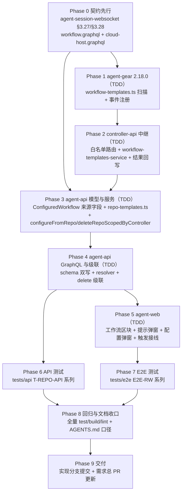

# 工作流模板项目持久化 - 实现计划

**关联 Proposal**: `docs/engineering/proposals/20261107-feat-workflow-template-project-persistence.md`（v1.0）
**关联 PRD**: `docs/product/draft/20261107-workflow-template-project-persistence.md`（v1.0）
**需求总分支（feat-branch）**: `prd/workflow-template-project-persistence`（需求总 PR [#484](https://github.com/Deliay/z-agent-gear/pull/484)，上游 Issue [#469](https://github.com/Deliay/z-agent-gear/issues/469)）
**实现分支**: `feat/workflow-template-project-persistence`（基于需求总分支）
**创建日期**: 2026-11-08
**计划版本**: v1.0

**上游评审结论**：产品文档与技术提案经「审核产品文档与技术方案」人类节点于 2026-11-07 通过（节点 DONE、无打回记录）；需求总 PR #484 当前无 review 记录与 inline comment。本计划按 PRD v1.0 / 提案 v1.0 推进。

**版本说明**：

- v1.0 首版：把提案 §5.2 的 6 个实现点拆成 10 个 Phase（契约 → agent-gear → controller-api → agent-api 服务 → agent-api GraphQL → agent-web → API 测试 → E2E → 回归收口 → 交付）；给出「代码探查关键事实」20 条、「上游文档 × 代码现状差异」4 条、「计划期裁决」16 条，收敛提案留白（扫描查询的节点图透出、工作区可见性口径、compareVersions 落点、契约章节编号、提示触发的工作区推导链等）。
- 不改变 PRD 产品口径；契约变更为纯新增（类型/查询/变更/字段），存量字段零改动；不新增数据库集合与迁移。

## 实现顺序



依赖说明：

- **P0 先行**：契约是各端实现的唯一依据（schema 手写双写、事件名/载荷/Redis 键口径），先落纸面再写代码。
- **P1 → P2**：controller-api 中继的测试 fixture 必须与 agent-gear 真实回包形态一致（AGENTS.md 教训：跨服务协议两端共用同一份 fixture）。P1 产出扫描模块的真实输出形态后再写 P2。
- **P3 依赖 P0/P2**：`repo-templates.ts` 的轮询消费依赖 P2 的 Redis 结果键口径；`configureFromRepo` 依赖 P0 的契约字段。
- **P5 依赖 P4**：前端 GraphQL 文档与类型以 P4 落地的 schema 为准。
- **P6/P7 并行于 P5 之后**：API 测试不依赖前端；E2E 依赖前端区块与弹窗。
- 开发模式采用 TDD（红-绿-重构）。编码前加载 `docs/engineering/common-rules.md`、`backend-rules.md`（后端）、`frontend-rules.md`（前端）与对应子项目 AGENTS.md。

### 关键约束（实现期不得回退）

- **扫描通道专用事件**：不复用 `fs:browse`/`fs:read-file`（fs 白名单仅在会话启动后注册，检测发生在会话前；F5/F7）。agent-gear 扫描模块独立直读 `<path>/.zag/workflow/templates/`，不挂 fs 白名单、不递归、仅 `.json`。
- **模板不落地平台**：不导入为 `WorkflowTemplate` 行，不引入平台侧缓存；仓库为唯一事实源（提案 D2）。
- **快照语义**：`configureRepoWorkflow` 不回读仓库文件二次校验（提案 D4）；客户端提交的全量节点图（含 agentConfig）经全量校验后落库。
- **级联仅 REPO 来源**：`deleteRepoScopedByController` 只删 `sourceKind:'REPO'`；PLATFORM 来源零影响（提案 D3）。
- **优雅降级返回空列表**：控制器离线/版本不足/目录不存在/扫描超时，查询一律返回 `[]`（不抛错）；前端据主机状态与版本自行提示（提案 D6）。
- **仅云电脑**：`configureRepoWorkflow` 仅允许 `type='cloud'` 控制器（提案 D7）；前端区块仅 cloud 主机渲染。
- **存量零迁移**：`sourceKind` 缺省即 PLATFORM（读取侧 `?? 'PLATFORM'` 归一）；不新增迁移、不新增索引。
- **禁止 rebase/squash**：遵循 z-git 规范，仅允许 merge。

### 代码探查关键事实（实现时以现状为准）

- **F1**：`validateTemplateGraph(nodes)` 位于 `servers/agent-api/src/services/workflow/template.ts:44`，纯函数，抛出中文可读 Error（nodeKey 唯一 / dependsOn 存在 / AI 节点 prompts 非空 / HUMAN·FLAG 不允许 prompts·artifactTitles / 仅 HUMAN 可 linkUpstreamPullRequest / DAG 无环 / 首节点唯一且 HUMAN），返回拓扑序。
- **F2**：`configured.ts` 配置链路：`configureFromContent`（:225）= `getAvailableServerTypes` → `normalizeConfiguredNodes`（private，:204）→ `validateTemplateGraph` + `validateAgentConfigs`（exported 纯函数，:102）→ `ConfiguredWorkflow.create({userId, ...currentWorkspaceFields(), ...})`；`currentWorkspaceFields()`（private，:197）从 ALS 取 `{resourceWorkspaceId, tenantId}`。`configureFromRepo` 在同类内新增，直接复用全部私有/公开方法。
- **F3**：`models/configured-workflow.ts`：挂 `applyTenantScope` + `applyWorkspaceScope({workspaceField:'resourceWorkspaceId'})`；既有索引 `{userId:1,controllerId:1}`；agentConfig 用独立子 Schema 防 Mongoose 空对象物化（文件头注释教训）。新增 `sourceKind`（String，default `'PLATFORM'`）/`sourceRepoPath`（String，default null）/`sourceWorkspaceId`（ObjectId ref ControllerWorkspace，default null）。
- **F4**：controller-api 中继形态（`fs:read-file` 先例）：`session-command.ts:190` 白名单分支（`requestId && controllerId && path` 齐备才分发）→ `fs-read-file-service.ts`（`Controller.findById` → `keyId` → `sessionService.getSocketId` → `io.sockets.sockets.get` → `socket.emit(event, withTraceMeta({...}))`；离线/查不到仅记 error 不写 Redis）；`socketio.ts:691` `onEvent(socket, 'fs:read-file:result', ...)` → 结果写 Redis `fs:read-file:{requestId}` EX 60。
- **F5**：agent-api 轮询范式（`resolvers/session.ts:21-24`）：`FILE_CONTENT_POLL_INTERVAL_MS=500` × `FILE_CONTENT_POLL_ATTEMPTS=30`（≈15s）；`publish('session:command', {type, requestId, controllerId, path})` → `redis.get('{type}:{requestId}')` 轮询；超时返回降级。
- **F6**：`cloud-host-service.ts`：`delete` 于 :739；级联先例 :766-768（`cloudHostIssuesLinkageService.deleteByController(...)` + `.catch` 仅 `logger.warn`，best-effort 不阻断）；`CLOUD_HOST_AGENT_GEAR_MIN_VERSION='2.12.0'`（:35）；`compareVersions`（:62）为模块私有函数、未导出。
- **F7**：agent-gear 事件注册形态：`socketio-client.ts:1555` `socket.on('fs:read-file', ...)` → 调 handler → `socket.emit('fs:read-file:result', { requestId, ...result })`。`fs-handler.ts` 的 `registerAllowedPath` 白名单在 acp:start/resume 的 cwd 注册（文件头注释），扫描事件不复用（见关键约束）。当前版本 `2.17.0`（`packages/agent-controller/package.json`）。
- **F8**：契约 `contracts/agent-session-websocket.md`：§3.1 事件总览表位于 :1057-1086 区；章节编号 **3.25/3.26 已被双重占用**（`git:worktree:coauthor` 对 :1443/:1467 与 `fs:read-file` 对 :1706/:1733）；新事件章节追加在 `fs:read-file:result` 服务端行为段（:1763）之后，编号 **§3.27/§3.28**，服务端行为段对齐 :1759-1763 形态。
- **F9**：`contracts/workflow.graphql`：`type Query` :333（`configuredWorkflows` :336）、`type Mutation` :345（`configureWorkflow` :352）；手写 schema 串 `servers/agent-api/src/graphql/schemas/workflow.ts` 为 `extend type Query` :294 / `extend type Mutation` :304——契约与 schema 必须双写。
- **F10**：`resolvers/workflow.ts`：`mapConfigured` :51（新字段在此透出）；`Query` :185 / `Mutation` :229；`wrap()` :175 把服务层 Error 逐字包装为 GraphQLError。新查询/变更加入既有 `workflowResolvers` 的 Query/Mutation 键，**无需新增 `resolvers/index.ts` 登记**（无类型级 resolver）。
- **F11**：`ControllerWorkspace` 模型仅挂 `applyTenantScope`（无 workspace 插件）；`controller-workspace.ts#findById`（:27）为 `{_id, userId}` 属主口径；前端 `controllerWorkspaces` resolver → `findAllByController`（`{controllerId, userId}`）。提案括注的「工作区上下文存在时跟随控制器可见集」与现状不符 → 见差异 D1 与裁决 2。
- **F12**：`ControllerConfigPage.tsx`：`activeSection` 联合类型 `'workspace'|'harness'|'mcp'|'workloads'|'github'`（:131）；tab 按钮双份渲染（移动端 :229-236、桌面 nav :276-319），`workloads`/`github` 仅 `cloudHost` 非空时渲染。新增 `'workflow'` tab（`config-tab-workflow`）需两处同步。
- **F13**：`ConfigureWorkflowDialog` props `{open, onOpenChange, initialTemplateId, editing}`；创建模式数据源为平台模板列表（`GET_WORKFLOW_TEMPLATES`），节点编辑器为 `WorkflowGraphEditor` + `template-validation.ts`（`templateNodeToEditable`/`toConfiguredNodeInput`/`validateConfiguredNodes`）。REPO 场景模板来自扫描结果而非平台模板 → 新增 `ConfigureRepoWorkflowDialog` 复用编辑器与校验，不复用该对话框本身（其模板选择与 controller 选择交互不适用于云电脑场景）。
- **F14**：`GithubSetupProgressDialog` props 含 `onFinished?: (operation) => void`（:45，终态回调）——检测提示接线点；operation 不直接携带项目工作区 id，需推导（裁决 4）。
- **F15**：`WorkspaceSection` props `{controllerId, controllerOnline?}`（:22-25）；`createWorkspace` mutation（:60）成功后 `refetch()`（:113-117）。组件被普通主机与云电脑共用 → 手工新增触发以可选回调 prop 注入（裁决 5）。
- **F16**：agent-web `graphql/workflow.ts`：`CONFIGURED_NODE_FIELDS` fragment :290、`GET_CONFIGURED_WORKFLOWS` :306、`CONFIGURE_WORKFLOW` :468、`DELETE_CONFIGURED_WORKFLOW` :490；`ConfiguredWorkflowData` 类型同文件扩展三字段。
- **F17**：`tests/api/src/agent-api/workflow.test.ts` 的 A 系列编号已占用至 A55（A35-A50 为工作流优化套件）；新用例采用独立前缀 **T-REPO-API***，新建 `tests/api/src/agent-api/repo-workflow.test.ts`，不挤压既有编号。
- **F18**：tests/api 与 tests/e2e 均有 fake controller helper（Socket.IO 直连注册、按事件应答）；两处都需扩展应答 `workflow-templates:scan`（fixture 形态与 agent-gear 真实回包一致）。
- **F19**：`contracts/cloud-host.graphql:267` `deleteCloudHost`——注释增补级联口径（REPO 来源已配置工作流随删除销毁），零字段变更。
- **F20**：agent-gear / controller-api / agent-api 单测 colocated（`src/*.test.ts`）；`fs-read-file-service.test.ts` 为中继测试形态参照；`configured.test.ts` 承载 T-CFR/T-DEL 追加用例。

## 上游文档 × 代码现状差异

| # | 上游表述 | 代码现状（证据） | 本计划处置 |
|---|----------|------------------|------------|
| D1 | 提案 §3.1 接口 1：「工作区须对当前用户可见（复用 controllerWorkspaceService 可见性口径：工作区上下文存在时跟随控制器可见集，无上下文回退 `{userId}`）」 | `findById` 为 `{_id, userId}` 属主口径（F11），`ControllerWorkspace` 不挂 workspace 插件；前端列表同属主口径 | 裁决 2：复用 `findById` 现口径（属主），与前端列表口径一致；不扩大可见性 |
| D2 | 提案 §3.1 接口 1：「版本比较复用 compareVersions 口径（cloud-host-service.ts 内部函数，抽取到公共 util 或复制最小实现，计划期定）」 | `compareVersions` 为模块私有未导出（F6） | 裁决 1：抽取为 `services/version.ts` 单一来源 |
| D3 | 提案 §3.1 接口 1 的 `RepoWorkflowTemplate` 仅含 `fileName/name/description/nodeCount/valid/errors` | 配置弹窗需以模板节点图预填编辑器（提案 §5.2 实现点 6「以模板节点预填」），客户端无节点图来源则 configureRepoWorkflow 的 `nodes` 入参无法构造 | 裁决 3：`RepoWorkflowTemplate` 追加 `nodes` 字段（契约纯新增，不改变任何决策） |
| D4 | 提案 §5.2 实现点 6：「GithubSetupProgressDialog 成功收尾（operation SUCCEEDED 且拿到工作区）后自动发起一次」 | `onFinished` 回调存在（F14），但 operation 不含项目工作区 id | 裁决 4：SUCCEEDED 后 refetch 工作区列表，按 `path === cloudHost.defaultWorkspace` 定位 |

## 计划期裁决（提案留白 / 含混处的实现口径）

1. **compareVersions 抽取**：新建 `servers/agent-api/src/services/version.ts` 导出 `compareVersions(a, b)`（实现逐字搬移）；`cloud-host-service.ts` 删除私有函数改 import（既有单测回归防漂移）；`repo-templates.ts` 的 `isRepoTemplateScanSupported` 复用同一来源。
2. **工作区可见性口径**：`repo-templates.scan` 与 `configureFromRepo` 均用 `controllerWorkspaceService.findById(workspaceId, userId)`（`{_id, userId}` 属主口径）判定可见性，不可见抛 `Workspace not found`；与前端 `controllerWorkspaces` 列表口径一致，本期不扩大到工作区成员（属主口径是多租户二期的保留例外，见 agent-api AGENTS.md）。
3. **扫描查询透出节点图**：`RepoWorkflowTemplate` 追加 `nodes: [WorkflowTemplateNode!]!`（复用既有节点类型；`valid=true` 时为解析归一后的节点图，`valid=false` 时为空数组）。契约与手写 schema 双写；`nodeCount` 保留（= `nodes.length`，供列表低成本展示）。
4. **GitHub 设置成功后的提示触发**：`GithubSetupProgressDialog` 的 `onFinished`（SUCCEEDED）接线后，先 `refetch` `GET_CONTROLLER_WORKSPACES`，取 `path === cloudHost.defaultWorkspace` 的工作区行；命中才发起 `repoWorkflowTemplates`，存在 `valid` 项即弹提示；工作区行缺失或扫描为空则不打扰（降级不弹）。新建云电脑编排（`useCloudHostProvisioning` 传 `hostId` 的四阶段形态）同路径生效——`onFinished` 统一承接，不区分入口。
5. **手工新增工作目录触发**：`WorkspaceSection` 新增可选 prop `onWorkspaceCreated?: (workspace: { id: string }) => void`，在 `createWorkspace` 成功且 `refetch` 完成后回调；仅 `ControllerConfigPage`（云电脑）传入，设置页与普通主机不传（零行为变化）。回调内发起扫描，存在合法模板即弹提示。
6. **「取消后不再自动弹」记忆**：新增 `stores/repo-workflow-prompt.ts`（模块级 `Set<workspaceId>`，会话内记忆）；「取消」或已弹过一次即加入集合，同一页面会话内不再自动弹；页面刷新后允许再次提示（与「设置区块常驻入口」互补，PRD 不禁止）。手动「重新检测」与「配置」入口不受该集合影响。
7. **MCP 管理工具集不开放 REPO 来源**：`agent-workflow-admin-tools` 的 `createConfiguredWorkflow`/`instantiateWorkflowFromContent` 等维持 PLATFORM 语义不变；REPO 创建唯一入口为 GraphQL `configureRepoWorkflow`（必有 ALS 工作区上下文，`currentWorkspaceFields()` 不缺归属）。
8. **版本判定**：`isRepoTemplateScanSupported(version)` 落 `repo-templates.ts`（`compareVersions(version, '2.18.0') >= 0`；版本缺失/非法/非字符串视为不支持）；前端 `lib/repo-workflow.ts` 镜像同规则纯函数（仅用于提示语展示，权威判定在服务端）。
9. **fileName 归一校验**：trim 后非空、必须以 `.json` 结尾、不得含 `/` / `\` / `..` / NUL；来源路径落库为 `.zag/workflow/templates/<fileName>`（拒绝后抛 `invalid template file name`）。
10. **来源字段透出归一**：`mapConfigured` 追加 `sourceKind: doc.sourceKind ?? 'PLATFORM'`、`sourceRepoPath: doc.sourceRepoPath ?? null`、`sourceWorkspaceId: toId(doc.sourceWorkspaceId)`；模型 `default: 'PLATFORM'` + 读取归一双保险，存量行零迁移。
11. **错误文案白名单**（`wrap()` 逐字透传）：`Workspace not found` / `repo workflow only supports cloud host` / `invalid template file name` / `invalid workflow name` + 图校验与 agentConfig 校验既有中文文案；其余收敛 `internal error`。
12. **超时与空结果同态**：扫描超时（15s 轮询未命中）、目录不存在、全部不合法以外的「空」均返回 `[]`，前端不区分超时与无模板；用户可手动「重新检测」。不引入超时专用提示文案（提案「计划期定稿文案」在此定稿：区块空态为「未检测到项目工作流模板」，版本不足为「升级云电脑工作组件后可检测项目模板」，非 RUNNING 为「云电脑运行中才可检测与配置」）。
13. **测试编号**：agent-gear 扫描 **T-WT***；controller-api 中继 **T-WTS***；agent-api 解析 **T-RT***、编排 **T-SCAN***、配置 **T-CFR***、级联 **T-DEL***；前端组件 **T-RW-WEB***；API **T-REPO-API***；E2E **E2E-RW***。全部使用独立前缀，不占用既有编号序列。
14. **不新增索引**：级联删除 `deleteMany({controllerId, sourceKind:'REPO'})` 走既有 `{userId:1,controllerId:1}` 索引规模（每控制器配置量级小）；如后续评审要求可补 `{controllerId:1, sourceKind:1}`（本期不建）。
15. **来源徽标展示**：`RepoWorkflowSection` 的「已配置工作流（项目）」列表条目展示 `sourceRepoPath`；设置页 `WorkflowSection` 与 `InstantiateWorkflowDialog` 的已配置工作流条目在 `sourceKind==='REPO'` 时追加「项目模板」Badge（一处条件渲染，其余零改动），满足 PRD「与平台模板配置的工作流可区分」。
16. **文档收口范围**：本节点只提交计划文档与 `docs/engineering/AGENTS.md` 索引；各子项目 AGENTS.md 的行为口径（版本 2.18.0、新事件、新查询/变更、前端区块）随实现提交（Phase 8），避免文档先于代码描述未实现行为。

---

## Phase 0: 契约先行

| 文件 | 操作 | 说明 |
|------|------|------|
| `contracts/agent-session-websocket.md` | 修改 | §3.1 事件总览表新增两行（`workflow-templates:scan` / `workflow-templates:scan:result`）；`fs:read-file:result` 段后追加 §3.27（请求：payload `requestId/path`、约束：固定子目录 `.zag/workflow/templates/`、不递归、仅 `.json`、20 文件/128KiB 单文件/1MiB 总量上限、目录不存在返回空列表）与 §3.28（结果：`requestId/success/templates[{fileName,content?,error?}]/truncated/error?`，错误白名单 `file too large`/`not found`/`permission denied`；服务端行为：写 Redis `workflow-templates:scan:{requestId}` EX 60，agent-api 轮询 500ms×30） |
| `contracts/workflow.graphql` | 修改 | 新增 `RepoWorkflowTemplate`（含裁决 3 的 `nodes: [WorkflowTemplateNode!]!`）、`ConfiguredWorkflowSourceKind` 枚举、`ConfigureRepoWorkflowInput`、`Query.repoWorkflowTemplates(workspaceId: ID!)`、`Mutation.configureRepoWorkflow(input:)`；`ConfiguredWorkflow` 扩展 `sourceKind/sourceRepoPath/sourceWorkspaceId` 三字段（注释：缺省 PLATFORM、存量零迁移） |
| `contracts/cloud-host.graphql` | 修改 | `deleteCloudHost`（:267）注释增补：级联删除该控制器项目来源（REPO）的已配置工作流（best-effort）；PLATFORM 来源与实例历史不受影响 |

验收：三处契约变更均为纯新增/注释；无字段删除或类型变更；提案 §3.1 的接口定义与契约文本逐字一致（含裁决 3 的 `nodes` 增补）。

## Phase 1: agent-gear 扫描模块（TDD）

| 文件 | 操作 | 说明 |
|------|------|------|
| `packages/agent-controller/src/workflow-templates.ts` | 新增 | 纯函数 `scanWorkflowTemplates(workspacePath)`：`resolve(workspacePath, '.zag/workflow/templates')`；`readdir(withFileTypes)`（ENOENT → `{success:true, templates:[], truncated:false}`；EACCES → `{success:false, error:'permission denied'}`）；过滤 `isFile() && name.endsWith('.json')`，`localeCompare` 排序，最多 20 个（超出 `truncated:true`）；逐文件 `readFile(utf8)`：单文件 >128KiB 标记 `error:'file too large'`（不读内容）、总量 >1MiB 停止（`truncated:true`）；符号链接按 `stat` 为常规文件才读取 |
| `packages/agent-controller/src/workflow-templates.test.ts` | 新增 | T-WT1~T-WT10（见测试矩阵；tmp 目录真实文件系统） |
| `packages/agent-controller/src/socketio-client.ts` | 修改 | 注册 `socket.on('workflow-templates:scan', ...)` → 调模块 → `socket.emit('workflow-templates:scan:result', { requestId, ...result })`；日志 `workflow_templates_scan`（不含文件内容；pino 形态，`log.info({...}, '...')`） |
| `packages/agent-controller/package.json` | 修改 | `version`: `2.17.0` → `2.18.0`（MINOR） |

验收：`pnpm run test`（T-WT 全绿）+ `pnpm run build` 通过；`fs:read-file` 等既有事件零回归。

## Phase 2: controller-api 中继（TDD）

| 文件 | 操作 | 说明 |
|------|------|------|
| `servers/controller-api/src/services/session-command.ts` | 修改 | 载荷类型补 `path` 已有（复用）；白名单新增分支：`command.type === 'workflow-templates:scan' && requestId && controllerId && path` → `workflowTemplatesService.handleScan(...)` |
| `servers/controller-api/src/services/workflow-templates-service.ts` | 新增 | 对齐 `fs-read-file-service.ts` 形态：`handleScan(requestId, controllerId, path)`（Controller → socketId → `socket.emit('workflow-templates:scan', withTraceMeta({requestId, path}))`；离线/查不到仅记 error）；`handleScanResult(requestId, result)` 写 Redis `workflow-templates:scan:{requestId}` EX 60；`result.templates` 非数组时按 `{success:false}` 兜底落键 |
| `servers/controller-api/src/services/socketio.ts` | 修改 | `onEvent(socket, 'workflow-templates:scan:result', ...)` → `handleScanResult`（`!authenticated` 忽略） |
| `servers/controller-api/src/services/workflow-templates-service.test.ts` + `session-command.test.ts` | 新增/修改 | T-WTS1~T-WTS6（分发、离线、结果写键、非数组兜底、白名单字段齐备性） |

验收：`pnpm run test` + `pnpm run build` 通过；`publishJson`/`withTraceMeta` 口径与既有事件一致（T-OBS22 巡检零新增豁免）。

## Phase 3: agent-api 模型与服务层（TDD）

| 文件 | 操作 | 说明 |
|------|------|------|
| `servers/agent-api/src/models/configured-workflow.ts` | 修改 | 新增 `sourceKind`（String，enum `['PLATFORM','REPO']`，default `'PLATFORM'`）/`sourceRepoPath`（String，default null）/`sourceWorkspaceId`（ObjectId ref `ControllerWorkspace`，default null） |
| `servers/agent-api/src/services/version.ts` | 新增 | `compareVersions` 单一来源（裁决 1；自 `cloud-host-service.ts` 逐字搬移） |
| `servers/agent-api/src/services/cloud-host-service.ts` | 修改 | 删除私有 `compareVersions`，改 import（行为零变化） |
| `servers/agent-api/src/services/workflow/repo-templates.ts` | 新增 | `repoTemplateService.scan(userId, workspaceId)`：`findById` 可见性（不可见抛 `Workspace not found`）→ `Controller.findOne({_id: workspace.controllerId, ...actorFilter(userId)})`（离线或 `!isRepoTemplateScanSupported(version)` → `[]`）→ publish `session:command`（`workflow-templates:scan`，path=workspace.path）→ 轮询 `workflow-templates:scan:{requestId}`（500ms×30）→ `success=false`/超时 → `[]`；逐文件：`error` 透传为 `errors:[error]`，否则 `parseRepoTemplate`。`parseRepoTemplate(fileName, content)` 纯函数：`JSON.parse` 失败 → `['不是合法的 JSON 文件']`；顶层形状（`name` 非空 string、`description` 可选 string、`nodes` 非空数组）与节点字段类型归一（`prompts/artifactTitles/dependsOn` 字符串数组等）→ 形状错误汇总一条中文文案；形状过后 `validateTemplateGraph`（Error.message 原样进 `errors`）。输出按 fileName 排序稳定 |
| `servers/agent-api/src/services/workflow/configured.ts` | 修改 | 新增 `configureFromRepo(userId, input)`（工作区可见性 → `controllerId` 推导 → 仅 `type='cloud'` 否则 `repo workflow only supports cloud host` → fileName 归一（裁决 9）→ `name` 归一（trim 1~64，`invalid workflow name`）→ `normalizeConfiguredNodes` → `validateTemplateGraph` + `validateAgentConfigs` → `create({..., sourceKind:'REPO', sourceRepoPath, sourceWorkspaceId})`）；新增 `deleteRepoScopedByController(controllerId): Promise<number>`（`deleteMany({controllerId, sourceKind:'REPO'})`，返回删除数） |
| `servers/agent-api/src/services/workflow/repo-templates.test.ts` / `configured.test.ts` | 新增/修改 | T-RT1~8 / T-SCAN1~6 / T-CFR1~6 / T-DEL1~3（见测试矩阵） |

验收：`pnpm run test` + `pnpm run build` 通过；`cloud-host-service` 既有单测（版本门禁/级联先例）零回归。

## Phase 4: agent-api GraphQL 与级联（TDD）

| 文件 | 操作 | 说明 |
|------|------|------|
| `servers/agent-api/src/graphql/schemas/workflow.ts` | 修改 | 双写契约：`RepoWorkflowTemplate` / `ConfiguredWorkflowSourceKind` / `ConfigureRepoWorkflowInput` / `repoWorkflowTemplates` / `configureRepoWorkflow` / `ConfiguredWorkflow` 三字段 |
| `servers/agent-api/src/graphql/resolvers/workflow.ts` | 修改 | `Query.repoWorkflowTemplates`（认证 → `repoTemplateService.scan`，`wrap()` 透传）；`Mutation.configureRepoWorkflow`（认证 → `configuredWorkflowService.configureFromRepo`，`wrap()` 透传）；`mapConfigured` 追加三字段归一透出（裁决 10） |
| `servers/agent-api/src/services/cloud-host-service.ts` | 修改 | `delete` 在 Issues 级联同位（:766 后）追加 `configuredWorkflowService.deleteRepoScopedByController(...)`，`.catch` 仅 `logger.warn`（best-effort） |
| `graphql/schemas/workflow.test.ts` / `resolvers/workflow.test.ts` / `cloud-host-service.test.ts` | 修改 | schema 契约对齐用例；resolver 委托/认证/白名单用例；级联断言（仅删 REPO、PLATFORM 保留、失败不阻断删除） |

验收：`pnpm run test` + `pnpm run build` 通过；手写 schema 与契约逐字段一致。

## Phase 5: agent-web（TDD）

| 文件 | 操作 | 说明 |
|------|------|------|
| `apps/agent-web/src/graphql/workflow.ts` | 修改 | 新增 `REPO_WORKFLOW_TEMPLATES` / `CONFIGURE_REPO_WORKFLOW` 文档与类型（`RepoWorkflowTemplateData` 等）；`CONFIGURED_NODE_FIELDS` 所在查询与 `ConfiguredWorkflowData` 扩展 `sourceKind/sourceRepoPath/sourceWorkspaceId` |
| `apps/agent-web/src/lib/repo-workflow.ts` | 新增 | `isRepoTemplateScanSupported(version)` 纯函数（裁决 8；仅提示展示用） |
| `apps/agent-web/src/stores/repo-workflow-prompt.ts` | 新增 | 会话内「不再自动弹」集合（裁决 6） |
| `apps/agent-web/src/components/cloud-host/RepoWorkflowSection.tsx` | 新增 | 云电脑「工作流」区块：工作区下拉（默认匹配 `cloudHost.defaultWorkspace`）→ `REPO_WORKFLOW_TEMPLATES`（`cache-and-network`，非 RUNNING/版本不足只读提示，文案见裁决 12）；模板列表（名称/来源文件名/节点数量；不合法项灰色 + `errors[0]`；合法项「配置」按钮）；「重新检测」= refetch；「已配置工作流（项目）」列表（`GET_CONFIGURED_WORKFLOWS` 过滤 `sourceKind==='REPO'`，展示 `sourceRepoPath`，删除复用 `DELETE_CONFIGURED_WORKFLOW`） |
| `apps/agent-web/src/components/cloud-host/RepoWorkflowPromptDialog.tsx` | 新增 | 检测提示弹窗：列出合法模板名，「去配置」（打开配置弹窗、预选第一个模板）/「取消」（关闭并记入裁决 6 集合） |
| `apps/agent-web/src/components/workflow/ConfigureRepoWorkflowDialog.tsx` | 新增 | 复用 `WorkflowGraphEditor` + `template-validation.ts`：以扫描模板 `nodes` 预填（`templateNodeToEditable`，agentConfig 空待选），名称默认模板名；提交 `CONFIGURE_REPO_WORKFLOW`（`{workspaceId, fileName, name, nodes: toConfiguredNodeInput}`）；`controllerId` 由云电脑上下文固定，不提供控制器选择 |
| `apps/agent-web/src/pages/ControllerConfigPage.tsx` | 修改 | `activeSection` 联合类型加 `'workflow'`；移动/桌面双份 tab 按钮（`config-tab-workflow`，仅 `cloudHost` 渲染）；渲染 `RepoWorkflowSection`；`WorkspaceSection` 传 `onWorkspaceCreated`（裁决 5）；`GithubSetupProgressDialog` 的 `onFinished` 接线裁决 4 |
| `apps/agent-web/src/components/settings/WorkspaceSection.tsx` | 修改 | 新增可选 prop `onWorkspaceCreated`（默认未传，零行为变化） |
| `apps/agent-web/src/components/workflow/InstantiateWorkflowDialog.tsx` / 设置页 `WorkflowSection` | 修改 | `sourceKind==='REPO'` 条目追加「项目模板」Badge（裁决 15） |
| 组件测试（`components/cloud-host/__tests__/`、`pages/__tests__/ControllerConfigPage.test.tsx` 等） | 新增/修改 | T-RW-WEB1~8（见测试矩阵） |

验收：`pnpm run test` + `pnpm run build` + `pnpm run lint` 通过（0 error）；普通主机配置页与设置页零回归。

## Phase 6: API 测试（tests/api）

| 文件 | 操作 | 说明 |
|------|------|------|
| `tests/api/src/agent-api/repo-workflow.test.ts` | 新增 | T-REPO-API1~8（见测试矩阵）；fake controller 扩展应答 `workflow-templates:scan`（fixture 与 agent-gear 真实回包同形态，注册 version `2.18.0`）；级联用例直插 STOPPED 云电脑 + REPO/PLATFORM 配置夹具（`MONGODB_URI`，缺省 skip 该分支） |
| fake controller helper | 修改 | 应答注册表新增 `workflow-templates:scan`（按 path 返回预置 fixture） |

验收：按 `tests/api/AGENTS.md` 起 Aspire 后 `pnpm test` 通过（`INTERNAL_API_TOKEN` 开户；`MONGODB_URI` 分支缺省跳过并标注）。

## Phase 7: E2E 测试（tests/e2e）

| 文件 | 操作 | 说明 |
|------|------|------|
| `tests/e2e/src/cloud-host-repo-workflow.spec.ts` | 新增 | E2E-RW1~5（见测试矩阵）；fake controller 应答 `workflow-templates:scan`（合法 + 不合法混合 fixture）；云电脑夹具直写 Mongo（`MONGODB_URI`，缺省整套 skip 并标注） |
| tests/e2e fake controller helper | 修改 | 同 Phase 6 形态扩展应答 |

验收：按 `tests/e2e/AGENTS.md` 起 Aspire 后 `pnpm exec playwright test src/cloud-host-repo-workflow.spec.ts --workers=1` 通过。

## Phase 8: 回归与文档收口

| 动作 | 落点 | 验收 |
|------|------|------|
| 全量单测 | 各包 `pnpm run test` | 全绿（含既有套件零回归） |
| 构建与 lint | 各包 `pnpm run build` / agent-web `pnpm run lint` | 通过 |
| AGENTS.md 口径 | `packages/agent-controller/AGENTS.md`（版本 2.18.0 与新事件段）、`servers/controller-api/AGENTS.md`（中继段）、`servers/agent-api/AGENTS.md`（扫描编排/来源字段/级联段）、`apps/agent-web/AGENTS.md`（云电脑「工作流」区块段）、`tests/api/AGENTS.md` 与 `tests/e2e/AGENTS.md`（测试清单） | 与实现同步提交，描述与代码一致 |
| 计划索引 | `docs/engineering/AGENTS.md`「实现计划（plan/）」 | 本节点已补入 |

## Phase 9: 交付

- 实现分支 `feat/workflow-template-project-persistence`（基于需求总分支）提交全部实现；推送后需求总 PR #484 更新（实现合入需求总分支需经评审节点，遵循工作流下游节点安排）；禁止直推 `main`，禁止 rebase/squash。

## 测试矩阵

| 用例 | 层次 | 断言 | 旧实现 |
|------|------|------|--------|
| T-WT1 | agent-gear 单测 | 目录不存在 → `{success:true, templates:[], truncated:false}` | 红（模块不存在） |
| T-WT2 | agent-gear 单测 | 空目录 / 仅非 `.json` 文件 / 子目录中的 `.json` → 空列表（不递归） | 红 |
| T-WT3 | agent-gear 单测 | 多文件按 `localeCompare` 排序返回内容 | 红 |
| T-WT4 | agent-gear 单测 | 单文件 >128KiB → 该文件 `error:'file too large'`，其余正常 | 红 |
| T-WT5 | agent-gear 单测 | 文件数 >20 → 仅前 20 个且 `truncated:true` | 红 |
| T-WT6 | agent-gear 单测 | 总量 >1MiB → 停止读取且 `truncated:true` | 红 |
| T-WT7 | agent-gear 单测 | 符号链接指向目录/设备 → 跳过；指向常规 `.json` 文件 → 读取 | 红 |
| T-WT8 | agent-gear 单测 | 目录读取 EACCES → `{success:false, error:'permission denied'}` | 红 |
| T-WT9 | agent-gear 单测 | 事件注册：socket 收到 `workflow-templates:scan` → 回 `workflow-templates:scan:result` 携带 requestId 与结果 | 红 |
| T-WTS1 | controller-api 单测 | 白名单分支：字段齐备才分发（缺 requestId/controllerId/path 忽略） | 红 |
| T-WTS2 | controller-api 单测 | handleScan：Controller 不存在/离线/socket 缺失仅记 error，不写 Redis | 红 |
| T-WTS3 | controller-api 单测 | handleScanResult：写 `workflow-templates:scan:{requestId}` EX 60，payload 原样 | 红 |
| T-WTS4 | controller-api 单测 | result.templates 非数组 → 兜底 `{success:false}` 落键 | 红 |
| T-RT1 | agent-api 单测 | 合法模板 → `{name, description, nodeCount, valid:true, errors:[], nodes}` | 红 |
| T-RT2 | agent-api 单测 | 非法 JSON → `valid:false`，`errors=['不是合法的 JSON 文件']` | 红 |
| T-RT3 | agent-api 单测 | 形状错误（缺 name/nodes 空数组/字段类型错）→ 一条汇总中文文案 | 红 |
| T-RT4 | agent-api 单测 | 图校验失败（环/双首节点/AI 首节点/缺 prompts）→ Error.message 原样进 errors | 红 |
| T-RT5 | agent-api 单测 | 逐文件隔离：一个文件非法不影响其他文件结果 | 红 |
| T-SCAN1 | agent-api 单测 | 工作区不可见 → 抛 `Workspace not found` | 红 |
| T-SCAN2 | agent-api 单测 | 控制器离线 / 版本 <2.18.0 / version 缺失非法 → 返回 `[]`（不发事件） | 红 |
| T-SCAN3 | agent-api 单测 | 扫描超时（轮询未命中）/ `success:false` → 返回 `[]` | 红 |
| T-SCAN4 | agent-api 单测 | publish 载荷 `{type, requestId, controllerId, path}` 正确；结果键正确 | 红 |
| T-CFR1 | agent-api 单测 | 合法输入落库：`sourceKind='REPO'`、`sourceRepoPath='.zag/workflow/templates/<fileName>'`、`sourceWorkspaceId`、工作区/租户归属字段齐备 | 红 |
| T-CFR2 | agent-api 单测 | 校验矩阵：非 cloud 控制器 / fileName 非法（`../x.json`、`a/b.json`、非 .json）/ name 非法 → 白名单文案逐字 | 红 |
| T-CFR3 | agent-api 单测 | 图校验与 agentConfig 校验复用（缺 agentConfig / acpServerType 不可用 → 既有中文文案） | 红 |
| T-CFR4 | agent-api 单测 | 工作区不可见 → `Workspace not found` | 红 |
| T-DEL1 | agent-api 单测 | `deleteRepoScopedByController` 仅删 REPO：PLATFORM 行与同 controllerId 无关行保留；返回删除数 | 红 |
| T-DEL2 | agent-api 单测 | `cloudHostService.delete` 级联：删除后 REPO 行消失；级联抛错仅 warn 不阻断删除 | 红 |
| T-RW-WEB1 | 前端单测 | 区块三态：合法模板列表 / 不合法项灰色 + 原因 / 空态文案 | 红 |
| T-RW-WEB2 | 前端单测 | 非 RUNNING 只读提示 / 版本不足提示（`isRepoTemplateScanSupported`） | 红 |
| T-RW-WEB3 | 前端单测 | 「重新检测」触发 refetch；「配置」打开配置弹窗并以模板节点预填 | 红 |
| T-RW-WEB4 | 前端单测 | 提示弹窗：「去配置」预选首个模板打开配置弹窗；「取消」关闭且同会话不再自动弹 | 红 |
| T-RW-WEB5 | 前端单测 | `WorkspaceSection` 新增成功后回调 `onWorkspaceCreated`；未传 prop 零行为变化 | 红 |
| T-RW-WEB6 | 前端单测 | `ControllerConfigPage` cloud 主机渲染 `config-tab-workflow`（移动+桌面）；非 cloud 不渲染 | 红 |
| T-RW-WEB7 | 前端单测 | 配置弹窗提交映射：`{workspaceId, fileName, name, nodes}` 形状正确 | 红 |
| T-RW-WEB8 | 前端单测 | 已配置列表过滤 REPO 并展示 `sourceRepoPath`；来源徽标条件渲染 | 红 |
| T-REPO-API1 | API | 未认证：查询/变更均 `Not authenticated` | 红 |
| T-REPO-API2 | API | `repoWorkflowTemplates` 形状：合法/不合法/逐文件隔离；工作区不可见 `Workspace not found` | 红 |
| T-REPO-API3 | API | 控制器离线 / 版本 2.17.0 → `[]`（降级不抛错） | 红 |
| T-REPO-API4 | API | `configureRepoWorkflow` 成功：返回 `sourceKind=REPO/sourceRepoPath/sourceWorkspaceId`；`configuredWorkflows(controllerId)` 列表包含 | 红 |
| T-REPO-API5 | API | 错误白名单逐字：非 cloud / fileName 非法 / name 非法 / 图校验中文文案 | 红 |
| T-REPO-API6 | API | 存量行为：`configureWorkflow`/`configureFromContent` 路径落库 `sourceKind` 缺省，读出归一 `PLATFORM` | 绿（回归基线） |
| T-REPO-API7 | API（需 MONGODB_URI） | `deleteCloudHost` 后 REPO 配置消失、PLATFORM 保留；实例行不受影响 | 红 |
| E2E-RW1 | E2E | 云电脑配置页「工作流」tab：合法模板可见可配置；不合法项标示原因；「重新检测」刷新 | 红 |
| E2E-RW2 | E2E | 配置全流程：选模板 → 补 agentConfig → 提交 → 已配置列表出现（含来源路径）→ 可实例化 | 红 |
| E2E-RW3 | E2E | GitHub 设置成功（onFinished SUCCEEDED + 工作区命中）后检测提示弹出；「取消」后同会话不再自动弹，设置区块可再配置 | 红 |
| E2E-RW4 | E2E | 手工新增工作目录成功后同样触发提示 | 红 |
| E2E-RW5 | E2E | 零回归：无模板目录的工作区全流程无提示；普通主机配置页无「工作流」tab | 绿（回归基线） |

## 命令参考

```bash
# 单测（各包先红后绿）
cd packages/agent-controller && pnpm run test
cd servers/controller-api && pnpm run test
cd servers/agent-api && pnpm run test
cd apps/agent-web && pnpm run test

# 构建 / Lint
cd packages/agent-controller && pnpm run build
cd servers/controller-api && pnpm run build
cd servers/agent-api && pnpm run build
cd apps/agent-web && pnpm run build && pnpm run lint

# API 测试（端口以 aspire describe 为准，见 tests/api/AGENTS.md）
aspire start && aspire wait agent-api && aspire wait controller-api
cd tests/api && API_URL=<agent-api>/graphql CONTROLLER_API_URL=<controller-api> \
  INTERNAL_API_TOKEN=<token> MONGODB_URI=<mongo-uri> pnpm test src/agent-api/repo-workflow.test.ts

# E2E（见 tests/e2e/AGENTS.md）
aspire start && aspire wait agent-api && aspire wait agent-web
cd tests/e2e && BASE_URL=<agent-web> API_URL=<agent-api>/graphql CONTROLLER_API_URL=<controller-api> \
  INTERNAL_API_TOKEN=<token> MONGODB_URI=<mongo-uri> \
  pnpm exec playwright test src/cloud-host-repo-workflow.spec.ts --workers=1
```

## 验收 checklist

- [ ] 契约三处更新完成（websocket §3.27/§3.28、workflow.graphql、cloud-host.graphql 注释），与手写 schema 双写一致。
- [ ] 仓库 `.zag/workflow/templates/*.json` 经扫描后在云电脑「工作流」区块可见（名称/来源文件名/节点数量；不合法文件标示原因）。
- [ ] GitHub 项目设置成功与手工新增工作目录后自动检测并提示（可取消，取消后设置区块仍可配置）。
- [ ] 从项目模板配置的工作流落 `sourceKind=REPO` 并出现在该云电脑已配置列表，可正常实例化执行；模板文件后续变更不影响已配置快照。
- [ ] 销毁云电脑后 REPO 来源已配置工作流一并删除；PLATFORM 来源与实例历史不受影响。
- [ ] 控制器离线/版本不足/目录不存在时优雅降级（返回空列表，前端提示不打扰）。
- [ ] 未放置模板目录的项目与本地控制器行为与现状完全一致，零回归。
- [ ] 测试矩阵全绿：T-WT / T-WTS / T-RT / T-SCAN / T-CFR / T-DEL / T-RW-WEB / T-REPO-API / E2E-RW。
- [ ] agent-gear 版本 2.18.0；云电脑门禁基线不提升（2.12.0 不变）。
- [ ] 各子项目 AGENTS.md 口径随实现同步更新。

## 风险与回滚

| # | 风险 | 缓解 |
|---|------|------|
| R1 | 契约章节编号已双占用（3.25/3.26 两对），新章节编号错乱 | F8 已核实落点：追加 §3.27/§3.28 于 fs:read-file 段后；Phase 0 验收逐字核对 |
| R2 | 跨服务报文形态不一致（agent-gear 回包 vs controller-api 解析 vs agent-api 消费） | 三端共用同一 fixture 形态（AGENTS.md 教训）；T-WT9/T-WTS3/T-SCAN4 锚定字段名 |
| R3 | `compareVersions` 抽取引入行为漂移 | 逐字搬移 + cloud-host-service 既有版本门禁单测回归（裁决 1） |
| R4 | 级联误删 PLATFORM 来源配置 | `deleteMany({controllerId, sourceKind:'REPO'})` 精确条件 + T-DEL1/T-REPO-API7 双向断言 |
| R5 | 工作区可见性扩大引入越权 | 复用 `findById` 属主现口径（裁决 2），不新增可见面；T-SCAN1/T-CFR4 锁定 |
| R6 | 检测提示打扰用户（重复弹窗） | 会话内记忆集合（裁决 6）+ 仅在「存在合法模板」时弹出；E2E-RW3 断言不再自动弹 |
| R7 | 旧版本 worker 收到未知事件 | agent-api 版本预检不发事件（双保险主判定）；旧 worker 忽略未知事件优雅降级；门禁基线不提升 |
| R8 | 扫描大目录拖垮云电脑 | 20 文件/128KiB/1MiB 三重上限 + 排序确定性（T-WT4~6） |
| R9 | 前端双份 tab（移动/桌面）漏改一处 | T-RW-WEB6 双渲染断言；F12 已核实两处位置 |

**回滚**：契约与代码均为纯新增；`ConfiguredWorkflow` 新字段可空/有默认归一，存量零迁移。回滚 = revert 实现分支各 commit；已落库的 REPO 行在旧代码下读出归一为 PLATFORM 语义外的未知字段被忽略（Mongoose strict 按 schema 裁剪），无数据兼容负担。agent-gear 2.18.0 与 worker 镜像随常规发布，旧 worker 不需要回滚。
