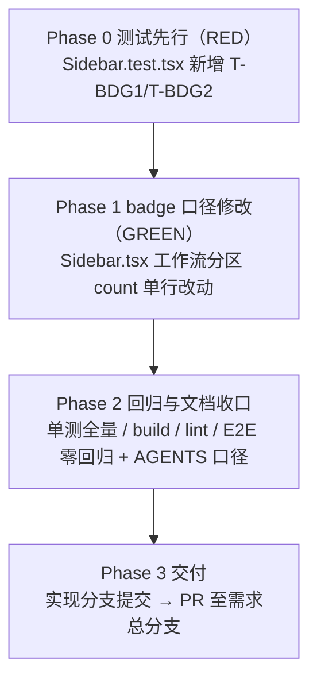

# 侧边栏数字 Badge 优化（活动数量口径） - 实现计划

**关联 Proposal**: `docs/engineering/proposals/20261107-fix-sidebar-badge-active-count.md`（v1.0）
**关联 PRD**: `docs/product/draft/20261107-sidebar-badge-active-count.md`（v1.0）
**需求总分支（feat-branch）**: `prd/sidebar-badge-active-count`（需求总 PR [#483](https://github.com/Deliay/z-agent-gear/pull/483)，上游 Issue [#462](https://github.com/Deliay/z-agent-gear/issues/462)）
**实现分支**: `feat/sidebar-badge-active-count`（提案指定，自需求总分支切出）
**创建日期**: 2026-11-08
**计划版本**: v1.0

**上游评审结论**：产品文档与技术提案经「审核产品文档与技术方案」人类节点于 2026-11-07 通过（节点 DONE、无打回记录）；需求总 PR #483 当前 OPEN、无 review 记录与 inline comment。本计划按 PRD v1.0 / 提案 v1.0 推进。

**版本说明**：

- v1.0 首版：把提案 §5.2 的 3 个实现点拆成 4 个 Phase；给出「代码探查关键事实」9 条（全部经计划期逐行核对）、「上游文档 × 代码现状差异」核对结论、「计划期裁决」6 条，收敛提案留白但会阻塞实现的口径（badge 断言的定位方式、测试落点与编号、实现分支与交付路径）。

## 实现顺序



依赖说明：

- **P0 → P1**：严格 TDD。T-BDG1/T-BDG2 必须先在旧实现上失败（RED：现状 badge = 活动+已归档总量），再改实现转绿（GREEN）；提案 §5.2 实现点 3 明确要求先以现状运行确认红。
- **P2 依赖 P0~P1**：纯前端单行改动，回归以 `apps/agent-web` 单测全量 + build/lint 为准，`tests/e2e/src/sidebar-phase4.spec.ts` 作为零回归证据执行（不新增用例）。
- **P3 依赖 P2**：实现分支 → 需求总分支（PR），不直推 `main`、不直推需求总分支。

开发模式采用 TDD（红-绿-重构）。编码前加载 `docs/engineering/common-rules.md`、`docs/engineering/frontend-rules.md`、`apps/agent-web/AGENTS.md`；本需求不触碰后端与契约，无需加载后端规范。

### 关键约束（实现期不得回退）

- **唯一行为改动点**：`apps/agent-web/src/components/Sidebar.tsx:503` 工作流分区 `count` 由 `sortedWorkflows.length + sortedArchivedWorkflows.length` 改为 `sortedWorkflows.length`，单行改动。
- **零契约 / 零后端**：不改 GraphQL 契约、不改 `HOME_OVERVIEW` 聚合查询字段、不改任何服务端代码；数据来源为既有双字段（`workflowInstances` / `archivedWorkflowInstances`）。
- **「已归档（N）」分组零改动**：`ArchivedWorkflowGroup` 的文案（全角括号「已归档（N）」）、默认折叠交互、空归档不渲染（`sortedArchivedWorkflows.length > 0` 门控）全部保持现状。
- **其余分区 badge 口径零改动**：主机 / 会话 / 网关 / 工作区 `TreeSection` 现状已符合「活动/可用」口径（提案 §5.2 实现点 2，本计划 F5 复核一致），一行都不改。
- **badge 为 0 照常显示**：不为工作流分区引入「0 时隐藏」等特殊形态（提案决策 6.1）。
- **禁止 rebase/squash**：遵循 z-git 规范，仅允许 merge。

### 代码探查关键事实（实现时以现状为准）

- **F1**：`apps/agent-web/src/components/Sidebar.tsx:503` 现状逐字符为 `count={sortedWorkflows.length + sortedArchivedWorkflows.length}}`（在「分区 2：工作流」`SidebarSection` 上，500-538 行），与提案 §1.1 引用一致。
- **F2**：`sortedWorkflows` / `sortedArchivedWorkflows` 定义于 `Sidebar.tsx:287-288`（`sortByUpdatedAtDesc` 包装）；`length` 与排序无关，改动不影响排序行为（`updatedAt` 倒序 + id tie-break 由 T-UI4-AGG3 锁定）。
- **F3**：已归档分组门控与渲染在 `Sidebar.tsx:534-536`（`sortedArchivedWorkflows.length > 0 && <ArchivedWorkflowGroup .../>`）；`ArchivedWorkflowGroup` 本体在 `Sidebar.tsx:730-753`，标题文案 `已归档（{instances.length}）`（全角括号）、`useState(false)` 默认折叠、`aria-expanded` 随开合切换。
- **F4**：`SidebarSection`（`Sidebar.tsx:90-130`）——外层 `<section data-testid={`sidebar-section-${sectionKey}`}>`；标题按钮带 `aria-label={title}`，**可访问名恒为「工作流」，badge 数字不参与 name 匹配**；badge 为标题按钮内 `<span className="shrink-0 rounded bg-muted px-1 py-0.5 text-[10px] font-normal">{count}</span>`，`count !== undefined` 即恒渲染（0 照常显示）；内容区 `data-testid={`sidebar-section-content-${sectionKey}`}`。
- **F5**：其余分区 count 现状复核——主机 `count={controllers.length}`（`Sidebar.tsx:300`）、会话 `count={sessions.length}`（`:544`，`sessions` 为活动会话，已归档由 `ArchivedSessionGroup` 承载）、网关 `count={gatewayCount}`（`:289`，仅在线主机网关行）、工作区 `TreeSection count={controllerWorkspaces.length}`（仅 `isEnabled`）；均无归档概念或已分开展示，本需求零改动。
- **F6**：测试辅助设施（`apps/agent-web/src/components/__tests__/Sidebar.test.tsx`）——`mockHome(overrides)`（`:201`，默认空数据）、`makeInstance(overrides)`（`:166`，含 `archived` 字段）、`renderSidebar()`（`:227`，渲染并额外展开「主机」分区；「工作流」分区默认展开，由 T-UI4-SEC1 锁定）。
- **F7**：既有 describe「已归档工作流实例折叠」位于 `Sidebar.test.tsx:435`（1 个用例：默认收起、展开后名称可见）；T-UI4-AGG2（`:524`）在 `sidebar-workflow-list` 内断言 `已归档（1）` 分组文本——两处均针对分组标题与列表内容，不随本次 badge 口径变化失效。
- **F8**：E2E `tests/e2e/src/sidebar-phase4.spec.ts`（E2E-UI4S1~S6）全文件无 badge 数字 / 已归档计数断言（逐字检索 0 命中），本次改动不影响其覆盖点，可作为零回归证据直接执行。
- **F9**：桌面端与移动端共用同一 `Sidebar` 组件与同一 `count` 取值（`mobile` prop 仅影响容器 className，`:292`），口径修改一处生效、两端一致（PRD §4.3）。

## 上游文档 × 代码现状差异

核对结论：**无实质差异**。提案引用的代码位置、表达式、分组形态与现状逐行一致；两处精确化记录如下。

| # | 上游表述 | 代码现状（证据） | 本计划处置 |
|---|----------|------------------|------------|
| D1 | 提案 §5.2 实现点 1 写「工作流分区（约 503 行）」 | 精确为 `Sidebar.tsx:503`（F1） | 以现状行号为准，不回改提案 |
| D2 | 提案 §5.2 实现点 3 提示风险「同一页面可能存在多个同文本数字」 | 标题按钮带 `aria-label={title}`，badge 数字不影响按钮可访问名（F4）；「已归档（N）」文本在内容区而非标题按钮内 | 以裁决 1 的「容器 + 标题按钮双层 within 限定」化解，断言与分组文本天然隔离 |

## 计划期裁决（提案留白 / 含混处的实现口径）

1. **badge 断言定位方式**：先取 `screen.getByTestId('sidebar-section-workflows')` 容器，再取标题按钮 `within(section).getByRole('button', { name: '工作流' })`（`aria-label` 保证 name 恒为「工作流」，与 badge 数字无关），最后在按钮内 `within(titleButton).getByText('1')` 精确匹配 badge `<span>`。禁止在整页或整个 section 容器内断言裸数字（内容区含「已归档（N）」等文本，且其他分区也有数字 badge）。
2. **用例落点与编号**：T-BDG1 / T-BDG2 追加到既有 describe「已归档工作流实例折叠」（`Sidebar.test.tsx:435`），复用 `mockHome` / `makeInstance` / `renderSidebar`，不新增 fixture 工厂、不改既有用例。
3. **RED 验证方式**：先写测试并以现状运行——T-BDG1（1 活动 + 1 已归档）现状 badge 为 `2`、断言 `1` 失败；T-BDG2（0 活动 + 2 已归档）现状 badge 为 `2`、断言 `0` 失败。确认两条均红后才进入 Phase 1。
4. **实现分支与交付路径**：沿用提案指定的 `feat/sidebar-badge-active-count`，自需求总分支 `prd/sidebar-badge-active-count` 切出；实现完成后向需求总分支发起 PR，不直推 `main` 或需求总分支。
5. **E2E 不新增用例**（提案 §8.1）：badge 口径由组件单测锚定；`sidebar-phase4.spec.ts` 全量执行作为零回归证据（F8）。
6. **文档收口范围**：本节点只提交本计划文档与 `docs/engineering/AGENTS.md` 的「实现计划」索引；`apps/agent-web/AGENTS.md`「UI 优化四期」段的 badge 口径说明（工作流分区 badge 仅统计活动实例，已归档计数由「已归档（N）」分组承载）随实现提交（Phase 2），避免文档先于代码描述未实现行为。

### 目标实现代码（Phase 1 基准）

```tsx
// apps/agent-web/src/components/Sidebar.tsx:503（唯一行为改动点）
// 修改前：
count={sortedWorkflows.length + sortedArchivedWorkflows.length}
// 修改后：
count={sortedWorkflows.length}
```

```tsx
// apps/agent-web/src/components/__tests__/Sidebar.test.tsx
// describe('已归档工作流实例折叠') 内追加（断言写法基准，实现期可按裁决 1 提取局部 helper）：
it('T-BDG1 活动与已归档并存时工作流分区 badge 仅显示活动数量', () => {
  mockHome({
    workflowInstances: [makeInstance({ id: 'inst-active', name: '活跃实例' })],
    archivedWorkflowInstances: [makeInstance({ id: 'inst-archived', name: '已归档实例', archived: true })],
  });

  renderSidebar();

  const section = screen.getByTestId('sidebar-section-workflows');
  const titleButton = within(section).getByRole('button', { name: '工作流' });
  expect(within(titleButton).getByText('1')).toBeInTheDocument();
  // 已归档数量仍由分区内分组承载
  expect(within(screen.getByTestId('sidebar-workflow-list')).getByText(/已归档（1）/)).toBeInTheDocument();
});

it('T-BDG2 仅已归档无活动时工作流分区 badge 显示 0', () => {
  mockHome({
    archivedWorkflowInstances: [
      makeInstance({ id: 'inst-archived-1', name: '归档实例一', archived: true }),
      makeInstance({ id: 'inst-archived-2', name: '归档实例二', archived: true }),
    ],
  });

  renderSidebar();

  const section = screen.getByTestId('sidebar-section-workflows');
  const titleButton = within(section).getByRole('button', { name: '工作流' });
  expect(within(titleButton).getByText('0')).toBeInTheDocument();
  const archiveGroup = within(screen.getByTestId('sidebar-workflow-list')).getByText(/已归档（2）/);
  expect(archiveGroup).toBeInTheDocument();
  expect(archiveGroup).toHaveAttribute('aria-expanded', 'false');
});
```

---

## Phase 0: 测试先行（RED）

| 文件 | 操作 | 用例 |
|------|------|------|
| `apps/agent-web/src/components/__tests__/Sidebar.test.tsx` | 在 describe「已归档工作流实例折叠」追加 | T-BDG1、T-BDG2 |

RED 预期：T-BDG1 现状 badge 为 `2`（断言 `1` 失败）；T-BDG2 现状 badge 为 `2`（断言 `0` 失败）。既有用例（含 T-UI4-AGG2、已归档折叠用例）保持绿。

验收：`cd apps/agent-web && pnpm run test -- src/components/__tests__/Sidebar.test.tsx` 输出恰为 T-BDG1/T-BDG2 两条失败，其余全绿。

## Phase 1: badge 口径修改（GREEN）

| 文件 | 操作 | 说明 |
|------|------|------|
| `apps/agent-web/src/components/Sidebar.tsx` | 修改（`:503` 单行） | `count={sortedWorkflows.length + sortedArchivedWorkflows.length}` → `count={sortedWorkflows.length}` |

验收：T-BDG1/T-BDG2 转绿；既有用例零回归。

## Phase 2: 回归与文档收口

| 动作 | 命令 / 落点 | 验收 |
|------|-------------|------|
| 组件单测全量 | `cd apps/agent-web && pnpm run test` | 全绿（含 T-UI4-AGG2、T-WEB2、已归档折叠等既有 Sidebar 套件） |
| 类型与构建 | `cd apps/agent-web && pnpm run build` | 通过（`tsc -b` + vite build） |
| Lint | `cd apps/agent-web && pnpm run lint` | 无新增告警/错误 |
| E2E 零回归 | `aspire start && aspire wait agent-api && aspire wait agent-web` 后按 `tests/e2e/AGENTS.md` 注入端口执行 `pnpm exec playwright test src/sidebar-phase4.spec.ts --workers=1` | E2E-UI4S1~S6 全绿（无 badge 断言，作为零回归证据） |
| 前端行为口径 | `apps/agent-web/AGENTS.md`「UI 优化四期（侧边栏与工作流视图）」段 | 补一条：工作流分区 badge 仅统计活动实例数量，已归档计数由分区内「已归档（N）」分组承载 |
| 计划索引 | `docs/engineering/AGENTS.md`「实现计划（plan/）」 | 已由本节点补入 |

## Phase 3: 交付

| 动作 | 说明 |
|------|------|
| 提交实现 | 在实现分支 `feat/sidebar-badge-active-count` 提交 Phase 0~2 全部改动 |
| 发起 PR | 实现分支 → 需求总分支 `prd/sidebar-badge-active-count`，关联上游 Issue #462 |

## 测试矩阵

| 用例 | 层次 | 断言 | 旧实现 |
|------|------|------|--------|
| T-BDG1 | 组件单测 | 1 活动 + 1 已归档：工作流分区标题按钮内 badge 文本为 `1`；「已归档（1）」分组仍渲染 | 红（badge=2） |
| T-BDG2 | 组件单测 | 0 活动 + 2 已归档：badge 文本为 `0`；「已归档（2）」分组渲染且默认折叠 | 红（badge=2） |
| 回归 | 组件单测（既有） | T-UI4-AGG2「已归档（1）」分组、已归档折叠用例、T-WEB2 会话分组计数、T-UI4-SEC/AGG 全套件 | 绿 → 绿 |
| 回归 | E2E（既有） | `sidebar-phase4.spec.ts` E2E-UI4S1~S6 | 绿 → 绿 |

## 命令参考

```bash
# 单测（先红后绿）
cd apps/agent-web && pnpm run test -- src/components/__tests__/Sidebar.test.tsx
cd apps/agent-web && pnpm run test

# 类型 / 构建 / Lint
cd apps/agent-web && pnpm run build
cd apps/agent-web && pnpm run lint

# E2E 零回归（端口以 aspire describe 为准，见 tests/e2e/AGENTS.md）
aspire start && aspire wait agent-api && aspire wait agent-web
cd tests/e2e && BASE_URL=<agent-web> API_URL=<agent-api>/graphql \
  CONTROLLER_API_URL=<controller-api> pnpm exec playwright test src/sidebar-phase4.spec.ts --workers=1
```

## 验收 checklist

- [ ] 「工作流」分区 badge = 活动工作流数量（活动 + 已归档并存场景，T-BDG1）。
- [ ] 仅已归档、无活动工作流时 badge 显示 `0`，「已归档（N）」分组正常渲染且默认折叠（T-BDG2）。
- [ ] 已归档数量仍由「已归档（N）」分组标题承载，分组的文案、默认折叠、点击展开交互零变化（既有用例 + T-BDG1/T-BDG2 辅证）。
- [ ] 其余分区（主机/会话/网关/工作区）badge 一行未改（关键约束 + `git diff` 复核）。
- [ ] T-BDG1/T-BDG2 先红后绿；`apps/agent-web` `pnpm run test` + `pnpm run build` + `pnpm run lint` 全绿。
- [ ] E2E `sidebar-phase4.spec.ts` 全绿（零回归证据）。
- [ ] 实现分支 PR 至需求总分支，无直推 `main` / 需求总分支。

## 风险与回滚

| # | 风险 | 缓解 |
|---|------|------|
| R1 | badge 断言与内容区「已归档（N）」文本或其他分区数字混淆，测试假绿/假红 | 裁决 1：容器 + 标题按钮双层 `within` 限定；按钮 `aria-label` 使 name 匹配与数字解耦（F4） |
| R2 | 误改其余分区或「已归档」分组行为 | 关键约束锁定唯一改动点；Phase 2 全量单测 + E2E-UI4S* 零回归兜底 |
| R3 | 0 显示被误判为「应隐藏 badge」而引入特殊形态 | 提案决策 6.1 已定 0 照常显示；T-BDG2 断言 `0` 可见锁死该口径 |

**回滚**：本需求为单行行为改动 + 组件测试，直接 revert 实现 commit 即可恢复；无契约变更、无数据迁移、无后端、无发布顺序依赖。
