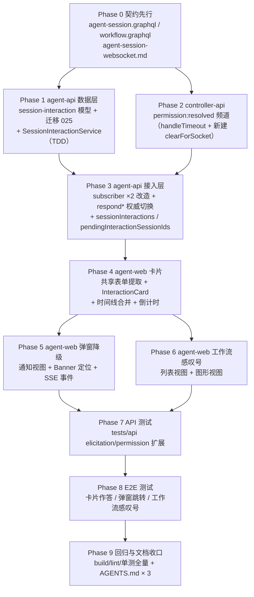

# 会话中的提问表单与权限审批作为会话内容出现 - 实现计划

**关联 Proposal**: `docs/engineering/proposals/20261112-feat-session-interaction-cards.md`（v1.0）
**关联 PRD**: `docs/product/draft/20261112-session-interaction-cards.md`（v1.0）
**需求总分支（feat-branch）**: `feat/session-interaction-cards`（需求总 PR [#491](https://github.com/Deliay/z-agent-gear/pull/491)，上游 Issue [#490](https://github.com/Deliay/z-agent-gear/issues/490)）
**实现分支**: `feat/session-interaction-cards-impl`（基于需求总分支，由实现节点创建；完成后 merge 回需求总分支，禁止 rebase/squash）
**创建日期**: 2026-11-13
**计划版本**: v1.0

**上游评审结论**：产品文档与技术提案经上游人类节点评审通过（本节点启动时上游节点 DONE、无打回记录）；需求总 PR #491 当前 OPEN、MERGEABLE、无 review 记录与 inline comment。本计划按 PRD v1.0 / 提案 v1.0 推进，计划期已对提案引用的关键代码现状逐条核实（见「代码探查关键事实」与「差异」两节）。

**版本说明**：

- v1.0 首版：把提案 §5 的 6 个实现点与 §7 项目结构拆解为 Phase 0~9；给出「代码探查关键事实」18 条、「上游文档 × 代码现状差异」6 条、「计划期裁决」14 条。重要差异：提案实现点 6 提到的 `permission-manager.clearForSocket` 在代码中**不存在**（D1），本计划按「新建并对齐 elicitation-manager 模式」安排任务。
- 不改变 PRD 产品口径；不新增/删除提案已定的契约字段；不引入新的第三方依赖。

## 实现顺序



依赖说明：

- **P0 先行（契约式开发）**：三处契约是后续所有实现的口径依据；契约只增不改（新增类型/查询/字段/频道注记），零存量字段变更。
- **P1 与 P2 可并行**：数据层（agent-api）与 permission:resolved 频道（controller-api）互不依赖；P3 同时消费两者（subscriber 订阅新频道、resolver 走新服务）。
- **P3 → P4**：前端卡片依赖 `sessionInteractions` 查询与 `session_interaction` SSE 事件的真实可用。
- **P4 → P5/P6**：弹窗降级复用 P4 提取的共享表单模块（通知视图不再用表单，但卡片与潜在回退路径共用一份表单逻辑）；工作流感叹号复用 P3 的 `pendingInteractionSessionIds`。
- **P7/P8 严格 TDD 收口**：API/E2E 用例在对应实现 Phase 内先写红，P7/P8 做全量回归与缺口补齐。
- **P9 依赖全部实现**：三处 AGENTS.md 口径更新随代码完成后提交，避免文档先于代码描述未实现行为。

开发模式采用 TDD（红-绿-重构）。编码前加载 `docs/engineering/common-rules.md`、`docs/engineering/backend-rules.md`（后端 Phase）、`docs/engineering/frontend-rules.md`（前端 Phase）与对应子项目 `AGENTS.md`。

### 关键约束（实现期不得回退）

- **状态机单调**：`PENDING → {ACCEPTED, DECLINED, CANCELLED, EXPIRED, FAILED}`，仅允许从 PENDING 迁移；所有终态写入统一走 `SessionInteractionService` 的 CAS（`{interactionId, userId, status:'PENDING'}` 前置过滤），禁止第二写入点。
- **CAS 先行于 publish**：`respondElicitation`/`respondPermission` 必须先 CAS 收敛成功再 publish response 回传 Agent（对现状「先 publish 后标记」的顺序调整，见 F3/D2），失败文案保持 `Todo item not found or already handled` 不变。
- **`interactionId` 幂等**：全局唯一索引；重复触发捕获 E11000 返回既有记录，会话中只出现一张卡片。
- **作答时限唯一口径 60s**：`sessioninteractions.expiresAt` = 事件到达 agent-api 时刻 + 60s（对齐 controller-api `TIMEOUT_MS`）；TodoItem 的 5 分钟仅为通知 TTL 窗口，不再参与作答有效性判定（`isRespondableTodo` 对 permission/elicitation 两类型在本链路废弃，harness login 仍使用，不删）。
- **租户隔离红线**：新集合声明 `tenantId` + `applyTenantScope`，并在 `models/tenant-isolation.test.ts` 与迁移 013 的 `TENANT_ID_COLLECTIONS` 双注册（F17）；订阅链路事件缺 `userId` 一律拒绝写入并告警（沿用 elicitation-subscriber 现有口径）。
- **弹窗保留**：`ElicitationDialog`/`PermissionDialog` 组件与 `stores/elicitationDialog` 互斥机制不删，仅内容降级为「通知 + 跳转会话链接」（PRD 约束）。
- **零 ACP 协议改动**：不改 agent-gear、不动事件上报/响应回传链路；历史会话不回填卡片。
- **resolver 登记**：`sessionInteractions` 查询落 `sessionResolvers.Query`、`pendingInteractionSessionIds` 落 `workflowResolvers.WorkflowInstance`——两处均已被 `resolvers/index.ts` spread（F10），在对应文件内新增即可，但必须在实现后人工核对登记链（AGENTS.md 明示陷阱）。
- **禁止 rebase/squash**：遵循 z-git 规范，仅允许 merge。

### 代码探查关键事实（实现时以现状为准）

- **F1**：`elicitation-subscriber.ts` 订阅 `elicitation:request/complete/resolved` 三频道；`handleElicitationResolved` 已有：未知 reason → `failed` + warn（:156-164）、无 `userId` 拒绝写入（:171-178）、`requestId` 缺失按 `sessionId` 会话级兜底（:180-192）。
- **F2**：`permission-subscriber.ts` 仅订阅 `permission:request` 一个频道（:37），无 resolved 订阅；`handlePermissionRequest` 仅建 TodoItem + pushToUser（:70-90）。
- **F3**：`resolvers/todo.ts` 现状顺序 = `isRespondableTodo` → `publish` → `markTodoAsResponded`（respondPermission :53-67；respondElicitation :81-96 + `markElicitationResolved` :104）。`isRespondableTodo`（todo-service.ts:263-278）：permission 仅校验归属（`{userId,'data.requestId'}`，**不查 expiresAt**）；elicitation 追加 `resolution: null`。这证实提案 §1.1 的口径不一致：controller 60s 超时后、TodoItem 5min TTL 内的提交仍会 publish 回传（必然无效）。
- **F4**：controller-api `permission-manager.ts` `TIMEOUT_MS = 60_000`（:38）；`handleTimeout`（:132-147）仅 `socket.emit('acp:permission:response', {outcome:{outcome:'cancelled'}})`，**无任何 resolved 发布**。
- **F5**：`permission-manager.ts` **没有 `clearForSocket`**；`socketio.ts` disconnect 处理（:800-802）只调用 `elicitationManager.clearForSocket` 与 `harnessLoginManager.clearForSocket`。即权限请求在控制器断连后不靠清理、由 60s 定时器自然超时回 Agent cancelled。
- **F6**：`elicitation-manager.ts` 是同构模板：`handleTimeout`（:230-261）发布 `elicitation:resolved{reason:'timeout', detail:'controller-api timeout (60s)'}` 并回 Agent cancel；`clearForSocket`（:268-274）清 timer + 删 pending；`handleElicitationResolved`（:194-228）做入站白名单校验（reason 枚举、requestId/detail ≤200 截断、sessionId ≤200）。
- **F7**：`todo-service.ts` `resolveSessionTenantId` 为 **private**（:76-86），口径 = `Session.workspaceId → Workspace.tenantId`；`createPermissionTodo`/`createElicitationTodo` 落 `expiresAt = now + 5min`（:104/:179）。
- **F8**：`session-sse.ts` `pushToUser(userId, data)`（:266）为用户级 SSE 唯一扇出口；前端 `useUserEventStream` 挂载于 `SessionView.tsx:179` 与 `MainLayout.tsx:57` 两处。
- **F9**：会话删除连带落点 `services/session.ts:1100`（`AcpMessage.deleteMany({sessionId: id})`）；导入覆盖连带落点 `services/session-import.ts:121`（同形态）。两处即 SessionInteraction 连带清理的追加位置。
- **F10**：`resolvers/index.ts`：`Query` spread 列表（:23-41）含 `sessionResolvers.Query`（:29）与 `workflowResolvers.Query`（:34）；`Session` 键 :71、`WorkflowInstance` 键 :80-81（`...workflowResolvers.WorkflowInstance`）。`schemas/workflow.ts` 为手写 schema 串（`type WorkflowInstance` :202、`extend type Query` :328），`schemas/session.ts` 同为手写（`extend type Query` :352）——契约与手写 schema 必须双写。
- **F11**：迁移最新占用 `024-resource-workspace-backfill`（含真库测试），`025` 可用，与提案一致；迁移经 `migrations/index.ts` 启动 runner 登记（幂等「先建后用」，生产 `autoIndex=false` 兜底）。
- **F12**：`MessageList.tsx`：`groups = useMemo(groupMessages(messages))`（:238）、`mergedToolCalls` memo（:241-246）、渲染 `groups.map`（:347 起）。交互卡片合并点在 `groups` memo 之后、渲染之前，不动 `group-messages`/`tool-call-state` 既有逻辑。
- **F13**：`ElicitationDialog.tsx`：`renderField` 为组件内闭包（:179），表单渲染/默认值/必答校验（`missingRequired`）/多选 join（`lib/elicitation-multi-select.ts`）均在其内；倒计时模式 = `const [now, setNow] = useState(() => Date.now())` + 剩余时长定时器（:93-102，**非快照冻结**）；终态判定 `resolution 优先，expiresAt 已过按过期`（:104-106）；url 模式 `window.open(data.url, '_blank', 'noopener,noreferrer')` + http(s) 校验（:165-173）。
- **F14**：`WorkflowInstancePage.tsx` 已把 `onOpenSession={setSideSessionId}` 透传给列表视图（:310）与图形视图（:317），`SessionSidePanel` 消费 `sideSessionId`（:359）；`WorkflowNodeTree.NodeCard` 已有 `onOpenSession` prop 与 `node.sessionId` 会话按钮（:175-179）；`WorkflowNodeCard` 的 `data` 已含 `sessionId`（:36）。
- **F15**：`useUserEventStream.ts` 事件 switch（:80-99）现有 case：`ready` / `harness_login_required` / `harness_login_resolved` / `session_review_requested` / `session_review_updated` / `heartbeat`；新增 `session_interaction` 按同形态扩展 options 回调。
- **F16**：既有测试落点：单测 `ElicitationDialog.test.tsx` / `PermissionDialog.test.tsx` / `TodoListPanel.test.tsx` / `PendingElicitationBanner.test.tsx` / `useUserEventStream.test.ts`；API `tests/api/src/agent-api/elicitation.test.ts` 与 `permission.test.ts`（含「权限请求流程 - 超时处理：60秒未响应 → controller 收到 cancelled」）；E2E `tests/e2e/src/elicitation.spec.ts`、`permission.spec.ts`（含「点击待办打开权限审批Dialog」「审批后返回结果给controller」「立即优先级待办触发全局弹窗」）、`session-capabilities.spec.ts` T-E37/T-E38/T-E39（弹窗终态断言）。
- **F17**：agent-api 租户隔离规则（AGENTS.md）：新增带 `userId` 的模型必须声明 `tenantId` 并 `applyTenantScope(schema)`，且在 `models/tenant-isolation.test.ts`（T-ISO 矩阵）与迁移 013 的 `TENANT_ID_COLLECTIONS` 注册表双注册（回填对新集合为 no-op）。
- **F18**：`PendingElicitationBanner.tsx` 当前点击打开 `ElicitationDialog`（:73 onClick）；其数据源为首页聚合 `todos` 中本会话未 resolved 的问询（会话内挂载，移动端 Sidebar 未挂载时也可达）。

## 上游文档 × 代码现状差异

| # | 上游表述 | 代码现状（证据） | 本计划处置 |
|---|----------|------------------|------------|
| D1 | 提案实现点 6：「`permission-manager.handleTimeout` 与 `clearForSocket` 增加 `permission:resolved` 发布」 | `permission-manager` **不存在 `clearForSocket`**，disconnect 也未调用它（F5） | Phase 2 新建 `clearForSocket`（对齐 elicitation-manager 模式：清 timer + 删 pending + 发布 `permission:resolved{reason:'cancelled', detail:'socket disconnected'}`），并在 `socketio.ts` disconnect 注册 |
| D2 | 提案实现点 2：「对现有顺序的调整点：现行为先 publish 再标记 todo 已读；新行为必须 CAS 先行」 | 现状确认先 publish 后标记（F3） | Phase 3 调整为「CAS 收敛成功 → publish → TodoItem 已读」，并用 spy 断言顺序的用例锁定 |
| D3 | 提案 §3.1.1：「`sessionInteractions` 归属校验复用 `sessionService.findById(sessionId, userId)` 口径（与 `sessionMessages` 一致），只读会话允许查询」 | `sessionMessages` 的归属校验实现于 `resolvers/session.ts`（提案描述的是口径而非现成函数签名） | 实现时以 `sessionMessages` resolver 的实际校验链为准（同一 service 同一口径），只读会话放行 |
| D4 | 提案实现点 5：「若图形视图当前无打开会话入口，则将实例页 `onOpenSession` 透传进 `WorkflowGraphView`」 | 透传链已存在：实例页向两视图均下发 `onOpenSession`（F14） | 图形卡片直接消费既有 prop，无需新增透传；仅在 `WorkflowNodeCard` 增加感叹号按钮与点击接线 |
| D5 | 提案 §4.1：「声明 `applyTenantScope`（与同类集合一致），显式写入（订阅链路经 `TodoService.resolveSessionTenantId` 同口径解析）」 | `resolveSessionTenantId` 当前为 private（F7） | 将其提升为 public 并由 `SessionInteractionService` 复用（裁决 2），不复制第二份口径 |
| D6 | 提案 §5.2 实现点 4：「`PendingElicitationBanner` 点击行为改为滚动定位到对应卡片」 | Banner 点击打开弹窗（F18）；卡片尚未存在 | Phase 5 改为 `scrollIntoView` 定位（卡片容器 `data-interaction-id` 锚点），弹窗不再由 Banner 打开 |

## 计划期裁决（提案留白 / 含混处的实现口径）

1. **测试编号体系**：agent-api 服务层 `T-SI*`、subscriber `T-SUB*`、resolver `T-SIR*`、迁移 `T-MIG25-*`；controller-api `T-PM*`；agent-web 卡片/表单 `T-IC*`、弹窗降级 `T-DLG*`、时间线合并 `T-TL*`、感叹号 `T-WFP*`、SSE `T-SSE*`；API `API-SI*`；E2E `E2E-SI*`。既有用例改写保留原编号并在描述中注明语义变化。
2. **tenantId 解析复用**：`todo-service.ts` 的 `resolveSessionTenantId` 由 private 改 public（签名不变），`SessionInteractionService` 创建交互时经同一方法解析；解析结果 null 时不写 `tenantId` 键（与 todo 现有 `...(tenantId ? { tenantId } : {})` 口径一致，由 `applyTenantScope` 兜底个人租户）。
3. **时间线合并算法**：在 `MessageList` 新增 memo `timelineItems`：输入 `groups`（含每组的代表 `createdAt` = 首条消息时间）与 `interactions`，输出稳定归并数组 `[{type:'group', group} | {type:'interaction', interaction}]`，按 `createdAt` 升序、**同刻消息组在前、交互在后**（tie-break 固定，防轮询跳动）；交互 key = `interactionId`。
4. **卡片倒计时**：`InteractionCard` 内卡片级 `useEffect` 定时器（复用 F13 的 `now` 模式：按剩余时长设定下次跳变，而非固定 1s 轮询空转），展示 `mm:ss`；`expiresAt` 归零本地立即禁用并展示「已过期」，服务端 `session_interaction` 终态事件到达后 refetch 覆盖为权威状态。倒计时唯一依据 = `interaction.expiresAt`。
5. **url 模式卡片**：展示链接（`splitUrl` 高亮 host，逻辑随共享模块迁出）+「打开链接」按钮；点击 = `window.open(url, '_blank', 'noopener,noreferrer')` + 调 `respondElicitation(action:'accept')`（与现弹窗 :383 分支口径一致）；`elicitation:complete` 到达后仅向 history 追加记录（`markAgentCompleted`，不改 status）。
6. **工作流实例页刷新通道**：`WorkflowInstancePage` 自挂 `useUserEventStream({ onSessionInteraction: () => refetch() })`（既有 hook 复用，不落 MainLayout），`GET_WORKFLOW_INSTANCE` 5s 轮询兜底（PRD 允许轮询级延迟）。
7. **通知弹窗视图内容**：类型徽标（提问/审批）+ 会话标题 + 摘要（elicitation=message 首行 / permission=toolCall.title）+ 剩余时限提示（「该请求将在约 1 分钟后过期」，静态文案）+ 主按钮「前往会话处理」（导航 `/sessions/{sessionId}#interaction-{interactionId}`）；表单与审批按钮整体移除。`TodoListPanel` 点击行为、store 互斥、终态展示框架不变。
8. **滚动定位锚点**：会话页挂载或 `sessionInteractions` 数据到达后，读取 `location.hash` 的 `#interaction-<interactionId>`，`document.querySelector('[data-interaction-id="..."]')?.scrollIntoView({ block: 'center' })`；`PendingElicitationBanner` 点击同口径定位（不走路由 hash，直接按 interactionId 查询选择器）。
9. **会话删除/导入连带**：`session.ts:1100` 与 `session-import.ts:121` 同点追加 `SessionInteraction.deleteMany({ sessionId })`（F9），保持与 `AcpMessage` 同事务语义（顺序执行、失败上抛）。
10. **`permission:resolved` 载荷与校验**：`{requestId, sessionId, reason:'timeout'|'cancelled', detail?, controllerId, userId}`；agent-api 订阅侧对齐 elicitation-subscriber 的三道防线（reason 映射 `timeout→EXPIRED`、`cancelled→CANCELLED`，契约外 reason → `FAILED` + warn；无 `userId` 拒绝写入；`requestId` 缺失按 `sessionId` 会话级兜底收敛）。
11. **断连清理语义**：`permission-manager.clearForSocket` 对每个被清理的 pending 发布 `permission:resolved{reason:'cancelled', detail:'socket disconnected'}`（此时 Agent 侧 Promise 悬挂至进程退出，卡片文案「已取消」，与提案实现点 6 风险注记一致）；不重复回 Agent（socket 已断）。
12. **既有用例改写清单**（语义变化点，Phase 5/8 内完成）：`ElicitationDialog.test.tsx`/`PermissionDialog.test.tsx` 表单与审批断言 → 通知视图断言；`TodoListPanel.test.tsx`「打开 Dialog」类断言 → 通知视图打开 + 跳转链接断言；`PendingElicitationBanner.test.tsx` 点击 → 滚动定位断言；E2E `permission.spec.ts` 的「点击待办打开权限审批Dialog / 审批后返回结果给controller / 立即优先级待办触发全局弹窗」改为「通知弹窗 + 跳转会话 + 卡片内审批回传」；`session-capabilities.spec.ts` T-E37/T-E38/T-E39 的弹窗终态断言迁移到卡片终态断言（Banner 仍作为入口提示保留）。
13. **文档收口范围**：本节点只提交本计划与 `docs/engineering/AGENTS.md` 的「实现计划」索引；`servers/agent-api/AGENTS.md`、`servers/controller-api/AGENTS.md`、`apps/agent-web/AGENTS.md` 的行为口径说明随实现提交（Phase 9），避免文档先于代码描述未实现行为。
14. **不引入新依赖**：前端复用既有 lucide 图标（`AlertCircle`）、Base UI 原语与 Tailwind 语义类；感叹号颜色用 `text-amber-500` 语义类（与 REWORK 提示同语义，`NODE_STATUS_VISUAL` 单一来源约束不破坏）。

---

## Phase 0: 契约先行

| 文件 | 操作 | 说明 |
|------|------|------|
| `contracts/agent-session.graphql` | 修改 | 新增 `SessionInteractionKind` / `SessionInteractionStatus` 枚举、`SessionInteractionEvent` / `SessionInteractionResponse` / `SessionInteraction` 类型、`Query.sessionInteractions(sessionId: ID!): [SessionInteraction!]!`（逐字以提案 §3.1.1 为准；注明归属校验口径与只读会话放行） |
| `contracts/workflow.graphql` | 修改 | `WorkflowInstance` 新增 `pendingInteractionSessionIds: [ID!]!`（含「待处理且未过期」「实例级一次查询避免 N+1」注记） |
| `contracts/agent-session-websocket.md` | 修改 | 新增 `permission:resolved` 频道章节（触发点：handleTimeout / clearForSocket；载荷与 reason 子集 `timeout|cancelled`）；增补 60s 统一口径注记（`sessioninteractions.expiresAt` 为卡片倒计时唯一依据，TodoItem 5min 仅为通知 TTL） |

验收：`git diff` 确认三处契约只增不改（无存量字段/类型/可空性变更）；新增 SSE 事件 `session_interaction` 的载荷形态在 `contracts/agent-session.graphql` 或 websocket 文档中有书面依据。

## Phase 1: agent-api 数据层（模型 + 迁移 + 服务，TDD）

先红：`services/session-interaction-service.test.ts`（T-SI1~T-SI10）与 `migrations/025-session-interactions.test.ts`（T-MIG25-1~3，真库）在模型/服务不存在时失败。

| 文件 | 操作 | 说明 |
|------|------|------|
| `servers/agent-api/src/models/session-interaction.ts` | 新增 | Mongoose 模型：字段逐字按提案 §4.1（userId/tenantId/sessionId/interactionId/kind/status/mode/message/requestedSchema/url/elicitationId/toolCallId/toolCall/options/response/expiresAt/respondedAt/resolvedAt/history）；`history` 子文档 `{_id:false, state, at, actor, detail}`；声明 `applyTenantScope`（F17）；message ≤4000 落库前截断 |
| `servers/agent-api/src/models/tenant-isolation.test.ts` 与 `TENANT_ID_COLLECTIONS`（迁移 013 注册表） | 修改 | 双注册 `sessioninteractions`（F17；注册表回填逻辑对新集合为 no-op） |
| `servers/agent-api/src/migrations/025-session-interactions.ts` | 新增 | 幂等建索引：`{interactionId:1}` unique、`{sessionId:1,createdAt:1}`、`{sessionId:1,status:1,expiresAt:1}`、`{elicitationId:1}` sparse；登记 `migrations/index.ts` 启动 runner |
| `servers/agent-api/src/services/session-interaction-service.ts` | 新增 | 唯一读写口：`createFromElicitationRequest` / `createFromPermissionRequest`（E11000 幂等返回既有；history 首条 `PENDING(agent)`；`expiresAt=+60s`；tenantId 经裁决 2 复用解析）；`respondElicitation` / `respondPermission`（CAS `{interactionId,userId,status:'PENDING'}` + `expiresAt>now` 判定，写终态 + response + respondedAt + `$push history(actor:'user')`，未命中返回 null）；`resolve`（PENDING→EXPIRED/CANCELLED/FAILED，`actor:'system'`，requestId 缺失按 sessionId 会话级 `updateMany` 兜底）；`markAgentCompleted`（仅 `$push history`，不改 status）；`findPendingBySessionIds`（`distinct('sessionId', {sessionId:{$in}, status:'PENDING', expiresAt:{$gt:now}})`，空集合短路 `[]`）；`listBySession`（按 createdAt 升序） |
| `servers/agent-api/src/services/todo-service.ts` | 修改 | `resolveSessionTenantId` 由 private 改 public（裁决 2，签名与行为不变） |

验收：T-SI1~T-SI10 全绿（创建幂等单卡片 / 响应 CAS 成功·已终结·已过期·非本人 / resolved 单调迟到 timeout 不覆盖 accepted / history 完整性与 actor 序列 / pending 聚合过期剔除 / 会话级兜底收敛）；T-MIG25-* 真库幂等；`pnpm run build` 通过。

## Phase 2: controller-api `permission:resolved` 频道（TDD）

先红：`services/permission-manager.test.ts` 新增 T-PM1~T-PM4。

| 文件 | 操作 | 说明 |
|------|------|------|
| `servers/controller-api/src/services/permission-manager.ts` | 修改 | ① `handleTimeout` 增加 `publish('permission:resolved', {requestId, sessionId, userId, controllerId, reason:'timeout', detail:'controller-api timeout (60s)'})`（对齐 elicitation-manager F6 的发布形态，含 `.catch` 告警）；② 新建 `clearForSocket(socketId)`（D1/裁决 11：清 timer + 删 pending + 逐条发布 `permission:resolved{reason:'cancelled', detail:'socket disconnected'}`）；③ 记录 pending 时补存 `controllerId`（现状仅存 socketId/sessionId/userId，载荷需要） |
| `servers/controller-api/src/services/socketio.ts` | 修改 | disconnect 处理（:800-802 同点）追加 `permissionManager.clearForSocket(socket.id)` |

验收：T-PM1 超时发布载荷与频道断言；T-PM2 clearForSocket 清理该 socket 全部 pending 并逐条发布 cancelled；T-PM3 不清理其他 socket 的 pending；T-PM4 disconnect 接线断言；elicitation-manager 既有用例零回归；`pnpm run build` / `pnpm run test` 通过。

## Phase 3: agent-api 接入层（subscriber + resolver + 查询，TDD）

先红：`services/elicitation-subscriber.test.ts` 扩展、`services/permission-subscriber.test.ts`（新建）、`graphql/resolvers/todo.test.ts`（顺序 spy）与 `graphql/resolvers/session.test.ts` / `workflow.test.ts` 对应用例。

| 文件 | 操作 | 说明 |
|------|------|------|
| `services/elicitation-subscriber.ts` | 修改 | `handleElicitationRequest` 追加 `sessionInteractionService.createFromElicitationRequest(data)` 与 `pushToUser({type:'session_interaction', data:{sessionId, interactionId, kind:'ELICITATION', status:'PENDING'}})`（TodoItem 与既有 `elicitation_request` 通知保留）；`handleElicitationResolved` 追加 `resolve`（reason 映射沿用现有 `RESOLUTION_BY_REASON` 口径：timeout→EXPIRED、cancelled→CANCELLED、unsupported_mode→FAILED）+ 终态 `session_interaction` 事件；`handleElicitationComplete` 追加 `markAgentCompleted` |
| `services/permission-subscriber.ts` | 修改 | 订阅追加 `permission:resolved` 频道；`handlePermissionRequest` 追加 `createFromPermissionRequest` + `session_interaction` 事件；新增 resolved 处理（裁决 10 三道防线 + `markTodoAsResponded` 收敛通知已读） |
| `graphql/resolvers/todo.ts` | 修改 | `respondElicitation`/`respondPermission` 权威切换到 `SessionInteractionService`：**先 CAS（未命中/已过期抛 `Todo item not found or already handled`）→ publish response → `markTodoAsResponded`**（D2）；`isRespondableTodo` 本链路不再调用（harness login 保持） |
| `graphql/schemas/session.ts` | 修改 | 手写 schema 双写：新增 SessionInteraction 族类型与 `sessionInteractions` 查询（与 Phase 0 契约逐字一致） |
| `graphql/resolvers/session.ts` | 修改 | 新增 `sessionInteractions` resolver（未认证 `Not authenticated`；归属校验同 `sessionMessages` 口径（D3），非归属 `Session not found`；只读会话放行；按 createdAt 升序返回） |
| `graphql/schemas/workflow.ts` | 修改 | 手写 schema 双写：`WorkflowInstance.pendingInteractionSessionIds: [ID!]!` |
| `graphql/resolvers/workflow.ts` | 修改 | `WorkflowInstance` 类型 resolver 新增该字段：收集实例节点 `sessionId`（空短路 `[]`）→ `findPendingBySessionIds` |
| `services/session.ts` / `services/session-import.ts` | 修改 | F9 两落点追加 `SessionInteraction.deleteMany({sessionId})`（裁决 9） |
| `graphql/resolvers/index.ts` | 核对 | 关键约束已述：确认 Query spread 与 `WorkflowInstance` 键覆盖新增 resolver，不缺登记 |

验收：subscriber 用例（落库 + 双 SSE 事件 + 无 userId 拒绝写入）；resolver 用例（签名/文案回归 + CAS 先行于 publish 的 spy 顺序断言 + 已过期拒绝）；`sessionInteractions` 归属/只读/排序；`pendingInteractionSessionIds` 空集合短路与过期剔除；删除/导入连带；`pnpm run build && pnpm run test` 通过。

## Phase 4: agent-web 交互卡片与时间线（TDD）

先红：`components/session/__tests__/InteractionCard.test.tsx`（T-IC1~T-IC10）、`elicitation-form` 共享模块测试、`MessageList` 合并用例（T-TL1~T-TL3）。

| 文件 | 操作 | 说明 |
|------|------|------|
| `components/session/elicitation-form.tsx` | 新增 | 自 `ElicitationDialog` 提取共享表单渲染（`renderField`/默认值/必答校验/url 展示与 http(s) 校验），多选 join 继续复用 `lib/elicitation-multi-select.ts`，口径零变化（F13） |
| `components/session/InteractionCard.tsx` | 新增 | 卡片容器 `data-interaction-id={interactionId}`；elicitation-form 分支（共享模块）/ url 分支（裁决 5）/ permission 分支（工具调用摘要 + 选项按钮，展示逻辑复用 `PermissionDialog` 现有结构）；PENDING 可交互 + 倒计时（裁决 4）；ACCEPTED 禁用并按 schema 字段标签回显 `response.values` / 所选审批项徽标；其余终态禁用 + 状态徽标（已拒绝/已取消/已过期/已失效）；提交调 `respondElicitation`/`respondPermission`（签名不变） |
| `components/session/MessageList.tsx` | 修改 | 新增 `timelineItems` memo（裁决 3）；渲染层按 item type 分流，`groups.map` 既有分支零改动 |
| `graphql/queries.ts` / `graphql/types.ts` | 修改 | 新增 `GET_SESSION_INTERACTIONS` 与手写类型（对齐契约） |
| 会话数据接线（`SessionView.tsx` / 对应 hook） | 修改 | `useQuery(GET_SESSION_INTERACTIONS, { fetchPolicy: 'cache-and-network' })`；`useUserEventStream`（F8，SessionView 既有挂载）新增 `onSessionInteraction`：命中当前 sessionId 即 `refetch()` |

验收：T-IC* 全绿（各状态渲染 / 倒计时归零禁用 / 提交内容回显 / 多选拼接回归 / url 白名单）；T-TL* 全绿（合并排序 / 同刻 tie-break / 无交互零变化）；既有 MessageList/tool-call 用例零回归；`pnpm run build && pnpm run test && pnpm run lint` 通过。

## Phase 5: 弹窗降级与通知保留（TDD）

先红：裁决 12 清单内单测改写。

| 文件 | 操作 | 说明 |
|------|------|------|
| `components/ElicitationDialog.tsx` / `components/PermissionDialog.tsx` | 修改 | 内容替换为通知视图（裁决 7）：类型徽标 + 会话标题 + 摘要 + 剩余时限提示 + 「前往会话处理」（导航 `/sessions/{sessionId}#interaction-{interactionId}`）；打开入口与 store 互斥机制不变；表单逻辑已由 Phase 4 迁出 |
| `components/session/PendingElicitationBanner.tsx` | 修改 | 保持挂载；点击改为滚动定位到对应卡片（D6/裁决 8），不再打开弹窗 |
| `hooks/useUserEventStream.ts` | 修改 | switch 新增 `session_interaction` case + `onSessionInteraction` options 回调（F15 同形态） |
| `components/session/SessionView.tsx`（或 MessageList 容器层） | 修改 | hash 锚点滚动定位（裁决 8：挂载与数据到达后各尝试一次） |

验收：通知弹窗无表单/审批按钮、跳转链接正确；Banner 定位；既有弹窗终态/互斥用例按裁决 12 改写后全绿。

## Phase 6: 工作流节点待审批感叹号（TDD）

先红：`components/workflow/__tests__` 与 `graph/__tests__` 新增 T-WFP1~T-WFP4。

| 文件 | 操作 | 说明 |
|------|------|------|
| `graphql/queries.ts`（GET_WORKFLOW_INSTANCE 选择集）/ `types.ts` | 修改 | 选择集追加 `pendingInteractionSessionIds` |
| `components/workflow/WorkflowNodeTree.tsx` | 修改 | `NodeCard` 头部行（状态徽标旁）渲染 `AlertCircle` 按钮（`text-amber-500`、`aria-label="有待处理的提问或审批"`），仅当 `node.sessionId ∈ pendingInteractionSessionIds`；点击 `onOpenSession(node.sessionId)`（复用既有 prop，F14） |
| `components/workflow/graph/WorkflowNodeCard.tsx` | 修改 | 同语义渲染（`nodrag` + `stopPropagation` 交互约束沿用；颜色走语义类，裁决 14）；点击消费既有 `onOpenSession` 链（D4） |
| `pages/WorkflowInstancePage.tsx` | 修改 | 自挂 `useUserEventStream({ onSessionInteraction })` → `refetch()`（裁决 6）；向两视图下发 pending 集合 |

验收：T-WFP* 全绿（有/无 pending 两态渲染、点击打开会话、无 sessionId 节点不渲染）；`WorkflowGraphView` 既有用例零回归。

## Phase 7: API 测试（tests/api）

| 文件 | 操作 | 用例 |
|------|------|------|
| `tests/api/src/agent-api/elicitation.test.ts` | 扩展 | API-SI1~SI4：elicitation 触发 → `sessionInteractions` 落库 PENDING（含 expiresAt≈+60s 与 history 首条）；`respondElicitation(accept, values)` → 状态 ACCEPTED + response 回显 + controller 收到 `acp:elicitation:response`；`elicitation:resolved{timeout}` → EXPIRED 后 respond 拒绝（文案不变）；归属隔离（B 查 A 的 `sessionInteractions` 报 `Session not found`） |
| `tests/api/src/agent-api/permission.test.ts` | 扩展 | API-SI5~SI8：permission 触发落库；`respondPermission` → ACCEPTED + `acp:permission:response` 回传；超时后 `sessionInteractions` 经 `permission:resolved` 收敛 EXPIRED（60s 真实等待不可行——由 fake controller 直发 resolved 或直写库后断言查询口径，与 T-WFIR 的等价预置同思路）；重复 `acp:permission` 同 requestId 仅一张卡片 |
| `tests/api/src/agent-api/workflow.test.ts` | 扩展 | API-SI9：实例化后直写/publish 交互事件 → `workflowInstance.pendingInteractionSessionIds` 含该节点 sessionId，处理后消失 |

前提：`aspire start && aspire wait agent-api controller-api`、`INTERNAL_API_TOKEN`（开户）、`MONGODB_URI`（直写断言分支，缺省 skip 对应分支，口径同既有套件）；既有 elicitation/permission 套件全量回归。

## Phase 8: E2E 测试（tests/e2e）

| 文件 | 操作 | 用例 |
|------|------|------|
| `tests/e2e/src/elicitation.spec.ts` | 扩展 + 改写 | E2E-SI1：fake controller 发 `acp:elicitation`（form schema）→ 会话时间线出现卡片（含倒计时）→ 卡片内填写提交 → controller 收到 `acp:elicitation:response` → 卡片禁用展示提交内容与「已提交」；E2E-SI2：发 `acp:elicitation:resolved{timeout}` → 卡片「已过期」禁用；既有弹窗表单断言按裁决 12 改写为通知视图 + 跳转 |
| `tests/e2e/src/permission.spec.ts` | 扩展 + 改写 | E2E-SI3：发 `acp:permission` → 通知弹窗（无审批按钮）→ 点击「前往会话处理」→ 卡片定位可见 → 卡片内「Allow once」→ controller 收到 `acp:permission:response` → 卡片「已批准」；裁决 12 三条既有断言同步改写 |
| `tests/e2e/src/session-capabilities.spec.ts` | 改写 | T-E37/T-E38/T-E39 迁移到卡片终态与 Banner 定位（裁决 12） |
| `tests/e2e/src/workflow.spec.ts` 或 `workflow-graph.spec.ts` | 扩展 | E2E-SI4：节点会话注入 `acp:permission` → 列表视图节点行出现感叹号 → 点击打开会话侧面板且卡片可见 → 处理后感叹号消失（轮询级延迟内）；图形视图同语义断言（可归并到同一用例两视图各断言一次） |

前提与编排：`aspire start && aspire wait agent-api agent-web controller-api`，端口以 `aspire describe` 为准（见 `tests/e2e/AGENTS.md`）；`--workers=1` 串行不变。

## Phase 9: 回归与文档收口

| 动作 | 命令 / 落点 | 验收 |
|------|-------------|------|
| agent-api 全量 | `cd servers/agent-api && pnpm run build && pnpm run test` | 全绿（含 T-SI/T-SUB/T-SIR/T-MIG25 与既有套件） |
| controller-api 全量 | `cd servers/controller-api && pnpm run build && pnpm run test` | 全绿（含 T-PM* 与 elicitation-manager 回归） |
| agent-web 全量 | `cd apps/agent-web && pnpm run build && pnpm run test && pnpm run lint` | 全绿，lint 无新增问题 |
| API 回归 | `tests/api` 按 AGENTS.md 注入端口执行 `pnpm test` | elicitation/permission/workflow 套件与全量零回归 |
| E2E 回归 | `tests/e2e` 按 AGENTS.md 注入端口执行相关 spec（elicitation/permission/session-capabilities/workflow/workflow-graph） | 全绿 |
| agent-api AGENTS.md | 「会话能力快照与模型来源」段附近新增「会话交互卡片（sessioninteractions）」小节：状态机/CAS 唯一写口/60s 口径/respond* 权威切换/删除导入连带/双注册要求 | 描述与实现一致 |
| controller-api AGENTS.md | 「能力快照与 Elicitation resolved」段补 `permission:resolved` 频道与 `clearForSocket` 口径 | 同上 |
| agent-web AGENTS.md | 「会话能力门控与能力面板」段更新：弹窗降级为通知 + 跳转会话；卡片/倒计时/时间线合并/Banner 定位口径；工作流感叹号入口 | 同上 |
| 计划索引 | `docs/engineering/AGENTS.md`「实现计划（plan/）」 | 已由本节点补入 |

## 测试矩阵

| 用例 | 层次 | 断言 | 旧实现 |
|------|------|------|--------|
| T-SI1~SI10 | 单测（agent-api 服务） | 创建幂等 / 响应 CAS 四分支 / resolved 单调 / history actor 序列 / pending 聚合 / 会话级兜底 | 红（服务不存在） |
| T-MIG25-1~3 | 单测（真库迁移） | 四个索引幂等建立、重复执行不报错 | 红 |
| T-PM1~PM4 | 单测（controller-api） | timeout 发布 permission:resolved / clearForSocket 逐条 cancelled / 他 socket 不受影响 / disconnect 接线 | 红（无发布无方法） |
| T-SUB* | 单测（subscriber ×2） | 落库 + 双 SSE 事件 / resolved 收敛 / 无 userId 拒绝写入 | 红 |
| T-SIR* | 单测（resolver） | CAS 先行于 publish（spy 顺序）/ 文案回归 / 归属与只读 / pending 字段登记 | 红 |
| T-IC1~IC10 | 组件单测 | 各状态渲染 / 倒计时归零禁用 / 提交回显 / 多选 join / url 白名单 | 红 |
| T-TL1~TL3 | 组件单测 | 合并排序 / 同刻 tie-break / 无交互零变化 | 红 |
| T-DLG* | 组件单测（改写） | 通知视图无表单 / 跳转链接 / Banner 定位 | 改写 |
| T-WFP1~WFP4 | 组件单测 | 两视图感叹号有无两态 / 点击打开会话 / 无会话节点不渲染 | 红 |
| T-SSE* | 组件单测 | session_interaction 事件分发与 refetch 触发 | 红 |
| API-SI1~SI9 | API | 触发→落库→作答→回传→收敛全链路；归属隔离；pending 字段 | 红 |
| E2E-SI1~SI4 | E2E | 卡片作答 / 过期 / 弹窗跳转 / 工作流感叹号两视图 | 红 |

## 命令参考

```bash
# 单测（各 Phase 内先红后绿）
cd servers/agent-api && pnpm run test -- src/services/session-interaction-service.test.ts
cd servers/agent-api && pnpm run test
cd servers/controller-api && pnpm run test -- src/services/permission-manager.test.ts
cd servers/controller-api && pnpm run test
cd apps/agent-web && pnpm run test -- src/components/session/__tests__/InteractionCard.test.tsx
cd apps/agent-web && pnpm run test

# 类型 / 构建 / Lint
cd servers/agent-api && pnpm run build
cd servers/controller-api && pnpm run build
cd apps/agent-web && pnpm run build && pnpm run lint

# API 测试（端口以 aspire describe 为准，见 tests/api/AGENTS.md）
aspire start && aspire wait agent-api && aspire wait controller-api
cd tests/api && API_URL=<agent-api>/graphql CONTROLLER_API_URL=<controller-api> \
  INTERNAL_API_TOKEN=<token> MONGODB_URI=<mongo-uri> pnpm test

# E2E（端口以 aspire describe 为准，见 tests/e2e/AGENTS.md）
aspire start && aspire wait agent-api && aspire wait agent-web
cd tests/e2e && BASE_URL=<agent-web> API_URL=<agent-api>/graphql CONTROLLER_API_URL=<controller-api> \
  INTERNAL_API_TOKEN=<token> pnpm exec playwright test src/elicitation.spec.ts src/permission.spec.ts --workers=1
```

## 验收 checklist

- [ ] 契约三处只增不改（agent-session / workflow / websocket），与手写 schema 双写一致。
- [ ] 提问/审批触发后会话时间线实时出现卡片，刷新后状态与提交内容保持正确（功能点 1/2）。
- [ ] 卡片状态机单调收敛：待处理 → 各终态，无回退、无重复作答；终态卡片禁用并如实展示（功能点 3）。
- [ ] 待处理卡片倒计时与 controller 60s 实际等待一致，归零即禁用并展示已过期（功能点 4）。
- [ ] 通知弹窗不再承载表单/审批按钮，提供跳转会话链接且点击后定位到待处理卡片；处理后通知同步已处理（功能点 5）。
- [ ] 工作流列表/图形两视图节点感叹号，点击展开对应会话；处理/过期后消失（功能点 6）。
- [ ] `respondElicitation`/`respondPermission` 签名与错误文案不变；过期/已终结/非本人作答被服务端拒绝（安全要求 4.2）。
- [ ] 迁移 025 幂等；`sessioninteractions` 双注册租户隔离；会话删除/导入连带清理。
- [ ] 既有待办通知链路（铃铛/待办列表/未读计数）零退化；旧会话无卡片、行为不变（兼容性 4.3）。
- [ ] 单测 / build / lint / API / E2E 全绿；三处子项目 AGENTS.md 口径更新随实现提交。

## 风险与回滚

| # | 风险 | 缓解 |
|---|------|------|
| R1 | CAS 先行顺序调整引入回归（并发双击只应一次回传 Agent） | D2 + spy 顺序断言用例；CAS 未命中不 publish 从根上杜绝双回传 |
| R2 | `expiresAt` 时钟差（agent-api 落库时刻 vs controller 60s 定时器） | 同机部署可忽略；resolved 事件为权威终态，卡片倒计时仅展示辅助（提案 §5.2 实现点 1 风险注记） |
| R3 | 共享表单提取改变既有弹窗/多选行为 | 提取为纯搬迁（F13 口径逐字保留）+ T-IC 多选拼接回归 + 裁决 12 改写清单锁定 |
| R4 | 时间线合并影响既有分组/工具调用渲染 | 合并在 `groups` memo 之后纯追加（F12）；T-TL3「无交互零变化」+ 既有 MessageList 套件回归 |
| R5 | `permission:resolved` 断连清理误收敛用户正在作答的交互 | 断连即 Agent 不可能再收到回答（裁决 11），语义与「已取消」一致；CAS 单调保证已作答不被覆盖 |
| R6 | 工作流感叹号 N+1 或刷新抖动 | 实例级一次 distinct 查询（复合索引）+ 5s 轮询 + SSE refetch；节点匹配在渲染层纯集合查找 |
| R7 | 新集合泄漏跨租户数据 | F17 双注册 + subscriber 缺 userId 拒绝写入 + resolver 归属校验 + T-ISO 矩阵回归 |

**回滚**：按依赖逆序回滚实现分支 merge 即可；迁移 025 仅建索引（不回填不删除），回滚代码后集合与索引残留无害，如需清理单独 drop 集合；`permission:resolved` 频道下线后 agent-api 订阅侧自然无事件（卡片停留 PENDING 至本地倒计时过期展示，不产生错误写入）。
