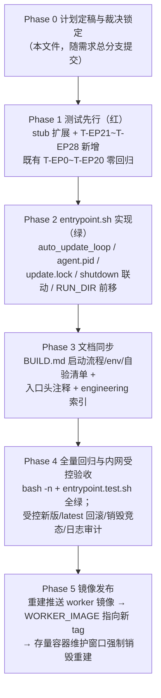

# 云环境 agent-gear 自动升级 - 实现计划

**关联 Proposal**: `docs/engineering/proposals/20261113-feat-cloud-agent-gear-auto-upgrade.md`（v1.0）
**关联 PRD**: `docs/product/shipping/20261113-cloud-agent-gear-auto-upgrade.md`（v1.0）
**需求总分支（feat-branch）**: `feat/cloud-agent-gear-auto-upgrade`（基于 `origin/main`，需求总 PR [#499](https://github.com/Deliay/z-agent-gear/pull/499)）
**计划提交分支**: `feat/cloud-agent-gear-auto-upgrade`（本文件随需求总分支提交）
**创建日期**: 2026-11-13
**计划版本**: v1.0

**版本说明**：

- v1.0（2026-11-13）首版。对齐提案 **v1.0**（PR #499 评审已通过上游人类节点）。本期改动面收敛在 `deploy/images/worker/` 单目录（`entrypoint.sh` / `entrypoint.test.sh` / `BUILD.md`），契约零变更、服务端与前端零改动。§3 计划期裁决登记提案与代码事实的偏差：新增 stub 用例编号顺延（T-EP20~T-EP27 → **T-EP21~T-EP28**，T-EP20 已被云存储自举用例占用）、`RUN_DIR` 创建时机前移（启动更新与销毁标记全程可用）、子壳 `$BASHPID` 口径、main 退出路径清理后台循环等。

## 1. 实现顺序



依赖说明：

- 本期**无契约变更、无 GraphQL/WebSocket/REST 改动、无服务端与前端改动**（提案 §1.3 范围），唯一对外口径是容器运行时环境变量 `ZAG_AGENT_GEAR_AUTO_UPDATE_INTERVAL_MS`（默认收敛在入口，可用运行时同名环境变量覆盖）。
- **Phase 1 → Phase 2** 严格 TDD 红-绿：先把 stub 扩展与 8 个新用例写好并确认红（缺实现），再实现 entrypoint 转绿；`entrypoint.sh` 为纯 Bash + PATH stub 测试，与既有用例同体系。
- **Phase 3** 与 Phase 2 同分支随后提交；**Phase 4/5** 在实现合回需求总分支后收口（Phase 5 为部署动作，不产生仓库提交）。
- 产品文档生命周期：PRD 在**实现阶段开始**时从 `docs/product/draft/` 移入 `docs/product/shipping/`（z-product 规范），由下游实现节点执行，本计划阶段不动。

### 1.1 开发分支与合并顺序

| 分支 | 范围 | 基于 | 合并目标 |
|------|------|------|---------|
| `feat/cloud-agent-gear-auto-upgrade` | PRD / 提案 / 本计划 | `origin/main` | 需求总 PR #499 |
| `feat/cloud-agent-gear-auto-upgrade-impl` | 测试 + entrypoint 实现 + BUILD.md 同步（主实现分支） | 需求总分支 | 需求总分支（评审通过后随需求总 PR 入 main） |

- 主实现分支内按 Phase 顺序分提交：`test(worker-image): T-EP21~T-EP28 stub 用例（红）` → `feat(worker-image): entrypoint 周期自升级循环` → `docs(worker-image): BUILD.md 与索引同步`。
- 单目录单文件改动，无需再切子项目并行分支；**禁止 rebase/squash，只允许 merge**（z-git 规范）。
- 合并顺序：实现分支评审通过后 merge 回 `feat/cloud-agent-gear-auto-upgrade`，随需求总 PR #499 入 main。

### 1.2 开发模式与规范加载

- 全部 Phase 采用 TDD（红-绿-重构）；entrypoint 为纯 Bash + 临时 PATH stub 测试，不触网、不触碰真实 `/home/worker`。
- 编码前加载：`docs/engineering/common-rules.md`；镜像/脚本改动参照 `deploy/images/worker/BUILD.md` 既有形态。
- 目录级 `AGENTS.md`：根 `AGENTS.md`、`docs/engineering/AGENTS.md`、`docs/engineering/plan/AGENTS.md`；`deploy/images/worker` 无独立 `AGENTS.md`，沿用根 `AGENTS.md` 与 engineering 规范。
- 日志口径对齐 `contracts/observability.md`（单行 JSON、纯 printf + sed 转义，不引 jq/python；`component=worker-entrypoint`）。

## 2. 命令参考

```bash
# 静态校验与 stub 自动化（本期唯一测试面；纯 stub，无网络、无真实 docker/agent-gear）
bash -n deploy/images/worker/entrypoint.sh
bash deploy/images/worker/entrypoint.test.sh

# worker 镜像（内网构建，不属于服务编排；自验步骤见 BUILD.md）
cd deploy/images/worker
docker build -t core.harbor.internal.fffdan.com/zero-tools/worker:auto-update-local .
docker run -d --name worker-auto-update \
  -e ZAG_SERVER_ENDPOINT=wss://example.invalid/worker -e ZAG_CONTROLLER_KEY=dummy \
  -e ZAG_AGENT_GEAR_AUTO_UPDATE_INTERVAL_MS=60000 \
  core.harbor.internal.fffdan.com/zero-tools/worker:auto-update-local
docker logs --tail 40 worker-auto-update   # 期望周期出现 up to date / check 锚点
docker rm -f worker-auto-update
```

> `K8S_ENABLED=false` 下无真实工作容器回连：周期自升级的正确性由 entrypoint stub 用例 + BUILD.md 镜像自验 + Phase 4 内网 K8s 受控验收覆盖（验收标准见提案 §10）。

## 3. 计划期裁决（提案与代码事实偏差的落地口径）

> 以下裁决以**当前代码事实**为准（需求总分支 `e5052dcc`）。提案中与之不一致或含混的描述在实现期按本节执行，**不回改提案**；验收报告逐条登记。

### 3.1 事实校正（提案描述与代码事实的偏差）

| # | 提案描述 | 代码事实 | 本计划口径 |
|---|---------|----------|-----------|
| C1 | §8.2：新增 stub 用例 **T-EP20~T-EP27** | `entrypoint.test.sh` 已用至 **T-EP20**（云存储上线时新增「未挂载云存储的新容器同样完成自举并上线」）；T-EP9/T-EP10 曾被占用时既有先例是顺延（pnpm 用例顺延为 T-EP13/T-EP14，见测试文件 418-421 行注释） | 新用例顺延为 **T-EP21~T-EP28**，与提案 §8.2 八条场景一一对应：T-EP21=有新版、T-EP22=无新版、T-EP23=检查失败、T-EP24=安装失败、T-EP25=skip 开关、T-EP26=interval=0、T-EP27=销毁信号、T-EP28=退避窗口 |
| C2 | §5.2 实现点 1/3：互斥锁与销毁标记位于 `$RUN_DIR` | 现状 `main()` 中 `RUN_DIR=$(mktemp -d …)` 在**启动 `update_agent_gear` 之后**才创建（entrypoint.sh:354 vs 361），启动更新无处取锁；信号若在 bootstrap 阶段到达，`shutdown()` 也读不到 `$RUN_DIR/shutdown` | `RUN_DIR` 与 `MISMATCH_MARKER` 创建**前移到 `main()` 开头**（`write_nvm_profile` 之前）。`mktemp` 目录仅承载运行时标记，前移无语义变化；启动更新、周期循环、shutdown 全程可用同一 `$RUN_DIR` |
| C3 | §5.2 实现点 3：锁内 `echo $$ > …/pid` 供死锁回收 | `auto_update_loop` 是后台**子壳**，bash 子壳中 `$$` 等于父壳 PID；两个安装路径若都写 `$$`，锁内 PID 恒为 PID 1，`kill -0` 永真、死锁回收失效 | 锁内 pid 文件与持有者判定一律用 **`$BASHPID`**（主壳写 `$$` 等价，统一写 `$BASHPID`）；`AUTO_UPDATE_PID` 由父壳 `$!` 记录，无此问题 |
| C4 | §2.3/§5.2：`main()` 启动后台循环并记录 `AUTO_UPDATE_PID`，销毁路径 `kill` 之 | supervise 收敛（退出码 42）后 `main()` 正常退出，若只依赖 `shutdown()` 清理，后台循环成为孤儿继续 `sleep` 至下个周期——测试中挂住临时目录句柄，真实容器中空转至 Pod 回收 | `main()` 在 `supervise_agent_gear` 返回后、`exit` 前 `kill "$AUTO_UPDATE_PID"`（存在且存活时）；循环每轮开头同时探测 `$RUN_DIR/shutdown` 标记自行退出。双保险，不引入新退出码 |
| C5 | §5.2 实现点 2：`run_agent_gear` 写 `$RUN_DIR/agent.pid`，TERM 目标为「setpriv 链顶层进程」 | `run_as_worker_exec` 经 `exec setpriv … env … agent-gear`，setpriv/env 均 `exec` 替换，**PID 链上即 agent-gear 本体**（T-EP7 已断言信号沿链直达）；`CHILD_PID` 与 agent.pid 同值 | agent.pid 直接写 `run_agent_gear` 内的 `$CHILD_PID`（`run_as_worker_exec … &` 之后同一语句块），`wait` 返回后删除（与 FIFO 清理同点）。TERM 前重新读取并 `kill -0` 校验，规避 pid 复用竞态 |
| C6 | §8.2：测试「经 `ZAG_AGENT_GEAR_AUTO_UPDATE_INTERVAL_MS` 缩小到毫秒级驱动」 | 既有用例（T-EP1~T-EP10 等）均跑完整入口，若周期循环默认立刻/高频动作，会污染 `pnpm_invocations`、`agent_starts`、`signals` 等计数断言 | **默认 600s 间隔即隔离**：循环首轮先 `sleep 600s`，既有用例在 42 收敛后入口退出（配合 C4 清理），周期循环零动作，既有断言零改动。新用例显式将间隔缩至 50~200ms 驱动，并用轮询锚点文件/日志收敛（沿用 T-EP7 模式） |

### 3.2 设计裁决（提案留白/含混处）

1. **间隔解析**：`ZAG_AGENT_GEAR_AUTO_UPDATE_INTERVAL_MS` 按 `^[0-9]+$` 校验；未设置默认 `600000`；非法值（空串以外的非非负整数）回退 `600000` 并 `WARN` 一条；`0` = 禁用——循环启动即打印 `agent-gear auto-update disabled (interval=0)` 后 return，不启动任何检查。
2. **循环启动位置与首轮时机**：`main()` 在 `supervise_agent_gear` 之前以 `auto_update_loop &` 启动并 `AUTO_UPDATE_PID=$!`。循环每轮**先 sleep 间隔再检查**（启动时 `update_agent_gear` 已完成一次安装/更新，首轮检查即启动后 10 分钟）。启动一次性打印 `agent-gear auto-update loop started (interval=<秒>s)`；`ZAG_SKIP_AGENT_GEAR_UPDATE=1` 时打印 `agent-gear auto-update disabled (ZAG_SKIP_AGENT_GEAR_UPDATE=1)` 后 return（总开关语义与启动/每轮更新一致）。
3. **睡眠与中断**：复用既有 `sleep_ms`；循环被杀的唯一路径是 `shutdown()` / main 退出路径 `kill "$AUTO_UPDATE_PID"`（SIGTERM 到子壳，sleep 子进程短暂残留随 Pod/测试进程组回收，可接受，不引入 wait 包装复杂度）。
4. **检查实现**：`latest=$(run_as_worker "$PNPM_CMD" view agent-gear version 2>/dev/null)`、`current=$(run_as_worker agent-gear --version 2>/dev/null)`，均经命令替换 + `|| rc=$?` 形态吞错转 WARN，不因 `set -e` 中断循环；两端去空白后字符串比较，任一端为空或含空白字符按检查失败处理（`WARN: agent-gear update check failed (...)`）。
5. **安装互斥**：两条安装路径共用 `acquire_update_lock` / `release_update_lock`：`mkdir "$RUN_DIR/update.lock.d"` 原子获取并写 `$BASHPID` 入 `pid` 文件；获取失败读 `pid` 并 `kill -0` 探测，持有者不存在则强制清锁重试一次；再失败则**跳过本次安装**。`update_agent_gear` 跳过语等价于既有「更新失败容忍」（记 `agent-gear update skipped: another install in progress`，返回 0）；周期路径跳过本轮（同锚点日志）。
6. **优雅重启触发**：安装成功后 `if [ -f "$RUN_DIR/agent.pid" ]` → 重读 PID 并 `kill -0` 校验 → `kill -TERM`；日志 `agent-gear updated: <version>; restarting service to apply`。无 agent.pid（退避/更新窗口）→ 不 TERM，日志 `agent-gear updated: <version>; will apply on next (re)start`，由保活链路下一轮自然带出新版本（不打断退避节奏，PRD §3.5 口径）。
7. **销毁联动**：`shutdown()` 置位 `shutting_down=1` 后，先 `touch "$RUN_DIR/shutdown"` 并 `kill "$AUTO_UPDATE_PID"`（存在且存活时），再走既有 CHILD_PID/SCAN_PID 转发；销毁后循环绝不再安装/TERM（C2 保证 `$RUN_DIR` 恒存在）。孤儿收敛沿用提案口径：周期安装进行中销毁，pnpm 短暂继续随 Pod 回收终止，下次启动 `update_agent_gear` 幂等修复。
8. **stub 扩展**（`entrypoint.test.sh` 既有 stub 体系内演进，既有 stub 默认行为不变）：
   - `pnpm` stub 新增 `view` 子命令：`pnpm view agent-gear version` 输出 `${STUB_PNPM_LATEST_VERSION:-2.13.0}`（默认与初始版本一致 → 既有用例若意外触发检查也是「已是最新」）；`STUB_PNPM_VIEW_MODE=fail` 时非零退出模拟检查失败。
   - `pnpm` stub 的 `add -g agent-gear` 成功路径把 `$STUB_PNPM_LATEST_VERSION` 写入 `$STUB_DIR/version`（模拟安装后版本切换）；`STUB_PNPM_MODE=fail` 维持既有失败模拟。
   - `agent-gear` stub 已支持 `--version` 读 version 文件与 TERM/INT 信号记录，直接复用；无需新增 stub 二进制。
9. **日志锚点**（全部经既有 `log()` 单行 JSON，版本串先剔除控制字符再入日志；绝不打印 `ZAG_CONTROLLER_KEY`/`ZAG_HOST_KEY`/token/带凭据 URL）：
   - `agent-gear auto-update loop started (interval=600s)` / `agent-gear auto-update disabled (interval=0)` / `agent-gear auto-update disabled (ZAG_SKIP_AGENT_GEAR_UPDATE=1)`
   - `agent-gear is up to date (<version>)`
   - `new agent-gear version available: <current> -> <latest>; installing`
   - `agent-gear updated: <version>; restarting service to apply` / `agent-gear updated: <version>; will apply on next (re)start`
   - `WARN: agent-gear update check failed (...)` / `WARN: agent-gear auto-update install failed; will retry next round`
   - `agent-gear update skipped: another install in progress`
10. **头注释口径**：`entrypoint.sh` 头注释「可选开关」新增 `ZAG_AGENT_GEAR_AUTO_UPDATE_INTERVAL_MS` 一行（默认 600000ms、0 禁用、非法回退默认），并补一段周期自升级口径说明（与保活口径、云存储自举口径同级）。
11. **镜像内容**：`Dockerfile` 零改动；能力随 entrypoint 进镜像，发布即重建镜像指向新 tag（Phase 5）。

## 4. 关键约束（提案 §1.3/§6，实现期不得回退）

- **契约零变更**：不新增/修改任何 GraphQL / WebSocket / REST 契约；唯一对外口径为容器运行时环境变量，记录于入口头注释与 `BUILD.md`。
- **改动面收敛**：仅 `deploy/images/worker/{entrypoint.sh,entrypoint.test.sh,BUILD.md}` 与文档索引；`servers/*`、`packages/*`、`apps/*`、`contracts/*`、`Dockerfile` 零改动。
- **保活语义不回归**：退出码 42/非 42 分流、退避序列（1/2/5/10/30s、稳定 60s 重置）、每轮自更新、VERSION_MISMATCH 标记、信号转发与销毁不重启行为逐字保持（T-EP0~T-EP20 零回归）。
- **安装互斥且失败容忍**：同一时刻至多一个 `pnpm add -g agent-gear`；任一路径持锁时另一路径跳过，语义等价既有失败容忍。
- **销毁优先**：`shutdown()` 先终止周期循环再转发子进程信号；销毁后不升级、不 TERM、不重启（T-EP27 锚定）。
- **失败收敛**：检查/安装失败仅 WARN，重试节奏恒受检查周期约束，不缩短间隔、不产生重启风暴。
- **日志纪律**：单行 JSON 经既有 `log()`；不输出密钥、token、带凭据 URL；版本串先剔除控制字符。
- **测试纪律**：新增用例先进红再转绿；`bash -n` + `entrypoint.test.sh` 全量通过（既有零回归 + 新增 8 条）。

## 5. Phase 计划

### Phase 0：计划定稿与裁决锁定（0.5d，本节点完成）

**目标**：本文件随需求总分支提交，§3 裁决定稿，Phase 1~5 文件清单（附录 A）不再变化。

**完成判据**：本文件合入 `feat/cloud-agent-gear-auto-upgrade`；`docs/engineering/AGENTS.md` 实现计划索引同步。

### Phase 1：测试先行——stub 扩展与 T-EP21~T-EP28（1d，红）

| 文件 | 变更 |
|------|------|
| `deploy/images/worker/entrypoint.test.sh` | 按 §3.2 裁决 8 扩展 `pnpm` stub（`view` 子命令、`add -g` 回写 version、`STUB_PNPM_VIEW_MODE`）；`setup_env`/`teardown_env` 增补 `STUB_PNPM_LATEST_VERSION`/`STUB_PNPM_VIEW_MODE`/`ZAG_AGENT_GEAR_AUTO_UPDATE_INTERVAL_MS` 环境管理；新增 T-EP21~T-EP28（场景与断言见 §6.1）；确认新用例全红（缺实现）且既有 T-EP0~T-EP20 全绿 |

**时序编排口径**（新用例共用模式，沿用 T-EP7 的「后台跑入口 + 轮询锚点 + 外部信号收敛」）：

- **T-EP21（有新版）**：`STUB_RUN_FOREVER=1` + `STUB_PNPM_LATEST_VERSION=9.9.9` + `ZAG_AGENT_GEAR_AUTO_UPDATE_INTERVAL_MS=100` + `ZAG_KEEPALIVE_BACKOFF_MS=10`；后台起入口，`agent_ready` 出现后轮询直至 `signals` 含 `TERM` 且 `agent_starts` 达 2 且 version 文件为 9.9.9；随后外部 TERM 入口收敛，断言退出 0、日志含 `new agent-gear version available` 与 `restarting service to apply`、TERM 恰好 1 次（升级后版本相等不再触发）。
- **T-EP28（退避窗口）**：`STUB_AGENT_EXITS` 全 `1` 序列（末位 42 收敛）+ 退避缩放 ≫ 检查间隔（如 backoff 1000ms / interval 100ms），使检查点落在退避窗口（无 agent.pid）；断言 `add -g agent-gear` 发生、`signals` 无 TERM、日志含 `will apply on next (re)start`。

**完成判据**：`bash entrypoint.test.sh` 输出中 T-EP21~T-EP28 全部 FAIL（红），T-EP0~T-EP20 全部 ok；`bash -n` 通过。

### Phase 2：entrypoint.sh 实现（1.5d，绿）

| 文件 | 变更 |
|------|------|
| `deploy/images/worker/entrypoint.sh` | ① 头注释新增 env 与周期自升级口径（裁决 10）；② `main()` 前移 `RUN_DIR`/`MISMATCH_MARKER` 创建（C2）；③ 新增 `auto_update_loop`（裁决 1/2/3/4）与 `acquire_update_lock`/`release_update_lock`（裁决 5、C3）；④ `update_agent_gear` 纳入互斥锁（裁决 5）；⑤ `run_agent_gear` 写/清 `$RUN_DIR/agent.pid`（C5）；⑥ `shutdown()` 先置销毁标记并 `kill "$AUTO_UPDATE_PID"`（裁决 7）；⑦ `main()` supervise 返回后清理后台循环（C4） |

**最终形态（口径，非逐字）**：

```bash
auto_update_loop() {
  local interval_ms="${ZAG_AGENT_GEAR_AUTO_UPDATE_INTERVAL_MS:-600000}"
  # 非法值回退默认 + WARN；0 = 禁用（打印一次后 return）；skip 总开关同样打印后 return
  log "agent-gear auto-update loop started (interval=$((interval_ms / 1000))s)"
  while true; do
    sleep_ms "$interval_ms"
    [ -f "$RUN_DIR/shutdown" ] && exit 0
    # pnpm view → agent-gear --version → 去空白比较（失败 WARN 进下一周期）
    # latest != current → acquire_update_lock（失败跳过本轮）
    #   → pnpm add -g agent-gear（失败 WARN 放锁进下一周期）
    #   → 放锁；agent.pid 存在且 kill -0 → TERM（restarting service to apply）
    #     否则 will apply on next (re)start
  done
}
```

**完成判据**：`bash -n` 通过；`entrypoint.test.sh` 全量转绿（T-EP0~T-EP28）；手工抽查日志锚点逐条齐全（§3.2 裁决 9）。

### Phase 3：文档同步（0.5d）

| 文件 | 变更 |
|------|------|
| `deploy/images/worker/BUILD.md` | ① 「默认启动」流程补第 5 步「周期自升级循环（`ZAG_AGENT_GEAR_AUTO_UPDATE_INTERVAL_MS`，默认 10 分钟、0 禁用）」；② 「受监督运行的行为」段补周期自升级与 `ZAG_SKIP_AGENT_GEAR_UPDATE=1` 总开关联动口径；③ 「版本门禁与自升级自验」自动化用例段补 T-EP21~T-EP28 描述；④ 镜像自验增补「周期自升级锚点观察」（缩间隔起容器，日志出现 started / up to date / check 锚点）与「销毁后无安装/无 TERM」核对项 |
| `docs/engineering/AGENTS.md` | 「实现计划（`plan/`）」索引追加本计划条目（随 Phase 0 提交） |

**完成判据**：BUILD.md 所述步骤与 entrypoint 行为逐条一致；索引可点击跳转。

### Phase 4：全量回归与内网受控验收（1d）

1. `bash -n deploy/images/worker/entrypoint.sh` 与 `bash deploy/images/worker/entrypoint.test.sh` 全绿（T-EP0~T-EP28）。
2. 全库检索确认无 `servers/*`、`packages/*`、`apps/*`、`contracts/*` 改动（`git diff` 范围核对）。
3. 内网构建 worker 镜像，按 BUILD.md 完成自验（含新增周期自升级锚点观察与销毁核对项）。
4. 内网 K8s 受控验收（对齐提案 §10，结论登记下游验收报告）：
   - 起容器 → 测试 registry 注入受控新版（间隔缩至分钟级）→ 观察 `new agent-gear version available` → 安装 → 重启 → 以新版本 `register` 成功且**不重复初始化**（`hasSettledInit`）；
   - latest 回滚场景：latest 指回旧版后容器下一周期自动「升级」到该回滚目标（自动愈合）；
   - 销毁竞态：升级进行中下发销毁，容器按既有流程退出，无残留安装/TERM/重启；
   - 日志审计：检查/安装/重启锚点齐全，无 `ZAG_CONTROLLER_KEY`/`ZAG_HOST_KEY`/token/带凭据 URL。

### Phase 5：镜像发布（0.5d，部署动作）

- 合并本分支入 main → 重建并推送 worker 镜像 → `WORKER_IMAGE` 指向新 tag → 新创建容器自动获得能力 → 存量运行中容器按既有口径在维护窗口**强制销毁重建一次**（与版本门禁/保活历次发布口径一致）。
- 无服务端发布、无数据迁移；回滚 = `WORKER_IMAGE` 指回旧 tag + 存量容器销毁重建。

## 6. 测试矩阵

### 6.1 entrypoint Bash 测试（`entrypoint.test.sh`，纯 stub）

既有 T-EP0~T-EP20 零回归（默认 600s 间隔隔离，C6）。新增：

| 用例 | 场景 | 断言 |
|------|------|------|
| T-EP21 | registry 有新版（latest=9.9.9） | 触发安装 → TERM agent-gear（signals 恰 1 次）→ 重启后 version=9.9.9；日志含 `new agent-gear version available` 与 `restarting service to apply`；外部 TERM 后入口 0 |
| T-EP22 | 无新版（latest==current） | 零安装、零 TERM、零重启；日志含 `agent-gear is up to date`；外部 TERM 收敛 |
| T-EP23 | `pnpm view` 失败（`STUB_PNPM_VIEW_MODE=fail`） | WARN 锚点、零安装零 TERM，agent-gear 持续运行；下一周期重试（WARN ≥2 条） |
| T-EP24 | 安装失败（`STUB_PNPM_MODE=fail` + 有新版） | WARN 锚点 `auto-update install failed`、不 TERM、不重启，服务继续；version 文件未变 |
| T-EP25 | `ZAG_SKIP_AGENT_GEAR_UPDATE=1` | 周期循环零检查动作（`pnpm view` 调用计数为 0）；启动日志含 `auto-update disabled (ZAG_SKIP_AGENT_GEAR_UPDATE=1)`；保活行为不变（既有 T-EP4 口径） |
| T-EP26 | `ZAG_AGENT_GEAR_AUTO_UPDATE_INTERVAL_MS=0` | 循环即退，`pnpm view` 计数为 0；启动日志含 `auto-update disabled (interval=0)`；保活与启动/每轮更新不受影响 |
| T-EP27 | 销毁信号到达（扩展 T-EP7 模式） | 入口收到 TERM 后：循环被终止、销毁标记落盘；销毁后 `pnpm view`/`add -g` 计数不再增长、agent-gear 不重启、入口 0 |
| T-EP28 | 检查命中时处于退避窗口（无 agent.pid） | 安装执行但不发 TERM（signals 无 TERM）；日志含 `will apply on next (re)start`；下一轮启动使用新版本 |

### 6.2 静态校验

- `bash -n deploy/images/worker/entrypoint.sh` 通过（T-EP0 前置断言已含）。

### 6.3 内网受控验收（Phase 4 手工，登记验收报告）

见 §5 Phase 4 第 4 条：受控新版升级、latest 回滚自动愈合、销毁竞态、日志审计四项。

## 7. 验收 checklist（分阶段）

- [ ] Phase 0：本计划合入需求总分支，§3 裁决定稿，索引同步
- [ ] Phase 1：T-EP21~T-EP28 全红、T-EP0~T-EP20 全绿；stub 扩展默认行为不变
- [ ] Phase 2：`bash -n` 通过；T-EP0~T-EP28 全绿；日志锚点逐条齐全且无敏感信息
- [ ] Phase 3：BUILD.md 启动流程/env/自验清单与实现一致；索引同步
- [ ] Phase 4：全量回归通过；内网受控验收 4 项通过并登记验收报告
- [ ] Phase 5：镜像重建推送、`WORKER_IMAGE` 指向新 tag、存量容器销毁重建口径通知运维
- [ ] PRD 功能点 1~4 验收标准逐条通过（提案 §10 对齐）

## 8. 风险与回滚

| 风险 | 影响 | 缓解 / 回滚 |
|------|------|------------|
| 后台子壳 `$$` 误用（C3） | 死锁回收失效，极端情况下安装路径互相饿死 | `$BASHPID` 统一口径 + T-EP21/T-EP24 覆盖锁获取/失败路径；review 重点核查 |
| main 退出未清理后台循环（C4） | 孤儿循环空转/挂住测试句柄 | main 退出路径 kill + 循环自探销毁标记双保险；T-EP27 锚定 |
| 周期检查与既有计数断言互相污染（C6） | 既有用例抖动失败 | 默认 600s 首轮先 sleep 隔离；新用例显式缩间隔并轮询收敛 |
| TERM 击中 pid 复用进程 | 误杀无关进程 | TERM 前重读 agent.pid + `kill -0` 校验；文件刚删则不动作 |
| 销毁恰好发生在周期安装中 | pnpm 孤儿短暂运行 | 随 Pod 回收终止；下次启动 `update_agent_gear` 幂等修复（提案已接受） |
| registry 长期不可达 | 每周期一条 WARN（10 分钟级） | 周期即节流，无重试风暴；`ZAG_AGENT_GEAR_AUTO_UPDATE_INTERVAL_MS=0` 或 `ZAG_SKIP_AGENT_GEAR_UPDATE=1` 为排障出口 |
| 新版 agent-gear 自身缺陷 | 容器内服务异常 | 既有保活退避维持容器存活；发布侧回滚 latest 指针后容器下一周期自动回落（T-EP21 版本比较口径覆盖，内网验收第 2 项实证） |
| T-EP28 时序敏感 | 用例偶发失败 | 退避 ≫ 间隔的悬殊编排 + 轮询锚点驱动；必要时放宽为「至少一次 will apply 锚点」 |

回滚：各 Phase 独立提交、merge-only，可按提交粒度 revert；镜像回滚为 `WORKER_IMAGE` 指回旧 tag + 存量容器销毁重建（Phase 5 反向执行）。

## 9. 相关文档

- 关联 PRD：[[../../product/shipping/20261113-cloud-agent-gear-auto-upgrade.md]]
- 关联 Proposal：[[../proposals/20261113-feat-cloud-agent-gear-auto-upgrade.md]]（v1.0）
- 需求来源：[GitHub Issue Deliay/z-agent-gear#496](https://github.com/Deliay/z-agent-gear/issues/496)；需求总 PR：[Deliay/z-agent-gear#499](https://github.com/Deliay/z-agent-gear/pull/499)
- [[20261025-feat-cloud-host-keepalive.md]] — 云电脑保活与 worker 用户（保活/退避/自更新既有语义，本计划复用其非 42 重启链路）
- [[20261017-feat-controller-version-requirement.md]] — 版本门禁与一次性自升级（VERSION_MISMATCH 链路）
- [[20261102-feat-cloud-storage.md]] — 主目录工具链自举（`bootstrap_home`/`ensure_pnpm` 口径）
- 日志契约：`contracts/observability.md`
- 开发规范：[[../common-rules.md]]

## 附录 A：文件变更总览

| Phase | 文件 | 动作 |
|-------|------|------|
| 0 | `docs/engineering/plan/20261113-feat-cloud-agent-gear-auto-upgrade.md` | 新增（本文件，随需求总分支提交） |
| 0 | `docs/engineering/AGENTS.md` | 改（实现计划索引追加） |
| 1 | `deploy/images/worker/entrypoint.test.sh` | 改（stub 扩展 + T-EP21~T-EP28，先红） |
| 2 | `deploy/images/worker/entrypoint.sh` | 改（auto_update_loop / agent.pid / update.lock / shutdown 联动 / RUN_DIR 前移 / 头注释） |
| 3 | `deploy/images/worker/BUILD.md` | 改（启动流程、env 口径、自验清单） |
| 4 | `docs/engineering/acceptance/`（下游产出） | 验收报告 |

其余目录（`servers/*`、`packages/*`、`apps/*`、`contracts/*`、`deploy/images/worker/Dockerfile`）零改动。

## 附录 B：计划期核对记录

### B.1 代码事实核对（2026-11-13，需求总分支 e5052dcc）

| 核对项 | 结论 |
|--------|------|
| `entrypoint.test.sh` 用例编号 | 已用至 **T-EP20**（云存储自举）；提案 T-EP20~T-EP27 顺延为 T-EP21~T-EP28（C1，沿用 T-EP13/T-EP14 先例） |
| `RUN_DIR` 创建位置 | `main()` 中在启动 `update_agent_gear`（entrypoint.sh:354）之后、:361 才创建 → 前移（C2） |
| `update_agent_gear` 现状 | `run_as_worker_exec pnpm add -g agent-gear` + `wait $CHILD_PID`，失败容忍返回 0；未持锁（C-锁纳入，裁决 5） |
| `run_agent_gear` 现状 | FIFO 扫描 + `run_as_worker_exec agent-gear 2>fifo &`，`CHILD_PID` 即 agent-gear 本体（exec 链），无 agent.pid（C5） |
| `shutdown()` 现状 | 置 `shutting_down=1` → 转发 CHILD/SCAN；无 AUTO_UPDATE_PID 与销毁标记（裁决 7） |
| stub 体系 | `pnpm` stub 无 `view` 子命令、add 成功不回写 version；`agent-gear` stub 支持 `--version`/TERM 记录/RUN_FOREVER，可直接复用（裁决 8） |
| 默认间隔对既有用例影响 | 既有用例不设间隔环境变量，600s 首轮先 sleep → 周期循环零动作（C6）；入口退出依赖 C4 清理 |
| 门禁常量 | `MIN_HARNESS_WORKER_VERSION` 等门禁与 `agentGearMinVersion` 链路**不变**（升级方向恒向上，提案 §6.2） |
| 契约面 | 无 GraphQL/WebSocket/REST 变更；运行时 env 口径记录于入口头注释与 BUILD.md |

### B.2 实现期核对项（Phase 2/4 收口，登记验收报告）

1. `$BASHPID` 在 ubuntu:24.04 bash 子壳中的取值（锁内 pid 文件正确性）。
2. `kill` 后台子壳对其 `sleep` 子进程的回收表现（测试进程组/Pod 语义）。
3. 真实 registry 下 `pnpm view agent-gear version` 的输出形态（单版本号单行）与失败退出码。
4. TERM 后 agent-gear 优雅退出耗时与 supervise 1s 退避叠加后的整体断连时长（秒级口径实证）。
5. latest 回滚场景实机表现（提案 §10 验收项，内网受控验收第 2 条）。
