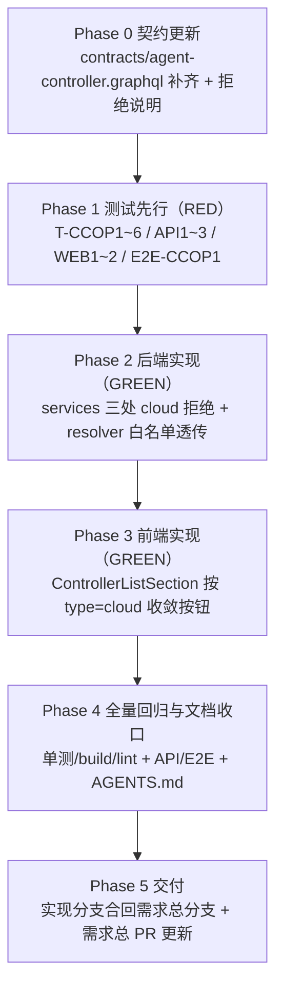

# 设置中控制器的操作按钮优化（云控制器操作限制） - 实现计划

**关联 Proposal**: `docs/engineering/proposals/20261113-feat-cloud-controller-operations-restriction.md`（v1.0）
**关联 PRD**: `docs/product/draft/20261113-cloud-controller-operations-restriction.md`（v1.0）
**需求总分支**: `prd/cloud-controller-operations-restriction`（需求总 PR [#497](https://github.com/Deliay/z-agent-gear/pull/497)，上游 Issue [#489](https://github.com/Deliay/z-agent-gear/issues/489)）
**实现分支**: `feat/cloud-controller-operations-restriction`（基于需求总分支切出）
**创建日期**: 2026-11-13
**计划版本**: v1.0

**上游评审结论**：产品文档与技术提案已经「审核产品文档与技术方案」人类节点通过（需求总 PR #497 已创建、OPEN/MERGEABLE、无 review 记录与 inline comment）。本计划按 PRD v1.0 / 提案 v1.0 推进。

**版本说明**：

- v1.0 首版：把提案 §5.2 的 6 个实现点拆成 6 个 Phase（契约 → 测试先行 → 后端 → 前端 → 回归收口 → 交付）；给出「代码探查关键事实」11 条（含提案 F1~F7 复核与 4 条计划期新发现）、「上游文档 × 代码现状差异」3 条、「计划期裁决」10 条。
- 不改变 PRD/提案口径；契约仅补齐既有定义与说明，零字段/类型/可空性变更；数据模型零变更、零迁移。

## 实现顺序



依赖说明：

- **P0 先行**：契约是「错误文案表」的书面依据（双写铁律），先落口径再写测试；契约与手写 schema（`servers/agent-api/src/graphql/schemas/controller.ts`）逐字段核对一致。
- **P1 → P2/P3**：严格 TDD。T-CCOP1~6、T-CCOP-API1~3、T-CCOP-WEB1~2、E2E-CCOP1 必须在旧实现上失败（RED）；既有本地路径用例为回归基线，旧实现即绿、改完必须仍绿。P2 与 P3 互不依赖（后端/前端分离），按序推进即可。
- **P4 依赖 P1~P3**：回归以 `servers/agent-api` 与 `apps/agent-web` 全量单测 + build/lint、`tests/api` controller 套件、`tests/e2e` settings-controller 套件为准；两处 AGENTS.md 行为口径随本 Phase 提交（见裁决 8）。
- **P5 依赖 P4**：实现分支 → 需求总分支（不直推 `main`），需求总 PR #497 随推送更新。

开发模式采用 TDD（红-绿-重构）。编码前加载 `docs/engineering/common-rules.md`、`docs/engineering/backend-rules.md`、`docs/engineering/frontend-rules.md`、`servers/agent-api/AGENTS.md`、`apps/agent-web/AGENTS.md`、`tests/api/AGENTS.md`、`tests/e2e/AGENTS.md`。

### 关键约束（实现期不得回退）

- **拒绝先于一切副作用**：`unbind` 的 cloud 判定必须位于 `commandService.sendShutdown` / `evictKeyById` / `ControllerKey.deleteOne` / `Controller.deleteOne` 之前；`regenerate` 的判定必须位于换 hash、`Controller` 置 `unbound`、`evictKeyById` / `cacheKey`、`sendShutdown` 之前（PRD 功能点 2「零副作用」）。
- **错误文案逐字稳定**：三条白名单文案——`cloud controller cannot be renamed` / `cloud controller cannot be unbound` / `cloud controller key cannot be regenerated`——写入契约错误表，服务层抛出、resolver 透传、测试断言三处逐字一致，禁止意译/改写。
- **本地控制器零变化**：三个操作的 `local`/`github` 路径代码顺序与副作用保持不变；`createControllerKey` / `renameControllerKey` / `setControllerWorktreeDir` / `setControllerDefaultMcp` 不在范围内。
- **不存在的控制器口径不变**：`renameController` 仍 `Controller not found`、`unbindController` 仍 `false`、`regenerateControllerKey` 仍 `Controller not found`（先查存在性、再判类型，顺序不可颠倒）。
- **零数据迁移、零新增依赖**：`Controller.type` 为既有字段；前端复用既有 Button 条件渲染，不引入新组件/库。
- **禁止 rebase/squash**：遵循 z-git 规范，仅允许 merge。

### 代码探查关键事实（实现时以现状为准）

- **F1**（提案 F1 复核）：`apps/agent-web/src/components/settings/ControllerListSection.tsx` 已绑定控制器行（L268-281）渲染「配置 / 重命名 / 重新生成Key / 解绑」四按钮；未绑定行（L303-310）渲染「重新生成Key / 删除」。行数据已含 `type` 字段（`GET_CONTROLLERS` L37-52 已选择），无需改查询；`boundControllers`/`unboundControllers` 过滤（L133-134）按 `status !== 'unbound'` 分组，与类型无关。
- **F2**（提案 F2 复核）：`controllerService.rename`（`servers/agent-api/src/services/controller.ts:74-82`）为单步 `Controller.findOneAndUpdate({_id, ...actorFilter(userId)}, { name }, { returnDocument: 'after' }).lean()`，无 `type` 检查、无独立查询。
- **F3**（提案 F3 复核）：`controllerService.unbind`（同文件 L84-101）`findOne` 命中后依次 `commandService.sendShutdown(keyId)`（L91）→ `evictKeyById(keyId)`（L94）→ `ControllerKey.deleteOne`（L97）→ `Controller.deleteOne`（L98），无 `type` 检查。
- **F4**（提案 F4 复核）：`controllerKeyService.regenerate`（`services/controller-key.ts:121-178`）第一步已 `Controller.findOne({_id, ...actorFilter(userId)})`（L123）校验归属——**判定可直接复用该结果，无新增查询**；后续副作用为 `ControllerKey.findOneAndUpdate` 换 hash（L139）→ `Controller.findOneAndUpdate` 置 `unbound`（L152）→ `evictKeyById`（L158）→ `cacheKey`（L162）→ `sendShutdown`（L172）。
- **F5**（提案 F5 复核）：`graphql/resolvers/controller.ts` 三个 mutation（`renameController` L81-98、`unbindController` L99-108、`regenerateControllerKey` L156-172）均无 try/catch，服务层抛出的普通 `Error` 直接冒泡；同文件 `setControllerDefaultMcp`（L127-155）有「捕获 → GraphQLError 透传」的既有模式可对齐。
- **F6**（提案 F6 复核）：`contracts/agent-controller.graphql` 缺 `regenerateControllerKey` 与 `RegenerateControllerKeyInput`；手写 schema（`graphql/schemas/controller.ts` L64-66 定义 input、L86 挂 mutation）早已实现。
- **F7**（提案 F7 复核）：全仓 grep 确认 `renameController` / `unbindController` / `regenerateControllerKey` 的唯一前端调用点为 `ControllerListSection.tsx`（`graphql/mutations.ts` / `graphql/types.ts` 仅为无关定义）。三个 GraphQL mutation 即全部需拦截入口。
- **F8**（计划期新发现）：契约与手写 schema 另有同文件漂移——契约 `ControllerStatus`（L7-11）缺 `unbound`（schema L8-13 有）、契约 `ControllerKey`（L19-28）缺 `rawKey: String`（schema L27 有）。纯文档漂移，与 schema 行为无关。
- **F9**（计划期新发现）：既有服务单测 `services/controller.test.ts` 的 rename 用例（L76-108）只 mock `Controller.findOneAndUpdate`；实现改为「先 `findOne().lean()` 再 `findOneAndUpdate`」后，既有用例必须同步补 `findOne` mock——**RED 阶段先改测试适配新查询形态**（见裁决 3）。`unbind`/`regenerate` 既有用例的 mock controller 无 `type` 字段（`undefined !== 'cloud'` 自然放行），可作为本地回归保留。
- **F10**（计划期新发现）：tests/api 云控制器夹具范式见 `tests/api/src/agent-api/session-readonly.test.ts` 的 `seedCloudController`（L51-108）：直插 `controllers` 需带 `userId/tenantId`（personal 期均为 userId）与 `workspaceId`（经 `support/workspace-fixtures.js` 的 `personalGlobalWorkspaceId` 取个人全局工作区）；多租户二期 `actorFilter` 口径下缺 `workspaceId` 的行不可见。测试用户经 `createFrontUser()`（`support/front-users.ts`，返回 `{ token, userId, tenantId }`）开户。
- **F11**（计划期新发现）：前端设置组件测试 mock 范式见 `components/settings/__tests__/WorkspaceSection.test.tsx`（L8-15）：`vi.mock('@apollo/client/react')` + `mockUseQuery`/`mockUseMutation` 两个 `vi.fn()`。`ControllerListSection` 内有**两次** `useQuery` 调用（`GET_CONTROLLER_KEYS` 与 `GET_CONTROLLERS`），mock 需按查询文档分流（`mockImplementation` 比对 query 引用或按调用序返回）。

## 上游文档 × 代码现状差异

| # | 上游表述 | 代码现状（证据） | 本计划处置 |
|---|----------|------------------|------------|
| D1 | 提案 §3.1 只要求补齐 `regenerateControllerKey` / `RegenerateControllerKeyInput` | 同文件另有 `ControllerStatus.unbound` 与 `ControllerKey.rawKey` 两处漂移（F8） | 顺手一并补齐（纯文档对齐、零行为变更），见裁决 5 |
| D2 | 提案实现点 2 将 `rename` 改为「先查后判再更新」 | 既有 rename 服务单测只 mock `findOneAndUpdate`（F9），新查询形态下立即失败 | RED 阶段先适配既有用例 mock，再新增 T-CCOP1，见裁决 3 |
| D3 | 提案 §8 的 T-CCOP-API1~3 要求「云控制器夹具」 | tests/api 既有夹具范式（F10）插的是完整云电脑三件套（controllers/controllerworkspaces/cloudhosts），本需求只需 controllers + controllerkeys 两行 | 夹具精简为两行（无 cloudhosts 时 `findAllByUser` 不过滤，云电脑照常展示），见裁决 10 |

## 计划期裁决（提案留白 / 含混处的实现口径）

1. **错误文案常量单一来源**：三条文案以导出常量定义在抛出方——`services/controller.ts` 导出 `CLOUD_CONTROLLER_RENAME_REJECTED = 'cloud controller cannot be renamed'` 与 `CLOUD_CONTROLLER_UNBIND_REJECTED = 'cloud controller cannot be unbound'`；`services/controller-key.ts` 导出 `CLOUD_CONTROLLER_KEY_REGENERATE_REJECTED = 'cloud controller key cannot be regenerated'`。resolver 从两个服务模块导入组成白名单 `Set`；契约错误表、服务抛出、resolver 透传、测试断言四处逐字一致。
2. **resolver 白名单透传形态**：三个 mutation 各加 try/catch——`err instanceof GraphQLError` 直接 rethrow；`err instanceof Error && CLOUD_REJECT_MESSAGES.has(err.message)` 时 `throw new GraphQLError(err.message)`（逐字）；其余错误原样 `throw err` 冒泡（生产被 maskedErrors 掩盖为 `Unexpected error.`，与现状一致，不扩大透传面）。`unbindController` 正常路径仍返回 `boolean`，不引入第三种返回形态。
3. **rename 实现形态**：`Controller.findOne({ _id: id, ...actorFilter(userId) }).lean()` → 不存在返回 `null`（resolver 维持抛 `Controller not found`）→ `type === 'cloud'` 抛 `CLOUD_CONTROLLER_RENAME_REJECTED` → 否则执行既有 `findOneAndUpdate`。既有 rename 服务单测在 RED 阶段先补 `findOne` mock 适配（mock 返回 local 文档），保持回归语义不变。
4. **unbind / regenerate 复用既有查询**：`unbind` 在既有 `findOne` 命中后判 `type === 'cloud'` 抛错（先于 L91 `sendShutdown`）；`regenerate` 复用 L123 已查出的 controller 判型。两者均无新增查询、返回类型不变。
5. **契约补齐范围**：`RegenerateControllerKeyInput` / `regenerateControllerKey`（提案内）+ `ControllerStatus` 补 `unbound` + `ControllerKey` 补 `rawKey: String`（F8 同文件漂移）。四处均为「契约向手写 schema 对齐」的纯文档修订，零行为变更；其余定义不动。
6. **测试编号与落点**：T-CCOP1/T-CCOP2 追加到 `servers/agent-api/src/services/controller.test.ts`；T-CCOP3 追加到 `services/controller-key.test.ts`；T-CCOP4~6 追加到 `graphql/resolvers/controller.test.ts`；T-CCOP-API1~3 追加到 `tests/api/src/agent-api/controller.test.ts` 新 describe；T-CCOP-WEB1~2 新建 `apps/agent-web/src/components/settings/__tests__/ControllerListSection.test.tsx`；E2E-CCOP1 追加到 `tests/e2e/src/settings-controller.spec.ts`。
7. **前端条件渲染形态**：已绑定行三个按钮包入 `{ctrl.type !== 'cloud' && (<>…</>)}`，「配置」恒渲染；未绑定行云控制器（防御性分支）同样隐藏「重新生成Key / 删除」、按钮组渲染为空，不引入空态文案（提案决策 6.1 表第 5 行）。隐藏后 `renameTarget`/`confirmRegenerate`/`confirmUnbind` 三个 Dialog 状态不再被 cloud 行触发，Dialog 本体不动。
8. **AGENTS.md 行为口径随实现提交**：`servers/agent-api/AGENTS.md`（补「云控制器三操作拒绝」口径）与 `apps/agent-web/AGENTS.md`（「云电脑（Cloud Host）约定」段补设置页按钮收敛）在 Phase 4 更新；本计划节点只提交计划文档与 `docs/engineering/AGENTS.md` 索引，避免文档先于代码描述未实现行为。
9. **分支与交付**：实现分支 `feat/cloud-controller-operations-restriction` 自需求总分支 `prd/cloud-controller-operations-restriction` 切出；实现验收后合并回需求总分支，需求总 PR #497 随推送自动更新（工作流 PR 联动已在上一节点关联，实现节点确认关联仍有效即可，无需重复关联）。
10. **API/E2E 夹具口径**：T-CCOP-API1~3 与 E2E-CCOP1 均需 `MONGODB_URI`，缺省时显式 `skipIf` 并在标题标注（对齐 T-WS-ISO3 口径）。夹具只插 `controllers`（`type:'cloud'`、`status:'online'`、`userId/tenantId/workspaceId` 按 F10 范式）与 `controllerkeys`（`type:'cloud'`、`status:'active'`、`boundControllerId` 指向该控制器、`keyHash` 任意 bcrypt 串）两行，**不插 `cloudhosts`**（`findAllByUser` 仅过滤已软删除云电脑，无 host 行即不过滤）；用例结束按唯一 id 清理两行。

### 目标实现代码（Phase 2/3 基准）

```ts
// services/controller.ts（顶部导出常量）
export const CLOUD_CONTROLLER_RENAME_REJECTED = 'cloud controller cannot be renamed';
export const CLOUD_CONTROLLER_UNBIND_REJECTED = 'cloud controller cannot be unbound';

// rename（替换现状 L74-82）
async rename(id: string, userId: string, name: string): Promise<Record<string, unknown> | null> {
  const existing = await Controller.findOne({ _id: id, ...actorFilter(userId) }).lean();
  if (!existing) return null;
  if (existing.type === 'cloud') {
    throw new Error(CLOUD_CONTROLLER_RENAME_REJECTED);
  }
  const controller = await Controller.findOneAndUpdate(
    { _id: id, ...actorFilter(userId) },
    { name },
    { returnDocument: 'after' },
  ).lean();
  if (!controller) return null;
  return this.mapController(controller);
}

// unbind（在 L85-88 之间插入判定，先于 sendShutdown）
const controller = await Controller.findOne({ _id: id, ...actorFilter(userId) });
if (!controller) return false;
if (controller.type === 'cloud') {
  throw new Error(CLOUD_CONTROLLER_UNBIND_REJECTED);
}
```

```ts
// services/controller-key.ts（顶部导出常量 + regenerate 判定）
export const CLOUD_CONTROLLER_KEY_REGENERATE_REJECTED = 'cloud controller key cannot be regenerated';

// regenerate（在 L123-124 之后插入判定，复用既有查询结果）
const controller = await Controller.findOne({ _id: controllerId, ...actorFilter(userId) });
if (!controller) return null;
if (controller.type === 'cloud') {
  throw new Error(CLOUD_CONTROLLER_KEY_REGENERATE_REJECTED);
}
```

```ts
// graphql/resolvers/controller.ts（白名单与透传辅助）
import {
  CLOUD_CONTROLLER_RENAME_REJECTED,
  CLOUD_CONTROLLER_UNBIND_REJECTED,
} from '../../services/controller.js';
import { CLOUD_CONTROLLER_KEY_REGENERATE_REJECTED } from '../../services/controller-key.js';

const CLOUD_REJECT_MESSAGES = new Set([
  CLOUD_CONTROLLER_RENAME_REJECTED,
  CLOUD_CONTROLLER_UNBIND_REJECTED,
  CLOUD_CONTROLLER_KEY_REGENERATE_REJECTED,
]);

function rethrowCloudReject(err: unknown): never {
  if (err instanceof GraphQLError) throw err;
  if (err instanceof Error && CLOUD_REJECT_MESSAGES.has(err.message)) {
    throw new GraphQLError(err.message);
  }
  throw err;
}

// 三个 mutation 各包 try/catch，catch 中调用 rethrowCloudReject(err)
```

```tsx
// ControllerListSection.tsx 已绑定行（L268-281）
<div className="flex gap-1">
  <Button variant="ghost" size="sm" onClick={() => onNavigateToConfig?.(ctrl.id)}>
    配置
  </Button>
  {ctrl.type !== 'cloud' && (
    <>
      <Button variant="ghost" size="sm" onClick={() => setRenameTarget({ id: ctrl.id, name: ctrl.name || ctrl.hostname })}>
        重命名
      </Button>
      <Button variant="ghost" size="sm" onClick={() => setConfirmRegenerate({ id: ctrl.id, name: ctrl.name || ctrl.hostname })}>
        重新生成Key
      </Button>
      <Button variant="ghost" size="sm" className="text-destructive" onClick={() => setConfirmUnbind({ id: ctrl.id, name: ctrl.name || ctrl.hostname })}>
        解绑
      </Button>
    </>
  )}
</div>

// 未绑定行（L303-310）：两个按钮同样包入 {ctrl.type !== 'cloud' && (<>…</>)}
```

---

## Phase 0: 契约更新

| 文件 | 操作 | 说明 |
|------|------|------|
| `contracts/agent-controller.graphql` | 修改 | ① 新增 `input RegenerateControllerKeyInput { controllerId: ID! }` 与 `regenerateControllerKey(input: RegenerateControllerKeyInput!): CreateKeyPayload!`（对齐手写 schema L64-66/L86）；② `ControllerStatus` 补 `unbound`、`ControllerKey` 补 `rawKey: String`（F8）；③ 三个 mutation 上方补云控制器拒绝注释：「目标控制器 `type=cloud`（云电脑）时拒绝执行且零副作用（凭据不失效、档案不删除、实例不收指令）；`local`/`github` 行为不变」；④ 增补错误文案表（三条白名单逐字 + 既有「不存在」口径） |

验收：`git diff` 确认契约无既有字段/类型/可空性增删改（仅新增 input/mutation/枚举值/字段与注释）；与 `servers/agent-api/src/graphql/schemas/controller.ts` 逐字段核对一致。

## Phase 1: 测试先行（RED）

| 文件 | 操作 | 用例 |
|------|------|------|
| `servers/agent-api/src/services/controller.test.ts` | 适配既有 rename 用例 mock（补 `findOne`）+ 追加 | T-CCOP1、T-CCOP2 |
| `servers/agent-api/src/services/controller-key.test.ts` | 追加 | T-CCOP3 |
| `servers/agent-api/src/graphql/resolvers/controller.test.ts` | 追加 | T-CCOP4、T-CCOP5、T-CCOP6 |
| `tests/api/src/agent-api/controller.test.ts` | 追加 describe（`skipIf(!HAS_MONGO)` 口径对齐 T-WS-ISO3） | T-CCOP-API1、T-CCOP-API2、T-CCOP-API3 |
| `apps/agent-web/src/components/settings/__tests__/ControllerListSection.test.tsx` | 新建 | T-CCOP-WEB1、T-CCOP-WEB2 |
| `tests/e2e/src/settings-controller.spec.ts` | 追加 test（`test.skip(!HAS_MONGO)` 口径） | E2E-CCOP1 |

RED 预期：

- T-CCOP1~3：旧实现下 cloud 不被拒绝（rename/unbind/regenerate 照常执行）→ 失败；同时断言的「副作用未被调用」随之失败。
- T-CCOP4~6：旧 resolver 无白名单透传，服务层 mock 抛白名单文案时冒泡为普通 `Error` 而非 `GraphQLError` → 失败。
- T-CCOP-API1~3 / E2E-CCOP1：旧实现下云电脑操作成功、按钮照常渲染 → 失败。
- 既有本地路径用例（rename/unbind/regenerate local、T-CCOP-WEB1 的 local 行回归断言）为回归基线：旧实现即绿，改完必须仍绿。

## Phase 2: 后端实现（GREEN）

| 文件 | 操作 | 说明 |
|------|------|------|
| `servers/agent-api/src/services/controller.ts` | 修改 | 导出两条拒绝文案常量；`rename` 改「findOne → 判型 → findOneAndUpdate」（裁决 3）；`unbind` 在 findOne 命中后判型抛错（先于一切副作用） |
| `servers/agent-api/src/services/controller-key.ts` | 修改 | 导出一条拒绝文案常量；`regenerate` 复用既有 findOne 结果判型抛错（裁决 4） |
| `servers/agent-api/src/graphql/resolvers/controller.ts` | 修改 | 新增白名单 `Set` 与 `rethrowCloudReject` 辅助；三个 mutation 包 try/catch 逐字透传（裁决 2） |

验收：T-CCOP1~6 全绿；`servers/agent-api` 全量单测零回归。

## Phase 3: 前端实现（GREEN）

| 文件 | 操作 | 说明 |
|------|------|------|
| `apps/agent-web/src/components/settings/ControllerListSection.tsx` | 修改 | 已绑定行三按钮与未绑定行两按钮分别包入 `ctrl.type !== 'cloud'` 条件渲染（裁决 7）；查询、分组、Dialog 与其余逻辑不动 |

验收：T-CCOP-WEB1~2 全绿；`apps/agent-web` 全量单测零回归。

## Phase 4: 全量回归与文档收口

| 动作 | 命令 / 落点 | 验收 |
|------|-------------|------|
| agent-api 单测 | `cd servers/agent-api && pnpm run test` | 全绿（含 T-CCOP1~6 与既有套件） |
| agent-api 构建 | `cd servers/agent-api && pnpm run build` | tsc 通过 |
| agent-web 单测 | `cd apps/agent-web && pnpm run test` | 全绿（含 T-CCOP-WEB1~2） |
| agent-web 构建 / Lint | `cd apps/agent-web && pnpm run build && pnpm run lint` | 通过、无新增告警 |
| API 测试 | 按 `tests/api/AGENTS.md`：`aspire start && aspire wait agent-api controller-api`，注入 `API_URL` / `CONTROLLER_API_URL` / `INTERNAL_API_TOKEN` / `MONGODB_URI` 后 `cd tests/api && pnpm test -- src/agent-api/controller.test.ts` | 既有套件 + T-CCOP-API1~3 全绿 |
| E2E | 按 `tests/e2e/AGENTS.md`：`aspire wait agent-web` 后注入端口执行 `cd tests/e2e && pnpm exec playwright test src/settings-controller.spec.ts --workers=1` | 既有套件 + E2E-CCOP1 全绿 |
| 后端行为口径 | `servers/agent-api/AGENTS.md` | 补一段：云控制器（`type=cloud`）的 rename/unbind/regenerate 在服务层拒绝且零副作用、resolver 白名单逐字透传、文案常量单一来源 |
| 前端行为口径 | `apps/agent-web/AGENTS.md`「云电脑（Cloud Host）约定」段 | 补一条：设置-控制器管理中云电脑条目仅展示「配置」，不展示「重命名/重新生成Key/解绑(删除)」；测试入口补 `ControllerListSection.test.tsx` |
| 计划索引 | `docs/engineering/AGENTS.md`「实现计划（plan/）」 | 已由本节点补入 |

## Phase 5: 交付

| 动作 | 说明 |
|------|------|
| 合并实现分支 | `feat/cloud-controller-operations-restriction` 合并回 `prd/cloud-controller-operations-restriction`（merge，禁止 rebase/squash），推送远端 |
| 需求总 PR 更新 | PR #497 随推送自动更新；确认工作流 PR 关联仍有效（上一节点已 `linkPullRequest`，同节点重复关联以最后一次为准） |
| 分支清理 | 合并后按 z-git 规范删除实现分支（本地 + 远端），**不删除**需求总分支 |

## 测试矩阵

| 用例 | 层次 | 断言 | 旧实现 |
|------|------|------|--------|
| T-CCOP1 | 服务单测 | `rename` 命中 `type:'cloud'` → rejects `cloud controller cannot be renamed`，且 `Controller.findOneAndUpdate` 未被调用；`local` 回归通过（改名成功） | 红 |
| T-CCOP2 | 服务单测 | `unbind` 命中 cloud → rejects `cloud controller cannot be unbound`，且 `sendShutdown` / `evictKeyById` / `ControllerKey.deleteOne` / `Controller.deleteOne` 均未被调用；`local` 回归通过 | 红 |
| T-CCOP3 | 服务单测 | `regenerate` 命中 cloud → rejects `cloud controller key cannot be regenerated`，且 `ControllerKey.findOneAndUpdate` / `cacheKey` / `evictKeyById` / `sendShutdown` 未被调用、`Controller.findOneAndUpdate`（置 unbound）未被调用；`local` 回归通过 | 红 |
| T-CCOP4 | resolver 单测 | `renameController` 服务层 rejects 白名单文案 → `GraphQLError` 且 `message` 逐字；非白名单错误原样冒泡（非 GraphQLError）；未认证仍 `Not authenticated` | 红 |
| T-CCOP5 | resolver 单测 | `unbindController` 同口径（白名单逐字 / 非白名单冒泡 / 未认证） | 红 |
| T-CCOP6 | resolver 单测 | `regenerateControllerKey` 同口径（白名单逐字 / 非白名单冒泡 / 未认证） | 红 |
| T-CCOP-API1 | API（需 `MONGODB_URI`） | 直插云控制器 + 绑定 key 夹具：`renameController` 返回 GraphQL error 且文案逐字；操作后库内 `name` 不变 | 红 |
| T-CCOP-API2 | API（需 `MONGODB_URI`） | `unbindController` 返回 GraphQL error 且文案逐字；夹具两行（controllers/controllerkeys）保持存在 | 红 |
| T-CCOP-API3 | API（需 `MONGODB_URI`） | `regenerateControllerKey` 返回 GraphQL error 且文案逐字；库内 controller `status` 未变 `unbound`、key 行 `keyHash` 未变 | 红 |
| T-CCOP-WEB1 | 组件单测 | 列表含 cloud + local 两个已绑定控制器：cloud 行仅渲染「配置」，无「重命名/重新生成Key/解绑」；local 行四按钮齐全（回归） | 红 |
| T-CCOP-WEB2 | 组件单测 | 未绑定分组出现 cloud 数据（防御）：不渲染「重新生成Key/删除」按钮；未绑定 local 行两按钮齐全（回归） | 红 |
| E2E-CCOP1 | E2E（需 `MONGODB_URI`） | 直插云控制器夹具 → 设置-控制器管理列表该行仅见「配置」按钮；local 控制器行按钮齐全（回归） | 红 |

## 命令参考

```bash
# agent-api 单测（先红后绿）
cd servers/agent-api && pnpm run test -- src/services/controller.test.ts src/services/controller-key.test.ts src/graphql/resolvers/controller.test.ts
cd servers/agent-api && pnpm run test && pnpm run build

# agent-web 单测 / 构建 / Lint
cd apps/agent-web && pnpm run test -- src/components/settings/__tests__/ControllerListSection.test.tsx
cd apps/agent-web && pnpm run test && pnpm run build && pnpm run lint

# API 测试（端口以 aspire describe 为准，见 tests/api/AGENTS.md）
aspire start && aspire wait agent-api controller-api
cd tests/api && API_URL=<agent-api>/graphql CONTROLLER_API_URL=<controller-api> \
  INTERNAL_API_TOKEN=<token> MONGODB_URI='<mongo-uri>' \
  pnpm test -- src/agent-api/controller.test.ts

# E2E（见 tests/e2e/AGENTS.md）
aspire start && aspire wait agent-api agent-web controller-api
cd tests/e2e && BASE_URL=<agent-web> API_URL=<agent-api>/graphql \
  CONTROLLER_API_URL=<controller-api> INTERNAL_API_TOKEN=<token> MONGODB_URI='<mongo-uri>' \
  pnpm exec playwright test src/settings-controller.spec.ts --workers=1
```

## 验收 checklist

- [ ] 设置-控制器管理中云电脑（无论在线/离线/启动中/已停止待删除）不展示「重命名」「重新生成Key」「解绑/删除」，「配置」可用（T-CCOP-WEB1、E2E-CCOP1）。
- [ ] 直接调用三个 mutation 对云电脑均被拒绝，三条文案逐字正确，凭据/档案/连接状态零副作用（T-CCOP1~6、T-CCOP-API1~3）。
- [ ] 不存在的控制器三操作行为与现状一致（`Controller not found` / `false`）。
- [ ] 本地控制器三操作与「配置」零回归（既有套件 + T-CCOP 各 local 回归断言）。
- [ ] 契约补齐 `regenerateControllerKey` / `RegenerateControllerKeyInput` 与同文件漂移（`unbound` / `rawKey`），增补拒绝说明与错误文案表；与手写 schema 逐字段一致。
- [ ] `servers/agent-api` / `apps/agent-web` 全量单测、build、lint 全绿；`tests/api` controller 套件与 `tests/e2e` settings-controller 套件全绿。

## 风险与回滚

| # | 风险 | 缓解 |
|---|------|------|
| R1 | `rename` 由单步更新改为「先查后更新」，引入并发窗口（查后控制器类型变更） | `Controller.type` 创建期固定、从不迁移（提案 6.1），窗口无实际风险；低频管理操作多一次查询可接受 |
| R2 | 拒绝点位置写错，`unbind` 的 `sendShutdown` 先于判定执行 | 关键约束 + T-CCOP2 显式断言四个副作用均未调用 |
| R3 | resolver 透传面写宽，把非白名单内部错误也逐字透出 | 裁决 2 白名单 `Set` 收口 + T-CCOP4~6 断言非白名单错误原样冒泡 |
| R4 | 既有 rename 服务单测因新查询形态假红 | RED 阶段先适配 mock（F9），保持回归语义；CI 全量单测兜底 |
| R5 | 契约补齐与手写 schema 不一致（双写漂移） | Phase 0 验收逐字段核对；F8 漂移随本次一并消除 |
| R6 | 前端误把「配置」也隐藏或 local 行按钮丢失 | 条件渲染只包三个受限按钮（裁决 7）+ T-CCOP-WEB1/WEB2 双向断言 |
| R7 | E2E/API 夹具在多租户二期口径下不可见（缺 `workspaceId`） | 夹具按 F10 范式带齐 `userId/tenantId/workspaceId`；`personalGlobalWorkspaceId` 辅助 |

**回滚**：本需求为「条件渲染 + 服务层判定 + resolver 透传 + 契约文档」的纯代码/文档改动，直接 revert 实现 commit 即可恢复；无数据迁移、无发布顺序依赖、worker 镜像无需升级。

## 相关文档

- 关联 Proposal：`docs/engineering/proposals/20261113-feat-cloud-controller-operations-restriction.md`
- 关联 PRD：`docs/product/draft/20261113-cloud-controller-operations-restriction.md`
- 需求来源：[Deliay/z-agent-gear#489](https://github.com/Deliay/z-agent-gear/issues/489)；需求总 PR：[Deliay/z-agent-gear#497](https://github.com/Deliay/z-agent-gear/pull/497)
- 关联契约：`contracts/agent-controller.graphql`
- [[20260830-regenerate-controller-key.md|proposals/20260830-regenerate-controller-key.md]] — 控制器Key重新生成（本需求限制的操作之一）
- [Backend Rules](../backend-rules.md)、[Frontend Rules](../frontend-rules.md)、[Common Rules](../common-rules.md)
