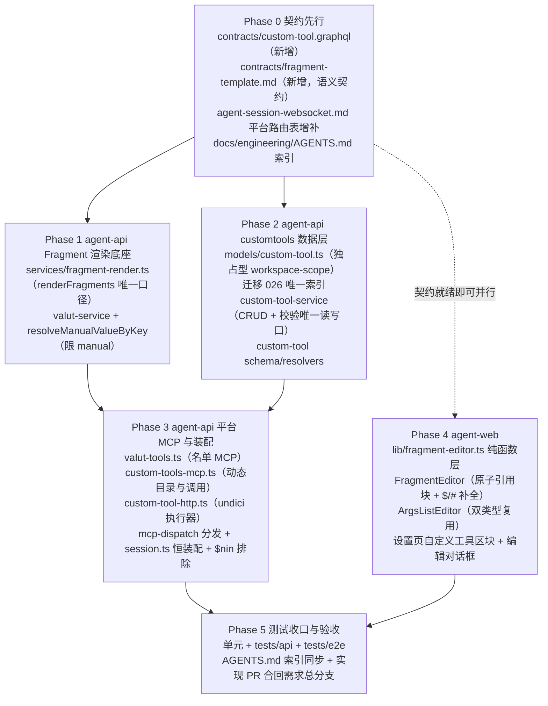

# 自定义渲染模板 + 自定义工具 MCP - 实现计划

**关联 PRD**: `docs/product/draft/20261113-fragment-template-custom-tools.md`（v1.0，Issue #449）
**关联 Proposal**: `docs/engineering/proposals/20261113-feat-fragment-template-custom-tools.md`（v1.0，需求总 PR #505）
**需求总分支（feat-branch）**: `feat/fragment-template-custom-tools`（需求总 PR #505，基于 `origin/main` `3ec68a18`）
**实现分支**: `impl/fragment-template-custom-tools`（基于 `feat/fragment-template-custom-tools`，实现 PR 合回需求总分支）
**创建日期**: 2026-11-15
**计划版本**: v1.0

## 实现顺序



依赖说明：

- **Phase 0 契约先行**（z-coding：技术方案 → 更新 Contract → 开发分支 → 实现）；契约未改不写实现。
- **Phase 1 与 Phase 2 并行**：渲染底座（fragment-render + valut 增补）与 customtools 数据层互不依赖；两者都就绪后才进入 Phase 3（custom-tools-mcp 同时依赖 `renderFragments`、`custom-tool-service` 与 http 执行器）。
- **Phase 4 可与 Phase 1~3 并行开发**（graphql 域文件按契约手写先行、FragmentEditor 不依赖后端），运行时联调需 Phase 1~3 就绪；合并前全部转绿。
- **Phase 5 在实现分支合并回需求总分支前收口**（测试全绿是合并前提）。
- 发布顺序：**agent-api（迁移 026 随启动 runner 幂等执行）→ agent-web**；回滚先回前端。

开发模式 TDD（红-绿-重构）：每个 Phase 内先写测试（RED）→ 实现（GREEN）→ 重构。编码前加载 `docs/engineering/common-rules.md`、`backend-rules.md` / `frontend-rules.md` 与对应子项目 `AGENTS.md`。`tests/api` / `tests/e2e` 只允许 Aspire 编排（禁止裸 docker），重跑从 `aspire start` 重来。

### 关键约束（PRD §5.2 / 提案 §6，实现期不得回退）

- **值不可见是安全红线**：Valut 明文不出服务端——任何界面、接口响应、日志中不出现明文；解密仅 `valut-service` 内部路径，消费点为 `fragment-render`（内存）；http 执行器的请求/响应正文、headers、endpoint 全串、渲染中间值一律不入日志（日志白名单字段：`sessionId/toolId/name/status/reason/errName`）。
- **Valut MCP 只给名单不给值**：`agent-valut-tools` 有且仅有 `valut_list` 一个工具；任何取值诉求 `METHOD_NOT_FOUND`；名单仅含当前工作区 manual 密钥名称（不透出 id 与 refs）。
- **编辑器不求值**：前端 FragmentEditor 只展示引用名，任何状态下不请求、不展示密钥值；求值唯一发生在服务端 `renderFragments`。
- **仅 manual namespace**：Valut 引用取值与 `#` 补全名单都限定 manual；服务托管（`service-*`）密钥名视为取不到（`valut key not found`）。
- **工作区权限复用二期体系**：`customtools` 挂 `applyWorkspaceScope`（**独占型**）；全局工作区写 = 仅 admin（`global workspace is read-only`）；普通工作区 = 成员可读写；跨工作区一律 `Not found`（不泄露存在性）。
- **动态目录与删除即时失效**：`agent-custom-tools` 的 `tools/list` 每次实时查询 `customtools`，不引入快照/缓存；删除后本会话及后续会话调用即 `METHOD_NOT_FOUND`。
- **禁止 rebase/squash**（z-git）：只允许 merge；迁移编号与并行需求冲突用 merge 协调并顺延（见 D1）。
- **实现计划文档提交到需求总分支**（本文件落 `feat/fragment-template-custom-tools`）；实现代码在 `impl/fragment-template-custom-tools`。

---

## 代码事实核对（F1~F14）

> 提案对现状的描述整体准确；以下为在需求总分支（`feat/fragment-template-custom-tools`）上的核对结论与实现必须处理的落点。

| 编号 | 事实 | 对计划的影响 |
|------|------|-------------|
| F1 | 平台 MCP 正典形态为 `services/session-preview-tools.ts`：`ensureSessionPreviewToolsServer(userId)` 以 `findOneAndUpdate({userId,name}, {$setOnInsert:{transport:'platform',source:'platform',enabled:true,tools:[{name,description}]}}, {upsert:true})` 幂等 upsert 返回 `_id` 字符串（E11000 回读兜底）；`handleSessionPreviewToolRequest(caller, request)` 为 switch 形态（`initialize`/`notifications/*`/`ping`/`tools/list`/`tools/call`），返回 `{result?} | {error:{code,message}}` | `valut-tools.ts` / `custom-tools-mcp.ts` 逐形态对齐；`tools` 快照分别为 `[valut_list]` 与 `[]`（动态目录占位，D3） |
| F2 | `mcp-dispatch.ts` 分发顺序：JWT 校验 → sessionId 匹配 → `getStatus` → serverName 解析 → `payload.serverNames.includes(serverName)` 作用域校验 → custom 快照分流（custom-mcp-forwarder，MCP+Valut 已落地）→ `McpServer.findOne({userId,name,enabled:true})` → `transport='platform'` 分支在 `runWithWorkspace(buildSessionWorkspaceContext(...))` 内按 serverName **嵌套三元链**分发（ADMIN/PLATFORM/CLOUD_HOST/SESSION_PREVIEW 四名）；通知（无 id）形态 202 fire-and-forget；`outcome.error` 收敛为 200 + `jsonRpcError` | 两个新 serverName 分支追加在三元链尾部（`SESSION_PREVIEW` 之后、`Unsupported platform server` 之前）；工作区上下文已由 dispatch 统一建立，handler 内直接用 ALS |
| F3 | `session.ts` 装配点位（行 405~417）：云会话并入 `ensureCloudHostToolsServer`（仅 `controller.type==='cloud'`）；**全部类型会话**并入 `ensureSessionPreviewToolsServer`（普通/云/工作流节点会话公共路径，`Array.from(new Set([...]))` 去重）；上方注释明示「平台内置服务自动并入，不参与用户所选 MCP 有效性前置校验」 | 两个新平台服务在同一公共路径点位追加 ensure + 去重并入（D5）；`CreateSessionInput` 零变更成立 |
| F4 | `$nin` 排除口径两处：`services/session.ts:391`（`resolveInitialMcpServerIds` 默认 MCP 候选，现 `[CLOUD_HOST_TOOLS_SERVER_NAME, SESSION_PREVIEW_TOOLS_SERVER_NAME]`）与 `services/controller.ts:154`（`setControllerDefaultMcp` 校验同名数组） | 两处数组各追加 `VALUT_TOOLS_SERVER_NAME` / `CUSTOM_TOOLS_SERVER_NAME` 两个名字（D6）；对应单测（`session.test.ts:2690`、`controller.test.ts:278` 断言数组）同步更新 |
| F5 | 前端 MCP 列表过滤现状：`NewSessionDialog.tsx:90/143-144` 与 `McpDefaultSection.tsx:88` 仅排除 `agent-cloud-host-tools`；`McpRegistrySection` 以 `source` 徽标展示（`platform` →「平台内置」）；`agent-session-preview-tools` 在前端列表可见（服务端装配去重兜底，重复选择无害） | 两个新平台服务的前端可见性沿用 preview 先例：**前端过滤逻辑零改动**，registry 自然显示「平台内置」（D6） |
| F6 | `mcp-endpoint.ts` 为 `McpEndpointService` 类（`createEndpoint(...)` 行 32 / `reissueEndpoint` 行 105，MCP+Valut 已扩展第 5 参 `customMcpServers`）；平台服务走 `mcpServerIds` 通道，JWT `serverNames` 由 mcpServerIds 对应的服务名组成 | 本期 **mcp-endpoint 零变更**：两个平台名经 mcpServerIds 并入后天然进入 JWT `serverNames`，过 dispatch 作用域校验（F2） |
| F7 | 迁移注册点位 `src/index.ts` `runMigrations([...])` 数组（尾部 `migration025SessionInteractions`）；迁移形态 = 具名 export + `run()` + `ensureIndex` 幂等 + 同目录 `.test.ts`；`ensureNamespace('mcp-bearer-tokens', ...)` 启动自检在迁移完成后、就绪之前（行 228 先例） | 迁移编号 **026** 在需求总分支成立；但 `origin/main` 已占用 026（external-logins）/027（oidc-binding-optimization）——需求总分支落后主干，**合回主干前 merge 协调顺延**（D1） |
| F8 | `models/tenant-isolation.test.ts` 硬编码 **21 集合**矩阵（`CASES` 逐一列出 + `TENANT_ID_COLLECTIONS` 长度断言 21）；新增带 tenantId 集合须双注册 | **实现校正**：`customtools` 无 `userId`（独占型 workspace-scope，采集 `tenantId` 仅留档），`applyTenantScope` 对其为 no-op——与 `valutentries`/`custommcpservers` 同口径，**不进** 013 `TENANT_ID_COLLECTIONS` 与 tenant-isolation `CASES`（矩阵保持 21），由迁移 026 建索引、服务层显式写 `tenantId` 保证隔离（D9 据此失效，见下） |
| F9 | `valut-service.ts`：`listManualOptions()`（行 249）强制 `workspaceId=当前工作区`（ALS），无上下文返回空集；`resolveValue(id)`（行 401）按**条目 id** 解密；按 key 取值的原语不存在 | 增补 `resolveManualValueByKey(key, workspaceId)`：按 `{workspaceId, namespace:'manual', key}` 定位后走既有解密路径；非 manual/取不到返回 `null`；不新增任何出参通道（D3 提案 §3.2 一致） |
| F10 | `models/custom-mcp-server.ts` 为独占型 workspace-scope 范本：`tenantId` required 由服务层显式写入（`applyTenantScope` 对无 userId 集合为 no-op）、`applyWorkspaceScope`（不设 shared）、唯一索引 `uniq_custom_mcp_workspace_name {workspaceId,name}` 声明在模型且**与迁移同名同键** | `models/custom-tool.ts` 逐形态对齐（含注释口径）；唯一索引名 `uniq_custom_tool_workspace_name` |
| F11 | 前端 graphql 组织：`queries.ts`/`mutations.ts`/`types.ts` 集中式与域文件（`home.ts`/`preview.ts`/`workflow.ts`）先例并存 | 提案取域文件 `graphql/custom-tool.ts`（D10），与 preview/workflow 先例一致 |
| F12 | `SettingsPage.tsx`：`NAV_ITEMS` 数组 + `NAV_GROUPS`（「MCP」组 = `NAV_ITEMS[6..8]`：MCP 管理/Valut/自定义 MCP）；区块挂载点行 226 注释「Valut 与自定义 MCP 紧随 #mcp-section」 | 「自定义工具」NAV 项追加进「MCP」组尾部（`NAV_ITEMS[9]` 前插入，`CUSTOM_TOOL` 紧随自定义 MCP 区块挂载）；图标沿用 `Plug`/`Wrench` 系 |
| F13 | `custom-mcp-forwarder.ts` 用**全局 fetch**（Node 24 内建 undici fetch）无自定义 dispatcher；`undici` 不是 agent-api 直接依赖（package.json 与 node_modules 均无） | http 执行器的 `insecure` 需要 dispatcher 级 `Agent({connect:{rejectUnauthorized:false}})` → **新增 agent-api 直接依赖 undici**（D2），仅 `custom-tool-http.ts` import；其余链路继续全局 fetch |
| F14 | `apps/agent-web/src/components/common/` 已有 `CommandTemplate.tsx`/`DirectoryPicker.tsx` 先例；`components/ui/popover.tsx` 浮层原语齐备 | `FragmentEditor`（`components/common/fragment-editor/`）与 `ArgsListEditor`（`components/common/args-list-editor/`）落点成立；补全浮层复用 popover 原语，不引入新依赖 |

---

## 计划期裁决（提案留白 / 与现状对齐处的实现口径）

> 均为落地口径，不改变产品结论；实现完成后回写提案勘误（不重开评审）。

1. **D1 迁移编号与主干协调**：需求总分支内使用迁移 **026**（`026-custom-tools`）；`origin/main` 已占用 026/027（F7），实现 PR 合回需求总分支不受影响；**需求总分支合回主干时**若编号被占，按 z-git merge 协调顺延至最新可用编号，并同步修正本文、提案与 `servers/agent-api/AGENTS.md`。
2. **D2 undici 新增直接依赖**：`servers/agent-api/package.json` 新增 `undici`（锁 minor 版本，与 Node 24 内建版本线对齐）；**仅** `custom-tool-http.ts` `import { Agent } from 'undici'`，模块级单例 `insecureAgent`；其余链路保持全局 fetch 零改动。lockfile 随实现 PR 一并提交。
3. **D3 平台服务 tools 快照**：`agent-valut-tools` 快照 `[{name:'valut_list', description:'列出当前工作区可用（手动创建）的 Valut 密钥名称；不提供任何获取密钥值的工具'}]`；`agent-custom-tools` 快照 `[]`（动态目录，`tools/list` 实时枚举，提案 D1）；快照仅用于 mcpservers 集合展示，不作为调用依据。
4. **D4 工具暴露名映射**：`tools/list` 的 `name` 优先用工具展示名——命中 MCP 安全名规则 `^[A-Za-z0-9_-]{1,64}$` 直接用原名；否则用稳定别名 `ct-<id 后 8 位>`（同一次 list 内别名确定性由 id 保证）；`description` 恒携带展示名（别名形态时展示名放 description 首部）；`tools/call` 按同规则反解（先按展示名精确匹配当前工作区可见集，未命中再按 `ct-<id8>` 反查）。
5. **D5 装配点位与形态**：`session.ts` 在 preview 装配块（F3）同点位追加——`{ const valutToolsId = await ensureValutToolsServer(userId); mcpServerIds = Array.from(new Set([...(mcpServerIds ?? []), valutToolsId])); }` 与 custom-tools 同形态两行；注释同步扩展平台服务名单；老会话（装配前创建）不回填（提案口径）。
6. **D6 排除口径增补两处、前端零改动**：`session.ts:391` 与 `controller.ts:154` 的 `$nin` 数组追加两个新名字（F4）；前端 `NewSessionDialog`/`McpDefaultSection` 过滤逻辑**零改动**（沿用 preview 先例，F5），registry 以 `source=platform` 徽标自然展示。
7. **D7 Fragment 序列化前后端同源**：`contracts/fragment-template.md` 为唯一事实源；后端 `fragment-render.ts` 与前端 `lib/fragment-editor.ts`（`fragmentsToNodes`/`nodesToFragments`）各自单测，**round-trip 互锁用例**（同一 fixture 两侧断言）防漂移；Plain 相邻合并、空 Plain 省略规则写进契约。
8. **D8 http 组装与编码分工**：Uri/Json 编码**只**在格式管线发生（`encodeURIComponent`/`JSON.stringify`），组装层（query `URL.searchParams.append`、headers `Headers.append`、body 拼接）**不二次编码**；托管 `content-type`（json/text bodyType 显式设置）优先于用户 headers 同名项（与 custom-mcp-forwarder「托管凭据覆盖」同思路）；渲染后 endpoint 必须 `http(s)://` 开头否则工具错误。
9. **D9 tenant 双注册 21→22（实现期校正：不适用）**：`customtools` 无 `userId`，与 `valutentries`/`custommcpservers` 同口径不进 013 `TENANT_ID_COLLECTIONS` 与 tenant-isolation 矩阵（保持 21 集合）；`applyTenantScope` 对无 `userId` 集合为 no-op，隔离由 `applyWorkspaceScope`（独占型）+ 服务层显式写 `tenantId` + 迁移 026 索引保证。原计划「矩阵 21→22 + 013 追加」经实现核对会破坏既有 21 集合不变量测试（已回退）。
10. **D10 前端 graphql 域文件**：`apps/agent-web/src/graphql/custom-tool.ts` 单文件承载 `GET_CUSTOM_TOOLS`/`GET_CUSTOM_TOOL`/`CREATE_CUSTOM_TOOL`/`UPDATE_CUSTOM_TOOL`/`DELETE_CUSTOM_TOOL` 与手写类型（对齐 `preview.ts` 域文件先例，F11）；错误文案映射独立 `lib/custom-tool.ts`（契约白名单 → 中文，未命中原样展示）。

---

## Phase 0: 契约先行（contracts）

开发分支：`impl/fragment-template-custom-tools`。

### 文件修改

| 文件 | 操作 | 说明 |
|------|------|------|
| `contracts/fragment-template.md` | 新增 | 按提案 §3.1 逐字落地：Fragment/RenderContext 类型、`renderFragments` 签名、渲染规则（Plain 原样空省略 / Valut 取 manual 取不到抛 `valut key not found: <key>` / Parameter 缺失抛 `missing parameter: <key>`）、格式管线（Generic 恒等 / Json = `JSON.stringify` / Uri = `encodeURIComponent`）、上限（`fragments.length ≤ 200`、单 `value ≤ 4096`、渲染总长 `≤ 65536`，超限 `fragment template too large`）、Plain 相邻合并与空 Plain 省略的序列化规则（D7）、安全红线（求值仅服务端、明文不出服务端、日志白名单） |
| `contracts/custom-tool.graphql` | 新增 | 按提案 §3.1 契约 2 逐字段落地：`CustomToolType`/`FragmentType`/`FragmentFormat`/`CustomToolBodyType`/`CustomToolFormFieldType` 枚举；`Fragment`/`CustomToolArg`/`CustomToolFormField`/`CustomToolKeyValue`/`CustomToolHttpConfig`/`CustomTool` 类型；`CreateCustomToolInput`/`UpdateCustomToolInput`；Query `customTools`/`customTool(id)`；Mutation `createCustomTool`/`updateCustomTool`/`deleteCustomTool`；头注释写明：名称工作区唯一、args key 标识符规则与 ≤32、「工作区」权限口径（全局 developer 只读）、`type=file` 本期保留拒绝保存、GET 类带 bodyType 拒绝、错误文案白名单表（`custom tool not found`/`invalid custom tool name`/`invalid custom tool description`/`invalid custom tool args`/`invalid fragment template`/`invalid http config`/`duplicate custom tool name`/`global workspace is read-only`/`Not found`/`workspace not found`/`Not authenticated`） |
| `contracts/agent-session-websocket.md` | 修改 | 平台 MCP 路由表增补 `agent-valut-tools`（名单工具，无取值工具）与 `agent-custom-tools`（**动态目录**——`tools/list` 按会话工作区实时枚举 customtools；`tools/call` 参数齐全校验后 prompt 渲染返回 / http 服务端执行）两个 `transport=platform` 服务的分发口径：不经 Redis、不经 `mcp:forward:*`，`mcp-dispatch` 本地 handler 直发；恒装配、用户不可选 |
| `docs/engineering/AGENTS.md` | 修改 | 「实现计划（`plan/`）」索引追加本计划 |

### 验收 checklist

- [ ] 契约与提案 §3.1/§3.2 逐条对应；`custom-tool.graphql` 全文不存在任何密钥值出参（含错误信息字段）
- [ ] `git diff --stat contracts/` 仅上述三个文件；`agent-session-websocket.md` 除平台路由表增补外无既有口径变更
- [ ] Fragment 上限、args 标识符规则、http 校验规则（method token / endpoint 首片段 Plain http(s) 开头 / header 唯一性名单 / form file 拒绝）与提案 §4.1/§5.2 一致
- [ ] 渲染错误文案（`valut key not found: <key>` / `missing parameter: <key>` / `fragment template too large`）落入契约并被后端白名单引用

---

## Phase 1: agent-api Fragment 渲染底座（fragment-render + valut 增补）

开发分支：`impl/fragment-template-custom-tools`。TDD：先写 `fragment-render.test.ts` 与 `valut-service.test.ts` 增补用例（RED）→ 实现（GREEN）。

### 文件修改

| 文件 | 操作 | 说明 |
|------|------|------|
| `servers/agent-api/src/services/fragment-render.ts`(+test) | 新增 | `renderFragments(fragments, context, resolveValut)` 唯一渲染口径：纯函数 + 注入 `ValutResolver`（不 import Mongoose 模型）；逐片段解析 → 取值（Plain 跳过取值恒 Generic / Valut 经 resolveValut / Parameter 取 `context.params`）→ 格式管线（Generic 恒等 / Json = `JSON.stringify` / Uri = `encodeURIComponent`）→ 拼接；上限校验在渲染前（数量 ≤200 / 单值 ≤4096 / 总长 ≤65536 → `fragment template too large`）；错误带定位（`valut key not found: <key>` / `missing parameter: <key>`，片段序号细节进日志，对外仅白名单文案） |
| `servers/agent-api/src/services/valut-service.ts`(+test) | 修改 | 增补 `resolveManualValueByKey(key, workspaceId): Promise<string \| null>`：按 `{workspaceId, namespace:'manual', key}` 定位条目后走既有解密路径（AES-256-GCM，`CREDENTIAL_ENCRYPTION_KEY` 未配置即抛错，F9）；非 manual namespace/取不到返回 `null`；内部原语（无 ALS 依赖，与 `resolveValue` 同档），不被任何 resolver 引用 |

### 关键实现要点

1. **明文边界**：`resolveManualValueByKey` 返回值只在 `renderFragments` 调用栈内存中出现；渲染结果字符串经 MCP 调用结果回传 Agent 是**唯一**合法出口（PRD 安全红线）；服务/渲染层任何日志不携带 resolved 值。
2. **格式管线纯函数**：`applyFormat(value, format)` 独立导出便于单测；Json 输出带引号（`JSON.stringify` 语义）——文档与编辑器提示「Json 模式自动加引号转义」（提案实现点 1 风险）。
3. **Plain 规则**：`format` 对 Plain 无意义恒按 Generic；空串省略（相邻 Plain 合并在序列化层，D7）。

### 验收 checklist

- [ ] T-FR 矩阵全绿：三类型 × 三格式 9 格渲染正确；Json 输出为合法 JSON 字符串字面量、Uri 输出经 `encodeURIComponent`
- [ ] Valut 取不到（不存在/非 manual）→ `valut key not found: <key>`；Parameter 缺失 → `missing parameter: <key>`；上限三类超限 → `fragment template too large`
- [ ] `resolveManualValueByKey` 仅 manual（`service-*` 条目返回 null）；解密往返正确；`CREDENTIAL_ENCRYPTION_KEY` 缺失即抛错
- [ ] 渲染服务不 import 任何 Mongoose 模型（依赖注入断言）

---

## Phase 2: agent-api customtools 数据层（模型 + 迁移 + 服务 + GraphQL）

开发分支：`impl/fragment-template-custom-tools`。与 Phase 1 并行。TDD：先写 `custom-tool-service.test.ts`、迁移测试、tenant-isolation 矩阵断言（RED）→ 实现（GREEN）。

### 文件修改

| 文件 | 操作 | 说明 |
|------|------|------|
| `servers/agent-api/src/models/custom-tool.ts` | 新增 | `customtools`：`tenantId`（required，服务层显式写入）+ `workspaceId`（`applyWorkspaceScope` **独占型**，F10 范本）、`name`（trim 1..64，唯一索引 `uniq_custom_tool_workspace_name {workspaceId,name}` 模型声明与迁移同名同键）、`description?`（≤512）、`type`（`'prompt'\|'http'`）、`args`（`[{key,name,description?}]`）、`prompt`（Fragment[]，type=prompt 必填，http 恒 null）、`http`（`{method,endpoint,insecure,bodyType?,body?,form?,headers,queries}`，type=http 必填，prompt 恒 null）、`createdBy`、timestamps |
| `servers/agent-api/src/migrations/026-custom-tools.ts`(+test) | 新增 | 幂等 `ensureIndex` 创建 `uniq_custom_tool_workspace_name`（范式同 023/025，「先建后用」）；登记 `src/index.ts` runMigrations 数组尾部（D1 编号协调） |
| `servers/agent-api/src/services/custom-tool-service.ts`(+test) | 新增 | `customtools` 唯一读写口：`list/get/create/update/delete` + `listForMcp(workspaceContext)`（MCP 链路最小字段）；全部入口 `requireContext()`（无工作区上下文 → `workspace not found`）+ `assertWorkspaceWritable`（全局工作区 developer → `global workspace is read-only`）；跨工作区 id → `Not found`、不存在 → `custom tool not found`；创建/更新同一纯函数校验（提案实现点 3）：name trim 1..64 重名预检 + E11000 映射 `duplicate custom tool name`；args ≤32、key `^[A-Za-z_][A-Za-z0-9_]{0,63}$` 且唯一、name trim 1..64、description ≤256（`invalid custom tool args`）；Fragment 通用校验（枚举/数量/单值）；**引用一致性**——配置内所有 Parameter 片段 value ∈ args keys、Valut 片段 value 符合 valut key 规则（trim 1..128 禁空白控制字符），违反 → `invalid fragment template`；http 校验（method 合法 token `^[!#$%&'*+.^_`|~0-9A-Za-z-]{1,32}$` / endpoint 非空且首片段 Plain 以 http(s):// 开头 / headers key 禁空白冒号且唯一性 header（`cookie`/`host`/`content-length`/`authorization` 等）不重复 / queries key 禁空白 / bodyType 与 body、form 配对 / GET 类带 bodyType 拒绝 / form `type=file` 拒绝 → `invalid http config`）；删除按 id + 可见集 `deleteOne`，无级联（按名弱引用，提案 D3） |
| `servers/agent-api/src/graphql/schemas/custom-tool.ts` | 新增 | 与契约逐字段一致；登记 `schemas/index.ts` |
| `servers/agent-api/src/graphql/resolvers/custom-tool.ts` | 新增 | Query/Mutation resolver，`wrap()` 白名单透传（契约错误表）；未认证 `Not authenticated`；**登记 `resolvers/index.ts`**（Mutation/Query 键，漏登记运行时无效——backend-rules 陷阱） |
| `servers/agent-api/src/models/tenant-isolation.test.ts` | 修改 | `CASES` 矩阵追加 customtools、总数断言 21→22（D9） |
| `servers/agent-api/src/migrations/013-tenant-id-backfill.ts` | 修改 | `TENANT_ID_COLLECTIONS` 追加 `{model:'CustomTool', collection:'customtools'}`（D9） |
| `servers/agent-api/AGENTS.md` | 修改 | 新增「自定义工具（customtools）」段（独占型/校验不变量/明文边界） |

### 关键实现要点

1. **校验纯函数**：`validateCustomToolInput(input)` 独立导出，create/update 复用；错误逐字命中契约白名单。
2. **重名两道防线**：服务层预检（`{workspaceId, name}` 查询）+ 唯一索引兜底（E11000 捕获映射）；大小写/空白按 trim 后精确匹配（与 custommcpservers 同口径）。
3. **删除即失效的下游语义**：MCP 链路每次调用实时查询（Phase 3），删除后调用 `METHOD_NOT_FOUND`——本阶段删除不做任何会话侧清理（无快照可清，D3）。

### 验收 checklist

- [ ] 迁移 026 幂等（二次 run 零变更）；唯一索引生效（直写重名文档 E11000）
- [ ] tenant-isolation 矩阵 22 集合全绿；013 `TENANT_ID_COLLECTIONS` 与模型 `collection.name` 逐一相等
- [ ] T-CTS 校验矩阵全绿：name/description/args/fragment 引用一致性/http 各项逐条命中白名单文案
- [ ] 权限矩阵全绿（对照 T-VAL 模式）：全局 developer 读通写拒 / admin 写通；普通工作区成员读写通；非成员/跨租户 `Not found`
- [ ] GraphQL CRUD 全链路；resolver 登记守卫（`resolvers/index.test.ts`）通过

---

## Phase 3: agent-api 平台 MCP 三件套与会话装配

开发分支：`impl/fragment-template-custom-tools`。依赖 Phase 1（renderFragments / resolveManualValueByKey）与 Phase 2（custom-tool-service）。TDD：先写 `valut-tools.test.ts` / `custom-tools-mcp.test.ts` / `custom-tool-http.test.ts` / `mcp-dispatch.test.ts` 增补 / `session.test.ts` 装配用例（RED）→ 实现（GREEN）。

### 文件修改

| 文件 | 操作 | 说明 |
|------|------|------|
| `servers/agent-api/src/services/valut-tools.ts`(+test) | 新增 | 平台 MCP `agent-valut-tools`（F1 形态）：`VALUT_TOOLS_SERVER_NAME = 'agent-valut-tools'`；`ensureValutToolsServer(userId)` 幂等 upsert（tools 快照 `[valut_list]`，D3）；`handleValutToolsMcpRequest({userId, sessionId}, request)`——`initialize`/`notifications`/`ping`/`tools/list` 对齐 preview 形态；`tools/call valut_list` 复用 `valutService.listManualOptions()`（ALS 当前工作区，无上下文返回空集，F9），输出 `[{key, namespaceDisplayName}]`（**仅名称**，无 id 无值无 refs）；其他工具名一律 `METHOD_NOT_FOUND`（不存在取值工具） |
| `servers/agent-api/src/services/custom-tools-mcp.ts`(+test) | 新增 | 平台 MCP `agent-custom-tools`（F1 形态）：`CUSTOM_TOOLS_SERVER_NAME = 'agent-custom-tools'`；`ensureCustomToolsServer(userId)`（tools 快照 `[]`，D3）；`tools/list` 以 ALS 会话工作区上下文查 `custom-tool-service.listForMcp` → 映射 MCP 工具（`name` 暴露名 D4、`description` 恒带展示名、`inputSchema {type:'object', properties:{<argKey>:{type:'string',description}}, required:[全部 argKey]}`）；工作区无工具返回空数组（合法）；`tools/call` 暴露名反解（D4）→ 当前工作区可见集查无 → `METHOD_NOT_FOUND` → 参数齐全校验（缺失 → `INVALID_PARAMS` message 列缺失 key）→ params 归一全转 string → 分流：prompt `renderFragments(tool.prompt, ctx)` → `{content:[{type:'text',text}]}`；http `custom-tool-http.execute` → 结果包装；渲染失败 → `isError:true` + 白名单文案（**不回传任何密钥片段**） |
| `servers/agent-api/src/services/custom-tool-http.ts`(+test) | 新增 | http 执行器：`execute(tool, params, renderContext)`：渲染 endpoint/queries/headers/body（编码只经格式管线，D8）→ endpoint 必须 http(s):// 开头（否则工具错误）→ 组装 undici 请求（`fetch(url, {method, headers, body, dispatcher: insecure ? insecureAgent : undefined, signal: AbortSignal.timeout(30_000), redirect:'follow'})`，`insecureAgent = new Agent({connect:{rejectUnauthorized:false}})` 模块级单例；重定向 ≤5）→ json bodyType 渲染结果必须合法 JSON（否则 `rendered body is not valid json`）→ form `FormData`（`type=file` 保存期已拦截不会出现）→ 响应 `arrayBuffer` 上限 256KB 截断标注 `truncated:true` → 返回 `{status, contentType, bodyText, truncated}`；网络错误/TLS 错误/超时 → `isError` 结果 + 归类文案（`request failed`/`request timeout`/`tls verification failed`，未勾 insecure 的自签证书归入 tls 文案并提示可勾选 insecure）；**日志红线**：请求/响应正文、headers、endpoint 全串、渲染中间值不入日志，只记白名单字段，错误信息先替换敏感片段再截断（custom-mcp-forwarder D4/D8 同口径） |
| `servers/agent-api/package.json` | 修改 | 新增直接依赖 `undici`（锁 minor 版本，D2）；lockfile 同步 |
| `servers/agent-api/src/services/mcp-dispatch.ts`(+test) | 修改 | platform 分支三元链尾部追加 `VALUT_TOOLS_SERVER_NAME` / `CUSTOM_TOOLS_SERVER_NAME` 两个分支（F2）；通知形态 202 与错误收敛沿用既有形态 |
| `servers/agent-api/src/services/session.ts`(+test) | 修改 | preview 装配块同点位追加两个 ensure + 去重并入（D5）；`resolveInitialMcpServerIds` 的 `$nin` 数组追加两个新名字（D6） |
| `servers/agent-api/src/services/controller.ts`(+test) | 修改 | `setControllerDefaultMcp` 校验 `$nin` 数组追加两个新名字（D6） |
| `servers/agent-api/AGENTS.md` | 修改 | 补「平台 MCP：agent-valut-tools / agent-custom-tools」段（恒装配/动态目录/日志红线） |

### 关键实现要点

1. **分发零新机制**：两个 handler 与 preview/cloud-host 同形态挂入既有三元链；作用域（JWT `serverNames`）与在线校验（`getStatus`）由 dispatch 既有链路天然覆盖（F2/F6）。
2. **渲染上下文**：`renderContext = {userId, tenantId, workspaceId, params}`——tenantId/workspaceId 取自 dispatch 建立的会话工作区 ALS（`buildSessionWorkspaceContext`），`resolveValut` 注入包装 `valutService.resolveManualValueByKey`（workspaceId 显式传当前工作区，防 id 猜测）。
3. **删除即时失效**：`tools/list` 与 `tools/call` 都实时查询 `customtools`，无快照无缓存（D3）；改名不影响暴露名稳定性规则（D4）。
4. **insecure 隔离**：`insecureAgent` 模块级单例仅作用于该工具调用，不污染默认 dispatcher（提案 D6）；单例创建失败/进程退出无句柄泄漏（`Agent` 不显式 close，与进程同生灭）。

### 验收 checklist

- [ ] 新建会话（普通/云/工作流节点三类）`mcpServerIds` 含两个平台服务 id 且去重；老会话不受影响
- [ ] MCP 选择默认候选与 `setControllerDefaultMcp` 排除两个新名字（两处 `$nin` 断言更新）
- [ ] `agent-valut-tools`：`tools/list` 仅 `valut_list`；调用返回仅名称（无 id/值/refs）；`service-*` 密钥不出现；其他工具名 `METHOD_NOT_FOUND`
- [ ] `agent-custom-tools`：工具增删改后 `tools/list` 即时反映；暴露名映射（中文名 → `ct-<id8>` 别名，description 带展示名）；参数缺失 `INVALID_PARAMS` 列名；prompt 渲染返回字符串；删除后调用 `METHOD_NOT_FOUND`
- [ ] http 执行器：渲染编码正确（无二次编码）；insecure 跳过证书校验；超时 30s；截断 256KB 标注；错误归类文案；日志断言无敏感片段（白名单字段）
- [ ] 会话终态后调用 401（既有链路）；name 不在作用域 200+`SERVER_NOT_FOUND`（既有口径）

---

## Phase 4: agent-web（FragmentEditor + ArgsListEditor + 设置页区块）

开发分支：`impl/fragment-template-custom-tools`（契约 Phase 0 就绪后可并行）。TDD：先写组件测试（RED）→ 实现（GREEN）。编码前加载 `frontend-rules.md` 与 `apps/agent-web/AGENTS.md`。

### 文件修改

| 文件 | 操作 | 说明 |
|------|------|------|
| `apps/agent-web/src/graphql/custom-tool.ts` | 新增 | 域文件（D10）：`GET_CUSTOM_TOOLS`/`GET_CUSTOM_TOOL`/`CREATE_CUSTOM_TOOL`/`UPDATE_CUSTOM_TOOL`/`DELETE_CUSTOM_TOOL` 与手写类型（Fragment/CustomTool/Input 形状与契约一致） |
| `apps/agent-web/src/lib/custom-tool.ts` | 新增 | 契约白名单错误文案 → 中文映射（未命中原样展示）；暴露名安全规则等纯函数（与 D4 同规则） |
| `apps/agent-web/src/lib/fragment-editor.ts`(+test) | 新增 | 序列化/解析纯函数层（D7）：`fragmentsToNodes`/`nodesToFragments` 双向、相邻 Plain 合并、空 Plain 省略；round-trip fixture 与后端 `fragment-render` 单测互锁 |
| `apps/agent-web/src/components/common/fragment-editor/FragmentEditor.tsx`(+test) | 新增 | 可复用编辑器（contentEditable 自实现，提案 D4）：受控 `value: Fragment[]`/`onChange`；props `mode:'single'\|'multi'`、`editorMode:'Generic'\|'Json'\|'Uri'`、`params: Record<string,{name,description?}>`、`placeholder?`、`disabled?`、`ariaLabel`；Plain → 文本节点；Valut/Parameter → `contentEditable={false}` 原子 chip（两类型不同配色 `data-fragment-type` 标记，展示引用名 + Json/Uri 格式角标）；`beforeinput` 拦截——`$` 打开参数补全浮层（列出 params key+name+description，键盘/鼠标选择，Esc 关闭），`#` 打开 Valut 补全（数据源 `GET_VALUT_MANUAL_OPTIONS`，仅对话框打开时拉取，`cache-and-network`，仅 manual）；选中插入 chip（格式按当前 editorMode，Plain 恒 Generic）；退格在 chip 边界整体删除（`keydown` 处理 selection 紧邻场景）；单行模式拦截 Enter 与粘贴换行（`\n`→空格）；IME 期间不触发补全（`compositionstart/end` 门控）；补全浮层复用 `components/ui/popover.tsx` 原语（F14），零新依赖 |
| `apps/agent-web/src/components/common/args-list-editor/ArgsListEditor.tsx`(+test) | 新增 | 参数列表编辑器（prompt/http 双类型复用，PRD 功能点 7）：按行维护 `{key,name,description?}`，增删改、标识重复与非法（`^[A-Za-z_][A-Za-z0-9_]{0,63}$`）即时提示；删除仍被模板引用的参数时给出拦截提示（保存期服务端一致性校验兜底） |
| `apps/agent-web/src/components/settings/CustomToolSection.tsx`(+test) | 新增 | 设置页区块（形态对齐 `CustomMcpSection`）：标题「自定义工具」+ `<Badge>工作区</Badge>`；列表（名称/类型徽标/描述/更新时间）；空态「暂无自定义工具」；删除二次确认；`useWorkspaceAccess().readOnly` 收敛编辑入口（服务端插件权威兜底）；数据 `GET_CUSTOM_TOOLS`（`cache-and-network`）+ mutation `refetchQueries`；随当前工作区切换（既有 apollo workspaceLink） |
| `apps/agent-web/src/components/settings/CustomToolDialog.tsx`(+test) | 新增 | 新增/编辑对话框：名称/描述/类型选择（prompt/http）；`ArgsListEditor`；type=prompt → 提示文案「这个工具会要求 AI 输入参数列表中的参数，并将提示词的内容进行模板替换」+ 多行 FragmentEditor（Generic 模式）；type=http → 表单布局 `[method 下拉+可自定义][endpoint 单行 Uri 模式 FragmentEditor][insecure 勾选+风险提示]` / `[body]`（GET/HEAD 隐藏；POST 类默认 bodyType=json；text→多行 Generic、json→多行 Json 模式、form→键值行编辑器：key 单行 + type 下拉（text 可选 / file 禁用并提示「本期不支持」）+ value 单行 Generic FragmentEditor）/ `[queries]`（勾选展开，value 单行 Uri 模式）/ `[headers]`（勾选展开，value 单行 Generic 模式）；key 校验即时提示；每处 FragmentEditor 独立受控 value（禁止共享 store） |
| `apps/agent-web/src/pages/SettingsPage.tsx` | 修改 | NAV「MCP」组追加「自定义工具」项（紧随「自定义 MCP」，F12）；挂载 `CustomToolSection`（紧随 CustomMcpSection） |
| `apps/agent-web/AGENTS.md` | 修改 | 新增「自定义工具 / FragmentEditor（设置页）」段（组件复用口径/不求值红线） |

### 关键实现要点

1. **不求值红线**：编辑器任何状态不请求、不展示密钥值；`#` 补全只拿名单（`GET_VALUT_MANUAL_OPTIONS` 契约无 value 出参）；组件单测断言无 value 相关请求/渲染。
2. **原子 chip 模型**：chip 一律 `contentEditable={false}`、不可块内编辑；整体删除；跨浏览器差异以此规避（提案实现点 7）；IME 门控防中文输入误触补全。
3. **工作区切换**：两区块数据随 `x-workspace-id` 自动切换（`cache-and-network` + 切工作区 `resetStore` 沿用既有口径）；`#` 补全名单同样随工作区。
4. **嵌套编辑器隔离**：http 表单内多处 FragmentEditor 各自独立受控，禁止共享状态（提案实现点 8 风险）。

### 验收 checklist

- [ ] 设置页「自定义工具」区块（标题带「工作区」badge），列表随工作区切换；空态/删除二次确认/只读收敛
- [ ] FragmentEditor：单行拦截 Enter 与粘贴换行；多行换行正常；两类 chip 高亮可区分（含格式角标）；`$` 仅列已声明参数、`#` 仅列 manual 密钥名；chip 整体删除；保存再打开原样还原（round-trip）
- [ ] prompt 表单：提示文案逐字出现；未声明的参数引用保存被拦截并提示引用名
- [ ] http 表单：method 下拉含常用项且可自定义；GET 类隐藏 body、POST 类默认 json；headers/queries 勾选展开按行编辑、Cookie 重复被拦截；form file 禁用并提示
- [ ] ArgsListEditor 双类型复用交互一致；标识重复/非法即时拦截
- [ ] 移动端布局不横向溢出（沿用既有 section 宽度约束；Dialog 内 `min-w-0` 三件套）

---

## Phase 5: 测试收口与验收

### 文件修改

| 文件 | 操作 | 说明 |
|------|------|------|
| `tests/api/src/agent-api/custom-tool.test.ts` | 新增 | T-CT-API 系列：CRUD 全链路 + 权限矩阵（全局 developer 拒绝 `global workspace is read-only` / 非成员 `Not found`）+ 重名 `duplicate custom tool name` + 校验白名单逐字断言 |
| `tests/api/AGENTS.md` | 修改 | 测试清单追加套件说明 |
| `tests/e2e/src/settings-custom-tool.spec.ts` | 新增 | E2E-CT1：设置页创建 prompt 工具（参数 + Fragment 模板 + `$`/`#` 补全）→ 建会话 → 经会话 MCP 代理端点直接 `tools/call` 驱动（wire 级，不依赖真实 LLM 决策，对齐「真实握手 + 协议字节流 + 全链路 stub」分层口径）→ 断言渲染串返回与参数缺失拒绝；E2E-CT2：http 工具打 fake upstream（headers 含 Valut 引用）→ 断言状态与正文回传、Valut 值全程不出现在任何界面与响应（除工具调用最终渲染产物）；E2E-CT3：Valut MCP 名单可见（仅 manual）且无取值工具 |
| `tests/e2e/AGENTS.md` | 修改 | 测试清单同步 |
| `docs/engineering/AGENTS.md` / `servers/agent-api/AGENTS.md` / `apps/agent-web/AGENTS.md` | 修改 | 索引与口径最终收口（各 Phase 已随改，本 Phase 复核） |

### 命令参考

```bash
# 单测（各自子项目）
cd servers/agent-api && pnpm test -- fragment-render valut-tools custom-tool custom-tools-mcp custom-tool-http mcp-dispatch session controller tenant-isolation
cd servers/agent-api && pnpm test -- migrations/026
cd apps/agent-web  && pnpm test -- FragmentEditor ArgsListEditor CustomToolSection CustomToolDialog fragment-editor

# 类型/构建
cd servers/agent-api && pnpm build
cd apps/agent-web && pnpm lint && pnpm build

# 编排（API/E2E 前置；禁止裸 docker）
aspire start && aspire wait agent-api && aspire wait agent-web
cd tests/api && API_URL=... INTERNAL_API_TOKEN=... pnpm test -- custom-tool
cd tests/e2e && BASE_URL=... API_URL=... INTERNAL_API_TOKEN=... pnpm exec playwright test settings-custom-tool
```

### 测试矩阵（TDD 先红后绿）

| 编号 | 用例 | 落点 |
|------|------|------|
| T-FR1 | 三类型 × 三格式 9 格渲染矩阵（Json 带引号、Uri 编码、Plain 空省略） | `fragment-render.test.ts` |
| T-FR2 | 错误定位：`valut key not found: <key>` / `missing parameter: <key>` / `fragment template too large`（数量/单值/总长三档） | 同上 |
| T-FR3 | 依赖注入：不 import Mongoose 模型；resolveValut 返回 null → Valut 错误 | 同上 |
| T-FR4 | `resolveManualValueByKey`：仅 manual（`service-*` 返回 null）；解密往返；KEY 缺失抛错 | `valut-service.test.ts` |
| T-MIG26 | 026 幂等、唯一索引生效、二次 run 零变更 | `migrations/026-custom-tools.test.ts` |
| T-CTS1 | 校验矩阵：name/description/args（标识符/重复/≤32）逐字白名单 | `custom-tool-service.test.ts` |
| T-CTS2 | 引用一致性：Parameter 引用未声明拒绝；删除仍被引用参数拒绝；Valut key 规则 | 同上 |
| T-CTS3 | http 校验：method token / endpoint http(s) 开头 / Cookie 等唯一性 header 重复 / GET 带 bodyType / form file 拒绝 | 同上 |
| T-CTS4 | 权限矩阵：全局 developer 写拒 / admin 写通；普通工作区成员读写；非成员/跨租户 `Not found`；无上下文 `workspace not found` | 同上 + `tests/api` |
| T-CTS5 | 重名两道防线（预检 + E11000 映射 `duplicate custom tool name`） | 同上 |
| T-VAL1 | `tools/list` 仅 `valut_list`；`valut_list` 返回仅名称（无 id/值/refs）；仅 manual；无 ALS 返回空集 | `valut-tools.test.ts` |
| T-VAL2 | 取值工具不存在：任意其他工具名 `METHOD_NOT_FOUND` | 同上 |
| T-CTM1 | 动态目录：增删改后 `tools/list` 即时反映；空工作区返回空数组 | `custom-tools-mcp.test.ts` |
| T-CTM2 | 暴露名映射：安全名原名直用、中文名 `ct-<id8>` 别名、description 带展示名、call 双向反解 | 同上 |
| T-CTM3 | 参数缺失 `INVALID_PARAMS` 列缺失 key；params 归一全 string；删除后 `METHOD_NOT_FOUND` | 同上 |
| T-CTM4 | prompt 渲染返回 text content；Valut 取不到 `isError:true` 白名单文案且无密钥片段 | 同上 |
| T-CTH1 | 渲染组装：endpoint/queries/headers/body 编码正确（无二次编码）；json 非法拒绝 `rendered body is not valid json` | `custom-tool-http.test.ts` |
| T-CTH2 | insecure 跳过证书校验（自签 fake upstream）；未勾选时 TLS 错误归类文案含 insecure 提示 | 同上 |
| T-CTH3 | 30s 超时 `request timeout`；不可达 `request failed`；256KB 截断 `truncated:true`；重定向 ≤5 | 同上 |
| T-CTH4 | 日志红线：spy 断言日志无正文/headers/endpoint 全串/渲染中间值，仅白名单字段 | 同上 |
| T-SESS1 | 三类会话（普通/云/工作流节点）装配两个平台服务且去重；平台 id 不参与用户所选校验 | `session.test.ts` |
| T-SESS2 | 两处 `$nin` 排除两个新名字（默认候选 + setControllerDefaultMcp） | `session.test.ts` / `controller.test.ts` |
| T-DISP | mcp-dispatch 两个新分支分发（含通知 202、error 收敛 200+jsonRpcError） | `mcp-dispatch.test.ts` |
| T-ISO | tenant-isolation 22 集合矩阵 + 013 TENANT_ID_COLLECTIONS 同步 | `tenant-isolation.test.ts` |
| T-FE1 | lib round-trip：序列化/解析互逆（相邻 Plain 合并、空 Plain 省略），与后端 fixture 互锁 | `lib/fragment-editor.test.ts` |
| T-FE2 | FragmentEditor：chip 原子删除、单行拦截、IME 门控、`$`/`#` 补全触发与插入（格式随 editorMode） | `FragmentEditor.test.tsx` |
| T-FE3 | 不求值红线：组件任何状态不发起 value 相关请求、不渲染密钥值 | 同上 |
| T-ALE | ArgsListEditor：增删改、标识重复/非法即时拦截 | `ArgsListEditor.test.tsx` |
| T-CTW1 | 设置区块：列表/空态/删除二次确认/只读收敛/工作区 badge | `CustomToolSection.test.tsx` |
| T-CTW2 | 对话框：类型切换、GET 隐藏 body、POST 默认 json、form file 禁用、headers/queries 勾选展开、Cookie 重复拦截 | `CustomToolDialog.test.tsx` |
| API-CT | tests/api：CRUD 全链路 + 权限矩阵 + 白名单逐字 | `tests/api/src/agent-api/custom-tool.test.ts` |
| E2E-CT1 | prompt 工具创建 → 会话 MCP 代理端点 tools/call（wire 级）→ 渲染串返回 / 参数缺失拒绝 | `tests/e2e/src/settings-custom-tool.spec.ts` |
| E2E-CT2 | http 工具打 fake upstream（Valut header 引用）→ 状态与正文回传；明文零暴露（除最终渲染产物） | 同上 |
| E2E-CT3 | Valut MCP 名单可见（仅 manual）且无取值工具 | 同上 |

---

## 风险与回滚

| 风险 | 影响 | 处置 |
|------|------|------|
| 明文泄漏（日志/响应/页面） | 安全红线失守 | 契约无出参 + 日志白名单 + T-CTM4/T-CTH4/T-FE3 断言；评审卡点逐条核对 |
| 迁移编号与主干冲突 | 026 撞号（main 已占用 026/027） | D1：需求总分支内用 026，合回主干前 merge 协调顺延并同步本文/提案/AGENTS |
| undici 新依赖引入面 | 依赖面扩大、版本漂移 | D2：锁 minor 版本、仅 custom-tool-http 单点 import；lockfile 随 PR 评审 |
| contentEditable 跨浏览器差异 | 编辑器行为不一致 | 原子 chip 不可编辑 + 整体删除规避；IME 门控；组件测试覆盖关键交互 |
| http 执行器 SSRF 面 | 服务端直连任意目标 | 与 custom-mcp-forwarder 同口径（不限制内外网，PRD 约束）；30s 超时 + 256KB 截断 + 日志红线兜底；**已知取舍**：响应先全量缓冲再截断（受 30s 兜底），流式读取列为后续优化（评审确认本期可接受） |
| Json 格式双引号误用 | 用户模板自写引号导致双写 | 契约/编辑器提示「Json 模式自动加引号转义」；T-FR1 锚定语义 |
| 老会话无新平台服务 | 装配前创建的会话看不到新工具 | 接受（提案口径）：继续会话/新会话获得，不回填 |
| 发布倒挂（新前端 + 旧 agent-api） | 新区块查询报错 | 发布顺序 agent-api → agent-web；回滚先回前端 |

**回滚**：agent-web 回滚即隐藏新区块（前端单回滚不影响后端）；agent-api 回滚后 `customtools` 数据保留无害（全新集合，无存量依赖）；迁移 026 只增不改，回滚不需要反向迁移；两个平台服务行（mcpservers）保留不影响既有链路（旧代码不感知新 serverName）。

---

## 验收 checklist（对齐 PRD §1.3 与提案 §10）

- [ ] 技术方案与契约评审通过（需求总 PR #505；本计划随契约评审）
- [ ] 三类 Fragment × 三种格式渲染正确；Valut 取不到/参数缺失渲染失败并指明引用；渲染只在服务端发生
- [ ] Valut 引用与名单仅限 manual；服务托管密钥名视为取不到
- [ ] Valut MCP：Agent 可列出当前工作区 manual 密钥名；任何 MCP 工具都不返回密钥值；跨工作区不可见
- [ ] 自定义工具 CRUD：工作区内重名拒绝；全局工作区非管理员写拒绝；非成员按「不存在」；删除二次确认且删除后调用即失效
- [ ] prompt 工具：未声明的参数引用保存拦截；调用缺参拒绝并列名；参数齐全返回渲染串
- [ ] http 工具：method/endpoint/insecure/body(text/json/form，file 保留禁用)/headers/queries 各处引用正确渲染编码；服务端发起请求；状态与响应回传；不可达/超时明确错误；insecure 跳过证书校验
- [ ] Fragment 编辑器在 prompt 与 http 表单各处复用；ArgsListEditor 双类型复用；编辑器任何状态不求值、不见密钥值
- [ ] T-FR/T-VAL/T-CTS/T-CTM/T-CTH/T-MIG26/T-SESS/T-DISP/T-ISO/T-FE/T-ALE/T-CTW/API-CT/E2E-CT 全绿；agent-api/agent-web 构建通过
- [ ] AGENTS.md 索引同步（engineering plan 索引 + 各子项目口径）

## 相关文档

- [关联 PRD](../../product/draft/20261113-fragment-template-custom-tools.md)（v1.0）
- [关联 Proposal](../proposals/20261113-feat-fragment-template-custom-tools.md)（v1.0）
- [MCP+Valut 功能迭代实现计划](./20261104-feat-mcp-valut-iteration.md)（Valut 底座与 custom-mcp-forwarder 口径来源）
- [多租户二期实现计划](./20261028-feat-multi-tenant-phase2.md)（workspace-scope 独占型与权限体系基础）
- [需求总 PR #505](https://github.com/Deliay/z-agent-gear/pull/505) / [Issue #449](https://github.com/Deliay/z-agent-gear/issues/449)
