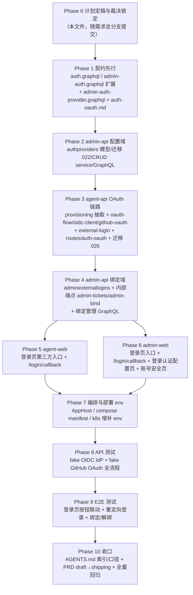

# 支持自定义 OIDC 登录和 GitHub OAuth 登录 - 实现计划

**关联 Proposal**: `docs/engineering/proposals/20261113-feat-oidc-github-oauth-login.md`（v1.0）
**关联 PRD**: `docs/product/draft/20261113-oidc-github-oauth-login.md`（v1.0）
**需求总分支（feat-branch）**: `feat/oidc-github-oauth-login`（基于 `origin/main`，需求总 PR [#504](https://github.com/Deliay/z-agent-gear/pull/504)）
**计划提交分支**: `feat/oidc-github-oauth-login`（本文件随需求总分支提交）
**创建日期**: 2026-11-14
**计划版本**: v1.0

**版本说明**：

- v1.0（2026-11-14）首版。对齐提案 **v1.0** 与 PRD **v1.0**（需求总 PR #504 已推送）。§3 登记计划期代码事实核对结果与落地裁决：迁移编号 022/026 与提案一致未被占用、AppHost 需向 agent-api 补注 `CREDENTIAL_ENCRYPTION_KEY`、TENANT_ID_COLLECTIONS 集合数 21→22、用户名规则 2~20 与派生口径对齐、fake IdP 测试基建选型等。

## 1. 实现顺序



依赖说明：

- **Phase 1 契约先行**：GraphQL schema 与手写 typeDefs 双写一致性测试随各服务端实现同步转绿（契约文件本身先落地，作为实现唯一事实源）。
- **Phase 2 → Phase 3**：agent-api 只读镜像 `authproviders` 模型，索引声明必须与 admin-api 迁移 022 逐字一致，故配置域先行；agent-api 侧 `autoIndex=false` 不重复建索引（沿用 providers 写方/镜像模式）。
- **Phase 3 → Phase 4**：绑定域的 GraphQL（createAdminBindTicket 等）与内部端点被 agent-api 回调分流消费；两端经 `INTERNAL_API_TOKEN` 内部 REST 解耦，契约（auth-oauth.md）在 Phase 1 已锁定，Phase 3/4 可并行起步，联调点在 Phase 8。
- **Phase 5/6 前端**：依赖 Phase 1 契约与对应后端 resolver 就绪；两 app 组件各自实现，**禁止跨项目 import**。
- **TDD**：全部 Phase 红-绿-重构；先写 fake IdP/fake GitHub 测试基建与契约/模型测试，再写实现。
- **PRD 生命周期**：实现阶段开始时 `docs/product/draft/20261113-oidc-github-oauth-login.md` 移入 `docs/product/shipping/`（z-product 规范），在 Phase 10 收口时执行（文件名不变）。

### 1.1 开发分支与合并顺序

| 分支 | 范围 | 基于 | 合并目标 |
|------|------|------|---------|
| `feat/oidc-github-oauth-login` | PRD / 提案 / 本计划 | `origin/main` | 需求总 PR #504 |
| `feat/oidc-github-oauth-login-impl-contracts` | Phase 1 契约四件 | 需求总分支 | 需求总分支 |
| `feat/oidc-github-oauth-login-impl-admin-api` | Phase 2 + Phase 4（admin-api 配置域与绑定域） | 需求总分支（contracts 合并后） | 需求总分支 |
| `feat/oidc-github-oauth-login-impl-agent-api` | Phase 3（agent-api OAuth 链路） | 需求总分支（contracts 合并后） | 需求总分支 |
| `feat/oidc-github-oauth-login-impl-agent-web` | Phase 5 | 需求总分支（agent-api 合并后） | 需求总分支 |
| `feat/oidc-github-oauth-login-impl-admin-web` | Phase 6 | 需求总分支（admin-api 合并后） | 需求总分支 |
| `feat/oidc-github-oauth-login-impl-infra-tests` | Phase 7~10（编排 env、API/E2E、收口） | 需求总分支（前端合并后） | 需求总分支 |

- 每个实现分支内按 Phase 分提交（`test(...): ...（红）` → `feat(...): ...`（绿） → `docs(...): ...`）；**禁止 rebase/squash，只允许 merge**（z-git 规范）。
- admin-api 与 agent-api 两实现分支可并行；前端两分支可并行；合并顺序按上表依赖。
- 各子项目实现按 z-coding 规范可委托 subagent 并行（每个子项目一个 todo），完成后各提 PR 回需求总分支。

### 1.2 开发模式与规范加载

- 编码前加载：`docs/engineering/common-rules.md`；后端 Phase 2/3/4 加载 `docs/engineering/backend-rules.md`，前端 Phase 5/6 加载 `docs/engineering/frontend-rules.md`。
- 目录级 `AGENTS.md`：根、`servers/agent-api/AGENTS.md`、`servers/admin-api/AGENTS.md`、`apps/agent-web/AGENTS.md`、`apps/admin-web/AGENTS.md`、`tests/api/AGENTS.md`、`tests/e2e/AGENTS.md`、`aspire/AgentGear.AppHost/AGENTS.md`、`docs/engineering/AGENTS.md`（含 `plan/AGENTS.md`）；修改哪个目录即同步其 AGENTS.md 口径。
- 日志一律 pino 单行 JSON（vendored observability），字段与脱敏口径见 `contracts/observability.md`；**token/code/secret/state/ticket 一律不入日志**。
- 测试纪律：新增用例先进红再转绿；存量套件零回归（尤其 `internal-users.test.ts`、`auth.test.ts`、admin-api `auth.test.ts`、schema 契约测试）。

## 2. 命令参考

```bash
# 服务编排（唯一允许方式，禁止直接 docker）
aspire start && aspire wait agent-api admin-api

# 单元测试（各包内）
cd servers/agent-api && pnpm test
cd servers/admin-api && pnpm test
cd apps/agent-web && pnpm test
cd apps/admin-web && pnpm test

# 构建 / 静态检查
pnpm run build   # 各包
pnpm run lint    # apps/*

# API 测试（fake IdP / fake GitHub 为进程内 mock，env 覆盖注入）
API_URL=http://localhost:10001/graphql \
ADMIN_API_URL=http://localhost:10003/graphql \
INTERNAL_API_TOKEN=<token> MONGODB_URI=<mongo> REDIS_URL=<redis> \
OIDC_TEST_ISSUER=http://127.0.0.1:19419 \
GITHUB_OAUTH_AUTHORIZE_URL=http://127.0.0.1:19418/login/oauth/authorize \
GITHUB_OAUTH_TOKEN_URL=http://127.0.0.1:19418/login/oauth/access_token \
GITHUB_OAUTH_API_BASE=http://127.0.0.1:19418 \
cd tests/api && pnpm test

# E2E
BASE_URL=http://localhost:<agent-web> ADMIN_WEB_URL=http://localhost:<admin-web> \
API_URL=http://localhost:10001/graphql ADMIN_API_URL=http://localhost:10003/graphql \
INTERNAL_API_TOKEN=<token> MONGODB_URI=<mongo> \
cd tests/e2e && pnpm exec playwright test --workers=1
```

> Redis 键断言沿用 `REDIS_URL` 直连先例（Aspire rediss 自签证书需 `NODE_EXTRA_CA_CERTS` 或 `NODE_TLS_REJECT_UNAUTHORIZED=0`，见 tests/api/AGENTS.md）。

## 3. 计划期裁决（提案与代码事实偏差的落地口径）

> 以下裁决以**当前代码事实**为准（需求总分支 `08d7cfc7`）。提案中与之不一致或含混的描述在实现期按本节执行，**不回改提案**；验收报告逐条登记。

### 3.1 事实核对结论（已核实，无需返工）

| # | 核对项 | 结论 |
|---|--------|------|
| F1 | 迁移编号 | agent-api 最新 `025-session-interactions` → **026-external-logins 可用**；admin-api 最新 `021-docker-registry-mirrors` → **022-auth-providers 可用**，与提案一致 |
| F2 | `routes/internal-users.ts` | 开户逻辑（账户+用户+个人租户+计费 get-or-create+全局工作区 `ensureGlobalWorkspace({adminUserId, createdBy:'provision'})`）当前内联于单文件，抽取目标 `services/provisioning.ts`；端点保持幂等/409/503/回滚语义，存量 `internal-users.test.ts` 全绿为零回归判据 |
| F3 | agent-api config | 现有 `frontendUrl`（FRONTEND_URL 默认 `http://localhost:5173`）、`adminApiUrl`、`internalApiToken`；无 `PUBLIC_BASE_URL`/`ADMIN_FRONTEND_URL` —— 本期新增 |
| F4 | admin-api config | 现有 `agentApiUrl`、`internalApiToken`；无 `AGENT_API_PUBLIC_URL`/`ADMIN_FRONTEND_URL` —— 本期新增 |
| F5 | 加密基建 | 双端各有 `services/crypto.ts`（AES-256-GCM + `CREDENTIAL_ENCRYPTION_KEY`）；**AppHost 当前仅向 admin-api 注入该参数**（AppHost.cs  adminApi 段），agent-api 缺省回落全零 hex —— agent-api 解密 `encryptedClientSecret` 前必须补注入（裁决 D1） |
| F6 | Redis state 先例 | `routes/github.ts` 用 `get`+`del`；本期按提案统一 **GETDEL** 一次性消费（ioredis 原生支持 `getdel`），更严谨，无兼容负担 |
| F7 | 路由挂载 | agent-api `index.ts`：webhook 路由在全局 `express.json()` 前；新 OAuth 路由为纯 GET（无 body/验签需求），挂在既有 `/api` 组（与 `sessionStreamRouter` 同段），顺序无特殊要求 |
| F8 | schema 登记 | agent-api `graphql/schemas/index.ts` 为手写串数组；新/改 typeDefs 必须入数组，resolver 必须登记 `graphql/resolvers/index.ts`（含 `User`/`Session` 等类型级键），否则运行时无效；admin-api 同构 |
| F9 | admin 守卫 | admin-api `graphql/resolvers/guard.ts` `assertAdmin`：未认证 `Not authenticated`（UNAUTHENTICATED）、`mustChangePassword=true` → `MUST_CHANGE_PASSWORD`；白名单 `adminMe/adminLogin/changeAdminPassword` —— 本期新增免登录查询 `adminAuthProviders` 必须列入白名单口径（不走 assertAdmin），`adminExchangeLoginTicket` 同（登录前置，不能要求已登录） |
| F10 | 前端现状 | agent-web `LoginPage`（`LOGIN_MUTATION` + `useAuth.login(token,user)` → `navigate('/')`），路由仅 `/login` 公开；admin-web `LoginPage`（`ADMIN_LOGIN` + mustChangePassword 跳 `/change-password`），受保护 `AdminLayout` 下无安全页 —— 本期新增公开路由 `/login/callback`（两端）与 admin-web 两个受保护页 |
| F11 | 测试基建先例 | `tests/api/src/mock-github-server.ts`（进程内 mock、`MOCK_GITHUB_PORT` 19418、`GITHUB_API_BASE` 注入）；本期 GitHub OAuth fake 复用该 mock 扩展 `authorize/token` 端点（与既有 API mock 共存，裁决 D4）；fake OIDC IdP 为新建（`fake-oidc-server.ts`，端口 19419，裁决 D5） |
| F12 | 用户名规则 | `assertUsernamePasswordRules`：username 2~20、password ≥6；OAuth 开户 `deriveUsername` 派生（过滤 `[a-zA-Z0-9_-]` → 截断 20 → 不足补 `u_`）与同口径一致；密码为随机 32 字节再 bcrypt，**provisioning 新签名接受预哈希 passwordHash，跳过明文规则校验**（裁决 D2） |
| F13 | AppHost 注入现状 | dev：`FRONTEND_URL=agentWeb endpoint`、`ADMIN_API_URL` 已注入 agentApi；publish：`frontend-url` 参数；admin-api 已注入 `AGENT_API_URL`。本期新增参数 `admin-frontend-url`（缺省 `http://localhost:5174`）与 `agent-api-public-url`（publish 用；dev 缺省 `http://localhost:10001`），并补 `CREDENTIAL_ENCRYPTION_KEY` 注入 agentApi |
| F14 | 租户隔离双注册 | `externallogins` 带 `userId` → 必须声明 `tenantId` + `applyTenantScope`，并在 `models/tenant-isolation.test.ts` 与迁移 013 `TENANT_ID_COLLECTIONS` **双注册**（集合数 21 → **22**，T-ISO 计数断言同步） |
| F15 | adminexternallogins | 归属 admin-api（admin 侧无租户 scope 插件体系），不适用双注册；索引 `{providerId,issuer,subject}` 唯一 + `{adminUserId,providerId}` 唯一，由迁移 022 幂等创建 |
| F16 | 镜像模型先例 | agent-api `models/provider.ts` 为 admin-api 写方集合的只读镜像（`autoIndex=false`）；`authproviders` 镜像同模式：模型文件双端镜像、索引声明逐字一致、agent-api 不建索引 |

### 3.2 设计裁决（提案留白/含混处）

1. **agent-api 加密键注入（F5）**：AppHost 向 agentApi 追加 `.WithEnvironment("CREDENTIAL_ENCRYPTION_KEY", credentialEncryptionKey)`（dev + publish 同口径）；compose/k8s manifest 同步。k8s secret 复用既有同名键源。agent-api config 保留现有全零缺省（本地无 OIDC 配置时不影响启动），**存在启用中的 OIDC provider 且密钥为缺省值时启动告警**（warn 一条，不阻塞）。
2. **provisioning 签名（F2/F12）**：`services/provisioning.ts` 导出 `provisionUser({username, passwordHash, source: 'internal'|'oauth'})`——预哈希密码直入；`routes/internal-users.ts` 改为薄封装（先 `assertUsernamePasswordRules` 明文校验 + `hashPassword`，再调 provisioning；409 幂等重放判定（verifyPassword 匹配既有账户）保留在端点层，因 OAuth 路径无此语义）。返回 `{user, account, tenant, globalWorkspace, created}`。失败回滚语义逐字保持。
3. **`externallogins` 归属字段**：`tenantId` = 用户个人租户 id（personal 期 = userId），由插件写入链路补齐；集合为**用户级事实记录**（跟随成员本人，同 commit-settings 例外口径不同——本集合挂 `applyTenantScope`，因查询均带 userId 维度且迁移 013 模式要求带 userId 集合必须注册）。唯一索引 `{providerId,issuer,subject}` 为**全局唯一**（跨租户身份幂等锚点，不含 tenantId 维度）。
4. **GitHub OAuth fake（F11）**：扩展 `tests/api/src/mock-github-server.ts` 增加 `POST /login/oauth/access_token` 与 `GET /login/oauth/authorize`（authorize 直接 302 回 redirect_uri 带 code+state，模拟用户已授权；支持 `?deny=1` 注入 `error=access_denied`）；`GET /user` 返回可配置 profile（`MOCK_GITHUB_USER` JSON，缺省 `{id: 1001, login: 'octo-test', name: 'Octo Test'}`）。agent-api 侧 `github-oauth.ts` 的 authorize/token/api base 三地址由 env `GITHUB_OAUTH_AUTHORIZE_URL`/`GITHUB_OAUTH_TOKEN_URL`/`GITHUB_OAUTH_API_BASE` 覆盖（缺省官方地址），与 `githubApiBaseUrl` 先例同模式。
5. **fake OIDC IdP（F11）**：新建 `tests/api/src/fake-oidc-server.ts`（进程内 http server，端口 `MOCK_OIDC_PORT` 19419）：`/.well-known/openid-configuration`（issuer=`http://127.0.0.1:19419`）、`/jwks`（测试 RSA 公钥 JWK）、`/authorize`（302 回 redirect_uri 带 code+state+nonce 口径）、`/token`（签发 id_token：RS256，含 iss/sub/aud/exp/nonce，sub 可经 `MOCK_OIDC_SUB` 覆盖）。签名用 `jose`（openid-client v6 传递依赖；tests/api `package.json` 显式登记 devDependency `jose`，lockfile 更新）。
6. **ticket 兑换与登录限速**：`exchangeLoginTicket`/`adminExchangeLoginTicket` 不验密码，**不纳入** login-rate-limiter；一次性 GETDEL + 60s TTL 即暴力破解防线（ticket 为 32 字节随机 hex）。
7. **admin surface 302 目标**：`ADMIN_FRONTEND_URL` 缺省 `http://localhost:5174`（admin-web dev 端口）；admin-bind 成功 302 `{ADMIN_FRONTEND_URL}/settings/security?bind=success`，失败 `?bind=error&error=<code>`。admin-web SecurityPage 挂载点为 `/settings/security` 路由（admin-web 当前无设置区，本期新建独立页并入 `AdminLayout` 导航，裁决 D8）。
8. **admin-web 新页面与导航**：`AdminLayout` 侧边栏新增「登录认证」（`/auth-providers`）与「账号安全」（`/settings/security`）两入口；页面组件从 agent-web 复制形态后独立演进，禁止跨项目 import（既有约束）。
9. **authorize 入口参数校验**：`surface` 仅允许 `front|admin|admin-bind`；`admin-bind` 必须携带 `ticket`（bindTicket），缺失即 302 `?error=invalid_request` 回对应登录页。provider 不存在/未启用/未开对应 surface → `provider_unavailable`。
10. **错误码到页面映射**：前端登录页读 `?error=<code>` 映射友好文案：`access_denied`→「已取消授权」、`invalid_state`→「登录状态已过期，请重试」、`provider_error`→「第三方登录服务不可用，请稍后重试」、`provider_unavailable`→「该登录方式已停用」、`not_bound`→「该身份未绑定任何管理员账户」、`provision_failed`→「账户开通失败，请联系管理员」、`invalid_request`→「非法的登录请求」。未识别 code 原样兜底。
11. **OIDC scopes 配置**：`scopes` 缺省 `openid profile email`；claims 归一 `username = preferred_username ?? email 本地段 ?? sub 前 8`，`displayName = name ?? preferred_username`；**不以 email 为身份锚点**（锚点 = `{providerId, issuer, sub}`）。
12. **PKCE 降级**：discovery 未宣告 `code_challenge_methods_supported` 含 S256 时降级为仅 state+nonce（info 日志一条记录降级），不拒绝配置；GitHub 恒仅 state。
13. **配置保存不做连通性校验**（PRD 3.5 口径）；authorize 时 discovery 失败 → `provider_error`。
14. **agent-api `PUBLIC_BASE_URL`**：拼 `redirect_uri = {PUBLIC_BASE_URL}/api/auth/oauth/callback` 唯一事实源；缺省 dev 回退 `http://localhost:10001`（与 AppHost dev 端口一致），生产（`NODE_ENV=production`）缺失且存在启用 provider 时启动告警。
15. **admin-api `AGENT_API_PUBLIC_URL`**：仅用于配置页展示回调地址（`callbackUrl` 出参），缺省从 `AGENT_API_URL` 派生。
16. **contracts/auth.graphql 的枚举落位**：`AuthProviderType`（`oidc`/`github_oauth`）定义于 `contracts/auth.graphql`，`admin-auth.graphql` 与 `admin-auth-provider.graphql` 注释引用同口径（三个文件各自自足， GraphQL 文件间无 import，值域逐字一致由 schema 契约测试断言）。
17. **PRD 移动时点**：Phase 10 将 PRD 从 `draft/` 移入 `shipping/` 并同步 `docs/product/AGENTS.md` 索引（z-product 生命周期「开始实现」），文件名不变。

## 4. 关键约束（提案 §1.3/§6 与规范红线，实现期不得回退）

- **契约先行**：四件契约（auth/admin-auth 扩展 + admin-auth-provider 新增 + auth-oauth.md 新增）先合并入需求总分支；手写 schema 与契约双写一致（schema 测试断言）。
- **写方唯一**：`authproviders` 写方仅 admin-api、`externallogins` 写方仅 agent-api、`adminexternallogins` 写方仅 admin-api；agent-api 对 `authproviders` 只读镜像。
- **admin JWT 不离开 admin-api**：后台登录/绑定票据由 admin-api 内部端点铸造（`INTERNAL_API_TOKEN` + `crypto.timingSafeEqual`，同 internal-users 模式）；agent-api 只负责身份验证与 302。
- **secret 红线**：入库前 `encrypt()`；一切出参（GraphQL/日志/错误）恒不含明文 secret；`mapProvider` 装配显式白名单字段 + `hasSecret`；契约测试断言出参无 secret 字段。
- **一次性凭证**：state 600s / ticket 60s / bindTicket 600s，均 Redis GETDEL 一次性消费；JWT 不进 URL。
- **密码登录零变化**：前后台密码登录表单、resolver、限速、强制改密行为逐字保持；存量套件全绿为准。
- **租户隔离红线**：`externallogins` 双注册（F14）；唯一索引冲突（E11000）回读既有行（幂等，同 SessionReview 模式）。
- **单实例部署前提**：Redis state/ticket 与 E11000 幂等依赖单实例，与现状一致。
- **无跨项目 import**：agent-web 与 admin-web 登录/回调组件各自实现。

## 5. Phase 计划

### Phase 0：计划定稿与裁决锁定（本节点完成）

**目标**：本文件随需求总分支提交；`docs/engineering/AGENTS.md` 实现计划索引追加本条目。

**完成判据**：本文件合入 `feat/oidc-github-oauth-login` 并推送；索引同步。

### Phase 1：契约先行（0.5d）

| 文件 | 变更 |
|------|------|
| `contracts/auth.graphql` | 扩展 `AuthProviderType`/`AuthProviderInfo`/`Query.authProviders`（免登录）/`Mutation.exchangeLoginTicket`（提案 §3.1.1 逐字） |
| `contracts/admin-auth.graphql` | 扩展 `AdminAuthProviderInfo`/`AdminExternalLogin`/`Query.adminAuthProviders`（免登录）/`Query.adminExternalLogins`/`Mutation.adminExchangeLoginTicket`/`createAdminBindTicket`/`unbindAdminExternalLogin`（提案 §3.1.2 逐字；`adminAuthProviders`/`adminExchangeLoginTicket` 注明免登录白名单口径） |
| `contracts/admin-auth-provider.graphql` | 新增（提案 §3.1.3 逐字：OidcProvider/GithubOauthConfig/Input/Query/Mutation；secret 仅写入不回显、github 单条、启停与 scope 口径注释） |
| `contracts/auth-oauth.md` | 新增 REST 流程契约（端点表、surface 语义、state/ticket/bindTicket Redis 键与 TTL、错误码表 access_denied/invalid_state/provider_error/provider_unavailable/not_bound/provision_failed/invalid_request、内部端点 admin-tickets/admin-bind 入出参与鉴权） |

**完成判据**：四文件合入需求总分支；契约间枚举/错误码口径互校一致。

### Phase 2：admin-api 配置域（1.5d）

| 文件 | 变更 |
|------|------|
| `servers/admin-api/src/models/auth-provider.ts` | 新增 `authproviders` 模型（提案 §4.1 字段；`encryptedClientSecret` 子文档；索引仅声明、由迁移创建） |
| `servers/admin-api/src/models/admin-external-login.ts` | 新增 `adminexternallogins` 模型（Phase 4 使用，模型随迁移同批落地） |
| `servers/admin-api/src/migrations/022-auth-providers.ts` | 幂等创建：`authproviders` 部分唯一索引（`{type:1}` + `partialFilterExpression:{type:'github_oauth'}`）+ `{type,enabled}`；`adminexternallogins` 两唯一索引；登记 runner |
| `servers/admin-api/src/services/auth-provider.ts` | CRUD + 校验（displayName trim 1..64、issuer 合法 URL 且生产强制 https、clientId ≤256、scopes 非空）+ secret 加密/脱敏装配（`mapProvider` 恒无 secret、`hasSecret`）+ `callbackUrl` 出参 |
| `servers/admin-api/src/graphql/schemas/auth-provider.ts` | 新增手写 schema（与契约逐字一致）；登记 `schemas/index.ts` |
| `servers/admin-api/src/graphql/resolvers/auth-provider.ts` | CRUD resolver（全部 `assertAdmin`）；登记 `resolvers/index.ts` |
| `servers/admin-api/src/config/index.ts` | 新增 `agentApiPublicUrl`（缺省派生自 `agentApiUrl`）、`adminFrontendUrl`（缺省 `http://localhost:5174`） |

**测试（先红）**：`services/auth-provider.test.ts`（T-AP1~8：CRUD/校验矩阵/加密往返/出参无 secret/github upsert 单条幂等/停用口径）、`migrations/022-auth-providers.test.ts`（T-MIG-AP1~3：索引幂等创建/github 部分唯一/重复执行无副作用）、`graphql/schemas/auth-provider.test.ts`（契约逐字段对齐 + 出参无 secret）、`graphql/resolvers/auth-provider.test.ts`（未认证/守卫/委托）。

**完成判据**：`pnpm test`（admin-api）全绿含新增；`pnpm run build` 通过。

### Phase 3：agent-api OAuth 链路（3d）

| 文件 | 变更 |
|------|------|
| `servers/agent-api/package.json` | 新增依赖 `openid-client@^6`（lockfile 更新） |
| `servers/agent-api/src/config/index.ts` | 新增 `publicBaseUrl`（缺省 dev `http://localhost:10001`）、`adminFrontendUrl`（缺省 `http://localhost:5174`）、`githubOauthAuthorizeUrl`/`githubOauthTokenUrl`/`githubOauthApiBase`（缺省官方地址） |
| `servers/agent-api/src/models/auth-provider.ts` | `authproviders` 只读镜像（与 admin-api 逐字一致，`autoIndex=false`） |
| `servers/agent-api/src/models/external-login.ts` | 新增 `externallogins`（`tenantId` 声明 + `applyTenantScope`；双注册 F14） |
| `servers/agent-api/src/migrations/026-external-logins.ts` | 幂等创建唯一索引 `{providerId,issuer,subject}`（`uniq_external_login_subject`）+ `{userId}`；登记 runner；迁移 013 `TENANT_ID_COLLECTIONS` 追加 `externallogins`（集合数 21→22） |
| `servers/agent-api/src/services/provisioning.ts` | 自 `internal-users.ts` 抽取（裁决 D2）；端点改薄封装，行为零变化 |
| `servers/agent-api/src/services/oauth-flow.ts` | state/ticket 签发消费（GETDEL；`oauth:state:` 600s / `oauth:ticket:` 60s；`crypto.randomBytes(32).hex`） |
| `servers/agent-api/src/services/oidc-client.ts` | discovery/JWKS Redis 缓存（`oidc:discovery:`/`oidc:jwks:` 1h）、PKCE S256 + nonce、code 交换、id_token 验签（iss 精确/aud 含 clientId/exp/nonce 相等）、claims 归一（裁决 D11）、PKCE 降级（D12） |
| `servers/agent-api/src/services/github-oauth.ts` | authorize URL 组装（`read:user user:email` scope + state）、code→token、`GET /user`；token 仅内存不落库不入日志；三地址 env 可覆盖（D4） |
| `servers/agent-api/src/services/external-login.ts` | 身份匹配 `{providerId,issuer,subject}` → 命中更新 lastLoginAt / 未命中 `deriveUsername` 唯一化（冲突 `-{4位随机}` 重试 ≤5，E11000 回读幂等）→ provisioning 开户 → 落 externallogins；失败整体回滚抛 `provision_failed` |
| `servers/agent-api/src/routes/auth-oauth.ts` | `GET /api/auth/oauth/:providerId/authorize`（surface 校验 D9、provider 启用与 scope 校验、state 写入、302 授权页）+ `GET /api/auth/oauth/callback`（验 state → 按 type 交换身份 → 归一 → surface 分流：front 签 JWT 写 ticket 302 `{frontendUrl}/login/callback?ticket=`；admin 调 admin-api admin-tickets → 302 `{adminFrontendUrl}/login/callback?ticket=`、403→`?error=not_bound`；admin-bind 调 admin-bind → 302 设置页）；一切错误 302 带 error code（不回 JSON） |
| `servers/agent-api/src/index.ts` | 挂载 `app.use('/api', authOauthRouter)`（/api 组内）；存在启用 OIDC provider 且加密键缺省时启动 warn（D1/D14） |
| `servers/agent-api/src/graphql/schemas/auth.ts` + `resolvers/auth.ts` | 扩展 `AuthProviderType`/`AuthProviderInfo`/`authProviders`（免登录：仅 enabled 且 `enableFrontLogin`）/`exchangeLoginTicket`（GETDEL 消费 ticket → AuthPayload；失败 BAD_USER_INPUT `invalid or expired ticket`）；登记 index |
| `servers/agent-api/src/models/tenant-isolation.test.ts` | 双注册 externallogins（计数 22） |

**测试（先红）**：`services/provisioning.test.ts` + 存量 `internal-users.test.ts` 零回归；`services/oauth-flow.test.ts`（T-FLOW1~5：TTL/一次性/重放）；`services/oidc-client.test.ts`（T-OIDC1~8：discovery 缓存/PKCE/nonce 不匹配/aud 不符/iss 不符/降级/claims 归一）；`services/github-oauth.test.ts`（T-GHO1~4）；`services/external-login.test.ts`（T-EXT1~8：首登开户/再登命中/用户名派生矩阵/冲突重试/E11000 幂等/计费失败回滚）；`routes/auth-oauth.test.ts`（T-OA-RT1~10：authorize 各 surface/未启用/未配置、callback 成功/取消/无效 state/未绑定、错误 302 code）；`graphql/resolvers/auth.test.ts` 扩展（authProviders 过滤口径/ticket 兑换一次性与过期）；`migrations/026-external-logins.test.ts`。

**完成判据**：`pnpm test`（agent-api）全绿含新增与存量零回归；`pnpm run build` 通过。

### Phase 4：admin-api 绑定域（1.5d）

| 文件 | 变更 |
|------|------|
| `servers/admin-api/src/services/admin-external-login.ts` | 绑定关系读写（唯一写方）：`bind`（upsert 幂等、E11000 回读）、`listByAdmin`、`unbind`（本人）、`findBound`（登录换票用，命中更新 lastLoginAt） |
| `servers/admin-api/src/routes/internal-auth.ts` | `POST /internal/auth/admin-tickets`（Bearer + timingSafeEqual；查绑定 → 命中签 admin JWT 经 Redis 写 `oauth:ticket:` 60s 返回 `{ticket}`；未命中 403 `NOT_BOUND`）+ `POST /internal/auth/admin-bind`（消费 `oauth:bind-ticket:` GETDEL → upsert → 200；票据无效 400 `INVALID_BIND_TICKET`）；**bindTicket 由本服务经 Redis 签发**（`createAdminBindTicket` 写 `oauth:bind-ticket:{ticket}` → `{adminUserId, providerId}` 600s，admin-api 自签自消费） |
| `servers/admin-api/src/graphql/schemas/auth.ts` + `resolvers/auth.ts` | 扩展 `AdminAuthProviderInfo`/`AdminExternalLogin`/`adminAuthProviders`（**免登录白名单**，仅 enabled 且 `enableAdminLogin`）/`adminExternalLogins`（assertAdmin）/`adminExchangeLoginTicket`（**免登录**，GETDEL → AdminAuthPayload）/`createAdminBindTicket`（assertAdmin，provider 须启用且允许后台登录）/`unbindAdminExternalLogin`（assertAdmin，本人）；白名单口径更新（F9） |
| `servers/admin-api/src/config/index.ts` | （Phase 2 已含 adminFrontendUrl；此处接线使用） |

> Redis 访问：admin-api 新增 `src/middleware/redis.ts`（ioredis，与 agent-api 同形态）若尚不存在；确认 admin-api 现有 Redis 客户端基建并复用（实现期核对，若无则按 agent-api 形态新建）。

**测试（先红）**：`services/admin-external-login.test.ts`（T-AEL1~6：绑定/幂等/唯一约束/解绑/lastLoginAt）；`routes/internal-auth.test.ts`（T-IA-AUTH1~8：401/未绑定 403/换票成功/绑定票据生命周期/重复绑定幂等）；resolver/schema 测试（白名单、免登录口径、契约对齐）。

**完成判据**：admin-api 全绿；与 Phase 3 联调点（内部端点入出参）与 `contracts/auth-oauth.md` 逐字一致。

### Phase 5：agent-web 登录入口与兑换（1d）

| 文件 | 变更 |
|------|------|
| `apps/agent-web/src/pages/LoginPage.tsx` | `authProviders` 查询（`fetchPolicy:'cache-first'`，失败静默降级仅密码登录）→ 第三方按钮区（「使用 {displayName} 登录」，GitHub 恒「使用 GitHub 登录」）→ 点击 `window.location.href='/api/auth/oauth/{id}/authorize?surface=front'`；读 `?error=` 映射文案（D10） |
| `apps/agent-web/src/pages/LoginCallbackPage.tsx` | 新增：读 `ticket` → `exchangeLoginTicket` → `useAuth.login` → `navigate('/')`；读 `error` → 映射文案回登录页；`replaceState` 立即清 URL；ticket 失效引导重新登录（不循环重试） |
| `apps/agent-web/src/App.tsx` | 新增公开路由 `/login/callback` |
| `apps/agent-web/src/graphql/`（查询/类型） | `AUTH_PROVIDERS`/`EXCHANGE_LOGIN_TICKET` 与类型 |

**测试（先红）**：`pages/__tests__/LoginPage.test.tsx` 扩展（按钮渲染与启停联动、查询失败降级、error 文案映射）、`pages/__tests__/LoginCallbackPage.test.tsx`（兑换成功/失败/URL 清理）。

**完成判据**：`pnpm test` + `pnpm run build` + `pnpm run lint` 全绿；密码登录既有用例零回归。

### Phase 6：admin-web 页面（1.5d）

| 文件 | 变更 |
|------|------|
| `apps/admin-web/src/pages/LoginPage.tsx` | `adminAuthProviders` 查询 → 按钮区（surface=admin）→ error 文案映射（D10，含 `not_bound`） |
| `apps/admin-web/src/pages/LoginCallbackPage.tsx` | 新增：`adminExchangeLoginTicket` 兑换 → `useAuth.login` → mustChangePassword 分流 `/change-password` |
| `apps/admin-web/src/pages/AuthProvidersPage.tsx` | 新增「登录认证」配置页：OIDC Provider 列表（新增/编辑/停用/删除对话框）+ GitHub OAuth 配置卡片（upsert）+ 启用开关 + 应用范围勾选（前台/后台）+ 回调地址展示与复制（`callbackUrl`）；secret 输入恒空占位（「已设置」由 `hasSecret` 展示，更新省略=不变） |
| `apps/admin-web/src/pages/SecurityPage.tsx` | 新增「账号安全」页：`adminExternalLogins` 列表（Provider/外部帐号名/绑定时间）+ 绑定入口（`createAdminBindTicket` → `window.location` 到 agent-api authorize `surface=admin-bind&ticket=`）+ 解绑（二次确认）；读 `?bind=success|error` toast |
| `apps/admin-web/src/App.tsx` + `AdminLayout` | 公开路由 `/login/callback`；受保护路由 `/auth-providers`、`/settings/security`；侧边栏导航两入口（D8） |
| `apps/admin-web/src/graphql/`（queries/mutations/types） | 对应操作类型 |

**测试（先红）**：`pages/__tests__/`（LoginPage 按钮/error 映射、LoginCallbackPage、AuthProvidersPage CRUD 表单与 secret 不回显、SecurityPage 绑定/解绑流转）。

**完成判据**：`pnpm test` + `pnpm run build` + `pnpm run lint` 全绿。

### Phase 7：编排与部署 env（0.5d）

| 文件 | 变更 |
|------|------|
| `aspire/AgentGear.AppHost/AppHost.cs` | agentApi 追加 `CREDENTIAL_ENCRYPTION_KEY`（D1）、`PUBLIC_BASE_URL`（dev `http://localhost:10001` / publish 参数 `agent-api-public-url`）、`ADMIN_FRONTEND_URL`（参数 `admin-frontend-url`，dev 缺省 `http://localhost:5174`）；adminApi 追加 `ADMIN_FRONTEND_URL`、`AGENT_API_PUBLIC_URL`（publish 参数；dev 缺省 `http://localhost:10001`） |
| `aspire/manifest/`（docker-compose 产物） | `aspire publish -o aspire/manifest` 重新生成并清理多余 Dockerfile（根 AGENTS.md 口径），核对新 env 注入 |
| `deploy/k8s/` | 对应 Deployment/Secret 增补 env（`PUBLIC_BASE_URL` 生产为对外 HTTPS 地址；`CREDENTIAL_ENCRYPTION_KEY` 复用既有 secret 键源） |

**完成判据**：`aspire start` 全服务就绪且 `aspire describe` 可见新 env；compose manifest diff 仅含预期变更。

### Phase 8：API 测试（1.5d）

| 文件 | 变更 |
|------|------|
| `tests/api/src/fake-oidc-server.ts` | 新增 fake IdP（D5：discovery/jwks/authorize/token；`jose` devDependency） |
| `tests/api/src/mock-github-server.ts` | 扩展 OAuth authorize/token 端点（D4；既有 API mock 零回归由 `mock-github-server.test.ts` 守卫） |
| `tests/api/src/agent-api/auth-oauth.test.ts` | 新增套件 T-OA-API*：authorize 各 surface/未启用/未配置 → 302/错误码；callback 前台首登（fake IdP，自动开户 + externallogins 落库 + ticket 兑换登录成功 + `me` 命中）、再登同账户、GitHub 前台登录、取消授权 `access_denied`、重放 state `invalid_state`、停用后 `provider_unavailable`、后台未绑定 `not_bound`、后台绑定后登录成功（admin-tickets 链路）、绑定流程 admin-bind 全链路、ticket 一次性/过期 |
| `tests/api/src/admin-api/auth-provider.test.ts` | 新增套件 T-AP-API*：CRUD 鉴权与校验、secret 不回显（响应任意路径无明文）、github 单条、启停与 scope 过滤（`authProviders`/`adminAuthProviders` 免登录查询口径） |
| `tests/api/package.json` | devDependency `jose`；套件登记 |
| `tests/api/AGENTS.md` | 测试清单追加两套件（环境变量 `MOCK_OIDC_PORT`/`MOCK_GITHUB_PORT` 与覆盖 env 口径） |

**前置 env**：Aspire 启动前注入 `PUBLIC_BASE_URL=http://localhost:10001`、`ADMIN_FRONTEND_URL=http://localhost:5174`、`CREDENTIAL_ENCRYPTION_KEY`（admin-api 已有，agent-api 由 Phase 7 注入）、fake 地址经测试侧配置写入 authproviders（issuer 指向 fake IdP）。

**完成判据**：新套件全绿；`pnpm test`（tests/api 全量）零回归。

### Phase 9：E2E 测试（1d）

| 文件 | 变更 |
|------|------|
| `tests/e2e/src/auth-oauth.spec.ts` | 新增：E2E-OIDC1 登录页按钮渲染与启停联动（API 配置启停 → 前台登录页按钮即时增减）；E2E-OIDC2 完整重定向登录（fake IdP：点击按钮 → 302 → 回跳 → 进入首页，新用户自动开户）；E2E-OIDC3 取消授权返回登录页提示；E2E-GH1 GitHub 登录链路（fake GitHub） |
| `tests/e2e/src/admin-auth-oauth.spec.ts` | 新增：E2E-AD-OA1 后台「登录认证」配置 CRUD（secret 创建后不可见）；E2E-AD-OA2 绑定→后台第三方登录→进入后台；E2E-AD-OA3 未绑定身份后台登录被拒文案；E2E-AD-OA4 解绑后立即无法登录 |
| `tests/e2e/AGENTS.md` | 清单追加（依赖：Aspire 全量 + fake 服务器随测试进程启动 + `INTERNAL_API_TOKEN`/`MONGODB_URI`） |

**完成判据**：新套件全绿（workers=1 串行）；既有 `auth.spec.ts`/`admin-auth.spec.ts` 零回归。

### Phase 10：收口（0.5d）

1. PRD `docs/product/draft/20261113-oidc-github-oauth-login.md` → `docs/product/shipping/`（文件名不变），`docs/product/AGENTS.md` 索引同步（draft 移除、shipping 追加）。
2. `servers/agent-api/AGENTS.md`（OAuth 链路/externallogins/provisioning 口径）、`servers/admin-api/AGENTS.md`（authproviders/adminexternallogins/内部端点/免登录白名单）、`apps/agent-web/AGENTS.md`（登录页第三方入口与回调）、`apps/admin-web/AGENTS.md`（两新页与导航）、`docs/engineering/AGENTS.md`（本计划索引已在 Phase 0 追加，收口时核对口径）。
3. 全量回归：四包单测 + tests/api + tests/e2e 关键套件；契约双写一致性测试全绿。

**完成判据**：提案 §10 验收标准逐条通过；验收报告骨架就绪（下游验收节点产出）。

## 6. 测试矩阵

### 6.1 单元测试（先红后绿）

| 范围 | 用例组 | 覆盖 |
|------|--------|------|
| admin-api | T-AP1~8 / T-MIG-AP1~3 / T-AEL1~6 / T-IA-AUTH1~8 | 配置 CRUD/校验/加密脱敏/迁移幂等/绑定关系/内部端点鉴权与票据 |
| agent-api | T-FLOW1~5 / T-OIDC1~8 / T-GHO1~4 / T-EXT1~8 / T-OA-RT1~10 / T-MIG-026 / provisioning 回归 | state/ticket 生命周期/OIDC 验签与归一/GitHub 交换/自动开户幂等/路由分流与错误码/迁移索引 |
| agent-web / admin-web | LoginPage/LoginCallbackPage/AuthProvidersPage/SecurityPage 组件用例 | 按钮联动/降级/兑换/URL 清理/表单校验/secret 不回显 |
| 契约 | schemas/*.test.ts（两端） | 手写 schema 与 contracts 逐字段一致；出参无 secret |

### 6.2 API 测试（tests/api）

T-OA-API*（授权跳转/回调分流/自动开户/绑定换票/一次性/错误码矩阵）+ T-AP-API*（配置管理全链路与脱敏）——见 Phase 8。fake IdP / fake GitHub 进程内 mock，不触网。

### 6.3 E2E（tests/e2e）

E2E-OIDC1~3 / E2E-GH1 / E2E-AD-OA1~4——见 Phase 9。

### 6.4 回归基线

- `servers/agent-api`：`internal-users.test.ts`、`auth.test.ts`、tenant-isolation（计数 22）全绿。
- `servers/admin-api`：`auth.test.ts`（登录/改密/守卫）全绿。
- `tests/api`：`auth.test.ts`、`admin-api/auth.test.ts`、mock-github-server 守卫全绿。
- `tests/e2e`：`auth.spec.ts`、`admin-auth.spec.ts` 全绿（密码登录零变化锚定）。

## 7. 验收 checklist（分阶段）

- [ ] Phase 0：本计划合入需求总分支，索引同步
- [ ] Phase 1：四件契约合入，口径互校一致
- [ ] Phase 2：admin-api 配置域全绿（secret 不回显、github 单条、启停/scope 口径）
- [ ] Phase 3：agent-api OAuth 链路全绿（自动开户幂等、ticket 一次性、存量零回归）
- [ ] Phase 4：admin-api 绑定域全绿（未绑定 403/绑定幂等/解绑生效）
- [ ] Phase 5/6：两前端全绿（按钮联动、兑换、配置页、安全页）
- [ ] Phase 7：Aspire/compose/k8s env 增补就绪
- [ ] Phase 8：API 测试新套件全绿、tests/api 零回归
- [ ] Phase 9：E2E 新套件全绿、auth 既有套件零回归
- [ ] Phase 10：PRD 移入 shipping、各 AGENTS.md 口径同步、提案 §10 逐条通过
- [ ] PRD 功能点 1~4 验收标准逐条通过

## 8. 风险与回滚

| 风险 | 影响 | 缓解 / 回滚 |
|------|------|------------|
| `openid-client` v6 API 与提案假设差异 | OIDC 模块返工 | Phase 3 起步先做 spike（discovery+PKCE+验签最小闭环）锁定 API 形态；失败可降级 `jose`+手写（提案 D1 备选）并记录裁决 |
| agent-api 缺 `CREDENTIAL_ENCRYPTION_KEY`（F5） | OIDC token 交换解密失败 | D1 显式注入 + 启动告警；部署清单 Phase 7 核对 |
| 双端镜像模型索引漂移 | 生产索引缺失/冲突 | F16 逐字一致 + admin-api 迁移唯一建索引 + schema-index-invariants 测试口径扩展 |
| 并发首登同一外部身份 | 重复开户 | 唯一索引 E11000 回读幂等（T-EXT8 覆盖） |
| ticket 泄露进日志/历史 | 会话劫持窗口 | GETDEL 一次性 + 60s TTL + `replaceState` 清 URL + 日志脱敏名单核对（REDACT_PATHS 增补 `*.ticket` 精确路径） |
| IdP 不支持 PKCE | 登录失败 | D12 降级 state+nonce；info 日志可观测 |
| fake IdP 与真实 IdP 行为差异 | 测试通过但生产失败 | 契约对照 RFC 6749/OIDC Core 关键点（state/nonce/aud/iss/exp）；部署侧手工验收一条真实 IdP 链路 |
| 前端轮询/缓存致按钮不即时 | PRD「启停即时生效」打折 | 登录页查询 `cache-and-network`（进入登录页即重取）；E2E-OIDC1 锚定 |
| 内部端点被伪造调用 | 越权签发 admin JWT | timingSafeEqual + token 缺省拒绝 + T-IA-AUTH1 401 矩阵；端点不暴露公网（部署口径） |

回滚：各 Phase 独立分支 merge-only，可按分支粒度 revert；数据迁移仅新增集合/索引，回滚即停止使用（集合保留无副作用）；env 新增缺省安全（未配置 = 功能不展示）。

## 9. 相关文档

- 关联 PRD：[[../../product/draft/20261113-oidc-github-oauth-login.md]]（实现开始移入 shipping/）
- 关联 Proposal：[[../proposals/20261113-feat-oidc-github-oauth-login.md]]（v1.0）
- 需求来源：[GitHub Issue Deliay/z-agent-gear#503](https://github.com/Deliay/z-agent-gear/issues/503)；需求总 PR：[Deliay/z-agent-gear#504](https://github.com/Deliay/z-agent-gear/pull/504)
- [[20261027-feat-multi-tenant-phase1.md]] — 三层帐号模型与 `/internal/users` 开户（provisioning 抽取来源）
- [[../proposals/20260709-feat-github-account-binding.md]] — 既有 GitHub App 绑定（仓库访问，与本期 OAuth 登录相互独立；state/Redis 先例）
- 日志契约：`contracts/observability.md`
- 开发规范：[[../common-rules.md]] / [[../backend-rules.md]] / [[../frontend-rules.md]]

## 附录 A：文件变更总览

| Phase | 文件 | 动作 |
|-------|------|------|
| 0 | `docs/engineering/plan/20261113-feat-oidc-github-oauth-login.md`（本文件）、`docs/engineering/AGENTS.md` | 新增 / 索引追加 |
| 1 | `contracts/auth.graphql`、`contracts/admin-auth.graphql`、`contracts/admin-auth-provider.graphql`、`contracts/auth-oauth.md` | 扩展 ×2 / 新增 ×2 |
| 2 | `servers/admin-api/src/models/auth-provider.ts`、`models/admin-external-login.ts`、`migrations/022-auth-providers.ts`、`services/auth-provider.ts`、`graphql/schemas/auth-provider.ts`、`graphql/resolvers/auth-provider.ts`、`config/index.ts` | 新增/扩展 |
| 3 | `servers/agent-api/`：`package.json`、`config/index.ts`、`models/auth-provider.ts`、`models/external-login.ts`、`migrations/026-external-logins.ts`、迁移 013 注册表、`services/provisioning.ts`、`services/oauth-flow.ts`、`services/oidc-client.ts`、`services/github-oauth.ts`、`services/external-login.ts`、`routes/auth-oauth.ts`、`routes/internal-users.ts`、`index.ts`、`graphql/schemas/auth.ts`、`graphql/resolvers/auth.ts`、`models/tenant-isolation.test.ts` | 新增/扩展/重构 |
| 4 | `servers/admin-api/src/services/admin-external-login.ts`、`routes/internal-auth.ts`、`graphql/schemas/auth.ts`、`graphql/resolvers/auth.ts`、（按需）`middleware/redis.ts` | 新增/扩展 |
| 5 | `apps/agent-web/src/pages/LoginPage.tsx`、`pages/LoginCallbackPage.tsx`、`App.tsx`、`graphql/*` | 扩展/新增 |
| 6 | `apps/admin-web/src/pages/LoginPage.tsx`、`pages/LoginCallbackPage.tsx`、`pages/AuthProvidersPage.tsx`、`pages/SecurityPage.tsx`、`App.tsx`、`AdminLayout`、`graphql/*` | 扩展/新增 |
| 7 | `aspire/AgentGear.AppHost/AppHost.cs`、`aspire/manifest/*`、`deploy/k8s/*` | 扩展 |
| 8 | `tests/api/src/fake-oidc-server.ts`、`mock-github-server.ts`、`agent-api/auth-oauth.test.ts`、`admin-api/auth-provider.test.ts`、`tests/api/AGENTS.md`、`tests/api/package.json` | 新增/扩展 |
| 9 | `tests/e2e/src/auth-oauth.spec.ts`、`admin-auth-oauth.spec.ts`、`tests/e2e/AGENTS.md` | 新增/扩展 |
| 10 | `docs/product/{draft→shipping}/20261113-oidc-github-oauth-login.md`、`docs/product/AGENTS.md`、四包 `AGENTS.md` | 移动/同步 |

## 附录 B：计划期核对记录

### B.1 代码事实核对（2026-11-14，需求总分支 08d7cfc7）

- 迁移编号：agent-api `025-session-interactions` 为最新 → 026 可用；admin-api `021-docker-registry-mirrors` 为最新 → 022 可用。
- `internal-users.ts` 开户逻辑内联（账户/用户/租户/计费/全局工作区 + 回滚），抽取可行；存量 `internal-users.test.ts` 为回归判据。
- agent-api config 无 `PUBLIC_BASE_URL`/`ADMIN_FRONTEND_URL`；admin-api config 无 `AGENT_API_PUBLIC_URL`/`ADMIN_FRONTEND_URL`；AppHost 仅向 admin-api 注入 `CREDENTIAL_ENCRYPTION_KEY`（F5→D1）。
- `auth.ts`（agent-api）`signToken(userId)` 7d；admin-api `signToken(adminId, pwdAt)` 7d；admin 守卫白名单仅 `adminMe/adminLogin/changeAdminPassword`（F9）。
- agent-web 路由仅 `/login` 公开；admin-web 受保护布局下无安全/认证配置页（F10）。
- tests/api 已有 `mock-github-server.ts`（19418）先例；无 OIDC fake（F11→D5）。
- 租户隔离：`TENANT_ID_COLLECTIONS` 当前 21 集合（session-interactions 口径）；externallogins 注册后 22（F14）。

### B.2 实现期核对项（实现节点收口，登记验收报告）

1. `openid-client` v6 实际 API 形态（discovery 缓存注入点、PKCE/nonce 参数名）与降级路径实证。
2. admin-api 现有 Redis 客户端基建是否可复用（无则按 agent-api `middleware/redis.ts` 形态新建）。
3. ioredis `getdel` 在 Aspire Redis（rediss 自签）链路实证。
4. admin-web `AdminLayout` 导航结构与 `/settings/security`、`/auth-providers` 落位形态（与既有页一致）。
5. fake IdP 与至少一种真实 IdP（Keycloak/Authentik）的部署侧联调记录。
