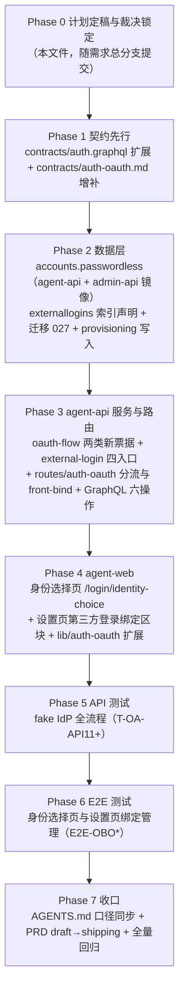

# OIDC 绑定优化 - 实现计划

**关联 Proposal**: `docs/engineering/proposals/20261114-feat-oidc-binding-optimization.md`（v1.0）
**关联 PRD**: `docs/product/draft/20261114-oidc-binding-optimization.md`（v1.0）
**需求总分支（feat-branch）**: `feat/oidc-binding-optimization`（基于含 #503 的 `origin/main`，需求总 PR [#514](https://github.com/Deliay/z-agent-gear/pull/514)）
**计划提交分支**: `feat/oidc-binding-optimization`（本文件随需求总分支提交）
**创建日期**: 2026-11-14
**计划版本**: v1.0

**版本说明**：

- v1.0（2026-11-14）首版。对齐提案 **v1.0** 与 PRD **v1.0**（需求总 PR #514 已推送并经人工审核节点通过）。§3 登记计划期代码事实核对结果与落地裁决：迁移编号 027 可用、`externallogins` 既有索引形态、`provisionUser` 内部按 `source='oauth'` 写 `passwordless`、state payload 复用 `bindTicket` 字段承载 front-bind 票据、pending 验密失败计次回写用 `SET KEEPTTL`、fake IdP `setClaims` 直接支撑多身份用例等。

## 1. 实现顺序



依赖说明：

- **Phase 1 契约先行**：`contracts/auth.graphql` 与 `contracts/auth-oauth.md` 先落地为实现唯一事实源；手写 schema 与契约双写一致性测试随 Phase 3 同步转绿。
- **Phase 2 → Phase 3**：服务层依赖 `accounts.passwordless` 字段与 `{userId,providerId}` 唯一索引（唯一索引是绑定路径的最终裁决面），故数据层先行；迁移 027「先建索引后回填」在同一迁移内顺序执行。
- **Phase 2 含 admin-api 镜像**：`accounts` 新增字段按「双服务同 PR」约束，agent-api 模型与 admin-api 只读镜像在同一实现分支同批落地。
- **Phase 3 → Phase 4**：前端身份选择页消费两条免登录 mutation 与 `pendingExternalLoginInfo`，设置页区块消费 `myExternalLogins`/`createFrontBindTicket`/`unbindExternalLogin`，故后端 GraphQL 就绪后再做前端；契约 Phase 1 已锁定，前端 mock 开发可并行起步，联调点在 Phase 5/6。
- **TDD**：全部 Phase 红-绿-重构；先写迁移与服务测试，再写实现（提案 §8 口径）。
- **PRD 生命周期**：实现阶段开始时 PRD 由 `draft/` 移入 `shipping/`（z-product 规范），在 Phase 7 收口时执行（文件名不变）。

### 1.1 开发分支与合并顺序

| 分支 | 范围 | 基于 | 合并目标 |
|------|------|------|---------|
| `feat/oidc-binding-optimization` | PRD / 提案 / 本计划 | `origin/main`（含 #503） | 需求总 PR #514 |
| `feat/oidc-binding-optimization-impl-contracts` | Phase 1 契约两件 | 需求总分支 | 需求总分支 |
| `feat/oidc-binding-optimization-impl-agent-api` | Phase 2 + Phase 3（agent-api 全部 + admin-api 镜像） | 需求总分支（contracts 合并后） | 需求总分支 |
| `feat/oidc-binding-optimization-impl-agent-web` | Phase 4 | 需求总分支（agent-api 合并后） | 需求总分支 |
| `feat/oidc-binding-optimization-impl-tests` | Phase 5~7（API/E2E、收口） | 需求总分支（agent-web 合并后） | 需求总分支 |

- 每个实现分支内按 Phase 分提交（`test(...): ...（红）` → `feat(...): ...`（绿） → `docs(...): ...`）；**禁止 rebase/squash，只允许 merge**（z-git 规范）。
- Phase 2/3（后端）与 Phase 4（前端）在契约合并后可并行起步；合并顺序按上表依赖。
- 各子项目实现按 z-coding 规范可委托 subagent 并行（每个子项目一个 todo），完成后各提 PR 回需求总分支。

### 1.2 开发模式与规范加载

- 编码前加载：`docs/engineering/common-rules.md`；后端 Phase 2/3 加载 `docs/engineering/backend-rules.md`，前端 Phase 4 加载 `docs/engineering/frontend-rules.md`。
- 目录级 `AGENTS.md`：根、`servers/agent-api/AGENTS.md`、`servers/admin-api/AGENTS.md`、`apps/agent-web/AGENTS.md`、`tests/api/AGENTS.md`、`tests/e2e/AGENTS.md`、`docs/engineering/AGENTS.md`（含 `plan/AGENTS.md`）；修改哪个目录即同步其 AGENTS.md 口径。
- 日志一律 pino 单行 JSON（vendored observability），字段与脱敏口径见 `contracts/observability.md`；**token/pendingToken/bindTicket/state/密码一律不入日志**（pending/bindTicket 增补 `REDACT_PATHS` 精确路径，禁止裸 `*.ticket` 类宽匹配）。
- 测试纪律：新增用例先进红再转绿；存量套件零回归（尤其 #503 OAuth 套件 T-OA-API1~10、`internal-users.test.ts`、`auth.test.ts`、tenant-isolation 计数 22、schema 契约测试）。

## 2. 命令参考

```bash
# 服务编排（唯一允许方式，禁止直接 docker）
aspire start && aspire wait agent-api admin-api

# 单元测试（各包内）
cd servers/agent-api && pnpm test
cd servers/admin-api && pnpm test
cd apps/agent-web && pnpm test

# 构建 / 静态检查
pnpm run build   # 各包
pnpm run lint    # apps/agent-web

# API 测试（fake IdP / fake GitHub 为进程内 mock，env 覆盖注入）
API_URL=http://localhost:10001/graphql \
ADMIN_API_URL=http://localhost:10003/graphql \
INTERNAL_API_TOKEN=<token> MONGODB_URI=<mongo> REDIS_URL=<redis> \
OIDC_TEST_ISSUER=http://127.0.0.1:19419 \
GITHUB_OAUTH_AUTHORIZE_URL=http://127.0.0.1:19418/login/oauth/authorize \
GITHUB_OAUTH_TOKEN_URL=http://127.0.0.1:19418/login/oauth/access_token \
GITHUB_OAUTH_API_BASE=http://127.0.0.1:19418 \
cd tests/api && pnpm test

# E2E
BASE_URL=http://localhost:<agent-web> \
API_URL=http://localhost:10001/graphql ADMIN_API_URL=http://localhost:10003/graphql \
INTERNAL_API_TOKEN=<token> MONGODB_URI=<mongo> \
cd tests/e2e && pnpm exec playwright test --workers=1
```

> Redis 键断言沿用 `REDIS_URL` 直连先例（Aspire rediss 自签证书需 `NODE_EXTRA_CA_CERTS` 或 `NODE_TLS_REJECT_UNAUTHORIZED=0`，见 tests/api/AGENTS.md）。

## 3. 计划期裁决（提案与代码事实偏差的落地口径）

> 以下裁决以**当前代码事实**为准（需求总分支 `074bd296`）。提案中与之不一致或含混的描述在实现期按本节执行，**不回改提案**；验收报告逐条登记。

### 3.1 事实核对结论（已核实，无需返工）

| # | 核对项 | 结论 |
|---|--------|------|
| F1 | 迁移编号 | agent-api 最新 `026-external-logins` → **027-oidc-binding-optimization 可用**，与提案一致；迁移经 `src/index.ts` import + `runMigrations([...])` 数组登记（`migration026ExternalLogins` 为当前最后一项） |
| F2 | `accounts` 模型 | agent-api `models/account.ts` 仅 `username`/`passwordHash` 两字段；admin-api `models/account.ts` 只读镜像同构（文件头注释明确「字段变更必须双服务同 PR」）→ `passwordless` 两端同 PR 增补，admin-api **无需新迁移**（无索引变更，Mongoose 缺省值由读侧兜底） |
| F3 | `externallogins` 既有索引 | 模型文件声明 `uniq_external_login_subject {providerId,issuer,subject}` 唯一 + `external_login_user {userId}`，迁移 026 经 `ensureIndex` 幂等创建 → 新索引 `uniq_external_login_user_provider {userId:1,providerId:1}` 沿用同一形态：**模型声明 + 迁移 027 创建**双写；存量数据天然满足（自动开户每身份一个全新用户，同一用户同 Provider 不可能两行），建唯一索引无冲突风险 |
| F4 | `external-login.ts` 现状 | `resolveExternalLogin` 单入口：`withIdentityLock`（Redis 身份锁 5s 自旋 + Lua 释放）包 `resolveExternalLoginCore`；命中分支更新 `lastLoginAt`/`externalUsername` 后经 `resultFromExisting` 返回；未命中分支 `deriveUsername` + `withSuffix` 冲突重试 ≤5 + `provisionUser(source='oauth')` + `ExternalLogin.create` + E11000 回读 → 重构为四入口时**命中分支逐字搬移**至 `findExternalLogin`，未命中分支主体搬移至 `provisionExternalLogin`，`withIdentityLock` 仅保留在开户路径（提案实现点 1） |
| F5 | `oauth-flow.ts` 现状 | `issueState`/`consumeState`（600s）、`issueLoginTicket`/`consumeLoginTicket`（60s）均为 Redis SET + GETDEL 先例；`OAuthSurface = 'front' \| 'admin' \| 'admin-bind'`；`randomToken()` = `crypto.randomBytes(32).hex` → pending（600s）与 front-bind-ticket（600s）完全同形态新增；`OAuthSurface` 扩第四值 `'front-bind'` |
| F6 | `routes/auth-oauth.ts` 分流点 | `SURFACES` 常量、`isSurface`、`loginUrl(surface,error)`（admin-bind → admin 设置页，其余 → 各自登录页）、`providerAllowsSurface`（front ↔ `enableFrontLogin`）、callback 内 `surface==='front'` 分支调 `resolveExternalLogin` → 签 JWT → `issueLoginTicket` → 302；front 未命中改道 pending 即在此分支内拆分；`loginUrl` 需扩 `front-bind` → `{frontendUrl}/settings?bind=error&error=`（裁决 D5） |
| F7 | `provisioning.ts` 现状 | `provisionUser({username, passwordHash, password?, source, existingAccount?})`；`Account.create({username, passwordHash})` 为唯一建账户点；`source='oauth'` 时账户已存在一律 `USERNAME_TAKEN` → `passwordless` 在 `Account.create` 处按 `source==='oauth'` 写入，**不改函数签名**（裁决 D3） |
| F8 | GraphQL 登记模式 | `schemas/index.ts` 为手写 typeDefs 数组（`authTypeDefs` 在列）；`resolvers/index.ts` 按 `Query/Mutation/User/...` 类型键 spread 合并（`...authResolvers.Query` 等），`resolvers/index.test.ts` 有登记守卫 → 新增 `ExternalLoginInfo` 类型级 resolver 必须在 `resolvers/index.ts` 增 `ExternalLoginInfo: { ...authResolvers.ExternalLoginInfo }` 键（提案实现点 6），漏登记运行时无效 |
| F9 | `contracts/auth.graphql` 现状 | 66 行：`Query.me/authProviders`、`Mutation.login/exchangeLoginTicket`；`AuthProviderType` 枚举已定义 → 提案 §3.1.1 的两个新类型与 6 个操作按 extend 形态追加，注释口径（免登录/需登录、错误文案）逐字落地 |
| F10 | `contracts/auth-oauth.md` 现状 | v1.0：三 surface 语义、Redis 键表（state/ticket/bind-ticket/discovery/jwks）、错误码表 9 条（含 `already_bound`/`invalid_bind_ticket` 既有 admin 语义）→ 增补 `front-bind` surface、2 个新 Redis 键、3 条错误码前台口径（`already_bound` 复用 code 前台文案独立、`provider_already_bound` 新增） |
| F11 | agent-web 现状 | `LoginPage.tsx` 内定义 `AUTH_PROVIDERS` 查询；`App.tsx` 公开路由仅 `/login` 与 `/login/callback`（`LoginCallbackPage` 已示范「读参数 → 立即 `replaceState` 清 URL → 兑换 → `useAuth.login`」形态）；`SettingsPage` 有 `#account-section`（NAV「帐号」组）与 `UnbindConfirmDialog`（`components/settings/`，GithubBindingSection 在用）→ 身份选择页新公开路由、绑定区块挂 `#account-section` 内、解绑二次确认复用 `UnbindConfirmDialog` 模式 |
| F12 | agent-web `lib/auth-oauth.ts` | `mapOauthError` 已有 9 条映射（其中 `already_bound` 文案为 admin 语义「该身份已绑定其他管理员账户」）；`oauthAuthorizeUrl(providerId, surface: 'front' \| 'admin')` → surface 联合类型扩 `'front-bind'` 并支持 `ticket` 参数；`already_bound` 前台文案改为「该身份已被其他账户绑定」（admin-web 有独立 `lib/auth-oauth.ts`，不受影响，裁决 D6） |
| F13 | fake IdP 能力 | `tests/api/src/fake-oidc-server.ts` 暴露 `setClaims(Partial<FakeOidcClaims>)`（可逐用例切换 `sub`/`preferred_username`）与 `denyNext()` → 多身份（身份 A 已绑、身份 B 首登）用例无需扩展 fake；`tests/api/src/agent-api/auth-oauth.test.ts` 存量 T-OA-API1~10，本期顺序编号 T-OA-API11+ |
| F14 | E2E 基建 | `tests/e2e/src/auth-oauth-helpers.ts` 已封装 fake OIDC/GitHub 进程内启动 + admin-api Provider 配置/清理（复用 tests/api fake 实现）；`auth-oauth.spec.ts` 存量 E2E-OIDC1~3/E2E-GH1 → 本期新建独立 spec（裁决 D9），helpers 直接复用 |
| F15 | 租户隔离双注册 | `externallogins` 已在 `models/tenant-isolation.test.ts` 与迁移 013 `TENANT_ID_COLLECTIONS` 双注册（集合数 **22**）；本期**无新增集合**（仅新字段/新索引），计数与注册表均不变 |
| F16 | `login` 验密语义 | `resolvers/auth.ts` 的 `login`：账户不存在 / 验密失败 / 用户缺失三处统一 `GraphQLError('Invalid username or password')`；无登录限速器 → `bindExternalLoginWithPassword` 验密失败文案逐字复用，防爆破由 pending `failCount≥5` 作废兜底（提案 D7）；无密码账户随机哈希验密必然失败，无需特判 |
| F17 | 需求总 PR | PR [#514](https://github.com/Deliay/z-agent-gear/pull/514) OPEN（base `main` ← head `feat/oidc-binding-optimization`），本地分支与 `origin` 同步；本计划随该分支提交 |

### 3.2 设计裁决（提案留白/含混处）

1. **pending 计次回写保留 TTL**：验密失败 `failCount+1` 回写用 `SET key <json> KEEPTTL`（ioredis 原生支持），不再 `PTTL` 读回重写；`failCount>=5` 直接 `DEL`（提案 D7）。`issuePendingIdentity`/`consumePendingIdentity`（GETDEL）/「GET 不消费」三入口与 `failCount` 回写封装在 `services/oauth-flow.ts`。
2. **state payload 复用 `bindTicket` 字段**：front-bind 票据复用 `OAuthStatePayload.bindTicket` 可选字段承载（不新增字段名）；callback 按 `surface` 区分消费端——`admin-bind` 维持转发 admin-api `/internal/auth/admin-bind`，`front-bind` 本地 GETDEL `oauth:front-bind-ticket:{ticket}`。`front-bind` 的 authorize 缺 `ticket` → `invalid_request`（与 admin-bind 同口径）。
3. **`passwordless` 写入点**：`provisionUser` 内部 `Account.create({username, passwordHash, ...(source==='oauth' ? {passwordless:true} : {})})`；`source='internal'`（后台开户）默认 `false`。`login` 对无密码账户行为零变化（F16）。
4. **provision 路径的 E11000 语义变更**：`provisionExternalLogin`（服务入口）仅被 `provisionExternalLogin` mutation 调用（front 回调已不再自动开户）；E11000 回读到他人行 → 抛 `ProvisioningError('IDENTITY_ALREADY_BOUND')` 由 resolver 映射 `identity already bound`，**不再幂等吞并为登录**（提案实现点 1）；回滚本次开户产物语义逐字保留。
5. **`loginUrl` 扩展**：`front-bind` 全部错误（含 access_denied/invalid_state/provider_error/already_bound/provider_already_bound/invalid_bind_ticket）302 `{FRONTEND_URL}/settings?bind=error&error=<code>`；成功 302 `{FRONTEND_URL}/settings?bind=success`（提案 §3.1.2）。
6. **`mapOauthError` 前台文案**：agent-web `already_bound` 改为「该身份已被其他账户绑定」并新增 `provider_already_bound: '当前账户已绑定该登录方式'`；admin-web `lib/auth-oauth.ts` 独立文件不动（F12）。
7. **身份选择页错误文案（GraphQL 非 302）**：mutation 错误 `invalid or expired pending token` → 「登录状态已过期，请重新登录」并引导回登录页；`Invalid username or password` 原样展示（与登录页一致）；`identity already bound` → 「该身份已被其他账户绑定」；`provider already bound` → 「当前账户已绑定该登录方式」；`provider unavailable` → 「该登录方式已停用」；`provision failed` → 「账户开通失败，请联系管理员」。映射单一来源放 `lib/auth-oauth.ts`（新增 `mapIdentityChoiceError`）。
8. **绑定路径不加身份锁**：`bindExternalLoginToUser` 与 front-bind 回调落行不引入 `withIdentityLock`（两个唯一索引即唯一裁决，回读判定输出稳定错误；提案实现点 1）；`provisionExternalLogin` 保留身份锁口径。
9. **E2E 新 spec**：新建 `tests/e2e/src/auth-oidc-binding.spec.ts`（不挤占存量 `auth-oauth.spec.ts`），复用 `auth-oauth-helpers.ts`（F14）；选择页流程驱动浏览器走真实 302 链路。
10. **Redis 键前缀**：`oauth:pending:{token}`、`oauth:front-bind-ticket:{ticket}` 两前缀与既有 `oauth:state:`/`oauth:ticket:`/`oauth:bind-ticket:` 并列；`oauth-flow.ts` 导出对应 `pendingKey`/`frontBindTicketKey` 便于测试断言（与 `stateKey`/`ticketKey` 先例一致）。
11. **`ExternalLoginInfo` 类型级 resolver 回退**：`AuthProvider` 镜像查无（provider 被删除）时 `providerDisplayName` 回退该绑定行快照 `externalUsername`、`providerEnabled=false`；命中时 `providerEnabled=doc.enabled`，OIDC 取 `displayName`、GitHub 恒 `GitHub`（与 `authProviders` 同口径）。
12. **PRD 移动时点**：Phase 7 将 PRD 从 `draft/` 移入 `shipping/` 并同步 `docs/product/AGENTS.md` 索引（z-product 生命周期「开始实现」），文件名不变。

## 4. 关键约束（提案 §1.3/§6 与规范红线，实现期不得回退）

- **契约先行**：`contracts/auth.graphql` 扩展与 `contracts/auth-oauth.md` 增补先合并入需求总分支；手写 schema 与契约双写一致（schema 测试断言）。
- **写方唯一**：`externallogins`/`accounts` 写方仅 agent-api；admin-api `accounts` 只读镜像仅同步字段（F2）；`authproviders` 写方仍仅 admin-api（本期零变更）。
- **安全不变量**：外部身份全平台唯一归属（`uniq_external_login_subject`）；同一账户每 Provider 仅一条（`uniq_external_login_user_provider`，迁移 027）；绑定已有帐号必须验明用户名密码（文案 `Invalid username or password` 逐字）；无密码账户最后一条绑定不可解绑（服务端强制）。
- **一次性凭证**：pending（600s）与 front-bind-ticket（600s）GETDEL 一次性；pending 仅在「绑定/开户成功」路径消费，验密失败计次不消费；**JWT 不进 URL**（选择页经 GraphQL `AuthPayload` 直返）。
- **已绑定链路零变化**：front 回调命中分支（签 JWT → 60s ticket → `/login/callback`）逐字保持；#503 存量套件 T-OA-API1~10 与 E2E-OIDC1~3 全绿为零回归判据。
- **后台链路零变更**：`admin`/`admin-bind` surface、admin-api 内部端点（admin-tickets/admin-bind）任何行不改；admin-api 仅 `models/account.ts` 镜像加字段。
- **单实例部署前提**：Redis 票据 GETDEL 与唯一索引回读依赖单实例，与现状一致。
- **无跨项目 import**：agent-web 组件自实现；E2E helpers 复用 tests/api fake 为既有先例（F14），不属跨项目 import 违例。

## 5. Phase 计划

### Phase 0：计划定稿与裁决锁定（本节点完成）

**目标**：本文件随需求总分支提交；`docs/engineering/AGENTS.md` 实现计划索引追加本条目。

**完成判据**：本文件合入 `feat/oidc-binding-optimization` 并推送；索引同步。

### Phase 1：契约先行（0.5d）

| 文件 | 变更 |
|------|------|
| `contracts/auth.graphql` | 扩展（提案 §3.1.1 逐字）：`ExternalLoginInfo` / `PendingExternalLoginInfo` 两类型；`Query.myExternalLogins`（需登录）/ `Query.pendingExternalLoginInfo(pendingToken)`（免登录，不消费票据，过期返回 null）；`Mutation.bindExternalLoginWithPassword` / `provisionExternalLogin`（免登录，错误文案注释逐字）/ `createFrontBindTicket` / `unbindExternalLogin`（需登录） |
| `contracts/auth-oauth.md` | 增补（提案 §3.1.2 逐字）：`surface` 第四值 `front-bind`（authorize 必须携带 `ticket`，缺失 `invalid_request`；provider 校验同 `front`）；`front` 回调分流变更（未命中写 `oauth:pending:{token}` 600s → 302 `{FRONTEND_URL}/login/identity-choice?pending=`）；`front-bind` 回调（GETDEL state → 归一 → GETDEL `oauth:front-bind-ticket` → 校验落行 → 302 `{FRONTEND_URL}/settings?bind=success`，失败 `?bind=error&error=<code>`）；Redis 键表追加两行；错误码表追加 `already_bound`（前台文案独立）/`provider_already_bound`/`invalid_bind_ticket`（复用）三行前台口径；版本 v1.0 → v1.1 |

**完成判据**：两文件合入需求总分支；与提案 §3.1 逐字段互校一致（错误文案、TTL、键名零偏差）。

### Phase 2：数据层（agent-api + admin-api 镜像）（1d）

| 文件 | 变更 |
|------|------|
| `servers/agent-api/src/models/account.ts` | 新增 `passwordless: { type: Boolean, default: false }`（注释：OAuth 开户置 true，解绑防呆锚点） |
| `servers/admin-api/src/models/account.ts` | 只读镜像同步新增 `passwordless`（双服务同 PR，F2） |
| `servers/agent-api/src/models/external-login.ts` | 索引声明追加 `{userId:1, providerId:1}` 唯一 `uniq_external_login_user_provider`（F3 双写形态） |
| `servers/agent-api/src/migrations/027-oidc-binding-optimization.ts` | 新增（幂等）：① `ensureIndex` 创建 `uniq_external_login_user_provider`；② 回填 `accounts`：`_id ∈ externallogins.accountId` 且 `passwordless` 未设置的文档 `$set passwordless:true`（先索引后回填；重复执行幂等）；日志组件名 `migration/027-oidc-binding-optimization` |
| `servers/agent-api/src/index.ts` | import 并登记迁移 027 到 `runMigrations([...])` 数组（F1） |
| `servers/agent-api/src/services/provisioning.ts` | `Account.create` 处按 `source==='oauth'` 写 `passwordless:true`（D3；签名不变） |

**测试（先红）**：`migrations/027-oidc-binding-optimization.test.ts`（T-MIG-OBO1~4：索引幂等创建/存量满足唯一约束直接建成/回填仅命中 externallogins 关联账户且后台开户账户不受影响/重复执行无副作用，真库）；`services/provisioning.test.ts` 扩展（T-ACC1~2：oauth 开户 `passwordless:true` / internal 开户默认 false 且存量 `internal-users.test.ts` 零回归）；`models/account.test.ts`（字段缺省 false）。

**完成判据**：`pnpm test`（agent-api、admin-api）全绿含新增；`pnpm run build` 两包通过；`TENANT_ID_COLLECTIONS` 计数 22 不变（F15）。

### Phase 3：agent-api 服务与路由（2.5d）

| 文件 | 变更 |
|------|------|
| `servers/agent-api/src/services/oauth-flow.ts` | 新增 pending 三入口 `issuePendingIdentity`（600s，payload `{providerId,issuer,subject,externalUsername,displayName?,avatarUrl?,failCount:0}`）/ `getPendingIdentity`（GET 不消费）/ `consumePendingIdentity`（GETDEL）/ `bumpPendingFailCount`（`SET KEEPTTL`，≥5 删除返回 false，D1）与前台绑定票据 `issueFrontBindTicket`（600s，`{userId,providerId}`）/ `consumeFrontBindTicket`（GETDEL）；`OAuthSurface` 扩 `'front-bind'`；导出 `pendingKey`/`frontBindTicketKey`（D10） |
| `servers/agent-api/src/services/external-login.ts` | 四入口重构（F4）：`findExternalLogin`（命中分支逐字搬移，更新快照返回绑定视图；未命中返回 null）；`provisionExternalLogin`（原未命中分支 + 身份锁保留，E11000 回读到他人行改抛 `ProvisioningError('IDENTITY_ALREADY_BOUND')`，D4）；`bindExternalLoginToUser(user, identity)`（预检两唯一性 → 落行 `userId/accountId/tenantId` 取自目标用户 → 任一索引 E11000 回读判定 `identity already bound` / `provider already bound`，不加身份锁 D8）；`unbindExternalLogin(userId, id)`（归属校验 `external login not found` → 统计绑定数=1 且账户 `passwordless` → `cannot unbind last login method` → 删除）；自定义错误 `ExternalLoginError(code)` 导出错误码枚举 |
| `servers/agent-api/src/routes/auth-oauth.ts` | `SURFACES` 增 `'front-bind'`；authorize：`front-bind` 缺 ticket → `invalid_request`（D2）；`providerAllowsSurface` 对 `front-bind` 复用 `enableFrontLogin` 判定；callback `front` 分支：`findExternalLogin` 命中 → 原 ticket 链路逐字不变，未命中 → `issuePendingIdentity` → 302 `{frontendUrl}/login/identity-choice?pending=`；新增 `front-bind` 分支：GETDEL state → 归一 → `consumeFrontBindTicket` → 票据 providerId 与 state 匹配、用户存在、两唯一性预检 → `ExternalLogin.create` → 302 `{frontendUrl}/settings?bind=success`；`loginUrl` 扩 `front-bind` → settings 带参（D5）；一切错误 302 不返 JSON 口径保持 |
| `servers/agent-api/src/graphql/schemas/auth.ts` | 追加 `ExternalLoginInfo`/`PendingExternalLoginInfo` 类型与 2 Query + 4 Mutation（与契约逐字一致，F9） |
| `servers/agent-api/src/graphql/resolvers/auth.ts` | 新增：`pendingExternalLoginInfo`（免登录，`getPendingIdentity` 不消费，白名单两字段，缺失返回 null）；`bindExternalLoginWithPassword`（免登录：GET 校验 → provider 复核 `enabled && enableFrontLogin` 否则 `provider unavailable` → `Account.findOne({username})` + `verifyPassword`（失败 `bumpPendingFailCount`，文案逐字 `Invalid username or password`）→ `User.findOne({accountId})` → `bindExternalLoginToUser` → 成功 `consumePendingIdentity` → `signToken` 返 `AuthPayload`）；`provisionExternalLogin`（免登录：GET 校验 → provider 复核 → `provisionExternalLogin` → 成功消费 → AuthPayload）；`myExternalLogins`（需登录，按 `createdAt` 升序）；`createFrontBindTicket`（需登录：provider 校验 + 当前用户该 provider 无既有绑定 `provider already bound` → `issueFrontBindTicket`）；`unbindExternalLogin`（需登录，委托服务）；`ExternalLoginInfo.providerDisplayName/providerEnabled` 类型级 resolver（D11） |
| `servers/agent-api/src/graphql/resolvers/index.ts` | 登记 `ExternalLoginInfo: { ...authResolvers.ExternalLoginInfo }` 键（F8） |

**测试（先红）**：`services/oauth-flow.test.ts` 扩展（T-PEND1~6：签发/GET 不消费/GETDEL 一次性/KEEPTTL 计次/≥5 作废/过期；T-FBT1~4：签发消费一次性/过期/载荷）；`services/external-login.test.ts` 重写（T-EXT-B1~10：find 命中更新快照与未命中 null / bind 成功 / 身份被他人绑定 E11000 回读 / 同账户同 provider 冲突 / provision 成功与 E11000 拒绝 D4 / unbind 正常 / 最后一条无密码拒绝 / 有密码不拦截 / 非本人拒绝）；`routes/auth-oauth.test.ts` 扩展（T-OA-RT-FB1~8：front 未命中 302 identity-choice 且写 pending / 命中零变化 / front-bind authorize 缺 ticket / 未启用 / callback 成功落行 / 票据过期 invalid_bind_ticket / 身份占用 already_bound / 同账户重复 provider_already_bound）；`graphql/resolvers/auth.test.ts` 扩展（六操作认证口径与错误文案矩阵、`pendingExternalLoginInfo` 不消费）；`graphql/schemas/auth.test.ts`（契约逐字段对齐）；`resolvers/index.test.ts` 守卫同步（`ExternalLoginInfo` 键）。

**完成判据**：`pnpm test`（agent-api）全绿含新增与存量零回归（`external-login` 旧用例按四入口口径改写）；`pnpm run build` 通过。

### Phase 4：agent-web（1.5d）

| 文件 | 变更 |
|------|------|
| `apps/agent-web/src/pages/IdentityChoicePage.tsx` | 新增：读 `pending` 参数并立即 `replaceState` 清除 → `PENDING_EXTERNAL_LOGIN_INFO` 查询（免登录；null → 「登录状态已过期，请重新登录」+ 回登录页引导）；展示外部身份摘要（登录方式名称 + 外部帐号名）；「绑定已有帐号」区（用户名/密码表单 → `BIND_EXTERNAL_LOGIN_WITH_PASSWORD` → `useAuth.login` → 首页）；「创建新帐号」区（说明文案 + 确认 → `PROVISION_EXTERNAL_LOGIN` → 同登录）；「返回登录页」入口；错误经 `mapIdentityChoiceError` 就地展示（D7），验密失败不跳页可重试 |
| `apps/agent-web/src/App.tsx` | 新增公开路由 `/login/identity-choice`（F11） |
| `apps/agent-web/src/components/settings/ExternalLoginBindingSection.tsx` | 新增「第三方登录绑定」卡片：`MY_EXTERNAL_LOGINS` 列表（登录方式/外部帐号名/绑定时间/最近登录时间；`providerEnabled=false` 展示「已停用」徽标）；可绑定列表（`authProviders` 过滤已绑定项置「已绑定」态）→ 点击 `CREATE_FRONT_BIND_TICKET` → `oauthAuthorizeUrl(id,'front-bind',ticket)` 跳转；解绑走 `UnbindConfirmDialog` 二次确认（F11）→ `UNBIND_EXTERNAL_LOGIN`；错误白名单映射（`cannot unbind last login method` → 「这是账户唯一的登录方式，请先绑定其他登录方式或联系管理员」等） |
| `apps/agent-web/src/pages/SettingsPage.tsx` | `#account-section` 内挂载 `<ExternalLoginBindingSection />`；识别 `?bind=success`（toast「绑定成功」并 refetch 列表）/ `?bind=error&error=<code>`（toast 映射文案），处理后 `replaceState` 清 URL |
| `apps/agent-web/src/lib/auth-oauth.ts` | `oauthAuthorizeUrl` surface 联合类型扩 `'front-bind'` + 可选 `ticket` 参数；`mapOauthError` 更新 `already_bound` 前台文案 + 新增 `provider_already_bound`（D6）；新增 `mapIdentityChoiceError`（D7） |
| `apps/agent-web/src/graphql/`（查询/类型） | `PENDING_EXTERNAL_LOGIN_INFO`/`BIND_EXTERNAL_LOGIN_WITH_PASSWORD`/`PROVISION_EXTERNAL_LOGIN`/`MY_EXTERNAL_LOGINS`/`CREATE_FRONT_BIND_TICKET`/`UNBIND_EXTERNAL_LOGIN` 与类型（`ExternalLoginInfo` 等手写类型同步） |

**测试（先红）**：`pages/__tests__/IdentityChoicePage.test.tsx`（摘要渲染/过期引导/绑定成功登录/验密失败重试/创建新帐号/放弃返回）；`components/settings/__tests__/ExternalLoginBindingSection.test.tsx`（列表渲染/已绑定置灰/绑定跳转/解绑二次确认/防呆文案）；`pages/__tests__/SettingsPage.test.tsx` 扩展（`?bind` 结果处理与 URL 清理）；`lib/__tests__/auth-oauth.test.ts`（新映射与 URL 组装）。

**完成判据**：`pnpm test` + `pnpm run build` + `pnpm run lint` 全绿；密码登录与 `/login/callback` 既有用例零回归。

### Phase 5：API 测试（1d）

| 文件 | 变更 |
|------|------|
| `tests/api/src/agent-api/auth-oauth.test.ts` | 扩展 T-OA-API11~20（fake IdP，`setClaims` 切 sub，F13）：T-OA-API11 首登未命中 → 302 identity-choice + `oauth:pending:` 键存在且不开户（DB 无 externallogins/accounts 新增）；T-OA-API12 pending + 正确用户名密码 → 绑定落库 + AuthPayload + me 命中既有账户（数据汇合）；T-OA-API13 错误密码 → `Invalid username or password` 且 pending 未消费（可重试），连续 5 次 → pending 作废；T-OA-API14 pending + 创建新帐号 → 开户落库（`passwordless:true`）+ AuthPayload；T-OA-API15 pending 期间身份被他账户抢绑 → 两 mutation 均 `identity already bound`；T-OA-API16 front-bind 全链路（登录态建票据 → authorize → callback → `?bind=success` + 落库 + `myExternalLogins` 可见）；T-OA-API17 front-bind 票据缺失/过期 → `invalid_request`/`invalid_bind_ticket`；T-OA-API18 同账户同 provider 重复绑定 → `provider_already_bound`（mutation 与回调双路径）；T-OA-API19 解绑（正常删除 + 解绑后该身份可重新首登）与无密码账户最后一条拒绝 `cannot unbind last login method`；T-OA-API20 已绑定用户再次登录链路零变化（命中直登，锚定回归） |
| `tests/api/AGENTS.md` | 「第三方登录 OAuth/OIDC」节追加本期用例清单与 pending/front-bind-ticket Redis 键断言口径 |

**前置 env**：与 #503 套件相同（`PUBLIC_BASE_URL`/`ADMIN_FRONTEND_URL`/fake 地址三件套 + `MONGODB_URI` + `INTERNAL_API_TOKEN` + `REDIS_URL`）；无需新增 env。

**完成判据**：新用例全绿；`pnpm test`（tests/api 全量）零回归（T-OA-API1~10 原样全绿）。

### Phase 6：E2E 测试（1d）

| 文件 | 变更 |
|------|------|
| `tests/e2e/src/auth-oidc-binding.spec.ts` | 新增（D9，复用 `auth-oauth-helpers.ts`）：E2E-OBO1 已有密码账户首登 → 身份选择页摘要正确 → 绑定已有帐号 → 进入原账户；E2E-OBO2 新身份选择「创建新帐号」→ 进入新账户且与旧自动开户等价；E2E-OBO3 验密失败提示可重试；E2E-OBO4 设置页查看绑定列表 + 对第二 provider 发起绑定 → 授权返回 → 列表出现新绑定（`?bind=success` toast）；E2E-OBO5 解绑二次确认生效 → 列表移除；E2E-OBO6 无密码账户仅剩一条绑定时解绑被拒文案；E2E-OBO7 完成绑定后再次第三方登录直登不再出现选择页 |
| `tests/e2e/AGENTS.md` | 「第三方登录 E2E」节追加本期 spec 与用例清单 |

**完成判据**：新 spec 全绿（workers=1 串行）；既有 `auth-oauth.spec.ts`/`auth.spec.ts` 零回归。

### Phase 7：收口（0.5d）

1. PRD `docs/product/draft/20261114-oidc-binding-optimization.md` → `docs/product/shipping/`（文件名不变），`docs/product/AGENTS.md` 索引同步（draft 移除、shipping 追加）（D12）。
2. `servers/agent-api/AGENTS.md`（OAuth 链路节更新：front 未命中改道 pending + front-bind surface + external-login 四入口 + passwordless/迁移 027 + 新 Redis 键）、`servers/admin-api/AGENTS.md`（accounts 镜像 passwordless）、`apps/agent-web/AGENTS.md`（身份选择页 + 设置页绑定区块 + 错误映射口径）、`docs/engineering/AGENTS.md`（本计划索引已在 Phase 0 追加，收口核对口径）、`tests/api/AGENTS.md`/`tests/e2e/AGENTS.md`（Phase 5/6 已同步，收口复核）。
3. 全量回归：三包单测 + tests/api + tests/e2e 关键套件；契约双写一致性测试全绿。

**完成判据**：提案 §10 验收标准逐条通过；验收报告骨架就绪（下游验收节点产出）。

## 6. 测试矩阵

### 6.1 单元测试（先红后绿）

| 范围 | 用例组 | 覆盖 |
|------|--------|------|
| agent-api 数据层 | T-MIG-OBO1~4 / T-ACC1~2 | 迁移 027 幂等与回填矩阵、provisioning passwordless 写入、internal 开户零回归 |
| agent-api 服务 | T-PEND1~6 / T-FBT1~4 / T-EXT-B1~10 | pending 与绑定票据生命周期、四入口（命中快照/绑定/冲突回读/开户拒绝/解绑防呆矩阵） |
| agent-api 路由 | T-OA-RT-FB1~8 | front 未命中改道、命中零变化、front-bind authorize/callback 与错误码 302 |
| agent-api GraphQL | resolver/schema 扩展用例 | 六操作认证与错误文案矩阵、契约逐字段对齐、`ExternalLoginInfo` 登记守卫 |
| agent-web | IdentityChoicePage / ExternalLoginBindingSection / SettingsPage / lib 用例 | 选择页两路径与重试、绑定区块列表/跳转/解绑、`?bind` 结果处理、错误映射 |
| 契约 | schemas/*.test.ts | 手写 schema 与 contracts/auth.graphql 逐字段一致 |

### 6.2 API 测试（tests/api）

T-OA-API11~20（首登分流/验密绑定/计次作废/创建新帐号/抢绑拒绝/front-bind 全链路/票据异常/重复绑定/解绑与防呆/直登回归）——见 Phase 5。fake IdP `setClaims` 切 sub 构造多身份（F13），进程内不触网。

### 6.3 E2E（tests/e2e）

E2E-OBO1~7——见 Phase 6。

### 6.4 回归基线

- `servers/agent-api`：`internal-users.test.ts`、`auth.test.ts`、tenant-isolation（计数 **22** 不变）、`external-login`/`oauth-flow`/`auth-oauth` 路由既有用例（按四入口口径改写后语义锚定）全绿。
- `servers/admin-api`：`auth.test.ts` 与 accounts 镜像消费方（租户只读）全绿。
- `tests/api`：T-OA-API1~10（#503 全套）与 `auth.test.ts` 零回归。
- `tests/e2e`：`auth-oauth.spec.ts`（E2E-OIDC1~3/E2E-GH1）、`auth.spec.ts` 全绿。

## 7. 验收 checklist（分阶段）

- [ ] Phase 0：本计划合入需求总分支，索引同步
- [ ] Phase 1：契约两件合入，与提案 §3.1 逐字段互校一致
- [ ] Phase 2：迁移 027 幂等（索引 + 回填），passwordless 双服务同 PR，agent-api/admin-api 全绿
- [ ] Phase 3：oauth-flow 两类票据、external-login 四入口、front 分流与 front-bind、GraphQL 六操作全绿，存量零回归
- [ ] Phase 4：身份选择页与设置页绑定区块全绿，登录既有用例零回归
- [ ] Phase 5：API 新用例 T-OA-API11~20 全绿，tests/api 零回归
- [ ] Phase 6：E2E-OBO1~7 全绿，auth 既有套件零回归
- [ ] Phase 7：PRD 移入 shipping、各 AGENTS.md 口径同步、提案 §10 逐条通过
- [ ] PRD 功能点 1~3 验收标准逐条通过（身份选择页 / 设置页绑定管理 / 解绑防呆）

## 8. 风险与回滚

| 风险 | 影响 | 缓解 / 回滚 |
|------|------|------------|
| pending「GET 不消费 + 成功才 GETDEL」并发双击 | 双重提交竞态 | 两个唯一索引为最终裁决，败方 E11000 回读输出稳定错误（T-EXT-B/T-OA-API15 覆盖）；成功后 pending 已消费，重试得 `invalid or expired pending token` 引导重新登录 |
| 迁移 027 建唯一索引时存量数据冲突 | 迁移失败阻塞启动 | F3 已论证存量天然满足；迁移测试 T-MIG-OBO2 真库锚定；若生产出现意外冲突，按 ensureIndex 失败日志人工核对重复行后重跑（迁移幂等） |
| `passwordless` 回填遗漏导致防呆误伤 | 无密码账户被允许解绑最后一条 | 回填口径 `_id ∈ externallogins.accountId` 全覆盖（提案实现点 4）；T-MIG-OBO3 断言后台开户账户不受影响；上线后防呆拒绝文案引导联系管理员兜底 |
| front-bind 票据与会话分离被滥发 | 越权绑定 | `createFrontBindTicket` 需登录 + 票据绑定 userId 且 GETDEL 一次性 + providerId 匹配复核（提案实现点 3）；T-OA-API17/18 覆盖 |
| pending 载荷泄露平台账户信息 | 信息泄露 | payload 仅外部身份白名单字段（提案实现点 2）；`pendingExternalLoginInfo` 出参仅两字段；契约测试断言 |
| 错误文案与 `login` 不一致 | 用户可被枚举账户 | 验密失败文案逐字 `Invalid username or password`（F16）；计次 ≥5 作废防爆破（D1） |
| Redis `SET KEEPTTL` 版本兼容 | 计次回写失败 | Aspire/部署 Redis ≥6（ioredis 已用 GETDEL 同代命令）；T-PEND4 真 Redis 锚定 |
| 已绑定链路被分流改动波及 | 存量登录回归 | front 命中分支逐字保持（F4/F6）；T-OA-API1~10 与 E2E-OIDC1~3 原样全绿为准入 |

回滚：各 Phase 独立分支 merge-only，可按分支粒度 revert；迁移 027 仅新增索引与字段缺省/回填（索引可手工 drop、字段保留无副作用）；契约新增操作前端未上线时无调用方，回滚安全。

## 9. 相关文档

- 关联 PRD：[[../../product/draft/20261114-oidc-binding-optimization.md]]（实现开始移入 shipping/）
- 关联 Proposal：[[../proposals/20261114-feat-oidc-binding-optimization.md]]（v1.0）
- 需求来源：[GitHub Issue Deliay/z-agent-gear#510](https://github.com/Deliay/z-agent-gear/issues/510)；需求总 PR：[Deliay/z-agent-gear#514](https://github.com/Deliay/z-agent-gear/pull/514)
- [[20261113-feat-oidc-github-oauth-login.md]] — 前置实现计划：OIDC/GitHub 登录基础设施（本计划复用其 oauth-flow/external-login/provisioning 与 fake 测试基建）
- [[20261027-feat-multi-tenant-phase1.md]] — 三层帐号模型（accounts/users/tenants 与 provisioning 口径）
- 日志契约：`contracts/observability.md`
- 开发规范：[[../common-rules.md]] / [[../backend-rules.md]] / [[../frontend-rules.md]]

## 附录 A：文件变更总览

| Phase | 文件 | 动作 |
|-------|------|------|
| 0 | `docs/engineering/plan/20261114-feat-oidc-binding-optimization.md`（本文件）、`docs/engineering/AGENTS.md` | 新增 / 索引追加 |
| 1 | `contracts/auth.graphql`、`contracts/auth-oauth.md` | 扩展 |
| 2 | `servers/agent-api/src/models/account.ts`、`servers/admin-api/src/models/account.ts`、`servers/agent-api/src/models/external-login.ts`、`servers/agent-api/src/migrations/027-oidc-binding-optimization.ts`、`servers/agent-api/src/index.ts`、`servers/agent-api/src/services/provisioning.ts` | 扩展 ×5 / 新增 ×1 |
| 3 | `servers/agent-api/src/services/oauth-flow.ts`、`services/external-login.ts`、`routes/auth-oauth.ts`、`graphql/schemas/auth.ts`、`graphql/resolvers/auth.ts`、`graphql/resolvers/index.ts` | 扩展/重构 |
| 4 | `apps/agent-web/src/pages/IdentityChoicePage.tsx`、`App.tsx`、`pages/SettingsPage.tsx`、`components/settings/ExternalLoginBindingSection.tsx`、`lib/auth-oauth.ts`、`graphql/*` | 新增 ×2 / 扩展 ×4 |
| 5 | `tests/api/src/agent-api/auth-oauth.test.ts`、`tests/api/AGENTS.md` | 扩展 |
| 6 | `tests/e2e/src/auth-oidc-binding.spec.ts`、`tests/e2e/AGENTS.md` | 新增 / 扩展 |
| 7 | `docs/product/{draft→shipping}/20261114-oidc-binding-optimization.md`、`docs/product/AGENTS.md`、四包 `AGENTS.md` | 移动/同步 |

## 附录 B：计划期核对记录

### B.1 代码事实核对（2026-11-14，需求总分支 074bd296）

- 迁移编号：agent-api `026-external-logins` 为最新 → **027 可用**；迁移经 `src/index.ts` `runMigrations([...])` 登记（F1）。admin-api 最新 `022-auth-providers`，本期 admin-api 无新迁移（仅镜像字段）。
- `accounts` 两端模型均仅 `username`/`passwordHash`（F2）；`externallogins` 既有两索引，模型声明与迁移 026 `ensureIndex` 双写形态（F3）。
- `external-login.ts` 单入口 `resolveExternalLogin` + `withIdentityLock`（F4）；`oauth-flow.ts` GETDEL 先例与 `OAuthSurface` 三值（F5）；`routes/auth-oauth.ts` front 分流点与 `loginUrl`/`providerAllowsSurface` 结构（F6）；`provisionUser` 唯一建账户点（F7）。
- GraphQL：`schemas/index.ts` 数组 + `resolvers/index.ts` spread（含 `User` 类型级键先例），登记守卫在（F8）。
- agent-web：公开路由仅 `/login`、`/login/callback`；`LoginCallbackPage` 的 `replaceState` 清 URL 先例；`#account-section` 与 `UnbindConfirmDialog` 存在（F11）；`lib/auth-oauth.ts` 前台映射含 admin 语义 `already_bound` 文案待独立（F12/D6）；admin-web 有独立映射文件不受影响。
- 测试基建：fake IdP `setClaims`/`denyNext` 就绪（F13）；E2E helpers 复用 tests/api fake（F14）；T-OA-API1~10 与 E2E-OIDC1~3 为回归基线。
- 需求总 PR #514 OPEN，分支与远端同步（F17）。

### B.2 实现期核对项（实现节点收口，登记验收报告）

1. `SET KEEPTTL` 在 Aspire Redis（rediss 自签）链路实证（D1）。
2. 身份选择页在移动端窄屏的表单布局核验（跟随既有登录页宽度约束）。
3. `ExternalLoginInfo.providerDisplayName` 回退快照口径在 provider 被删除场景的真库实证（D11）。
4. 设置页 `?bind=` 参数与既有 `?section=valut` 穿透定位并存时的清理顺序核验（均为 `replaceState`，实测无互相吞参）。
