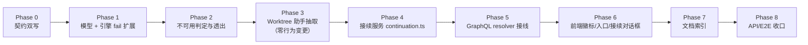
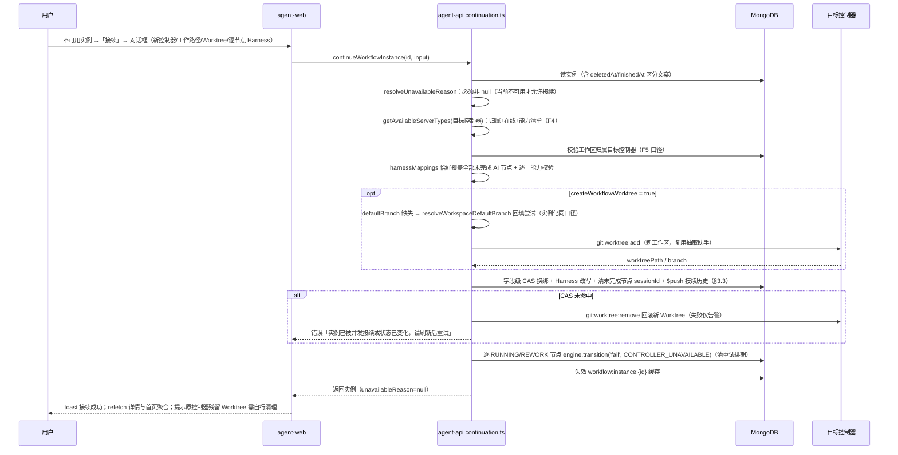

# 已实例化的工作流接续 - 实现计划

**功能名称**: 已实例化的工作流接续
**关联 PRD**: [`docs/product/draft/20261114-workflow-instance-continuation.md`](../../product/draft/20261114-workflow-instance-continuation.md)
**关联提案**: [`docs/engineering/proposals/20261114-feat-workflow-instance-continuation.md`](../proposals/20261114-feat-workflow-instance-continuation.md)
**计划版本**: v1.0
**创建日期**: 2026-11-14
**作者**: ZeroAsh Agent
**需求总分支**: `feat/workflow-instance-continuation`
**feat-branch**: `feat/workflow-instance-continuation`
**需求总 PR**: https://github.com/Deliay/z-agent-gear/pull/520

## 1. 实施顺序

严格按「契约 → 模型/引擎 → 不可用判定透出 → Worktree 助手抽取 → 接续服务 → GraphQL 接线 → 前端 → 文档索引 → 测试收口」推进，每个切片先写失败测试再实现：



**关键路径**：Phase 4 是需求核心（校验矩阵 + CAS 换绑 + 回滚）。Phase 2 的 `unavailableReason` 是前端全部入口的唯一判据，必须先于前端落地。Phase 3 的抽取是零行为变更重构，把 `instance.ts` 的私有 Worktree 创建/清理变为可复用函数，必须先于 Phase 4 完成并被既有测试锁定。

**回归重灾区**：`instance.test.ts`（Worktree 创建/回滚断言）、`engine.test.ts`（`fail` 转移源状态表）、`tests/api/src/agent-api/workflow.test.ts`（实例化链路）——Phase 1/3 改动后必须全绿。

## 2. 代码事实核对（计划期确认）

以下事实基于需求总分支 `feat/workflow-instance-continuation`（HEAD `55ab1492`）实际代码：

| # | 事实 | 位置 | 对计划的影响 |
|---|------|------|--------------|
| F1 | 引擎 `fail` 转移仅允许 `from: ['RUNNING']`；`retryExhausted` 允许 `['RUNNING','REWORK']` | `servers/agent-api/src/services/workflow/engine.ts:147,152` | 提案要求「RUNNING/REWORK 节点标记 FAILED」**直接编译不通过**：需扩展 `fail.from` 追加 `REWORK`（见 D2） |
| F2 | 引擎 `fail` 分支：置 FAILED + `failInfo{reason,source,at}` + `clearRetrySchedule` + `markLastNode`，不触发会话 hook | `engine.ts:371-383` | `CONTROLLER_UNAVAILABLE` 只是新 `source` 文案，语义完全复用；`failInfo.source` 注释（模型 :42、契约 :175）需同步补 |
| F3 | `createWorkflowWorktree`/`removeWorkflowWorktree` 是 `WorkflowInstanceService` 私有方法（Redis `git:worktree:add/remove` + worktreeDir 解析 + 随机后缀），实例化失败回滚已复用 remove | `services/workflow/instance.ts:298-358,773-804` | 抽取为零行为变更的独立模块供接续服务复用（见 Phase 3） |
| F4 | `getAvailableServerTypes(controllerId, userId)` 一站式完成：归属校验（`actorFilter`）→ 缓存命中直返 → 在线回源 → 离线抛「能力信息不可用」 | `services/workflow/capability.ts:13-49` | 接续的「目标控制器归属 + 在线 + 能力清单」直接复用，不另写校验（见 D7） |
| F5 | 实例化的目标工作区校验：`getWorkspaceContext() ? {_id, controllerId} : {_id, userId, controllerId}` | `instance.ts:148-156` | 接续的工作区校验照抄同一口径（团队工作区成员可复用控制器工作区） |
| F6 | `workflowInstanceSchema` 无 `continuationHistory`；既有 Map/子文档字段均以 `default` 兜底 | `models/workflow-instance.ts:93-144` | 新增子文档数组 `default: []`，**零迁移**（存量读取经 mapInstance 归一 `?? []`，见 D4） |
| F7 | `mapInstance` 是同步纯函数，不查库 | `graphql/resolvers/workflow.ts:150-171` | `unavailableReason` 需查 Controller → 必须是**字段级 resolver**，登记于 `resolvers/index.ts` 的 `WorkflowInstance` 键（:83-85 spread 已就位） |
| F8 | 请求级缓存先例：`AuthContext.modelLibraryPromise`（`??=` 惰性单例） | `resolvers/auth.ts:47-50`、`resolvers/session.ts:148-149` | `unavailableReason` 按 controllerId 的请求级 Promise 缓存照此模式，列表场景天然去重 N+1（见 D1） |
| F9 | `Session.readOnlyReason` 为字段级 resolver → 服务层实时计算、不落库 | `resolvers/session.ts:126-133`、`services/session.ts:233-236` | `unavailableReason` 同构：服务层纯判定 + resolver 委托（提案决策 B 落点） |
| F10 | `homeOverview` 的 `workflowInstances`/`archivedWorkflowInstances` 复用 `workflowInstanceService.list` + `mapInstance` | `resolvers/home.ts:94-146` | 前端 `HOME_WORKFLOW_INSTANCE_FIELDS` fragment 追加 `unavailableReason` 即生效，后端零改动（字段 resolver 自动承接） |
| F11 | 实例变更后需失效 Redis 缓存 `workflow:instance:{id}`（`invalidateInstanceCache` 为 instance.ts 私有） | `instance.ts:571-578` | 接续成功/换绑后必须 del 该 key；抽取为可复用导出（Phase 3 一并处理） |
| F12 | 中断重试调度器扫描 `status∈RUNNING/REWORK + retryPhase/nextRetryAt` 的实例；排期/占位/重排全部是「状态 + phase + 快照」字段级 CAS | `services/workflow/interrupt-retry.ts`、`interrupt-retry-scheduler.ts` | 接续的引擎 `fail` 清调度字段后扫描器自然不再命中；并发交错全部收敛（分析见 §7 D3 与 §8） |
| F13 | 引擎 `transition` 内部整文档 `instance.save()`（Mongoose `__v` 乐观锁） | `engine.ts:360` 一带 | 接续主更新用 `updateOne` 字段级 CAS（不走 save），与引擎并发时败者报错而非互相覆盖 |
| F14 | `restartNode` 仅在传入 agentConfig 时校验能力；`restartNodeSession`/`resumeNodeSession` 对 `sessionId` 缺失安全（跳过 close 直接起新会话） | `instance.ts:662-669`、`orchestrator.ts:222-263` | 接续清空未完成节点 `sessionId` 后，既有 restart/resume 链路在新控制器上自然工作，**零改动** |
| F15 | REWORK 节点会话由 `reworkNodeSession` resume 拉起，是活会话 | `orchestrator.ts:200-220` | 控制器不可用时 REWORK 节点会话同样死亡 → 必须纳入 FAILED 收敛（F1 的动因） |
| F16 | `Controller.status` 枚举 `['online','offline','registering','unbound']`；删除控制器（unbind/deleteCloudHost）直接删文档 | `models/controller.ts:13` | `resolveUnavailableReason`：文档缺失 → `CONTROLLER_DELETED`；`status !== 'online'` → `CONTROLLER_OFFLINE`（registering/unbound 同归离线档） |
| F17 | `InstantiateWorkflowDialog` 已组合 `GET_WORKSPACES` / `DETECT_GIT_REPO` / `GET_ACP_CAPABILITIES`；Worktree 勾选默认随 isGitRepo | `apps/agent-web/src/components/workflow/InstantiateWorkflowDialog.tsx:25-121` | 接续对话框复用同一查询组合与「默认勾选」口径 |
| F18 | `AddWorkspaceDialog({controllerId, open, onOpenChange, onSelect})` 内嵌 `DirectoryPicker`；父组件 `onSelect(path)` 后调 `CREATE_WORKSPACE` 落库 | `components/settings/AddWorkspaceDialog.tsx`、`WorkspaceSection.tsx:62,115-123,515-519` | 「新建工作路径」复用该对话框 + `CREATE_WORKSPACE`，再把新 workspaceId 选中（提案决策 B 的前端落点） |
| F19 | `GET_CONTROLLERS` 含 `status`/`type`/`cloudHost` 字段 | `apps/agent-web/src/graphql/queries.ts:292-312` | 接续对话框控制器选择器按 `status === 'online'` 客户端过滤，无需新查询 |
| F20 | `WorkflowInstanceCard` 是纯 `NavLink`（无任何嵌套交互元素） | `components/workflow/WorkflowInstanceCard.tsx:26-61` | 「接续」按钮必须 `preventDefault + stopPropagation` 并跳转 `/workflows/:id?continue=1`，不能嵌套可点击元素进 NavLink（见 D8） |
| F21 | `WorkflowInstancePage` 已 5s 轮询 `GET_WORKFLOW_INSTANCE`（`notifyOnNetworkStatusChange:false`） | `pages/WorkflowInstancePage.tsx:78-85` | 不可用标识随轮询自然出现/消失（控制器恢复在线即消失），无需新增订阅 |
| F22 | 手写 schema 与契约必须双写（`schemas/workflow.ts:1` 注释「逐一对齐」）；`restartNode` 既有注释更新过一次（:355-357） | `contracts/workflow.graphql`、`servers/agent-api/src/graphql/schemas/workflow.ts` | Phase 0 两处同 PR 同改，漏改即运行时 `Cannot query field` |

## 3. 数据模型与状态机

### 3.1 `workflowinstances` 扩展（`models/workflow-instance.ts`）

| 字段 | 类型 | 默认 | 说明 |
|------|------|------|------|
| `continuationHistory` | 子文档数组 | `[]` | `{ fromControllerId: ObjectId, fromWorkspaceId: ObjectId, toControllerId: ObjectId, toWorkspaceId: ObjectId, at: Date }`，`{_id:false}`；接续成功时 `$push` 追加（时间升序） |

零迁移：存量文档缺字段，Mongoose `default: []` + `mapInstance` 归一 `?? []` 双保险（D4）。`nodes[].sessionId`、`nodes[].agentConfig.acpServerType`、`controllerId`/`workspaceId`、`workflowWorktreePath`/`workflowWorktreeBranch` 均为既有字段，仅接续时改写。

### 3.2 引擎 `fail` 转移扩展（`engine.ts`）

```ts
fail: { from: ['RUNNING', 'REWORK'], to: 'FAILED' },  // + REWORK（镜像 retryExhausted）
```

- `failInfo.source` 新增取值 `CONTROLLER_UNAVAILABLE`（注释三处同步：模型 :42、契约 :175、手写 schema WorkflowNodeFailInfo）。
- `fail` 分支实现零改动（F2）；`REWORK → FAILED` 对既有调用方（`SESSION_STUCK`/`LLM_REPORTED`）语义同样成立（REWORK 即「节点持有活会话」），无回归面。

### 3.3 接续主更新的写入形状（字段级 CAS）

```ts
await WorkflowInstance.updateOne(
  { _id: id, deletedAt: null, finishedAt: null, controllerId: oldControllerId },  // CAS：防并发重复接续
  {
    $set: {
      controllerId: newControllerId,
      workspaceId: newWorkspaceId,
      workflowWorktreePath: newPath ?? null,   // 未勾选创建 = 清空（不再指向旧控制器路径）
      workflowWorktreeBranch: newBranch ?? null,
      // 逐节点 Harness 改写（动态 arrayFilters h0..hn）
      'nodes.$[h0].agentConfig.acpServerType': mappedType0,
      // 全部未完成节点清 sessionId（DONE 保留供只读回看）
      'nodes.$[u].sessionId': null,
    },
    $push: { continuationHistory: { fromControllerId, fromWorkspaceId, toControllerId, toWorkspaceId, at } },
  },
  { arrayFilters: [{ 'h0.nodeId': ... }, /* … */ { 'u.status': { $ne: 'DONE' } }] },
);
```

`modifiedCount === 0` → 抛「实例已被并发接续或状态已变化，请刷新后重试」；已创建的新 Worktree 走 `removeWorkflowWorktree` 回滚（失败仅告警日志，D3）。

## 4. 核心时序



## 5. 变更清单

### 5.1 Phase 0：契约（先于代码，双写）

| 文件 | 变更 |
|------|------|
| `contracts/workflow.graphql` | ① 新增 `enum WorkflowInstanceUnavailableReason { CONTROLLER_OFFLINE CONTROLLER_DELETED }`（含语义注释）；② `WorkflowInstance` 追加 `unavailableReason: WorkflowInstanceUnavailableReason`（「null=可用；不可用时仅允许归档/删除/查看与接续」）与 `continuationHistory: [WorkflowContinuation!]!`；③ 新增 `type WorkflowContinuation { fromControllerId: ID! fromWorkspaceId: ID! toControllerId: ID! toWorkspaceId: ID! at: String! }`；④ 新增 `input NodeHarnessMappingInput { nodeId: ID! acpServerType: String! }` 与 `input ContinueWorkflowInstanceInput { controllerId: ID! workspaceId: ID! createWorkflowWorktree: Boolean harnessMappings: [NodeHarnessMappingInput!]! }`（逐字段注释：恰好覆盖全部未完成 AI 节点/逐一校验目标控制器能力/非 Git 工作区勾选拒绝）；⑤ `type Mutation` 追加 `continueWorkflowInstance(id: ID!, input: ContinueWorkflowInstanceInput!): WorkflowInstance!`（注释：仅不可用实例允许；已完成/已删除拒绝）；⑥ `WorkflowNodeFailInfo.source` 注释补 `CONTROLLER_UNAVAILABLE` |
| `servers/agent-api/src/graphql/schemas/workflow.ts` | 与契约逐字同步（枚举、两字段、新类型、两 input、mutation、source 注释） |

> 错误文案表（服务层中文可读信息，resolver `wrap()` 原样透传，与既有 `instance.ts` 同风格）：`工作流实例不存在或无权限` / `工作流实例已删除` / `工作流实例已完成，无需接续` / `工作流实例当前可用，无需接续` / `工作区不存在、无权限或不属于该控制器`（实例化同文）/ `Harness 映射必须恰好覆盖全部未完成 AI 节点` / `Harness 映射包含非 AI 或已完成节点：<name>` / `控制器不支持该 Harness 类型: <type>`（restartNode 同文）/ `该工作区不是 Git 仓库（未设置默认分支），无法创建 Worktree` / `实例已被并发接续或状态已变化，请刷新后重试`；目标控制器归属/离线复用 `getAvailableServerTypes` 既有文案原样冒泡。契约在 `continueWorkflowInstance` 注释中列出该表。

### 5.2 Phase 1：模型与引擎

| 文件 | 变更 |
|------|------|
| `servers/agent-api/src/models/workflow-instance.ts` | ① 新增 `workflowContinuationSchema`（五字段，`_id:false`）；② 根 schema 追加 `continuationHistory: { type: [workflowContinuationSchema], default: [] }`；③ `failInfoSchema.source` 注释补 `CONTROLLER_UNAVAILABLE` |
| `servers/agent-api/src/services/workflow/engine.ts` | `TRANSITIONS.fail.from` 追加 `'REWORK'`（:147）；`WorkflowEvent`/`EVENT_LABEL` 不变 |

**不新增迁移**（D4）。`index.ts` 迁移列表零改动。

### 5.3 Phase 2：不可用判定与透出

| 文件 | 变更 |
|------|------|
| `servers/agent-api/src/services/workflow/unavailable.ts`（新增） | ① `type UnavailableReason = 'CONTROLLER_OFFLINE' \| 'CONTROLLER_DELETED' \| null`；② `resolveUnavailableReasonFromController(controller: { status?: string } \| null)` 纯函数（F16）；③ `resolveInstanceUnavailableReason(instanceLike, loadController)`：按 `controllerId` 惰性加载并判定（供字段 resolver 注入请求级缓存加载器） |
| `servers/agent-api/src/graphql/resolvers/auth.ts` | `AuthContext` 追加 `controllerStatusPromiseMap?: Map<string, Promise<{ status: string } \| null>>`（注释：与 modelLibraryPromise 同模式，F8） |
| `servers/agent-api/src/graphql/resolvers/workflow.ts` | ① `WorkflowInstance` 字段 resolver 新增 `unavailableReason(parent, _args, context)`：`context.controllerStatusPromiseMap ??= new Map()`，按 `parent.controllerId` 缓存 `Controller.findById(...).select('status').lean()`（**不带 actorFilter**——实例已归属校验，仅读存在性与状态，无数据面泄漏）；② `mapInstance` 追加 `continuationHistory: (doc.continuationHistory ?? []).map(...)`（`at` 经 `toIso`） |

### 5.4 Phase 3：Worktree 助手抽取（零行为变更）

| 文件 | 变更 |
|------|------|
| `servers/agent-api/src/services/workflow/workflow-worktree.ts`（新增） | 自 `instance.ts` 原样搬出：`createWorkflowWorktree(controllerId, workspace, workflowName, committer?)`（F3 全量逻辑：worktreeDir 解析/slug/随机后缀/`git:worktree:add`/30s 等待）与 `removeWorkflowWorktree(controllerId, repoPath, worktreePath, branch?)`（10s 等待）；签名与行为逐字保持 |
| `servers/agent-api/src/services/workflow/instance.ts` | 私有方法改为委托调用（保留 `resolveWorktreeCommitterSnapshot` 等编排）；同时导出 `invalidateWorkflowInstanceCache(instanceId)`（F11，供接续服务复用） |
| `servers/agent-api/src/services/workflow/instance.test.ts` | 既有断言全绿即锁定零行为变更；不新增用例 |

### 5.5 Phase 4：接续服务（新增 `services/workflow/continuation.ts`）

```ts
export interface ContinueWorkflowInstanceInput {
  controllerId: string;
  workspaceId: string;
  createWorkflowWorktree?: boolean | null;   // 缺省 true
  harnessMappings: { nodeId: string; acpServerType: string }[];
}
export async function continueWorkflowInstance(
  userId: string, instanceId: string, input: ContinueWorkflowInstanceInput,
): Promise<IWorkflowInstance> // 返回更新后实例（供 mapInstance）
```

实现步骤（严格按序，任一校验失败即整体拒绝、实例零改动）：

1. **读取与状态门**：`WorkflowInstance.findOne({ _id, ...actorFilter(userId) })`（不过滤 deletedAt，区分文案）；`deletedAt` 非空 → `工作流实例已删除`；`finishedAt` 非空 → `工作流实例已完成，无需接续`。
2. **不可用门**：按 F16 判定当前实例必须不可用（Controller 缺失或 `status !== 'online'`），否则 `工作流实例当前可用，无需接续`。
3. **目标控制器**：`getAvailableServerTypes(input.controllerId, userId)`（F4）拿到能力清单。
4. **目标工作区**：F5 口径 `ControllerWorkspace.findOne`；不存在 → `工作区不存在、无权限或不属于该控制器`。
5. **Harness 映射校验**：实例内未完成 AI 节点集 `U = { type==='AI' && status!=='DONE' }`；映射 nodeId 集合与 U 必须**恰好相等**——缺失/多余 → `Harness 映射必须恰好覆盖全部未完成 AI 节点`；命中非 AI/已完成节点 → `Harness 映射包含非 AI 或已完成节点：<name>`；每个 `acpServerType` 必须在能力清单内 → `控制器不支持该 Harness 类型: <type>`。
6. **Worktree 决策**：`createWorkflowWorktree ?? true`；为 true 时 `workspace.defaultBranch` 缺失先 `resolveWorkspaceDefaultBranch` 回填尝试（实例化同口径），仍缺失 → `该工作区不是 Git 仓库（未设置默认分支），无法创建 Worktree`。
7. **创建新 Worktree**：调 Phase 3 抽取的 `createWorkflowWorktree(input.controllerId, targetWorkspace, instance.name, committerSnapshot)`；提交人快照沿用实例既有 `worktreeCommitter*` 快照（不再解析，换绑不换身份）。
8. **CAS 换绑**：§3.3 形状；未命中 → 回滚新 Worktree（`removeWorkflowWorktree`，失败仅 `logger.warn`）→ 抛并发文案。
9. **进行中节点收敛**：对 CAS 后仍为 `RUNNING/REWORK` 的节点逐个 `workflowEngine.transition(instanceId, nodeId, 'fail', { reason: '控制器不可用，工作流已接续到新环境，请重启节点继续执行', source: 'CONTROLLER_UNAVAILABLE' })`；单节点转移失败仅 `logger.warn` 不阻断（用户可经既有 `restartNode` 兜底，D3）。
10. **收尾**：`invalidateWorkflowInstanceCache(instanceId)`（F11）；重读实例返回。

### 5.6 Phase 5：GraphQL resolver 接线

| 文件 | 变更 |
|------|------|
| `servers/agent-api/src/graphql/resolvers/workflow.ts` | `Mutation.continueWorkflowInstance`：`requireUser` → `wrap(() => continueWorkflowInstance(...))` → `mapInstance`；`restartNode` 追加不可用门（实例当前不可用 → `工作流实例不可用（控制器离线或已删除），请先接续后再操作`）（D11，流转类操作服务端兜底） |

### 5.7 Phase 6：前端（`apps/agent-web`）

| 文件 | 变更 |
|------|------|
| `src/graphql/workflow.ts` | ① `WorkflowInstanceUnavailableReason` 联合类型；`WorkflowInstanceSummaryData`/`WorkflowInstanceData` 追加 `unavailableReason: 'CONTROLLER_OFFLINE' \| 'CONTROLLER_DELETED' \| null`；② `WorkflowContinuationData` 与 `WorkflowInstanceData.continuationHistory`；③ `HOME_WORKFLOW_INSTANCE_FIELDS`（`graphql/home.ts`）与 `GET_WORKFLOW_INSTANCES`/`GET_WORKFLOW_INSTANCE` 选择集追加 `unavailableReason`（详情再含 `continuationHistory`）；④ 新增 `CONTINUE_WORKFLOW_INSTANCE` mutation 与 `ContinueWorkflowInstanceInput` 类型 |
| `src/components/workflow/WorkflowInstanceCard.tsx` | `unavailableReason` 非空时：状态徽标替换/追加不可用徽标（`控制器离线`/`控制器已删除`，destructive 色族，色值走 `NODE_STATUS_VISUAL` 同族语义不新增 hex）；行尾「接续」图标按钮（`aria-label="接续工作流"`，`e.preventDefault()+e.stopPropagation()` → `navigate(/workflows/:id?continue=1)`）（F20/D8） |
| `src/pages/WorkflowInstancePage.tsx` | ① 顶部不可用提示条（`role="alert"`，文案按原因两态 + 「已完成节点与产物保留；接续后未完成节点可继续流转」+「原控制器上的残留 Worktree 平台不做远程清理，请自行处理」）与「接续」按钮；② `searchParams.get('continue')==='1'` 或点击按钮 → 打开 `ContinueWorkflowDialog`，关闭后 `replaceState` 清参；③ 不可用时禁用流转类入口（列表/抽屉「重启节点」、人类节点就地操作），归档/删除/重命名保持可用 |
| `src/components/workflow/ContinueWorkflowDialog.tsx`（新增） | 单页表单：**新控制器**（`GET_CONTROLLERS` 过滤 `status==='online'`，F19）→ **工作路径**（既有工作区下拉 `GET_WORKSPACES` 过滤 `controllerId+isEnabled` + 「浏览目录新建…」复用 `AddWorkspaceDialog` → `CREATE_WORKSPACE` 后选中，F18）→ **创建新 Worktree** 勾选（默认勾选；`DETECT_GIT_REPO` 非 Git 时置灰并提示「目标路径不是 Git 仓库，无法创建 Worktree」，F17 口径）→ **逐节点 Harness 映射列表**（实例 `nodes.filter(type==='AI' && status!=='DONE')` 逐行：节点名 + 原 Harness 徽标 + Select；选项 `GET_ACP_CAPABILITIES(目标控制器)` 过滤 `available`；原 Harness 在清单内默认选中、否则留空并提示「原 Harness 不可用，请改选」） |
| 同上（提交门控） | 确认按钮禁用条件：未选控制器/工作区、任一未完成 AI 节点未选 Harness、勾选 Worktree 但非 Git；提交中 spinner；成功 `toast.success('工作流已接续到新控制器')` + `refetchQueries:[GET_WORKFLOW_INSTANCE, HOME_OVERVIEW]`；错误文案原样展示且对话框保持打开 |
| `src/components/workflow/WorkflowNodeTree.tsx`、`NodeDetailDrawer.tsx`、`graph/WorkflowNodeCard.tsx`（如持有操作入口） | 消费页面下发的 `unavailable` 布尔，禁用「重启节点」/人类节点完成/打回按钮（tooltip「实例不可用，请先接续」）；纯展示逻辑零改动 |

### 5.8 Phase 7：文档索引

| 文件 | 变更 |
|------|------|
| `docs/engineering/AGENTS.md` | 「实现计划（plan/）」索引登记本文件 |
| `servers/agent-api/AGENTS.md` | 新增「工作流实例接续」小节：不可用判定三态与透出位置、接续服务校验/换绑/CAS/回滚顺序、`CONTROLLER_UNAVAILABLE` 收敛与 restart 恢复入口、缓存失效点、`fail` 转移含 REWORK |
| `apps/agent-web/AGENTS.md` | 新增「工作流实例接续」小节：徽标/入口（NavLink 嵌套禁令与 `?continue=1` 深链）、对话框四段数据源与门控、轮询刷新口径 |
| `tests/api/AGENTS.md` | 追加「工作流实例接续 API」小节（T-WFC*） |
| `tests/e2e/AGENTS.md` | 追加 E2E-WCT* 条目 |

### 5.9 Phase 8：API/E2E 收口

见 §6.3；实现顺序按 Phase 逐切片 RED→GREEN。

## 6. TDD 测试矩阵

### 6.1 单元（agent-api，Vitest）

| 编号 | 文件 | 断言 |
|------|------|------|
| T-UAR1 | `services/workflow/unavailable.test.ts`（新增） | `resolveUnavailableReasonFromController`：null → `CONTROLLER_DELETED`；`online` → null；`offline`/`registering`/`unbound` → `CONTROLLER_OFFLINE` |
| T-UAR2 | 同上 | `resolveInstanceUnavailableReason`：按 instance.controllerId 惰性加载一次并判定（加载器调用次数 = 1） |
| T-ENG-C1 | `services/workflow/engine.test.ts` | `fail`：REWORK → FAILED 成功（`failInfo.source` 透传、清调度字段、保留 retryCount）；DONE/READY 仍拒绝 |
| T-WTU1 | `services/workflow/instance.test.ts` | 抽取后实例化全链路既有断言全绿（`git:worktree:add` 载荷、失败回滚 `git:worktree:remove`）——锁定零行为变更 |
| T-CONT1 | `services/workflow/continuation.test.ts`（新增） | 成功路径：换绑 controllerId/workspaceId、逐节点 Harness 改写到位、未完成节点 sessionId 清空且 DONE 节点保留、continuationHistory 追加一条（from/to/at）、未勾选 Worktree 时 worktree 字段清空 |
| T-CONT2 | 同上 | 勾选创建 Worktree：向目标控制器发 `git:worktree:add`（repoPath=新工作区 path）、落库新 path/branch；defaultBranch 缺失时先走 `resolveWorkspaceDefaultBranch` 回填，仍缺失 → 拒绝且不创建 |
| T-CONT3 | 同上 | CAS 未命中（并发已换绑）→ 抛并发文案；已创建的新 Worktree 收到 `git:worktree:remove` 回滚；实例保持旧绑定 |
| T-CONT4 | 同上 | 状态门矩阵：已删除 → `工作流实例已删除`；已完成（finishedAt 非空）→ `工作流实例已完成，无需接续`；当前可用（控制器 online）→ `工作流实例当前可用，无需接续`；不存在 → `工作流实例不存在或无权限` |
| T-CONT5 | 同上 | 映射校验矩阵：缺失一个未完成 AI 节点 / 多映射一个 nodeId → `Harness 映射必须恰好覆盖全部未完成 AI 节点`；映射指向 HUMAN 或 DONE 节点 → `Harness 映射包含非 AI 或已完成节点`；acpServerType 不在能力清单 → `控制器不支持该 Harness 类型: <type>` |
| T-CONT6 | 同上 | 目标控制器归属/离线：非当前用户可见 → `控制器不存在或不属于当前用户`；离线 → 能力不可用文案（均复用 capability.ts，不重复mock实现） |
| T-CONT7 | 同上 | 目标工作区归属：workspaceId 不属于目标控制器 → `工作区不存在、无权限或不属于该控制器` |
| T-CONT8 | 同上 | RUNNING/REWORK 节点收敛：CAS 后两个节点经引擎置 FAILED 且 `failInfo.source='CONTROLLER_UNAVAILABLE'`、重试排期字段清空；READY/REJECT/FAILED 节点不被 fail；单节点转移抛错仅告警不影响返回 |
| T-CONT9 | 同上 | 接续成功后 `workflow:instance:{id}` 缓存已删除；返回实例 `unavailableReason` 判定输入为新控制器（online → 可用） |
| T-CONT10 | 同上 | `createWorkflowWorktree: false`：不发 `git:worktree:add`，worktree 字段置 null；`harnessMappings` 仍生效 |
| T-WFCR1 | `graphql/resolvers/workflow.test.ts` | `unavailableReason` 字段 resolver：同请求内两个实例共享同一 controller → Controller 查询仅一次（请求级缓存）；控制器文档缺失 → `CONTROLLER_DELETED` |
| T-WFC-R2 | 同上 | `continueWorkflowInstance` mutation：未认证 → `Not authenticated`；服务层文案经 `wrap()` 原样透传 |

### 6.2 前端（Vitest + RTL）

| 编号 | 文件 | 断言 |
|------|------|------|
| T-WEB1 | `components/workflow/__tests__/WorkflowInstanceCard.test.tsx` | `unavailableReason=CONTROLLER_OFFLINE/CONTROLLER_DELETED` 展示对应徽标与「接续」按钮；点击按钮不触发 NavLink 导航而跳转 `?continue=1`；`null` 时零变化（现状快照） |
| T-WEB2 | `components/workflow/__tests__/ContinueWorkflowDialog.test.tsx`（新增） | 默认值：Worktree 勾选默认 true；逐节点 Harness 映射列出全部未完成 AI 节点（DONE/HUMAN 不出现）；原 Harness 在能力清单内默认选中、不在则留空并提示改选 |
| T-WEB3 | 同上 | 门控：未选控制器/工作区、任一节点未选 Harness、勾选 Worktree 但 `detectGitRepo.isGitRepo=false`（置灰 + 提示）均禁用提交；全部就绪后可提交且报文 `harnessMappings` 与逐行选择一致 |
| T-WEB4 | 同上 | 「浏览目录新建…」打开 `AddWorkspaceDialog`，onSelect 后调 `CREATE_WORKSPACE` 并选中新工作区；控制器切换后工作区/Harness 选择重置 |
| T-WEB5 | `pages/__tests__/WorkflowInstancePage.test.tsx` | 不可用实例：提示条两态文案 + 「接续」按钮 + 残留 Worktree 说明；`?continue=1` 自动打开对话框、关闭后清参；流转类按钮禁用、归档/删除可用；可用实例零变化 |

### 6.3 API / E2E

| 编号 | 文件 | 断言 |
|------|------|------|
| T-WFC1 | `tests/api/src/agent-api/workflow-continuation.test.ts`（新增；fake controller + `MONGODB_URI` 直写） | `workflowInstances`/`workflowInstance`/`homeOverview` 透出 `unavailableReason`：控制器 `status='offline'` → `CONTROLLER_OFFLINE`；删除控制器文档 → `CONTROLLER_DELETED`；恢复 online → null |
| T-WFC2 | 同上 | 全链路：实例化（fake controller A 在线 + acp:check 应答）→ A 离线（直写 DB）→ 目标控制器 B（fake 在线）接续（勾选 Worktree，B 应答 `git:worktree:add`）→ 实例绑定 B/新工作区、不可用标识消失、 continuationHistory 一条、RUNNING 节点 FAILED（source=CONTROLLER_UNAVAILABLE）→ `restartNode` 于该节点 → B 收到 `acp:start` 拉起新会话 |
| T-WFC3 | 同上 | 校验失败矩阵经 GraphQL 逐字透出：可用实例接续 / 已完成实例 / 映射缺失 / 映射含 DONE 节点 / 目标控制器不支持该 Harness / 非 Git 工作区勾选 Worktree（defaultBranch 缺失）/ 他人实例 `工作流实例不存在或无权限` |
| T-WFC4 | 同上 | 重复接续：第一次成功后实例仍不可用（B 再离线）→ 允许第二次接续到 C，continuationHistory 两条按时间升序 |
| T-WFC5 | 同上 | `restartNode` 于不可用实例 → `工作流实例不可用（控制器离线或已删除），请先接续后再操作`；接续后同调用成功 |
| T-WFC6 | 同上 | 未完成节点 sessionId 清空、DONE 节点 sessionId 保留（直读 DB 断言）；已完成节点状态与黑板产物逐条一致（接续零改动） |
| E2E-WCT1 | `tests/e2e/src/workflow-continuation.spec.ts`（新增；`MONGODB_URI` fixture） | 侧边栏/详情出现不可用徽标与提示条 → 点「接续」→ 对话框选第二控制器 + 既有工作区（Worktree 默认勾选）+ 逐节点 Harness → 提交成功 toast → 徽标/提示条消失 → 「重启节点」恢复执行 |
| E2E-WCT2 | 同上 | 控制器恢复在线后不可用标识自动消失（轮询口径回归）；可用实例无「接续」入口 |

### 6.4 回归清单（必须同批）

| 位置 | 关注 |
|------|------|
| `engine.test.ts` | `fail` 源状态表扩展后既有用例全绿 |
| `instance.test.ts` / `tests/api/.../workflow.test.ts` | 实例化与 Worktree 回滚零回归（Phase 3 抽取） |
| `tests/api/.../workflow-interrupt-retry.test.ts` | 中断重试与接续的交错场景不新增用例，既有 T-WFIR1~9 全绿即锁定无回归 |
| `apps/agent-web` 既有 workflow 组件测试 | 卡片/详情页新增 props 缺省（`unavailableReason: null`）零行为变化 |

## 7. 计划期裁决

| 编号 | 裁决 | 理由 |
|------|------|------|
| D1 | `unavailableReason` 为字段级 resolver 实时计算、不落库；Controller 状态用请求级 `Promise` Map 缓存（`AuthContext` 追加字段） | 与 `Session.readOnlyReason`（F9）同构——控制器状态本身实时变化，落库即腐化；缓存模式复制 `modelLibraryPromise`（F8），列表 N 实例同控制器仅一次查询 |
| D2 | 扩展引擎 `fail.from` 追加 `REWORK`，不新增独立事件 | `fail` 分支语义（FAILED + failInfo + 清调度 + 无会话 hook，F2）与接续收敛完全一致；镜像 `retryExhausted` 的源状态表（F1），引擎保持节点状态唯一写方 |
| D3 | 换绑/Harness 改写/清 sessionId/接续历史合并为**单次字段级 CAS**；RUNNING/REWORK 的 FAILED 标记在 CAS 成功后经引擎逐节点执行，失败仅告警 | CAS 原子保证「接续不产生半迁移数据」（PRD 3.5）；fail 标记失败的残留态（RUNNING + 无 sessionId）由既有 `restartNode` 兜底（F14），不引入补偿写 |
| D4 | 不新增迁移脚本：`continuationHistory` 缺省空数组 | Mongoose `default: []` + `mapInstance` 归一；无新查询路径故无索引（接续历史仅随详情透出） |
| D5 | 新工作路径由前端先经 `createWorkspace` 落库再传 `workspaceId` | 提案决策表沿用；接续契约保持最小，复用既有工作区校验与浏览/建目录链路（F18） |
| D6 | 接续**不改变** `resourceWorkspaceId` 与 Worktree 提交人快照 | 实例的租户工作区可见性与提交身份是创建期归属，换执行环境不换归属；目标控制器对其他工作区成员可能不可见时 `controller` 字段按既有「可能已被删除」口径返回 null（F7 判空消费） |
| D7 | 目标控制器「归属 + 在线 + 能力清单」复用 `getAvailableServerTypes` 一站式校验 | F4；离线/不归属文案原样冒泡，不新造错误分支 |
| D8 | 列表「接续」入口为图标按钮 `preventDefault` 跳转 `/workflows/:id?continue=1`，详情页统一承载对话框 | `WorkflowInstanceCard` 是纯 NavLink（F20），嵌套交互元素会破坏导航语义与可访问性 |
| D9 | 未勾选创建 Worktree 时清空 `workflowWorktreePath/Branch`（置 null） | 旧值指向原控制器路径，保留会误导后续 `existingWorktreePath` 会话落点（orchestrator.ts:136-140） |
| D10 | 接续成功失效 `workflow:instance:{id}` Redis 缓存 | F11；否则节点会话内 MCP 工具读到旧绑定 |
| D11 | 服务端流转门只加在 `restartNode`（唯一直接依赖控制器的 GraphQL 流转入口）；人类节点完成/打回不设服务端门 | 人类节点操作是纯状态与黑板写入；其触发的下游 AI 拉起失败走既有 `SESSION_START_FAILED` 路径，不属于本期扩大面；前端对所有流转入口统一禁用（PRD 功能点 1） |
| D12 | 中断重试调度与接续并发不引入互斥：占位/重排 CAS 要求 `status∈RUNNING/REWORK + retryPhase` 匹配，接续 fail 后全部自然不命中 | F12；最差交错为浪费一次重试计数后自愈，无错误终态 |

## 8. 风险与回滚

| 风险 | 影响 | 缓解 |
|------|------|------|
| 目标控制器在 Worktree 创建后、CAS 前离线 | 实例换绑到离线控制器，仍不可用 | `unavailableReason` 动态判定 → 界面继续提供「接续」入口可再次接续（PRD 3.5「同一实例重复接续：允许」）；T-CONT3/T-WFC4 覆盖 |
| CAS 与引擎转移并发 | `save()` 版本冲突或字段覆盖 | 接续走字段级 `updateOne`（F13）；引擎 save 遇并发抛 VersionError 由既有 defer/重试口径承担；CAS 条件携带 `controllerId` 旧值防双重接续 |
| 引擎 fail 标记在 CAS 后部分失败 | 节点滞留 RUNNING 且无 sessionId | D3：仅告警 + `restartNode` 兜底；T-CONT8 锁定告警路径 |
| 旧实例节点缺失 `agentConfig` 快照 | 前端无「原 Harness」可默认 | 映射行留空待选并提示；服务端仍强制恰好覆盖（不豁免旧实例） |
| 不可用实例的 `workflowInstances` 列表 N+1 | 每实例一次 Controller 查询 | D1 请求级缓存按 controllerId 去重；单测 T-WFCR1 断言 |
| 前端旧版本不识别新枚举 | `unavailableReason` 未知值渲染异常 | 同仓一次性发布；徽标渲染对未知值回退隐藏（防御性编码） |
| 回滚 | — | 服务端回滚即恢复旧行为：新字段为增量（旧代码忽略）；已被接续的实例 `controllerId` 指向新控制器属正常数据，无需回滚；`fail` 源状态表回滚后 `CONTROLLER_UNAVAILABLE` 历史 failInfo 仅作展示 |

## 9. 命令参考

```bash
# 依赖（仓库已迁移 pnpm）
pnpm install

# agent-api 单测 / 构建
cd servers/agent-api && pnpm test
cd servers/agent-api && pnpm exec vitest run src/services/workflow/continuation.test.ts
cd servers/agent-api && pnpm run build

# agent-web 单测 / 构建
cd apps/agent-web && pnpm test
cd apps/agent-web && pnpm exec vitest run src/components/workflow/__tests__/ContinueWorkflowDialog.test.tsx
cd apps/agent-web && pnpm run build

# 服务编排（API/E2E 前置）
aspire start
aspire wait agent-api controller-api agent-web

# API 集成（需 MONGODB_URI / INTERNAL_API_TOKEN / REDIS_URL）
cd tests/api && pnpm exec vitest run src/agent-api/workflow-continuation.test.ts

# E2E
cd tests/e2e && pnpm exec playwright test src/workflow-continuation.spec.ts
```

## 10. 验收 checklist

### 10.1 Phase 0~1（契约/模型/引擎）

- [ ] `contracts/workflow.graphql` 与手写 schema 双写一致（枚举/字段/input/mutation/注释）
- [ ] `failInfo.source` 注释三处同步含 `CONTROLLER_UNAVAILABLE`
- [ ] `fail` 转移接受 REWORK；既有转移表零回归
- [ ] `continuationHistory` 子文档就位且零迁移（无新迁移文件、`index.ts` 未改）

### 10.2 Phase 2~3（不可用判定/Worktree 抽取）

- [ ] 三态判定正确（缺失 → DELETED；非 online → OFFLINE；online → null）
- [ ] 列表场景同控制器只查一次（请求级缓存）
- [ ] `instance.ts` 全量单测绿（抽取零行为变更）

### 10.3 Phase 4~5（接续服务/接线）

- [ ] 校验矩阵全部逐字命中（状态门/不可用门/工作区/映射恰好覆盖/能力/非 Git）
- [ ] CAS 未命中回滚新 Worktree 且实例零改动
- [ ] RUNNING/REWORK 收敛 FAILED(CONTROLLER_UNAVAILABLE)；DONE 节点零改动；未完成节点 sessionId 清空
- [ ] `restartNode` 对不可用实例拒绝、接续后可用

### 10.4 Phase 6（前端）

- [ ] 列表徽标 + 「接续」入口（NavLink 不嵌套交互）；详情提示条两态文案 + 残留 Worktree 说明
- [ ] 对话框四段选择、默认值与提交门控符合 PRD 功能点 2/3 验收标准
- [ ] 提交成功刷新详情与首页聚合；失败文案原样保留且对话框不关闭
- [ ] 不可用实例流转类操作禁用、归档/删除/查看可用

### 10.5 Phase 8（测试与回归）

- [ ] 单测矩阵 T-UAR/T-ENG-C1/T-CONT/T-WFCR/T-WEB 全绿
- [ ] `tests/api` T-WFC1~6 全绿；workflow 既有套件零回归
- [ ] E2E-WCT1~2 通过
- [ ] `docs/engineering/AGENTS.md`、`servers/agent-api/AGENTS.md`、`apps/agent-web/AGENTS.md`、`tests/*/AGENTS.md` 已同步

## 11. 相关文档

- [产品需求 v1.1](../../product/draft/20261114-workflow-instance-continuation.md)
- [技术提案 v1.1](../proposals/20261114-feat-workflow-instance-continuation.md)
- [工作流契约](../../../contracts/workflow.graphql)
- [agent-api AGENTS](../../../servers/agent-api/AGENTS.md)
- [agent-web AGENTS](../../../apps/agent-web/AGENTS.md)
- [测试规范（API）](../../../tests/api/AGENTS.md) / [测试规范（E2E）](../../../tests/e2e/AGENTS.md)
- [需求来源：GitHub Issue #513](https://github.com/Deliay/z-agent-gear/issues/513)
- [需求总 PR #520](https://github.com/Deliay/z-agent-gear/pull/520)
