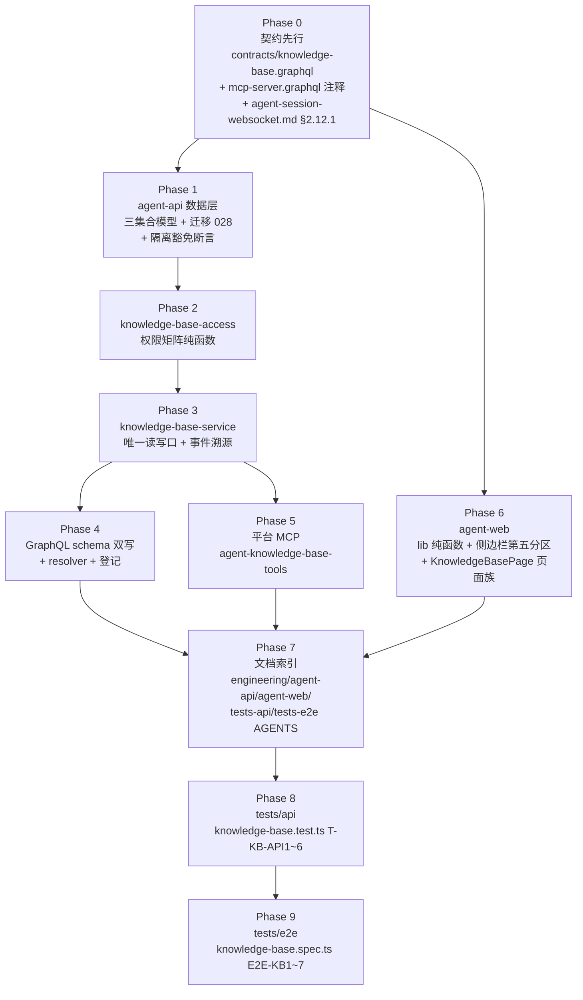

# 知识库 - 实现计划

**功能名称**: 知识库
**关联 PRD**: [`docs/product/draft/20261115-knowledge-base.md`](../../product/draft/20261115-knowledge-base.md)
**关联提案**: [`docs/engineering/proposals/20261115-feat-knowledge-base.md`](../proposals/20261115-feat-knowledge-base.md)
**计划版本**: v1.0
**创建日期**: 2026-11-15
**作者**: ZeroAsh Agent
**需求总分支**: `feat/knowledge-base`
**feat-branch**: `feat/knowledge-base-impl`（开发分支，基于需求总分支切出；实现完成后合并回需求总分支，随 PR #535 收口）
**需求总 PR**: https://github.com/Deliay/z-agent-gear/pull/535

## 1. 实施顺序

严格按「契约 → 数据层 → 权限纯函数 → 服务层 → GraphQL → 平台 MCP → 前端 → 文档索引 → API 收口 → E2E 收口」推进，每个切片先写失败测试再实现（红-绿-重构）：



**关键路径**：Phase 2/3 是需求核心——权限矩阵（四档模式 × 角色 × 本工作区/全局/跨工作区）与事件溯源（创建/更新/删除快照、删除释放路径、重建延续）是全需求的语义本体；Phase 0 契约锁定后 **Phase 1~5（agent-api 线）与 Phase 6（agent-web 线）可并行**（按 z-coding 流程各用一个 subagent 实现，各自从 `feat/knowledge-base-impl` 切工作分支、PR 回 `feat/knowledge-base-impl`）；Phase 4 与 Phase 5 可共享 Phase 3 的服务层并行推进。

**回归重灾区**（新增第 6 个恒装配平台服务 + 侧边栏第 5 分区的既有断言适配）：

- `servers/agent-api/src/services/session.test.ts`：`vi.mock` 清单追加 `./knowledge-base-tools.js`（否则真实 `ensureKnowledgeBaseToolsServer` 撞上被 mock 的 `McpServer` 返回 undefined 而抛错，F20）；
- `tests/api/src/agent-api/session.test.ts`（T-API-MCP1~4）与 `tests/api/src/agent-api/custom-mcp.test.ts`（T-CF1 等）的 `mcpEndpoint.serverNames` 断言（F19）：恒装配新增 `agent-knowledge-base-tools` 后按实际行为适配；
- `tests/e2e/src/sidebar-phase4.spec.ts` E2E-UI4S1（四分区默认态）与 `apps/agent-web/src/components/__tests__/Sidebar.test.tsx`（分区 testid 映射）：第五分区「知识库」同步更新（F21）；
- `servers/agent-api/src/models/tenant-isolation.test.ts`（CASES 恒 22 不进新集合）与 `workspace-isolation.test.ts`（追加豁免断言）（F8/F9）；
- `servers/agent-api` 全量单测 + `apps/agent-web` 全量单测/build/lint 同批跑绿。

## 2. 代码事实核对（计划期确认）

以下事实基于需求总分支 `feat/knowledge-base`（HEAD `60bed26f`）实际代码：

| # | 事实 | 位置 | 对计划的影响 |
|---|------|------|--------------|
| F1 | 平台 MCP 先例形态：`ensureValutToolsServer(userId)` 幂等 `findOneAndUpdate` upsert（`$setOnInsert` 写 `userId/name/transport:'platform'/source:'platform'/enabled:true/tools` 摘要，E11000 回读兜底）+ `handleValutToolsMcpRequest` switch（`initialize` 返回 `protocolVersion:'2025-03-26', capabilities:{tools:{}}, serverInfo`，`notifications/*`/`ping` → `{}`，未知 → `{error:{code:'METHOD_NOT_FOUND'}}`） | `servers/agent-api/src/services/valut-tools.ts:17-62,70-115`；`session-preview-tools.ts:49+`、`custom-tools-mcp.ts:32+` 同构 | `knowledge-base-tools.ts` 沿用同一形态（Phase 5） |
| F2 | `mcp-dispatch` platform 分支：`buildSessionWorkspaceContext(payload.sessionId, payload.userId)` → `runWithWorkspace(sessionContext, …)` 内按 serverName 三元链直发本地 handler（现有 6 个名字：workflow/admin/cloud-host/session-preview/valut/custom-tools）；通知（无 `id`）→ 202；`{error}` → `jsonRpcError` | `servers/agent-api/src/services/mcp-dispatch.ts:155-204` | 链尾追加 `KNOWLEDGE_BASE_TOOLS_SERVER_NAME` 分支；handler 内直接 `getWorkspaceContext()` 取会话创建人角色（MCP 链路无 RequestAuth ALS，见 D6） |
| F3 | `session.ts` 装配点：默认候选 `$nin:[CLOUD_HOST_TOOLS, SESSION_PREVIEW_TOOLS, VALUT_TOOLS, CUSTOM_TOOLS]`（:410-414）；三个恒装配块（:437-454，`Array.from(new Set([...]))` 去重）；`createEndpoint` 收**合并后**的 `mcpServerIds`（:657-666），`userSelectedMcpIds`（:429）用于前置校验（:563-572） | `servers/agent-api/src/services/session.ts:401-454,563-572,655-666` | 追加第四个恒装配块 + `$nin` 第 5 名；平台服务 id 不进用户前置校验（既有口径天然兼容） |
| F4 | `controller.ts` 的 `setControllerDefaultMcp` 校验同一 `$nin` 四名单（:151-163），选平台服务报 `MCP_SERVER_NOT_SELECTABLE` | `servers/agent-api/src/services/controller.ts:151-163` | 同步追加第 5 名（两处 `$nin` 同批改，漏一处即口径漂移） |
| F5 | `WorkspaceContext = {id, tenantId, type, role, readOnly, globalWorkspaceId}`（无 userId/用户名字段）；`TENANT_ROLES=['admin','developer']`、`WORKSPACE_TYPES=['global','normal']`；**无共享 `requireContext` 导出**——各服务私有实现（`valut-service.ts:179`、`cloud-storage-service.ts:182`、`custom-mcp-service.ts:279`、`custom-tool-service.ts:464`），无 ALS → 抛 `workspace not found` | `servers/agent-api/src/services/workspace-context.ts:19-31,58-65` | `knowledge-base-service` 同样私有 `requireContext()`；操作人由**显式 userId 首参**承载（D6） |
| F6 | `buildSessionWorkspaceContext(sessionId, userId)` 回退链：session.workspaceId → controller.workspaceId → CloudHost.resourceWorkspaceId；角色经 `TenantMember.findOne({tenantId, userId})` | `servers/agent-api/src/services/workspace-service.ts:435-465` | MCP 链路权限输入即「会话工作区 + 会话创建人角色」，与 PRD 四种示例场景同口径 |
| F7 | 无 `userId` 集合先例 `custom-tool.ts`：`tenantId`/`workspaceId` 为 ObjectId 显式写字段，唯一索引模型与迁移同名同键；该集合挂 `applyTenantScope`+`applyWorkspaceScope`（独占型） | `servers/agent-api/src/models/custom-tool.ts:69-94` | KB 三集合字段形态沿用，但**有意不挂任何 scope 插件**（提案 D2：全局库跨工作区写放行与插件「写只回当前工作区 + 全局 developer 只读拦截」冲突），可见性由 access 层显式判定 |
| F8 | `tenant-isolation.test.ts`：`CASES` 恒 22（:70）并与迁移 013 `TENANT_ID_COLLECTIONS` 互校；无 `userId` 集合（customtools/custommcpservers）不进矩阵 | `servers/agent-api/src/models/tenant-isolation.test.ts:37-106` | KB 三集合不进 CASES（22 不变），追加「不挂插件、查询不注入」豁免断言（D5） |
| F9 | `workspace-isolation.test.ts` 豁免断言先例：`user_commit_settings 为成员级：无 workspaceId 维度、不挂 workspace-scope`（:181-190，断言 `schema.path('workspaceId')` undefined + 真库跨上下文读写） | `servers/agent-api/src/models/workspace-isolation.test.ts:181-190` | KB 三集合同位追加豁免断言（有 workspaceId 字段但不挂插件、查询不注入） |
| F10 | 迁移登记双落点：`src/index.ts` import 区（:26-56）+ `runMigrations` 数组（:197-227）；编号现状：027 为最新（022/023/026 存在同号双文件先例），**028 空闲** | `servers/agent-api/src/index.ts:26-56,197-227`；`migrations/runner.ts`（名称幂等、锁） | 迁移编号 028（D1） |
| F11 | GraphQL 登记：`schemas/index.ts` 的 `typeDefs` 数组（baseTypeDefs 首、customToolTypeDefs 尾）与 `resolvers/index.ts` 的 Query/Mutation spread——**漏登记运行时无效** | `servers/agent-api/src/graphql/schemas/index.ts`、`resolvers/index.ts` | Phase 4 双登记 + `resolvers/index.test.ts` 守卫既有断言不破 |
| F12 | 契约对齐测试先例：`schemas/custom-mcp.test.ts` 读 `contracts/custom-mcp.graphql`，`parse`+`print` 逐定义比对（`COMPARED_DEFINITIONS` 名单） | `servers/agent-api/src/graphql/schemas/custom-mcp.test.ts` | `schemas/knowledge-base.test.ts` 同模式对齐 `contracts/knowledge-base.graphql` |
| F13 | resolver 错误口径先例：`resolvers/custom-tool.ts` 的 `wrap()` 白名单逐字透传、未命中收敛 `internal error`；未认证 `Not authenticated` | `servers/agent-api/src/graphql/resolvers/custom-tool.ts:16,34` | `resolvers/knowledge-base.ts` 14 条白名单同口径 |
| F14 | 侧边栏分区机制：`Sidebar.tsx` 的 `SidebarSection`（`data-testid="sidebar-section-{key}"`）消费 `lib/sidebar-prefs.ts` 的 `SidebarSectionKey = 'hosts'\|'workflows'\|'sessions'\|'gateways'`、`SIDEBAR_SECTION_DEFAULTS`、`readSidebarSections`（**逐 key 显式读取**，旧 localStorage 缺 key 回退默认） | `apps/agent-web/src/components/Sidebar.tsx:90-130,136-168`、`apps/agent-web/src/lib/sidebar-prefs.ts:1-39` | 新增第 5 key `knowledgeBases` 需三处同改（type/defaults/read），旧持久化自动回退（D3） |
| F15 | 路由：`App.tsx` 的 `<Route element={<MainLayout />}>` 内现有 index/sessions/workflows/settings/billing/workspaces/tenants（:38-48） | `apps/agent-web/src/App.tsx:38-48` | 追加 `knowledge-bases/:kbId/*`（D7：splat 承载文档路径，`?edit=1` 进编辑） |
| F16 | Markdown 渲染：`components/session/MarkdownContent.tsx`（props `{content: string, annotate?: boolean}`，内部 `react-markdown`+`remark-gfm`，代码块经 `markdown/CodeBlock`、Mermaid 经 `markdown/MermaidBlock` 动态导入） | `apps/agent-web/src/components/session/MarkdownContent.tsx:1-15`、`components/session/markdown/` | 预览与编辑左栏直接复用 `MarkdownContent`（不引新依赖，提案 D5） |
| F17 | `useWorkspaceAccess()` 返回 `{workspace, tenant, role, isAdmin, isDeveloper, isGlobal, isTeamTenant, readOnly, tenantId}` | `apps/agent-web/src/stores/workspace.ts:322` | 前端收敛创建库入口（`isAdmin`）与编辑/删除按钮（服务端 `myAccess` 为权威，界面仅体验收敛） |
| F18 | `TreeSection` props `{title, count?, actions?, defaultExpanded, children, emptyMessage?（不渲染）, hasContent?, level?}`；层级缩进 `level*0.5rem` | `apps/agent-web/src/components/tree/TreeSection.tsx` | KB 分区树复用该组件（KB 节点 + 文档层级节点） |
| F19 | tests/api 的 `serverNames` 断言点：`session.test.ts:2279/2281`（toContain/not.toContain）、`:2320/:2351`（**toEqual 精确** `['agent-workflow-admin-tools']`）、`custom-mcp.test.ts:908/1061/1105`（**toEqual 精确**）；relay 调用先例：fake controller `mcp:request` → `mcp:response` 按 requestId 匹配，token 取自 `acp:start.mcpEndpoint.token` | `tests/api/src/agent-api/session.test.ts:2263-2369`、`custom-mcp.test.ts:891-909`、`session-review.test.ts:70-96` | 新增第 6 恒装配服务后，精确断言按实际行为适配（见 §7 D13 与 §6.4 回归清单） |
| F20 | `session.test.ts`（单测）vi.mock 逐模块登记：`./session-preview-tools.js`/`./valut-tools.js`/`./custom-tools-mcp.js`（:83-96），`createEndpoint` mock 返回固定 `serverNames` | `servers/agent-api/src/services/session.test.ts:83-96,193-195` | 必须追加 `vi.mock('./knowledge-base-tools.js', …)`（含 `KNOWLEDGE_BASE_TOOLS_SERVER_NAME` 导出），否则装配块抛错全红 |
| F21 | E2E-UI4S1 断言「四分区存在 + 工作流/会话默认展开 + 主机/网关默认折叠」；`Sidebar.test.tsx:298` 的标题→testid 映射仅含四区 | `tests/e2e/src/sidebar-phase4.spec.ts:12`、`apps/agent-web/src/components/__tests__/Sidebar.test.tsx:298,524-526` | 第五分区新增后两处同步（默认折叠口径见 D3） |
| F22 | 前端规范约束：窄容器溢出三件套（`whitespace-pre-wrap break-all`/`min-w-0 truncate`/`shrink-0`，E2E 用 `scrollWidth - clientWidth ≤ 1` 断言）；Apollo 轮询陷阱（加载分支必须 `loading && !data`）；表单草稿 localStorage 持久化先例 | `docs/engineering/frontend-rules.md`「布局与溢出」「数据刷新与表单输入」 | 预览页限宽靠左（`max-w-3xl`+`wrap-anywhere`/`min-w-0`）、树/文档查询 `cache-and-network`+`loading && !data`、草稿缓存均由此约束 |

## 3. 内部接口与数据形态

### 3.1 `services/knowledge-base-access.ts`（新增，纯函数唯一判定源）

```ts
export type KnowledgeBasePermissionMode = 'NONE' | 'READ_ONLY' | 'UPDATE_ONLY' | 'FULL_ACCESS';

export interface KnowledgeBaseAccessResult {
  visible: boolean; canRead: boolean; canCreate: boolean;
  canUpdate: boolean; canDelete: boolean; canManage: boolean;
}

export function resolveKnowledgeBaseAccess(
  kb: { workspaceId: string; permissionMode: KnowledgeBasePermissionMode },
  context: WorkspaceContext,
): KnowledgeBaseAccessResult;

export function defaultPermissionMode(workspaceType: WorkspaceType): KnowledgeBasePermissionMode;
// global → READ_ONLY；normal → NONE（提案 D8）
```

判定表（`visible` 为一切读写前提；`canManage` 恒 = `visible && role==='admin'`）：

| 角色 \ 模式 | NONE | READ_ONLY | UPDATE_ONLY | FULL_ACCESS |
|---|---|---|---|---|
| admin | 全 true | 全 true | 全 true | 全 true |
| developer | visible=false（全 false） | 仅 canRead | canRead + canCreate + canUpdate | canRead + canCreate + canUpdate + canDelete |

- `visible = (kb.workspaceId === ctx.id || kb.workspaceId === ctx.globalWorkspaceId) && !(mode==='NONE' && role!=='admin')`；其他普通工作区的库对本工作区成员不可见（独占语义），全局库跨工作区可见且**写按库模式放行**（有意偏离全局只读插件，T-KBA8 锁定）。
- 库创建权限不在矩阵内：服务层入口单独判 `role !== 'admin' → 'not a tenant admin'`（全局工作区 developer 天然被拦截，无 `global workspace is read-only` 路径）。

### 3.2 `services/knowledge-base-service.ts`（新增，唯一读写口）

全部方法首参 `userId: string`（GraphQL 传 `context.user.id`；MCP 传 `caller.userId`；D6），入口 `requireContext()`（无 ALS → `workspace not found`）：

| 域 | 方法 | 语义要点 |
|---|---|---|
| 库 | `list()` / `listTree()` | 查 `{tenantId: ctx.tenantId, workspaceId: {$in: [ctx.id, ctx.globalWorkspaceId]}}` → 逐库 `resolveKnowledgeBaseAccess` 过滤 `visible`；每条附 `myAccess`；listTree 追加各库文档元信息（无 content） |
| 库 | `create(userId, name)` | `role!=='admin'` → `not a tenant admin`；name trim 1..64 → `invalid knowledge base name`；`permissionMode=defaultPermissionMode(ctx.type)`；重名预检 + E11000 → `knowledge base name already exists` |
| 库 | `rename` / `updatePermission` / `remove` | `canManage` 否则 `knowledge base permission denied`（不可见 → `knowledge base not found`）；remove 级联删三集合 |
| 文档 | `listDocuments(userId, kbId, prefix?)` | canRead 校验；prefix 走 `{knowledgeBaseId, path: {$regex:'^<escaped>'}}`（唯一索引前缀）；只出元信息 |
| 文档 | `getDocument(userId, kbId, path)` | 不可见/无读权限/不存在统一返回 `null`（不泄露存在性） |
| 文档 | `createDocument(userId, kbId, input)` | canCreate；路径归一（下）；同路径 → `knowledge base document already exists`（预检 + E11000 收敛）；写文档 + 追加 CREATE 事件 |
| 文档 | `updateDocument(userId, kbId, path, input)` | canUpdate；matchedCount=0 → `knowledge base document not found`；写文档 + 追加 UPDATE 事件 |
| 文档 | `upsertDocument(userId, kbId, path, input)` | MCP 专用：存在走更新（canUpdate）、不存在走创建（canCreate），权限分支各自判定 |
| 文档 | `deleteDocument(userId, kbId, path)` | canDelete；`deleteOne` + DELETE 事件（快照=删除前最后内容）；路径即释放 |
| 历史 | `listEvents(userId, kbId, {path?, limit?, before?})` | canRead；恒 `createdAt` 倒序；limit 缺省 50 上限 200；before 为 `createdAt` ISO 游标 |

- **写路径不变量**：「业务行变更 → 追加事件」同库顺序两步，事件写入失败整体抛错不留半提交（提案实现点 2）；**事件集合无任何更新/删除入口**。
- `normalizeDocumentPath(raw)`：trim → 必须 `/` 开头 → 去末尾 `/`（根 `/` 除外）→ 拒空路径段/控制字符/NUL → 段 ≤128、全长 ≤512；非法抛 `invalid document path`。
- 文档输入校验（逐字白名单）：title trim 1..200 → `invalid document title`；tags ≤16 个、每个 trim 1..32、去重 → `invalid document tags`；description ≤1024 → `invalid document description`；content ≤262144 字符 → `invalid document content`。
- **actorName 快照**：`appendEvent` 内部 `User.findById(userId).select('name').lean()` 解析（缺失回退 userId 串），账户改名不影响历史（D6）。

### 3.3 平台 MCP `agent-knowledge-base-tools`（新增 `services/knowledge-base-tools.ts`）

`KNOWLEDGE_BASE_TOOLS_SERVER_NAME = 'agent-knowledge-base-tools'`；`ensureKnowledgeBaseToolsServer(userId)` 幂等 upsert（F1 形态）；`handleKnowledgeBaseToolsMcpRequest(caller, request)` switch handler：

| 工具 | 入参 | 出参（content[0].text = JSON） | 权限（双校验：tools/list 门控 + 调用再判） |
|---|---|---|---|
| `knowledge_base_create` | `{name}` | `{id,name,permissionMode,global}` | 会话创建人为租户 admin；非 admin 不出现在 tools/list 且调用 → isError `not a tenant admin` |
| `knowledge_base_list` | `{}` | `[{id,name,global,permissionMode,myAccess}]` | 可见集 = 会话工作区 ∪ 本租户全局工作区，按矩阵过滤 |
| `knowledge_base_document_list` | `{knowledgeBaseId?/knowledgeBaseName?, prefix?}` | `[{path,title,tags,description,updatedAt}]`（无 content） | canRead，否则 isError `knowledge base not found` |
| `knowledge_base_document_get` | `{…, path}` | 完整文档（含 content） | canRead |
| `knowledge_base_document_update` | `{…, path, title, tags, description, content}` | 更新/创建后文档 | upsert：存在 → canUpdate；不存在 → canCreate |
| `knowledge_base_document_delete` | `{…, path}` | `{success:true}` | canDelete（UPDATE_ONLY 下拒绝 `knowledge base permission denied`） |

- 库定位：`knowledgeBaseId` 优先，缺省用 `knowledgeBaseName` 在**可见集内**解析，0 命中/多命中 → isError 明确提示（提案 D10）。
- 错误形态：服务层抛出的白名单文案统一收敛为 `isError:true` 文本（不抛协议级异常）；未知工具/方法 → `METHOD_NOT_FOUND`。
- tools/list 动态计算：`getWorkspaceContext()` 取会话创建人角色，非 admin 过滤 `knowledge_base_create`（提案 D4）。

## 4. 核心时序

沿用提案 §5.1 两图（GraphQL 更新文档链路 / MCP 工具调用链路），补充不变量：

- GraphQL 链路：resolver（认证 + `wrap()` 白名单）→ service（`requireContext` + access 判定 + 写 + 事件）→ Mongo；
- MCP 链路：controller relay → `mcp-dispatch`（`buildSessionWorkspaceContext` + `runWithWorkspace`）→ handler（tools/list 按角色门控）→ service（二次权限校验，防绕过 tools/list 门控）；
- 前端编辑链路：进入编辑（`?edit=1`）→ 读 localStorage 草稿（有则弹恢复对话框）→ 右侧输入防抖 300ms 写草稿 + 左侧 `MarkdownContent` 实时预览 → 保存（create/update mutation）→ 清草稿 + `refetchQueries` 树与文档。

## 5. 变更清单

### 5.1 Phase 0：契约（先于代码）

| 文件 | 变更 |
|------|------|
| `contracts/knowledge-base.graphql`（新增） | 提案 §3.1 定稿 SDL：`KnowledgeBasePermissionMode` / `KnowledgeBaseEventOp` / `KnowledgeBaseAccess` / `KnowledgeBase` / `KnowledgeBaseDocumentMeta` / `KnowledgeBaseDocument` / `KnowledgeBaseTreeItem` / `KnowledgeBaseEvent` / Query×5 / Mutation×7 / `KnowledgeBaseDocumentInput`；注释逐字列入 14 条错误白名单与语义要点（可见集口径、null 不泄露、E11000 收敛、limit/before 口径、默认模式） |
| `contracts/mcp-server.graphql` | `McpServerSource.platform` 注释追加 `agent-knowledge-base-tools` 说明（知识库工具集、全部会话恒装配、`knowledge_base_create` 按会话创建人角色门控） |
| `contracts/agent-session-websocket.md` | §2.12.1 平台路由表新增一行（serverName/装配范围/六工具/路由语义，提案 §3.1 定稿文案） |

### 5.2 Phase 1：agent-api 数据层（先红后绿）

| 文件 | 变更 |
|------|------|
| `servers/agent-api/src/models/knowledge-base.ts`（新增） | `knowledgebases`：`tenantId`/`workspaceId`（String，服务层显式写）、`name`、`permissionMode`（四档枚举）、`createdBy`；**不挂任何 scope 插件**（F7/D2）；索引声明与迁移同名同键 |
| `servers/agent-api/src/models/knowledge-base-document.ts`（新增） | `knowledgebasedocuments`：`knowledgeBaseId` ObjectId ref、`path`、`title/tags/description/content`、`createdBy/updatedBy`；唯一索引 `uniq_knowledge_base_doc_path {knowledgeBaseId,path}` |
| `servers/agent-api/src/models/knowledge-base-event.ts`（新增） | `knowledgebaseevents`：`op`（CREATE/UPDATE/DELETE）、快照四字段、`actorId/actorName`；无 TTL、无更新/删除入口 |
| `servers/agent-api/src/migrations/028-knowledge-base.ts`（新增） | 幂等建索引：`uniq_knowledge_base_workspace_name {workspaceId,name}` + `{tenantId,workspaceId}`（库）；`uniq_knowledge_base_doc_path`（文档）；`{knowledgeBaseId,createdAt:-1}` + `{knowledgeBaseId,path,createdAt:-1}`（事件） |
| `servers/agent-api/src/migrations/028-knowledge-base.test.ts`（新增） | T-MIG-KB1~3：幂等二次执行、三集合索引名/键断言、先建后用 |
| `servers/agent-api/src/index.ts` | import + `runMigrations` 数组尾部登记（F10） |
| `servers/agent-api/src/models/tenant-isolation.test.ts` | 追加豁免断言：三集合无 `userId`、不挂 tenant 插件、查询不注入 tenantId（CASES 恒 22 不变，F8/D5） |
| `servers/agent-api/src/models/workspace-isolation.test.ts` | 追加豁免断言：三集合不挂 workspace 插件、查询不注入 workspaceId 过滤（同 `user_commit_settings` 先例位，F9/D5） |

### 5.3 Phase 2：权限矩阵纯函数（先红后绿）

| 文件 | 变更 |
|------|------|
| `servers/agent-api/src/services/knowledge-base-access.ts`（新增） | §3.1 接口与判定表 |
| `servers/agent-api/src/services/knowledge-base-access.test.ts`（新增） | T-KBA1~8（§6.1） |

### 5.4 Phase 3：服务层（先红后绿，mongodb-memory-server 真库）

| 文件 | 变更 |
|------|------|
| `servers/agent-api/src/services/knowledge-base-service.ts`（新增） | §3.2 全量方法 + `normalizeDocumentPath` + 输入校验 + `appendEvent`（actorName 快照） |
| `servers/agent-api/src/services/knowledge-base-service.test.ts`（新增） | T-KBS1~12（§6.1） |

### 5.5 Phase 4：GraphQL（schema 双写 + resolver + 登记）

| 文件 | 变更 |
|------|------|
| `servers/agent-api/src/graphql/schemas/knowledge-base.ts`（新增） | 手写 schema，与契约逐字段一致（双写） |
| `servers/agent-api/src/graphql/schemas/knowledge-base.test.ts`（新增） | 契约对齐测试（F12 模式）：`COMPARED_DEFINITIONS` 覆盖全部 enum/type/input/Query/Mutation |
| `servers/agent-api/src/graphql/resolvers/knowledge-base.ts`（新增） | 认证守卫 + `wrap()` 14 条白名单逐字透传 + 委托 service（首参 `context.user.id`） |
| `servers/agent-api/src/graphql/resolvers/knowledge-base.test.ts`（新增） | 未认证 `Not authenticated`、白名单逐字、未命中收敛 `internal error`、登记存在性 |
| `servers/agent-api/src/graphql/schemas/index.ts` / `resolvers/index.ts` | 双登记（F11） |

### 5.6 Phase 5：平台 MCP（装配 + 路由 + handler）

| 文件 | 变更 |
|------|------|
| `servers/agent-api/src/services/knowledge-base-tools.ts`（新增） | §3.3：常量/六工具定义/`ensureKnowledgeBaseToolsServer`/`handleKnowledgeBaseToolsMcpRequest`（tools/list 按 `getWorkspaceContext()` 角色门控 `knowledge_base_create`） |
| `servers/agent-api/src/services/knowledge-base-tools.test.ts`（新增） | T-KBT1~8（§6.1） |
| `servers/agent-api/src/services/mcp-dispatch.ts` | platform 三元链尾追加 `KNOWLEDGE_BASE_TOOLS_SERVER_NAME` 分支（F2） |
| `servers/agent-api/src/services/session.ts` | 追加恒装配块（与 valut/custom 同位同形态）+ 默认候选 `$nin` 第 5 名（F3） |
| `servers/agent-api/src/services/controller.ts` | `setControllerDefaultMcp` 校验 `$nin` 第 5 名（F4） |
| `servers/agent-api/src/services/session.test.ts` | `vi.mock` 清单追加 `./knowledge-base-tools.js`（F20） |

### 5.7 Phase 6：agent-web（纯函数先行，组件后随；各环节先红后绿）

| 文件 | 变更 |
|------|------|
| `apps/agent-web/src/lib/knowledge-base-path.ts`（新增） | 纯函数：路径归一（与服务端同规则）、`joinDocPath(parentPath, name)`、`breadcrumbOf(path)`、`buildKnowledgeBaseTree(docs)`（按路径段聚合树）、`newDocumentName()`（`新文档-{随机后缀}`） |
| `apps/agent-web/src/lib/knowledge-base-draft.ts`（新增） | 草稿缓存：键 `kb-doc-draft:{kbId}:{path}`、防抖 300ms 写、保存清除、读取容错（解析失败/形状非法按无缓存） |
| `apps/agent-web/src/lib/__tests__/knowledge-base-path.test.ts` / `knowledge-base-draft.test.ts`（新增） | T-KBP1~6 / T-KBD1~5（§6.1） |
| `apps/agent-web/src/graphql/knowledge-base.ts`（新增） | 查询/变更（`GET_KNOWLEDGE_BASE_TREE`/`GET_KNOWLEDGE_BASE_DOCUMENT`/`GET_KNOWLEDGE_BASE_EVENTS` + 7 个 mutation）与手写类型；树 `cache-and-network`、mutation `refetchQueries` |
| `apps/agent-web/src/lib/sidebar-prefs.ts` | `SidebarSectionKey` 追加 `'knowledgeBases'` + 默认值 + `readSidebarSections` 逐 key 读取（F14/D3） |
| `apps/agent-web/src/components/knowledge-base/KnowledgeBaseSection.tsx`（新增） | 侧边栏第五分区「知识库」（位置：「会话」之后、「网关」之前，D8）：分区「+」创建库对话框入口（非 admin 不渲染，F17）、树（KB → 文档层级，全局来源徽标）、KB 条目设置齿轮 + 「+」、文档条目「+」 |
| `apps/agent-web/src/components/knowledge-base/CreateKnowledgeBaseDialog.tsx`（新增） | 名称输入 + 创建/取消；重名/无权限文案映射 |
| `apps/agent-web/src/components/knowledge-base/KnowledgeBaseSettingsDialog.tsx`（新增） | 重命名、权限模式四档选择、全库操作历史（`GET_KNOWLEDGE_BASE_EVENTS` 无 path，时间倒序）、删除知识库（二次确认） |
| `apps/agent-web/src/components/knowledge-base/KnowledgeBasePreview.tsx`（新增） | 面包屑/标题/描述（灰色小字）/Tags/Markdown 内容；`max-w-3xl` 限宽靠左 + `wrap-anywhere`/`min-w-0`（F22）；按 `myAccess` 显示编辑/删除/历史版本按钮 |
| `apps/agent-web/src/components/knowledge-base/KnowledgeBaseEditor.tsx`（新增） | 分栏编辑：右表单（标题/描述/tags/内容 textarea）左 `MarkdownContent` 实时预览；草稿接线与恢复对话框；保存调 create/update |
| `apps/agent-web/src/components/knowledge-base/KnowledgeBaseHistoryDrawer.tsx`（新增） | 抽屉 + 版本下拉（时间倒序）+ 所选版本只读预览（含已删除路径历史） |
| `apps/agent-web/src/pages/KnowledgeBasePage.tsx`（新增） | `/knowledge-bases/:kbId/*` 路由页：splat 解析文档路径、`?edit=1` 编辑模式、无权限/不存在提示（不泄露内容）、删除文档确认 |
| `apps/agent-web/src/App.tsx` | MainLayout 内追加路由（F15） |
| `apps/agent-web/src/components/Sidebar.tsx` | 渲染第五分区（F14） |
| `apps/agent-web/src/components/knowledge-base/__tests__/*`（新增） | T-KBW1~10 组件单测（§6.1） |

### 5.8 Phase 7：文档索引

| 文件 | 变更 |
|------|------|
| `servers/agent-api/AGENTS.md` | 新增「知识库」小节：三集合与不挂插件的有意偏离（D2）、access 矩阵唯一事实源、事件溯源写序、平台 MCP 装配/门控点、`$nin` 两处口径、错误白名单位置 |
| `apps/agent-web/AGENTS.md` | 新增「知识库」小节：第五分区、`/knowledge-bases/:kbId/*` 页面族、草稿缓存键口径、预览限宽与权限收敛口径、测试入口 |
| `tests/api/AGENTS.md` | 追加「知识库 API」小节（T-KB-API1~6 与前置 env） |
| `tests/e2e/AGENTS.md` | 追加「知识库 E2E」小节（E2E-KB1~7） |
| `docs/product/AGENTS.md` / `docs/engineering/AGENTS.md` | PRD 状态流转（draft→shipping 随实现开始）与索引口径核对 |

### 5.9 Phase 8：API 收口（`tests/api/src/agent-api/knowledge-base.test.ts` 新增）

见 §6.2；夹具复用 T-WS 模式（`adminCreateTeamTenant`/`adminAddTenantMember` + team 租户 admin/developer/outsider + 普通工作区）；MCP 用例经 fake controller relay（F19 先例）。

### 5.10 Phase 9：E2E 收口（`tests/e2e/src/knowledge-base.spec.ts` 新增）

见 §6.3；造数经 GraphQL API（开户 `INTERNAL_API_TOKEN`），UI 驱动关键路径；串行（workers=1）。

## 6. TDD 测试矩阵

### 6.1 单元（agent-api + agent-web，Vitest）

| 编号 | 文件 | 断言 |
|------|------|------|
| T-KBA1 | `services/knowledge-base-access.test.ts` | admin × 四模式 × 本工作区/全局库：六项权限全 true |
| T-KBA2 | 同上 | NONE + developer：visible=false（本工作区与全局库同口径） |
| T-KBA3 | 同上 | READ_ONLY + developer：仅 canRead |
| T-KBA4 | 同上 | UPDATE_ONLY + developer：canRead+canCreate+canUpdate、不可删 |
| T-KBA5 | 同上 | FULL_ACCESS + developer：仅 canManage=false |
| T-KBA6 | 同上 | 库属其他普通工作区（非 ctx.id/globalWorkspaceId）：visible=false |
| T-KBA7 | 同上 | `defaultPermissionMode`：global→READ_ONLY、normal→NONE |
| T-KBA8 | 同上 | 全局工作区 developer（readOnly 上下文）访问全局库：按库模式放行写（D2 锁定用例，UPDATE_ONLY 下 canUpdate=true） |
| T-KBS1 | `services/knowledge-base-service.test.ts`（真库） | 库创建默认模式按工作区类型落；重名预检与 E11000 → `knowledge base name already exists` |
| T-KBS2 | 同上 | 非 admin 创建 → `not a tenant admin`（全局工作区 developer 同文案） |
| T-KBS3 | 同上 | 列表 = 本工作区 ∪ 全局 ∪ 模式过滤（NONE 对 developer 不可见）；myAccess 逐库正确 |
| T-KBS4 | 同上 | 路径归一矩阵：非 `/` 开头/空段/超长/控制字符/NUL → `invalid document path` 逐字；合法归一（去末尾 `/`） |
| T-KBS5 | 同上 | 同路径重复创建 → `knowledge base document already exists`（E11000 收敛同文案） |
| T-KBS6 | 同上 | 更新不存在 → `knowledge base document not found`；删除不存在 → 同文案 |
| T-KBS7 | 同上 | CREATE/UPDATE/DELETE 事件快照完整（DELETE 保留删除前内容、actorId/actorName 快照、createdAt） |
| T-KBS8 | 同上 | 删除释放路径 → 同路径重建成功（新 CREATE 事件）；单路径历史跨删除延续、倒序完整 |
| T-KBS9 | 同上 | 库级历史 `createdAt` 倒序；limit 缺省 50/上限 200 截断；before 游标正确 |
| T-KBS10 | 同上 | 删除库级联删 documents+events； rename/updatePermission 仅 canManage |
| T-KBS11 | 同上 | 越权逐字：读不可见/无权限返回 null 或 `knowledge base not found`；写越权 `knowledge base permission denied`；无 ALS 上下文 → `workspace not found` |
| T-KBS12 | 同上 | 输入校验边界逐字：title（0/201）、tags（17 个/单条 33/去重）、description（1025）、content（262145） |
| T-KBT1 | `services/knowledge-base-tools.test.ts` | tools/list：admin 上下文含 `knowledge_base_create`，developer 上下文不含（门控） |
| T-KBT2 | 同上 | initialize/ping/notifications 形态；未知方法与未知工具 → `METHOD_NOT_FOUND` |
| T-KBT3 | 同上 | developer 直接调 `knowledge_base_create` → isError `not a tenant admin`（双校验） |
| T-KBT4 | 同上 | `knowledge_base_list` 只出可见集且字段仅 id/name/global/permissionMode/myAccess |
| T-KBT5 | 同上 | `document_list` 只出路径+元信息（无 content）；无读权限库 → isError |
| T-KBT6 | 同上 | get/update/delete 权限矩阵（UPDATE_ONLY 删除拒绝 `knowledge base permission denied`） |
| T-KBT7 | 同上 | `document_update` upsert：存在 → UPDATE 事件；不存在 → CREATE 事件（各自权限分支） |
| T-KBT8 | 同上 | 库定位 id 优先/name 兜底；name 0 命中/多命中 → isError 明确提示；服务层白名单文案统一 isError 形态 |
| T-MIG-KB1~3 | `migrations/028-knowledge-base.test.ts` | 幂等、索引名/键断言、重复执行不报错 |
| （契约/Resolver） | `schemas/knowledge-base.test.ts` / `resolvers/knowledge-base.test.ts` | 契约逐字段对齐；认证/白名单逐字/收敛/登记守卫 |
| T-KBP1~6 | `apps/agent-web/src/lib/__tests__/knowledge-base-path.test.ts` | 路径归一与服务端同规则；join/breadcrumb；`buildKnowledgeBaseTree` 层级聚合（同级排序稳定）；`newDocumentName` 形如 `新文档-XXXX` |
| T-KBD1~5 | `apps/agent-web/src/lib/__tests__/knowledge-base-draft.test.ts` | 防抖写/保存清/按 kbId+path 隔离/损坏 JSON 与非法形状按无缓存/恢复读取 |
| T-KBW1~10 | `apps/agent-web/src/components/knowledge-base/__tests__/` | 分区渲染与非 admin 无「+」、创建对话框提交、树条目「+」建子文档导航、预览元素与权限按钮收敛、编辑器实时预览与草稿恢复对话框两分支、历史抽屉版本选择与只读、设置改权限/全库历史/删除二次确认 |

### 6.2 API（tests/api，Vitest + Aspire 真实服务）

| 编号 | 断言 |
|------|------|
| T-KB-API1 | 未认证：Query×5/Mutation×7 全入口 `Not authenticated` |
| T-KB-API2 | 库 CRUD 全链路 + 重名逐字 + 默认模式（全局工作区创建 → READ_ONLY；普通工作区 → NONE）+ myAccess 透出 |
| T-KB-API3 | 文档 CRUD + 事件：创建/更新/删除各产生事件；删除后同路径重建历史延续；库级历史倒序 + limit/before 分页 |
| T-KB-API4 | 权限矩阵全链路：team 租户 admin/developer/outsider × 四模式 × 本工作区/全局工作区库（PRD 四种示例场景逐一核对）；权限模式收紧后即时生效；无权限读不泄露存在性（null / `knowledge base not found`） |
| T-KB-API5 | MCP 经 fake controller relay：tools/list 角色门控；list/document_list（无 content）/get/update（upsert 两分支）/delete；越权 isError；name 兜底解析与多命中提示 |
| T-KB-API6 | 路径与输入校验矩阵逐字（14 条白名单文案全覆盖） |

> 前置：`aspire start && aspire wait agent-api controller-api admin-api` + `INTERNAL_API_TOKEN`（开户/建 team）；MCP 用例需 controller-api relay（F19）。

### 6.3 E2E（tests/e2e，Playwright）

| 编号 | 断言 |
|------|------|
| E2E-KB1 | 侧边栏「知识库」折叠分区存在（默认折叠）；admin 见分区「+」并创建库成功；developer 无「+」入口 |
| E2E-KB2 | 树形展示（KB → 文档层级、标题）；条目「+」创建子文档「新文档-{后缀}」→ 地址栏跳新路径且处于编辑模式 |
| E2E-KB3 | 分栏编辑：右侧输入左侧实时渲染；保存生效且草稿清除；刷新后重进编辑弹「恢复未保存的内容？」（恢复/放弃两分支） |
| E2E-KB4 | 预览页：面包屑/标题/描述/Tags/Markdown；限宽靠左、超长内容 `scrollWidth - clientWidth ≤ 1`；地址栏含文档路径 |
| E2E-KB5 | 历史版本抽屉：下拉时间倒序、选择版本只读预览（含已删除路径的历史版本） |
| E2E-KB6 | 设置：改权限模式后 developer 视野即时变化；全库历史时间倒序可见；删除知识库二次确认后树下架 |
| E2E-KB7 | 删除文档：确认后路径从树消失、可立即同路径重建、历史仍可查看 |

### 6.4 回归清单（必须同批）

| 位置 | 关注 |
|------|------|
| `servers/agent-api/src/services/session.test.ts` | 追加 `./knowledge-base-tools.js` mock 后全绿（F20） |
| `tests/api/src/agent-api/session.test.ts`（T-API-MCP1~4）、`custom-mcp.test.ts`（T-CF1 等）、`mcp-server.test.ts` | 第 6 恒装配服务的 `serverNames` 断言适配（F19/D13） |
| `servers/agent-api/src/services/mcp-dispatch.test.ts` / `controller.test.ts` | 新分支/新 `$nin` 名追加后既有用例零回归 |
| `apps/agent-web/src/components/__tests__/Sidebar.test.tsx`、`tests/e2e/src/sidebar-phase4.spec.ts` | 第五分区断言更新（F21/D3） |
| `servers/agent-api/src/models/tenant-isolation.test.ts` / `workspace-isolation.test.ts` | CASES 恒 22 + 豁免断言新绿（F8/F9） |
| `servers/agent-api` 全量单测 + build；`apps/agent-web` 全量单测 + build + lint | 全绿 |
| `tests/api` 既有 62 文件套件、`tests/e2e` 既有套件 | 零回归（重点：会话创建/MCP/侧边栏/工作区套件） |

## 7. 计划期裁决

| 编号 | 裁决 | 理由 |
|------|------|------|
| D1 | 迁移编号取 `028-knowledge-base` | F10：027 已被 OIDC 绑定优化占用；028 空闲 |
| D2 | 开发分支 `feat/knowledge-base-impl` 基于需求总分支 `feat/knowledge-base` 切出；agent-api 线与 agent-web 线各自从 impl 切工作分支、PR 回 impl；impl 全绿后合并回 `feat/knowledge-base` 随 PR #535 收口 | 沿用 `feat/oidc-github-oauth-login(-impl)`、`feat/workflow-mcp-prompt-snippets(-impl)` 双分支先例；契约锁定后两线并行（z-coding「编写实现」并行 subagent 口径） |
| D3 | 侧边栏第 5 key 命名 `knowledgeBases`，**默认折叠** | 与 hosts/gateways 同档（非首屏主信息流）；旧 localStorage 无该 key 自动回退默认（F14 逐 key 读取形态天然兼容）；E2E-UI4S1 与 Sidebar 单测同步 |
| D4 | 侧边栏树走独立 `knowledgeBaseTree` 查询（不进 HOME_OVERVIEW） | 提案 D6：避免首页聚合膨胀；工作区切换随 `resetStore` 自动刷新 |
| D5 | 三集合豁免断言双落点：`tenant-isolation.test.ts`（断言无 userId、查询不注入 tenantId）+ `workspace-isolation.test.ts`（断言不挂 workspace 插件、跨上下文读写不被过滤） | 提案 §4.1 要求；`user_commit_settings` 先例位（F8/F9）；防后续误挂插件导致全局库跨工作区写被静默拦截 |
| D6 | service 方法首参显式 `userId`；actorName 在 `appendEvent` 内经 `User.findById(userId).select('name')` 快照 | F5：`WorkspaceContext` 无 userId/姓名；F2：MCP relay 链路无 RequestAuth ALS（`mcp-relay-consumer` 直调 `dispatch`，仅 `runWithWorkspace`），不能依赖 `getRequestAuth()` |
| D7 | 浏览器路由 `/knowledge-bases/:kbId/*`（splat=文档路径）+ `?edit=1` 编辑模式 | 提案 D7：PRD 要求「路径需要在浏览器的 path 中体现」；query 仅承载模式开关 |
| D8 | 第五分区渲染位置：「会话」之后、「网关」之前 | 内容型分区相邻（会话/知识库），网关为基础设施收尾；既有四分区顺序不变降低 diff |
| D9 | 条目「+」**点击即持久化**子文档（`createKnowledgeBaseDocument`，标题 `新文档-{随机后缀}`、空内容/tags/描述）→ 跳转 `?edit=1` | PRD 字面口径「点击后创建一个子知识库文档…然后自动进入编辑模式」；树即时可见、历史自 CREATE 起；并发同路径由唯一索引兜底 |
| D10 | 编辑器用原生 textarea + `MarkdownContent` 预览，不引入 Monaco | 提案 D5/F16：现有 Monaco 仅只读预览 seam；编辑需求轻量 |
| D11 | MCP 六工具 handler 不自行构造上下文，直接消费 dispatch 注入的 ALS（`getWorkspaceContext()`） | F2：dispatch 已 `runWithWorkspace(buildSessionWorkspaceContext(...))`；重复构造会漂移口径 |
| D12 | 前端错误文案映射集中 `apps/agent-web/src/lib/knowledge-base.ts`（未命中原样展示） | `lib/custom-tool.ts`/`lib/valut.ts` 先例；服务端为权威 |
| D13 | `tests/api` 的 `serverNames` 精确断言适配口径：实现期以真实环境行为为准，把 `toEqual(['agent-workflow-admin-tools'])` 等更新为包含 `agent-knowledge-base-tools` 的新集合（或改 `toContain` 语义等价改写），并在 PR 描述中逐条说明 | F19：第 6 个恒装配服务必然改变装配集合；静态阅读确认装配块无条件执行（F3），断言必须随实现同步 |
| D14 | 本期不提供历史回滚与路径改名/移动；事件集合无 TTL | 提案范围约束；删除库时级联清理事件控制体量 |

## 8. 风险与回滚

| 风险 | 影响 | 缓解 |
|------|------|------|
| 权限矩阵与全局只读插件语义冲突（全局库跨工作区写被插件误拦） | 核心需求失效 | 三集合**不挂插件**（提案 D2）+ 服务层显式判定 + T-KBA/T-KBS 矩阵锁定 + 豁免断言双注册（D5） |
| 第 6 恒装配平台服务波及既有 serverNames/装配断言 | tests/api 与单测红 | F19/F20 精确落点 + §6.4 回归清单同批跑绿 + D13 适配口径 |
| 侧边栏第五分区波及四分区断言 | Sidebar 单测与 E2E-UI4S1 红 | F21 落点 + 同批更新 |
| 事件集合无界增长 | 存储膨胀 | 本期无 TTL（提案定）；删除库级联清理；库级查询走 `{knowledgeBaseId,createdAt:-1}` 索引 + limit/before；后续优化另立提案 |
| 并发同路径创建 | 脏数据 | 唯一索引 `uniq_knowledge_base_doc_path` 兜底 + E11000 收敛 `knowledge base document already exists`（T-KBS5/T-KB-API6） |
| 大文档（≤256KiB）传输与渲染卡顿 | 体验 | 树/列表不带 content，预览/编辑按需加载；编辑器受控更新防抖 |
| 回滚 | — | 服务端回滚即恢复旧行为：新集合保留无影响（可按运维流程事后清理）；迁移 028 幂等无副作用；前端路由/分区随回滚消失 |

## 9. 命令参考

```bash
# 依赖（仓库已迁移 pnpm）
pnpm install

# agent-api 单测（先红后绿）
cd servers/agent-api && pnpm exec vitest run src/services/knowledge-base-access.test.ts
cd servers/agent-api && pnpm exec vitest run src/services/knowledge-base-service.test.ts
cd servers/agent-api && pnpm exec vitest run src/services/knowledge-base-tools.test.ts
cd servers/agent-api && pnpm exec vitest run src/migrations/028-knowledge-base.test.ts
cd servers/agent-api && pnpm test && pnpm run build

# agent-web 单测与构建
cd apps/agent-web && pnpm test && pnpm run build && pnpm run lint

# 服务编排（API/E2E 前置）
aspire start
aspire wait agent-api controller-api admin-api agent-web

# API 集成（端口以 aspire describe 实际输出为准）
cd tests/api && API_URL=http://localhost:10001/graphql \
  ADMIN_API_URL=http://localhost:10003/graphql \
  CONTROLLER_API_URL=http://localhost:35273 \
  INTERNAL_API_TOKEN=<token> \
  pnpm exec vitest run src/agent-api/knowledge-base.test.ts

# E2E
cd tests/e2e && BASE_URL=http://localhost:<agent-web-port> \
  API_URL=http://localhost:10001/graphql \
  ADMIN_API_URL=http://localhost:10003/graphql \
  CONTROLLER_API_URL=http://localhost:35273 \
  INTERNAL_API_TOKEN=<token> \
  pnpm exec playwright test src/knowledge-base.spec.ts --workers=1
```

## 10. 验收 checklist

### 10.1 Phase 0（契约）

- [ ] `contracts/knowledge-base.graphql` 与提案 §3.1 SDL 逐字段一致，14 条错误白名单逐字列入注释
- [ ] `contracts/mcp-server.graphql` 注释与 `contracts/agent-session-websocket.md` §2.12.1 路由表增补完成

### 10.2 Phase 1~3（数据层 / 权限 / 服务）

- [ ] 三集合模型不挂任何 scope 插件；迁移 028 幂等并登记 `src/index.ts`；豁免断言双落点新绿
- [ ] T-KBA1~8、T-KBS1~12、T-MIG-KB1~3 全绿（真库）

### 10.3 Phase 4~5（GraphQL / MCP）

- [ ] schema 双写 + 契约对齐测试绿；resolver 白名单逐字透传；双登记完成
- [ ] T-KBT1~8 全绿；`session.ts` 装配与两处 `$nin` 追加；`session.test.ts` mock 清单同步

### 10.4 Phase 6~7（前端 / 文档）

- [ ] T-KBP/T-KBD/T-KBW 全绿；第五分区与页面族可用；`Sidebar.test.tsx` 同步
- [ ] 四份 AGENTS.md 口径同步；product/engineering 索引核对

### 10.5 Phase 8~9（API / E2E 收口）

- [ ] T-KB-API1~6 全绿（含四种 MCP 会话场景可见范围核对）
- [ ] E2E-KB1~7 全绿；`sidebar-phase4.spec.ts` 零回归
- [ ] §6.4 回归清单全绿；PRD 功能点 1~6 逐条验收

## 11. 相关文档

- [产品需求 v1.0](../../product/draft/20261115-knowledge-base.md)
- [技术提案 v1.0](../proposals/20261115-feat-knowledge-base.md)
- [知识库契约](../../../contracts/knowledge-base.graphql)（Phase 0 产出）
- [agent-api AGENTS](../../../servers/agent-api/AGENTS.md)
- [agent-web AGENTS](../../../apps/agent-web/AGENTS.md)
- [测试规范（API）](../../../tests/api/AGENTS.md) / [测试规范（E2E）](../../../tests/e2e/AGENTS.md)
- [需求来源：GitHub Issue #495](https://github.com/Deliay/z-agent-gear/issues/495)
- [需求总 PR #535](https://github.com/Deliay/z-agent-gear/pull/535)
