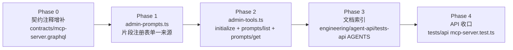
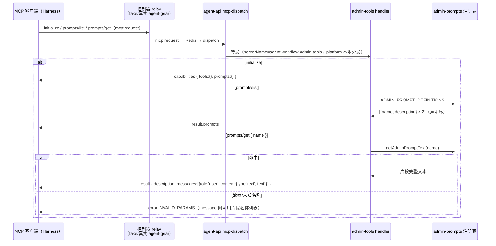

# 工作流MCP提供提示词片段 - 实现计划

**功能名称**: 工作流MCP提供提示词片段
**关联 PRD**: [`docs/product/draft/20261115-workflow-mcp-prompt-snippets.md`](../../product/draft/20261115-workflow-mcp-prompt-snippets.md)
**关联提案**: [`docs/engineering/proposals/20261115-feat-workflow-mcp-prompt-snippets.md`](../proposals/20261115-feat-workflow-mcp-prompt-snippets.md)
**计划版本**: v1.0
**创建日期**: 2026-11-15
**作者**: ZeroAsh Agent
**需求总分支**: `feat/workflow-mcp-prompt-snippets`
**feat-branch**: `feat/workflow-mcp-prompt-snippets`
**需求总 PR**: https://github.com/Deliay/z-agent-gear/pull/528

## 1. 实施顺序

严格按「契约注释 → 片段注册表（先红后绿）→ handler 路由（先红后绿）→ 文档索引 → API 收口」推进，每个切片先写失败测试再实现：



**关键路径**：Phase 1 是需求核心——两段片段文本是全需求的本体，其内容必须与 `validateTemplateGraph` / `repo-templates.ts` / agent-gear `workflow-templates.ts` 的实际口径逐条对齐（§3.2 要点清单即对齐表）；Phase 2 只是薄路由，注册表先稳定可避免 handler 与内容来回改。

**回归重灾区**：`admin-tools.test.ts`（initialize/tools 既有断言）、`tests/api/src/agent-api/session.test.ts`（MCP 签发形态零改动）、`tests/api/src/controller-api/acp-real-admin-tools.test.ts`（真实 agent 握手 initialize + tools/list，capabilities 追加后必须仍 200）——Phase 2 改动后全部跑绿。

## 2. 代码事实核对（计划期确认）

以下事实基于需求总分支 `feat/workflow-mcp-prompt-snippets`（HEAD `f53d6a86`）实际代码：

| # | 事实 | 位置 | 对计划的影响 |
|---|------|------|--------------|
| F1 | `handleAdminPlatformMcpRequest` 为 method switch：`initialize`（:424-431 返回 `{protocolVersion:'2025-03-26', capabilities:{tools:{}}, serverInfo:{name, version:'1.0.0'}}`）、`notifications/*`、`ping`、`tools/list`、`tools/call`（AdminToolError → `isError` result 形态）、default → `METHOD_NOT_FOUND` | `servers/agent-api/src/services/workflow/admin-tools.ts:419-462` | 新增 `prompts/list`/`prompts/get` 两个 case；`initialize` 仅追加 `prompts: {}`；未知名称错误走协议级 `error` 通道（与 `tools/call 缺少 params.name` 的 INVALID_PARAMS 同形态，见 D2） |
| F2 | 既有 initialize 断言为 `toMatchObject({serverInfo:{name}})`；「tools/list 返回 13 个工具」断言 `tools` 数组长度 13 | `admin-tools.test.ts:272-280` | capabilities 追加 `prompts:{}` **不破坏**既有断言（toMatchObject 非精确匹配）；13 工具断言零回归（prompts 非 tools，见 D9） |
| F3 | `validateTemplateGraph` 全量规则：≥1 节点；nodeKey 全局唯一；dependsOn 引用存在；AI 节点 prompts 过滤空白后 ≥1；HUMAN/FLAG 不允许 prompts/artifactTitles；仅 HUMAN 可 `linkUpstreamPullRequest=true`；DAG 无环（DFS 报环上节点）；入度 0 节点恰 1 个且必须 HUMAN | `services/workflow/template.ts:45-115` | `workflow-schema` 片段文本的图规则章节与此逐条对齐，防漂移守卫按本表断言（T-AP4） |
| F4 | `validateAgentConfigs`：AI 节点必须有 `agentConfig.acpServerType` 且在控制器能力清单内；`initNewWorktree` 由 `normalizeConfiguredNodes` 归一（必填）；`modeId`/`modelId` 允许为空 | `services/workflow/configured.ts:109-124`（校验）、`ADMIN_TOOL_SCHEMAS`（`admin-tools.ts:99-109`，required `['acpServerType','initNewWorktree']`） | `workflow-schema` 的 agentConfig 章节以此为准 |
| F5 | agent-gear 扫描约束常量：`WORKFLOW_TEMPLATES_SUBDIR='.zag/workflow/templates'`、`MAX_FILES=20`、`MAX_FILE_BYTES=128*1024`、`MAX_TOTAL_BYTES=1024*1024`；仅直下 `.json` 常规文件（符号链接按 `stat` 判定）、不递归、按 `localeCompare` 排序、单文件超限 `error:'file too large'`、总量超限截断 `truncated:true`；目录不存在返回空列表 | `packages/agent-controller/src/workflow-templates.ts:13-19,57-129` | `workflow-project-persistence` 片段文本的路径/格式/约束章节以此为准；跨包不可 import，守卫测试用字面量断言并在注释注明来源（T-AP5，见 D4） |
| F6 | 平台侧 `parseRepoTemplate`：JSON 语法 → 顶层形状（`name` 非空 string / `description` 可选 string / `nodes` 非空数组）→ 节点字段类型归一（含 `sortOrder` 数字归一、`requiresWorktree`/`linkUpstreamPullRequest` 缺省 false、`dependsOn` 缺省 `[]`）→ `validateTemplateGraph`（错误文案原样透传）；逐文件隔离、按 `fileName` 排序输出；`configureFromRepo` 为快照语义（服务端不回读仓库文件）、`fileName` 归一（trim 非空、`.json` 结尾、不含 `/`\`..`/NUL）、仅 `type='cloud'`（否则 `repo workflow only supports cloud host`） | `services/workflow/repo-templates.ts:124-172`、`services/workflow/configured.ts#configureFromRepo` | 持久化指引的「生效方式/不合法文件标记」章节以此为准 |
| F7 | 名称规则 1~64 的落点：`configured.ts:132,154`（已配置工作流）与 `instance.ts:43,51`（实例）的 `normalizeWorkflowName`（trim 后 1~64，非法抛 `invalid workflow name`）；**模板创建本身无服务层名称长度归一**（模型仅 `name: {type:String, required:true}`，GraphQL/MCP 创建路径均无 trim/长度校验） | `services/workflow/configured.ts`、`services/workflow/instance.ts`、`models/workflow-template.ts:38` | 片段文本**不得**宣称「模板名称 trim 后 1~64」——模板层无此规则；1~64 仅出现在配置/实例阶段。防漂移守卫不写该断言（避免把不存在的规则写进片段） |
| F8 | MCP 分发链路：`mcp-dispatch.dispatch` 按 serverName 把 `transport=platform` 服务直接分发到本地 handler；JSON-RPC 通知（无 `id`）→ `202` fire-and-forget；handler 返回 `{error}` 包装为 `jsonRpcError(request.id, code, message)`，`{result}` 包装为 `{jsonrpc:'2.0', id, result}` | `services/mcp-dispatch.ts:148-186` | handler 新增分支复用同一返回形态，分发层零改动；通知语义由 dispatch 统一处理，handler 无需区分（F1 的 case 直接命中即可） |
| F9 | 契约注释位置：`contracts/mcp-server.graphql` 的 `McpServerSource.platform` 注释（:11-13）；手写 schema `graphql/schemas/mcp-server.ts` **不含任何注释**（运行时无注释概念），且 mcp-server **不在**契约对齐测试之列（仅 auth/custom-mcp/session/valut 有 `*.test.ts` 契约断言） | `contracts/mcp-server.graphql`、`servers/agent-api/src/graphql/schemas/mcp-server.ts` | Phase 0 只改契约文件注释，手写 schema 无需改动（见 D8） |
| F10 | API 层 MCP 调用链：agent-api 公网 `POST /mcp/*` 已下线，平台 MCP 统一经控制器 relay——fake controller 在主 WebSocket 发 `mcp:request`（`{requestId, sessionId, serverName, token, body}`），controller-api → Redis → agent-api `mcp-dispatch`，按 requestId 匹配 `mcp:response`；token 取自 fake controller 收到的 `acp:start.mcpEndpoint.token`；装配了 admin 工具集的会话 `serverNames=['agent-workflow-admin-tools']` | `tests/api/AGENTS.md`（PR 联动小节注）、`tests/api/src/agent-api/workflow-check-runs.test.ts:372-400`、`tests/api/src/agent-api/session.test.ts:2320` | T-AP-API1~3 复用该 relay 模式：`serverName='agent-workflow-admin-tools'`，body 为 JSON-RPC `prompts/list`/`prompts/get`（见 D7） |
| F11 | 提示词常量形态先例：`pr-prompts.ts`（`GITHUB_PR_PROMPT` 等模块常量）、`issues-prompts.ts`、`prompts.ts`（节点会话系统/兜底/停滞提示词）均为代码内常量文本，随版本演进 | `services/workflow/pr-prompts.ts`、`issues-prompts.ts`、`prompts.ts` | 新增 `admin-prompts.ts` 沿用同一形态（见 D1）；与节点会话 `prompts.ts` 命名区分（admin 域专属注册表） |
| F12 | 节点作用域工具集 `tool-handlers.ts#handlePlatformMcpRequest` 的 `initialize` 同样返回 `capabilities:{tools:{}}` | `services/workflow/tool-handlers.ts:495-499` | 本期 `agent-workflow-tools` **零改动**（PRD 3.5：节点执行会话不提供片段）；其 initialize 断言不触碰 |
| F13 | `ensureAdminToolsServer` 幂等 upsert 平台服务文档，`tools` 字段写入 13 工具摘要 | `admin-tools.ts:465-482` | prompts 不是 tool，McpServer 文档与 upsert 零改动（见 D9） |
| F14 | MCP 协议 `2025-03-26` 的 prompts 能力：`initialize` 声明 `capabilities.prompts`；`prompts/list` 返回 `{prompts:[{name,description?,arguments?}]}`；`prompts/get` 返回 `{description?, messages:[{role, content:{type:'text',text}}]}` | 与 F1 的 `protocolVersion` 返回值一致，不升级协议版本 | 响应形态严格按 MCP 规范；片段无参数模板，`arguments` 不提供（提案决策表） |

## 3. 内部接口与片段内容契约

### 3.1 `services/workflow/admin-prompts.ts`（新增）

```ts
export interface AdminPromptDefinition {
  name: string;        // 片段名（kebab-case，稳定）
  description: string; // 一句话简介（prompts/list 与 prompts/get 的 description 共用）
}

/** 片段注册表（声明序即 prompts/list 顺序） */
export const ADMIN_PROMPT_DEFINITIONS: readonly AdminPromptDefinition[];

/** 可用片段名列表（错误信息复用，保证「所列即所得」） */
export function listAdminPromptNames(): string[];

/** 按名称取片段完整文本；未知名称返回 null */
export function getAdminPromptText(name: string): string | null;
```

`admin-tools.ts` 消费：

- `initialize` → `capabilities: { tools: {}, prompts: {} }`（`serverInfo`/`protocolVersion` 不变）；
- `prompts/list` → `{ result: { prompts: ADMIN_PROMPT_DEFINITIONS } }`；
- `prompts/get` → 校验 `params.name` 为非空字符串（缺失/空 → INVALID_PARAMS `prompts/get 缺少 params.name。可用片段：workflow-schema、workflow-project-persistence。`）→ `getAdminPromptText(name)` 命中组装 `{ result: { description, messages: [{ role: 'user', content: { type: 'text', text } }] } }`，未命中 → INVALID_PARAMS `未知提示词片段「<name>」。可用片段：workflow-schema、workflow-project-persistence。`。

### 3.2 片段文本要点清单（与代码事实的对齐表）

片段文本为 Markdown 结构中文说明（面向 LLM 消费），注册表两片段的要点覆盖如下——实现时逐条撰写，防漂移守卫（T-AP4/T-AP5）锁定关键表述：

**`workflow-schema`（工作流 Schema 说明）**：

| 章节 | 要点 | 事实来源 |
|------|------|---------|
| 顶层结构 | `{ name: string（必填）, description?: string, nodes: Node[]（≥1） }`；名称规则 1~64 仅在配置/实例阶段生效（F7） | F3/F7 |
| 节点类型 | HUMAN（人类节点：首节点唯一入口/审核打回/联动 PR）、AI（执行节点：需 prompts 与 agentConfig）、FLAG（旗帜节点：标记/汇合语义，无 prompts/artifactTitles） | F3 |
| 节点字段 | `nodeKey`（必填、全局唯一）、`type`、`name`、`description?`、`stage`、`dependsOn`（string[]，空数组=首节点候选）、`requiresWorktree`（boolean，节点会话 worktree 隔离）、`prompts`（仅 AI，≥1 条非空）、`artifactTitles`（仅 AI，可选）、`linkUpstreamPullRequest`（仅 HUMAN 可 true）、`sortOrder`（可选数字） | F3/F6 |
| 图校验规则 | nodeKey 唯一；dependsOn 必须引用存在的节点；DAG 无环；入度为 0 的节点有且仅有一个且必须为 HUMAN；AI 节点 prompts 至少 1 条非空；HUMAN/FLAG 不允许 prompts/artifactTitles；仅 HUMAN 可开启联动上游 PR | F3（逐条对应 validateTemplateGraph 错误文案） |
| AI 节点 Agent 配置 | 模板/项目文件**不含** agentConfig；配置/实例化阶段为每个 AI 节点补齐：`acpServerType`（必填，在目标控制器能力清单内）、`initNewWorktree`（必填）、`modeId`/`modelId`（可选） | F4 |

**`workflow-project-persistence`（工作流项目持久化指引）**：

| 章节 | 要点 | 事实来源 |
|------|------|---------|
| 放置约定 | 模板文件放置在仓库根目录 `.zag/workflow/templates/` 直下；一个 `.json` 文件对应一个工作流模板；不递归子目录；符号链接按 stat 判定为常规文件才读取 | F5 |
| 文件格式 | JSON：顶层 `{ name: string（非空）, description?: string, nodes: Node[]（非空） }`；节点图规则与 `workflow-schema` 一致；**不含 agentConfig**（配置发生在平台侧快照） | F5/F6 |
| 文件约束 | 仅识别直下 `.json`；≤20 个文件、单文件 ≤128KiB、总量 ≤1MiB；超限处理：单文件超限标记 `file too large`、数量/总量超限截断（`truncated`），超出部分不生效 | F5 |
| 生效方式 | 文件随仓库提交后，在云电脑新增工作目录（含完成 GitHub 项目设置）时平台自动检测并提示配置，也可在云电脑设置中随时检测与配置；检测要求控制器在线且 agent-gear ≥2.18.0（否则返回空列表）；配置时对模板做快照（`sourceKind=REPO`），仓库后续修改不影响已配置的工作流；仅支持云电脑（`repo workflow only supports cloud host`）；不合法文件被标记并给出原因（逐文件隔离，不静默忽略） | F5/F6 |

## 4. 核心时序



## 5. 变更清单

### 5.1 Phase 0：契约（先于代码）

| 文件 | 变更 |
|------|------|
| `contracts/mcp-server.graphql` | `McpServerSource.platform` 注释增补 prompts 能力口径：「`agent-workflow-admin-tools` 支持 MCP prompts 能力（initialize 声明 `capabilities.prompts`）：`prompts/list` 返回内置提示词片段清单；`prompts/get` 按 name 获取片段内容（messages 形态）。内置片段：`workflow-schema`（工作流 Schema 说明）、`workflow-project-persistence`（项目持久化指引）。`prompts/get` 未知名称返回 `INVALID_PARAMS`，message 列出可用名称。」（提案 §3.1 定稿文案） |

> 手写 schema `servers/agent-api/src/graphql/schemas/mcp-server.ts` 不含注释、运行时无注释概念，**无需改动**（F9/D8）。

### 5.2 Phase 1：片段注册表（新增 `services/workflow/admin-prompts.ts`）

| 文件 | 变更 |
|------|------|
| `servers/agent-api/src/services/workflow/admin-prompts.ts`（新增） | §3.1 接口与 §3.2 两片段完整文本（模块内常量）；导出 `ADMIN_PROMPT_DEFINITIONS`（声明序：workflow-schema 在前、workflow-project-persistence 在后）、`listAdminPromptNames()`、`getAdminPromptText(name)` |
| `servers/agent-api/src/services/workflow/admin-prompts.test.ts`（新增） | T-AP1~T-AP5（先红）：注册表形状、名单一致、get 命中/未命中、两段文本防漂移守卫 |

TDD 顺序：先写 `admin-prompts.test.ts` 全量用例（此时模块不存在，编译/运行即红）→ 实现 `admin-prompts.ts` 转绿 → 重构文本结构保持绿。

### 5.3 Phase 2：handler 路由（改 `services/workflow/admin-tools.ts`）

| 文件 | 变更 |
|------|------|
| `servers/agent-api/src/services/workflow/admin-tools.ts` | ① `initialize` 返回值 `capabilities` 追加 `prompts: {}`（`tools: {}` 保留；`protocolVersion`/`serverInfo` 不变）；② switch 新增 `case 'prompts/list'`：`{ result: { prompts: ADMIN_PROMPT_DEFINITIONS } }`；③ 新增 `case 'prompts/get'`：§3.1 校验与组装，缺参/未知名称返回 `{ error: { code: 'INVALID_PARAMS', message } }`（message 附 `listAdminPromptNames()` 输出） |
| `servers/agent-api/src/services/workflow/admin-tools.test.ts` | T-AP6~T-AP10（先红后绿）：initialize 声明 prompts、prompts/list 输出与注册表一致、prompts/get 命中 messages 形态、缺 name、未知名称含可用列表；**既有 13 工具与 initialize 断言保持不动、必须全绿**（F2） |

### 5.4 Phase 3：文档索引

| 文件 | 变更 |
|------|------|
| `docs/engineering/AGENTS.md` | 「实现计划（`plan/`）」索引登记本文件 |
| `servers/agent-api/AGENTS.md` | 新增「工作流 MCP 提示词片段」小节：prompts 能力落点（initialize/prompts/list/prompts/get）、`admin-prompts.ts` 注册表单一来源、内容与 `validateTemplateGraph`/agent-gear 扫描约束同源与防漂移守卫位置、错误形态（INVALID_PARAMS 含可用名称）、`agent-workflow-tools` 不提供片段的口径 |
| `tests/api/AGENTS.md` | 追加「工作流 MCP 提示词片段 API」小节（T-AP-API1~3 与 fake controller relay 口径） |

### 5.5 Phase 4：API 收口（`tests/api/src/agent-api/mcp-server.test.ts` 追加）

见 §6.2；fake controller relay 模式（F10/D7）：创建装配 `agent-workflow-admin-tools` 的会话 → 取 `acp:start.mcpEndpoint.token` → `mcp:request`（`serverName='agent-workflow-admin-tools'`，body 为 JSON-RPC `prompts/list` / `prompts/get`）→ 按 requestId 匹配 `mcp:response` 断言。

## 6. TDD 测试矩阵

### 6.1 单元（agent-api，Vitest）

| 编号 | 文件 | 断言 |
|------|------|------|
| T-AP1 | `services/workflow/admin-prompts.test.ts`（新增） | `ADMIN_PROMPT_DEFINITIONS` 恰 2 项、声明序为 `[workflow-schema, workflow-project-persistence]`；每项 `name` kebab-case 非空、`description` 非空 |
| T-AP2 | 同上 | `listAdminPromptNames()` 输出与注册表 name 集合一致且同序 |
| T-AP3 | 同上 | `getAdminPromptText('workflow-schema')` / `('workflow-project-persistence')` 返回非空文本且互不相同；未知名称/空串返回 `null` |
| T-AP4 | 同上（防漂移守卫） | `workflow-schema` 文本包含与 `validateTemplateGraph` 错误文案对应的关键约束表述：「首节点」唯一且「HUMAN」（人类节点）、AI 节点提示词「至少需要 1 条」、nodeKey 唯一、循环依赖/无环、仅人类节点可「联动上游 Pull Request」、agentConfig 的 `acpServerType` 必填与 `initNewWorktree` 必填；**不包含**「模板名称 trim 后 1~64」类不实表述（F7） |
| T-AP5 | 同上（防漂移守卫） | `workflow-project-persistence` 文本包含 `.zag/workflow/templates`、`20`、`128KiB`（或 `128 KiB`/`131072` 等价表述，定稿其一并注释来源 `packages/agent-controller/src/workflow-templates.ts`）、`1MiB`（或等价）、「不递归」、「快照」语义、「≥2.18.0」版本口径 |
| T-AP6 | `services/workflow/admin-tools.test.ts`（追加） | `initialize` 返回 `capabilities` 同时含 `tools` 与 `prompts`（`toMatchObject({ capabilities: { tools: {}, prompts: {} } })`）；`protocolVersion`/`serverInfo` 不变 |
| T-AP7 | 同上 | `prompts/list` 返回 `result.prompts` 与 `ADMIN_PROMPT_DEFINITIONS` 逐项一致（name/description、长度 2、顺序稳定） |
| T-AP8 | 同上 | `prompts/get { name: 'workflow-schema' }` 返回 `result.description` 与注册表一致、`result.messages` 恰 1 条 `{role:'user', content:{type:'text', text}}`，`text` 与 `getAdminPromptText` 输出一致；`result` 不含 `content`/`isError` 工具形态字段 |
| T-AP9 | 同上 | `prompts/get` 缺 `params.name`/空串 → `{ error: { code: 'INVALID_PARAMS', message } }`，message 含「缺少 params.name」与全部可用片段名称 |
| T-AP10 | 同上 | `prompts/get { name: 'foo' }` → `{ error: { code: 'INVALID_PARAMS' } }`，message 含「未知提示词片段」「foo」与全部可用片段名称 |

### 6.2 API（tests/api，Vitest + Aspire 真实服务）

| 编号 | 文件 | 断言 |
|------|------|------|
| T-AP-API1 | `tests/api/src/agent-api/mcp-server.test.ts`（追加；fake controller relay） | 经签发的会话端点 `prompts/list`：fake controller 发 `mcp:request`（body `{jsonrpc:'2.0', id, method:'prompts/list'}`）→ `mcp:response` 200，`result.prompts` 恰 2 项且 name 集合为 `{workflow-schema, workflow-project-persistence}`、各项 description 非空 |
| T-AP-API2 | 同上 | `prompts/get { name: 'workflow-schema' }` → 200，`result.description` 非空、`messages[0].content.type='text'` 且文本含「首节点」；`prompts/get { name: 'workflow-project-persistence' }` 文本含 `.zag/workflow/templates` |
| T-AP-API3 | 同上 | `prompts/get { name: 'nope' }` → 200 + JSON-RPC `error.code='INVALID_PARAMS'`，message 含「nope」与两个可用片段名称；同会话 `initialize` 返回 `capabilities.prompts`（同套件断言） |

> 前置：`aspire start`（agent-api + controller-api）+ `INTERNAL_API_TOKEN`（开户建会话）；fake controller 应答 `acp:check`/`acp:start`。会话创建时 `mcpServerIds` 传入 `agent-workflow-admin-tools` 服务 id（F10 口径）。

### 6.3 回归清单（必须同批）

| 位置 | 关注 |
|------|------|
| `admin-tools.test.ts` 既有用例 | 「暴露 13 个工具」「tools/list 返回 13 个工具」「initialize 返回平台服务信息」「M9 tools/call 未知工具」全绿（F2/F13） |
| `tool-handlers.test.ts` | `agent-workflow-tools` initialize/tools 形态零改动（F12） |
| `mcp-dispatch.test.ts` | platform 分发与通知 202 口径零改动（F8） |
| `tests/api/src/agent-api/session.test.ts`（MCP 签发用例） | `acp:start.mcpEndpoint` 形态零改动 |
| `tests/api/src/controller-api/acp-real-admin-tools.test.ts` | 真实 agent 握手 initialize + tools/list 仍 200（capabilities 追加不影响 MCP 客户端解析） |
| `servers/agent-api` 全量单测 | `pnpm test` 全绿 |

## 7. 计划期裁决

| 编号 | 裁决 | 理由 |
|------|------|------|
| D1 | 新建 `admin-prompts.ts` 承载片段注册表，不复用/扩展既有 `prompts.ts` | `prompts.ts` 是节点会话注入提示词（WORKFLOW_SYSTEM_PROMPT 等），与本需求的「MCP prompts 能力片段」是不同消费通道；admin 域单一来源与 `pr-prompts.ts`/`issues-prompts.ts` 形态一致（F11），避免跨域耦合 |
| D2 | `prompts/get` 参数/名称错误走协议级 `error` 通道（INVALID_PARAMS），不走 `isError` 工具形态 | `prompts/get` 不是 `tools/call`——`isError` result 形态专属于工具调用；与既有 `tools/call 缺少 params.name` 的协议级 INVALID_PARAMS 同形态（F1），message 附可用名称列表（PRD 功能点 3 验收标准） |
| D3 | 片段文本为模块内 Markdown 常量（中文为主、结构化），不落库、不可在线编辑 | 与校验代码同源演进、走代码评审（提案决策表）；无运营诉求；纯常量读取零开销（单/多实例无状态） |
| D4 | 防漂移守卫对 agent-gear 扫描上限采用字面量断言 + 注释注明来源 | agent-api 不能跨包 import `packages/agent-controller` 的常量（F5）；字面量断言锁定「20/128KiB/1MiB」，agent-gear 侧常量变更时守卫变红强制同步片段 |
| D5 | `prompts/list` 无 cursor 分页，顺序恒为注册表声明序（workflow-schema 在前） | 列表恒 2 项（提案范围）；声明序稳定可断言（T-AP1/T-AP7） |
| D6 | `initialize` 的 `capabilities.prompts` 取空对象 `{}`，不声明 `listChanged` | 与 `tools: {}` 同形态（F1）；本期无 listChanged 通知诉求 |
| D7 | API 测试经 fake controller `mcp:request` relay，不恢复公网 `POST /mcp/*` | F10：公网入口已下线，relay 是平台 MCP 唯一全链路路径；与 T-PR/T-CR 系列同一模式 |
| D8 | Phase 0 只改契约注释，手写 schema `schemas/mcp-server.ts` 零改动 | F9：手写 schema 本就不含注释、运行时无注释概念；mcp-server 无契约对齐测试，无双写义务 |
| D9 | `ensureAdminToolsServer` 与 McpServer 文档零改动 | prompts 不是 tool，13 工具清单与 upsert 语义不变（F13）；「mcpServers 默认包含 admin-tools」的既有 API 断言不受影响 |
| D10 | 片段文本不包含「模板名称 1~64」表述；名称规则仅按事实描述（配置/实例阶段 trim 后 1~64） | F7：模板创建无名称长度归一，写入片段即成不实说明并误导 AI |

## 8. 风险与回滚

| 风险 | 影响 | 缓解 |
|------|------|------|
| 片段文本与校验实现随时间漂移 | AI 按过期说明生成工作流被校验拒绝 | T-AP4/T-AP5 防漂移守卫：规则/常量变更时测试变红强制同步；`servers/agent-api/AGENTS.md` 登记同源口径 |
| `capabilities` 追加字段破坏旧 MCP 客户端 | initialize 握手失败 | MCP 规范要求客户端忽略未知能力字段；F2 既有断言非精确匹配；`acp-real-admin-tools` 真实握手回归兜底 |
| 片段文本体积过大 | 单次获取传输大、占用上下文 | PRD 4.1：单片段控制在可一次性消费篇幅；实现时两段文本各控制在数百行内（T-AP3 仅断言非空，体积由评审把关） |
| 请求洪水式获取 | 无（纯常量读取） | 无外部依赖调用，毫秒级返回（PRD 4.1） |
| 回滚 | — | 服务端回滚即恢复旧行为：`initialize` 回到 `capabilities:{tools:{}}`、`prompts/*` 回到 `METHOD_NOT_FOUND`；纯新增分支无数据迁移、无开关，回滚零残留 |

## 9. 命令参考

```bash
# 依赖（仓库已迁移 pnpm）
pnpm install

# agent-api 单测（先红后绿）
cd servers/agent-api && pnpm exec vitest run src/services/workflow/admin-prompts.test.ts
cd servers/agent-api && pnpm exec vitest run src/services/workflow/admin-tools.test.ts
cd servers/agent-api && pnpm test
cd servers/agent-api && pnpm run build

# 服务编排（API 测试前置）
aspire start
aspire wait agent-api controller-api

# API 集成（需 INTERNAL_API_TOKEN；端口以 aspire describe 实际输出为准）
cd tests/api && API_URL=http://localhost:10001/graphql \
  CONTROLLER_API_URL=http://localhost:35273 \
  INTERNAL_API_TOKEN=<token> \
  pnpm exec vitest run src/agent-api/mcp-server.test.ts

# 真实 agent 握手回归（可选，需本机 OpenCode）
cd tests/api && pnpm run test:real -- src/controller-api/acp-real-admin-tools.test.ts
```

## 10. 验收 checklist

### 10.1 Phase 0（契约）

- [ ] `contracts/mcp-server.graphql` 的 `McpServerSource.platform` 注释含 prompts 能力口径与两片段名称、未知名称 INVALID_PARAMS 口径
- [ ] 手写 schema `schemas/mcp-server.ts` 零改动（`git diff` 无该文件）

### 10.2 Phase 1（注册表）

- [ ] `admin-prompts.ts` 导出注册表/`listAdminPromptNames`/`getAdminPromptText`；两片段文本覆盖 §3.2 全部要点
- [ ] T-AP1~T-AP5 全绿；文本不含 F7 不实表述

### 10.3 Phase 2（handler）

- [ ] `initialize` 返回 `capabilities:{tools:{}, prompts:{}}`；`prompts/list` 输出与注册表一致
- [ ] `prompts/get` 命中返回 messages 形态；缺参/未知名称 INVALID_PARAMS 且附可用名称列表
- [ ] T-AP6~T-AP10 全绿；既有 13 工具与 initialize 断言零回归

### 10.4 Phase 3~4（文档与 API）

- [ ] `docs/engineering/AGENTS.md`、`servers/agent-api/AGENTS.md`、`tests/api/AGENTS.md` 已同步
- [ ] T-AP-API1~3 全绿（fake controller relay 全链路）
- [ ] `servers/agent-api` 全量单测与既有 API 套件零回归

## 11. 相关文档

- [产品需求 v1.0](../../product/draft/20261115-workflow-mcp-prompt-snippets.md)
- [技术提案 v1.0](../proposals/20261115-feat-workflow-mcp-prompt-snippets.md)
- [MCP 服务契约](../../../contracts/mcp-server.graphql)
- [agent-api AGENTS](../../../servers/agent-api/AGENTS.md)
- [agent-gear AGENTS](../../../packages/agent-controller/AGENTS.md)
- [测试规范（API）](../../../tests/api/AGENTS.md)
- [需求来源：GitHub Issue #523](https://github.com/Deliay/z-agent-gear/issues/523)
- [需求总 PR #528](https://github.com/Deliay/z-agent-gear/pull/528)
