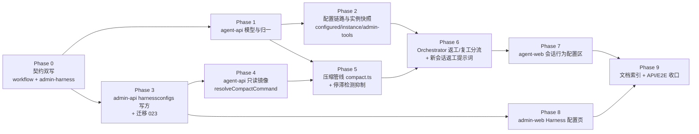
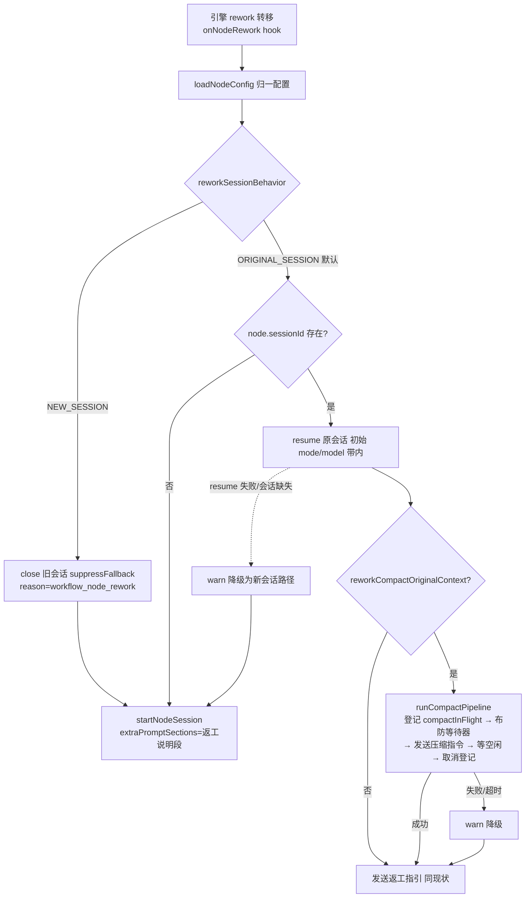
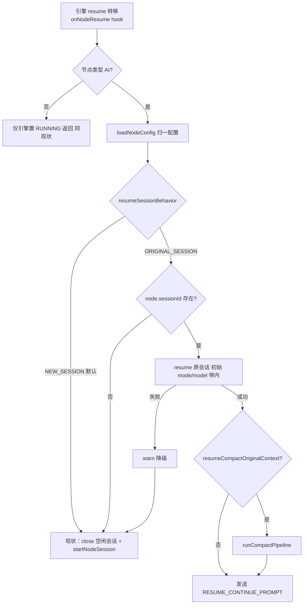
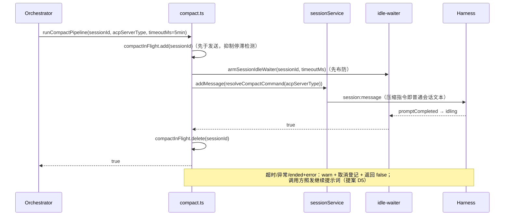

# 工作流打回/返工会话行为优化 - 实现计划

**功能名称**: 工作流打回/返工会话行为优化
**关联 PRD**: [`docs/product/draft/20261115-workflow-reject-rework-session-behavior.md`](../../product/draft/20261115-workflow-reject-rework-session-behavior.md)
**关联提案**: [`docs/engineering/proposals/20261115-feat-workflow-reject-rework-session-behavior.md`](../proposals/20261115-feat-workflow-reject-rework-session-behavior.md)
**计划版本**: v1.0
**创建日期**: 2026-11-15
**作者**: z-agent-bot
**feat-branch**: `feat/workflow-reject-rework-session-behavior`
**需求总 PR**: https://github.com/Deliay/z-agent-gear/pull/526

## 1. 实施顺序

严格按「契约 → 模型与归一 → 配置链路 → Harness 配置（写方→镜像）→ 压缩管线 → Orchestrator 分流 → 前端 → 文档索引 → 测试收口」推进，每个切片先写失败测试再实现（TDD 红-绿-重构）：



**关键路径**：Phase 5/6 是需求核心（压缩管线与四象限分流）。Phase 1 的归一函数 `normalizeNodeSessionBehavior` 是全部读取/写入路径的唯一事实源，必须先于一切消费方落地。Phase 3 与 Phase 1/2 无依赖，可并行；Phase 4 依赖 Phase 3 的集合与索引（只读镜像字段逐字一致）。

**回归重灾区**：`orchestrator.test.ts`（rework/resume 现状行为——默认配置下必须逐字不变）、`engine.test.ts`、`instance.test.ts`（实例化快照）、`tests/api/src/agent-api/workflow.test.ts`（A13 打回返工链路）、`tests/e2e/src/workflow.spec.ts`（E2E-3 打回→返工→复工）——存量工作流零行为变化由这些既有用例锁定，Phase 6 改动后必须全绿。

## 2. 代码事实核对（计划期确认）

以下事实基于需求总分支 `feat/workflow-reject-rework-session-behavior`（HEAD `36d89555`）实际代码逐一核对：

| # | 事实 | 位置 | 对计划的影响 |
|---|------|------|--------------|
| F1 | 返工现状：`reworkNodeSession` 对 `node.sessionId` 缺失直接 return；存在则 `resume`（`initialModeModel` 带内下发）后 `addMessage` 固定返工指引（含 `completeCurrentRework`/`rejectCurrentNode` 指引） | `servers/agent-api/src/services/workflow/orchestrator.ts:201-222` | 「返工时=原始会话」路径逐字保留为默认；「新会话」与「压缩」为新增分支 |
| F2 | 复工现状：`resumeNodeSession` 对非 AI 节点直接 return；AI 节点先 `close(suppressFallback, reason:'workflow_node_resume')` + `node.sessionId=undefined`，再 `startNodeSession` 全新拉起 | `orchestrator.ts:225-239` | 「打回后=新会话」路径逐字保留为默认；「原始会话」为新增分支 |
| F3 | 新会话拉起链：`startNodeSession`（`withSpan('workflow.node.advance')`）→ `startNodeSessionInner`：`loadNodeConfig` → `assemblePrompt` → `sessionService.create`（打标 + 平台 MCP 装配 + mode/model 带内）→ `addMessage` 单条首消息 | `orchestrator.ts:117-198` | `startNodeSessionInner` 增加可选参数 `extraPromptSections?: string[]`，拼入首条消息（一次 addMessage，D2）；既有 3 处调用点不传参零变化 |
| F4 | `assemblePrompt` 纯函数拼装：系统提示 + 节点描述 + 提示词数组 + 上游产物 + 追加提示词（key 升序） | `orchestrator.ts:405-435` | 返工说明段作为 `extraPromptSections` 追加在 assemblePrompt 结果尾部，不侵入该函数 |
| F5 | `loadNodeConfig` 快照优先（`prompts !== undefined \|\| agentConfig !== undefined` 即用快照）、缺失回查已配置工作流；`ConfiguredNodeLike` 为返回类型 | `services/workflow/node-config.ts:11-60` | `ConfiguredNodeLike` 扩展 4 个可选字段并在两路（快照/回查）统一归一（`?? 默认值`）；orchestrator 只消费归一结果 |
| F6 | 空闲等待器：`armSessionIdleWaiter(sessionId, timeoutMs)` 返回 `{promise, cancel}`；须先布防再触发动作；`idling` 以 DB 复核成功；`ended+error` 立即失败；15s DB 心跳兜底；定时器 `unref` | `services/session-idle-waiter.ts:104-179` | 压缩管线直接复用（5 分钟上限）；「先布防再 addMessage 压缩指令」为硬性顺序 |
| F7 | 停滞检测：`handleSessionIdled` 查到节点（RUNNING/REWORK）即 `scheduleInterruptionRetry({trigger:'IDLED'})`；resume 成功的裸 `idling`（不带 promptCompleted）天然不触发 | `orchestrator.ts:71-86`、`session-idle-waiter.ts` 头注 | 压缩回合结束（promptCompleted→idling）会命中此路径 → 必须在排期前以 `isCompactInFlight(sessionId)` 抑制（提案 D1） |
| F8 | 压缩等待超时常量口径：`INTERRUPT_RETRY_IDLE_TIMEOUT_MS = 5 * 60_000` | `services/workflow/interrupt-retry.ts:20` | 压缩管线复用同一常量（提案 §9.2：无新增环境变量） |
| F9 | 三处节点子 Schema 各自独立声明；`agentConfig` 用独立子 Schema（避免内联嵌套被 Mongoose 物化为 `{}`，HUMAN/FLAG 保持 null/undefined） | `models/workflow-template.ts:11-30`、`models/configured-workflow.ts:6-37`（含 :6-7 注释）、`models/workflow-instance.ts:62-104` | 4 字段逐字加到三处；HUMAN/FLAG 恒 null 的纪律与 `agentConfig` 相同（`default: undefined` + 归一层写 null） |
| F10 | 契约六处 + 手写 schema 六处一一对应：`WorkflowTemplateNode` / `ConfiguredWorkflowNode` / `WorkflowNode` / `WorkflowTemplateNodeInput` / `ConfiguredWorkflowNodeInput` / `WorkflowNodeUpdateInput` | `contracts/workflow.graphql:38/88/200/309/338/407`、`servers/agent-api/src/graphql/schemas/workflow.ts:34/72/160/260/289/355` | Phase 0 双写 12 个位置 + 新增枚举；漏改即运行时 `Cannot query field`，契约对齐测试锁定 |
| F11 | 归一先例：`normalizeConfiguredNodes` 中 `linkUpstreamPullRequest: n.type === 'HUMAN' ? (n.linkUpstreamPullRequest ?? false) : false`（按类型强制归一） | `services/workflow/configured.ts:245-260` | `normalizeNodeSessionBehavior` 纯函数同形态：AI 节点按 `?? 默认值` 归一、新会话强制 compact=false、HUMAN/FLAG 恒 null |
| F12 | 实例化快照 `normalizeNodes`（与 configured 同形）复制节点字段落库；`updateNode` 原子条件更新仅允许 `status ∈ INITIALIZING/READY 且 startedAt=null` 的节点，未匹配时二次查询区分「不存在/已开始」 | `services/workflow/instance.ts:128-144,326-409` | 快照复制追加 4 字段；`updateNode` patch 追加 4 字段（HUMAN/FLAG 写入 null，与 linkUpstreamPullRequest 的「仅 HUMAN 可写」镜像为「仅 AI 可写」） |
| F13 | Harness 类型三值 `HARNESS_TYPES = ['OPENCODE','KIMI_CODE','DEEPSEEK_HARNESS']`（models/cloud-host.ts:15）；Harness→ACP 映射 `HARNESS_ACP_TYPES` 为 cloud-host-service.ts:43-47 的**私有常量**（OPENCODE→opencode、KIMI_CODE→kimi_code、DEEPSEEK_HARNESS→deepseek_harness） | `models/cloud-host.ts:15`、`services/cloud-host-service.ts:43-47` | `resolveCompactCommand` 需 ACP→Harness 反向映射；为单一事实源，将 `HARNESS_ACP_TYPES` 上移至 `models/cloud-host.ts`（零行为变更，cloud-host-service 改为 import），harness-config 据此派生反向映射（见 D5） |
| F14 | 写方/只读镜像先例：`authproviders` —— admin-api `models/auth-provider.ts`（唯一写方 + 迁移 022 建索引 + `assertAdmin` + `mapError` E11000→「配置已存在」）；agent-api 同名字段只读镜像（`autoIndex` 不建索引，注释「索引由 admin-api 迁移创建」） | `servers/admin-api/src/models/auth-provider.ts`、`servers/agent-api/src/models/auth-provider.ts`、`servers/admin-api/src/migrations/022-auth-providers.ts` | `harnessconfigs` 逐字复刻该形态：模型双写、迁移建唯一索引 + 种子、resolver `assertAdmin` |
| F15 | admin-api 迁移注册：`src/index.ts` 逐个 `import * as migrationNNN` 并在 `runMigrations([...])` 数组追加；最新编号 022 → **本需求占用 023**；账本独立集合 `admin_migrations` | `servers/admin-api/src/index.ts:15-50,173-196`、`migrations/models.ts` | Phase 3 新增 `migrations/023-harness-configs.ts` 并登记 index.ts |
| F16 | 平台 MCP `agent-workflow-admin-tools` 节点入参 schema 三处携带节点字段（createWorkflowTemplate / createConfiguredWorkflow / instantiateWorkflowFromContent 与 instantiateWorkflowFromTemplate 的 nodes items） | `services/workflow/admin-tools.ts:36-190` | 三处 nodes items `properties` 各加 4 个可选字段（enum 两值），归一仍由 configured.ts/instance.ts 承担（schema 层只透传） |
| F17 | 前端节点编辑单一事实源：`template-validation.ts` 的 `EditableNode` + `createEmptyNode`/`templateNodeToEditable`/`configuredNodeToEditable`/`toNodeInput`/`toConfiguredNodeInput`；`toNodeInput`/`toConfiguredNodeInput` 已按类型丢弃字段（HUMAN 才带 linkUpstreamPullRequest） | `apps/agent-web/src/components/workflow/template-validation.ts:18-155` | 4 字段进 `EditableNode`（默认值 ORIGINAL/false/NEW/false）；提交映射 AI 节点携带、HUMAN/FLAG 省略；「新会话」时对应 compact 恒 false |
| F18 | `WorkflowGraphEditor.tsx` 导出 `AgentConfigFields` 供 `EditInstanceNodeDialog` 复用；`EditInstanceNodeDialog` 重启模式仅编辑 agentConfig（不展示其余设置区） | `apps/agent-web/src/components/workflow/WorkflowGraphEditor.tsx`、`EditInstanceNodeDialog.tsx:44-308` | 「会话行为」区做成导出组件（同 AgentConfigFields 模式）三入口共用；重启模式不渲染（提案实现点 6） |
| F19 | 映射层：`mapTemplateNode`(:24) / `mapTemplate`(:40) / `mapConfigured`(:55) / `mapInstanceNode`(:86) / `mapInstance`(:152) 均以 `??` 归一缺省字段（先例 `linkUpstreamPullRequest: node.linkUpstreamPullRequest ?? false`） | `servers/agent-api/src/graphql/resolvers/workflow.ts` | 4 字段在 mapTemplateNode/mapConfigured/mapInstanceNode 三处按 `??` 归一输出（AI 默认值、HUMAN/FLAG null） |
| F20 | admin-web 路由与导航：`App.tsx` 在 `<AdminLayout />` 下逐个注册 Route；`AdminLayout.tsx` `NAV_ITEMS` 数组驱动侧边栏 | `apps/admin-web/src/App.tsx:32-46`、`components/AdminLayout.tsx:6-16` | 新增 `/harness-configs` 路由 + NAV 项「Harness 配置」 |

## 3. 数据模型与状态机

### 3.1 三处节点子 Schema 扩展（agent-api）

`models/workflow-template.ts`（templateNodeSchema）、`models/configured-workflow.ts`（configuredNodeSchema）、`models/workflow-instance.ts`（instanceNodeSchema）各增 4 字段，形态完全一致：

| 字段 | 类型 | 默认 | 说明 |
|------|------|------|------|
| `reworkSessionBehavior` | String enum `['NEW_SESSION','ORIGINAL_SESSION']` | `undefined` | 返工时行为；读取层归一 `?? 'ORIGINAL_SESSION'`（=现状）；HUMAN/FLAG 恒 null |
| `reworkCompactOriginalContext` | Boolean | `undefined` | 返工时为原始会话时先压缩；读取层归一 `?? false` |
| `resumeSessionBehavior` | String enum 同上 | `undefined` | 打回后行为；读取层归一 `?? 'NEW_SESSION'`（=现状）；HUMAN/FLAG 恒 null |
| `resumeCompactOriginalContext` | Boolean | `undefined` | 打回后为原始会话时先压缩；读取层归一 `?? false` |

- **零迁移**（提案 D7）：默认值即现状；存量行字段缺失由归一函数与映射层双保险；不写 schema 级 `default`（避免 HUMAN/FLAG 物化出字段，纪律同 `agentConfig`，F9）。
- 归一唯一事实源 `normalizeNodeSessionBehavior`（Phase 1，见 §5.2）。

### 3.2 集合 `harnessconfigs`（新；admin-api 唯一写方）

| 字段 | 类型 | 说明 |
|------|------|------|
| `harnessType` | String enum（OPENCODE/KIMI_CODE/DEEPSEEK_HARNESS） | 唯一索引 `uniq_harness_config_type` |
| `compactCommand` | String | trim 后 1~64、`/` 开头；服务层校验，非法抛 `invalid compact command` |
| `createdAt/updatedAt` | Date | `timestamps: true` |

- 迁移 `023-harness-configs`（幂等）：建唯一索引 + 对三种 Harness 以 `$setOnInsert` upsert 默认 `/compact`（已存在不覆盖用户配置）；
- agent-api 只读镜像模型同名字段逐字一致，`autoIndex=false`（F14 先例）。

### 3.3 状态机

零改动（提案 §1.3「不做」）：不新增状态/事件；`REWORK`/`REJECT→RUNNING(resume)` 转移与 hook 触发点不变，仅 hook 实现按配置分流。

## 4. 核心时序

### 4.1 返工时（rework）四象限



### 4.2 打回后复工（resume）四象限



### 4.3 压缩管线（`services/workflow/compact.ts`）



**发送前双校验**（镜像 interrupt-retry 管线）：等待器结算后、发送继续提示词前，Orchestrator 重新读实例——实例未删除 + 节点状态仍为 REWORK（返工）/RUNNING（复工）+ `sessionId` 未变，不满足则放弃发送（人工 complete/restart/删除已介入）。

## 5. 变更清单

### 5.1 Phase 0：契约（先于代码，双写）

| 文件 | 变更 |
|------|------|
| `contracts/workflow.graphql` | ① 新增 `enum WorkflowNodeSessionBehavior { NEW_SESSION ORIGINAL_SESSION }`（注释：AI 节点打回/返工会话行为）；② 六处类型/Input 各加 4 字段——`reworkSessionBehavior: WorkflowNodeSessionBehavior`（注释：仅 AI 节点有意义；缺省 ORIGINAL_SESSION=现状）、`reworkCompactOriginalContext: Boolean`（缺省 false；仅 ORIGINAL_SESSION 合法）、`resumeSessionBehavior: WorkflowNodeSessionBehavior`（缺省 NEW_SESSION=现状）、`resumeCompactOriginalContext: Boolean`（缺省 false；仅 ORIGINAL_SESSION 合法）；读取侧注释「存量文档为 null，映射层按默认值归一；HUMAN/FLAG 恒 null」 |
| `servers/agent-api/src/graphql/schemas/workflow.ts` | 与契约逐字同步（枚举 + 六处 4 字段 + 注释） |
| `contracts/admin-harness.graphql`（新增） | 按提案 §3.1 契约 2 逐字落盘：`HarnessType` 枚举（注释与 `contracts/cloud-host.graphql` 同枚举值同源）、`HarnessConfig`、`Query.adminHarnessConfigs`、`Mutation.upsertHarnessConfig`、错误文案表（`invalid compact command`：trim 后为空/超 64/不以 `/` 开头）、鉴权注释（全部需管理员 JWT，未认证 UNAUTHENTICATED） |
| `servers/admin-api/src/graphql/schemas/harness-config.ts`（新增） | 手写 schema（`extend type Query` / `extend type Mutation` 形态，同 auth-provider.ts 先例） |

### 5.2 Phase 1：agent-api 模型与归一

| 文件 | 变更 |
|------|------|
| `servers/agent-api/src/models/workflow-template.ts` | templateNodeSchema +4 字段（§3.1 形态；注释「仅 AI 节点；HUMAN/FLAG 恒 null」） |
| `servers/agent-api/src/models/configured-workflow.ts` | configuredNodeSchema +4 字段（同上） |
| `servers/agent-api/src/models/workflow-instance.ts` | instanceNodeSchema +4 字段（同上；实例快照语义注释） |
| `servers/agent-api/src/services/workflow/node-config.ts` | ① `ConfiguredNodeLike` 追加 4 个可选字段；② 新增纯函数 `normalizeNodeSessionBehavior(node: {type, reworkSessionBehavior?, ...}): { reworkSessionBehavior, reworkCompactOriginalContext, resumeSessionBehavior, resumeCompactOriginalContext } \| null`——HUMAN/FLAG 返回 null（四字段 null）；AI：behavior `?? 'ORIGINAL_SESSION'` / `?? 'NEW_SESSION'`，compact `?? false` 且 behavior=NEW_SESSION 时强制 compact=false；③ `loadNodeConfig` 两路（快照/回查）返回均附加归一结果 |
| `servers/agent-api/src/graphql/resolvers/workflow.ts` | `mapTemplateNode` / `mapConfigured` 节点映射 / `mapInstanceNode` 三处追加 4 字段输出（经 `normalizeNodeSessionBehavior` 归一，HUMAN/FLAG 输出 null） |

### 5.3 Phase 2：配置链路与实例快照

| 文件 | 变更 |
|------|------|
| `servers/agent-api/src/services/workflow/configured.ts` | `normalizeConfiguredNodes` 调用 `normalizeNodeSessionBehavior` 结果展开入节点（AI 落显式值/缺省值，HUMAN/FLAG 落 null）；`validateAgentConfigs` 不动（与 Harness 能力无关） |
| `servers/agent-api/src/services/workflow/instance.ts` | ① `normalizeNodes` 同样展开归一结果（实例化快照）；② `updateNode` 入参与 patch 追加 4 字段：仅 AI 节点可写（HUMAN/FLAG 传入非 null 值时忽略并落 null，镜像 linkUpstreamPullRequest 的守卫形态）；输入 `undefined` 不动既有值（与既有字段同语义） |
| `servers/agent-api/src/services/workflow/admin-tools.ts` | 三处 nodes items `properties` 追加 `reworkSessionBehavior`/`resumeSessionBehavior`（`type:'string', enum:['NEW_SESSION','ORIGINAL_SESSION']`）与 `reworkCompactOriginalContext`/`resumeCompactOriginalContext`（`type:'boolean'`），均不进 `required`；description 注明「仅 AI 节点；缺省=现状」 |

### 5.4 Phase 3：admin-api Harness 配置写方

| 文件 | 变更 |
|------|------|
| `servers/admin-api/src/models/harness-config.ts`（新增） | `HARNESS_CONFIG_TYPES = ['OPENCODE','KIMI_CODE','DEEPSEEK_HARNESS']` 常量；`harnessconfigs` 集合（harnessType 唯一索引 `uniq_harness_config_type`、compactCommand、timestamps） |
| `servers/admin-api/src/services/harness-config.ts`（新增） | ① `DEFAULT_COMPACT_COMMAND = '/compact'`；② `validateCompactCommand(raw)`（trim 后 1~64 且 `/` 开头，否则抛 `invalid compact command`）；③ `listConfigs()` 返回三 Harness 全量（未配置以默认值归一补齐，读库一次按 type 索引）；④ `upsertConfig(harnessType, compactCommand)`（校验 → `findOneAndUpdate` upsert → 返回视图） |
| `servers/admin-api/src/migrations/023-harness-configs.ts`（新增） | 幂等：建 `uniq_harness_config_type` 唯一索引；对三 Harness `updateOne({harnessType}, {$setOnInsert:{compactCommand:'/compact'}}, {upsert:true})` 种子（已存在不覆盖）；日志 `logger.child({component:'migration/023-harness-configs'})` |
| `servers/admin-api/src/index.ts` | import + `runMigrations([...])` 数组追加 `migration023HarnessConfigs` |
| `servers/admin-api/src/graphql/resolvers/harness-config.ts`（新增） | `Query.adminHarnessConfigs` / `Mutation.upsertHarnessConfig`：均 `assertAdmin`；错误经 `mapError` 同形态透传（`invalid compact command` 逐字，E11000 → `配置已存在`） |
| `servers/admin-api/src/graphql/schemas/index.ts` / `resolvers/index.ts` | 登记 typeDefs 与 resolvers（漏登记运行时无效，backend-rules 陷阱） |

### 5.5 Phase 4：agent-api 只读镜像与指令解析

| 文件 | 变更 |
|------|------|
| `servers/agent-api/src/models/cloud-host.ts` | `HARNESS_ACP_TYPES` 自 cloud-host-service.ts 逐字上移至此（单一事实源，F13）；零行为变更 |
| `servers/agent-api/src/services/cloud-host-service.ts` | 删除私有常量，改为 `import { HARNESS_ACP_TYPES } from '../models/cloud-host.js'`；既有断言全绿锁定 |
| `servers/agent-api/src/models/harness-config.ts`（新增） | `harnessconfigs` 只读镜像（注释「唯一写方 admin-api；索引由 admin-api 迁移 023 创建」；`autoIndex=false` 纪律同 auth-provider 镜像） |
| `servers/agent-api/src/services/harness-config.ts`（新增） | ① `DEFAULT_COMPACT_COMMAND = '/compact'`（唯一来源）；② `ACP_SERVER_TO_HARNESS` 由 `HARNESS_ACP_TYPES` 反转派生；③ `resolveCompactCommand(acpServerType)`：映射未命中 → 默认值；命中 → 进程内 Map 缓存（TTL 60s，命中失败不回填）→ 查镜像 `findOne({harnessType}).lean()` → 无配置 → 默认值并缓存；④ 导出测试专用 `_clearCompactCommandCache()` |

### 5.6 Phase 5：压缩管线与停滞检测抑制

| 文件 | 变更 |
|------|------|
| `servers/agent-api/src/services/workflow/compact.ts`（新增） | ① 进程内 `compactInFlight: Set<string>` + `isCompactInFlight(sessionId)`；② `runCompactPipeline(sessionId, acpServerType, timeoutMs = INTERRUPT_RETRY_IDLE_TIMEOUT_MS)`：登记 → `armSessionIdleWaiter`（先布防）→ `sessionService.addMessage(compactCommand)` → 等空闲 → 取消登记 → 返回 true；超时/异常/等待器 false → `logger.warn` + 取消登记 + 返回 false；`compact.ts` 只依赖 session/session-idle-waiter/harness-config（不 import orchestrator，循环依赖约束同 node-config.ts） |
| `servers/agent-api/src/services/workflow/orchestrator.ts` | `handleSessionIdled` 在查到节点（RUNNING/REWORK）后、排期前：`if (isCompactInFlight(sessionId)) return;`（F7） |

### 5.7 Phase 6：Orchestrator 分流与提示词

| 文件 | 变更 |
|------|------|
| `servers/agent-api/src/services/workflow/prompts.ts` | ① 新增 `RESUME_CONTINUE_PROMPT` 常量（「你打回的上游节点已完成返工，产物已更新并重新写入黑板，请重新获取上游产物（getBlackboardValue / getNodeArtifactKeys）并继续本节点工作；确认无误后调用 completeCurrentNode」）；② 新增 `buildReworkSection(reason?: string): string`（「## 返工说明」段：本节点处于返工状态 + 打回原因 + 产物重写要求 + **必须调用 `completeCurrentRework`（而非 `completeCurrentNode`）** + 必要时 `rejectCurrentNode` 继续上溯） |
| `servers/agent-api/src/services/workflow/orchestrator.ts` | ① `startNodeSessionInner` 增加可选参数 `extraPromptSections?: string[]`（追加在 assemblePrompt 结果尾部，仍一次 `addMessage`）；`startNodeSession` 公开签名同步透传（默认 undefined，既有 3 处调用点零变化）；② `reworkNodeSession` 按 §4.1 分流：NEW_SESSION → close（`suppressFallback, reason:'workflow_node_rework'`）+ `startNodeSession(instance, node, { extraPromptSections: [buildReworkSection(payload.reason)] })`；ORIGINAL_SESSION → 现状 resume 链，sessionId 缺失/resume 失败 → warn 降级新会话路径；compact=true → resume 成功后 `runCompactPipeline`（false 仅 warn 照发返工指引）→ 发送前双校验 → addMessage 返工指引（文案逐字不变）；③ `resumeNodeSession` 按 §4.2 分流：ORIGINAL_SESSION 且 sessionId 存在 → resume（初始 mode/model 带内）→ 失败 warn 降级现状新会话链；成功 → 可选压缩 → 双校验 → `addMessage(RESUME_CONTINUE_PROMPT)` |

### 5.8 Phase 7：agent-web 会话行为配置区

| 文件 | 变更 |
|------|------|
| `apps/agent-web/src/graphql/workflow.ts` | ① `WorkflowNodeSessionBehavior = 'NEW_SESSION' \| 'ORIGINAL_SESSION'` 联合类型；② `WorkflowTemplateNodeData`/`ConfiguredWorkflowNodeData`/`WorkflowNodeData` 与对应 Input 追加 4 字段；③ 模板/已配置/实例查询选择集同步追加 |
| `apps/agent-web/src/components/workflow/template-validation.ts` | `EditableNode` +4 字段（`reworkSessionBehavior: WorkflowNodeSessionBehavior` 等，createEmptyNode 默认 ORIGINAL/false/NEW/false）；`templateNodeToEditable`/`configuredNodeToEditable` 读取 `??` 归一；`toNodeInput`/`toConfiguredNodeInput`：AI 节点携带 4 字段（新会话时 compact 恒 false），HUMAN/FLAG 省略该键（保持旧报文形状）；`validateTemplateNodes`/`validateConfiguredNodes` 追加「compact 仅在原始会话下合法」前置校验文案 |
| `apps/agent-web/src/components/workflow/WorkflowGraphEditor.tsx` | 新增导出组件 `SessionBehaviorFields`（同 `AgentConfigFields` 复用模式）：「会话行为」区——「返工时」单选组（新会话/原始会话）+「打回后」单选组；各自选「原始会话」时展示对应「压缩原始上下文」勾选；切到「新会话」隐藏并重置对应勾选；仅 AI 节点渲染；节点表单接入（模板/已配置/实例化三入口自然覆盖） |
| `apps/agent-web/src/components/workflow/EditInstanceNodeDialog.tsx` | 编辑模式渲染 `SessionBehaviorFields`（读 node 快照 `??` 归一）；重启模式不渲染（F18）；提交 input 追加 4 字段（AI）/null（非 AI） |

### 5.9 Phase 8：admin-web Harness 配置页

| 文件 | 变更 |
|------|------|
| `apps/admin-web/src/graphql/harness-config.ts`（新增） | `ADMIN_HARNESS_CONFIGS` 查询与 `UPSERT_HARNESS_CONFIG` mutation + 类型（手写，同项目惯例） |
| `apps/admin-web/src/pages/HarnessConfigsPage.tsx`（新增） | 固定渲染三 Harness 行（OPENCODE/KIMI_CODE/DEEPSEEK_HARNESS + 中文展示名）：压缩指令输入框（默认 `/compact` 回显）+ 逐行「保存」；前端预校验「以 / 开头且非空且 ≤64」与服务端同口径（服务端 `invalid compact command` 映射中文提示「指令需以 / 开头且长度 1~64」）；加载分支 `loading && !data`；保存成功 toast 并 `refetchQueries` |
| `apps/admin-web/src/App.tsx` | `<AdminLayout />` 下注册 `<Route path="harness-configs" element={<HarnessConfigsPage />} />`（F20） |
| `apps/admin-web/src/components/AdminLayout.tsx` | `NAV_ITEMS` 追加 `{ to: '/harness-configs', label: 'Harness 配置', icon: Wrench }`（icon 取 lucide 既有依赖） |

### 5.10 Phase 9：文档索引与 API/E2E 收口

| 文件 | 变更 |
|------|------|
| `docs/engineering/AGENTS.md` | 「实现计划（plan/）」索引登记本文件（提案索引已存在） |
| `servers/agent-api/AGENTS.md` | 新增「工作流打回/返工会话行为」小节：4 字段六处契约与三处模型、归一唯一事实源、四象限分流落点、压缩管线与 compactInFlight 抑制、发送前双校验、`RESUME_CONTINUE_PROMPT`/`buildReworkSection`、harnessconfigs 只读镜像与 60s 缓存、`HARNESS_ACP_TYPES` 上移至模型 |
| `servers/admin-api/AGENTS.md` | 新增「Harness 平台配置」小节：harnessconfigs 唯一写方、迁移 023 种子幂等、upsert 校验与错误文案、GraphQL 登记点 |
| `apps/agent-web/AGENTS.md` | 新增小节：`SessionBehaviorFields` 三入口共用、EditableNode 4 字段与提交口径、重启模式不渲染 |
| `apps/admin-web/AGENTS.md` | 新增小节：Harness 配置页路由/NAV、逐行保存与校验口径 |
| `tests/api/AGENTS.md` / `tests/e2e/AGENTS.md` | 追加 T-SB-API / T-HCA-API 与 E2E-SB / E2E-HC 条目 |

## 6. TDD 测试矩阵

### 6.1 单元（agent-api，Vitest）

| 编号 | 文件 | 断言 |
|------|------|------|
| T-NSB1 | `services/workflow/node-config.test.ts`（新增或并入既有） | `normalizeNodeSessionBehavior`：AI 全缺省 → `{ORIGINAL,false,NEW,false}`；显式值原样保留 |
| T-NSB2 | 同上 | behavior=NEW_SESSION + compact=true → compact 强制归一 false；ORIGINAL + compact=true 保留 true |
| T-NSB3 | 同上 | HUMAN/FLAG 节点 → 四字段全 null（无论输入） |
| T-NSB4 | 同上 | `loadNodeConfig`：快照缺失字段按默认值归一；快照存在显式值透传；快照整体缺失时回查 configured 同口径 |
| T-MAP1 | `graphql/resolvers/workflow.test.ts` | mapTemplateNode/mapConfigured/mapInstanceNode 对存量（字段缺失）节点输出默认值；HUMAN 节点输出 null |
| T-SNAP1 | `services/workflow/instance.test.ts` | 实例化快照携带 4 字段（显式配置落库；缺省配置落归一默认值） |
| T-SNAP2 | 同上 | `updateNode`：未开始 AI 节点可写 4 字段并落库；HUMAN 节点写入被归一为 null；已开始节点仍拒绝（既有口径不变） |
| T-SNAP3 | `services/workflow/continuation.test.ts` | 接续只映射 acpServerType，4 字段随快照原样保留（零改动锁定） |
| T-ORC1 | `services/workflow/orchestrator.test.ts` | 返工-原始会话-不压缩（默认）：resume + 返工指引，与现状逐字一致（零回归锚点） |
| T-ORC2 | 同上 | 返工-新会话：close（reason=workflow_node_rework）+ startNodeSession；首条消息单条发送且含 assemblePrompt 全文 + 「## 返工说明」段（含打回原因与 `completeCurrentRework` 指引、不含引导 completeCurrentNode 完成返工的歧义文案） |
| T-ORC3 | 同上 | 返工-原始会话+压缩：调用顺序断言 resume → addMessage(compactCommand) → 空闲 → addMessage(返工指引)；压缩失败/超时仍发送返工指引（warn 一次） |
| T-ORC4 | 同上 | 返工-原始会话但 sessionId 缺失 / resume 返回失败 → warn 降级新会话路径（close 不调用或安全跳过 + startNodeSession 含返工说明段） |
| T-ORC5 | 同上 | 复工-新会话（默认）：close + startNodeSession，与现状逐字一致（零回归锚点）；HUMAN/FLAG 直接返回 |
| T-ORC6 | 同上 | 复工-原始会话：不 close、不新建会话；resume + addMessage(RESUME_CONTINUE_PROMPT)（文案含「重新获取上游产物」与 completeCurrentNode 指引） |
| T-ORC7 | 同上 | 复工-原始会话+压缩顺序；resume 失败降级新会话链 |
| T-ORC8 | 同上 | 发送前双校验：等待器结算后节点状态已变（被人工 complete/restart）或 sessionId 已变 → 放弃发送继续提示词 |
| T-CPCT1 | `services/workflow/compact.test.ts`（新增） | 成功路径：登记先于发送（发送瞬间 `isCompactInFlight` 为 true）、布防先于 addMessage、空闲后返回 true 且取消登记 |
| T-CPCT2 | 同上 | 超时/等待器 false/addMessage 抛错 → 返回 false 且登记取消（无残留）；warn 日志一次 |
| T-CPCT3 | 同上 | `handleSessionIdled` 命中 `isCompactInFlight` → 不调用 scheduleInterruptionRetry；登记取消后恢复既有行为 |
| T-HCR1 | `services/harness-config.test.ts`（新增） | `resolveCompactCommand('opencode'/'kimi_code'/'deepseek_harness')` 映射命中并读镜像值 |
| T-HCR2 | 同上 | 未映射 acpServerType / 镜像无配置行 → 返回 `/compact` |
| T-HCR3 | 同上 | 60s 缓存：第二次调用无 DB 查询；过期后重新查询；查询失败不缓存（下次重试） |
| T-HCR4 | 同上 | `ACP_SERVER_TO_HARNESS` 与 `HARNESS_ACP_TYPES` 互为逆映射且覆盖 HARNESS_TYPES 全集（漂移守卫） |
| T-SCHEMA1 | `graphql/schemas/workflow.test.ts`（既有文件追加） | 手写 schema 与 `contracts/workflow.graphql` 逐字段对齐：新枚举 + 六处 4 字段（双写守卫） |

### 6.2 单元（admin-api，Vitest）

| 编号 | 文件 | 断言 |
|------|------|------|
| T-HCA1 | `services/harness-config.test.ts`（新增） | upsert 校验矩阵逐字 `invalid compact command`：空串/纯空白/超 64 字符/不以 `/` 开头；合法值 upsert 成功并 trim 落库 |
| T-HCA2 | 同上 | `listConfigs` 恒返回三 Harness；未配置的以 `/compact` 归一；已配置返回库内值 |
| T-HCA3 | `graphql/resolvers/harness-config.test.ts`（新增） | 未认证 → `Not authenticated`；服务层文案逐字透传；schemas/resolvers 均登记（index 守卫） |
| T-MIG-HC1 | `migrations/023-harness-configs.test.ts`（新增，真库） | 执行后三 Harness 各一条 `/compact`；重复执行幂等（仍三条） |
| T-MIG-HC2 | 同上 | 用户已改为 `/custom` 后重跑迁移不覆盖（`$setOnInsert`）；唯一索引 `uniq_harness_config_type` 存在 |

### 6.3 前端（Vitest + RTL）

| 编号 | 文件 | 断言 |
|------|------|------|
| T-SB-WEB1 | `apps/agent-web/src/components/workflow/__tests__/SessionBehaviorFields.test.tsx`（新增） | 仅 AI 节点渲染「会话行为」区；HUMAN/FLAG 不渲染 |
| T-SB-WEB2 | 同上 | 选「原始会话」展示对应「压缩原始上下文」勾选；切回「新会话」隐藏且勾选被重置为 false |
| T-SB-WEB3 | `template-validation` 既有测试文件追加 | `toNodeInput`/`toConfiguredNodeInput`：AI 携带 4 字段（新会话时 compact=false）；HUMAN/FLAG 不含该键；`configuredNodeToEditable` 对缺失字段 `??` 归一 |
| T-SB-WEB4 | `EditInstanceNodeDialog` 既有/新增测试 | 编辑模式展示会话行为区并随 UPDATE_WORKFLOW_NODE 提交 4 字段；重启模式不渲染该区 |
| T-HC-WEB1 | `apps/admin-web/src/pages/__tests__/HarnessConfigsPage.test.tsx`（新增） | 三行 Harness 展示与默认 `/compact` 回显（含库内自定义值回显）；加载分支 `loading && !data` |
| T-HC-WEB2 | 同上 | 编辑保存调 UPSERT_HARNESS_CONFIG（变量逐字段对齐）+ 成功 refetch；非法输入保存禁用/提示；服务端 `invalid compact command` 映射中文 |

### 6.4 API / E2E

| 编号 | 文件 | 断言 |
|------|------|------|
| T-SB-API1 | `tests/api/src/agent-api/workflow.test.ts`（追加） | 模板创建/更新携带 4 字段，读取逐字段回显；缺省创建读取归一为默认值；HUMAN 节点恒 null |
| T-SB-API2 | 同上 | 已配置工作流 configure/update 4 字段透传与归一（含「新会话+compact=true → compact=false」服务端强制） |
| T-SB-API3 | 同上 | 实例化快照携带 4 字段；`updateWorkflowNode` 未开始节点可改、已开始拒绝；实例节点读取归一 |
| T-SB-API4 | 同上（fake controller + MONGODB_URI） | 行为链路：配置「返工时=新会话」的节点被打回 → 旧会话收到 acp:stop、节点以 acp:start 拉起新会话且首条消息含「## 返工说明」与 completeCurrentRework 指引；默认配置节点打回 → acp:resume（现状回归） |
| T-HCA-API1 | `tests/api/src/admin-api/harness-config.test.ts`（新增） | `adminHarnessConfigs` 未认证 → `Not authenticated`；认证后返回三 Harness（默认 `/compact`） |
| T-HCA-API2 | 同上 | `upsertHarnessConfig` 校验矩阵逐字 `invalid compact command`；合法 upsert 后查询回读新值；重复 upsert 幂等更新 |
| E2E-SB1 | `tests/e2e/src/workflow-session-behavior.spec.ts`（新增） | 模板编辑器/已配置工作流编辑器：AI 节点展开「会话行为」区，配置「返工时=新会话」并保存 → 重开回显一致；HUMAN 节点无该区 |
| E2E-SB2 | 同上 | 打回/返工链路：配置「打回后=原始会话」的评审节点在打回→返工完成后恢复原会话（fake controller 断言 acp:resume 而非 acp:start，会话消息含继续评审提示词）；默认配置链路走 E2E-3 既有断言零回归 |
| E2E-HC1 | `tests/e2e/src/admin-harness-config.spec.ts`（新增） | 后台「Harness 配置」页三行可见且默认 `/compact`；修改某 Harness 指令保存 → 刷新后回显新值；非法输入被拦截 |

### 6.5 回归清单（必须同批）

| 位置 | 关注 |
|------|------|
| `orchestrator.test.ts` 既有用例 | 默认配置下 rework/resume 逐字行为零变化（T-ORC1/T-ORC5 为锚点） |
| `tests/api/.../workflow.test.ts` A13 / `workflow-interrupt-retry.test.ts` T-WFIR* / E2E-3、E2E-4A~4C | 打回返工与中断重试链路零回归（compactInFlight 不改变非压缩路径） |
| `instance.test.ts` / `continuation.test.ts` / `configured.test.ts` | 快照复制、接续保留、配置归一既有断言全绿 |
| `cloud-host-service.test.ts` | `HARNESS_ACP_TYPES` 上移后既有引用全绿（零行为变更重构） |
| `apps/agent-web` 既有 workflow 组件测试 | EditableNode 新字段默认值不破坏既有表单快照 |

## 7. 计划期裁决

| 编号 | 裁决 | 理由 |
|------|------|------|
| D1 | 归一唯一事实源为 `node-config.ts` 的纯函数 `normalizeNodeSessionBehavior`，configured/instance/template 三处写入与 mapXxx/loadNodeConfig 读取全部共用 | 提案实现点 2；避免三处各自 `??` 漂移（先例：linkUpstreamPullRequest 在多处分别归一已现维护负担） |
| D2 | `extraPromptSections` 仅拼入首条消息（一次 addMessage），不做第二条独立消息 | 提案 D2：避免首回合进行中第二条 prompt 的排队/打断竞态 |
| D3 | 模型层不写 schema `default`，读取/写入两侧由归一函数兜底 | HUMAN/FLAG 恒 null 纪律（F9）；schema default 会对全部节点物化字段 |
| D4 | `updateNode` 的 4 字段语义与既有字段一致：`undefined`=不动、显式值=写入；HUMAN/FLAG 传入非 null 时静默落 null（不报错） | 镜像 linkUpstreamPullRequest「仅 HUMAN 可写」的既有守卫形态（F12），保持编辑弹窗提交形态简单 |
| D5 | `HARNESS_ACP_TYPES` 自 cloud-host-service 上移至 `models/cloud-host.ts`，`ACP_SERVER_TO_HARNESS` 由其反转派生 + 逆映射漂移守卫测试（T-HCR4） | F13；避免两处私有常量各自漂移；模型层是两侧都能 import 的叶模块（harness-config 不依赖 cloud-host-service 重模块，无循环风险） |
| D6 | 压缩管线独立 `compact.ts`，不 import orchestrator | 循环依赖约束同 node-config.ts 头注；orchestrator 单向依赖 compact |
| D7 | 发送前双校验放在 Orchestrator（而非 compact.ts 内） | 校验语义（节点状态/sessionId）属编排层；compact.ts 保持纯粹（只管「发指令+等空闲」） |
| D8 | 「返工时=原始会话且 sessionId 缺失」与「resume 失败」统一 warn 降级为新会话返工路径 | 提案 D4；新会话返工提示词已含返工说明段，语义完整 |
| D9 | MCP 节点 schema 只透传 4 字段（不进 required、不做交叉校验），归一仍由 configured.ts/instance.ts 承担 | admin-tools 现状即「schema 透传 + 服务层归一」分工（F16）；交叉校验唯一事实源保持服务端归一函数 |
| D10 | admin-web 逐行保存（不做整页单保存按钮） | 三行独立编辑互不影响；与「工作负载」页逐行操作形态一致 |
| D11 | `resolveCompactCommand` 缓存命中失败（DB 异常）不回填、不缓存失败 | 提案 §4.2；避免短暂故障被缓存放大为 60s 不可用 |
| D12 | E2E-SB2 只新增「打回后=原始会话」断言；「返工时=新会话」全链路由 T-SB-API4 覆盖 | E2E 成本最小化；两条新分支各自有确定性断言（API 层 fake controller 字节级 + E2E 层 UI/会话行为） |

## 8. 风险与回滚

| 风险 | 影响 | 缓解 |
|------|------|------|
| 手写 schema 漏改六处之一 | 运行时 `Cannot query field` | T-SCHEMA1 逐字段对齐测试；Phase 0 同 PR 同改（F10） |
| 压缩回合结束触发停滞检测重发兜底提示词 | 压缩窗口被污染、提示词乱序 | compactInFlight 登记先于发送（T-CPCT1/T-CPCT3）；登记取消时机在等待器结算后 |
| 压缩等待期间节点被人工操作 | 等待器结算后发出过期提示词 | 发送前双校验（D7/T-ORC8），镜像 interrupt-retry 先例 |
| 新会话返工被 LLM 调 completeCurrentNode | 引擎拒绝（from 不含 REWORK）流程卡死 | 返工说明段以 completeCurrentRework 为唯一指引（T-ORC2 提示词测试锁定） |
| agent-api 与 admin-api HarnessType 枚举漂移 | 配置查不到/映射错乱 | admin-api 模型常量与 agent-api 同值；T-HCR4 逆映射守卫 + T-HCA-API 三值回读 |
| 存量工作流行为变化 | 零回归红线 | 默认即现状由 T-ORC1/T-ORC5/E2E-3/A13 既有用例锁定；模型零迁移（§3.1） |
| 回滚 | — | 服务端回滚即恢复旧行为：4 字段为增量（旧代码忽略未知字段）；harnessconfigs 集合留存无影响（无消费者即惰性）；admin-api 迁移 023 幂等可重复，无需回退脚本 |

## 9. 命令参考

```bash
# 依赖
pnpm install

# agent-api 单测 / 构建
cd servers/agent-api && pnpm test
cd servers/agent-api && pnpm exec vitest run src/services/workflow/compact.test.ts
cd servers/agent-api && pnpm run build

# admin-api 单测 / 构建
cd servers/admin-api && pnpm test
cd servers/admin-api && pnpm exec vitest run src/migrations/023-harness-configs.test.ts
cd servers/admin-api && pnpm run build

# agent-web / admin-web 单测与构建
cd apps/agent-web && pnpm test && pnpm run build
cd apps/admin-web && pnpm test && pnpm run build

# 服务编排（API/E2E 前置）
aspire start
aspire wait agent-api admin-api controller-api agent-web admin-web

# API 集成（需 MONGODB_URI / INTERNAL_API_TOKEN / ADMIN_INITIAL_PASSWORD / REDIS_URL）
cd tests/api && pnpm exec vitest run src/agent-api/workflow.test.ts
cd tests/api && pnpm exec vitest run src/admin-api/harness-config.test.ts

# E2E
cd tests/e2e && pnpm exec playwright test src/workflow-session-behavior.spec.ts
cd tests/e2e && pnpm exec playwright test src/admin-harness-config.spec.ts
```

## 10. 验收 checklist

### 10.1 Phase 0~2（契约/模型/配置链路）

- [ ] `contracts/workflow.graphql` 与手写 schema 六处 4 字段 + 枚举双写一致；`contracts/admin-harness.graphql` 落盘且 admin-api 手写 schema 同步
- [ ] 三处节点子 Schema 扩展就位且零迁移（无新 agent-api 迁移、`index.ts` 未改）
- [ ] `normalizeNodeSessionBehavior` 为唯一归一来源；configured/instance/admin-tools 三链路透传归一
- [ ] 存量模板/已配置/实例读取归一为默认值（T-MAP1/T-NSB4）

### 10.2 Phase 3~4（Harness 配置）

- [ ] admin-api harnessconfigs 模型 + 迁移 023（幂等种子不覆盖用户配置）+ GraphQL 两操作就位
- [ ] agent-api 只读镜像 + `resolveCompactCommand`（映射/默认兜底/60s 缓存/失败不缓存）
- [ ] `HARNESS_ACP_TYPES` 上移模型层且 cloud-host-service 既有测试全绿

### 10.3 Phase 5~6（压缩管线与分流）

- [ ] 四象限分流全部命中（T-ORC1~8）；默认路径与现状逐字一致
- [ ] 压缩顺序「resume → 压缩指令 → 空闲 → 继续提示词」可验证；失败/超时降级不阻断
- [ ] 压缩期间停滞检测抑制、结束后恢复；发送前双校验放弃过期发送
- [ ] 新会话返工单条消息含「## 返工说明」且唯一指引 completeCurrentRework

### 10.4 Phase 7~8（前端）

- [ ] 节点编辑器三入口「会话行为」区：AI 渲染、条件展示压缩勾选、新会话重置勾选
- [ ] 实例节点编辑弹窗同步（重启模式不渲染）
- [ ] admin-web Harness 配置页三行展示/保存/非法拦截；路由与 NAV 就位

### 10.5 Phase 9（测试与文档）

- [ ] 单测矩阵 T-NSB/T-MAP/T-SNAP/T-ORC/T-CPCT/T-HCR/T-HCA/T-MIG-HC/T-SB-WEB/T-HC-WEB 全绿
- [ ] `tests/api` T-SB-API/T-HCA-API 全绿；workflow/interrupt-retry 既有套件零回归
- [ ] E2E-SB1~2 / E2E-HC1 通过；E2E-3 零回归
- [ ] 六个 AGENTS.md 已同步（engineering 索引 + agent-api + admin-api + agent-web + admin-web + tests×2）

## 11. 相关文档

- [产品需求 v1.0](../../product/draft/20261115-workflow-reject-rework-session-behavior.md)
- [技术提案 v1.0](../proposals/20261115-feat-workflow-reject-rework-session-behavior.md)
- [工作流契约](../../../contracts/workflow.graphql) / Harness 配置契约（新增 `contracts/admin-harness.graphql`）
- [agent-api AGENTS](../../../servers/agent-api/AGENTS.md) / [admin-api AGENTS](../../../servers/admin-api/AGENTS.md)
- [agent-web AGENTS](../../../apps/agent-web/AGENTS.md) / [admin-web AGENTS](../../../apps/admin-web/AGENTS.md)
- [测试规范（API）](../../../tests/api/AGENTS.md) / [测试规范（E2E）](../../../tests/e2e/AGENTS.md)
- [需求来源：GitHub Issue #525](https://github.com/Deliay/z-agent-gear/issues/525)
- [需求总 PR #526](https://github.com/Deliay/z-agent-gear/pull/526)
