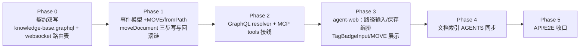
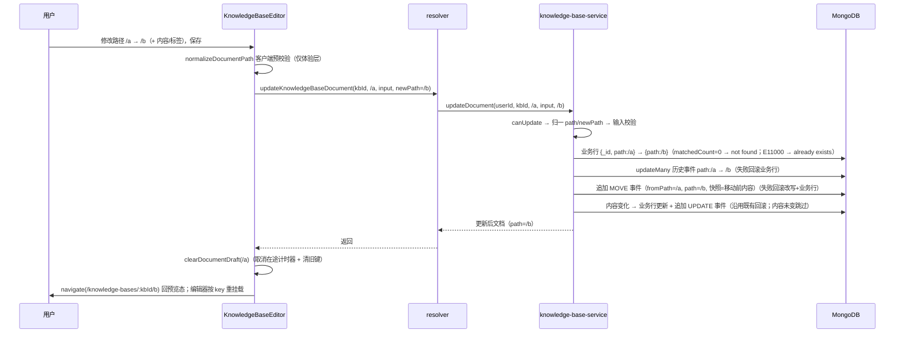

# 知识库优化 - 实现计划

**功能名称**: 知识库优化
**关联 PRD**: [`docs/product/draft/20261116-knowledge-base-optimization.md`](../../product/draft/20261116-knowledge-base-optimization.md)
**关联提案**: [`docs/engineering/proposals/20261116-feat-knowledge-base-optimization.md`](../proposals/20261116-feat-knowledge-base-optimization.md)
**基座计划**: [`docs/engineering/plan/20261115-feat-knowledge-base.md`](./20261115-feat-knowledge-base.md)
**计划版本**: v1.0
**创建日期**: 2026-11-16
**作者**: ZeroAsh Agent
**需求总分支**: `feat/knowledge-base-optimization`
**feat-branch**: `feat/knowledge-base-optimization`
**需求总 PR**: https://github.com/Deliay/z-agent-gear/pull/542

## 1. 实施顺序

严格按「契约双写 → 事件模型与服务层 → GraphQL/MCP 接线 → 前端 → 文档索引 → API/E2E 收口」推进，每个切片先写失败测试再实现（红-绿-重构）：



**关键路径**：Phase 1 是需求核心——`moveDocument` 三步写不变量（业务行 → 历史改写 → MOVE 事件）与回滚链、事件集合「无更新入口」不变量的唯一受控例外（提案 D1）。Phase 0 必须先于一切代码——手写 schema 漏改即运行时 `Cannot query field`（`schemas/knowledge-base.test.ts` 逐字段守卫）。

**回归重灾区**：`knowledge-base-service.test.ts`（T-KBS1~12 写路径不变量）、`knowledge-base-tools.test.ts`（T-KBT1~8）、`tests/api/src/agent-api/knowledge-base.test.ts`（T-KB-API1~6，含 14 条白名单逐字矩阵）、`tests/e2e/src/knowledge-base.spec.ts`（E2E-KB1~7+KB1b）、`apps/agent-web` 知识库组件测试（T-KBW1~10）与草稿 lib 测试（T-KBD1~5）。全绿即锁定「移动/徽章编辑」不破坏既有口径。

## 2. 代码事实核对（计划期确认）

以下事实基于需求总分支 `feat/knowledge-base-optimization`（HEAD `d19ae8ad`）实际代码：

| # | 事实 | 位置 | 对计划的影响 |
|---|------|------|--------------|
| F1 | 契约头注释第 19 行「文档不可改名/移动（删除 + 新建替代）」；`KnowledgeBaseEventOp` 仅 CREATE/UPDATE/DELETE；`KnowledgeBaseEvent` 无 `fromPath`；`updateKnowledgeBaseDocument` 仅 3 参；错误白名单 14 条 | `contracts/knowledge-base.graphql:19,39-43,91-102,131` | Phase 0 改写该注释并增补 MOVE/fromPath/newPath 与语义注释；白名单零新增（提案 §1.2） |
| F2 | 手写 schema 与契约逐字段对齐，由 `schemas/knowledge-base.test.ts` 守卫（文件头注释明示） | `servers/agent-api/src/graphql/schemas/knowledge-base.ts:1-2`、同目录 `knowledge-base.test.ts` | Phase 0 双写两处同 PR 同改；守卫测试自动覆盖新增字段 |
| F3 | 事件模型 `KNOWLEDGE_BASE_EVENT_OPS = ['CREATE','UPDATE','DELETE'] as const`；schema `op` 用同一数组做 enum；索引 `knowledge_base_event_recent {knowledgeBaseId,createdAt:-1}` 与 `knowledge_base_event_path_recent {knowledgeBaseId,path,createdAt:-1}`；注释声明「无任何更新/删除入口（仅删除知识库时级联清理）」 | `servers/agent-api/src/models/knowledge-base-event.ts:12,25,37-46` | enum 数组追加 `MOVE` 即时生效、存量零迁移；新增可选 `fromPath` 字段；注释补「唯一受控例外：moveDocument 内部 updateMany 改写 path」（提案 D1） |
| F4 | 文档唯一索引 `uniq_knowledge_base_doc_path {knowledgeBaseId,path}`；服务层预检 + E11000 兜底 | `servers/agent-api/src/models/knowledge-base-document.ts:36-39`、`knowledge-base-service.ts:516-533` | 移动的目标占用兜底复用同一索引：E11000 → `knowledge base document already exists`（含同库并发移动） |
| F5 | 服务层写路径不变量「业务行变更 → 追加事件」同库两步、事件失败回滚业务行（createDocument:535-541 / updateDocument:570-578 / deleteDocument:624-636）；`updateDocument` 的 updateOne filter 仅 `{_id: existing._id}`（不带 path）；`upsertDocument` 按 `exists` 分流 update/create；`appendEvent(context, kbId, path, op, snapshot, actorId)` 无 fromPath 参；`EventRow`/`KnowledgeBaseEventView`/`listEvents` 映射无 fromPath；错误常量 31-43 行齐备（含 DOC_EXISTS/DOC_NOT_FOUND/INVALID_DOC_PATH） | `servers/agent-api/src/services/knowledge-base-service.ts` | moveDocument 复用同款回滚惯例扩展为三步；filter 必须带旧路径防 TOCTOU（提案实现点 1）；appendEvent 增可选 fromPath；View/Row/映射同步补 fromPath |
| F6 | resolver `wrap()` 白名单逐字透传 14 条（`KNOWLEDGE_BASE_PUBLIC_ERRORS`）；`updateKnowledgeBaseDocument` 传 4 参（userId/kbId/path/input） | `servers/agent-api/src/graphql/resolvers/knowledge-base.ts:24-50,162-176` | resolver 仅追加 `newPath` 透传；白名单零新增（移动全部错误复用既有文案） |
| F7 | MCP `knowledge_base_document_update` inputSchema required=[path,title,tags,description,content]；handler 调 `upsertDocument`；`PUBLIC_ERRORS` 13 条（较 resolver 少 `Not authenticated`）；`tools/list` 直接返回 `KNOWLEDGE_BASE_TOOL_DEFINITIONS` 常量（非 McpServer 快照——`ensureKnowledgeBaseToolsServer` 的 `$setOnInsert` 快照仅存 name/description 用于展示），`ToolFailure` 文案直发 Agent 不受白名单约束 | `servers/agent-api/src/services/knowledge-base-tools.ts:80-96,152-167,184,241-251,322-341` | inputSchema 增可选 `newPath` 即时生效（**零 MCP 快照迁移**）；创建分支拒绝经服务层 `DOC_NOT_FOUND` 白名单透出（D2） |
| F8 | `contracts/agent-session-websocket.md` §2.12.1 路由表第 490 行 `agent-knowledge-base-tools` 行列举六工具与门控口径 | `contracts/agent-session-websocket.md:490` | 该行末尾追加 `newPath` 口径注记（提案 §3.1） |
| F9 | `KnowledgeBaseEditor`：`tagsText: string` state + `parseTags`（split `/[,，]/`）；保存 `refetchQueries`=[TREE, DOCUMENT(path), EVENTS(path)]；成功后 `clearDocumentDraft(kbId, path)` + `toast` + `onSaved(saved)`；页面 `onSaved=handleSaved→openPreview` 仅 `setSearchParams({})`（清 `?edit=1`，**不动 splat 路径**）；编辑器以 `key={kbId:path}` 重挂载；编辑器当前未 import `useNavigate` | `apps/agent-web/src/components/knowledge-base/KnowledgeBaseEditor.tsx:49-54,71-178`、`pages/KnowledgeBasePage.tsx:62-68,144-153` | 移动成功后必须编辑器内自行 `navigate(knowledgeBaseDocHref(kbId,newPath))`（父级 openPreview 不改路径）；key 重挂载保证表单零残留 |
| F10 | 草稿 lib：键 `kb-doc-draft:{kbId}:{path}`；`KnowledgeBaseDraftInput{title,tags:string[],description,content}`；`isDraft` 校验五字段；`writeDocumentDraft`/`readDocumentDraft`/`scheduleDocumentDraft`/`clearDocumentDraft`/`flushDocumentDraft` 齐备 | `apps/agent-web/src/lib/knowledge-base-draft.ts:12-22,36-47` | 形状增可选 `editedPath?: string`（isDraft 放行缺省，旧草稿兼容，提案 D7）；tags 已是 `string[]`——编辑器 state 改数组**草稿零迁移** |
| F11 | 前端 GraphQL：`UPDATE_KNOWLEDGE_BASE_DOCUMENT` 仅 3 变量；`KnowledgeBaseEventOp='CREATE'\|'UPDATE'\|'DELETE'`；`KnowledgeBaseEventData` 无 fromPath；fragment `KNOWLEDGE_BASE_EVENT_FIELDS` 无 fromPath | `apps/agent-web/src/graphql/knowledge-base.ts:13,53-63,121-133,233-244` | mutation 增 `$newPath: String` 变量；类型/fragment 同步补 MOVE 与 fromPath |
| F12 | `lib/knowledge-base.ts`：`EVENT_OP_LABELS` 类型为 `Record<'CREATE'\|'UPDATE'\|'DELETE',string>`；错误映射已覆盖全部复用文案（含 `knowledge base document already exists`→「该路径已存在文档」、`invalid document path`→「文档路径不合法（需以 / 开头、无空路径段）」） | `apps/agent-web/src/lib/knowledge-base.ts:8-24,60-64` | `EVENT_OP_LABELS` 增补 `MOVE:'移动'`，键类型同步扩展；中文映射零新增 |
| F13 | 历史展示两处共用 `EVENT_OP_LABELS`：HistoryDrawer 下拉选项「label · 时间 · 操作人」与所选版本徽标行（含 `selected.path` mono 展示）；SettingsDialog 全库历史行（label + `event.path` mono + actor/时间） | `apps/agent-web/src/components/knowledge-base/KnowledgeBaseHistoryDrawer.tsx:78-95`、`KnowledgeBaseSettingsDialog.tsx:267-279` | 两处对 MOVE 事件在路径位展示 `fromPath → path`（提案 D8）；下拉选项文案保持不变 |
| F14 | `lib/knowledge-base-path.ts`：`normalizeDocumentPath(raw): string\|null` 与服务端同源（不抛错）；`knowledgeBaseDocHref(kbId, path, edit?)` 逐段编码 | `apps/agent-web/src/lib/knowledge-base-path.ts:23-39,183-186` | 路径输入客户端预校验直接复用（仅体验层，服务端权威） |
| F15 | `components/ui/badge.tsx`：`Badge` 为 div、cva variants 含 `outline`；无内置「可关闭徽章」组件 | `apps/agent-web/src/components/ui/badge.tsx` | `TagBadgeInput` 内以 Badge(variant=outline)+`×` 按钮自足实现（提案 D6，不引第三方库） |
| F16 | IME 组合态先例：`FragmentEditor` 用 `composingRef` + `onCompositionStart/End` 门控 keydown | `apps/agent-web/src/components/common/fragment-editor/FragmentEditor.tsx:131,242,359-362` | `TagBadgeInput` 同款门控（提案实现点 4 风险点） |
| F17 | 测试现状：service `knowledge-base-service.test.ts` T-KBS1~12（mongodb-memory-server 真库）；tools T-KBT1~8；api `knowledge-base.test.ts` T-KB-API1~6（fake controller relay 覆盖 MCP）；e2e `knowledge-base.spec.ts` E2E-KB1~7+KB1b；组件 T-KBW1~10；草稿 T-KBD1~5；路径 lib T-KBP1~6 | 各测试文件头注释 | 新增用例顺延编号：T-KBS-M1~M10 / T-KBT-M1~M2 / T-TBI1~10 / T-KBW-M1~M4 / T-KBD-M1 / API 增补进 T-KB-API3~5 / E2E-KB8~9 |
| F18 | `updateDocument` 恒写 UPDATE 事件（无内容变更检测）；`updatedBy` 随写更新 | `knowledge-base-service.ts:564-578` | 「仅路径变化 → 仅 MOVE」需在 moved 分支新增快照比对短路（D6）；未移动分支保持恒 UPDATE 零行为变化 |

## 3. 数据模型与状态机

### 3.1 `knowledgebaseevents`（增量扩展、零迁移）

| 字段 | 变更 | 说明 |
|------|------|------|
| `op` | enum 数组追加 `MOVE` | `KNOWLEDGE_BASE_EVENT_OPS = ['CREATE','UPDATE','DELETE','MOVE']`；存量事件零改动 |
| `fromPath` | **新增可选 String** | 仅 MOVE 事件写入（原路径）；存量事件无此字段 → GraphQL `null` |

- 无新索引：移动后历史事件 `path` 已是新路径，`{knowledgeBaseId,path,createdAt:-1}` 天然命中（F3）。
- 「事件集合无更新/删除入口」不变量出现**唯一受控例外**：仅 `moveDocument` 内部 `updateMany` 改写历史事件 `path`（不暴露任何公共更新/删除入口，级联删除口径不变），模型注释同步登记。

### 3.2 服务编排形状（`knowledge-base-service.ts`）

```ts
/** 移动唯一入口（提案实现点 1）：三步写 + 回滚链；权限/归一/占用全部复用既有文案 */
async moveDocument(userId: string, kbId: string, rawPath: string, rawNewPath: string): Promise<void> {
  // 1. requireContext → loadKnowledgeBase → canUpdate 判定（越权 → knowledge base permission denied）
  // 2. path/newPath 各自 normalizeDocumentPath（非法 → invalid document path）；
  //    归一后相同 → 直接返回（幂等无操作，零事件，提案 D4）
  // 3. existing = findOne({knowledgeBaseId, path}) → 缺失 → knowledge base document not found
  // 4. 业务行 updateOne({_id, path: oldPath}, {$set: {path: newPath, updatedBy: userId}})
  //    —— filter 带旧路径防 TOCTOU（matchedCount=0 → not found）；E11000 → already exists（F4）
  // 5. 历史改写 KnowledgeBaseEvent.updateMany({knowledgeBaseId, path: oldPath}, {$set: {path: newPath}})
  //    —— 失败 → 回滚业务行 path（best-effort）后整体抛错（同既有事件失败回滚口径）
  // 6. appendEvent MOVE（path=newPath, fromPath=oldPath, 快照=移动时点内容, actor 快照）
  //    —— 失败 → 反向 updateMany 回滚历史改写 + 回滚业务行后整体抛错（不留半提交）
}

/** updateDocument 签名扩展：rawNewPath?（D5/D6 编排顺序） */
async updateDocument(userId, kbId, rawPath, input, rawNewPath?): Promise<KnowledgeBaseDocumentView> {
  // loadKnowledgeBase + canUpdate → normalize(rawPath) → （提供时）normalize(rawNewPath)
  // → validateDocumentInput(input)（全部校验先于任何写）
  // → newPath 提供且≠path → moveDocument(...)，effectivePath = newPath，moved = true
  // → findOne(effectivePath) → DOC_NOT_FOUND
  // → moved 且快照与业务行一致 → 直接返回当前文档（仅 MOVE，跳过业务更新与 UPDATE 事件，D6）
  // → 否则 updateOne + appendEvent('UPDATE', effectivePath)（未移动保持既有恒 UPDATE 零行为变化）
}

/** upsertDocument（MCP 专用）同形扩展 rawNewPath?：存在 → updateDocument(..., newPath)；
    不存在（创建分支）且提供 newPath → throw DOC_NOT_FOUND（D2） */
```

## 4. 核心时序



## 5. 变更清单

### 5.1 Phase 0：契约双写（先于代码）

| 文件 | 变更 |
|------|------|
| `contracts/knowledge-base.graphql` | ① 头注释第 19 行「文档不可改名/移动」改写为移动语义（路径可修改：移动时全部历史事件 path 改写随文档带入新路径 + 追加 MOVE 事件；原路径即刻释放、重建历史独立）；② `KnowledgeBaseEventOp` 追加 `MOVE`（注释：path=新路径、fromPath=原路径、快照为移动时点内容）；③ `KnowledgeBaseEvent` 追加 `fromPath: String`（注释：仅 MOVE 有值，其余恒 null）；④ `updateKnowledgeBaseDocument` 追加可选 `newPath: String` 与语义注释（提供且归一后≠path → 原子「移动+更新」；相同 → 视为未提供；目标占用 → `knowledge base document already exists`；权限 = canUpdate；错误白名单 14 条零新增） |
| `servers/agent-api/src/graphql/schemas/knowledge-base.ts` | 与契约逐字同步（enum/类型/mutation 三处）；`schemas/knowledge-base.test.ts` 守卫自动覆盖（F2） |
| `contracts/agent-session-websocket.md` | §2.12.1 路由表 `agent-knowledge-base-tools` 行追加：`knowledge_base_document_update` 可选参数 `newPath`（源文档存在时先移动再更新，口径同 `updateKnowledgeBaseDocument`；源不存在走创建分支时提供 `newPath` → isError 拒绝）（F8） |

### 5.2 Phase 1：事件模型与服务层（agent-api）

| 文件 | 变更 |
|------|------|
| `servers/agent-api/src/models/knowledge-base-event.ts` | `KNOWLEDGE_BASE_EVENT_OPS` 追加 `'MOVE'`；schema 新增 `fromPath: { type: String }`（可选）；文件头注释补「唯一受控例外：`moveDocument` 内部 `updateMany` 改写历史事件 path（MOVE 事件自身 `fromPath` 记录原路径），不暴露任何公共更新/删除入口」（F3） |
| `servers/agent-api/src/services/knowledge-base-service.ts` | ① `KnowledgeBaseEventView`/`EventRow` 增 `fromPath?: string`；`listEvents` 映射补 `fromPath: row.fromPath ?? null`；② `appendEvent` 增可选 `fromPath` 参（仅 MOVE 传）；③ 新增 `moveDocument`（§3.2 三步写与回滚链）；④ `updateDocument` 扩展 `rawNewPath?`（§3.2 编排，含 moved 分支快照一致短路）；⑤ `upsertDocument` 扩展 `rawNewPath?`（创建分支收到 → `throw new Error(DOC_NOT_FOUND)`，D2）；⑥ 类注释写路径不变量更新为「三步（移动）/两步（其余）」 |

### 5.3 Phase 2：GraphQL resolver + MCP tools 接线

| 文件 | 变更 |
|------|------|
| `servers/agent-api/src/graphql/resolvers/knowledge-base.ts` | `updateKnowledgeBaseDocument` args 增 `newPath?: string \| null` 并透传 `args.newPath ?? undefined`（F6）；白名单零改动 |
| `servers/agent-api/src/services/knowledge-base-tools.ts` | ① `knowledge_base_document_update` inputSchema 增可选 `newPath: { type:'string', description:'新文档路径（移动，可选；仅当 path 指向已存在文档时生效）' }`；② handler 透传 `asString(args.newPath)` 至 `upsertDocument` 第五参（F7；tools/list 直出常量，零快照迁移） |

### 5.4 Phase 3：前端（apps/agent-web）

| 文件 | 变更 |
|------|------|
| `src/graphql/knowledge-base.ts` | ① `KnowledgeBaseEventOp` 增 `'MOVE'`；`KnowledgeBaseEventData` 增 `fromPath: string \| null`；fragment `KNOWLEDGE_BASE_EVENT_FIELDS` 增 `fromPath`；② `UPDATE_KNOWLEDGE_BASE_DOCUMENT` 增 `$newPath: String` 变量并传参（F11） |
| `src/lib/knowledge-base-draft.ts` | `KnowledgeBaseDraftInput` 增可选 `editedPath?: string`；`isDraft` 对 `editedPath` 仅做「存在则须为 string」校验（缺省放行，旧草稿兼容）；`readDocumentDraft`/`writeDocumentDraft`/`scheduleDocumentDraft` 透传该字段（F10） |
| `src/lib/knowledge-base.ts` | `EVENT_OP_LABELS` 键类型扩展并增补 `MOVE: '移动'`（F12） |
| `src/components/knowledge-base/TagBadgeInput.tsx`（新增） | 自足徽章编辑器（提案实现点 4、D6）：受控 `{ value: string[]; onChange(tags: string[]): void; disabled?: boolean }`；`flex-wrap` 容器内 `Badge(variant=outline)` + 逐枚 `×` 删除按钮 + 内联无边框输入框；提交触发 Enter / `,` / `，` / blur（非空，trim 后）；重复（与既有 badge trim 后相同）→ toast 提示不添加；输入为空时 Backspace 删末枚；`onPaste` 文本含逗号（中英文）→ preventDefault 拆分后逐枚走同一提交管线（去重/超限逐枚拒绝并汇总 toast，D9）；输入框 `maxLength=32`；badge 达 16 枚 → 输入框禁用 + 提示文案（与服务端约束同值）；IME 组合态 `composingRef` 门控 Enter 提交（F16 先例） |
| `src/components/knowledge-base/KnowledgeBaseEditor.tsx` | ① 新增「路径」输入（`font-mono`，预填当前 path，Label「路径」）：state `editedPath: string` 初始 = path prop；变更入草稿（`editedPath`）；② state `tagsText: string` → `tags: string[]`，标签区替换为 `TagBadgeInput`（删除 `parseTags` 对 state 的依赖，拆分逻辑迁入 TagBadgeInput）；实时预览直接渲染 `tags` 数组（既有 Badge 展示不变）；③ 保存编排（提案实现点 3、D5/D7/D8）：文档已存在 → 归一 `editedPath`，非法 → 行内错误提示保持编辑态；≠path → `updateDocument({variables:{knowledgeBaseId, path, input, newPath}}, refetchQueries=[TREE, DOCUMENT(newPath), EVENTS(newPath)])` → 成功 `clearDocumentDraft(kbId, path)` → `navigate(knowledgeBaseDocHref(kbId, newPath))`（编辑器新 import `useNavigate`，F9）→ `onSaved?.(saved)`；=path → 既有流程零变化；文档不存在（创建分支）→ 以归一后 `editedPath` 调 `createKnowledgeBaseDocument` → 成功且 ≠path 时 navigate 至新路径；④ 保存失败（占用/非法/越权）保持编辑态，`knowledgeBaseErrorMessage` 中文映射零新增（F12）；⑤ 草稿恢复：`setEditedPath(pendingDraft.editedPath ?? path)`、tags 直接取 `pendingDraft.tags` |
| `src/components/knowledge-base/KnowledgeBaseHistoryDrawer.tsx` | 所选事件 `op==='MOVE'` 时徽标行路径位展示 `{selected.fromPath} → {selected.path}`（F13）；下拉选项文案不变 |
| `src/components/knowledge-base/KnowledgeBaseSettingsDialog.tsx` | 全库历史行对 MOVE 事件路径位同样展示 `fromPath → path`（F13） |

### 5.5 Phase 4：文档索引

| 文件 | 变更 |
|------|------|
| `servers/agent-api/AGENTS.md` | 「知识库（#495）」小节追加：MOVE op 与 `fromPath`、moveDocument 三步写与受控例外、`updateKnowledgeBaseDocument.newPath` 原子「移动+更新」、MCP newPath 创建分支拒绝口径 |
| `apps/agent-web/AGENTS.md` | 「知识库（#495）」小节更新：分栏编辑补「路径可编辑 + 保存后导航新路径」、标签改 `TagBadgeInput`（提交/删除/粘贴/上限/IME 口径）、草稿形状 `+editedPath`、`EVENT_OP_LABELS` 增补 MOVE 与 `fromPath → path` 展示 |
| `tests/api/AGENTS.md` | 「知识库 API」小节追加移动/MCP newPath 断言口径（T-KB-API3/4/5 增补） |
| `tests/e2e/AGENTS.md` | 知识库 E2E 表追加 E2E-KB8/E2E-KB9 行 |
| `docs/engineering/AGENTS.md` | 「实现计划（plan/）」索引登记本文件（产出本计划时已登记） |

### 5.6 Phase 5：API/E2E 收口

见 §6.3；实现顺序按 Phase 逐切片 RED→GREEN。

## 6. TDD 测试矩阵

### 6.1 单元（agent-api，Vitest + mongodb-memory-server 真库）

| 编号 | 文件 | 断言 |
|------|------|------|
| T-KBS-M1 | `services/knowledge-base-service.test.ts` | 移动成功：业务行 path 更新（updatedBy 跟随）；该路径全部历史事件（含 CREATE/UPDATE/DELETE 前记录）`path` 改写为新路径；新路径历史倒序完整且末尾追加一条 MOVE 事件（`fromPath`=原路径、`path`=新路径、快照=移动时点内容、actorName 快照） |
| T-KBS-M2 | 同上 | 目标占用逐字：新路径已有文档 → `knowledge base document already exists`；并发同目标（绕过预检直撞唯一索引）E11000 同文案（F4） |
| T-KBS-M3 | 同上 | 非法路径矩阵：`newPath` 不以 `/` 开头 / 空路径段 / 超 512 / 段超 128 → `invalid document path`；源不存在 → `knowledge base document not found` |
| T-KBS-M4 | 同上 | 四档权限矩阵：UPDATE_ONLY/FULL_ACCESS 非管理员放行；READ_ONLY 非管理员 → `knowledge base permission denied`；NONE 非管理员不可见 → `knowledge base not found`；admin 恒放行 |
| T-KBS-M5 | 同上 | 同路径幂等：`newPath` 归一后与 `path` 相同 → 零事件零写、返回成功（提案 D4） |
| T-KBS-M6 | 同上 | 路径+内容同次变化双事件（提案 D5）：先 MOVE（快照=移动前内容）后 UPDATE（快照=新内容），时序与 createdAt 倒序正确 |
| T-KBS-M7 | 同上 | 仅路径变化 → 仅 MOVE：内容快照与业务行一致时跳过业务更新与 UPDATE 事件（D6）；仅内容变化（未移动）→ 仅 UPDATE（零行为变化，F18） |
| T-KBS-M8 | 同上 | 原路径释放：移动后原路径 `createDocument` 成功；新文档历史仅含其自身 CREATE，不含已迁走历史 |
| T-KBS-M9 | 同上 | 并发同文档移动：`updateOne({_id, path: oldPath})` matchedCount=0 → `knowledge base document not found`（TOCTOU 防护，提案实现点 1） |
| T-KBS-M10 | 同上 | 级联删除含 MOVE 事件：删除知识库时 `knowledgebaseevents` 中 MOVE 事件一并清理；`listEvents` 透出 `fromPath`（MOVE 有值/其余 null） |
| T-KBT-M1 | `services/knowledge-base-tools.test.ts` | `knowledge_base_document_update` 携带 `newPath`：源存在 → 先移动再更新（返回 path=新路径，历史含 MOVE）；tools/list 的 inputSchema 含可选 `newPath` |
| T-KBT-M2 | 同上 | 创建分支拒绝：源路径不存在且提供 `newPath` → isError 文案 `knowledge base document not found`（D2）；越权移动 → isError `knowledge base permission denied` |
| （守卫） | `graphql/schemas/knowledge-base.test.ts` | 契约与手写 schema 逐字段一致（新增 MOVE/fromPath/newPath 自动覆盖，F2） |

### 6.2 前端（Vitest + RTL）

| 编号 | 文件 | 断言 |
|------|------|------|
| T-TBI1 | `components/knowledge-base/__tests__/TagBadgeInput.test.tsx`（新增） | 提交三触发：Enter / `,` / `，` 各将输入 trim 后生成 badge；blur 非空输入同样生成 |
| T-TBI2 | 同上 | 去重：与既有 badge（trim 后）相同 → toast 提示且不添加；批内重复同口径 |
| T-TBI3 | 同上 | 逐枚删除：点击 badge `×` 移除该枚；输入为空时 Backspace 删除末枚；输入非空时 Backspace 不删 badge |
| T-TBI4 | 同上 | 粘贴拆分：`a, b，c` → 三枚 badge 且与既有去重；非法（空/超 32）逐枚拒绝并汇总提示 |
| T-TBI5 | 同上 | 上限：达 16 枚输入框禁用 + 提示文案；删除一枚后恢复可输；输入框 `maxLength=32` |
| T-TBI6 | 同上 | IME 门控：组合态（compositionstart 后）按 Enter 不提交；compositionend 后正常提交（F16） |
| T-KBW-M1 | `components/knowledge-base/__tests__/KnowledgeBaseEditor.test.tsx` | 路径修改保存编排：路径输入改为 /b 保存 → mutation 变量含 `newPath:'/b'`；成功后旧键草稿清除、`navigate(knowledgeBaseDocHref(kbId,'/b'))` 被调用（F9） |
| T-KBW-M2 | 同上 | 路径未变 → 不传 `newPath`（变量 undefined），既有保存流程零回归；非法路径（如 `a/b` 无前导 `/`）→ 行内错误且不发 mutation |
| T-KBW-M3 | 同上 | 创建分支（document=null）以编辑后路径调 `createKnowledgeBaseDocument`；目标占用失败 → 错误映射「该路径已存在文档」保持编辑态（F12） |
| T-KBW-M4 | 同上 | 草稿含 `editedPath`：恢复草稿时路径输入一并还原；tags 数组经 TagBadgeInput 完整还原（F10） |
| T-KBD-M1 | `lib/__tests__/knowledge-base-draft.test.ts` | 形状扩展：`editedPath` 写入/读取/缺省兼容（旧草稿无该字段读取为 undefined，isDraft 放行）；损坏形状仍按无缓存 |
| （回归） | `components/knowledge-base/__tests__/KnowledgeBaseHistoryDrawer.test.tsx` | MOVE 事件展示 `fromPath → path`；CREATE/UPDATE/DELETE 既有渲染零回归（F13） |

### 6.3 API / E2E

| 编号 | 文件 | 断言 |
|------|------|------|
| T-KB-API3 增补 | `tests/api/src/agent-api/knowledge-base.test.ts` | 移动断言追加：`updateKnowledgeBaseDocument(newPath)` 后新路径文档可访问、历史完整带入且含 MOVE 事件（fromPath/path/actorName）；原路径释放可重建且历史独立；目标占用与非法路径逐字文案 |
| T-KB-API4 增补 | 同上 | 权限矩阵增补移动行：UPDATE_ONLY developer 移动放行、READ_ONLY developer 移动拒绝 `knowledge base permission denied`、全局库同口径 |
| T-KB-API5 增补 | 同上 | MCP 链路：fake controller relay 调 `knowledge_base_document_update` 携带 `newPath` → 移动生效且历史含 MOVE；创建分支携带 `newPath` → isError `knowledge base document not found`（D2） |
| E2E-KB8 | `tests/e2e/src/knowledge-base.spec.ts` | 编辑模式修改路径保存：地址栏跳新路径、预览生效；历史版本含「移动」记录（fromPath → path 可见）；原路径可立即重建文档且历史独立；目标被占用时提示「该路径已存在文档」且保持编辑态 |
| E2E-KB9 | 同上 | 标签 badge 编辑：回车/逗号生成 badge、逐枚删除、空输退格删末枚、粘贴「a, b，c」拆分去重、16 枚上限提示；保存后预览页 badge 展示零回归 |

### 6.4 回归清单（必须同批）

| 位置 | 关注 |
|------|------|
| `knowledge-base-service.test.ts` T-KBS1~12 / `knowledge-base-tools.test.ts` T-KBT1~8 / `knowledge-base-access.test.ts` | 写路径不变量、upsert 分流、权限矩阵既有用例全绿（服务层纯扩展，未移动分支零行为变化） |
| `tests/api/src/agent-api/knowledge-base.test.ts` T-KB-API1~6 | 14 条白名单逐字矩阵零回归（白名单零新增，F1/F6） |
| `tests/e2e/src/knowledge-base.spec.ts` E2E-KB1~7+KB1b | 预览/历史/设置/草稿恢复既有场景零回归 |
| `apps/agent-web` T-KBW1~10 / T-KBD1~5 / T-KBP1~6 / Sidebar 五分区 | 编辑器 tags state 改数组后实时预览/保存/草稿恢复零回归；`EVENT_OP_LABELS` 增补对既有 op 渲染零影响 |
| `graphql/schemas/knowledge-base.test.ts` | 契约双写一致（F2） |

## 7. 计划期裁决

| 编号 | 裁决 | 理由 |
|------|------|------|
| D1 | `moveDocument` 作为服务层公开方法但仅被 `updateDocument`/`upsertDocument` 编排调用（不直接暴露 GraphQL/MCP 入口）；其内部自带完整「上下文 → 权限 → 归一 → 占用」校验链 | 提案 §3.2「移动唯一入口」：独立可测（T-KBS-M1~M10 直调），且调用方绕过前置校验时仍安全 |
| D2 | `upsertDocument` 创建分支收到 `newPath` → 服务层 `throw new Error('knowledge base document not found')`，经 tools 既有白名单以 isError 透出 | 提案「错误白名单零新增」与「INVALID_PARAMS 语义：创建时无移动对象」双约束的交集：文案准确（源文档不存在）、零新增白名单、isError 形态一致（F7） |
| D3 | MOVE 事件快照 = 移动时点（移动前）内容；路径+内容同次变化记 MOVE + UPDATE 两条 | 提案 D5；历史如实反映「先移动后更新」两次事实，与既有事件语义一致 |
| D4 | `updateDocument` 编排顺序：canUpdate → 归一 path → 归一 newPath → 输入校验 → （需要时）moveDocument → 内容更新；全部校验先于任何写 | 输入非法时不得先落移动写；与既有 `updateDocument` 校验顺序同构（F5） |
| D5 | GraphQL resolver 对 `newPath` 仅 `?? undefined` 透传，不做任何归一/预检 | 服务端服务层是唯一校验权威（F6 既有分工）；`null` 与缺省同义（契约注明） |
| D6 | 「仅路径变化 → 仅 MOVE」以**快照与业务行四字段（title/tags/description/content）一致**为短路条件，且仅在 moved 分支生效；未移动分支保持恒 UPDATE | 提案语义要点 + F18 零行为变化；短路同时跳过业务行更新（updatedAt 已由 moveDocument 更新） |
| D7 | 前端保存成功（含移动）后**只清旧键草稿、不写新键草稿**，随后 `navigate` 新路径；`onSaved` 两分支照常调用 | 提案 D2 原子「移动+更新」下不存在「已移动但内容未存」中间态（提案 §4.2 的草稿键迁移系两调用形态残留描述）；保存成功即无草稿语义与既有口径一致，避免新路径下出现伪草稿恢复弹窗 |
| D8 | 移动后的 `refetchQueries` 指向**新路径** DOCUMENT/EVENTS + TREE；旧路径查询不主动失效 | 提案 §4.2；导航离开后旧路径查询自然失效，Apollo 缓存不残留脏数据 |
| D9 | `TagBadgeInput` 粘贴拆分后**逐枚走同一提交管线**（trim → 去空 → 与既有+批内去重 → 单枚 ≤32 → 总量 ≤16），非法逐枚拒绝并汇总 toast；不静默截断 | PRD 验收「粘贴自动拆分去重」「超限拒绝并提示」；单枚与批量同一规则源，行为可预期 |
| D10 | 编辑器 state `tagsText: string` → `tags: string[]`；`parseTags` 拆分逻辑迁入 `TagBadgeInput`（编辑器内删除） | 草稿形状本就 `tags: string[]`（F10），state 与草稿同形零迁移；实时预览直接渲染数组 |
| D11 | MOVE 展示仅改「路径位」为 `fromPath → path`（HistoryDrawer 徽标行 + SettingsDialog 历史行）；下拉选项文案保持「移动 · 时间 · 操作人」 | 提案 D8 的最小侵入面；option 标签空间受限且 path 已在新路径语境下 |
| D12 | `TagBadgeInput` 不引第三方 tag 库；`×` 删除按钮用文本符号 + aria-label（`删除标签 {tag}`） | 提案 D6；交互面小，复用既有 `Badge`（F15） |

## 8. 风险与回滚

| 风险 | 影响 | 缓解 |
|------|------|------|
| 三步写中途失败（历史改写或 MOVE 事件失败） | 业务行与历史不一致 | 回滚链与既有「不留半提交」同语义（best-effort 反向回滚后整体抛错）；T-KBS-M1/M6 覆盖顺序与快照，单实例部署 + 唯一索引兜底（提案 §6.2 约束） |
| 并发移动同一文档 / 并发占同一目标路径 | 历史归属错乱或唯一索引冲突 | filter 带旧路径 TOCTOU 防护（T-KBS-M9）；E11000 → already exists（T-KBS-M2） |
| 事件集合「无更新入口」不变量被破坏 | 历史不可信 | 例外仅限 `moveDocument` 内部 `updateMany`；模型注释登记；`tenant-isolation`/隔离豁免断言不涉及本集合更新入口（F3） |
| 移动后 Apollo 缓存旧路径文档残留 | 旧路径短暂显示已移动文档 | refetch 新路径三查询 + 导航离开旧路径自然失效（D8）；tree refetch 即时刷新侧边栏 |
| 移动成功响应未达客户端（网络中断） | 草稿滞留旧路径键 | 与既有保存中断同口径（草稿保留可人工放弃）；重进新路径内容为已保存态，无数据丢失 |
| 粘贴大量文本拆分后超限 | 批量拒绝体验差 | 逐枚校验 + 汇总 toast（D9）；合法前缀部分正常入列 |
| IME 中文输入被 Enter 误提交 | 误生成 badge | `composingRef` 门控（F16 先例，T-TBI6） |
| 回滚 | — | 服务端回滚即恢复旧行为：`newPath`/`fromPath`/MOVE 为增量字段，旧前端忽略即无入口；已改写 path 的历史事件在新路径下仍可读，无需反向迁移（提案 §9.2） |

## 9. 命令参考

```bash
# 依赖（仓库已迁移 pnpm）
pnpm install

# agent-api 单测 / 构建
cd servers/agent-api && pnpm test
cd servers/agent-api && pnpm exec vitest run src/services/knowledge-base-service.test.ts
cd servers/agent-api && pnpm exec vitest run src/services/knowledge-base-tools.test.ts
cd servers/agent-api && pnpm run build

# agent-web 单测 / 构建
cd apps/agent-web && pnpm test
cd apps/agent-web && pnpm exec vitest run src/components/knowledge-base/__tests__/TagBadgeInput.test.tsx
cd apps/agent-web && pnpm exec vitest run src/components/knowledge-base/__tests__/KnowledgeBaseEditor.test.tsx
cd apps/agent-web && pnpm run build

# 服务编排（API/E2E 前置）
aspire start
aspire wait agent-api controller-api agent-web

# API 集成（需 MONGODB_URI / INTERNAL_API_TOKEN / REDIS_URL）
cd tests/api && pnpm exec vitest run src/agent-api/knowledge-base.test.ts

# E2E
cd tests/e2e && pnpm exec playwright test src/knowledge-base.spec.ts
```

## 10. 验收 checklist

### 10.1 Phase 0（契约双写）

- [ ] `contracts/knowledge-base.graphql` 与手写 schema 双写一致（MOVE/fromPath/newPath + 头注释移动语义），schema 守卫测试绿
- [ ] `agent-session-websocket.md` §2.12.1 路由表 newPath 口径增补
- [ ] 错误白名单 14 条零新增（契约头注释与 resolver/tools PUBLIC_ERRORS 同步不增）

### 10.2 Phase 1~2（服务/接线）

- [ ] `moveDocument` 三步写与回滚链由 T-KBS-M1~M10 锁死（历史全量带入、MOVE 事件、占用/非法/权限/幂等/并发/级联）
- [ ] 路径+内容双变化双事件、仅路径变化仅 MOVE（快照短路）、仅内容变化仅 UPDATE（零行为变化）
- [ ] resolver 透传 `newPath`；MCP `newPath` 更新分支生效、创建分支 isError `knowledge base document not found`

### 10.3 Phase 3（前端）

- [ ] 编辑模式路径可改：保存后地址栏跳新路径、旧键草稿清除、refetch 指向新路径；非法/占用/越权保持编辑态且中文提示正确
- [ ] 草稿 `editedPath` 随保存/恢复完整还原（含未保存即离开场景）
- [ ] `TagBadgeInput` 交互矩阵全绿（三触发/去重/逐枚删除/空输退格/粘贴拆分/16×32 上限/IME 门控）；展示侧 badge 零回归
- [ ] HistoryDrawer 与 SettingsDialog 对 MOVE 事件展示 `fromPath → path`；`EVENT_OP_LABELS` 增补 MOVE

### 10.4 Phase 5（测试与回归）

- [ ] 单测矩阵 T-KBS-M1~M10 / T-KBT-M1~M2 / T-TBI1~6 / T-KBW-M1~M4 / T-KBD-M1 全绿；新增分支 100% 覆盖
- [ ] `tests/api` T-KB-API1~6（含增补）全绿；`tests/e2e` E2E-KB1~9 通过
- [ ] PRD 功能点 1~2 逐条验收（含多次移动 A→B→C、原路径重建历史独立、AI 工具口径一致）
- [ ] `servers/agent-api/AGENTS.md`、`apps/agent-web/AGENTS.md`、`tests/api/AGENTS.md`、`tests/e2e/AGENTS.md`、`docs/engineering/AGENTS.md` 已同步

## 11. 相关文档

- [产品需求 v1.0](../../product/draft/20261116-knowledge-base-optimization.md)
- [技术提案 v1.0](../proposals/20261116-feat-knowledge-base-optimization.md)
- [知识库实现计划（基座）](./20261115-feat-knowledge-base.md)
- [知识库技术提案（基座）](../proposals/20261115-feat-knowledge-base.md)
- [知识库契约](../../../contracts/knowledge-base.graphql)
- [agent-api AGENTS](../../../servers/agent-api/AGENTS.md)
- [agent-web AGENTS](../../../apps/agent-web/AGENTS.md)
- [需求来源 Issue #541](https://github.com/Deliay/z-agent-gear/issues/541)
- [需求总 PR #542](https://github.com/Deliay/z-agent-gear/pull/542)
