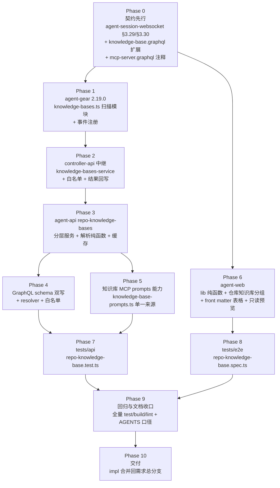

# 仓库内建知识库 - 实现计划

**功能名称**: 仓库内建知识库（知识库支持在代码仓库中内建）
**关联 PRD**: [`docs/product/draft/20261116-knowledge-base-repo-built-in.md`](../../product/draft/20261116-knowledge-base-repo-built-in.md)（v1.1）
**关联提案**: [`docs/engineering/proposals/20261116-feat-knowledge-base-repo-built-in.md`](../proposals/20261116-feat-knowledge-base-repo-built-in.md)（v1.1）
**计划版本**: v1.0
**创建日期**: 2026-11-16
**作者**: z-agent-bot
**需求总分支**: `feat/knowledge-base-repo-built-in`
**feat-branch**: `feat/knowledge-base-repo-built-in-impl`（开发分支，基于需求总分支切出；实现完成后合并回需求总分支，随 PR #546 收口）
**需求总 PR**: https://github.com/Deliay/z-agent-gear/pull/546

**上游评审结论**：产品文档 v1.0 / 技术提案 v1.0 经 PR #546 评审返工一轮（3 条 inline comment：前端折叠懒加载、front matter 渲染为表格、MCP 提供编写指引提示词），返工后 PRD v1.1 / 提案 v1.1（提交 `e1d157f3`）于 2026-11-16T19:03:10Z 获审核人 APPROVED。本计划按 PRD v1.1 / 提案 v1.1 推进，不改变其产品口径。

**版本说明**：

- v1.0 首版：把提案 §5.2 的 7 个实现点拆成 10 个 Phase（契约 → agent-gear → controller-api → agent-api 服务 → GraphQL → MCP prompts → agent-web → API 测试 → E2E → 回归收口/交付）；给出「代码事实核对」22 条、「计划期裁决」14 条，收敛提案留白（契约章节编号、缓存内容形态、错误文案定稿、前端「重新检测」缓存口径、分组挂载位置等）。
- 契约变更为纯新增（类型/查询/事件/注释），存量字段零改动；**零 MongoDB 变更**（无新集合、无迁移、无索引，提案 D2）。

## 1. 实施顺序

严格按「契约 → agent-gear 扫描 → controller-api 中继 → agent-api 服务/GraphQL/MCP → 前端 → API 收口 → E2E 收口」推进，每个切片先写失败测试再实现（红-绿-重构）：



**关键路径**：Phase 3 是需求核心——分层懒加载（骨架纯 DB → 单工作区扫描 → 缓存派生子条目/文档）与解析校验（schema / front matter / 路径归一与冲突）是全需求的语义本体；Phase 0 契约锁定后 **Phase 1→2→3→4/5（后端线）与 Phase 6（前端线，依赖 Phase 0 的契约 SDL）可并行**（按 z-coding 流程各用一个 subagent 实现，各自从 `feat/knowledge-base-repo-built-in-impl` 切工作分支、PR 回 impl，D1）。

**依赖说明**：

- **P1 → P2**：controller-api 中继测试 fixture 必须与 agent-gear 真实回包形态一致（AGENTS.md「跨服务协议」教训：两端共用同一份 fixture）。
- **P3 依赖 P2**：轮询消费依赖中继的 Redis 结果键口径（`knowledge-bases:scan:{requestId}` EX 60）。
- **P6 依赖 P0/P4**：前端 GraphQL 文档与类型以契约 SDL 为准；组件联调在 P4 落地后收口。
- **P5 独立**：prompts 能力只依赖 `knowledge-base-tools.ts` 现状与扫描器常量（P1 落定后防漂移守卫才有锚点），可与 P4 并行。

### 关键约束（实现期不得回退）

- **扫描通道专用事件**：不复用 `fs:browse`/`fs:read-file` 会话路径白名单（检测可发生在会话启动前）；agent-gear 仅直读两个约定子目录，只读不写、不执行（提案 §3.1(a)）。
- **仓库为唯一事实源**：仓库知识库**不落 MongoDB**（仅 Redis 短缓存）、**不进知识库 MCP 工具**（六工具零改动）、**无任何 mutation/写入口**（提案 D2/D3/D4）。
- **折叠懒加载**：`repoKnowledgeBaseHosts` 必须是**纯 DB 读**，不得触发任何继电器扫描；扫描仅在「展开云电脑 / 缓存 miss / 重新检测」时发生（提案 D7）。
- **错误收敛**：`repoKnowledgeBases` 扫描失败抛白名单 `repo knowledge base scan failed`；`repoKnowledgeBaseDocumentChildren` / `repoKnowledgeBaseDocument` 对任何不可达统一返回 `[]` / `null`（不泄露存在性）；`workspaceId` 不可见/非默认工作区 → `Workspace not found`。
- **版本门禁**：agent-gear 版本 <2.19.0 时 `scanSupported=false`，前端展示升级提示且**不发起加载**（不报错、不影响其他云电脑）。
- **禁止 rebase/squash**：遵循 z-git 规范，仅允许 merge。

## 2. 代码事实核对（计划期确认）

以下事实基于需求总分支 `feat/knowledge-base-repo-built-in`（HEAD `e1d157f3`）实际代码：

| # | 事实 | 位置 | 对计划的影响 |
|---|------|------|--------------|
| F1 | agent-gear 扫描先例：`scanWorkflowTemplates(workspacePath)` 直读 `<path>/.zag/workflow/templates/`（不递归、仅 `.json`、符号链接按 `stat` 判常规文件、`localeCompare` 排序、20 文件/128KiB/1MiB 上限、ENOENT/ENOTDIR→空、EACCES/EPERM→`permission denied`、单文件超限 `error:'file too large'`）；常量 `WORKFLOW_TEMPLATES_SUBDIR/MAX_FILES/MAX_FILE_BYTES/MAX_TOTAL_BYTES` 导出 | `packages/agent-controller/src/workflow-templates.ts:13-19,57-129` | `knowledge-bases.ts` 逐形镜像（两个来源目录、子文件夹发现、库内递归 `.md`、分级上限），Phase 1 |
| F2 | agent-gear 事件注册形态：`socket.on('workflow-templates:scan')` → 调模块 → `socket.emit('workflow-templates:scan:result', {requestId, ...result})`；日志不含文件内容 | `packages/agent-controller/src/socketio-client.ts`（workflow-templates 注册位） | `knowledge-bases:scan` 同位注册；日志 `knowledge_bases_scan` 仅含 `requestId/path` |
| F3 | agent-gear 当前版本 `2.18.0`；版本历史段注明「`workflow-templates:scan` 自 2.18.0 起」 | `packages/agent-controller/package.json:3`、`packages/agent-controller/AGENTS.md:60-68` | 升 MINOR 到 `2.19.0`；AGENTS 版本段同步 |
| F4 | controller-api 中继先例：`WorkflowTemplatesService.handleScan(requestId, controllerId, path)`（Controller → keyId → socketId → `socket.emit(event, withTraceMeta({requestId, path}))`；三处失败仅记 error 不写 Redis）；`handleScanResult` 写 `workflow-templates:scan:{requestId}` EX 60，`templates` 非数组按 `{success:false,...}` 兜底落键 | `servers/controller-api/src/services/workflow-templates-service.ts:23-57` | `knowledge-bases-service.ts` 逐字镜像形态，`sources` 非数组兜底（Phase 2） |
| F5 | controller-api 白名单位：`session-command.ts:193`（`command.type==='workflow-templates:scan' && requestId && controllerId && path` 齐备才分发）；结果监听位 `socketio.ts:697-698`（`onEvent(socket, 'workflow-templates:scan:result', …)`） | `servers/controller-api/src/services/session-command.ts:193`、`socketio.ts:697-698` | 两处分支后各追加 `knowledge-bases:scan` 同型分支 |
| F6 | agent-api 扫描编排先例：`repoTemplateService.scan(userId, workspaceId)`——`controllerWorkspaceService.findById` 可见性（不可见抛 `Workspace not found`）→ `Controller.findOne({_id, ...actorFilter})`（离线/版本不支持 → `[]`）→ `publish('session:command', {type, requestId, controllerId, path})` → 轮询 `500ms×30`（`REPO_TEMPLATE_POLL_INTERVAL_MS/ATTEMPTS`）→ 读后即删 → JSON.parse 失败/`success:false` 降级 | `servers/agent-api/src/services/workflow/repo-templates.ts:10-14,182-225` | 轮询参数与「读后即删」同型复用；差异：本需求扫描失败**抛错**而非降级 `[]`（提案 §3.1(b) 错误口径，D5） |
| F7 | `compareVersions(a, b)` 已抽取为单一来源；`isRepoTemplateScanSupported(version)` 形态（非字符串/空/异常 → false） | `servers/agent-api/src/services/version.ts:5`、`repo-templates.ts:16-23` | `isRepoKnowledgeBaseScanSupported` 同型（阈值 `2.19.0`） |
| F8 | `CloudHost` 模型：`status ∈ STARTING/RUNNING/STOPPING/STOPPED/FAILED`、`controllerId`（ref Controller）、`workspaceId`（ref ControllerWorkspace，默认工作区，可空）、`deletedAt` 软删；列表查询先例 `CloudHost.find({...actorFilter(userId), deletedAt: null})` | `servers/agent-api/src/models/cloud-host.ts:5-11,48-62`、`services/cloud-host-service.ts:587` | `listHosts` 过滤 `status:'RUNNING' + workspaceId:{$ne:null} + deletedAt:null`（Phase 3） |
| F9 | `actorFilter(userId)`：有 ALS 工作区上下文返回 `{}`（插件注入可见集），无上下文回退 `{userId}`；ControllerWorkspace 已按「控制器可见集」口径校验（多租户二期） | `servers/agent-api/src/services/workspace-context.ts:84-86`；`servers/agent-api/AGENTS.md:674` | hosts/bases/children/document 全部经 `actorFilter` + `findById` 现有口径，不新增可见面 |
| F10 | `normalizeDocumentPath(raw)` 已导出：trim → 必须 `/` 开头 → 去末尾 `/`（根除外）→ 全长 ≤512 → 控制字符/NUL → 段非空且 ≤128；非法抛 `invalid document path` | `servers/agent-api/src/services/knowledge-base-service.ts:174-191` | repo 文档路径归一直接 import 复用（提案 §3.2）；归一失败/冲突的处理见 D8 |
| F11 | GraphQL 双写与登记：`knowledgeBaseTypeDefs` 在 `schemas/index.ts:28` typeDefs 数组（末尾）；`knowledgeBaseResolvers.Query/Mutation` 在 `resolvers/index.ts:45,66` spread；`schemas/knowledge-base.test.ts` 为契约逐字段比对（`COMPARED_DEFINITIONS` 名单） | `servers/agent-api/src/graphql/{schemas,resolvers}/index.ts`、`schemas/knowledge-base.test.ts` | 四个新查询加入既有 `knowledgeBaseResolvers.Query`（**无需新增登记**）；契约比对名单追加新类型/查询 |
| F12 | resolver 错误口径：`wrap()` + `KNOWLEDGE_BASE_PUBLIC_ERRORS`（14 条）白名单逐字透传、未命中 `internal error`；`requireUser` 未认证 `Not authenticated` | `servers/agent-api/src/graphql/resolvers/knowledge-base.ts:24-55` | 白名单追加 `Workspace not found` / `repo knowledge base scan failed` 两条（16 条） |
| F13 | 平台 MCP 形态：`handleKnowledgeBaseToolsMcpRequest` switch——`initialize` 返回 `capabilities:{tools:{}}`；`tools/list` 按 `getWorkspaceContext()?.role` 门控；未知方法/工具 → `METHOD_NOT_FOUND`；错误统一 `isError:true` 文本 | `servers/agent-api/src/services/knowledge-base-tools.ts:227-235,241-251,358-360` | `initialize` 追加 `prompts:{}`；新增 `prompts/list`/`prompts/get` 分支；六工具零改动（Phase 5） |
| F14 | prompts 先例（#523）：`ADMIN_PROMPT_DEFINITIONS`（声明序）/ `listAdminPromptNames()` / `getAdminPromptText(name)`；`prompts/list` 返回 `{prompts: ADMIN_PROMPT_DEFINITIONS}`；`prompts/get` 缺 name/未知名 → 协议级 `INVALID_PARAMS` 附「可用片段：…」；`initialize` 为 `capabilities:{tools:{},prompts:{}}` | `servers/agent-api/src/services/workflow/admin-prompts.ts:143-170`、`admin-tools.ts:498-524` | `knowledge-base-prompts.ts` 同形态；防漂移守卫对齐 T-AP4/T-AP5（跨包常量字面量断言 + 注释来源） |
| F15 | 既有断言需同步：`knowledge-base-tools.test.ts:145` 精确断言 `capabilities: { tools: {} }`；`tests/api/src/agent-api/mcp-server.test.ts:362-363` 以 `toHaveProperty` 断言 capabilities（prompts 追加后自然通过） | `servers/agent-api/src/services/knowledge-base-tools.test.ts:145` | Phase 5 同步改为 `{ tools: {}, prompts: {} }`（对齐 `admin-tools.test.ts:296` 先例） |
| F16 | 契约章节现状：`agent-session-websocket.md` §3.27/§3.28 为 `workflow-templates:scan` 对（:1817/:1843），其「服务端行为」段结束于 :1874，随后 `---` 与 `## 4. SSE`；§3.1 事件总览表 :1107-1138 | `contracts/agent-session-websocket.md` | 新事件章节编号 **§3.29/§3.30**，落点在 §3.28 段后、`---` 之前；总览表追加两行（D2） |
| F17 | 契约 `knowledge-base.graphql`：头部注释承载可见集/权限/路径/错误白名单口径；`extend type Query` :111-122 五个查询；**无 Mutation 之外的只读先例约束问题**（纯新增） | `contracts/knowledge-base.graphql:1-30,111-133` | 扩展六个新类型 + 四个查询；注释追加「仓库知识库只读/不进 MCP 工具/不落库」口径 |
| F18 | 侧边栏分区结构：`KnowledgeBaseSection` 挂 `SidebarSection sectionKey="knowledgeBases"`（默认折叠），平台库列表经 `GET_KNOWLEDGE_BASE_TREE`（`cache-and-network`）；`TreeSection` props `{title, count?, actions?, defaultExpanded, hasContent?, children}`；`SidebarSectionKey` 现有 5 key（不新增） | `apps/agent-web/src/components/knowledge-base/KnowledgeBaseSection.tsx:129-288` | 「仓库知识库」分组作为**分区内子分组**挂在平台库列表之后（D12），不新增第 6 个 `SidebarSectionKey` |
| F19 | 页面族：`KnowledgeBasePage` 以 `params.kbId` + splat 取文档（`decodeDocumentPath`），`?edit=1` 编辑模式；`knowledgeBaseDocHref(kbId, path, edit)` 生成 `/knowledge-bases/{kbId}{encodedPath}`（kbId 原样拼接）；`KnowledgeBasePreview` 面包屑/标题/描述/tags/`MarkdownContent`，`max-w-3xl` 靠左 + `min-w-0`/`wrap-anywhere` | `apps/agent-web/src/pages/KnowledgeBasePage.tsx:29-231`、`lib/knowledge-base-path.ts:158-186`、`components/knowledge-base/KnowledgeBasePreview.tsx:25-126` | `kbId` 命中 `repo:` 前缀走 repo 分支：路由零变化、只读预览（`?edit=1` 忽略）；front matter 表格组件仅 repo 分支接入（D9/D11） |
| F20 | 仓库扫描前端先例：`RepoWorkflowSection`——工作区选择 → 扫描查询（`cache-and-network`）→ 合法/不合法条目（不合法灰色 + `errors[0]`）→ 「重新检测」`refetch()`；版本不足/非 RUNNING 只读提示 | `apps/agent-web/src/components/cloud-host/RepoWorkflowSection.tsx:161-207` | 不合法库灰显 + `errors[0]`、「重新检测」交互同形态（分组场景改为云电脑级 + Apollo 缓存失效，D10） |
| F21 | tests/api fake controller 先例：`repo-workflow.test.ts:207-245` `registerFakeController(token, tag, version='2.18.0')` 应答 `workflow-templates:scan`（记录 `scans[]` 供「是否发起扫描」断言）；tests/e2e `helpers.ts:342` `registerController(rawKey, options)` 支持 `options.version`（默认 `'2.0.0'`）与 `options.workflowTemplates` fixture | `tests/api/src/agent-api/repo-workflow.test.ts`、`tests/e2e/src/helpers.ts:311,358-365,389` | 两处 fake controller 扩展应答 `knowledge-bases:scan`（fixture 与 agent-gear 真实回包同形态）；e2e 版本传 `'2.19.0'` |
| F22 | 前端规范约束：Apollo 加载分支必须 `loading && !data`；列表查询 `cache-and-network`；窄容器溢出三件套（`min-w-0`/`wrap-anywhere`/`shrink-0`）；`MarkdownContent` 为唯一 Markdown 渲染管线（不引新依赖） | `docs/engineering/frontend-rules.md`；F16/F19 | 分组各节点独立 `loading && !data` 与失败重试态；预览沿用 `max-w-3xl` 靠左口径 |

## 3. 计划期裁决（提案留白 / 含混处的实现口径）

| 编号 | 裁决 | 理由 |
|------|------|------|
| D1 | 开发分支 `feat/knowledge-base-repo-built-in-impl` 基于需求总分支 `feat/knowledge-base-repo-built-in` 切出；后端线（agent-gear+controller-api+agent-api）与前端线（agent-web）各自从 impl 切工作分支、PR 回 impl；impl 全绿后合并回 `feat/knowledge-base-repo-built-in` 随 PR #546 收口 | 沿用 `feat/knowledge-base(-impl)`、`feat/workflow-mcp-prompt-snippets(-impl)` 双分支先例；PR 描述已预告「后续实现将另切 `feat/knowledge-base-repo-built-in-impl` 分支」 |
| D2 | 契约事件章节取 **§3.29（`knowledge-bases:scan`）/ §3.30（`knowledge-bases:scan:result`）**，落点 `agent-session-websocket.md` §3.28 服务端行为段（:1874）之后、`---` 之前；§3.1 总览表追加两行 | F16：§3.27/§3.28 为最新占用；提案 §3.1(a) 已注明「顺延 §3.29/§3.30」 |
| D3 | 工作区级缓存键 `repo-knowledge-bases:ws:{workspaceId}`（EX 300）缓存**解析后的知识库全集**（含各库 `valid/errors/documentCount/truncated` 与合法库的文档数组 `{path,title,tags,description,content}`）；`refresh=true` 先 `DEL` 再重扫；children/document 查询缓存 miss 时触发一次重扫（等价一次列表加载） | 提案 §4.2；扫描结果天然 ≤2MiB/来源限界，缓存体积封顶；单次扫描结果键（EX 60）仍「读后即删」（F6） |
| D4 | `listKnowledgeBases` 在「控制器离线 / 版本 <2.19.0 / 扫描超时 / `success:false` / 中继异常 / 结果 JSON 非法」时统一抛 `repo knowledge base scan failed`；`listChildren`/`getDocument` 同场景（含缓存 miss 重扫失败、id 非法/不可达、云电脑转非 RUNNING）统一返回 `[]` / `null` | 提案 §3.1(b) 错误口径逐字落实；与 repo-templates「降级空列表」有意不同（前端按节点展示失败与重试，PRD 功能点 2 验收项） |
| D5 | `listKnowledgeBases` 归属校验链：`controllerWorkspaceService.findById(workspaceId, userId)`（不可见 → `Workspace not found`）→ `CloudHost.findOne({workspaceId, status:'RUNNING', deletedAt:null, ...actorFilter(userId)})`（非云电脑默认工作区/非 RUNNING → 同文案）；`listChildren`/`getDocument` 同链校验（失败按 D4 收敛 `[]`/`null`，不抛 `Workspace not found`） | 提案「`workspaceId` 不可见/非默认工作区/非云电脑 → `Workspace not found`」；children/document「不泄露存在性」优先于区分原因 |
| D6 | repo KB id 编解码：编码 `repo:<workspaceId>:<source>:<encodeURIComponent(folder)>`（`source ∈ zag|docs`）；解码校验三段齐备、source 枚举、workspaceId 非空，非法 id 按不可达收敛；前端 `isRepoKnowledgeBaseId` 仅以 `repo:` 前缀判定 | 提案 D8；`:` 在 URL path 段内合法，路由 `/knowledge-bases/:kbId/*` 零变化（F19） |
| D7 | 知识库列表输出顺序：先 `zag` 来源后 `docs` 来源（`REPO_KNOWLEDGE_BASE_SOURCES` 声明序），同一来源内按 `folder.localeCompare`；`documentCount` = 合法文档数（不合法库为 0） | PRD 功能点 2 验收项「两个来源目录中的知识库都展示，以来源目录标识区分；同一来源目录内知识库按文件夹名排序」 |
| D8 | 文档路径归一与冲突：`/` + 库内相对 POSIX 路径去末尾 `.md`（大小写保留）→ 复用 `normalizeDocumentPath`；归一后路径冲突（`a.md` vs `a.MD` 等）或单文档归一抛错（段超长/控制字符等）→ **整库标记不合法**（`valid:false`，errors 分别定稿为 `文档路径冲突：<path>` / `文档路径不合法：<rawPath>`），冲突/非法文档均不收录 | 提案 D12 + PRD 3.5；显式报错优于静默二选一/静默丢弃 |
| D9 | front matter 双端同规则手工解析（不引入 YAML 依赖，提案 D11）：仅当内容以 `---\n` 开头且前 4KiB 内存在闭合 `\n---` 才解析；逐行 `key: value`（键 trim、值 trim、不含换行）；`tags` 支持 `[a, b]` 与逗号两形态；非法块按「无 front matter」。服务端 `parseRepoDocument` 仅取 `title/tags/description` 三键做元信息（title 1..200 / tags ≤16×1..32 去重 / description ≤1024，超限该键忽略回退）；`content` 返回**原文全文**；前端 `splitFrontMatter` 同规则拆出**全部键值对**渲染表格 + 正文 | 提案 §3.2/§5.2 实现点 7、D13；两实现各自独立（跨包不可 import），以防漂移测试锚定同规则（T-RKB-SVC / T-RKB-WEB） |
| D10 | 前端「重新检测」（云电脑级）：以 `variables:{workspaceId, refresh:true}` 调 `refetch`，并 `client.cache.evict` 失效该云电脑下已展开的 `repoKnowledgeBaseDocumentChildren` / `repoKnowledgeBaseDocument` 缓存条目（按 field 关键词失效），使已展开子节点按新结果重拉 | 提案 §4.2「`refresh=true` 时删除缓存键后重扫」；Apollo 默认按 variables 缓存，refresh 响应不落旧键 |
| D11 | repo 预览面包屑与标题来源：文档 `title` 由 `GET_REPO_KNOWLEDGE_BASE_DOCUMENT` 回源；面包屑 = 知识库展示名（侧边栏已加载时沿用；直达链接经 `GET_REPO_KNOWLEDGE_BASES(workspaceId)` 回源，workspaceId 自 id 解码）+ `path` 段（复用 `breadcrumbOf`）；任何一步不可达 → 展示「知识库不存在或不可访问」提示（不泄露内容、不区分原因） | 提案 §5.2 实现点 6 末段；PRD 功能点 3「无访问条件时访问给出明确提示，不泄露内容」 |
| D12 | 「仓库知识库」分组挂载位置：`KnowledgeBaseSection` 内平台库列表**之后**渲染子分组（标题「仓库知识库」），与平台树共用 `knowledgeBases` 分区折叠态；无候选云电脑时整个子分组不渲染 | PRD 功能点 2「侧边栏『知识库』分区在平台知识库列表之后追加『仓库知识库』分组」；F18：不新增 `SidebarSectionKey`，五分区断言（E2E-UI4S1/Sidebar 单测）零回归 |
| D13 | MCP 指引文本单一来源 `services/knowledge-base-prompts.ts`（Markdown 常量 + `REPO_KNOWLEDGE_BASE_PROMPT_DEFINITIONS` 单片段 `repo-knowledge-base-authoring`）；防漂移守卫以字面量断言锚定：两个子目录、20/50、64KiB/128KiB/1MiB/2MiB、front matter 三键与回退链、`knowledge-base.json` name 1..64 / description ≤1024（注释标注来源文件；agent-gear 常量跨包不可 import，对齐 T-AP4/T-AP5 先例） | 提案 §3.1(c)/D14；扫描器常量变更时守卫变红强制同步 |
| D14 | hosts 排序与字段：`listHosts` 输出按 `name.localeCompare` + `_id` tie-break；`scanSupported = (controller.status==='online') && isRepoKnowledgeBaseScanSupported(controller.version)`（控制器缺失/版本非法 → false）；**不触发任何 publish**（纯 DB 读守卫：测试断言 publish 零调用） | 提案 D7「骨架（纯 DB）」；排序确定性防轮询跳动（前端规范同口径） |

## 4. 变更清单

### 4.1 Phase 0：契约（先于代码）

| 文件 | 变更 |
|------|------|
| `contracts/agent-session-websocket.md` | §3.1 事件总览表追加两行（`knowledge-bases:scan` / `knowledge-bases:scan:result`）；§3.28 段后追加 **§3.29**（请求：payload `{requestId, path}`，语义 = 扫描 `<path>/.zag/knowledges/` 与 `<path>/docs/knowledges/`；约束：知识库发现不递归（仅直接子文件夹）、`knowledge-base.json` 标识、库内递归 `.md` 常规文件（符号链接按 `stat`）、目录不存在视为空、错误白名单 `file too large`/`not found`/`permission denied`、上限每来源 ≤20 库 / 每库 ≤50 文档 / schema ≤64KiB / 单文档 ≤128KiB / 单库 ≤1MiB / 单来源 ≤2MiB、不使用 fs 白名单）与 **§3.30**（结果 payload `{requestId, success, sources:[{source:'zag'\|'docs', knowledgeBases:[{folder, schema?, documents?:[{path,content?,error?}], truncated?, error?}], truncated}], truncated, error?}` 逐字段表 + 服务端行为：写 Redis `knowledge-bases:scan:{requestId}` EX 60、agent-api 轮询 500ms×30、`sources` 非数组兜底落键） |
| `contracts/knowledge-base.graphql` | 头部注释追加「仓库知识库」口径段（只读、不进知识库 MCP 工具、不落 MongoDB、历史即 Git 历史）；新增 `RepoKnowledgeBaseSource { ZAG DOCS }`、`RepoKnowledgeBaseHost { cloudHostId, cloudHostName, workspaceId, scanSupported }`、`RepoKnowledgeBase { id, name, description, source, folder, workspaceId, cloudHostId, cloudHostName, valid, errors, documentCount, truncated }`、`RepoKnowledgeBaseNodeKind { FOLDER DOCUMENT }`、`RepoKnowledgeBaseNode { kind, name, path }`、`RepoKnowledgeBaseDocument { path, title, content（含 front matter 原文）}`；`extend type Query` 追加 `repoKnowledgeBaseHosts` / `repoKnowledgeBases(workspaceId: ID!, refresh: Boolean)` / `repoKnowledgeBaseDocumentChildren(id: ID!, path: String)` / `repoKnowledgeBaseDocument(id: ID!, path: String!)`（逐字段注释含错误口径：白名单新增 `Workspace not found` / `repo knowledge base scan failed`，children `[]` / document `null` 不泄露存在性） |
| `contracts/mcp-server.graphql` | `McpServerSource.platform` 注释中 `agent-knowledge-base-tools` 段追加：新增 MCP prompts 能力，提供 `repo-knowledge-base-authoring`（仓库知识库编写指引）；六工具清单与行为不变（仓库知识库不出现在工具结果） |

验收：三处契约均为纯新增/注释；与提案 §3.1 的 SDL/payload 逐字一致；章节编号落点与 F16/D2 一致。

### 4.2 Phase 1：agent-gear 扫描模块（TDD，版本 2.19.0）

| 文件 | 变更 |
|------|------|
| `packages/agent-controller/src/knowledge-bases.ts`（新增） | `REPO_KNOWLEDGE_BASE_SOURCES = [{source:'zag', subdir:'.zag/knowledges'},{source:'docs', subdir:'docs/knowledges'}] as const`；上限常量导出（`MAX_KNOWLEDGE_BASES_PER_SOURCE=20` / `MAX_DOCUMENTS_PER_BASE=50` / `MAX_SCHEMA_BYTES=64KiB` / `MAX_DOCUMENT_BYTES=128KiB` / `MAX_BASE_TOTAL_BYTES=1MiB` / `MAX_SOURCE_TOTAL_BYTES=2MiB`）；`scanKnowledgeBases(workspacePath)`：逐来源 `readdir(withFileTypes)`（ENOENT/ENOTDIR → 该来源空列表；EACCES/EPERM → 整体 `{success:false, error:'permission denied'}`）→ 直接子文件夹（符号链接按 `stat` 判目录才进入）→ 子文件夹内存在常规文件 `knowledge-base.json` 才识别为知识库（文件夹名 `localeCompare` 排序，>20 截断 `truncated:true`）→ schema `stat` 超 64KiB 该库 `{folder, error:'file too large'}`；库内递归收集 `.md`（**小写比较**）常规文件（符号链接按 `stat` 判常规文件才读取），路径为库内相对 POSIX 路径；>50 文档截断、单文档 >128KiB 该文档 `error:'file too large'`（不读内容）、单库累计 >1MiB 停止该库（`truncated:true`）、单来源累计 >2MiB 停止该来源（`truncated:true`）；读取异常逐条 `error` 白名单归一（复用 F1 的 `mapFileError` 同型） |
| `packages/agent-controller/src/knowledge-bases.test.ts`（新增） | T-RKB-SCAN1~12（§5.1）；tmp 目录真实文件系统 |
| `packages/agent-controller/src/socketio-client.ts` | 注册 `socket.on('knowledge-bases:scan')` → `scanKnowledgeBases(path)` → `socket.emit('knowledge-bases:scan:result', {requestId, ...result})`；日志 `knowledge_bases_scan` 仅含 `requestId/path`（不记录内容，F2） |
| `packages/agent-controller/package.json` | `version`: `2.18.0` → `2.19.0`（MINOR） |

验收：`pnpm run test`（T-RKB-SCAN 全绿）+ `pnpm run build` 通过；`workflow-templates:scan` 等既有事件零回归。

### 4.3 Phase 2：controller-api 中继（TDD）

| 文件 | 变更 |
|------|------|
| `servers/controller-api/src/services/knowledge-bases-service.ts`（新增） | 逐字镜像 F4 形态：`KNOWLEDGE_BASES_RESULT_TTL_SECONDS=60`；`handleScan(requestId, controllerId, path)`（Controller → keyId → socketId → `socket.emit('knowledge-bases:scan', withTraceMeta({requestId, path}))`；三处失败仅记 error 不写 Redis）；`handleScanResult(requestId, result)`：`sources` 非数组按 `{success:false, sources:[], truncated:false, error:'not found'}` 兜底落键，否则原样写 `knowledge-bases:scan:{requestId}` EX 60 |
| `servers/controller-api/src/services/knowledge-bases-service.test.ts`（新增） | T-RKB-RELAY1~6（§5.1） |
| `servers/controller-api/src/services/session-command.ts` | F5 白名单位追加分支：`command.type === 'knowledge-bases:scan' && requestId && controllerId && path` → `knowledgeBasesService.handleScan(...)` |
| `servers/controller-api/src/services/socketio.ts` | F5 监听位追加：`onEvent(socket, 'knowledge-bases:scan:result', ...)` → `handleScanResult`（`!authenticated` 忽略） |
| `servers/controller-api/src/services/session-command.test.ts` / 既有中继测试 | 追加白名单字段齐备性用例 |

验收：`pnpm run test` + `pnpm run build` 通过；`publishJson`/`withTraceMeta` 口径与既有事件一致。

### 4.4 Phase 3：agent-api 分层服务（TDD，先红后绿）

| 文件 | 变更 |
|------|------|
| `servers/agent-api/src/services/repo-knowledge-bases.ts`（新增） | 常量 `REPO_KNOWLEDGE_BASE_MIN_AGENT_GEAR_VERSION='2.19.0'`、`REPO_KB_POLL_INTERVAL_MS=500`、`REPO_KB_POLL_ATTEMPTS=30`、`REPO_KB_CACHE_TTL_SECONDS=300`；`isRepoKnowledgeBaseScanSupported`（F7 同型）；纯函数层——`parseRepoKnowledgeBaseSchema(raw)`（JSON 非法 → `['knowledge-base.json 不是合法的 JSON 文件']`；`name` trim 后 1..64 否则 `['知识库名称不合法（name 必填，trim 后 1~64 字符）']`；`description` 可选 ≤1024 否则 `['知识库描述不合法（description 可选，≤1024 字符）']`）、`splitRepoFrontMatter(content)`（D9 规则）、`parseRepoDocument(rawPath, content)`（front matter 三键 + 标题回退链「fm.title → 首个一级标题 → 文件名去 .md」+ 路径归一复用 `normalizeDocumentPath`，F10）、`buildKnowledgeBaseChildren(docs, prefix)`（直接子目录归并 FOLDER + 直接文档 DOCUMENT；文件夹在前、同组 `localeCompare`）、`encodeRepoKnowledgeBaseId` / `decodeRepoKnowledgeBaseId`（D6）；`RepoKnowledgeBaseService`——`listHosts(userId)`（F8/F9/D14，纯 DB 零 publish）、`listKnowledgeBases(userId, workspaceId, refresh?)`（D5 校验链 → 缓存命中返回 → miss/refresh 走 publish+轮询+读后即删（F6）→ 解析 → 写缓存 EX 300；失败抛 `repo knowledge base scan failed`，D4）、`listChildren(userId, id, path?)`（D4 收敛 `[]`）、`getDocument(userId, id, path)`（D4 收敛 `null`）；视图装配按 D7 排序 |
| `servers/agent-api/src/services/repo-knowledge-bases.test.ts`（新增） | T-RKB-SVC1~16（§5.1）；Redis 以既有测试形态 stub/mongoose 模型以既有内存库形态 |

验收：`pnpm run test` + `pnpm run build` 通过；解析纯函数层与扫描器常量（两个子目录、上限值）在注释中标注同源（供 D13 守卫引用）。

### 4.5 Phase 4：GraphQL（schema 双写 + resolver，先红后绿）

| 文件 | 变更 |
|------|------|
| `servers/agent-api/src/graphql/schemas/knowledge-base.ts` | 追加 §4.1 的六个类型与四个查询（与契约逐字段双写） |
| `servers/agent-api/src/graphql/schemas/knowledge-base.test.ts` | `COMPARED_DEFINITIONS` 追加新类型/查询的契约比对用例（F11） |
| `servers/agent-api/src/graphql/resolvers/knowledge-base.ts` | `KNOWLEDGE_BASE_PUBLIC_ERRORS` 追加 `Workspace not found` / `repo knowledge base scan failed`（16 条，F12）；`Query` 追加四 resolver：`repoKnowledgeBaseHosts`（认证 → `listHosts`）、`repoKnowledgeBases`（认证 → `listKnowledgeBases(userId, workspaceId, refresh===true)`）、`repoKnowledgeBaseDocumentChildren`（认证 → `listChildren`）、`repoKnowledgeBaseDocument`（认证 → `getDocument`），统一 `wrap()` |
| `servers/agent-api/src/graphql/resolvers/knowledge-base.test.ts` | 追加：未认证四入口 `Not authenticated`、白名单两条逐字透传、未命中 `internal error`、委托参数形态 |

验收：`pnpm run test` + `pnpm run build` 通过；手写 schema 与契约逐字段一致；既有 5 查询/7 变更 resolver 零回归。

### 4.6 Phase 5：知识库 MCP prompts 能力（TDD）

| 文件 | 变更 |
|------|------|
| `servers/agent-api/src/services/knowledge-base-prompts.ts`（新增） | D13：`REPO_KNOWLEDGE_BASE_AUTHORING_PROMPT` 文本（覆盖：存储路径两目录 / 目录结构（子文件夹 + `knowledge-base.json` 标识）/ schema（name 必填 1..64、description 可选 ≤1024 + 完整示例）/ 文档组织（库内递归 `.md`、路径推导与示例）/ front matter（三键 + 完整示例 + 标题回退链）/ 数量与体积上限 / 只读语义（平台只读展示、不进知识库工具、不允许平台内修改、更新走仓库提交流程））；`REPO_KNOWLEDGE_BASE_PROMPT_DEFINITIONS`（单片段 `repo-knowledge-base-authoring` + description）；`listKnowledgeBasePromptNames()` / `getKnowledgeBasePromptText(name)`（F14 同形态） |
| `servers/agent-api/src/services/knowledge-base-prompts.test.ts`（新增） | T-RKB-P1~6（§5.1）：要点覆盖逐项断言 + 防漂移守卫（扫描器常量字面量断言 + 注释来源，D13） |
| `servers/agent-api/src/services/knowledge-base-tools.ts` | `initialize` 的 `capabilities` 追加 `prompts: {}`；新增 `case 'prompts/list'`（`{prompts: REPO_KNOWLEDGE_BASE_PROMPT_DEFINITIONS}`）与 `case 'prompts/get'`（缺 name/未知名 → 协议级 `INVALID_PARAMS` 附「可用片段：…」，F14 形态）；**六工具与 `ensureKnowledgeBaseToolsServer` 零改动** |
| `servers/agent-api/src/services/knowledge-base-tools.test.ts` | :145 capabilities 断言改 `{ tools: {}, prompts: {} }`（F15）；追加 prompts/list 单片段、prompts/get 正常返回与 INVALID_PARAMS 两分支、六工具零回归断言 |

验收：`pnpm run test` + `pnpm run build` 通过；`mcp-dispatch`/`session.ts` 装配面零改动。

### 4.7 Phase 6：agent-web（纯函数先行，组件后随；各环节先红后绿）

| 文件 | 变更 |
|------|------|
| `apps/agent-web/src/lib/repo-knowledge-base.ts`（新增） | `isRepoKnowledgeBaseId(id)`（`repo:` 前缀）、`decodeRepoKnowledgeBaseId(id)`（D6 三段解码 + source 枚举 + folder `decodeURIComponent`）、`sourceLabel(source)`（`.zag/knowledges/` ↔ `docs/knowledges/` 展示标识） |
| `apps/agent-web/src/lib/front-matter.ts`（新增） | `splitFrontMatter(content): { frontMatter: Array<{key, value}>, body: string }`（D9 同规则；无 front matter 时 `frontMatter: []` + `body=原文`） |
| `apps/agent-web/src/lib/__tests__/repo-knowledge-base.test.ts` / `front-matter.test.ts`（新增） | T-RKB-WEB-L1~10（§5.1） |
| `apps/agent-web/src/graphql/knowledge-base.ts` | 追加 `GET_REPO_KNOWLEDGE_BASE_HOSTS` / `GET_REPO_KNOWLEDGE_BASES` / `GET_REPO_KNOWLEDGE_BASE_CHILDREN` / `GET_REPO_KNOWLEDGE_BASE_DOCUMENT` 文档与手写类型（`RepoKnowledgeBaseHostData` 等） |
| `apps/agent-web/src/components/knowledge-base/RepoKnowledgeBaseSection.tsx`（新增） | 「仓库知识库」子分组（D12）：数据源 `GET_REPO_KNOWLEDGE_BASE_HOSTS`（`cache-and-network`，`loading && !data`）；**全部层级默认折叠**——云电脑节点（名称；`scanSupported=false` 展示「升级后可加载」提示且不发起下级查询；云电脑级「重新检测」按 D10）→ 展开才发 `GET_REPO_KNOWLEDGE_BASES(workspaceId)`（知识库条目：名称 + 来源标识 Badge + `documentCount`；`valid=false` 灰显 + `errors[0]`；空列表空态）→ 展开知识库/目录才发 `GET_REPO_KNOWLEDGE_BASE_CHILDREN(id, path)`（FOLDER 在前；文档条目点击 `navigate(knowledgeBaseDocHref(id, path))`）；各节点独立加载/失败态与「重试」（失败不扩散兄弟节点）；条目**无「+」/设置齿轮**；无候选云电脑时子分组不渲染 |
| `apps/agent-web/src/components/knowledge-base/RepoKnowledgeBaseContent.tsx`（新增） | `splitFrontMatter(document.content)`：front matter 键值对渲染为表格（**按原文全部键值逐行**，键列 + 值列，`data-testid="repo-kb-front-matter-table"`）；正文 `MarkdownContent`（F22）；容器沿用 `max-w-3xl` 靠左 + `min-w-0`/`wrap-anywhere` |
| `apps/agent-web/src/components/knowledge-base/RepoKnowledgeBaseSection.test.tsx` / `RepoKnowledgeBaseContent.test.tsx`（新增） | T-RKB-WEB1~10（§5.1） |
| `apps/agent-web/src/components/knowledge-base/KnowledgeBaseSection.tsx` | 平台库列表之后挂载 `<RepoKnowledgeBaseSection />`（D12；既有平台树渲染零变化） |
| `apps/agent-web/src/pages/KnowledgeBasePage.tsx` | `kbId` 命中 `isRepoKnowledgeBaseId` 走 repo 分支（F19/D11）：`GET_REPO_KNOWLEDGE_BASE_DOCUMENT(id, path)` 取正文（标题回源）；库名/面包屑按 D11（直达链接经 `GET_REPO_KNOWLEDGE_BASES` 回源）；**只读渲染**——不渲染编辑/删除/历史按钮，`?edit=1` 忽略不进入编辑模式；`document === null` 或列表回源失败 → 「知识库不存在或不可访问」提示（不泄露内容）；平台分支零变化 |

验收：`pnpm run test` + `pnpm run build` + `pnpm run lint` 通过（0 error）；平台知识库页面族零回归。

### 4.8 Phase 7：API 收口（`tests/api/src/agent-api/repo-knowledge-base.test.ts` 新增）

- 新增 T-RKB-API1~8（§5.2）；fake controller 扩展应答 `knowledge-bases:scan`（fixture 与 agent-gear 真实回包同形态，注册 `version='2.19.0'`，记录 `scans[]` 供「骨架查询零扫描」断言，F21）。
- 前置同知识库套件：`aspire start && aspire wait agent-api admin-api controller-api` + `INTERNAL_API_TOKEN`；云电脑夹具直写 Mongo（`MONGODB_URI`，缺省时该分支用例标注跳过）。

### 4.9 Phase 8：E2E 收口（`tests/e2e/src/repo-knowledge-base.spec.ts` 新增）

- 新增 E2E-RKB1~6（§5.3）；`tests/e2e/src/helpers.ts` 的 `registerController` 扩展 `options.repoKnowledgeBases` fixture 与 `version:'2.19.0'` 注册（F21）；云电脑夹具直写 Mongo（`MONGODB_URI`，缺省整套 skip 并标注）。
- 串行（workers=1）；UI 驱动关键路径（分组展开 → 预览 → 重新检测）。

### 4.10 Phase 9：回归与文档收口

| 文件 | 变更 |
|------|------|
| `packages/agent-controller/AGENTS.md` | 版本段追加「仓库知识库扫描 `knowledge-bases:scan` 自 2.19.0 起」与新小节（两个约定目录、标识文件、递归 `.md`、分级上限、日志不含内容） |
| `servers/controller-api/AGENTS.md` | 追加「仓库知识库扫描中继」小节（白名单分支、结果键 EX 60、`sources` 兜底） |
| `servers/agent-api/AGENTS.md` | 追加「仓库内建知识库」小节（分层服务/缓存键/版本门禁/解析纯函数/错误白名单两条新文案/prompts 能力落点与单一来源） |
| `apps/agent-web/AGENTS.md` | 追加「仓库知识库分组」小节（折叠懒加载四级查询、front matter 表格组件边界、只读口径、重新检测缓存失效口径、测试入口） |
| `tests/api/AGENTS.md` / `tests/e2e/AGENTS.md` | 各追加套件小节（T-RKB-API / E2E-RKB 清单与前置 env） |
| `docs/engineering/AGENTS.md` | 「实现计划（plan/）」索引追加本计划（本节点完成）；`docs/product/AGENTS.md` PRD 状态流转随实现开始由下游节点处理 |
| 全量回归 | 各包 `pnpm run test` + `pnpm run build`；agent-web `pnpm run lint`；tests/api 与 tests/e2e 既有套件零回归（§6 回归清单） |

### 4.11 Phase 10：交付

- `feat/knowledge-base-repo-built-in-impl` 全绿后合并回 `feat/knowledge-base-repo-built-in`（merge，禁止 rebase/squash），推送后需求总 PR #546 更新；后续验收与合并遵循工作流下游节点安排；禁止直推 `main`。

## 5. TDD 测试矩阵

### 5.1 单元（agent-gear / controller-api / agent-api / agent-web，Vitest）

| 编号 | 文件 | 断言 |
|------|------|------|
| T-RKB-SCAN1 | `packages/agent-controller/src/knowledge-bases.test.ts` | 两目录均识别：`.zag/knowledges/a` 与 `docs/knowledges/b` 各含 `knowledge-base.json` → 两来源各 1 库 |
| T-RKB-SCAN2 | 同上 | 子文件夹无 `knowledge-base.json` → 不识别；`knowledge-base.json` 为目录/符号链接指向目录 → 不识别 |
| T-RKB-SCAN3 | 同上 | 库内递归 `.md`（含多级子目录）收集为文档，`path` 为库内相对 POSIX 路径；非 `.md` 文件不收录；`.MD` 按小写比较收录 |
| T-RKB-SCAN4 | 同上 | 知识库发现**不递归**：来源目录的二级嵌套文件夹中的 `knowledge-base.json` 不识别 |
| T-RKB-SCAN5 | 同上 | 目录不存在（ENOENT）/ 路径为文件（ENOTDIR）→ 该来源空列表且 `success:true`；两目录均不存在 → `sources` 均空 |
| T-RKB-SCAN6 | 同上 | 目录读取 EACCES → 整体 `{success:false, error:'permission denied'}` |
| T-RKB-SCAN7 | 同上 | 上限矩阵：>20 库截断（`truncated:true`，按 `localeCompare` 取前 20）；>50 文档截断；schema >64KiB 该库 `error:'file too large'`；单文档 >128KiB 该文档 `error:'file too large'` 不读内容；单库 >1MiB / 单来源 >2MiB 停止并标 `truncated` |
| T-RKB-SCAN8 | 同上 | 符号链接：指向常规 `.md` 文件 → 读取；指向目录/设备/悬空 → 跳过 |
| T-RKB-SCAN9 | 同上 | 事件注册：socket 收到 `knowledge-bases:scan` → 回 `knowledge-bases:scan:result` 携带 requestId 与结果（socketio-client 测试追加） |
| T-RKB-SCAN10 | 同上 | 日志不含文档内容/schema 内容（spy logger 断言） |
| T-RKB-RELAY1 | `servers/controller-api/src/services/knowledge-bases-service.test.ts` | 白名单分支：缺 requestId/controllerId/path 任一不分发（session-command 用例同步追加） |
| T-RKB-RELAY2 | 同上 | handleScan：Controller 不存在/离线/socket 缺失仅记 error，不写 Redis |
| T-RKB-RELAY3 | 同上 | handleScanResult：写 `knowledge-bases:scan:{requestId}` EX 60，payload 原样 |
| T-RKB-RELAY4 | 同上 | `sources` 非数组 → 兜底 `{success:false, sources:[], truncated:false, error:'not found'}` 落键 |
| T-RKB-SVC1 | `servers/agent-api/src/services/repo-knowledge-bases.test.ts` | `parseRepoKnowledgeBaseSchema` 矩阵：合法（name/description 落出）；非法 JSON；name 缺失/空/65 字符；description 1025；逐条文案定稿（D8 段） |
| T-RKB-SVC2 | 同上 | `parseRepoDocument`：front matter 三键解析（含 `[a,b]` 与逗号 tags、键值 trim）；块非法按无 front matter；超限键忽略回退（title 201 / tags 17 个 / description 1025） |
| T-RKB-SVC3 | 同上 | 标题回退链：fm.title → 正文首个 `# ` → 文件名去 `.md`；front matter 不剥离出 content（返回原文全文） |
| T-RKB-SVC4 | 同上 | 路径归一：`guides/git.md` → `/guides/git`；`a.md` 与 `a.MD` 冲突 → 整库 `valid:false` errors 含 `文档路径冲突：/a`，冲突文档不收录；单文档归一非法 → `文档路径不合法：<rawPath>` 整库不合法（D8） |
| T-RKB-SVC5 | 同上 | `buildKnowledgeBaseChildren`：根层级直接子目录归并 FOLDER + 直接文档 DOCUMENT；嵌套文档不越级出现；文件夹在前、同组 `localeCompare`；`prefix` 逐级正确 |
| T-RKB-SVC6 | 同上 | id 编解码：三段齐备/source 枚举/folder `encodeURIComponent` 往返；非法 id（缺段/未知 source/空前缀）解码返回 null（D6） |
| T-RKB-SVC7 | 同上 | `listHosts`：仅 `RUNNING + workspaceId 非空 + deletedAt:null`；`scanSupported` = 控制器 online × 版本 ≥2.19.0（2.18.0/非法/缺失/离线 → false）；**publish 零调用**（纯 DB 守卫，D14）；排序稳定 |
| T-RKB-SVC8 | 同上 | `listKnowledgeBases` 归属链：工作区不可见 → `Workspace not found`；工作区非任何 RUNNING 云电脑默认工作区 → 同文案（D5） |
| T-RKB-SVC9 | 同上 | 缓存命中直接返回（publish 零调用）；`refresh=true` 先 DEL 再重扫写缓存 EX 300；children/document 缓存 miss 触发一次重扫（D3） |
| T-RKB-SVC10 | 同上 | 扫描失败矩阵抛 `repo knowledge base scan failed` 逐字：控制器离线 / 版本 2.18.0 / 轮询超时 / `success:false` / 结果 JSON 非法（D4） |
| T-RKB-SVC11 | 同上 | 列表装配：zag 先于 docs、同来源 `folder.localeCompare`；不合法库 `valid:false` + `errors[0]` + `documentCount:0`；`truncated` 透出；scanner 条目级 `error` 映射为 `errors:[error]`（D7） |
| T-RKB-SVC12 | 同上 | `listChildren`：合法 id + path 逐级返回；id 非法/库不可达/云电脑转 STOPPED → `[]`（D4/D5） |
| T-RKB-SVC13 | 同上 | `getDocument`：命中返回 `{path,title,content 原文}`；不存在/不可达/非法 id → `null`；内容含 front matter 原文（D9） |
| T-RKB-GQL1 | `graphql/schemas/knowledge-base.test.ts` | 契约逐字段比对追加六个新类型与四个查询（COMPARED_DEFINITIONS 名单） |
| T-RKB-GQL2 | `graphql/resolvers/knowledge-base.test.ts` | 四查询未认证 `Not authenticated`；`Workspace not found` 与 `repo knowledge base scan failed` 逐字透传；未知错误 `internal error`；委托参数（`refresh===true` 归一）正确 |
| T-RKB-P1 | `services/knowledge-base-prompts.test.ts` | `prompts/list` 返回单片段 `repo-knowledge-base-authoring`（含 description） |
| T-RKB-P2 | 同上 | `prompts/get` 返回 `{description, messages:[{role:'user',content:{type:'text',text}}]}`；文本覆盖全要点：两目录 / 子文件夹+标识 / schema name 1..64 与 description ≤1024 及示例 / 文档组织与路径推导 / front matter 三键+示例+回退链 / 20/50/64KiB/128KiB/1MiB/2MiB 上限 / 只读语义 |
| T-RKB-P3 | 同上 | `prompts/get` 缺 name/未知名 → 协议级 `INVALID_PARAMS` 且 message 附可用片段名（所列即所得） |
| T-RKB-P4 | 同上 | 防漂移守卫：文本含 `.zag/knowledges` 与 `docs/knowledges` 字面量与全部上限值；扫描器常量（F1 位）变更时变红（注释标注来源，D13） |
| T-RKB-P5 | `services/knowledge-base-tools.test.ts` | `initialize` capabilities 为 `{ tools: {}, prompts: {} }`；`prompts/list`/`prompts/get` 经 handler 全链路；六工具清单与行为零回归（含 `tools/list` 角色门控） |
| T-RKB-WEB-L1 | `apps/agent-web/src/lib/__tests__/repo-knowledge-base.test.ts` | id 前缀判定与三段解码（含 folder `decodeURIComponent`、非法形态）；`sourceLabel` 两值 |
| T-RKB-WEB-L2 | `apps/agent-web/src/lib/__tests__/front-matter.test.ts` | D9 规则矩阵：`---\n` 开头 + 4KiB 内闭合才解析；逐行 `key: value`；块非法按无；全部键值保留原序（含三键以外的键）；无 front matter 时 body 恒等于原文 |
| T-RKB-WEB1 | `components/knowledge-base/__tests__/RepoKnowledgeBaseSection.test.tsx` | 初始仅渲染候选云电脑（hosts 查询发出、**零扫描类查询**——bases/children 查询未发起，D7）；全部层级默认折叠 |
| T-RKB-WEB2 | 同上 | 展开云电脑 → 发 `GET_REPO_KNOWLEDGE_BASES`；`scanSupported=false` 展示升级提示且**不发查询**；空列表空态 |
| T-RKB-WEB3 | 同上 | 不合法库灰显 + `errors[0]`；来源标识 Badge（zag/docs）与 `documentCount` 展示 |
| T-RKB-WEB4 | 同上 | 展开知识库/目录 → 发 `GET_REPO_KNOWLEDGE_BASE_CHILDREN(id, path)`；FOLDER 在前；点击文档导航 `/knowledge-bases/{id}{path}` |
| T-RKB-WEB5 | 同上 | 节点级失败态展示「重试」且不影响兄弟节点；「重新检测」以 `refresh:true` 重发并失效子查询缓存（D10） |
| T-RKB-WEB6 | 同上 | 条目无「+」与设置齿轮（全层级只读入口断言） |
| T-RKB-WEB7 | `components/knowledge-base/__tests__/RepoKnowledgeBaseContent.test.tsx` | front matter 渲染为键值表格（全部键逐行、含三键以外的键）；正文经 MarkdownContent；无 front matter 不渲染表格 |
| T-RKB-WEB8 | `pages/__tests__/KnowledgeBasePage.test.tsx`（追加） | `repo:` id 走 repo 分支：只读（无编辑/删除/历史按钮）、`?edit=1` 忽略；`document===null` → 不可访问提示且不泄露内容；平台 ObjectId 分支零回归 |

### 5.2 API（tests/api，Vitest + Aspire 真实服务）

| 编号 | 断言 |
|------|------|
| T-RKB-API1 | 未认证：四个新查询一律 `Not authenticated` |
| T-RKB-API2 | `repoKnowledgeBaseHosts` 只列出 RUNNING 且有默认工作区的云电脑；**调用前后 `scans[]` 为空**（骨架不触发扫描，D7）；版本 2.18.0 主机 `scanSupported=false` |
| T-RKB-API3 | `repoKnowledgeBases(workspaceId)` 首次调用触发恰好一次扫描并写缓存（二次调用 `scans[]` 不增长）；`refresh:true` 强制重扫；两来源知识库形状（合法/不合法/`errors`/`documentCount`/来源标识） |
| T-RKB-API4 | `repoKnowledgeBaseDocumentChildren` 逐级派生（根 → 目录 → 文档，FOLDER 在前）；`repoKnowledgeBaseDocument` 返回含 front matter 原文全文；不存在/不可达 → `[]`/`null` |
| T-RKB-API5 | 错误口径：`workspaceId` 非他人可见/非默认工作区 → `Workspace not found` 逐字；扫描失败（fake controller 离线/不应答超时）→ `repo knowledge base scan failed` 逐字 |
| T-RKB-API6 | MCP 经 fake controller relay：`agent-knowledge-base-tools` 的 `initialize` 含 `prompts` 能力、`prompts/list` 单片段、`prompts/get` 返回指引文本；六工具列表与调用结果均**不含**仓库知识库（按名解析 0 命中 isError，D3/提案 D3） |
| T-RKB-API7 | 平台托管知识库零回归：T-KB-API 关键用例随批跑绿（库/文档/事件/权限矩阵） |
| T-RKB-API8 | （需 `MONGODB_URI`）云电脑转 STOPPED 后 hosts 不再列出、children/document 收敛 `[]`/`null`；另一台 RUNNING 云电脑不受影响 |

### 5.3 E2E（tests/e2e，Playwright）

| 编号 | 断言 |
|------|------|
| E2E-RKB1 | 侧边栏「知识库」分区出现「仓库知识库」分组并列出候选云电脑；初始不发起扫描（fake controller `scans[]` 为空）；全部层级默认折叠 |
| E2E-RKB2 | 展开云电脑 → 知识库列表（两来源标识、不合法灰显 + 原因）；展开知识库/目录逐级展示；点击文档进入只读预览（面包屑/标题/正文） |
| E2E-RKB3 | 预览页 front matter 渲染为键值表格（含自定义键），正文紧随其后；无编辑/删除/历史版本按钮；`?edit=1` 直达仍为只读预览 |
| E2E-RKB4 | 修改 fixture 后点「重新检测」→ 列表与文档按新内容呈现（缓存刷新） |
| E2E-RKB5 | 版本 2.18.0 的云电脑条目展示「升级后可加载」提示且不发起扫描；无候选云电脑时分组不渲染 |
| E2E-RKB6 | 零回归：平台知识库 E2E-KB 关键路径（创建库/建文档/编辑/历史）随批跑绿；未放置知识库的云电脑展开为空态 |

## 6. 回归清单（必须同批）

| 位置 | 关注 |
|------|------|
| `servers/agent-api/src/services/knowledge-base-tools.test.ts:145` | capabilities 断言改 `{tools:{},prompts:{}}` 后全绿（F15） |
| `servers/agent-api/src/graphql/schemas/knowledge-base.test.ts` / `resolvers/knowledge-base.test.ts` | 既有 5 查询/7 变更契约比对与白名单断言零回归（追加而非改写） |
| `tests/api/src/agent-api/knowledge-base.test.ts`（T-KB-API1~6）、`mcp-server.test.ts`、`session.test.ts`、`custom-mcp.test.ts` | 平台知识库与恒装配集合断言零回归（本需求**不新增**恒装配服务、不改工具清单，预期零适配；若断言面意外变红须回本计划复核） |
| `packages/agent-controller` 全量（`workflow-templates.test.ts`、`socketio-client.*.test.ts`） | 新事件注册不影响既有事件族 |
| `servers/controller-api` 全量（`session-command.test.ts`、`socketio` 相关） | 白名单追加分支不影响既有分发 |
| `apps/agent-web/src/components/__tests__/Sidebar.test.tsx`、`tests/e2e/src/sidebar-phase4.spec.ts`（E2E-UI4S1） | 五分区默认态零回归（D12：不新增 `SidebarSectionKey`；「仓库知识库」为分区内子分组，候选为空时不渲染） |
| `apps/agent-web/src/components/knowledge-base/__tests__/*`、`tests/e2e/src/knowledge-base.spec.ts`（E2E-KB1~7） | 平台知识库前端零回归（`KnowledgeBaseSection`/`KnowledgeBasePage` 平台分支行为不变） |
| `servers/agent-api` 全量单测 + build；`apps/agent-web` 全量单测 + build + lint；`packages/agent-controller` / `servers/controller-api` 全量 | 全绿 |
| `tests/api` 既有 62 文件套件、`tests/e2e` 既有套件 | 零回归（重点：知识库 / repo-workflow / 会话 / MCP 套件） |

## 7. 风险与回滚

| 风险 | 影响 | 缓解 |
|------|------|------|
| 跨服务报文形态不一致（agent-gear 回包 vs controller-api 兜底 vs agent-api 消费） | 扫描链路断 | 三端共用同一 fixture 形态（AGENTS.md 教训）；T-RKB-SCAN9 / T-RKB-RELAY3 / T-RKB-SVC9~10 / T-RKB-API3 锚定字段名 |
| 懒加载层级间状态漂移（展开后云电脑停机/版本不足） | 展示错误内容 | children/document 每次经归属链实时校验（D5），不可达收敛 `[]`/`null`；前端节点级失败重试（T-RKB-SVC12/T-RKB-API8） |
| 缓存陈旧（仓库更新后仍展示旧内容） | 用户困惑 | 300s 短缓存 + 云电脑级「重新检测」（D3/D10）；PRD 明示快照语义 |
| 大库扫描拖垮云电脑或撑爆缓存 | 性能 | 分级上限 20/50/64KiB/128KiB/1MiB/2MiB（提案 §3.1(a)）+ 截断标记透出；T-RKB-SCAN7 锁定 |
| front matter 双端解析漂移 | 表格与元信息不一致 | D9 同规则双实现 + 双端测试矩阵（T-RKB-SVC2 / T-RKB-WEB-L2）+  prompts 防漂移守卫（D13） |
| 误把仓库知识库暴露进 MCP 工具 | 违反需求口径 | 六工具零改动 + T-RKB-API6 按名解析 0 命中断言；prompts 仅提供指引文本（提案 D3/D14） |
| 旧版本 worker 收到未知事件 | 兼容 | agent-api 版本预检不发事件（hosts `scanSupported` + 服务层双保险）；旧 worker 忽略未知事件优雅降级；云电脑门禁基线不提升（2.17.1 不变） |
| 回滚 | — | 纯新增回滚 = revert impl 分支各 commit；零 MongoDB 变更无数据负担；Redis 键随 TTL 自然过期；agent-gear 2.19.0 与 worker 镜像随常规发布，旧 worker 不需回滚 |

## 8. 命令参考

```bash
# 依赖（仓库已迁移 pnpm）
pnpm install

# 单测（各包先红后绿）
cd packages/agent-controller && pnpm exec vitest run src/knowledge-bases.test.ts
cd servers/controller-api && pnpm exec vitest run src/services/knowledge-bases-service.test.ts
cd servers/agent-api && pnpm exec vitest run src/services/repo-knowledge-bases.test.ts \
  src/services/knowledge-base-prompts.test.ts src/services/knowledge-base-tools.test.ts \
  src/graphql/schemas/knowledge-base.test.ts src/graphql/resolvers/knowledge-base.test.ts
cd apps/agent-web && pnpm exec vitest run src/lib/__tests__/front-matter.test.ts \
  src/lib/__tests__/repo-knowledge-base.test.ts

# 全量单测 / 构建 / Lint
cd packages/agent-controller && pnpm run test && pnpm run build
cd servers/controller-api && pnpm run test && pnpm run build
cd servers/agent-api && pnpm run test && pnpm run build
cd apps/agent-web && pnpm run test && pnpm run build && pnpm run lint

# 服务编排（API/E2E 前置）
aspire start
aspire wait agent-api controller-api admin-api agent-web

# API 集成（端口以 aspire describe 实际输出为准）
cd tests/api && API_URL=http://localhost:10001/graphql \
  ADMIN_API_URL=http://localhost:10003/graphql \
  CONTROLLER_API_URL=http://localhost:35273 \
  INTERNAL_API_TOKEN=<token> MONGODB_URI=<mongo-uri> \
  pnpm exec vitest run src/agent-api/repo-knowledge-base.test.ts

# E2E
cd tests/e2e && BASE_URL=http://localhost:<agent-web-port> \
  API_URL=http://localhost:10001/graphql \
  ADMIN_API_URL=http://localhost:10003/graphql \
  CONTROLLER_API_URL=http://localhost:35273 \
  INTERNAL_API_TOKEN=<token> MONGODB_URI=<mongo-uri> \
  pnpm exec playwright test src/repo-knowledge-base.spec.ts --workers=1
```

## 9. 验收 checklist

### 9.1 Phase 0（契约）

- [ ] `agent-session-websocket.md` §3.29/§3.30 与总览表追加完成，payload/上限/错误白名单/服务端行为与提案 §3.1(a) 逐字一致
- [ ] `knowledge-base.graphql` 六个新类型 + 四个只读查询与提案 §3.1(b) SDL 逐字段一致，注释含「只读/不进 MCP 工具/不落库」口径
- [ ] `mcp-server.graphql` platform 注释追加 prompts 能力说明

### 9.2 Phase 1~2（agent-gear / controller-api）

- [ ] T-RKB-SCAN1~10、T-RKB-RELAY1~4 全绿；包版本 2.19.0；既有扫描/中继事件零回归
- [ ] 扫描只读两个约定目录、不写不执行；日志不含文件内容

### 9.3 Phase 3~5（agent-api）

- [ ] T-RKB-SVC1~13、T-RKB-GQL1~2、T-RKB-P1~5 全绿；`listHosts` 纯 DB 零 publish 守卫成立
- [ ] schema 双写与契约比对绿；resolver 白名单 16 条逐字；`knowledge-base-tools` prompts 能力落地且六工具零回归
- [ ] 缓存键 TTL（300s）与「读后即删」（60s 结果键）口径正确；版本门禁 2.19.0

### 9.4 Phase 6（前端）

- [ ] T-RKB-WEB-L/T-RKB-WEB1~8 全绿；初始零扫描、全部层级默认折叠、失败节点重试、front matter 表格、只读与 `?edit=1` 忽略
- [ ] `Sidebar.test.tsx` 五分区断言零回归；lint 0 error

### 9.5 Phase 7~9（API / E2E / 收口）

- [ ] T-RKB-API1~8、E2E-RKB1~6 全绿；§6 回归清单全绿
- [ ] 六份 AGENTS.md 口径与实现同步；PRD 功能点 1~5 逐条验收（放置规范识别 / 折叠懒加载分组 / front matter 表格只读预览 / MCP 工具不显示 / MCP 编写指引提示词）

## 10. 相关文档

- [产品需求 v1.1](../../product/draft/20261116-knowledge-base-repo-built-in.md)
- [技术提案 v1.1](../proposals/20261116-feat-knowledge-base-repo-built-in.md)
- [知识库实现计划（#495）](20261115-feat-knowledge-base.md)
- [工作流模板项目持久化实现计划（#469）](20261107-feat-workflow-template-project-persistence.md)
- [工作流 MCP 提示词片段实现计划（#523）](20261115-feat-workflow-mcp-prompt-snippets.md)
- [知识库契约](../../../contracts/knowledge-base.graphql)（Phase 0 扩展）
- [agent-session-websocket 契约](../../../contracts/agent-session-websocket.md)（Phase 0 追加 §3.29/§3.30）
- [需求来源：GitHub Issue #545](https://github.com/Deliay/z-agent-gear/issues/545)
- [需求总 PR #546](https://github.com/Deliay/z-agent-gear/pull/546)
