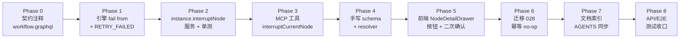
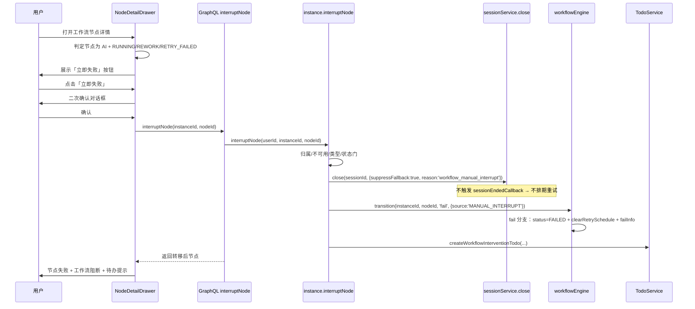

type: Permanent
---

# 工作流支持打断 - 实现计划

**功能名称**: 工作流支持打断
**关联 PRD**: [`docs/product/draft/20261116-workflow-interrupt.md`](../../product/draft/20261116-workflow-interrupt.md)
**关联提案**: [`docs/engineering/proposals/20261116-feat-workflow-interrupt.md`](../proposals/20261116-feat-workflow-interrupt.md)
**计划版本**: v1.0
**创建日期**: 2026-11-16
**作者**: ZeroAsh Agent
**需求总分支**: `feat/workflow-interrupt`
**feat-branch**: `feat/workflow-interrupt`
**需求总 PR**: https://github.com/Deliay/z-agent-gear/pull/534

## 1. 实施顺序

严格按「契约 → 引擎状态机 → instance 服务 → MCP 工具 → 手写 schema → 前端 → 迁移 → 文档索引 → API/E2E 收口」推进，每个切片先写失败测试再实现：



**关键路径**：Phase 2 是需求核心——`interruptNode` 服务串联「受控关闭 + fail 转移 + 待办」，必须先于 Phase 3（MCP 工具共用同一服务逻辑）和 Phase 5（前端调用 GraphQL mutation）完成。Phase 1 的 `fail from` 扩展是 `interruptNode` 能经引擎转移的前提，必须最早锁定。

**回归重灾区**：`engine.test.ts`（既有 `fail` from 为 `['RUNNING','REWORK']`，扩展后需补 `RETRY_FAILED` 来源测试且既有拒绝 `RETRY_FAILED` 的断言需改写）、`tool-handlers.test.ts`（工具总数 14→15 守卫）、`tests/api` 的 `workflow-interrupt-retry.test.ts`（`restartNode`/`resumeFailedNode` 接受 `RETRY_FAILED` 来源零回归）、`tests/e2e` 的 `workflow.spec.ts`（E2E-4 中断重试链路零回归）。

## 2. 代码事实核对（计划期确认）

以下事实基于需求总分支 `feat/workflow-interrupt`（HEAD `01411a7c`）实际代码：

| # | 事实 | 位置 | 对计划的影响 |
|---|------|------|--------------|
| F1 | 引擎 `fail` 转移 `from` 当前为 `['RUNNING','REWORK']`，`fail` 分支 `clearRetrySchedule` 保留 `retryCount` + `failInfo.source = payload.source ?? 'LLM_REPORTED'` | `servers/agent-api/src/services/workflow/engine.ts:147,371-384` | 扩展 `from` 加 `'RETRY_FAILED'` 即可支持人工打断重试用尽节点；`source` 透传已支持 `MANUAL_INTERRUPT`，无需改 `fail` 分支逻辑 |
| F2 | `TransitionPayload.source` 注释只列 `SESSION_STUCK/LLM_REPORTED/CONTROLLER_UNAVAILABLE`，无 `MANUAL_INTERRUPT` | `engine.ts:96` | 注释需补 `MANUAL_INTERRUPT`（仅注释，无逻辑影响） |
| F3 | `sessionService.close(id, userId, { suppressFallback?: boolean; reason?: string })` 已存在；`suppressFallback: true` 跳过 `sessionEndedCallback` | `servers/agent-api/src/services/session.ts:906-937` | `interruptNode` 直接复用 `close(suppressFallback:true, reason:'workflow_manual_interrupt')`，无需改 session 层 |
| F4 | `restartNode` 已用 `resolveInstanceUnavailableReason(instance, loadControllerStatus)` + 不可用门文案「工作流实例不可用（控制器离线或已删除），请先接续后再操作」 | `services/workflow/instance.ts:672-709` | `interruptNode` 复用同一不可用门与文案口径（提案 §3.2 步骤 3） |
| F5 | `actorFilter(userId)` 为归属校验口径；`restartNode` 用 `findOne({_id, ...actorFilter(userId), deletedAt: null}).lean()` | `instance.ts:679,117` | `interruptNode` 步骤 1 沿用同一读取口径 |
| F6 | `todoService.createWorkflowInterventionTodo({userId, instanceId, instanceName, nodeId, nodeName, sessionId, reason})` 已存在；`sessionId` 为 string；失败仅 warn 不阻断 | `services/todo-service.ts:138-158`、`interrupt-retry.ts:344-352` | `interruptNode` 直接复用；`sessionId` 取 `node.sessionId?.toString() ?? ''`（RETRY_FAILED 可能无 sessionId 时传空串，`resolveSessionTenantId` 空串降级无 tenantId） |
| F7 | `mapInstanceNode(node, instanceId?)` 已透出 `failInfo`（含 `source`）；`mapInstance` 为实例级映射 | `graphql/resolvers/workflow.ts:89-133,157-186` | `interruptNode` 返回 `mapInstanceNode` 即可透出 `failInfo.source=MANUAL_INTERRUPT`，resolver 无需新增字段映射 |
| F8 | `tool-handlers.ts` 的 `TOOL_DEFINITIONS` 当前 14 项（含 `renameCurrentWorkflow`）；`getWorkflowToolDefinitions()` 返回该数组；`handlePlatformMcpRequest` 的 `initialize` 返回 `capabilities:{tools:{}}` | `servers/agent-api/src/services/workflow/tool-handlers.ts:49-176,490-502` | 新增 `interruptCurrentNode` 定义 → 15 项；`initialize` 不变（prompts 不在此工具集）；`transition` 辅助函数当前类型限定 `'complete'|'reject'|'completeRework'|'fail'|'resumeFailed'`，需加 `'fail'` 已支持——实际 `interruptCurrentNode` 走 `workflowInstanceService.interruptNode` 而非直接 `workflowEngine.transition`（见 D3） |
| F9 | `loadScopeContext(scope)` 已做实例归属 + 节点存在校验，返回 `{instance, node}` | `tool-handlers.ts:183-216` | `interruptCurrentNode` 复用 `loadScopeContext` + 状态门 + 调用 `workflowInstanceService.interruptNode`，与 `failCurrentNode`/`resumeFailedNode` 同形态 |
| F10 | `contracts/workflow.graphql` 的 `WorkflowNodeFailInfo.source` 注释当前列 `SESSION_STUCK/LLM_REPORTED/SESSION_START_FAILED/RETRY_EXHAUSTED/CONTROLLER_UNAVAILABLE`；`Mutation` type 无 `interruptNode` | `contracts/workflow.graphql:199-206,494-539` | Phase 0 注释补 `MANUAL_INTERRUPT` + 新增 `interruptNode` mutation 定义 |
| F11 | 手写 schema `graphql/schemas/workflow.ts` 的 `WorkflowNodeFailInfo` source 注释同契约（无 `MANUAL_INTERRUPT`）；`extend type Mutation` 无 `interruptNode` | `graphql/schemas/workflow.ts:160-166,440-465` | 手写 schema 与契约双写（注释 + mutation） |
| F12 | `graphql/resolvers/workflow.ts` 的 `Mutation` 对象无 `interruptNode`；`wrap()` 包装服务层错误为 `GraphQLError`；`requireUser(context)` 取 userId | `graphql/resolvers/workflow.ts:258-444,188-193` | 新增 `interruptNode` resolver 调 `workflowInstanceService.interruptNode` + `mapInstanceNode` |
| F13 | 迁移编号 027 已被 `oidc-binding-optimization` 占用；`index.ts` 的 `runMigrations` 列表当前到 `migration027OidcBindingOptimization` | `src/index.ts:55-227` | 新迁移编号 028；`index.ts` 需 import + 登记 |
| F14 | 前端 `NodeDetailDrawer.tsx` 的 `NodeDetail` 组件已有 `canRestart` 门控（AI + RUNNING/REWORK/FAILED/RETRY_FAILED）与 `unavailable` 置灰；`failInfo` 展示在 `node.status === 'FAILED' || 'RETRY_FAILED'` 分支 | `apps/agent-web/src/components/workflow/NodeDetailDrawer.tsx:54-117` | 新增 `canInterrupt` 门控（AI + RUNNING/REWORK/RETRY_FAILED，不含 FAILED）+ 「立即失败」按钮 + 二次确认 + `failInfo.source` 文案映射；`failInfo` 展示分支需按 `source` 区分文案 |

## 3. 内部接口与数据模型

### 3.1 `workflowInstanceService.interruptNode`（新增）

```ts
async interruptNode(userId: string, instanceId: string, nodeId: string): Promise<WorkflowNodeDoc>
```

严格按序（与 `restartNode` 同口径，见 F4/F5）：

1. 读取：`WorkflowInstance.findOne({ _id: instanceId, ...actorFilter(userId), deletedAt: null }).lean()` → 不存在抛「工作流实例不存在或无权限」。
2. 类型门：`node.type === 'AI'`（HUMAN/FLAG 无 ACP 会话）→ 否则抛「节点不是 AI 节点会话，无法打断」。
3. 不可用门：`resolveInstanceUnavailableReason(instance, loadControllerStatus)` 非空 → 抛「工作流实例不可用（控制器离线或已删除），请先接续后再操作」。
4. 状态门：`node.status ∈ { RUNNING, REWORK, RETRY_FAILED }` → 否则抛「节点当前状态不允许立即打断」。
5. 受控关闭会话（`node.sessionId` 存在时）：`sessionService.close(sessionId, userId, { suppressFallback: true, reason: 'workflow_manual_interrupt' })`——**不触发 `sessionEndedCallback`、不排期重试**。会话已 ended/disconnected 时 `close` 幂等返回 false，继续。
6. 引擎 `fail` 转移：`workflowEngine.transition(instanceId, nodeId, 'fail', { source: 'MANUAL_INTERRUPT', reason: '人类主动打断：立即失败，绕过中断自动重试' })`。
7. 人工介入待办：`todoService.createWorkflowInterventionTodo({ userId, instanceId, instanceName: instance.name, nodeId, nodeName: node.name, sessionId: node.sessionId?.toString() ?? '', reason: '人类主动立即打断，节点已进入失败状态，请人工介入' })`——失败仅 warn，不阻断主流程。
8. 返回转移后节点（`mapInstanceNode`）。

### 3.2 `interruptCurrentNode` MCP 工具（节点作用域，新增）

经 `loadScopeContext(scope)`（实例归属 + 节点存在，见 F9）→ 状态门（`node.status ∈ {RUNNING,REWORK,RETRY_FAILED}`，否则 `INVALID_STATE`「节点当前状态不允许立即打断」）→ 调用 `workflowInstanceService.interruptNode(scope.userId, scope.instanceId, scope.nodeId)` → 返回 `{ nodeId, status }`。

**描述注明**：「仅在人类明确要求立即打断节点时调用。中断节点会话并让节点立即进入失败状态，绕过中断自动重试机制（不消耗 retryCount 预算、不排期重试）。仅允许 RUNNING/REWORK/RETRY_FAILED 的 AI 节点。」

### 3.3 数据模型

**无新增字段**。`failInfo.source` 为自由文本 `String`，新增值 `'MANUAL_INTERRUPT'` 无需迁移回填（见 F1 的 `fail` 分支已透传 `payload.source`）。

## 4. 核心时序



## 5. 变更清单

### 5.1 Phase 0：契约（先于代码）

| 文件 | 变更 |
|------|------|
| `contracts/workflow.graphql` | ① `WorkflowNodeFailInfo.source` 注释补 `MANUAL_INTERRUPT`（人类在工作流节点详情「立即失败」主动打断，绕过自动重试）；② `type Mutation` 新增 `interruptNode(instanceId: ID!, nodeId: ID!): WorkflowNode!` + 错误文案表注释（工作流实例不存在或无权限 / 工作流实例已删除 / 工作流实例不可用（控制器离线或已删除），请先接续后再操作 / 节点当前状态不允许立即打断 / 节点不是 AI 节点会话，无法打断） |

> 手写 schema `graphql/schemas/workflow.ts` 在 Phase 4 同步双写（F11）。

### 5.2 Phase 1：引擎状态机（改 `engine.ts`）

| 文件 | 变更 |
|------|------|
| `services/workflow/engine.ts` | ① `TRANSITIONS.fail.from` 由 `['RUNNING','REWORK']` 扩展为 `['RUNNING','REWORK','RETRY_FAILED']`（line 147）；② `TransitionPayload.source` 注释补 `MANUAL_INTERRUPT`（line 96） |
| `services/workflow/engine.test.ts` | T-ENG1~T-ENG3（先红后绿）：`fail` 允许 `RETRY_FAILED→FAILED` 透传 `source=MANUAL_INTERRUPT` 保留 `retryCount`；`fail` 仍拒绝 `DONE/READY/INITIALIZING`；既有 `T-ENG-C1b`（`fail` 拒绝 `DONE/READY`）零回归 |

TDD：先写 `fail` from `RETRY_FAILED` 测试（此时 `from` 不含 `RETRY_FAILED`，转移抛「不允许执行」→ 红）→ 改 `from` → 绿。

### 5.3 Phase 2：instance 服务（新增 `interruptNode`）

| 文件 | 变更 |
|------|------|
| `services/workflow/instance.ts` | `WorkflowInstanceService` class 新增 `async interruptNode(userId, instanceId, nodeId)` 方法（§3.1 八步严格序）；import `sessionService`（已 import，F3）、`todoService`（需新增 import）、`resolveInstanceUnavailableReason`/`loadControllerStatus`（已 import，F4）、`mapInstanceNode`（本文件已有） |
| `services/workflow/instance.test.ts` | T-INT1~T-INT8（先红后绿）：归属/不可用/类型/状态门各拒绝文案；受控关闭 `suppressFallback`（mock `sessionService.close` 断言 `suppressFallback:true` + `reason:'workflow_manual_interrupt'`）；`fail` 转移 `source=MANUAL_INTERRUPT`；待办创建；会话已 ended 幂等（`close` 返回 false 仍继续 fail）；并发 CAS（`KeyedMutex` 串行） |

TDD：先写 `interruptNode` 测试（方法不存在 → compile 红）→ 实现方法 → 绿。

### 5.4 Phase 3：MCP 工具（改 `tool-handlers.ts`）

| 文件 | 变更 |
|------|------|
| `services/workflow/tool-handlers.ts` | ① `TOOL_DEFINITIONS` 新增 `interruptCurrentNode` 定义（14→15，见 F8）；② `callWorkflowTool` switch 新增 `case 'interruptCurrentNode'`：`loadScopeContext` → 状态门 → `workflowInstanceService.interruptNode` → 返回 `{nodeId, status}`；③ `transition` 辅助函数类型不变（`interruptCurrentNode` 走 service 而非直接 `transition`，见 D3） |
| `services/workflow/tool-handlers.test.ts` | T-TH1~T-TH3（先红后绿）：工具定义守卫（15 项含 `interruptCurrentNode`）；`interruptCurrentNode` 节点作用域 + 状态门（非 RUNNING/REWORK/RETRY_FAILED → INVALID_STATE）；成功调用 `interruptNode` 返回 `{nodeId, status}`；未知工具拒绝（守卫 15 项列表） |

TDD：先写 `interruptCurrentNode` case 测试（`callWorkflowTool` 抛 `UNKNOWN_TOOL` → 红）→ 加定义 + case → 绿。

### 5.5 Phase 4：手写 schema + resolver（双写契约）

| 文件 | 变更 |
|------|------|
| `graphql/schemas/workflow.ts` | ① `WorkflowNodeFailInfo.source` 注释补 `MANUAL_INTERRUPT`（line 160-166）；② `extend type Mutation` 新增 `interruptNode(instanceId: ID!, nodeId: ID!): WorkflowNode!`（line 440-465） |
| `graphql/resolvers/workflow.ts` | `Mutation` 对象新增 `interruptNode` resolver：`requireUser(context)` → `wrap(async () => mapInstanceNode((await workflowInstanceService.interruptNode(userId, args.instanceId, args.nodeId)) as unknown as Doc))` |
| `graphql/resolvers/workflow.test.ts` | T-RES1：`interruptNode` resolver 委托 `interruptNode` + `mapInstanceNode`；错误文案逐字透传（`wrap()` 白名单） |

> 契约对齐测试：本仓库 `graphql/schemas/workflow.test.ts` 有契约逐字段对齐守卫，Phase 0 + Phase 4 双写后该测试自动验证。

### 5.6 Phase 5：前端 NodeDetailDrawer（改 `NodeDetailDrawer.tsx` + `graphql/workflow.ts`）

| 文件 | 变更 |
|------|------|
| `apps/agent-web/src/graphql/workflow.ts` | `WorkflowNodeFailInfoData.source` 注释补 `MANUAL_INTERRUPT`；新增 `INTERRUPT_NODE` mutation + `InterruptNodeResult` 类型 |
| `apps/agent-web/src/components/workflow/NodeDetailDrawer.tsx` | ① `NodeDetail` 组件新增 `canInterrupt` 门控：`node.type === 'AI' && node.status ∈ {RUNNING,REWORK,RETRY_FAILED}`（不含 FAILED）；② 操作按钮区新增「立即失败」按钮（`data-testid="interrupt-node"`，`disabled={unavailable}`，`title={unavailable ? '实例不可用，请先接续' : undefined}`）；③ `onInterruptNode?: (node) => void` prop（页面级回调，与 `onRestartNode` 同模式）；④ 二次确认对话框（复用 `Dialog` 组件，文案「确认立即打断？此操作会立即中断会话、让工作流进入失败状态且不再自动重试。」+ 确认/取消）；⑤ `failInfo` 展示分支按 `source` 区分文案：`MANUAL_INTERRUPT` →「已被人工立即打断」；`RETRY_EXHAUSTED` →「重试失败原因」；其余 → 既有「失败原因」 |
| `apps/agent-web/src/components/workflow/__tests__/NodeDetailDrawer.test.tsx` | T-WEB1~T-WEB4（先红后绿）：按钮门控（AI 节点 + RUNNING/REWORK/RETRY_FAILED 可见；非 AI 节点/不可打断状态/不可用置灰）；二次确认对话框（确认调用 `onInterruptNode`、取消不调用）；`failInfo.source` 文案映射（MANUAL_INTERRUPT / RETRY_EXHAUSTED / LLM_REPORTED）；`NodeDetailDrawer` prop 透传 `onInterruptNode` + `unavailable` |

TDD：先写 `canInterrupt` 门控 + 按钮渲染测试（按钮不存在 → 红）→ 加门控 + 按钮 → 绿。

### 5.7 Phase 6：迁移 028（新增，幂等 no-op）

| 文件 | 变更 |
|------|------|
| `servers/agent-api/src/migrations/028-workflow-interrupt.ts`（新增） | `export const name = '028-workflow-interrupt'`；`run()` 幂等 no-op（无数据模型变更，`failInfo.source` 为自由文本 String 无需回填）；仅登记编号占位确保迁移 runner 顺序一致 |
| `servers/agent-api/src/migrations/028-workflow-interrupt.test.ts`（新增） | T-MIG1：`run()` 幂等（重复调用不抛错、不改动数据） |
| `servers/agent-api/src/index.ts` | import `migration028WorkflowInterrupt` + 登记入 `runMigrations` 列表（line 55-227 区域，追加在 `migration027` 之后） |

### 5.8 Phase 7：文档索引

| 文件 | 变更 |
|------|------|
| `docs/engineering/AGENTS.md` | 「实现计划（`plan/`）」索引登记本文件 |
| `servers/agent-api/AGENTS.md` | 新增「工作流支持打断」小节：`interruptNode` 服务落点、`interruptCurrentNode` MCP 工具（14→15）、`failInfo.source=MANUAL_INTERRUPT` 口径、受控关闭 `suppressFallback` 绕过重试、前端入口门控 |
| `tests/api/AGENTS.md` | 追加「工作流支持打断 API」小节（T-WI-API1~3 与 fake controller relay 口径） |
| `tests/e2e/AGENTS.md` | 追加「工作流支持打断 E2E」小节（E2E-WI1） |

### 5.9 Phase 8：API/E2E 测试收口

| 文件 | 变更 |
|------|------|
| `tests/api/src/agent-api/workflow-interrupt.test.ts`（新增） | T-WI-API1~3（见 §6.3） |
| `tests/e2e/src/workflow-interrupt.spec.ts`（新增） | E2E-WI1（见 §6.4） |

## 6. TDD 测试矩阵

### 6.1 单元（agent-api，Vitest）

| 编号 | 文件 | 断言 |
|------|------|------|
| T-ENG1 | `services/workflow/engine.test.ts`（追加） | `fail` 允许 `RETRY_FAILED→FAILED`：`transition(inst,n,'fail',{source:'MANUAL_INTERRUPT',reason:'r'})` → `status=FAILED`、`failInfo.source='MANUAL_INTERRUPT'`、`retryCount` 保留、调度字段清 null |
| T-ENG2 | 同上 | `fail` 仍拒绝 `DONE/READY/INITIALIZING`（既有 `T-ENG-C1b` 扩展 `INITIALIZING`） |
| T-ENG3 | 同上 | `fail` from `RETRY_FAILED` 保留 `retryCount` + 清调度字段（同 `T-ENG7` 口径，起点为 `RETRY_FAILED`） |
| T-INT1 | `services/workflow/instance.test.ts`（新增） | 归属门：`findOne` 无匹配 → 「工作流实例不存在或无权限」 |
| T-INT2 | 同上 | 类型门：`node.type !== 'AI'` → 「节点不是 AI 节点会话，无法打断」 |
| T-INT3 | 同上 | 不可用门：`resolveInstanceUnavailableReason` 非空 → 「工作流实例不可用（控制器离线或已删除），请先接续后再操作」 |
| T-INT4 | 同上 | 状态门：`node.status ∈ {DONE,REJECT,FAILED,INITIALIZING,READY}` → 「节点当前状态不允许立即打断」 |
| T-INT5 | 同上 | 受控关闭：mock `sessionService.close` → `interruptNode` 调 `close(sessionId, userId, {suppressFallback:true, reason:'workflow_manual_interrupt'})`；`sessionId` null 时跳过 close |
| T-INT6 | 同上 | `fail` 转移 `source=MANUAL_INTERRUPT`：mock `workflowEngine.transition` → 断言 `event='fail'`、`payload.source='MANUAL_INTERRUPT'` |
| T-INT7 | 同上 | 待办创建：mock `todoService.createWorkflowInterventionTodo` → 断言调用参数含 `instanceId/nodeId/nodeName/sessionId/reason` |
| T-INT8 | 同上 | 会话已 ended 幂等：`sessionService.close` 返回 false → 仍执行 `fail` 转移 + 待办 |

### 6.2 单元（agent-api 续）+ 前端

| 编号 | 文件 | 断言 |
|------|------|------|
| T-TH1 | `services/workflow/tool-handlers.test.ts`（追加） | 工具定义守卫：`getWorkflowToolDefinitions()` 恰 15 项，含 `interruptCurrentNode`；`interruptCurrentNode` 有 `description` + `inputSchema` |
| T-TH2 | 同上 | `interruptCurrentNode` 节点作用域 + 状态门：`node.status=RUNNING` → 调 `interruptNode` 返回 `{nodeId,status}`；`node.status=DONE` → `INVALID_STATE`「节点当前状态不允许立即打断」；`node.type=HUMAN` → `interruptNode` 服务层抛「节点不是 AI 节点会话，无法打断」 |
| T-TH3 | 同上 | 未知工具拒绝：`callWorkflowTool(scope,'nope',{})` → `UNKNOWN_TOOL`（message 含 15 项列表） |
| T-MIG1 | `migrations/028-workflow-interrupt.test.ts`（新增） | `run()` 幂等：重复调用不抛错、`workflowinstances` 集合无改动 |
| T-RES1 | `graphql/resolvers/workflow.test.ts`（追加） | `interruptNode` resolver 委托 `workflowInstanceService.interruptNode` + `mapInstanceNode`；错误文案逐字透传（`wrap()` 白名单） |
| T-WEB1 | `apps/agent-web/src/components/workflow/__tests__/NodeDetailDrawer.test.tsx`（追加） | 按钮门控：`node.type=AI && status=RUNNING/REWORK/RETRY_FAILED` → 「立即失败」按钮可见；`status=FAILED`/非 AI 节点 → 不可见；`unavailable=true` → 按钮 `disabled` + `title="实例不可用，请先接续"` |
| T-WEB2 | 同上 | 二次确认对话框：点击「立即失败」→ 对话框出现（文案含「立即中断」「不再自动重试」）；确认 → 调 `onInterruptNode(node)`；取消 → 不调用 |
| T-WEB3 | 同上 | `failInfo.source` 文案映射：`MANUAL_INTERRUPT` →「已被人工立即打断」；`RETRY_EXHAUSTED` →「重试失败原因」；`LLM_REPORTED` →「失败原因」 |
| T-WEB4 | 同上 | `NodeDetailDrawer` prop 透传：`onInterruptNode` 回调 + `unavailable` 传入 `NodeDetail` |

### 6.3 API（tests/api，Vitest + Aspire 真实服务）

| 编号 | 文件 | 断言 |
|------|------|------|
| T-WI-API1 | `tests/api/src/agent-api/workflow-interrupt.test.ts`（新增） | `interruptNode` mutation 门控：非 AI 节点 →「节点不是 AI 节点会话，无法打断」；不可用实例 →「工作流实例不可用...」；不可打断状态 →「节点当前状态不允许立即打断」；不存在/无权限 →「工作流实例不存在或无权限」 |
| T-WI-API2 | 同上 | `interruptNode` 成功转移：AI 节点 RUNNING → `status=FAILED`、`failInfo.source=MANUAL_INTERRUPT`、`retryCount` 未递增、`nextRetryAt=null`；`workflow_intervention` 待办创建 |
| T-WI-API3 | 同上 | `restartNode` 接受 `RETRY_FAILED` 来源零回归（既有 `T-WFIR5` 不变）；`resumeFailedNode` 于 `RETRY_FAILED` → RUNNING 零回归（既有 `T-WFIR9` 不变） |

> 前置：`aspire start`（agent-api + controller-api）+ `INTERNAL_API_TOKEN` + `MONGODB_URI`（DB 断言 `failInfo`/`retryCount`/待办）；fake controller 应答 `acp:check`/`acp:start`/`acp:stop`。

### 6.4 E2E（tests/e2e，Playwright）

| 编号 | 文件 | 断言 |
|------|------|------|
| E2E-WI1 | `tests/e2e/src/workflow-interrupt.spec.ts`（新增） | 工作流节点详情 →「立即失败」→ 二次确认 → 节点 `FAILED` + `failInfo.source=MANUAL_INTERRUPT` + `retryCount` 未递增 + `nextRetryAt=null` + 工作流阻断 + 人工介入待办；`RETRY_FAILED` 节点打断同样转 `FAILED` |

> 前置：`aspire start`（agent-api + controller-api + agent-web）+ `INTERNAL_API_TOKEN` + `MONGODB_URI`；fake controller 应答 `acp:check`/`acp:start`/`acp:stop`。

### 6.5 回归清单（必须同批）

| 位置 | 关注 |
|------|------|
| `engine.test.ts` 既有 `T-ENG-C1b`（`fail` 拒绝 `DONE/READY`） | `from` 扩展后仍拒绝（`INITIALIZING` 也不在 from 中）零回归 |
| `engine.test.ts` 既有 `T-ENG7`（`fail` 保留 `retryCount`） | `fail` 分支逻辑不变零回归 |
| `tool-handlers.test.ts` 既有「提供全部 14 个工具」守卫 | 改写为 15 项（`T-TH1` 替换原断言） |
| `tests/api/src/agent-api/workflow-interrupt-retry.test.ts` 既有 `T-WFIR5/9` | `restartNode`/`resumeFailedNode` 接受 `RETRY_FAILED` 零回归 |
| `tests/e2e/src/workflow.spec.ts` 既有 `E2E-4A/4B/4C` | 中断自动重试链路零回归（人工打断是新增路径，不改变既有兜底） |
| `servers/agent-api` 全量单测 | `pnpm test` 全绿 |
| `apps/agent-web` 全量单测 | `pnpm test` 全绿 |

## 7. 计划期裁决

| 编号 | 裁决 | 理由 |
|------|------|------|
| D1 | 沿用 `FAILED` 状态，不新增 `INTERRUPTED` | PRD 要求「进入失败状态」；新增状态需同步 check-run/前端/恢复路径，成本高语义无增益；`failInfo.source=MANUAL_INTERRUPT` 已可区分来源（提案 D1） |
| D2 | `fail from` 扩展 `RETRY_FAILED` | 允许自动重试用尽节点经人工打断直接转 `FAILED`，与 `resumeFailed`/`restart` 的 `from` 对称（提案 D4） |
| D3 | `interruptCurrentNode` 走 `workflowInstanceService.interruptNode` 而非直接 `workflowEngine.transition` | `interruptNode` 封装「受控关闭 + fail 转移 + 待办」八步严格序，MCP 工具与 GraphQL mutation 共用同一服务逻辑，避免双实现漂移；`transition` 辅助函数类型不变 |
| D4 | `interruptNode` 返回 `mapInstanceNode`（非整实例） | 与 `restartNode`/`rejectNode` 同口径（返回转移后节点）；`failInfo` 经 `mapInstanceNode` 透出 `source` |
| D5 | `sessionId` 为 null 时跳过受控关闭，直接 fail | `sessionService.close` 需要 sessionId；无 sessionId 时无会话可中断，fail 转移本身即达成「立即失败」；`createWorkflowInterventionTodo` 的 `sessionId` 传空串（`resolveSessionTenantId` 空串降级无 tenantId，不阻断） |
| D6 | 前端 `canInterrupt` 状态集不含 `FAILED` | `FAILED` 节点已有「重启节点」入口（`canRestart` 含 `FAILED`），无需再打断——`FAILED` 已处于失败状态 |
| D7 | 二次确认复用 `Dialog` 组件 | `components/ui/dialog.tsx` 提供 `Dialog` 原语；`NodeDetailDrawer` 内用 `Dialog` 实现二次确认，文案对齐 PRD 功能点 2 |
| D8 | 前端 `onInterruptNode` 为页面级回调 prop | 与 `onRestartNode` 同模式，`NodeDetailDrawer` 不直接调 Apollo mutation；`WorkflowInstancePage` 负责 `INTERRUPT_NODE` mutation + refetch |
| D9 | 迁移 028 为幂等 no-op（不建索引） | `failInfo.source` 为自由文本 String，无需回填；人工打断低频，全量扫描可接受（提案 §4.2） |
| D10 | 契约注释 + 手写 schema 双写 | `graphql/schemas/workflow.test.ts` 有契约逐字段对齐守卫，漏改即红 |

## 8. 风险与回滚

| 风险 | 影响 | 缓解 |
|------|------|------|
| `fail from` 扩展 `RETRY_FAILED` 与兜底 `retryExhausted` 竞态 | `RETRY_FAILED` 节点同时被兜底 `resumeFailed` 与人工 `interruptNode` 命中 | `KeyedMutex` 串行化；`interruptNode` 先 `close(suppressFallback)` 再 `fail`，兜底 `resumeFailed` 前置过滤 `status∈{FAILED,RETRY_FAILED}` 不命中已 FAILED 节点 |
| `suppressFallback` 误传 false | 关闭触发 `sessionEndedCallback` → 排期重试 → 与 `fail` 转移竞态 | `interruptNode` 硬编码 `suppressFallback:true`（不依赖调用方传参）；`T-INT5` 断言该参数 |
| `failInfo.source` 自由文本前端文案漂移 | 新增 source 值未同步前端文案映射 | `T-WEB3` 文案映射守卫；`source` 值在契约注释 + 手写 schema + 前端三处单一来源 |
| 迁移 028 编号冲突 | 027 已被占用 | F13 确认 027 为 `oidc-binding-optimization`；028 为下一个可用编号 |
| 回滚 | — | 服务端回滚即恢复旧行为：`fail from` 回到 `['RUNNING','REWORK']`、`interruptNode` 方法删除、`interruptCurrentNode` 定义删除、前端按钮删除；纯新增 + 注释扩展，无数据迁移、无开关，回滚零残留 |

## 9. 命令参考

```bash
# 依赖（仓库已迁移 pnpm）
pnpm install

# agent-api 单测（先红后绿）
cd servers/agent-api && pnpm exec vitest run src/services/workflow/engine.test.ts
cd servers/agent-api && pnpm exec vitest run src/services/workflow/instance.test.ts
cd servers/agent-api && pnpm exec vitest run src/services/workflow/tool-handlers.test.ts
cd servers/agent-api && pnpm exec vitest run src/graphql/resolvers/workflow.test.ts
cd servers/agent-api && pnpm exec vitest run src/migrations/028-workflow-interrupt.test.ts
cd servers/agent-api && pnpm test
cd servers/agent-api && pnpm run build

# 前端单测
cd apps/agent-web && pnpm exec vitest run src/components/workflow/__tests__/NodeDetailDrawer.test.tsx
cd apps/agent-web && pnpm test

# 服务编排（API 测试前置）
aspire start
aspire wait agent-api controller-api

# API 集成（需 INTERNAL_API_TOKEN + MONGODB_URI）
cd tests/api && API_URL=http://localhost:10001/graphql \
  CONTROLLER_API_URL=http://localhost:35273 \
  INTERNAL_API_TOKEN=<token> MONGODB_URI=<uri> \
  pnpm exec vitest run src/agent-api/workflow-interrupt.test.ts

# E2E（需 INTERNAL_API_TOKEN + MONGODB_URI）
cd tests/e2e && BASE_URL=<agent-web-port> API_URL=http://localhost:10001/graphql \
  CONTROLLER_API_URL=http://localhost:35273 \
  INTERNAL_API_TOKEN=<token> MONGODB_URI=<uri> \
  pnpm exec playwright test workflow-interrupt.spec.ts
```

## 10. 验收 checklist

### 10.1 Phase 0~1（契约 + 引擎）

- [ ] `contracts/workflow.graphql` 的 `WorkflowNodeFailInfo.source` 注释含 `MANUAL_INTERRUPT` + `interruptNode` mutation + 错误文案表
- [ ] 手写 schema `graphql/schemas/workflow.ts` 同步双写（注释 + mutation）
- [ ] `engine.ts` `fail.from` 含 `RETRY_FAILED`；`TransitionPayload.source` 注释含 `MANUAL_INTERRUPT`
- [ ] T-ENG1~T-ENG3 全绿；`T-ENG-C1b` 零回归

### 10.2 Phase 2~3（instance 服务 + MCP 工具）

- [ ] `instance.ts` `interruptNode` 八步严格序实现；`todoService` import 新增
- [ ] T-INT1~T-INT8 全绿
- [ ] `tool-handlers.ts` `interruptCurrentNode` 定义 + case；工具总数 15
- [ ] T-TH1~T-TH3 全绿；既有 14 工具守卫改写为 15 零回归

### 10.3 Phase 4~5（resolver + 前端）

- [ ] `resolvers/workflow.ts` `interruptNode` resolver；`T-RES1` 全绿
- [ ] 前端 `INTERRUPT_NODE` mutation + `InterruptNodeResult` 类型
- [ ] `NodeDetailDrawer` `canInterrupt` 门控 + 「立即失败」按钮 + 二次确认 + `failInfo.source` 文案映射
- [ ] T-WEB1~T-WEB4 全绿

### 10.4 Phase 6~8（迁移 + 文档 + API/E2E）

- [ ] 迁移 028 幂等 no-op；`index.ts` import + 登记；`T-MIG1` 全绿
- [ ] `docs/engineering/AGENTS.md` + `servers/agent-api/AGENTS.md` + `tests/api/AGENTS.md` + `tests/e2e/AGENTS.md` 同步
- [ ] T-WI-API1~3 全绿（fake controller relay 全链路）
- [ ] E2E-WI1 全绿
- [ ] `servers/agent-api` + `apps/agent-web` 全量单测零回归

## 11. 相关文档

- [产品需求 v1.0](../../product/draft/20261116-workflow-interrupt.md)
- [技术提案 v1.0](../proposals/20261116-feat-workflow-interrupt.md)
- [工作流契约](../../../contracts/workflow.graphql)
- [agent-api AGENTS](../../../servers/agent-api/AGENTS.md)
- [测试规范（API）](../../../tests/api/AGENTS.md)
- [测试规范（E2E）](../../../tests/e2e/AGENTS.md)
- [需求来源：GitHub Issue #512](https://github.com/Deliay/z-agent-gear/issues/512)
- [需求总 PR #534](https://github.com/Deliay/z-agent-gear/pull/534)
