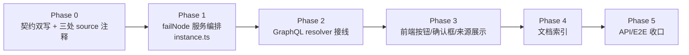
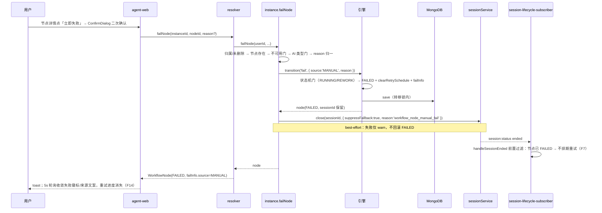

# 工作流节点「立即失败」 - 实现计划

**功能名称**: 工作流节点立即失败
**关联 PRD**: [`docs/product/draft/20261116-workflow-node-manual-fail.md`](../../product/draft/20261116-workflow-node-manual-fail.md)
**关联提案**: [`docs/engineering/proposals/20261116-feat-workflow-node-manual-fail.md`](../proposals/20261116-feat-workflow-node-manual-fail.md)
**计划版本**: v1.0
**创建日期**: 2026-11-16
**作者**: ZeroAsh Agent
**需求总分支**: `feat/workflow-node-manual-fail`
**feat-branch**: `feat/workflow-node-manual-fail`
**需求总 PR**: https://github.com/Deliay/z-agent-gear/pull/538

## 1. 实施顺序

严格按「契约双写 → 服务层 failNode → GraphQL 接线 → 前端 → 文档索引 → API/E2E 收口」推进，每个切片先写失败测试再实现（红-绿-重构）：



**关键路径**：Phase 1 是需求核心（门控矩阵 + 「先转移落库、后中断会话」顺序硬约束）。Phase 0 必须先于一切代码——手写 schema 漏改即运行时 `Cannot query field`（T-SCHEMA1 守卫）。

**回归重灾区**：`engine.test.ts`（fail 转移既有用例）、`instance.test.ts`（restartNode 门控同族断言）、`interrupt-retry.test.ts` / `interrupt-retry-scheduler.test.ts`（CAS 防护零改动锁定）、`tests/api/src/agent-api/workflow-interrupt-retry.test.ts`（T-WFIR1~9 全绿即锁定「立即失败」不破坏既有重试语义）。

## 2. 代码事实核对（计划期确认）

以下事实基于需求总分支 `feat/workflow-node-manual-fail`（HEAD `fc14b7d9`）实际代码：

| # | 事实 | 位置 | 对计划的影响 |
|---|------|------|--------------|
| F1 | 引擎 `fail` 转移已允许 `from: ['RUNNING', 'REWORK']`（接续需求 #513 已扩展 REWORK）；目标 `FAILED` | `servers/agent-api/src/services/workflow/engine.ts:147` | **转移表零改动**；「立即失败」只是 `fail` 的新调用方与新 `source` |
| F2 | 引擎 `fail` 分支：置 FAILED + `markLastNode` + `clearRetrySchedule`（清 `nextRetryAt/retryPhase/retryDeadlineAt/retryTrigger`，保留 `retryCount`）+ 写 `failInfo{reason: payload.reason ?? '', source: payload.source ?? 'LLM_REPORTED', at}`；**不触发会话 hook、不清 `sessionId`** | `engine.ts:371-384` | `MANUAL` 仅是新 `source` 取值，分支实现零改动；`sessionId` 保留使服务层能在转移后拿到会话并关闭（见 D3） |
| F3 | 引擎拒绝文案：`节点「<name>」当前状态为 <status>，不允许执行「标记失败」（fail）` | `engine.ts:273-275`、`EVENT_LABEL :162` | failNode 对非 RUNNING/REWORK 节点不做服务层预判，状态机拒绝文案原样冒泡（契约错误文案表登记） |
| F4 | `restartNode` 服务门控顺序：`actorFilter(userId)+deletedAt:null` → `工作流实例不存在或无权限`；节点缺失 → `工作流实例中不存在节点：<nodeId>`；不可用门 `resolveInstanceUnavailableReason(instance, loadControllerStatus)` → `工作流实例不可用（控制器离线或已删除），请先接续后再操作` | `services/workflow/instance.ts:673-709`、`unavailable.ts:21-41` | `failNode` 门控与文案逐字对齐（D7）；`unavailable.ts` 零改动直接复用 |
| F5 | `orchestrator.closeNodeSession` 的 reason 联合类型仅 `'workflow_node_rework' \| 'workflow_node_resume' \| 'workflow_node_restart'`；`restartNodeSession`/`endNodeSession` 均 `sessionService.close(sessionId, userId, { suppressFallback: true, reason })` | `services/workflow/orchestrator.ts:373-437` | close reason 语义族新增 `workflow_node_manual_fail`；落点裁决见 D1（不入 orchestrator） |
| F6 | `sessionService.close(sessionId, userId, opts?: { suppressFallback?: boolean; reason?: string })`；`suppressFallback:true` 时不触发兜底重试排期 | `services/session.ts:902-931` | 「立即失败」关会话必须带 `suppressFallback:true`，与重试管线/重启节点同口径 |
| F7 | `handleSessionEnded` 前置过滤：实例未删除 + 节点 `sessionId` 匹配 + `node.status === 'RUNNING'`；`handleSessionIdled` 要求 `RUNNING/REWORK` | `orchestrator.ts:553-568, 72-110` | 节点 FAILED 后，close 引发的 `ended` 与任何后续会话事件自然不命中过滤，**不会误排期重试**——「先转移后关会话」顺序成立的根基 |
| F8 | 模块依赖链：`orchestrator.ts:14` import `tool-handlers.ts`；`tool-handlers.ts:4` import `instance.ts`；`instance.ts:6` 已 import `sessionService` | 三文件 import 段 | instance.ts 若 import `workflowOrchestrator` 将成环（instance→orchestrator→tool-handlers→instance）；引擎注释亦明示「引擎不直接 import Orchestrator，避免循环依赖」——由此产生 D1/D2 裁决 |
| F9 | MCP `failCurrentNode`：`requireString` 仅校验非空，**无长度上限**；`transition(toolScope, 'fail', { reason, source: 'LLM_REPORTED' })` | `services/workflow/tool-handlers.ts:226-232, 371-373` | 提案「若无上限则新增 500 上限」落地：`failNode` 服务 trim + ≤500 截断并在契约注明（D4）；MCP 工具侧不动 |
| F10 | 契约 `Mutation.restartNode` 与 `WorkflowNodeFailInfo.source` 注释（5 来源，无 MANUAL）；手写 schema 同构；`schemas/workflow.test.ts` T-SCHEMA1 读取 `contracts/workflow.graphql` 逐字比对守卫双写 | `contracts/workflow.graphql:199-206, 516-518`、`graphql/schemas/workflow.ts:160-164, 452-454`、`graphql/schemas/workflow.test.ts:7-11` | Phase 0 两处同 PR 同改；守卫测试自动覆盖 |
| F11 | `failInfoSchema.source` 为自由 `String`（无枚举），注释列 5 来源 | `models/workflow-instance.ts:39-44` | 零 schema 变更、零迁移；仅注释补 `MANUAL`（三处注释之一） |
| F12 | 前端抽屉 `canRestart = AI && status∈{RUNNING,REWORK,FAILED,RETRY_FAILED}`；重启按钮 `disabled={unavailable}` + `title='实例不可用，请先接续'`；`onRestartNode` 由页面级注入（`unavailable ? undefined : setRestartTarget`） | `apps/agent-web/src/components/workflow/NodeDetailDrawer.tsx:42-97`、`pages/WorkflowInstancePage.tsx:391-413` | 「立即失败」按钮同源放置，可见性独立收窄为 `AI && RUNNING/REWORK`；`unavailable` 禁用口径照抄 |
| F13 | 抽屉失败信息块仅展示 `failInfo.reason`（FAILED 标题「失败原因」/RETRY_FAILED「重试失败原因」），**无来源展示**；`WorkflowNodeFailInfoData.source` 注释仅列 4 来源（缺 CONTROLLER_UNAVAILABLE） | `NodeDetailDrawer.tsx:113-117`、`apps/agent-web/src/graphql/workflow.ts:121-129` | PRD §3.4 要求「失败来源可区分」：新增 `failSourceText` 映射并在失败信息块补一行来源（D5），类型注释补齐 6 来源 |
| F14 | `retryProgressText(node)` 在 `nextRetryAt=null` 时返回 `null`（不展示） | `components/workflow/WorkflowNodeTreeConstants.ts:125-128`、测试 :81-95 | fail 转移清 `nextRetryAt` 后「下次重试时间」随 5s 轮询自然消失，前端零改动即满足 PRD 功能点 3 验收 |
| F15 | `RESTART_NODE` mutation 返回 `{ id status }`；详情页 `GET_WORKFLOW_INSTANCE` 5s 轮询；重启成功不额外 refetch | `apps/agent-web/src/graphql/workflow.ts:703-710`、`WorkflowInstancePage.tsx` 轮询 | `FAIL_WORKFLOW_NODE` 同形状 `{ id status failInfo { reason source at } }`，刷新依赖轮询（D6） |
| F16 | `components/ui/confirm-dialog.tsx` 既有；`wrap()` 将服务层 Error 原样包为 `GraphQLError(message)`；resolver 经 `mapInstanceNode` 映射节点 | `apps/agent-web/src/components/ui/confirm-dialog.tsx`、`resolvers/workflow.ts:196-203, 369-380` | 二次确认复用 ConfirmDialog；`failNode` resolver 与 `restartNode` 同构（requireUser → wrap → mapInstanceNode） |

## 3. 数据模型与状态机

### 3.1 `workflowinstances`（零变更、零迁移）

`failInfo.source` 自由字符串新增取值 `MANUAL`，仅三处注释登记（F10/F11）：

- `models/workflow-instance.ts` failInfoSchema source 注释；
- `contracts/workflow.graphql` `WorkflowNodeFailInfo.source` 注释；
- `graphql/schemas/workflow.ts` 手写 schema 注释。

行为字段零改动：`fail` 转移清调度字段、保留 `retryCount`（F2）。

### 3.2 引擎（零转移表改动）

`TRANSITIONS.fail = { from: ['RUNNING','REWORK'], to: 'FAILED' }`（F1）直接复用。仅注释补充：fail 分支「不触发会话 hook」说明追加「MANUAL（人工立即失败）来源由服务层在转移落库后中断会话」。

### 3.3 服务编排形状（`instance.ts` 新增）

```ts
/** 立即失败（仅 AI 节点，RUNNING/REWORK→FAILED）：先引擎转移落库，后中断会话（best-effort） */
async failNode(userId: string, instanceId: string, nodeId: string, reason?: string | null) {
  // 1~3：归属/未删除 → 节点存在 → 不可用门（文案与 restartNode 逐字一致，F4）
  // 4：node.type !== 'AI' → throw new Error('仅 AI 节点支持立即失败')
  // 5：reason 归一：trim；空 → '人工标记失败'；>500 截断（D4）
  // 6：workflowEngine.transition(instanceId, nodeId, 'fail', { reason, source: 'MANUAL' })
  //    —— 状态机门（非 RUNNING/REWORK 拒绝文案原样冒泡，F3）；落库后节点 FAILED、调度字段已清
  // 7：转移返回后：node.sessionId 非空 → sessionService.close(sessionId, userId,
  //    { suppressFallback: true, reason: 'workflow_node_manual_fail' })；
  //    任何异常仅 logger.warn，不回滚 FAILED（F7 保证 ended 事件不误排期）
  // 8：返回 node
}
```

## 4. 核心时序



## 5. 变更清单

### 5.1 Phase 0：契约与注释（先于代码，双写）

| 文件 | 变更 |
|------|------|
| `contracts/workflow.graphql` | ① `type Mutation` 追加 `failNode(instanceId: ID!, nodeId: ID!, reason: String): WorkflowNode!`（注释：仅 AI 节点 RUNNING/REWORK→FAILED；中断会话、取消全部中断自动重试、阻断工作流；`failInfo.source='MANUAL'`；reason 缺省「人工标记失败」、trim 后 ≤500 截断；错误文案表：`工作流实例不存在或无权限` / `工作流实例中不存在节点：<nodeId>` / `工作流实例不可用（控制器离线或已删除），请先接续后再操作` / `仅 AI 节点支持立即失败` / 引擎状态机拒绝文案原样冒泡）；② `WorkflowNodeFailInfo.source` 注释补 `MANUAL（人工「立即失败」）` |
| `servers/agent-api/src/graphql/schemas/workflow.ts` | 与契约逐字同步（mutation 字段 + source 注释）；T-SCHEMA1 守卫自动覆盖 |
| `servers/agent-api/src/models/workflow-instance.ts` | `failInfoSchema.source` 注释补 `MANUAL（人工「立即失败」）`（F11） |

### 5.2 Phase 1：failNode 服务编排（`services/workflow/instance.ts`）

| 文件 | 变更 |
|------|------|
| `services/workflow/instance.ts` | 新增 `failNode`（§3.3 形状；`sessionService` 为既有 import，F8）；close reason 常量 `'workflow_node_manual_fail'` 就近声明并注释登记入语义族（`workflow_node_restart` / `workflow_interruption_retry` / `workflow_node_rework` / `workflow_node_done` / `workspace_deleted`） |
| `services/workflow/engine.ts` | `fail` 分支注释补「MANUAL 来源由服务层在转移落库后中断会话」；`TransitionPayload.source` 注释（:96）来源列举补 `MANUAL=人工立即失败`。**不新增 `interruptSession` 载荷**（D2） |

### 5.3 Phase 2：GraphQL resolver 接线

| 文件 | 变更 |
|------|------|
| `servers/agent-api/src/graphql/resolvers/workflow.ts` | `Mutation.failNode`：`requireUser` → `wrap(() => workflowInstanceService.failNode(userId, args.instanceId, args.nodeId, args.reason))` → `mapInstanceNode`（与 `restartNode` 同构，F16） |

### 5.4 Phase 3：前端（`apps/agent-web`）

| 文件 | 变更 |
|------|------|
| `src/graphql/workflow.ts` | ① 新增 `FAIL_WORKFLOW_NODE` mutation（`failNode(instanceId:$instanceId, nodeId:$nodeId, reason:$reason) { id status failInfo { reason source at } }`，F15）；② `WorkflowNodeFailInfoData.source` 注释补齐 6 来源（补 `CONTROLLER_UNAVAILABLE` 与 `MANUAL`，F13） |
| `src/components/workflow/WorkflowNodeTreeConstants.ts` | 新增 `failSourceText(source)` 映射：`SESSION_STUCK→会话停滞` / `LLM_REPORTED→AI 主动标记` / `SESSION_START_FAILED→会话启动失败` / `RETRY_EXHAUSTED→中断重试用尽` / `CONTROLLER_UNAVAILABLE→控制器不可用` / `MANUAL→人工标记`；未知值原样返回（防御性，同仓发布无未知值） |
| `src/components/workflow/NodeDetailDrawer.tsx` | ① 「重启节点」旁新增 destructive 样式「立即失败」按钮：可见性 `node.type==='AI' && ['RUNNING','REWORK'].includes(node.status)`（与 canRestart 独立，F12）；`disabled={unavailable}` + `title='实例不可用，请先接续'`；② 点击打开 `ConfirmDialog`（文案说明：将中断节点会话、取消全部自动重试、节点置为失败并阻断工作流；确认按钮 destructive）；确认调 `FAIL_WORKFLOW_NODE`（不传 reason，走服务端缺省），成功 `toast.success('节点已标记失败')`、失败 `toast.error` 原样展示文案；不额外 refetch（5s 轮询收敛，F15）；③ 失败信息块补一行「失败来源：`failSourceText(node.failInfo.source)`」（F13/D5） |

### 5.5 Phase 4：文档索引

| 文件 | 变更 |
|------|------|
| `servers/agent-api/AGENTS.md` | 「工作流节点中断自动重试」小节追加：人工「立即失败」入口（failNode 门控与 restartNode 同口径、先转移后关会话、`workflow_node_manual_fail` close reason、`failInfo.source=MANUAL`、恢复路径与既有失败一致） |
| `apps/agent-web/AGENTS.md` | 工作流节点详情处追加：「立即失败」按钮可见性矩阵（仅 AI×RUNNING/REWORK）、ConfirmDialog 二次确认、失败来源展示与 `failSourceText` 映射 |
| `tests/api/AGENTS.md` | 追加「工作流节点立即失败 API」小节（T-MNF-API*） |
| `tests/e2e/AGENTS.md` | 追加 E2E-WMF* 条目 |
| `docs/engineering/AGENTS.md` | 「实现计划（plan/）」索引登记本文件（产出本计划时已登记） |

### 5.6 Phase 5：API/E2E 收口

见 §6.3；实现顺序按 Phase 逐切片 RED→GREEN。

## 6. TDD 测试矩阵

### 6.1 单元（agent-api，Vitest）

| 编号 | 文件 | 断言 |
|------|------|------|
| T-MNF1 | `services/workflow/engine.test.ts` | `fail` 携带 `source:'MANUAL'`：RUNNING→FAILED、`failInfo.source='MANUAL'`、调度字段清空、`retryCount` 保留、`sessionId` 保留（F2）；REWORK→FAILED 同样成立；既有 fail 用例零回归 |
| T-MNF2 | `services/workflow/instance.test.ts` | `failNode` 门控矩阵：非归属/不存在 → `工作流实例不存在或无权限`；nodeId 缺失 → `工作流实例中不存在节点：<id>`；控制器离线/缺失 → `工作流实例不可用（控制器离线或已删除），请先接续后再操作`；HUMAN/FLAG 节点 → `仅 AI 节点支持立即失败`；DONE/RETRY_FAILED/READY 节点 → 引擎拒绝文案冒泡（`不允许执行「标记失败」`） |
| T-MNF3 | 同上 | 成功路径顺序硬约束：`sessionService.close` 在 transition 落库**之后**调用（mock 调用次序断言），载荷 `{ suppressFallback:true, reason:'workflow_node_manual_fail' }`；返回节点 FAILED 且 `failInfo={ source:'MANUAL', reason:'人工标记失败' }`；`nextRetryAt/retryPhase` 清空 |
| T-MNF4 | 同上 | close 抛错（控制器暂不可达）→ 仅 `logger.warn`，failNode 不抛出、节点保持 FAILED（不回滚） |
| T-MNF5 | 同上 | 节点无 `sessionId`（启动失败场景）→ 跳过 close，其余行为不变 |
| T-MNF6 | 同上 | reason 归一：`undefined`/空白 → `人工标记失败`；前后空白 trim；600 字截断至 500 |
| T-MNF7 | `services/workflow/interrupt-retry-scheduler.test.ts`（或既有文件追加） | 回归：节点已排期（SCHEDULED + nextRetryAt 过去时刻）时 failNode → 调度器扫描 A 不再命中该节点（调度字段已清）；RECONNECTING + 占位中 failNode → 扫描 B 重排 CAS 不命中、管线发送前双校验放弃发送（复用既有桩，断言零 `addMessage`） |
| T-MNF-R1 | `graphql/resolvers/workflow.test.ts` | `failNode`：未认证 → `Not authenticated`；服务层文案经 `wrap()` 原样透传；返回值经 `mapInstanceNode` 含 `failInfo.source` |

### 6.2 前端（Vitest + RTL）

| 编号 | 文件 | 断言 |
|------|------|------|
| T-MNF-W1 | `components/workflow/__tests__/NodeDetailDrawer.test.tsx` | 按钮可见性矩阵：AI×RUNNING / AI×REWORK 可见；AI×READY/DONE/REJECT/FAILED/RETRY_FAILED 不可见；HUMAN/FLAG 任意状态不可见；`unavailable=true` 时禁用且 tooltip「实例不可用，请先接续」 |
| T-MNF-W2 | 同上 | 交互：点击「立即失败」→ ConfirmDialog 出现且文案含「中断会话/取消全部自动重试/阻断工作流」；「取消」→ 不发 mutation；「确认」→ 以 `{instanceId, nodeId}` 调 `FAIL_WORKFLOW_NODE`（不带 reason）；成功 toast；mutation 报错 → toast 原样展示且节点状态不经本地伪造 |
| T-MNF-W3 | 同上 / `WorkflowNodeTreeConstants.test.ts` | `failSourceText` 六来源映射（含 `MANUAL→人工标记`、未知值原样）；FAILED 节点失败信息块展示「失败来源：人工标记」；RETRY_FAILED 既有两行（原因+来源）展示不回归 |

### 6.3 API / E2E

| 编号 | 文件 | 断言 |
|------|------|------|
| T-MNF-API1 | `tests/api/src/agent-api/workflow-manual-fail.test.ts`（新增；fake controller + `MONGODB_URI` 直写，复用 workflow-interrupt-retry 套件基建） | 全链路：实例化（fake controller 在线 + 应答 `acp:check`/`acp:start`）→ 节点 RUNNING 持会话 → `failNode` → 节点 FAILED、`failInfo.source='MANUAL'`、reason 缺省「人工标记失败」、重试字段清空；fake controller 收到会话 stop/close；直读 DB 复核 |
| T-MNF-API2 | 同上 | 拒绝矩阵经 GraphQL 逐字透出：他人实例 → `工作流实例不存在或无权限`；HUMAN 节点 → `仅 AI 节点支持立即失败`；DONE 节点 → `节点「<name>」当前状态为 DONE，不允许执行「标记失败」（fail）`；控制器离线（直写 DB）→ 不可用文案 |
| T-MNF-API3 | 同上 | 重试短路：直写 DB 预置节点 `retryPhase='SCHEDULED'` + `nextRetryAt` 过去时刻 + `retryCount=3` → `failNode` → 等待 >1 个扫描周期（30s 级，可直写推进/轮询 DB 断言）无 `acp:resume`/`acp:message` 发出、`retryCount` 保持 3、节点保持 FAILED |
| E2E-WMF1 | `tests/e2e/src/workflow-manual-fail.spec.ts`（新增；fake controller 应答 `acp:check`/`acp:start`/`acp:stop`，实例准备走 GraphQL setup，口径同 workflow.spec.ts） | 详情抽屉点「立即失败」→ 确认 → 节点徽标 FAILED + 失败信息「失败来源：人工标记」+ 重试进度消失；fake controller 收到 stop；下游节点保持等待；「重启节点」仍可恢复执行 |
| E2E-WMF2 | 同上 | 取消分支：打开确认框后取消，节点保持 RUNNING 且 zero mutation；DONE/HUMAN 节点抽屉无「立即失败」按钮 |

### 6.4 回归清单（必须同批）

| 位置 | 关注 |
|------|------|
| `engine.test.ts` / `instance.test.ts` / `orchestrator.test.ts` | fail/restart/rework 既有用例全绿（引擎零转移表改动、instance 纯新增方法） |
| `interrupt-retry.test.ts` / `interrupt-retry-scheduler.test.ts` | 中断重试 CAS 防护零改动，既有用例全绿 |
| `tests/api/src/agent-api/workflow-interrupt-retry.test.ts`（T-WFIR1~9）、`workflow-continuation.test.ts`、`workflow-session-behavior.test.ts` | 中断重试/接续/会话行为既有套件零回归 |
| `apps/agent-web` 既有 workflow 组件测试（NodeDetailDrawer/WorkflowNodeTree/WorkflowInstancePage） | 新增按钮对既有状态快照零影响（不可见即无渲染差异） |
| `graphql/schemas/workflow.test.ts` T-SCHEMA1 | 契约双写一致 |

## 7. 计划期裁决

| 编号 | 裁决 | 理由 |
|------|------|------|
| D1 | 会话中断落点在 `instance.ts` 的 `failNode` 内直接调 `sessionService.close`（既有 import），**不新增** `orchestrator.interruptFailedNodeSession`，instance.ts 不引入 `workflowOrchestrator` | F8：`orchestrator → tool-handlers → instance` 依赖链已存在，反向 import 成环；提案核心设计「先引擎转移落库、后中断会话」与 best-effort 语义完全保留，仅落点移到服务层（与提案决策 6.1 行 1「服务层转移返回后关会话」一致） |
| D2 | **不新增** `TransitionPayload.interruptSession` 载荷 | 该载荷在提案中「仅作标记透传」且无引擎内消费方；服务层自身即触发方、无需引擎知情。引擎零改动（仅注释），缩小回归面 |
| D3 | failNode 后**保留** `node.sessionId`（不重置） | F2：fail 分支本就不清 sessionId；与 SESSION_STUCK/RETRY_EXHAUSTED 失败节点一致，详情「打开会话」只读回看可用；会话已 ended，恢复走既有 restart（新会话）/ resumeFailed（用户先在会话页 resume 再发消息）路径 |
| D4 | `reason` 服务端归一：trim → 空取缺省「人工标记失败」→ >500 截断；契约注明上限 | F9：MCP `failCurrentNode` 的 `requireString` 无上限，提案授权「若无上限则新增 500 上限并在契约注明」；仅约束本次新增的 GraphQL 入口，MCP 口径不动 |
| D5 | 前端失败信息块新增「失败来源」行 + `failSourceText` 六来源映射（补齐 CONTROLLER_UNAVAILABLE 注释欠账） | F13：现状仅展示 reason，无法满足 PRD §3.4「失败来源可区分」验收；展示行对全部来源生效（不只 MANUAL），一并补齐历史来源的可读性 |
| D6 | `FAIL_WORKFLOW_NODE` 返回 `{id status failInfo{reason source at}}`、成功不额外 refetch | F15：与 `RESTART_NODE` 同口径依赖 5s 轮询收敛；选择集多带 failInfo 仅为 toast 外的一致性兜底，不新增刷新通道 |
| D7 | 门控顺序与文案逐字对齐 `restartNode`（归属/未删除 → 节点存在 → 不可用门 → AI 类型门 → 引擎状态机门） | F4：同族操作同一权限口径（PRD 4.2）；引擎状态机门放最后，确认瞬间并发流转由引擎拒绝文案冒泡（PRD 3.5） |
| D8 | 不新增人工介入待办、不新增 MCP 工具 | 提案范围锁定：操作者即人工本人（与 LLM_REPORTED 同口径）；AI 自判失败已有 `failCurrentNode` |

## 8. 风险与回滚

| 风险 | 影响 | 缓解 |
|------|------|------|
| 先关会话后转移的顺序被未来改动反转 | ended 事件在转移落库前到达 → 误排期一次重试 | T-MNF3  mock 调用次序断言锁死顺序；`handleSessionEnded` 前置过滤（F7）为第二道防线 |
| close 时控制器不可达 | 会话在控制器侧残留至断连超时收敛 | 既有 close 尽力而为语义；节点 FAILED 已是事实源，调度字段已清不会重试；T-MNF4 锁定仅告警不回滚 |
| 确认瞬间节点恰好完成/被并发流转 | 用户看到状态机拒绝文案 | D7 文案冒泡 + toast 原样展示（PRD 3.5 明示该口径）；5s 轮询收敛真实状态 |
| 旧前端不识别 `source=MANUAL` | 来源行展示原始串 | `failSourceText` 未知值原样返回（防御性）；同仓一次性发布无该窗口 |
| 「立即失败」按钮误触 | 节点被阻断 | ConfirmDialog 二次确认 + destructive 样式（PRD 功能点 1）；恢复路径既有（重启/指示后恢复） |
| 回滚 | — | 服务端回滚即恢复旧行为：契约字段为增量（旧前端忽略 mutation 即无入口）；历史 `failInfo.source='MANUAL'` 记录仅作展示，无需数据回滚 |

## 9. 命令参考

```bash
# 依赖（仓库已迁移 pnpm）
pnpm install

# agent-api 单测 / 构建
cd servers/agent-api && pnpm test
cd servers/agent-api && pnpm exec vitest run src/services/workflow/instance.test.ts
cd servers/agent-api && pnpm run build

# agent-web 单测 / 构建
cd apps/agent-web && pnpm test
cd apps/agent-web && pnpm exec vitest run src/components/workflow/__tests__/NodeDetailDrawer.test.tsx
cd apps/agent-web && pnpm run build

# 服务编排（API/E2E 前置）
aspire start
aspire wait agent-api controller-api agent-web

# API 集成（需 MONGODB_URI / INTERNAL_API_TOKEN / REDIS_URL）
cd tests/api && pnpm exec vitest run src/agent-api/workflow-manual-fail.test.ts

# E2E
cd tests/e2e && pnpm exec playwright test src/workflow-manual-fail.spec.ts
```

## 10. 验收 checklist

### 10.1 Phase 0（契约/注释）

- [ ] `contracts/workflow.graphql` 与手写 schema 双写一致（`failNode` + source 注释），T-SCHEMA1 绿
- [ ] `failInfo.source` 注释三处同步含 `MANUAL`（模型/契约/手写 schema）
- [ ] 契约注明错误文案表与 reason ≤500 口径

### 10.2 Phase 1~2（服务/接线）

- [ ] `failNode` 门控矩阵逐字命中（归属/节点存在/不可用/AI 门/状态机冒泡）
- [ ] 先转移落库、后关会话的顺序由测试锁定；close 失败仅告警不回滚
- [ ] 无 sessionId 安全跳过；reason 归一（缺省/trim/截断）
- [ ] SCHEDULED / RECONNECTING 状态下 failNode 后不再发生任何自动重试（T-MNF7）

### 10.3 Phase 3（前端）

- [ ] 按钮可见性矩阵与 unavailable 禁用符合 PRD 功能点 1
- [ ] 二次确认文案含三项后果；取消零副作用、确认后才发 mutation
- [ ] 失败信息块展示「失败来源：人工标记」，六来源映射齐备；重试进度随失败收敛消失

### 10.4 Phase 5（测试与回归）

- [ ] 单测矩阵 T-MNF1~7 / T-MNF-R1 / T-MNF-W1~3 全绿；新增分支 100% 覆盖
- [ ] `tests/api` T-MNF-API1~3 全绿；workflow 既有套件（含 T-WFIR1~9）零回归
- [ ] E2E-WMF1~2 通过
- [ ] `servers/agent-api/AGENTS.md`、`apps/agent-web/AGENTS.md`、`tests/api/AGENTS.md`、`tests/e2e/AGENTS.md` 已同步

## 11. 相关文档

- [产品需求 v1.0](../../product/draft/20261116-workflow-node-manual-fail.md)
- [技术提案 v1.0](../proposals/20261116-feat-workflow-node-manual-fail.md)
- [中断自动重试实现计划（CAS 防护复用来源）](./20261103-feat-workflow-node-interrupt-retry.md)
- [工作流接续实现计划（不可用门同源）](./20261114-feat-workflow-instance-continuation.md)
- [工作流契约](../../../contracts/workflow.graphql)
- [agent-api AGENTS](../../../servers/agent-api/AGENTS.md)
- [agent-web AGENTS](../../../apps/agent-web/AGENTS.md)
- [需求总 PR #538](https://github.com/Deliay/z-agent-gear/pull/538)
