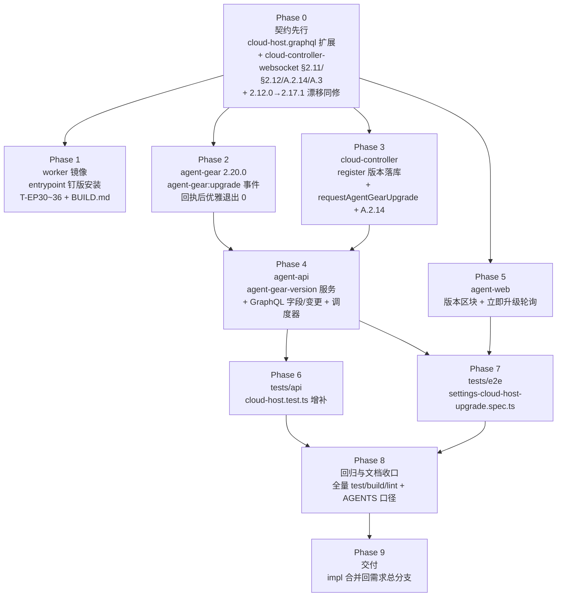

# 云电脑控制器包升级优化 - 实现计划

**功能名称**: 云电脑控制器包升级优化
**关联 PRD**: [`docs/product/draft/20261117-cloud-agent-gear-upgrade-optimization.md`](../../product/draft/20261117-cloud-agent-gear-upgrade-optimization.md)（v1.0）
**关联提案**: [`docs/engineering/proposals/20261117-feat-cloud-agent-gear-upgrade-optimization.md`](../proposals/20261117-feat-cloud-agent-gear-upgrade-optimization.md)（v1.0）
**计划版本**: v1.0
**创建日期**: 2026-11-17
**作者**: z-agent-bot
**需求总分支**: `feat/cloud-agent-gear-upgrade-optimization`
**feat-branch**: `feat/cloud-agent-gear-upgrade-optimization-impl`（开发分支，基于需求总分支切出；实现完成后合并回需求总分支，随 PR #552 收口）
**需求总 PR**: https://github.com/Deliay/z-agent-gear/pull/552
**需求来源**: [GitHub Issue Deliay/z-agent-gear#551](https://github.com/Deliay/z-agent-gear/issues/551)

**版本说明**：

- v1.0 首版：把提案 §5.2 的 8 个实现点拆成 9 个 Phase（契约 → worker 镜像 → agent-gear → cloud-controller → agent-api → agent-web → API 收口 → E2E 收口 → 回归/交付）；给出「代码事实核对」20 条、「计划期裁决」14 条，收敛提案留白（entrypoint 用例编号顺延、契约 2.12.0 漂移同修、回执 flush 后再停机、在飞互斥落点、E2E 范围、env 不落 AppHost 等）。
- 契约变更为纯新增（类型/字段/事件/端点/注释），存量字段零改动；MongoDB **零迁移**（`cloudcontainers.agentGearVersion` 复制新增、不建索引、不回填）。

## 1. 实施顺序

严格按「契约 → worker 镜像 / agent-gear / cloud-controller → agent-api → agent-web → API 收口 → E2E 收口」推进，每个切片先写失败测试再实现（红-绿-重构）：



**关键路径**：Phase 3 的升级事件链路（gateway 在飞互斥 + 回执等待）与 Phase 1 的钉版安装是全需求的语义本体；Phase 0 契约锁定后 **Phase 1 / 2 / 3 / 5 可并行**（按 z-coding 流程各用一个 subagent 实现，各自从 `feat/cloud-agent-gear-upgrade-optimization-impl` 切工作分支、PR 回 impl，D1）。

**依赖说明**：

- **P3 → P2**：cloud-controller 的 `MIN_UPGRADE_WORKER_VERSION='2.20.0'` 与 agent-gear 包版本防漂移断言（D13）读 `packages/agent-controller/package.json`，P2 版本落定后 P3 断言才绿；可同批开发、联调在 P2 落地后收口。
- **P4 依赖 P0/P3**：agent-api 客户端方法按 A.2.14 契约错误码表实现；联调在 P3 落地后收口。
- **P5 依赖 P0**：前端 GraphQL 文档与手写类型以契约 SDL 为准；组件联调在 P4 落地后收口（P6/P7 同理）。
- **P1 独立**：worker 镜像与 stub 测试不依赖任何服务代码，仅依赖 D2/D9/D10 的测试裁决。

### 关键约束（实现期不得回退）

- **安装通道唯一**：容器内 agent-gear 安装恒由 entrypoint 经 `$RUN_DIR/update.lock.d` 互斥链路执行；agent-gear 收到升级事件只回执并优雅退出（退出码 0），**绝不自安装**（提案 D2）。
- **精确钉版**：两条安装路径一律 `pnpm info agent-gear --json` 解析精确最新版后 `pnpm add -g agent-gear@<精确版本>`，禁止再出现 `@latest` 安装（`@latest` 会被 pnpm `minimumReleaseAge` 年龄门回退）。
- **版本门禁先于副作用**：cloud-controller `register` 版本门禁拒绝路径保持零副作用（F4）；`agentGearVersion` 落库位于门禁通过之后，写失败仅 WARN 不阻断注册。
- **错误收敛**：GraphQL 走既有白名单逐字透传（六条新文案见契约），未命中 `internal error`；A.2.14 错误码表与契约逐字一致。
- **销毁优先**：升级进行中收到停止/销毁指令时，entrypoint `shutdown` 语义不变（先落 `$RUN_DIR/shutdown`，绝不升级/重启/重连）。
- **禁止 rebase/squash**：遵循 z-git 规范，仅允许 merge；禁止直推 `main`。

## 2. 代码事实核对（计划期确认）

以下事实基于需求总分支 `feat/cloud-agent-gear-upgrade-optimization`（HEAD `54f17aa7`）实际代码：

| # | 事实 | 位置 | 对计划的影响 |
|---|------|------|--------------|
| F1 | entrypoint 两条安装路径：`update_agent_gear`（启动/每轮）以 `pnpm add -g agent-gear@latest` 安装；`auto_update_loop`（周期）先 `pnpm view agent-gear version` 检查、后 `pnpm add -g agent-gear@latest` 安装、装后校验 `installed==latest` 才 TERM；互斥锁 `acquire/release_update_lock`；`normalize_version` 归一 | `deploy/images/worker/entrypoint.sh:239-264`（:253 安装）、`:307-393`（:333 检查、:355 安装、:374-381 校验、:382-391 TERM）、`:269-291`、`:294-302` | 统一改「`pnpm info agent-gear --json` → Node 单行解析 `.version` → 钉版安装」（Phase 1）；锁/校验/TERM/日志锚点全部沿用 |
| F2 | entrypoint 测试编号 **T-EP28/T-EP29 已被占用**（提案 T-EP28~T-EP34 顺延）；pnpm stub 分支：`view agent-gear version` / `add -g agent-gear`（`STUB_PNPM_ADD_NOOP` 模拟年龄门）；node stub 由 `write_fake_nvm` 生成仅 `echo "v24"`；计数 helper grep `'add -g agent-gear'` 与 `'view agent-gear version'` | `deploy/images/worker/entrypoint.test.sh:849`（T-EP28）、`:874`（T-EP29）、`:75-109`（stub）、`:180-187`（node stub）、`:15-29`（helper） | 新用例编号 **T-EP30~T-EP36**（D2）；stub 新增 `info` 分支与 `node -e` 委派（D9）；既有 T-EP21~T-EP29 迁移到 `info` 分支（D10） |
| F3 | `cloudcontainers` schema 无 `agentGearVersion`；`agentGearMinVersion` 在 :111-112，最后字段 `storageArchiveSkipped` :172 | `servers/cloud-controller/src/models/cloud-container.ts:85-174` | 复制新增 `agentGearVersion`（`String, default null`，无索引无回填，零迁移）（Phase 3） |
| F4 | gateway `register`：版本门禁（:351-379）先于全部注册副作用；`workerVersions.set(containerId, payload.version)` 位于 :406-408（门禁通过后）；`registered` emit :419；`getWorkerVersion` 句柄 :221-222 经 :517 返回；disconnect 时 `workerVersions.delete` :497 | `servers/cloud-controller/src/services/socketio-gateway.ts:328-449` | `agentGearVersion` 落库点与 `workerVersions.set` 同位（`findOneAndUpdate` 刷新，失败仅 WARN）；升级回执监听与在飞互斥同文件实现（D7） |
| F5 | `worker-version.ts`：`MIN_WORKER_VERSION='2.2.0'` :12、`MIN_HARNESS_WORKER_VERSION='2.17.1'` :20、`parseWorkerVersion` :82-100、`isSupportedWorkerVersion` :113-130、`sanitizeVersionForLog` :174-179 | `servers/cloud-controller/src/services/worker-version.ts` | 新增 `MIN_UPGRADE_WORKER_VERSION='2.20.0'` 常量（不 env 化）与防漂移断言（D13） |
| F6 | internal-api：`toCloudContainerJson` :117-177（A.3 序列化唯一出口）；`InternalRouterDeps` :201-217（`getWorkerVersion?` :214）；错误形态先例 404 `NOT_FOUND` / 409 `CONTAINER_NOT_ONLINE` / 409 `CONTAINER_BUSY`（:793/:812/:816）；`createInternalRouter` :619 | `servers/cloud-controller/src/routes/internal-api.ts` | A.3 增 `agentGearVersion` 字段；新增 dep `requestAgentGearUpgrade`；A.2.14 端点按五码表实现（Phase 3） |
| F7 | index.ts gatewayBridge 三句柄（`emitToContainer`/`isConnected`/`getWorkerVersion`）:326-334，gateway 注册后回填 :371-373；`createInternalRouter` 注入 :375-385 | `servers/cloud-controller/src/index.ts` | bridge 与 deps 各追加 `requestAgentGearUpgrade` 一处（Phase 3） |
| F8 | agent-api 只读镜像 `models/cloud-container.ts`：`strict: false`（:44），字段与 cloud-controller 写方同步演进（注释口径） | `servers/agent-api/src/models/cloud-container.ts` | 同步 `agentGearVersion` 只读字段（Phase 4） |
| F9 | cloud-host-service：`mapCloudHost` :1062-1084（`containerId` 透出 :1071）；`CLOUD_HOST_PUBLIC_ERRORS` :1088-1116（含 `'Cloud host not found'`/`'cloud host is not running'`）；`toCloudHostGraphQLError` :1134-1144（白名单命中逐字、未命中 `internal error`） | `servers/agent-api/src/services/cloud-host-service.ts` | 白名单追加三条（`container is not online` / `agent-gear upgrade is not supported by the current version` / `agent-gear upgrade already in progress`）；`upgradeCloudHostAgentGear` 编排落本服务（Phase 4） |
| F10 | resolvers/cloud-host.ts：`requireUser` :44-49；`CloudHost` 类型级 resolver 组 :365-384（`workloadInstalling` 经 `CloudContainer.findOne` 先例 :373-383）；`Mutation` 组 :191-364 | `servers/agent-api/src/graphql/resolvers/cloud-host.ts` | `CloudHost.agentGearVersion` 字段级 resolver 与 `Mutation.upgradeCloudHostAgentGear` 均加入既有对象（**无需新登记**） |
| F11 | 双登记现状：`cloudHostTypeDefs` 在 `schemas/index.ts:28`；`cloudHostResolvers.Query/Mutation/Controller/CloudHost` 在 `resolvers/index.ts:39/60/95/98` spread | `servers/agent-api/src/graphql/{schemas,resolvers}/index.ts` | 本需求零新增登记点（扩展既有 typeDefs 串与 resolver 对象） |
| F12 | 契约↔手写 schema 双写守卫先例：`schemas/knowledge-base.test.ts` 以 `graphql` `parse`/`print` 逐字段比对（`COMPARED_DEFINITIONS` 名单）；cloud-host 目前**无** schema 测试文件 | `servers/agent-api/src/graphql/schemas/knowledge-base.test.ts:1-60` | 新增 `schemas/cloud-host.test.ts` 同模式守卫（D11） |
| F13 | `cloud-controller-client`：`requestWithError` :263-302 把非 2xx 映射为 `CloudControllerRequestError(status, code)`（:62-71）；单例导出 :474 | `servers/agent-api/src/services/cloud-controller-client.ts` | 新增 `upgradeAgentGear(containerId, {targetVersion?})` 复用 `requestWithError`，服务层按 code 表映射白名单（Phase 4） |
| F14 | agent-api config：`toPositiveInt`（如 :53 `cloudStorageReconcileMs`、:67 `cloudHostSetupStaleMs`）与 `process.env.X || default` 形态；`getRedisClient`（ioredis 单例）在 `middleware/redis.ts:6-8`；调度器登记于 `index.ts` listen 回调（:320-326，`scheduleCloudStorageReconcile` 先例，timer unref） | `servers/agent-api/src/config/index.ts`、`src/middleware/redis.ts`、`src/index.ts` | 三个新 env 落 config（D12 允许 0 的自定义解析）；版本调度器同位登记（Phase 4） |
| F15 | agent-gear：`CONTROLLER_VERSION` 自 `package.json` 读取（socketio-client.ts:34）；`ShutdownPayload` :165-167 仅 `reason`；`notifyShutdown` :528-532 委托 `options.onShutdown`；supervisor `shutdown(reason, code?)` :236-257 支持显式退出码；`resolveShutdownExitCode` 三分（0/42/1） | `packages/agent-controller/src/socketio-client.ts`、`src/cloud-host/supervisor.ts`、`src/exit-codes.ts` | `ShutdownPayload` 扩展可选 `exitCode`（D6）；升级事件回执后 `notifyShutdown({reason:'agent-gear upgrade', exitCode:0})`（D5） |
| F16 | agent-web：`CLOUD_HOST_FIELDS` fragment（queries.ts:265-290）为 `GET_CONTROLLERS`/`CLOUD_HOST`/`MY_CLOUD_HOSTS` 共用唯一选择集；`CLOUD_HOST` 查询 :339-346；`CloudHostData`（types.ts:274-301）；`CloudHostPanel`（ControllerConfigPage.tsx:46-131，storage 区块 :102-123 为新增区块形态参考）；`mutations.ts` 云电脑变更集中（如 `STOP_CLOUD_HOST` :495） | `apps/agent-web/src/{graphql,pages}` | 版本区块落 `CloudHostPanel`；选择集只改 `CLOUD_HOST_FIELDS` 一处；新 mutation 落 mutations.ts；手写类型同步（Phase 5） |
| F17 | **契约漂移**：`cloud-controller-websocket.md` §2.2（:64/:72）、§3.4（:331-338）、A.2.2（:410 JSON 示例、:444）仍为 `2.12.0`；代码 `MIN_HARNESS_WORKER_VERSION='2.17.1'`（F5）与 agent-api `CLOUD_HOST_AGENT_GEAR_MIN_VERSION='2.17.1'`（servers/agent-api/AGENTS.md:117）早已提升 | `contracts/cloud-controller-websocket.md` | Phase 0 同修六处漂移为 2.17.1（D3），与新增章节同批审阅 |
| F18 | tests/api 约束：合法 worker 一次性 token 外部不可得（`worker-handshake.test.ts:6-9`；`billing-events.test.ts:75` 以 Mongo 直写替代回连）；Mongo/Redis 直写夹具先例（`MONGODB_URI`；`REDIS_URL` + `NODE_EXTRA_CA_CERTS`/自签证书模式，见 tests/api/AGENTS.md 环境变量表） | `tests/api/src/cloud-controller/`、`tests/api/AGENTS.md` | A.2.14 happy path（真实 socket）归 servers/cloud-controller 集成测试；tests/api 做 GraphQL 字段查询与 mutation 错误映射（D8） |
| F19 | tests/e2e `helpers.registerController`（:346+）fake 的是 controller-api 标准连接，**非** cloud-controller worker；env 表无 `REDIS_URL` | `tests/e2e/src/helpers.ts`、`tests/e2e/AGENTS.md` | E2E 版本数据经 `MONGODB_URI`（cloudcontainers）+ 新增 `REDIS_URL`（agent-gear:latest-version）直写；升级按钮只验到错误提示路径（D8） |
| F20 | AppHost.cs 无 `AGENT_GEAR_*` env；既有代码默认值配置（如 `CLOUD_STORAGE_RECONCILE_MS`）不进 AppHost/compose；`deploy/k8s/` 无 agent-api manifest（仅 cloud-controller.yaml / otel-collector.yaml） | `aspire/AgentGear.AppHost/AppHost.cs`、`aspire/manifest/docker-compose.yaml`、`deploy/k8s/` | 三个新 env 仅代码默认值，零编排改动（D4，修正提案 §9.2 措辞） |

## 3. 计划期裁决（提案留白 / 含混处的实现口径）

| 编号 | 裁决 | 理由 |
|------|------|------|
| D1 | 开发分支 `feat/cloud-agent-gear-upgrade-optimization-impl` 基于需求总分支切出；worker 镜像线（P1）、agent-gear 线（P2）、cloud-controller 线（P3）、agent-api 线（P4）、前端线（P5）各自从 impl 切工作分支、PR 回 impl；impl 全绿后合并回 `feat/cloud-agent-gear-upgrade-optimization` 随 PR #552 收口 | 沿用 `feat/knowledge-base-repo-built-in(-impl)` 等双分支先例；z-git 仅 merge |
| D2 | entrypoint 新用例编号 **T-EP30~T-EP36**（提案 T-EP28~T-EP34 顺延两个号段） | F2：T-EP28/T-EP29 已被云存储自举后续与年龄门用例占用 |
| D3 | 契约 `cloud-controller-websocket.md` 的 2.12.0→2.17.1 漂移（§2.2 两处、§3.4 四处、A.2.2 两处）随 Phase 0 同修 | F17；本次恰好在同文件新增 §2.11/§2.12/A.2.14/§3.4 常量，漂移同修避免读者按过期门禁理解新端点的版本口径 |
| D4 | agent-api 三个新 env（`AGENT_GEAR_REGISTRY_URL` / `AGENT_GEAR_VERSION_REFRESH_INTERVAL_MS` / `AGENT_GEAR_AUTO_UPDATE_INTERVAL_MINUTES`）**仅代码默认值**，不改 AppHost.cs / docker-compose.yaml / deploy/k8s；内网部署经 env 覆盖 | F20：既有代码默认值配置（如 `CLOUD_STORAGE_RECONCILE_MS`）均不落编排；默认值与 Issue/提案一致（registry.npmjs.org / 600000 / 10），落编排反而产生双源漂移 |
| D5 | agent-gear 升级回执 `agent-gear:upgrade:result {accepted:true}` emit 后**延迟 ~100ms 再优雅停机**（保证 ack  flush 出 socket 缓冲），随后 `notifyShutdown({reason:'agent-gear upgrade', exitCode:0})` | socket.emit 后立刻 disconnect 双连接可能丢回执，服务端会误判 10s 超时（`UPGRADE_NOT_ACCEPTED`）而用户侧已重启 |
| D6 | `ShutdownPayload` 扩展可选 `exitCode?: number`；supervisor 透传 `shutdown(\`worker shutdown: ${payload.reason}\`, payload.exitCode)`；本地（非云电脑）模式该事件不会到达（controller-api 从不下发），死路径按既有形态 `process.exit(0)`；**不新增退出码常量**（复用「信号退出 0」语义） | F15；提案「复用 EXIT_SERVER_SHUTDOWN 之外的既有信号退出 0 语义」的最小改动面 |
| D7 | A.2.14 的在飞互斥与回执等待收敛在 **socketio-gateway** 新句柄 `requestAgentGearUpgrade(containerId, {targetVersion?})`：进程内 `Map<containerId, deadline>`（60s 在飞窗）+ `Map<containerId, {resolve, timer}>` 待回执（10s 超时）；连接处理器注册 `agent-gear:upgrade:result` 监听解析待回执；disconnect 清理两份 Map；internal-api 路由只做门禁与错误码薄映射 | F4/F6/F7：socket 与 `workerVersions` 均由 gateway 持有，路由层不直接触达 socket；单实例部署前提与既有 KeyedMutex/调度器一致 |
| D8 | E2E 范围收敛：版本区块三态展示、按钮可见性、周期小字、点击后错误提示（`container is not online`）路径；**happy path 全链路不在 E2E**（归 servers/cloud-controller 集成测试与 tests/api 错误映射） | F18/F19：外部拿不到合法 worker 一次性 token，E2E 无法让容器真实 online；错误路径已覆盖「按钮 → mutation → cloud-controller 门禁 → 提示」全 wiring |
| D9 | entrypoint 测试：`node` stub 在 `write_fake_nvm` 夹具中识别首参 `-e` 时 `exec` 真实 node（`setup_env` 记录 `REAL_NODE="$(command -v node)"`，PATH 覆盖前取定）；pnpm stub 新增 `info agent-gear --json` 分支——默认输出 `{"version":<latest>}`（`<latest>` 复用 `STUB_PNPM_LATEST_VERSION`/`registry_latest`），`STUB_PNPM_INFO_MODE=fail/invalid-json/missing-version` 驱动失败形态 | F2：生产解析经 `run_as_worker node -e`（不引 jq，与入口零依赖风格一致），测试环境 stub node 仅 `echo v24` 必须委派否则解析恒失败 |
| D10 | 既有 T-EP21~T-EP29 迁移到 `info --json` 检查路径：stub `view` 分支保留（无害），`count_agent_gear_checks` 改为 grep `'info agent-gear --json'`；语义断言（安装/TERM/重试/销毁）逐字保留 | F1：检查命令由 `pnpm view agent-gear version` 换成 `pnpm info agent-gear --json` 后，旧计数点恒 0 会造成假绿 |
| D11 | 新增 `servers/agent-api/src/graphql/schemas/cloud-host.test.ts` 双写守卫：`COMPARED_DEFINITIONS` 含 `CloudHostAgentGearVersion` / `CloudHostAgentGearUpgradeResult` / `CloudHost` / `Query` / `Mutation`，`parse`/`print` 逐字段比对契约 | F12 先例；cloud-host 此前无双写守卫，本需求恰是建立时机 |
| D12 | `AGENT_GEAR_VERSION_REFRESH_INTERVAL_MS` 解析允许 `0`（= 关闭定时刷新，仍可经查询路径 single-flight 触发单次抓取）：config 新增非负整数小解析器（`toPositiveInt` 不接受 0）；非法值回退 600000 并 WARN | 提案 §3.1.3 明确 `0` 语义；`toPositiveInt` 形态（F14）不支持 0 |
| D13 | agent-gear 版本 `2.19.0 → 2.20.0`（MINOR）；cloud-controller `MIN_UPGRADE_WORKER_VERSION='2.20.0'` 与防漂移断言（`worker-version.test.ts` 读 `packages/agent-controller/package.json` 字面量比对，注释标注来源） | 提案 D6/实现点 8；跨包不可 import，对齐 T-AP4/T-AP5 字面量守卫先例 |
| D14 | 前端升级轮询：mutation 成功后以 `CLOUD_HOST` 查询（queries.ts:339）`fetchPolicy:'network-only'` 每 2s 手动 refetch，直至 `currentVersion === latestVersion`（toast「工作组件已升级到 {version}」）或 3 分钟超时（toast 提示可重试/等待自动升级）；组件卸载清理定时器不残留 | F16；`CLOUD_HOST` 复用 `CLOUD_HOST_FIELDS`，选择集单点扩展即可 |

## 4. 变更清单

### 4.1 Phase 0：契约（先于代码）

| 文件 | 变更 |
|------|------|
| `contracts/cloud-host.graphql` | 头部注释追加「工作组件版本与立即升级」口径段；新增 `CloudHostAgentGearVersion { currentVersion latestVersion upgradeAvailable autoUpdateIntervalMinutes }`（逐字段注释：currentVersion=worker register 上报落库值、latestVersion=agent-api 每 10 分钟刷新、upgradeAvailable=两者均在且不一致、autoUpdateIntervalMinutes 默认 10）；`CloudHost` 追加 `agentGearVersion: CloudHostAgentGearVersion!`；新增 `CloudHostAgentGearUpgradeResult { accepted: Boolean! }`；`extend type Mutation` 追加 `upgradeCloudHostAgentGear(controllerId: ID!): CloudHostAgentGearUpgradeResult!`（注释含「版本不一致且 RUNNING 时可用；触发后云电脑短暂断连并以新版本恢复在线」）；错误白名单表六条（`Not authenticated` / `Cloud host not found` / `cloud host is not running` / `container is not online` / `agent-gear upgrade is not supported by the current version` / `agent-gear upgrade already in progress`） |
| `contracts/cloud-controller-websocket.md` | §2.1 事件总览表追加两行（`agent-gear:upgrade` / `agent-gear:upgrade:result`）；§2.10 之后新增 **§2.11**（Server→Worker：payload `{targetVersion?}` 字段表 + 客户端行为——回执后优雅退出 0 委托保活钉版重启；正在退出回执 `{accepted:false, reason:'shutting_down'}`；旧 worker 静默忽略）与 **§2.12**（Worker→Server：`{accepted, currentVersion?, reason?}` 字段表）；§3.4 追加 `MIN_UPGRADE_WORKER_VERSION='2.20.0'` 常量条（仅用于升级事件门禁，不影响 register 既有门禁）；附录 **A.2.14** `POST /internal/containers/:id/upgrade-agent-gear`（Bearer、online+活跃 socket、版本 ≥2.20.0、60s 在飞窗、emit 后 10s 等回执；200 `{accepted, containerId, currentVersion}`；错误码表 404 `NOT_FOUND` / 409 `CONTAINER_NOT_ONLINE` / 400 `UPGRADE_UNSUPPORTED` / 409 `UPGRADE_IN_PROGRESS` / 409 `UPGRADE_NOT_ACCEPTED`）；A.3 追加 `agentGearVersion` 行（`string \| null`，register 成功刷新，未注册过为 null）；**漂移同修（D3）**：§2.2 :64/:72、§3.4 :331-338、A.2.2 :410（JSON 示例 `"agentGearMinVersion": "2.17.1"`）/:444 的 `2.12.0` 全部改 `2.17.1` |

验收：两处契约均为纯新增/注释/漂移修正；与提案 §3.1.1/§3.1.2 逐字一致；章节编号落点 §2.11/§2.12/A.2.14 不与现存冲突（现存最大 §2.10 / A.2.13）。

### 4.2 Phase 1：worker 镜像（TDD：先补 stub 与新用例见红，再改 entrypoint 转绿）

| 文件 | 变更 |
|------|------|
| `deploy/images/worker/entrypoint.sh` | 新增 `resolve_latest_version()`：`run_as_worker "$PNPM_CMD" info agent-gear --json` → `run_as_worker node -e '<stdin 解析 .version 校验非空串>'` → `normalize_version` 归一；任一步失败返回非零。`update_agent_gear`：resolve 失败仅 WARN 继续保活（现状容忍口径），成功则 `pnpm add -g "agent-gear@$latest"`。`auto_update_loop`：检查命令由 `pnpm view agent-gear version` 改 `resolve_latest_version`；安装改钉版；装后校验/TERM/`agent.pid`/销毁优先/日志锚点全部沿用（钉版后正常路径恒 `installed == latest`，校验转为防御兜底）。文件头部「周期自升级口径」注释段（:30-41）同步改写为「`pnpm info --json` 解析精确最新版 + 钉版安装绕开 minimumReleaseAge」 |
| `deploy/images/worker/entrypoint.test.sh` | ① pnpm stub 新增 `info agent-gear --json` 分支（D9）；② `write_fake_nvm` node stub 委派 `-e`（D9）；③ `count_agent_gear_checks` 改 grep `'info agent-gear --json'`（D10）；④ 既有 T-EP21~T-EP29 预期迁移（D10；`STUB_PNPM_ADD_NOOP` 语义保留为钉版后版本未变的防御兜底）；⑤ 新增 T-EP30~T-EP36（§5.1） |
| `deploy/images/worker/BUILD.md` | 「启动与保活」段（:474-500）与「周期自升级自验」段（:533 起）的安装口径改写为「`pnpm info --json` 解析精确最新版 + 钉版安装」；自验清单（:519）补 T-EP30~T-EP36 条目；删除「`pnpm add -g agent-gear@latest`」旧表述 |

验收：`bash -n deploy/images/worker/entrypoint.sh` 通过；`entrypoint.test.sh` 全量通过（新用例全绿 + 既有用例零回归）。

### 4.3 Phase 2：agent-gear 2.20.0（TDD）

| 文件 | 变更 |
|------|------|
| `packages/agent-controller/package.json` | `version`: `2.19.0` → `2.20.0`（MINOR） |
| `packages/agent-controller/src/socketio-client.ts` | `ShutdownPayload` 追加 `exitCode?: number`（D6）；注册 `socket.on('agent-gear:upgrade', handler)`：幂等守卫（已接受升级/`shutdownStarted` → 回执 `{accepted:false, reason:'shutting_down'}`）→ 置位守卫 → emit `agent-gear:upgrade:result { accepted:true, currentVersion: CONTROLLER_VERSION }` → ~100ms 后（D5）云电脑模式 `notifyShutdown({ reason:'agent-gear upgrade', exitCode:0 })` / 本地模式 `process.exit(0)`（死路径）；日志 `agent_gear_upgrade` 仅含 `targetVersion/currentVersion/accepted`（无凭据） |
| `packages/agent-controller/src/cloud-host/supervisor.ts` | worker 连接 `onShutdown` 透传 `payload.exitCode`（D6；无 exitCode 时行为逐字不变） |
| `packages/agent-controller/src/socketio-client.test.ts`（或新增 `agent-gear-upgrade.test.ts`） | T-AGU1~T-AGU5（§5.1；真实 socket.io 服务端对，对齐既有 socketio-client 测试形态） |
| `packages/agent-controller/AGENTS.md` | 版本段（:60-68）追加「`agent-gear:upgrade` 升级事件自 2.20.0 起」；新增「云电脑升级事件（2.20.0）」小节（事件对、回执后优雅退出 0 委托保活钉版重启、不自安装、本地模式零变化） |

验收：`pnpm run test`（T-AGU 全绿）+ `pnpm run build` 通过；既有事件族（register/shutdown/workload/scan）零回归。

### 4.4 Phase 3：cloud-controller（TDD）

| 文件 | 变更 |
|------|------|
| `servers/cloud-controller/src/models/cloud-container.ts` | 追加 `agentGearVersion: { type: String, default: null }`（F3；零迁移、无索引、历史行 null 容忍，注释口径同 A.3） |
| `servers/cloud-controller/src/services/worker-version.ts` | 新增 `MIN_UPGRADE_WORKER_VERSION = '2.20.0'`（代码常量，不 env 化；注释「`agent-gear:upgrade` 升级事件自 2.20.0 起提供」） |
| `servers/cloud-controller/src/services/socketio-gateway.ts` | ① register 持久化：`workerVersions.set` 同位（F4）`CloudContainer.findOneAndUpdate({_id:containerId}, {$set:{agentGearVersion: payload.version}})`，失败仅 WARN 不阻断注册（拒绝路径保持零副作用）；② `WorkerGatewayHandle` 追加 `requestAgentGearUpgrade(containerId, payload): Promise<UpgradeRequestResult>`（D7）：`activeSockets` 无活跃 → `{code:'NOT_ONLINE'}`；在飞窗（60s `Map`）→ `{code:'IN_PROGRESS'}`；emit `agent-gear:upgrade`（`withTraceMeta`）→ 挂一次性回执监听 + 10s 定时器；`accepted:true` → `{code:'ACCEPTED', currentVersion}`，`accepted:false`/超时 → `{code:'NOT_ACCEPTED'}`；disconnect 清理在飞与待回执（F4 :477-497 同区） |
| `servers/cloud-controller/src/routes/internal-api.ts` | `InternalRouterDeps` 追加 `requestAgentGearUpgrade?`；`toCloudContainerJson` 与 `CloudContainerJson` 追加 `agentGearVersion`（F6）；新增 `router.post('/containers/:id/upgrade-agent-gear')`：`getById` 缺失 → 404 `NOT_FOUND`；`status!=='online'` 或 dep 报 `NOT_ONLINE` → 409 `CONTAINER_NOT_ONLINE`；`getWorkerVersion` 缺失或 `isSupportedWorkerVersion(v, MIN_UPGRADE_WORKER_VERSION)` 不过 → 400 `UPGRADE_UNSUPPORTED`；`IN_PROGRESS` → 409 `UPGRADE_IN_PROGRESS`；`NOT_ACCEPTED` → 409 `UPGRADE_NOT_ACCEPTED`；`ACCEPTED` → 200 `{accepted:true, containerId, currentVersion}` |
| `servers/cloud-controller/src/index.ts` | bridge 与 `createInternalRouter` deps 各追加 `requestAgentGearUpgrade` 一处（F7） |
| 配套测试 | `socketio-gateway.test.ts` 追加 T-UPG-G1~G6；`internal-api.test.ts` 追加 T-UPG-I1~I7；`worker-version.test.ts` 追加 T-UPG-V1~V2（含 D13 防漂移断言） |

验收：`pnpm run test` + `pnpm run build` 通过；register 既有门禁/初始化/重连零回归。

### 4.5 Phase 4：agent-api（TDD）

| 文件 | 变更 |
|------|------|
| `servers/agent-api/src/config/index.ts` | 追加 `agentGearRegistryUrl`（`process.env.AGENT_GEAR_REGISTRY_URL \|\| 'https://registry.npmjs.org/agent-gear'`，去尾斜杠）、`agentGearVersionRefreshIntervalMs`（D12 非负解析，默认 600000）、`agentGearAutoUpdateIntervalMinutes`（`toPositiveInt`，默认 10） |
| `servers/agent-api/src/services/agent-gear-version.ts`（新增） | `getLatestAgentGearVersion(): Promise<string \| null>`（读 Redis `agent-gear:latest-version` JSON；miss → 进程内 single-flight 抓取回写；失败 → `null`）；`fetchLatestAgentGearVersion()`（全局 `fetch` + `AbortController` 10s；2xx 且 JSON 含字符串 `dist-tags.latest`；版本校验：非空、≤64、去控制字符，非法按抓取失败）；`startAgentGearVersionRefresh()`（启动即抓一次 + `setInterval` unref；`0` 关闭定时刷新仅启动一次；刷新失败保留旧值并 WARN；Redis 读写异常降级 WARN） |
| `servers/agent-api/src/services/agent-gear-version.test.ts`（新增） | T-AGV1~T-AGV8（§5.1；fetch/Redis 以既有测试形态 stub） |
| `servers/agent-api/src/services/cloud-controller-client.ts` | 新增 `upgradeAgentGear(containerId: string, input?: { targetVersion?: string }): Promise<{ accepted: boolean; currentVersion?: string }>`（`requestWithError`，F13；10s 超时可复用默认 30s——沿用默认即可） |
| `servers/agent-api/src/models/cloud-container.ts` | 只读镜像追加 `agentGearVersion` 字段（F8；注释「与 cloud-controller 同步演进」） |
| `servers/agent-api/src/services/cloud-host-service.ts` | ① `getAgentGearVersionInfo(host: Doc)`：`CloudContainer.findOne({_id: host.containerId})` 读 `agentGearVersion`（查询失败 → `currentVersion=null` 降级 WARN）；`getLatestAgentGearVersion()`（缺失 → `latestVersion=null`）；`upgradeAvailable` 两者非空且不等；`autoUpdateIntervalMinutes` 取 config。② `upgradeCloudHostAgentGear(controllerId, userId)`：认证 → `Controller.findOne({_id: controllerId, ...actorFilter(userId)})` 归属（空 → `Cloud host not found`）→ `CloudHost` 存在且未软删 → `status==='RUNNING'`（否则 `cloud host is not running`）→ `containerId` 解析 → `cloudControllerClient.upgradeAgentGear` → `CloudControllerRequestError` 按码映射（`NOT_FOUND`→`Cloud host not found`、`CONTAINER_NOT_ONLINE`/`UPGRADE_NOT_ACCEPTED`→`container is not online`、`UPGRADE_UNSUPPORTED`→`agent-gear upgrade is not supported by the current version`、`UPGRADE_IN_PROGRESS`→`agent-gear upgrade already in progress`）→ 返回 `{ accepted: true }`。③ `CLOUD_HOST_PUBLIC_ERRORS` 追加三条（F9） |
| `servers/agent-api/src/graphql/schemas/cloud-host.ts` | 追加 §4.1 的两个新类型、`CloudHost.agentGearVersion` 字段与 mutation（与契约逐字段双写） |
| `servers/agent-api/src/graphql/schemas/cloud-host.test.ts`（新增） | D11 双写守卫（`COMPARED_DEFINITIONS` 五名） |
| `servers/agent-api/src/graphql/resolvers/cloud-host.ts` | `CloudHost` 组追加 `agentGearVersion`（委托 service，单字段失败降级不拖垮查询）；`Mutation` 组追加 `upgradeCloudHostAgentGear`（`requireUser` → service → `toCloudHostGraphQLError`，F10） |
| `servers/agent-api/src/index.ts` | listen 回调登记 `startAgentGearVersionRefresh()`（F14 同位，timer unref 不阻塞退出） |
| 配套测试 | `services/cloud-host-service.test.ts` 追加 T-UPG-S1~S6；`services/cloud-controller-client.test.ts` 追加升级方法用例；`graphql/resolvers/cloud-host.test.ts` 追加 T-UPG-R1~R4；`schemas/cloud-host.test.ts`（D11） |

验收：`pnpm run test` + `pnpm run build` 通过；手写 schema 与契约逐字段一致；既有 cloud-host 查询/变更零回归。

### 4.6 Phase 5：agent-web（纯函数先行，组件后随；各环节先红后绿）

| 文件 | 变更 |
|------|------|
| `apps/agent-web/src/graphql/queries.ts` | `CLOUD_HOST_FIELDS` 追加 `agentGearVersion { currentVersion latestVersion upgradeAvailable autoUpdateIntervalMinutes }`（F16 单点扩展） |
| `apps/agent-web/src/graphql/mutations.ts` | 新增 `UPGRADE_CLOUD_HOST_AGENT_GEAR`（`mutation UpgradeCloudHostAgentGear($controllerId: ID!) { upgradeCloudHostAgentGear(controllerId: $controllerId) { accepted } }`） |
| `apps/agent-web/src/graphql/types.ts` | 新增 `CloudHostAgentGearVersionData`；`CloudHostData` 追加可选 `agentGearVersion` |
| `apps/agent-web/src/lib/cloud-host-agent-gear.ts`（新增） | 契约六条错误文案 → 中文提示映射（未命中原样展示）；`isAgentGearUpgradeAvailable(host)`（`upgradeAvailable && status==='RUNNING' && !deletedAt`） |
| `apps/agent-web/src/lib/__tests__/cloud-host-agent-gear.test.ts`（新增） | T-UPG-W-L1~L2 |
| `apps/agent-web/src/pages/ControllerConfigPage.tsx` | `CloudHostPanel` 增加「工作组件」区块（`data-testid="cloud-host-agent-gear-version"`，形态对齐 storage 区块 :102-123）：`当前版本 {currentVersion ?? '—'}` / `最新版本 {latestVersion ?? '—'}`；`isAgentGearUpgradeAvailable` 时渲染「立即升级」按钮（mutation 后进入升级中态：按钮禁用 + spinner，D14 轮询收敛 toast 或 3 分钟超时 toast）；小字 `自动升级每 {autoUpdateIntervalMinutes} 分钟检查一次`（`text-xs text-muted-foreground`）；错误 toast 经 lib 映射 |
| `apps/agent-web/src/pages/__tests__/ControllerConfigPage.test.tsx` | 追加 T-UPG-W1~W6（§5.1） |

验收：`pnpm run test` + `pnpm run build` + `pnpm run lint` 通过（0 error）；云电脑面板既有渲染零回归。

### 4.7 Phase 6：API 收口（`tests/api/src/agent-api/cloud-host.test.ts` 增补）

- 新增 T-UPG-API1~T-UPG-API6（§5.2）：`MONGODB_URI` 直写 `cloudcontainers.agentGearVersion`、`REDIS_URL` 直写 `agent-gear:latest-version`（F18 模式）；mutation 走真实 Aspire agent-api → cloud-controller（容器非 online → `container is not online` 等错误映射全链路）。
- 前置同 cloud-host 套件：`aspire start && aspire wait agent-api controller-api cloud-controller` + `INTERNAL_API_TOKEN` + `HARNESS_ENABLED=true`。

### 4.8 Phase 7：E2E 收口（`tests/e2e/src/settings-cloud-host-upgrade.spec.ts` 新增）

- 新增 E2E-UPG1~E2E-UPG5（§5.3）；云电脑夹具经 `MONGODB_URI` 直写（含 `cloudcontainers.agentGearVersion`），最新版本经新增 `REDIS_URL` env 直写（F19：tests/e2e/AGENTS.md 环境变量表同步追加，证书模式对齐 tests/api）。
- 串行（workers=1）；UI 驱动关键路径（设置页 → 版本区块 → 按钮点击 → 错误提示）。

### 4.9 Phase 8：回归与文档收口

| 文件 | 变更 |
|------|------|
| `servers/cloud-controller/AGENTS.md` | 追加「agent-gear 升级事件与版本落库」小节（register 落库 `agentGearVersion`、A.2.14 五码表、在飞互斥 60s、`MIN_UPGRADE_WORKER_VERSION` 常量） |
| `servers/agent-api/AGENTS.md` | 「前台云电脑（harness）」段追加版本信息/立即升级口径（agent-gear-version 服务、Redis 键、三 env、白名单三条、字段级 resolver 落点） |
| `apps/agent-web/AGENTS.md` | 「云电脑（Cloud Host）约定」段追加版本区块口径（三态展示、按钮可见性门、D14 轮询、错误映射单一来源、测试入口） |
| `tests/api/AGENTS.md` / `tests/e2e/AGENTS.md` | 各追加套件小节（T-UPG-API / E2E-UPG 清单与前置 env；e2e 增 `REDIS_URL` 行） |
| 全量回归 | 各包 `pnpm run test` + `pnpm run build`；agent-web `pnpm run lint`；`entrypoint.test.sh` 全量；tests/api 与 tests/e2e 既有套件零回归（§6 回归清单） |

### 4.10 Phase 9：交付

- `feat/cloud-agent-gear-upgrade-optimization-impl` 全绿后合并回 `feat/cloud-agent-gear-upgrade-optimization`（merge，禁止 rebase/squash），推送后需求总 PR #552 更新；后续验收与合并遵循工作流下游节点安排；禁止直推 `main`。
- 发布顺序（提案 §9.1 复述）：合并本分支 → 发布 agent-gear 2.20.0 到 npm → 重建推送 worker 镜像（`WORKER_IMAGE` 指向新 tag）→ 发布 cloud-controller / agent-api / agent-web；新建容器自动获得完整能力，存量容器按既有口径维护窗口销毁重建。

## 5. TDD 测试矩阵

### 5.1 单元（worker 镜像 bash stub / 各服务 Vitest）

| 编号 | 文件 | 断言 |
|------|------|------|
| T-EP30 | `deploy/images/worker/entrypoint.test.sh` | `pnpm info --json` 返回新版：解析出精确版本；安装命令参数为 `add -g agent-gear@<version>`（grep 断言**不含** `@latest`） |
| T-EP31 | 同上 | `STUB_PNPM_INFO_MODE=fail`（非零退出）与 `invalid-json`：WARN、零安装零 TERM、服务继续、下周期重试 |
| T-EP32 | 同上 | `missing-version`（JSON 缺 `version` 字段）：WARN、零安装 |
| T-EP33 | 同上 | 启动路径 `update_agent_gear` 同样钉版（参数含 `@<version>`）；resolve 失败仅 WARN 且保活/重启链路不受影响 |
| T-EP34 | 同上 | 钉版安装后版本校验不一致（`STUB_PNPM_ADD_NOOP=1` 防御兜底）：不 TERM、WARN、下周期重试 |
| T-EP35 | 同上 | 周期路径新版钉版成功且运行中（agent.pid 存在）：TERM agent-gear、以新版本重启（对齐 T-EP21 口径） |
| T-EP36 | 同上 | 发布侧 latest 回滚（`registry_latest` 改旧版）：解析到回滚目标并钉版「升级」到该版本（自愈合口径不变） |
| T-AGU1 | `packages/agent-controller/src/socketio-client.test.ts`（或新文件） | 收到 `agent-gear:upgrade` → 回执 `{accepted:true, currentVersion=package.json version}` → `onShutdown` 以 `exitCode:0` 调用 |
| T-AGU2 | 同上 | 回执发出与停机之间存在延迟窗口（ack 先到达服务端，D5） |
| T-AGU3 | 同上 | 幂等守卫：已接受升级/正在退出时第二帧事件回执 `{accepted:false, reason:'shutting_down'}`，不重复停机 |
| T-AGU4 | 同上 | 本地模式（无 `onShutdown`）不注册差异：事件永不到达；守卫断言既有本地连接事件族零回归 |
| T-AGU5 | `packages/agent-controller/src/cloud-host/supervisor.test.ts`（追加） | `onShutdown({reason, exitCode:0})` → `shutdown(reason, 0)` 以退出码 0 退出（既有无 exitCode 路径逐字不变） |
| T-UPG-V1 | `servers/cloud-controller/src/services/worker-version.test.ts` | `MIN_UPGRADE_WORKER_VERSION === '2.20.0'`；`isSupportedWorkerVersion('2.20.0', MIN_UPGRADE_WORKER_VERSION)` 通过、`'2.19.0'` 拒绝 |
| T-UPG-V2 | 同上 | 防漂移：常量与 `packages/agent-controller/package.json` `version` 字面量一致（注释标注来源，D13） |
| T-UPG-G1 | `servers/cloud-controller/src/services/socketio-gateway.test.ts` | register 成功落库 `agentGearVersion`；同容器新版本重新 register 刷新该字段；`idle`/`harness` 两用途同口径 |
| T-UPG-G2 | 同上 | 落库失败（repo 抛错）仅 WARN：注册成功、`registered` 照发、初始化/online 不受影响 |
| T-UPG-G3 | 同上 | 版本门禁拒绝路径零副作用扩展：`agentGearVersion` 不落库（F4 既有断言不变） |
| T-UPG-G4 | 同上 | `requestAgentGearUpgrade`：在线容器 emit `agent-gear:upgrade`（payload 含 `targetVersion`）；worker 回 `{accepted:true,currentVersion}` → resolve `ACCEPTED` 携带版本 |
| T-UPG-G5 | 同上 | 回执 `{accepted:false, reason:'shutting_down'}` → `NOT_ACCEPTED`；10s 无回执 → `NOT_ACCEPTED` 且定时器清理 |
| T-UPG-G6 | 同上 | 在飞互斥：首次调用未收敛时第二次 → `IN_PROGRESS`；60s 窗后/worker 断连后可再次发起 |
| T-UPG-I1 | `servers/cloud-controller/src/routes/internal-api.test.ts` | A.2.14 容器不存在 → 404 `NOT_FOUND` |
| T-UPG-I2 | 同上 | 容器非 online / 无活跃 socket → 409 `CONTAINER_NOT_ONLINE` |
| T-UPG-I3 | 同上 | 上报版本 2.19.0 / 未上报 → 400 `UPGRADE_UNSUPPORTED`；2.20.0 → 放行 |
| T-UPG-I4 | 同上 | 在飞 → 409 `UPGRADE_IN_PROGRESS`；拒绝/超时 → 409 `UPGRADE_NOT_ACCEPTED`；接受 → 200 `{accepted:true, containerId, currentVersion}` |
| T-UPG-I5 | 同上 | A.3 `toCloudContainerJson` 含 `agentGearVersion`（有值透传、缺省 `null`） |
| T-AGV1 | `servers/agent-api/src/services/agent-gear-version.test.ts` | 抓取成功：解析 `dist-tags.latest` 写 Redis `{version, fetchedAt}`（无 TTL）；读取命中直接返回 |
| T-AGV2 | 同上 | 抓取失败（非 2xx/超时/非法 JSON/缺 `dist-tags.latest`/版本含控制字符或 >64）：保留旧值并 WARN；读取返回旧值 |
| T-AGV3 | 同上 | Redis miss → 查询路径 single-flight 触发恰好一次抓取并回写；并发 10 个调用只发一次 fetch |
| T-AGV4 | 同上 | 抓取也失败 → `null`（resolver 降级）；Redis 读写异常降级不抛 |
| T-AGV5 | 同上 | 调度器：启动即抓一次；interval 周期触发；`0` 关闭周期（仅启动一次）；timer unref |
| T-UPG-S1 | `servers/agent-api/src/services/cloud-host-service.test.ts` | `getAgentGearVersionInfo`：current（容器行）/latest（Redis）/upgradeAvailable（一致 false、不一致 true、任一缺失 false）/`autoUpdateIntervalMinutes`（config 值）组装；单字段失败降级（current 查询抛错 → null，latest 缺失 → null） |
| T-UPG-S2 | 同上 | `upgradeCloudHostAgentGear` 门禁链：无归属 controller → `Cloud host not found`；非 RUNNING（STARTING/STOPPED）→ `cloud host is not running` 逐字 |
| T-UPG-S3 | 同上 | 客户端错误码映射五分支（F9/D 表）：`NOT_FOUND`→`Cloud host not found`、`CONTAINER_NOT_ONLINE`→`container is not online`、`UPGRADE_UNSUPPORTED`→`agent-gear upgrade is not supported by the current version`、`UPGRADE_IN_PROGRESS`→`agent-gear upgrade already in progress`、`UPGRADE_NOT_ACCEPTED`→`container is not online`；成功 → `{accepted:true}` |
| T-UPG-S4 | 同上 | 白名单：`CLOUD_HOST_PUBLIC_ERRORS` 含三条新文案；`toCloudHostGraphQLError` 逐字透传、未知错误 `internal error` |
| T-UPG-R1 | `servers/agent-api/src/graphql/resolvers/cloud-host.test.ts` | `CloudHost.agentGearVersion` 委托 service 返回组装结果；service 抛错降级 `currentVersion/latestVersion` 为 null 不拖垮 CloudHost 查询 |
| T-UPG-R2 | 同上 | mutation 未认证 → `Not authenticated`；白名单六条逐字透传；未命中 → `internal error`；委托参数（controllerId、userId）正确 |
| T-UPG-SC1 | `servers/agent-api/src/graphql/schemas/cloud-host.test.ts`（新增） | 契约逐字段比对五名（D11）：`CloudHostAgentGearVersion` / `CloudHostAgentGearUpgradeResult` / `CloudHost` / `Query` / `Mutation` |
| T-UPG-W-L1 | `apps/agent-web/src/lib/__tests__/cloud-host-agent-gear.test.ts` | 错误映射六条逐字（含 `internal error` 兜底）；`isAgentGearUpgradeAvailable` 门矩阵（upgradeAvailable × RUNNING × deletedAt） |
| T-UPG-W1 | `apps/agent-web/src/pages/__tests__/ControllerConfigPage.test.tsx` | 版本区块渲染三态：一致（无按钮）/ 不一致（按钮出现）/ 字段缺失（`—` 展示、无按钮）；周期小字 `自动升级每 10 分钟检查一次` |
| T-UPG-W2 | 同上 | 按钮可见性门：非 RUNNING / deletedAt / upgradeAvailable=false 均不渲染 |
| T-UPG-W3 | 同上 | 点击 → mutation 携带 controllerId；升级中态（禁用 + spinner）；轮询至版本一致 → toast「工作组件已升级到 x.y.z」 |
| T-UPG-W4 | 同上 | 轮询 3 分钟超时 → toast 提示可重试/等待自动升级；组件卸载清理定时器（不残留） |
| T-UPG-W5 | 同上 | mutation 失败 → 错误 toast 经 lib 映射（白名单文案中文、未知原样）；按钮恢复可重试 |
| T-UPG-W6 | 同上 | 既有面板渲染（状态/活动会话/Harness 工具/storage 区块）零回归 |

### 5.2 API（tests/api，Vitest + Aspire 真实服务）

| 编号 | 断言 |
|------|------|
| T-UPG-API1 | 未认证：`CloudHost.agentGearVersion` 选择时报 `Not authenticated`（经 `cloudHost(id)` 查询）；`upgradeCloudHostAgentGear` 同 |
| T-UPG-API2 | （需 `MONGODB_URI` + `REDIS_URL`）`cloudHost(id).agentGearVersion`：Mongo 直写容器行版本 + Redis 直写最新版 → 四字段正确透出（含 upgradeAvailable 两态） |
| T-UPG-API3 | Redis 键缺失/非法 → `latestVersion=null`、`upgradeAvailable=false`，查询不报错（降级口径） |
| T-UPG-API4 | `upgradeCloudHostAgentGear` 全链路（真实 agent-api → cloud-controller）：RUNNING 云电脑容器非 online → `container is not online` 逐字 |
| T-UPG-API5 | 非 RUNNING 云电脑 → `cloud host is not running`；他人云电脑 controllerId → `Cloud host not found` |
| T-UPG-API6 | 零回归：cloud-host 套件既有用例随批跑绿（创建/停止/删除/报价/工作负载） |

### 5.3 E2E（tests/e2e，Playwright）

| 编号 | 断言 |
|------|------|
| E2E-UPG1 | 设置页版本区块展示当前/最新版本与「自动升级每 10 分钟检查一次」小字（Mongo/Redis 夹具一致态：无「立即升级」按钮） |
| E2E-UPG2 | 版本不一致（当前 < 最新）→「立即升级」按钮出现；字段缺失时展示 `—` 且无按钮 |
| E2E-UPG3 | 点击「立即升级」→ 出现升级中态；容器非在线场景错误 toast 展示可读文案，按钮恢复可重试（D8 范围） |
| E2E-UPG4 | 非 RUNNING（STOPPED）云电脑进入配置页：版本按最近已知展示或 `—`，无「立即升级」按钮 |
| E2E-UPG5 | 零回归：既有云电脑设置页关键路径（停止/删除入口、storage 区块）随批跑绿 |

## 6. 回归清单（必须同批）

| 位置 | 关注 |
|------|------|
| `deploy/images/worker/entrypoint.test.sh` T-EP0~T-EP29 | 既有保活/自举/pnpm 预装/周期自升级用例零回归（D10 迁移后语义逐字保留，计数点改 `info --json`） |
| `packages/agent-controller` 全量（socketio-client / supervisor / workload / scan 套件） | 新事件注册不影响既有事件族；`ShutdownPayload` 扩展不改变无 exitCode 路径 |
| `servers/cloud-controller` 全量（socketio-gateway / internal-api / workload-dispatcher / worker-version） | register 门禁零副作用、初始化去重、runtime 版本门禁（`getWorkerVersion` 消费方）零回归 |
| `servers/agent-api` 全量（cloud-host-service / resolvers / schemas / cloud-controller-client / 调度器登记） | 既有 cloud-host 查询/变更/报价/工作负载零回归；`resolvers/index.test.ts` 登记守卫全绿 |
| `apps/agent-web` 全量 + build + lint | `CLOUD_HOST_FIELDS` 扩展后既有查询零回归（新增字段为追加选择，不删旧字段） |
| `tests/api` 既有 62 文件套件 | 零回归（重点：cloud-host / cloud-storage / billing-events / worker-handshake） |
| `tests/e2e` 既有套件 | 零回归（重点：cloud-host / settings-* 设置页套件） |

## 7. 风险与回滚

| 风险 | 影响 | 缓解 |
|------|------|------|
| pnpm 未来变更精确 pin 语义（pnpm/pnpm#9989 有收紧讨论） | 钉版退化为装到成熟旧版，升级延迟重现 | worker 固定 pnpm 12.16.1 行为稳定；装后校验兜底识别（`installed != latest` 不 TERM、WARN 重试，不会错误重启） |
| 升级回执丢失（ack 未达即断连） | 用户看到 `container is not online` 错误但容器实际在升级重启 | D5 延迟 100ms 再停机；错误提示含「可重试或由自动升级收敛」；版本轮询最终一致 |
| 在飞互斥进程内 Map 在多副本失效 | 并发升级 | cloud-controller 单实例部署前提（与既有 KeyedMutex/调度器一致，AGENTS.md 已载）；60s 窗口期天然随 worker 断连重注册收敛 |
| agent-api 出网依赖 `registry.npmjs.org` 不可达 | 最新版本长期为 null，「立即升级」入口不出现 | `AGENT_GEAR_REGISTRY_URL` 可指向内网 Nexus 代理（与 worker 安装同源）；查询路径 single-flight 抓取 + 保留最后已知值；失败仅降级展示不阻断 |
| 旧容器（镜像 baked 旧 entrypoint）收到升级事件 | 重启轮次仍 `@latest` 安装，版本不收敛 | 版本门禁 ≥2.20.0 在服务端拦截（`UPGRADE_UNSUPPORTED` 可读文案）；PRD 3.5 接受存量容器维护窗口重建后获得完整能力 |
| `ZAG_SKIP_AGENT_GEAR_UPDATE=1` 容器升级后版本不变 | 用户重试无效困惑 | 属运维显式出口，resolver 不额外门禁（提案实现点 5）；升级结果以前端轮询版本收敛为准（3 分钟超时提示） |
| 契约漂移同修误伤 | 读侧口径变更 | D3 仅为文字同步（代码早已是 2.17.1），零行为变更；与新增章节同 PR 审阅 |
| 回滚 | — | 纯新增回滚 = revert impl 分支各 commit；MongoDB 零迁移无数据负担（`agentGearVersion` 残留列无害）；Redis 键随进程清理；agent-gear 2.20.0 与 worker 镜像随常规发布，旧 worker 不需回滚 |

## 8. 命令参考

```bash
# 依赖（仓库已迁移 pnpm）
pnpm install

# worker 镜像（Phase 1）
bash -n deploy/images/worker/entrypoint.sh
bash deploy/images/worker/entrypoint.test.sh

# 单测（各包先红后绿）
cd packages/agent-controller && pnpm exec vitest run src/socketio-client.test.ts src/cloud-host/supervisor.test.ts
cd servers/cloud-controller && pnpm exec vitest run src/services/worker-version.test.ts \
  src/services/socketio-gateway.test.ts src/routes/internal-api.test.ts
cd servers/agent-api && pnpm exec vitest run src/services/agent-gear-version.test.ts \
  src/services/cloud-host-service.test.ts src/services/cloud-controller-client.test.ts \
  src/graphql/schemas/cloud-host.test.ts src/graphql/resolvers/cloud-host.test.ts
cd apps/agent-web && pnpm exec vitest run src/lib/__tests__/cloud-host-agent-gear.test.ts \
  src/pages/__tests__/ControllerConfigPage.test.tsx

# 全量单测 / 构建 / Lint
cd packages/agent-controller && pnpm run test && pnpm run build
cd servers/cloud-controller && pnpm run test && pnpm run build
cd servers/agent-api && pnpm run test && pnpm run build
cd apps/agent-web && pnpm run test && pnpm run build && pnpm run lint

# 服务编排（API/E2E 前置）
aspire start
aspire wait agent-api controller-api cloud-controller agent-web

# API 集成（端口以 aspire describe 实际输出为准）
cd tests/api && API_URL=http://localhost:10001/graphql \
  CONTROLLER_API_URL=http://localhost:35273 \
  CLOUD_CONTROLLER_URL=http://localhost:10004 \
  INTERNAL_API_TOKEN=<token> HARNESS_ENABLED=true \
  MONGODB_URI=<mongo-uri> REDIS_URL=<redis-url> \
  pnpm exec vitest run src/agent-api/cloud-host.test.ts

# E2E
cd tests/e2e && BASE_URL=http://localhost:<agent-web-port> \
  API_URL=http://localhost:10001/graphql \
  CONTROLLER_API_URL=http://localhost:35273 \
  INTERNAL_API_TOKEN=<token> MONGODB_URI=<mongo-uri> REDIS_URL=<redis-url> \
  pnpm exec playwright test src/settings-cloud-host-upgrade.spec.ts --workers=1
```

## 9. 验收 checklist

### 9.1 Phase 0（契约）

- [ ] `cloud-host.graphql` 两个新类型 + 字段 + mutation 与提案 §3.1.1 逐字一致；错误白名单六条入注释表
- [ ] `cloud-controller-websocket.md` §2.11/§2.12/A.2.14/A.3 与提案 §3.1.2 逐字一致；§2.1 总览表追加两行；§3.4 追加升级门禁常量；六处 2.12.0→2.17.1 漂移修正（D3）

### 9.2 Phase 1（worker 镜像）

- [ ] T-EP30~T-EP36 全绿；T-EP0~T-EP29 既有用例零回归；安装命令不再出现 `@latest`
- [ ] `bash -n` 通过；BUILD.md 口径与自验清单同步

### 9.3 Phase 2（agent-gear）

- [ ] T-AGU1~T-AGU5 全绿；包版本 2.20.0；回执后优雅退出 0（非 42）；本地模式零变化
- [ ] AGENTS.md 版本段与新小节同步

### 9.4 Phase 3（cloud-controller）

- [ ] T-UPG-V/G/I 全绿；register 落库/刷新 `agentGearVersion` 且拒绝路径零副作用；A.2.14 五码表与契约逐字一致；防漂移断言锚定 agent-gear 2.20.0
- [ ] A.3 JSON 透出 `agentGearVersion`

### 9.5 Phase 4（agent-api）

- [ ] T-AGV/T-UPG-S/T-UPG-R/T-UPG-SC 全绿；最新版本 Redis 10 分钟刷新、失败保留旧值、查询路径 single-flight；schema 双写守卫建立
- [ ] mutation 门禁链与六条白名单逐字透传；调度器 timer unref 登记

### 9.6 Phase 5（agent-web）

- [ ] T-UPG-W-L/T-UPG-W1~W6 全绿；区块三态/按钮门/轮询收敛与超时/周期小字；lint 0 error

### 9.7 Phase 6~9（API / E2E / 收口）

- [ ] T-UPG-API1~6、E2E-UPG1~5 全绿；§6 回归清单全绿
- [ ] 四份 AGENTS.md 口径与实现同步；PRD 功能点 1~4 逐条验收（自动升级直达最新版 / 设置页版本展示 / 立即升级 / 周期标注）

## 10. 相关文档

- [产品需求 v1.0](../../product/draft/20261117-cloud-agent-gear-upgrade-optimization.md)
- [技术提案 v1.0](../proposals/20261117-feat-cloud-agent-gear-upgrade-optimization.md)
- [云环境 agent-gear 自动升级实现计划（#524 前置）](20261113-feat-cloud-agent-gear-auto-upgrade.md)
- [云电脑保活与 worker 用户实现计划](20261025-feat-cloud-host-keepalive.md)
- [云端工作容器控制器版本门禁与自升级实现计划](20261017-feat-controller-version-requirement.md)
- [cloud-host 契约](../../../contracts/cloud-host.graphql)（Phase 0 扩展）
- [cloud-controller-websocket 契约](../../../contracts/cloud-controller-websocket.md)（Phase 0 追加 §2.11/§2.12/A.2.14/A.3 与漂移同修）
- [需求来源：GitHub Issue #551](https://github.com/Deliay/z-agent-gear/issues/551)
- [需求总 PR #552](https://github.com/Deliay/z-agent-gear/pull/552)
