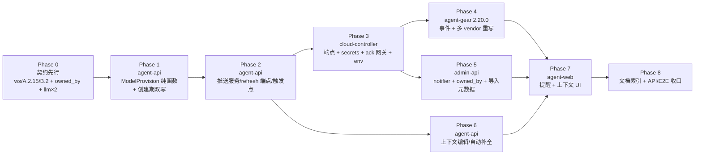
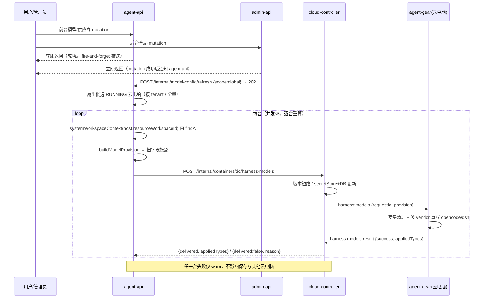

# 模型下发优化与云电脑配置实时下发 - 实现计划

**功能名称**: 模型下发优化与云电脑配置实时下发
**关联 PRD**: [`docs/product/draft/20261117-cloud-host-model-config-sync.md`](../../product/draft/20261117-cloud-host-model-config-sync.md)
**关联提案**: [`docs/engineering/proposals/20261117-feat-cloud-host-model-config-sync.md`](../proposals/20261117-feat-cloud-host-model-config-sync.md)
**计划版本**: v1.0
**创建日期**: 2026-11-17
**作者**: ZeroAsh Agent
**需求总分支**: `feat/cloud-host-model-config-sync`
**需求总 PR**: https://github.com/Deliay/z-agent-gear/pull/553

## 1. 实施顺序

严格按「契约先行 → 载荷唯一口径 → 服务端推送 → 下游事件通道 → worker 重写 → 用户侧上下文能力 → 前端 → 文档/测试收口」推进，每个切片先写失败测试再实现（红-绿-重构）：



**关键路径**：Phase 0 必须先于一切代码（手写 schema 漏改即运行时 `Cannot query field`；契约与实现漂移是本期最大返工源）。Phase 1 的 `ModelProvision` 是「创建期」与「运行期」的唯一构建口径，先落地才能保证双写一致与后续推送可测。

**跨包耦合点**（顺序硬约束）：

| 顺序 | 依赖 | 原因 |
|------|------|------|
| 1 | Phase 3 先于 Phase 2 联调 | agent-api 推送调用的 `POST /internal/containers/:id/harness-models` 由 cloud-controller 提供；先上 cloud-controller 保持向后兼容（新端点无人调用即无影响） |
| 2 | Phase 4 与 Phase 3 同 PR | 事件 `harness:models` 的收发两侧必须同时存在才可联调；旧 worker 忽略事件（D19） |
| 3 | Phase 1 先于 Phase 5/6 | 创建期与运行期共用 `buildModelProvision`；上下文长度进入同一载荷 |

**回归重灾区**：`services/cloud-host-service.test.ts`（创建期 secrets 断言 T-CL* / T-BILL*）、`services/provider.test.ts`（同步模型 upsert 与去重）、`tests/api/src/cloud-controller/internal-api.test.ts`（`parseHarnessRequest` secrets 必填口径）、`packages/agent-controller/src/harness/{opencode-config,dsh-config,prepare}.test.ts`（配置内容逐字断言）、`tests/api/src/agent-api/llm.test.ts`（供应商/模型生命周期）。

## 2. 代码事实核对（计划期确认）

以下事实基于需求总分支 `feat/cloud-host-model-config-sync`（HEAD `6de47235`）实际代码：

| # | 事实 | 位置 | 对计划的影响 |
|---|------|------|--------------|
| F1 | 创建期模型快照在 `cloud-host-service.create` 内联构建：`modelService.findAll()` → 过滤 `isEnabled !== false` → 去重 `name` → `modelContextLengths`（同名保留首个正整数），随后写入 `startHarness.secrets.modelIds/modelContextLengths` | `servers/agent-api/src/services/cloud-host-service.ts:364-383, 394-421` | **改为 `buildModelProvision` 派生**（旧字段 = 新载荷扁平投影），并新增 `secrets.modelProviders`（D1/D4） |
| F2 | 创建期断言逐字依赖旧字段：`modelIds: '["model-a","model-b"]'`、`modelContextLengths: '{"model-a":128000}'`；mock 的 `modelService.findAll` 只回 `{name,isEnabled,contextLength}`（无 scope/providerId） | `servers/agent-api/src/services/cloud-host-service.test.ts:207-213, 477-479` | 单测夹具需补 `scope/providerId`；断言改为「旧字段投影 + `modelProviders` 形状」双查 |
| F3 | `ModelService.findAll()` 口径：`scope=user`（含禁用）∪ 存量无 scope ∪ `scope=global && isEnabled`，按 `sortOrder, createdAt` 排序；`mapModel` 已透出 `contextLength`（非法值归一 null）、`scope`、`providerId` | `servers/agent-api/src/services/model.ts:8-14, 35-40, 166-192` | 纯函数输入无需自行补算 contextLength；禁用过滤仍在构建层（不能只靠查询） |
| F4 | `ProviderService.findAll()` 仅 `scope=user`（兼容无 scope），按 `createdAt:-1`，`mapProvider` 透出 `{id,name,isEnabled,createdAt}`；`findSummaryById` 对 global 恒 null | `servers/agent-api/src/services/provider.ts:10-12, 27-45, 293-312` | 用户组显示名直接取 `provider.name`；组序需在纯函数内按 `createdAt` 升序重排（D5） |
| F5 | `llm-api.fetchModels` 只回 `string[]`（OpenAI/Anthropic 均 `models.list()` 取 `id`），`TIMEOUT_MS = 10_000` | `servers/agent-api/src/services/llm-api.ts:6-46`；`servers/admin-api/src/services/llm-api.ts:6-46` | 新增 `fetchModelCatalog`，`fetchModels` 保留为 `map(e=>e.name)` 兼容既有调用点（D15） |
| F6 | agent-api 用户侧模型 mutation 已统一在成功后 `invalidateAcpOptionsBestEffort(userId)`（fire-and-forget + warn） | `servers/agent-api/src/graphql/resolvers/model.ts:9-16, 38-110` | 推送触发点与之同层同形（D3），零新增中间件 |
| F7 | agent-api 用户侧供应商 mutation 共 8 个（create/update/delete/toggle + batch×3），**当前不失效 ACP 缓存也不推送** | `servers/agent-api/src/graphql/resolvers/provider.ts:12-140` | 8 个成功路径全部补 `scheduleModelPush`（含供应商改名 → 显示名变更） |
| F8 | ACP 选项缓存 key 为 `acp:options:<controllerId>:<serverType>`，已具备 SCAN 删除通道；用户级失效枚举该用户 controller | `servers/agent-api/src/services/acp-options-cache.ts:9-41, 77-104` | global 变更新增 `invalidateAllAcpOptions()`（pattern `acp:options:*`），复用同一 SCAN（D3） |
| F9 | 网关 `/v1/models` **逐请求实时查库**：global `isEnabled` + 供应商启用联查 + 同名去重（global 优先）+ global 定价完整性过滤；`toModelEntry.owned_by` 硬编码 `'agent-gear'` | `servers/admin-api/src/routes/billing-openai.ts:329-350, 357-431` | `owned_by` 需 provider `id→name` 映射（D17）；「禁用即不可用」现状无需改代码，补测试锁定 |
| F10 | 网关 `/chat/completions` 解析顺序：`global && isEnabled` 优先 → cloud_host Key 回退 `user && isEnabled`（`sortOrder, createdAt` 首条）→ 供应商缺失/禁用 → 404 `model_not_found`；进行中请求不中断 | `servers/admin-api/src/routes/billing-openai.ts:455-478` | PRD 功能点 5 现状已满足：**仅补测试**（T-OWN2/T-OWN3） |
| F11 | admin 侧 `assertContextLength`（null/缺省=未设置，否则整数 ≥1，文案 `contextLength must be a positive integer`）；`createCustom`/`updateContextLength` 已支持；`importModels` 仅做连通性门禁，写入 docs **不含 contextLength** | `servers/admin-api/src/services/model.ts:56-62, 78-113, 178-240 (205), 274-286` | 用户侧校验口径逐字对齐（D14）；导入补全落在 importModels（D15） |
| F12 | admin `listProviderModels` 返回 `ProviderModelOption{name,isImported,isDuplicate}`，数据源为 `fetchModels` | `servers/admin-api/src/services/model.ts:130-166`；`contracts/admin-llm.graphql:65` | 契约加 `contextLength`，实现改 `fetchModelCatalog` 映射（D15） |
| F13 | admin-api 已具备 `AGENT_API_URL` + `INTERNAL_API_TOKEN` 配置与「转发 agent-api 内部端点」先例（`crypto.timingSafeEqual` + 超时） | `servers/admin-api/src/config/index.ts:31-41`；`resolvers/tenant.ts:227-275` | notifier 复用既有转发范式，不新增环境变量 |
| F14 | agent-api `CloudControllerClient` 已封装 Bearer 内部调用，默认超时 **30s**；`startHarness` 组装 `secrets` 原样透传；`config.cloudControllerUrl` 为单点控制面地址 | `servers/agent-api/src/services/cloud-controller-client.ts:12-47, 159-167, 201-238`；`config/index.ts:56` | 新增 `pushHarnessModels` 方法；ack 等待在 cloud-controller 侧（≤10s），agent-api 侧 30s 足够（D9） |
| F15 | cloud-controller `parseHarnessRequest` 把 `secrets` 收敛为必填 6 字段（`Object.values(...).some(len===0) → null`），`modelContextLengths` 作为可选字段在必填校验**之后**追加 | `servers/cloud-controller/src/routes/internal-api.ts:519-523` | `modelProviders` 必须同样在必填校验之后追加，否则旧调用方（不传）直接 400 |
| F16 | `HarnessSecrets` 为内存契约（`secret-store.ts`），persist 记录走 `cloudcontainersecrets`（Mongo 唯一索引 `uniq_harness_secret_container`），启动时 `restoreHarnessSecrets()` 回灌并清理孤儿 | `services/secret-store.ts:13-26`；`models/harness-secret.ts:13-36`；`repositories/harness-secret-repository.ts:27-80`；`services/container-service.ts:258-275` | 新增 `modelProviders` 三处同步；**零迁移**（可选字段默认 null，读取侧回退旧字段）（D20） |
| F17 | Job env 注入收敛在 `buildHarnessJobEnv`：缺 `modelApiKey/modelBaseUrl/modelIds` 即报错；`ZAG_MODEL_CONTEXT_LENGTHS` 可选；runtime 批次与 init 批次同源解析 | `servers/cloud-controller/src/services/workload-dispatcher.ts:216-247, 470-480` | 新增 `ZAG_MODEL_PROVIDERS`（携带时注入），保证「运行期补装 harness 的 init 脚本」也能拿到最新载荷 |
| F18 | worker 网关 `WorkerGatewayHandle` 仅有 `emitToContainer/isConnected/getWorkerVersion`；向 worker 发事件为 fire-and-forget，**无 ack 通道**；`workload:result` 是有状态派发器而非请求响应 | `servers/cloud-controller/src/services/socketio-gateway.ts:69-77, 216-219, 459-470` | 需新增 pending-ack 机制（`harness:models:result` + 10s 超时）（D9） |
| F19 | 容器 secret 写入点：`start()` 内 `secretStore.put` + `persistHarnessSecret`；持久化失败仅告警 | `services/container-service.ts:396-400, 900-913` | 新增 `get(id)` 与 `updateModelProvision(containerId, provision)`（内存 + 落库），复用同一告警语义（D11） |
| F20 | 版本门禁：`MIN_HARNESS_WORKER_VERSION='2.17.1'`，注册时按落库 `agentGearMinVersion` 拦截；`getWorkerVersion` 返回原始版本串，`isSupportedWorkerVersion` 提供语义比较 | `services/worker-version.ts:20-38`；`socketio-gateway.ts:349`；`routes/internal-api.ts:567-610` | 新增 `MIN_HARNESS_MODELS_WORKER_VERSION='2.20.0'`，仅用于推送短路判断，**不提升落库门禁**（D19） |
| F21 | agent-gear `HarnessEnv` 只含 `modelBaseUrl/modelApiKey/modelIds/modelContextLengths/defaultWorkspace`；`readHarnessEnv` 对缺失变量一次性列名报错；`resolvePrepareTypes` 白名单 `['opencode','deepseek_harness']` | `packages/agent-controller/src/harness/env.ts:9-20, 42-54, 123-146` | 新增可选 `modelProviders` 解析（非法值报变量名、不输出原值）；事件链路绕过必填 `ZAG_MODEL_IDS` 限制 |
| F22 | opencode 配置写入固定 `providers.zag`（`name:'ZAG'`，模型 `models.<id>`，`limit.context` 同 id），jsonc 增量修改 + 0600/0700 + 原子 rename | `packages/agent-controller/src/harness/opencode-config.ts:15-60, 91-182` | 改为多 vendor；差集清理需状态文件（D12）；`zag` 显示名 `Agent Gear` |
| F23 | dsh 配置固定 `llm-pi-ai.config.providers.zag`（`displayName:'ZAG'`）+ `agent-default-model`/`acp` 的 `provider:'zag'` 与 `modelIds[0]` | `packages/agent-controller/src/harness/dsh-config.ts:84-123, 296-337` | 多 vendor + 默认模型取首个非空组（D13）；`.credentials.yaml` 的 `refs.ZAG_MODEL_API_KEY` 单点不变（凭据仍走平台网关） |
| F24 | `prepareHarness` 按 `ZAG_HARNESS_TYPES` 先 CLI 硬校验再写文件；事件链路不能跑 CLI 硬校验（容器内可能未安装） | `packages/agent-controller/src/harness/prepare.ts:74-137` | 新增 `applyModelProvision`（只重写文件，不校验 CLI）供事件复用；`prepareHarness` 改为复用同一写函数 |
| F25 | agent-gear socket 客户端用 `handleWorkload` 区分 `/worker` 与 controller-api 标准连接；`acp:check → acp:check:result{requestId}` 是既有请求/响应范式 | `packages/agent-controller/src/socketio-client.ts:473, 534-567, 665-726` | `harness:models` handler 同样以 `handleWorkload` 门控（只 `/worker` 连接处理），结果带 `requestId` 回发 |
| F26 | supervisor 构造 `/worker` 连接的 `connect(...)` 选项（`onRegistered`/`onWorkloadBatchComplete`/`onShutdown`） | `packages/agent-controller/src/cloud-host/supervisor.ts:294-333` | 事件处理不依赖 supervisor 改造（handler 在 socketio-client 内注册），仅需确保 `/worker` 连接 `handleWorkload=true`（现状已满足） |
| F27 | agent-gear 版本 `2.19.0`；worker 镜像 entrypoint 每轮 `pnpm add -g agent-gear@latest` 自升级；harness 相关版本门禁常量在 agent-api/cloud-controller 各一份 | `packages/agent-controller/package.json:2-3`；`deploy/images/worker/entrypoint.sh:30-45, 237-260` | 本期升 `2.20.0`；存量容器靠自升级收敛，未升级者静默降级（D19） |
| F28 | agent-web 设置页模型区：`ModelSection`（分组/排序/启用/删除/自定义弹窗）、`ModelItem`（行 UI）、`CustomModelDialog`（供应商 + 名称）、`ProviderSection.handleSave`（create/update）**均无 toast、无 contextLength** | `apps/agent-web/src/components/settings/{ModelSection,ModelItem,CustomModelDialog,ProviderSection}.tsx` | 需补 contextLength 展示/编辑 + 统一提醒 toast（D18） |
| F29 | agent-web `GET_MODELS` 选择集不含 `contextLength`；`CREATE_CUSTOM_MODEL` 入参只有 `providerId/name` | `apps/agent-web/src/graphql/queries.ts:29-50`；`mutations.ts:91-102` | 同步补 selection/变量；新增 `UPDATE_MODEL_CONTEXT_LENGTH` / `PROVIDER_MODEL_OPTIONS` |
| F30 | admin-web 已有「最长上下文」完整 UI 范式：`最长上下文大小（token）` 输入 + 正整数校验（`POSITIVE_INTEGER_ERROR`）+ `ModelItem` 展示「最长上下文：200,000 tokens / 未设置」+ 编辑模式弹窗（供应商/名称只读） | `apps/admin-web/src/components/models/{CustomModelDialog,ModelItem,ModelSection}.tsx` | agent-web 直接镜像该范式（文案/校验/展示一致），避免两端口径漂移 |
| F31 | API 测试现状：cloud-controller secrets 夹具 2 处（`internal-api.test.ts:120-121, 682`）、gateway 断言无 `owned_by` 用例；E2E 上游 fake OpenAI `/v1/models` 条目不含上下文元数据 | `tests/api/src/cloud-controller/internal-api.test.ts`；`tests/api/src/agent-api/llm.test.ts:955-1000`；`tests/e2e/src/helpers.ts:440-470` | 夹具逐处补齐；新增上下文元数据 fake（`context_length` 等字段） |
| F32 | GraphQL 装配为「契约 + 手写 typeDefs + resolver 合并」三处齐改；`graphql/schemas/index.ts` 注册 typeDefs，`graphql/resolvers/index.ts` 合并 Query/Mutation | `servers/{agent,admin}-api/src/graphql/schemas/index.ts`、`resolvers/index.ts:27-50` | Phase 0/6 必须同批改三处，否则运行期字段不可查（补契约漂移守卫测试） |

## 3. 契约与数据结构

### 3.1 `ModelProvision`（创建期 secrets 与运行期事件共用）

```json
{
  "providers": [
    {
      "vendorId": "zag",
      "displayName": "Agent Gear",
      "models": [{ "id": "kimi-k2", "contextLength": 262144 }]
    },
    {
      "vendorId": "65f0a1b2c3d4e5f60718293a",
      "displayName": "我的 OpenAI",
      "models": [{ "id": "gpt-5.1" }]
    }
  ]
}
```

不变量（构建与解析两侧共同保证）：

- `providers` 恒含且仅含一个 `zag` 组（可为空 `models: []`，D4）；`zag` 组恒首位；
- 用户组 `vendorId = providerId`（ObjectId 字符串）、`displayName = provider.name`，组序按 provider `createdAt` 升序（同刻以 `_id` 兜底）；
- 组内模型顺序 = `findAll()` 顺序（`sortOrder, createdAt`）；
- 模型名全局唯一（同名 global 优先，先占位再去重，D6）；
- `contextLength` 仅正整数携带，未设置不出现该键；
- 载荷**不含** baseURL/apiKey/凭据（D8）。

### 3.2 事件与端点（契约 1）

| 方向 | 事件 | 载荷 |
|------|------|------|
| Server → Worker | `harness:models` | `{ requestId, provision }`（全量替换语义） |
| Worker → Server | `harness:models:result` | `{ requestId, success, appliedTypes[], error? }` |

`POST /internal/containers/:containerId/harness-models`（Bearer `INTERNAL_API_TOKEN`）

- 请求：`{ "provision": { "providers": [...] } }`；
- 200：`{ "delivered": true, "appliedTypes": ["opencode","deepseek_harness"] }`
  或 `{ "delivered": false, "reason": "offline" | "ack_timeout" | "worker_error" | "worker_unsupported" }`；
- 404 `NOT_FOUND`（容器不存在/ID 非法）、400 `INVALID_MODEL_PROVISION`、409 `CONTAINER_NOT_ONLINE`（终态）、503 `UNAVAILABLE`（网关未注入）；
- 语义：先更新 `SecretStore` + `cloudcontainersecrets`（自由 `modelProviders` + 旧字段投影），再 emit 等 ack（10s）；`delivered=false` 不视为失败（D11）。

### 3.3 GraphQL 增量（契约 3）

```graphql
# contracts/llm.graphql + servers/agent-api/src/graphql/schemas/model.ts（逐字双写）
input CustomModelInput {
  providerId: ID!
  name: String!
  contextLength: Int          # 新增：缺省/传 null = 未设置
}

type ProviderModelOption {    # 新增
  name: String!
  contextLength: Int
}

extend type Query {
  providerModelOptions(providerId: ID!): [ProviderModelOption!]!
}

extend type Mutation {
  updateModelContextLength(modelId: ID!, contextLength: Int): Model!
}
```

`contracts/admin-llm.graphql`：`ProviderModelOption` 增 `contextLength: Int`（上游未提供为 null），`importGlobalModels` 注释补「上游提供时写入 contextLength」；两份契约补注「mutation 成功后触发运行中云电脑实时下发（best-effort）；模型启停对网关逐请求立即生效」。

### 3.4 持久化字段（零迁移）

| 字段 | 类型 | 说明 |
|------|------|------|
| `cloudcontainersecrets.modelProviders` | `String`（default `null`） | ModelProvision JSON 字符串；null = 旧版本创建 → 读取侧回退 `modelIds` 合成单 `zag` 组 |
| Job env `ZAG_MODEL_PROVIDERS` | string | 仅在 secrets 携带时注入；旧 worker 忽略 |

`agent-api`/`admin-api` 模型层零 schema 变更（`Model.contextLength` 两侧已存在）。

## 4. 核心时序



## 5. 变更清单

### 5.1 Phase 0：契约先行（先于代码）

| 文件 | 变更 |
|------|------|
| `contracts/cloud-controller-websocket.md` | ① §2.1 事件总览增 `harness:models` / `harness:models:result` 两行；② 新增 §2.13/§2.14（字段表 + requestId + ack 10s + 全量替换语义 + 旧 worker 忽略）；③ 附录 A.2.15 端点（请求/响应/错误码/先持久化后 emit）；④ A.2.2 `secrets` 增可选 `modelProviders`；⑤ B.2 Job env 增 `ZAG_MODEL_PROVIDERS`；⑥ §3.4 版本兼容补「事件能力自 agent-gear 2.20.0，旧版本静默忽略」 |
| `contracts/billing-openai.openapi.yaml` | `owned_by` 描述：`scope=global → Agent Gear`；`scope=user（含存量无 scope）→ 该模型绑定的供应商名称`；account Key 列表恒 `Agent Gear`；其余结构不变 |
| `contracts/llm.graphql` | `CustomModelInput.contextLength`、`ProviderModelOption`、`Query.providerModelOptions`、`Mutation.updateModelContextLength`；`Model.contextLength` 注释改「可编辑（用户自有模型）」；补下发与网关即时生效注记 |
| `contracts/admin-llm.graphql` | `ProviderModelOption.contextLength`；`importGlobalModels` 注释补上下文元数据；补下发注记 |
| `servers/agent-api/src/graphql/schemas/model.ts` | 与 `contracts/llm.graphql` 逐字双写（新类型/字段/query/mutation）（F32） |
| `servers/admin-api/src/graphql/schemas/model.ts` / `provider.ts` | 若 `ProviderModelOption` 在 admin 手写 schema 中存在则同步 `contextLength`；注释同步下发口径 |

### 5.2 Phase 1：ModelProvision 唯一口径（agent-api）

| 文件 | 变更 |
|------|------|
| `servers/agent-api/src/services/model-provision.ts`（新） | 导出 `ModelProvision` 类型族、`buildModelProvision(models, providers)`（§3.1 全部不变量）、`projectProvision(provision)`（→ `{modelIds: string[], modelContextLengths: Record<string,number>}`，组序展开、同名/同 id 去重）、`flattenModelIds` / `flattenContextLengths`（供 cloud-controller 侧同构复用或纯字符串化） |
| `servers/agent-api/src/services/cloud-host-service.ts` | 删除内联 modelIds/modelContextLengths 构建（F1），改：`const models = await modelService.findAll(); const providers = await providerService.findAll(); const provision = buildModelProvision(models, providers); const legacy = projectProvision(provision);` → `secrets: { ..., modelIds: JSON.stringify(legacy.modelIds), modelContextLengths: JSON.stringify(legacy.modelContextLengths), modelProviders: JSON.stringify(provision) }` |
| `servers/agent-api/src/services/cloud-controller-client.ts` | `StartHarnessInput.secrets` 增 `modelProviders: string`（与 `modelContextLengths` 一样由调用方必传，内部链路单一来源）；新增 `pushHarnessModels(containerId, provision)`：`POST /internal/containers/:id/harness-models`，返回 `{delivered, appliedTypes?, reason?}`；4xx/5xx 抛 `CloudControllerRequestError`（保留 status/code） |

### 5.3 Phase 2：推送服务、内部端点与触发点（agent-api）

| 文件 | 变更 |
|------|------|
| `servers/agent-api/src/services/cloud-host-model-push.ts`（新） | `pushModelProvisionForTenant(tenantId)` / `pushModelProvisionForAllRunning()` / `applyGlobalModelRefresh()`（推送 + 全量 ACP 失效，single-flight 合并）；内部 `resolveProvisionForHost(host)`：`host.resourceWorkspaceId` → `workspaceService.systemWorkspaceContext(workspaceId)`（系统链路构造上下文，见 `services/workspace-service.ts:497-514`）→ `runWithWorkspace(ctx, findAll)` → `buildModelProvision`；`runWithLimit(5)`；逐台 `containerId` 缺失/非 RUNNING/上下文解析失败 → 跳过 + `logger.warn`（**绝不裸跑 find***，D2）；单台失败仅 warn（记录 `cloudHostId/containerId/delivered/reason`） |
| `servers/agent-api/src/services/acp-options-cache.ts` | 新增 `invalidateAllAcpOptions()`：`deleteKeysByPattern('acp:options:*')`，失败仅告警 |
| `servers/agent-api/src/routes/internal-model-config.ts`（新） | `POST /internal/model-config/refresh`：`timingSafeEqual(Bearer INTERNAL_API_TOKEN)`（复用 `internal-cloud-host.ts:19-25` 范式）；body `scope !== 'global'` → 400 `INVALID_SCOPE`；`res.status(202).json({accepted:true})` 后 `setImmediate` 执行 `applyGlobalModelRefresh()`；未配置 token → 401 |
| `servers/agent-api/src/index.ts` | `app.use('/internal/model-config', internalModelConfigRouter)` |
| `servers/agent-api/src/graphql/resolvers/model.ts` | 新增 `scheduleModelPush(context)`（`requireTenantId(context)` → `void pushModelProvisionForTenant(...).catch(warn)`）；`createCustomModel/deleteCustomModel/toggleModel/updateModelSortOrder` 成功路径追加；新增 `updateModelContextLength` resolver（见 Phase 6）；新增 `Query.providerModelOptions`（见 Phase 6） |
| `servers/agent-api/src/graphql/resolvers/provider.ts` | 8 个 mutation（create/update/delete/toggle/batchEnable/batchDisable/batchDelete）成功路径追加 `scheduleModelPush`，失败/未命中保持零副作用 |

### 5.4 Phase 3：cloud-controller 端点、secrets 与 ack 网关

| 文件 | 变更 |
|------|------|
| `servers/cloud-controller/src/models/harness-secret.ts` | schema 增 `modelProviders: { type: String, default: null }`（F16，零迁移） |
| `servers/cloud-controller/src/services/secret-store.ts` | `HarnessSecrets.modelProviders?: string`（注释：ModelProvision JSON，可选） |
| `servers/cloud-controller/src/repositories/harness-secret-repository.ts` | `RawHarnessSecretDoc.modelProviders` + `toRecord` 透出 + `upsert` 写入（null 归一） |
| `servers/cloud-controller/src/services/model-provision.ts`（新） | `parseModelProvisionPayload(raw): ModelProvision \| null` 结构校验（providers 非空数组？允许空数组；vendorId/displayName 非空字符串；models 数组、id 非空、contextLength 正整数或缺失；**不校验 business 语义**）— 路由与服务共用，避免两处口径 |
| `servers/cloud-controller/src/services/container-service.ts` | 新增 `get(id)`（`repo.findById`，不触发 K8s 巡检）与 `updateModelProvision(containerId, provision)`：读 `secretStore.get` → 合并 `{modelProviders: JSON, modelIds: JSON(展开 ids), modelContextLengths: JSON(projection)}` → `secretStore.put` + `persistHarnessSecret`（F19/D11）；secret 不存在（未创建/已清理）→ 返回 `null` 由路由 409 |
| `servers/cloud-controller/src/services/socketio-gateway.ts` | ① `WorkerGatewayHandle` 增 `requestHarnessModels(containerId, provision, timeoutMs?)`；② 内部 `pendingHarnessModels: Map<requestId, {containerId, resolve, timer}>`（**有界**：同容器并发请求直接复用/覆盖旧请求并即时以 `worker_error` 收敛）；③ `socket.on('harness:models:result')`：校验 `requestId/success/appliedTypes`，只接受同 `containerId` 的 pending；④ 断连/重连/关停时以 `offline`/`worker_error` 收敛 pending；⑤ `withTraceMeta` 复用 |
| `servers/cloud-controller/src/services/worker-version.ts` | 新增 `MIN_HARNESS_MODELS_WORKER_VERSION = '2.20.0'` + `supportsHarnessModelPush(version)`（复用 `isSupportedWorkerVersion`，未知版本 → 视为「不短路」，走 ack 超时） |
| `servers/cloud-controller/src/routes/internal-api.ts` | ① `parseHarnessRequest` 在必填校验之后可选解析 `modelProviders`（非空字符串才透传，F15）；② `InternalRouterDeps` 增 `requestHarnessModels?`；③ 新增 `POST /containers/:containerId/harness-models`：ID 非法/不存在 → 404；终态 → 409 `CONTAINER_NOT_ONLINE`；未 online（creating/connecting/initializing）→ 200 `{delivered:false, reason:'offline'}`；版本可得且 <2.20.0 → 200 `worker_unsupported`；payload 非法 → 400；`updateModelProvision` 返回 null → 409；否则 await ack 并回传 |
| `servers/cloud-controller/src/services/workload-dispatcher.ts` | `buildHarnessJobEnv` 增 `if (secrets.modelProviders) env.ZAG_MODEL_PROVIDERS = secrets.modelProviders;`（F17） |
| `servers/cloud-controller/src/index.ts` | `gatewayBridge` 增 `requestHarnessModels`，注入 `createInternalRouter` |

### 5.5 Phase 4：agent-gear 2.20.0（事件 + 多 vendor 重写）

| 文件 | 变更 |
|------|------|
| `packages/agent-controller/src/harness/model-providers.ts`（新） | 类型族 + `parseModelProvision(raw)`（结构校验，抛 `ModelProvisionError`，消息只含变量名/索引，不含原值）+ `projectToLegacy(provision)` + `resolveProvision(env)`（`ZAG_MODEL_PROVIDERS` 优先，缺省由 `modelIds/modelContextLengths` 合成单 `zag` 组，**向后兼容**）+ `applyModelProvision({provision, env, types, configDir?, dshHome?, statePath?})`：逐类型重写（不经 CLI 硬校验），返回 `{appliedTypes, errors}`；状态文件更新（D12） |
| `packages/agent-controller/src/harness/env.ts` | `HarnessEnv` 增 `modelProviders?: ModelProvision`；`readHarnessEnv` 解析可选 `ZAG_MODEL_PROVIDERS`（非法 → `HarnessEnvError`，只报变量名）；`modelIds` 缺省时若 `modelProviders` 存在则由投影补齐（事件链路与旧服务端双兼容，F21） |
| `packages/agent-controller/src/harness/opencode-config.ts` | `buildZagProvider` → `buildProviders(provision)`（多 vendor，`name = displayName`，`zag` → `Agent Gear`，统一 `package/settings`）；`writeOpencodeConfig` 依次 `modify(text, ['providers', vendorId], config)`，再按状态文件差集 `modify(..., undefined)` 删除消失 vendor；`providers.zag` 恒写（D4）；保留 0600/0700/原子 rename/注释保留/非法 JSONC 不覆盖；新增 `statePath` 注入（默认 `~/.zag/model-providers-state.json`） |
| `packages/agent-controller/src/harness/dsh-config.ts` | `buildZagProvider` → `buildProviders(provision)`（`llm-pi-ai.config.providers` 全量多 vendor，`displayName` 取 displayName）；`agent-default-model`/`acp` 的 `provider/model` 取「首个非空组」的第一个模型，全空保持 `{provider:'zag'}`（D13）；`.credentials.yaml` 单点不变 |
| `packages/agent-controller/src/harness/prepare.ts` | 复用 `resolveProvision` + 新写函数；摘要中 `modelCount` 改为投影数量（与现口径一致）；输出仍不含 secret |
| `packages/agent-controller/src/socketio-client.ts` | 注册 `harness:models`（`handleWorkload` 门控，F25）：解析 → `applyModelProvision` → `socket.emit('harness:models:result', {requestId, success, appliedTypes, error?})`；payload 非法也回 `success:false`（避免服务端空等）；error 脱敏（沿用 `redactSecrets` 口径） |
| `packages/agent-controller/src/commands/harness.ts` | 无需改动（`prepare` 入口沿用）；仅确认无 CLI 输出泄漏 |
| `packages/agent-controller/package.json` | `version: 2.20.0`（F27） |

### 5.6 Phase 5：admin-api（通知 + 网关口径 + 导入元数据）

| 文件 | 变更 |
|------|------|
| `servers/admin-api/src/services/model-push-notifier.ts`（新） | `notifyModelConfigChanged()`：未配置 `agentApiUrl/token` → warn 并返回；`POST {AGENT_API_URL}/internal/model-config/refresh` body `{scope:'global'}`，5s 超时，**fire-and-forget**（内部 catch + warn，不抛给调用方） |
| `servers/admin-api/src/graphql/resolvers/model.ts` | `createGlobalCustomModel/importGlobalModels/deleteGlobalModel/toggleGlobalModel/updateGlobalModelSortOrder/updateModelContextLength` 成功路径追加 `void notifyModelConfigChanged()` |
| `servers/admin-api/src/graphql/resolvers/provider.ts` | 7 个 global provider mutation 成功路径同上 |
| `servers/admin-api/src/routes/billing-openai.ts` | `toModelEntry` 增加 `ownedBy` 入参：global → `Agent Gear`，user → provider.name（D17）；`enabledProviderIdSet` → 同时返回 `id→name` 映射（`select({isEnabled:1, name:1})`）；account Key 分支恒 `Agent Gear`；chat 路径零改动（F9/F10） |
| `servers/admin-api/src/services/llm-api.ts` | 与 agent-api 同步演进 `fetchModelCatalog`（D15 字段白名单）；`fetchModels` 保留 |
| `servers/admin-api/src/services/model.ts` | `listProviderModels` 改 `fetchModelCatalog` 并透出 `contextLength`；`importModels` 用一次 `fetchModelCatalog` 同时做连通性门禁与 `name→contextLength` 映射，写入 docs 时携带（F11/F12） |

### 5.7 Phase 6：agent-api 用户侧上下文能力

| 文件 | 变更 |
|------|------|
| `servers/agent-api/src/services/llm-api.ts` | `fetchModelCatalog(type, endpoint, apiKey): Promise<ProviderModelEntry[]>`：OpenAI 兼容逐条**白名单字段映射**（`context_length` / `context_window` / `max_context_length` / `max_input_tokens` / `input_token_limit`，命中即取正整数；`max_tokens/max_output_tokens` **不取**）；Anthropic 恒 `undefined`；元数据异常只影响该条目；`fetchModels` = `(await fetchModelCatalog()).map(e=>e.name)` |
| `servers/agent-api/src/services/provider.ts` | 新增 `getDecryptedConnection(id)`（`scope=user`/无 scope 且读口径可见；不存在 → null）；`create`/`update` 的 `needsResync` 探测改 `fetchModelCatalog`；`syncSyncedModels(providerId, entries)`：先查既有同步行的 `contextLength`，**仅「未设置」行**在 upsert 的 `$set` 中携带上游值（D15），已有值行不进 `$set`；新建行携带；删除集合逻辑不变 |
| `servers/agent-api/src/services/model.ts` | `createCustom` 接受可选 `contextLength`（`assertContextLength` 本地等价实现，文案与 admin 一致）；`contextLength === undefined` 时尽力 `fetchModelCatalog` 按 `name` 匹配补全（失败/超时 → null，不阻塞创建；D15）；新增 `updateContextLength(id, value)`：校验 → `Model.findOneAndUpdate({_id, scope:{$ne:'global'}, ...}, {$set:{contextLength}})`（写插件收敛当前工作区，D14）→ null 抛 `Model not found` |
| `servers/agent-api/src/graphql/resolvers/model.ts` | `createCustomModel` 入参透传 `contextLength`；新增 `updateModelContextLength`：`requireUser` → 服务 → 成功 `invalidateAcpOptionsBestEffort` + `scheduleModelPush`；新增 `Query.providerModelOptions`：`requireUser` → `providerService.getDecryptedConnection`（null → `Provider not found`）→ `fetchModelCatalog` → `[{name, contextLength}]`（失败归一为可读文案，不泄漏上游细节） |
| `servers/agent-api/src/graphql/schemas/model.ts` | 已在 Phase 0 双写；本阶段确保 resolver 键齐全 |

### 5.8 Phase 7：agent-web（提醒 + 上下文编辑）

| 文件 | 变更 |
|------|------|
| `apps/agent-web/src/lib/model-config-notice.ts`（新） | `MODEL_CONFIG_APPLIED_NOTICE = '已保存并下发到运行中的云电脑；部分 Harness 运行时不会重载模型配置，已运行的会话可能需要重启后生效'`（单一来源）+ `notifyModelConfigApplied()`（`toast.success`，测试可 spy） |
| `apps/agent-web/src/graphql/queries.ts` / `mutations.ts` / `types.ts` | `GET_MODELS` 增 `contextLength`；新增 `UPDATE_MODEL_CONTEXT_LENGTH`、`PROVIDER_MODEL_OPTIONS`；`CREATE_CUSTOM_MODEL` 入参随变量类型扩展（F29） |
| `apps/agent-web/src/components/settings/ProviderSection.tsx` | `handleSave`（create/update）成功后 `notifyModelConfigApplied()`；toggle/delete 保持静默（D18） |
| `apps/agent-web/src/components/settings/CustomModelDialog.tsx` | ① 新增「最长上下文大小（token）」输入（`inputMode="numeric"`、正整数校验、留空 = 未设置；文案与 admin-web 逐字一致，F30）；② 编辑模式（`model` 入参）：供应商/名称只读，仅可改/清空上下文（镜像 admin）；③ 新增模式：选定供应商 + 输入模型名后（去抖 400ms）调 `PROVIDER_MODEL_OPTIONS` 匹配同名项预填（失败静默忽略；用户已手改则不覆盖）；④ `onSave(providerId, name, contextLength: number \| null)` |
| `apps/agent-web/src/components/settings/ModelItem.tsx` | `ModelData` 增 `contextLength`；行内展示「最长上下文：N tokens / 未设置」；`scope==='user' && !readOnly` 时提供「编辑上下文」入口（`PencilLine` ghost 按钮） |
| `apps/agent-web/src/components/settings/ModelSection.tsx` | ① 自定义模型保存改为携带 `contextLength`；② 新增 `editingModel` 状态：点击编辑 → 复用 `CustomModelDialog` 编辑模式 → `UPDATE_MODEL_CONTEXT_LENGTH`（`refetchQueries: [GET_MODELS]`）；③ 新增/编辑/启停/删除/排序成功路径统一 `notifyModelConfigApplied()`（D18） |
| `apps/agent-web/src/components/settings/ModelGroup.tsx` | 无逻辑改动（分组/计数不变）；确认上下文文案不破坏折行 |

### 5.9 Phase 8：文档索引与测试收口

| 文件 | 变更 |
|------|------|
| `servers/agent-api/AGENTS.md` | 「云容器优化二期（默认工作区与模型上下文）」段扩写：`ModelProvision` 唯一口径、`cloud-host-model-push` 扇出与跳过规则、`/internal/model-config/refresh`、用户上下文编辑与自动补全口径 |
| `servers/admin-api/AGENTS.md` | 新增「模型变更全局下发与网关显示口径」小节（notifier、owned_by、导入上下文元数据） |
| `servers/cloud-controller/AGENTS.md` | 新增「运行期模型下发（harness-models）」小节（端点/ack/版本短路/secrets 字段/env） |
| `packages/agent-controller/AGENTS.md` | 新增「多 vendor 模型下发与 harness:models」小节（状态文件差集清理、默认模型组归属、2.20.0 门禁口径） |
| `apps/agent-web/AGENTS.md` | 设置页模型/供应商保存提醒与上下文编辑口径 |
| `tests/api/AGENTS.md` | 追加 T-MCS-API* 条目 |
| `tests/e2e/AGENTS.md` | 追加 E2E-MCS* 条目 |
| `docs/engineering/AGENTS.md` | 「实现计划（plan/）」索引登记本文件 |

## 6. TDD 测试矩阵

### 6.1 单元（各包 Vitest）

| 编号 | 文件 | 断言 |
|------|------|------|
| T-MP1 | `servers/agent-api/src/services/model-provision.test.ts` | global 模型 → `{vendorId:'zag', displayName:'Agent Gear'}`，且恒首位、模型 `id/contextLength` 正确；无 global 时仍输出空 `zag` 组（D4） |
| T-MP2 | 同上 | 用户模型按 `providerId` 分组：`vendorId=providerId`、`displayName=provider.name`；多供应商不混组；组序按 provider `createdAt` 升序（同刻 `_id` 兜底） |
| T-MP3 | 同上 | 过滤：`isEnabled=false` 模型剔除；provider 缺失/`isEnabled=false` 的 user 模型剔除；global 模型 provider 状态不参与（F3/F9） |
| T-MP4 | 同上 | 同名：global 先占位，同名 user 不出现；同 id 重复仅保留首个（对应 F2 的 `model-a` 双条夹具） |
| T-MP5 | 同上 | `contextLength` 只携带正整数（0/负数/小数/字符串/NaN → 不携带） |
| T-MP6 | 同上 | `projectProvision`：`modelIds` 按组序展开去重；`modelContextLengths` 仅含正整数项；与旧实现产物逐字一致（F2 夹具） |
| T-CP1 | `servers/agent-api/src/services/cloud-host-model-push.test.ts` | `pushModelProvisionForTenant`：仅 `status='RUNNING' && deletedAt=null`；按 `resourceWorkspaceId` 逐台 `runWithWorkspace` 重算（两个工作区 → 两份不同载荷）；`containerId` 缺失/上下文解析失败 → 跳过 + warn，**零** `findAll` 裸调用 |
| T-CP2 | 同上 | 并发上限 5（mock 计时/调用并发计数断言）；单台 `pushHarnessModels` 抛错 → 其余继续、不 reject |
| T-CP3 | 同上 | global：`applyGlobalModelRefresh` = 全量 RUNNING 推送 + `invalidateAllAcpOptions` 各调用一次；single-flight：并发 3 次触发只执行 1 轮，期间新增触发在结束后补跑 1 轮 |
| T-CP4 | `servers/agent-api/src/routes/internal-model-config.test.ts` | 鉴权：无/错 token → 401；`scope!=='global'`/body 非法 → 400；合法 → 202 `{accepted:true}` 且推送被调度（spy）；推送异常不影响 202 |
| T-CP5 | `servers/agent-api/src/graphql/resolvers/model.test.ts` / `provider.test.ts` | 每个用户侧 mutation 成功后调用一次推送（tenantId 取自上下文）；失败路径零调用；推送抛错不外抛（warn） |
| T-CAT1 | `servers/agent-api/src/services/llm-api.test.ts`（扩） | `fetchModelCatalog`：`context_length/context_window/max_context_length/max_input_tokens/input_token_limit` 逐一命中；`max_tokens/max_output_tokens` **不命中**；非正整数/字符串忽略；Anthropic 恒 undefined；单条元数据读取异常不影响其余；`fetchModels` 仍是 `string[]` 且顺序不变 |
| T-UMC1 | `servers/agent-api/src/services/model.test.ts`（扩） | `createCustom`：显式 `contextLength` 写入；`null` → 未设置且**不**打上游；缺省字段 → 尽力补全（命中/未命中/抛错三态，抛错不阻塞创建） |
| T-UMC2 | 同上 | `updateContextLength`：正整数写入；null 清空；0/负数/小数/字符串 → `contextLength must be a positive integer`；global/他人/不存在 → `Model not found`；跨工作区（共享读行）→ `Model not found` 且未改动 |
| T-UMC3 | `servers/agent-api/src/services/provider.test.ts`（扩） | `syncSyncedModels`：未设置行补 `contextLength`；已有值行**不被覆盖**；新建行携带；上游未提供则保持 null；删除集合逻辑与去重不变（回归） |
| T-UMC4 | `servers/agent-api/src/services/provider.test.ts` | `getDecryptedConnection`：user 供应商返回 `{type,endpoint,apiKey}`；global/不存在/非法 id → null |
| T-UMC5 | `servers/agent-api/src/graphql/resolvers/model.test.ts` | `providerModelOptions`：未认证 → `Not authenticated`；供应商不存在 → `Provider not found`；成功返回 `[{name, contextLength}]`；上游失败 → 可读文案 |
| T-CC-MP1 | `servers/cloud-controller/src/services/container-service.test.ts`（扩） | `updateModelProvision`：SecretStore 与 `harnessSecretRepository.upsert` 同步更新，`modelProviders` 为原样 JSON、旧字段为投影；secret 缺失 → null 且不写库；持久化失败仅 error 日志 |
| T-CC-MP2 | `servers/cloud-controller/src/routes/internal-api.test.ts`（扩） | `parseHarnessRequest`：`modelProviders` 携带即透传；缺失不写字段；空串/非字符串 → 400 INVALID_HARNESS（不得影响必填 6 字段口径，F15） |
| T-CC-MP3 | 同上 | 新端点：容器不存在/非法 id → 404；终态 → 409 `CONTAINER_NOT_ONLINE`；creating/connecting/initializing → 200 `delivered:false/offline`；版本 `2.19.0` → 200 `worker_unsupported`（不 emit）；payload 非法 → 400 `INVALID_MODEL_PROVISION`；未注入 `requestHarnessModels` → 503 |
| T-CC-MP4 | `servers/cloud-controller/src/services/socketio-gateway.test.ts`（扩，真实 socket.io-client） | `requestHarnessModels`：worker 收到 `harness:models{requestId,provision}`；回 `harness:models:result` → resolve `{delivered:true,appliedTypes}`；10s 超时 → `ack_timeout`；断连 → `offline`；未知 requestId / 其他容器响应被忽略；并发两请求按 requestId 隔离 |
| T-CC-MP5 | `servers/cloud-controller/src/services/workload-dispatcher.test.ts`（扩） | `ZAG_MODEL_PROVIDERS` 仅在 secrets 携带时注入；缺失时 env 不含该键；runtime 批次同源（F17） |
| T-AG-MP1 | `packages/agent-controller/src/harness/model-providers.test.ts`（新） | `parseModelProvision`：合法；非法 JSON/空 vendorId/models 非数组/contextLength 非法 → 抛错且消息不含原值；`resolveProvision`：`ZAG_MODEL_PROVIDERS` 优先；缺省回退单 `zag` 组且 contextLength 映射正确 |
| T-AG-MP2 | `packages/agent-controller/src/harness/opencode-config.test.ts`（扩） | 多 vendor 写入：`zag.name='Agent Gear'`、user provider `name=displayName`、`models.<id>.limit.context`；保留用户手写 provider 与注释；状态文件差集删除「上次有本次无」的 vendor；`zag` 恒覆盖；状态文件写失败 → 配置成功（仅告警）；0600/0700/原子写不变量 |
| T-AG-MP3 | `packages/agent-controller/src/harness/dsh-config.test.ts`（扩） | `providers` 全量多 vendor（`displayName` 正确）；`agent-default-model`/`acp` 取首个**非空**组（zag 空 → 用户组）；全空 → `{provider:'zag'}`；其余 4+1 受管条目与注释保留 |
| T-AG-MP4 | `packages/agent-controller/src/socketio-client.test.ts`（扩） | `harness:models` 仅 `handleWorkload=true` 处理；成功回 `{requestId,success:true,appliedTypes}`；某类型写失败 → `success:false` + 脱敏 error + 其余类型仍生效；非法 payload → `success:false`；标准连接零响应 |
| T-UMC6 | `servers/admin-api/src/services/llm-api.test.ts`（扩） | admin 侧 `fetchModelCatalog` 与 agent 侧同口径（字段白名单/Anthropic/错误隔离） |
| T-UMC7 | `servers/admin-api/src/services/model.test.ts`（扩） | `listProviderModels` 透出 `contextLength`（含 null）；`importModels` 写入上游 contextLength，未提供 → null；连通性门禁失败文案不变；既有导入去重/重名用例零回归 |
| T-OWN1 | `servers/admin-api/src/routes/billing-openai.test.ts`（新/扩） | `/v1/models`：global → `owned_by='Agent Gear'`；user → 供应商名；同名 global 优先且不回退；供应商禁用/悬停不列出；account Key 恒 `Agent Gear` |
| T-OWN2 | 同上 | `/chat/completions`：禁用模型 → 404 `model_not_found`；启用后恢复；同名 user 回退（global 禁用时）；进行中请求不因后续禁用中断（用可控上游响应延迟断言完成） |
| T-NOTIFY1 | `servers/admin-api/src/services/model-push-notifier.test.ts`（新） | 配置缺失 → warn 且不抛；正常 → 正确 URL/Bearer/body；非 2xx/超时 → 吞错 warn；`fetch` mock 断言 |
| T-NOTIFY2 | `servers/admin-api/src/graphql/resolvers/model.test.ts` / `provider.test.ts` | 每个 global mutation 成功后调用一次 notifier；失败路径零调用 |
| T-MCWEB1 | `apps/agent-web/src/components/settings/__tests__/ModelSection.test.tsx`（扩） | `GET_MODELS` 渲染「最长上下文：200,000 tokens / 未设置」；编辑入口仅 user 模型且非只读可见/可点；编辑保存调 `UPDATE_MODEL_CONTEXT_LENGTH`（数值/null）；非法输入报错且不发 mutation；新增模型携带 contextLength |
| T-MCWEB2 | `apps/agent-web/src/components/settings/__tests__/CustomModelDialog.test.tsx`（新） | 正整数校验文案与 admin 一致；留空 → null；选定供应商+输入名称 → `providerModelOptions` 预填（用户已改则不强覆盖；请求失败静默）；编辑模式供应商/名称只读 |
| T-MCWEB3 | `apps/agent-web/src/components/settings/__tests__/ProviderSection.toast.test.tsx`（新） | 供应商保存成功 → toast 文案含「部分 Harness 运行时不会重载模型配置」；失败 → 无成功 toast；toggle/delete 静默（D18） |
| T-MCWEB4 | `apps/agent-web/src/components/settings/__tests__/ModelSection.toast.test.tsx`（新） | 新增/启停/删除/排序/上下文编辑成功 → 同一 toast 文案（单一来源常量）；失败路径无成功 toast |

### 6.2 API（`tests/api`，需 Aspire 全量 + `MONGODB_URI`）

| 编号 | 文件 | 断言 |
|------|------|------|
| T-MCS-API1 | `tests/api/src/cloud-controller/internal-api.test.ts`（扩） | 创建 harness 时 secrets 透传 `modelProviders` → 直读 `cloudcontainersecrets.modelProviders` 等于提交 JSON，旧字段同时写入；未携带 → 字段 null（旧调用方零回归） |
| T-MCS-API2 | `tests/api/src/agent-api/llm.test.ts`（扩） | 供应商 create（上游返回 `context_length`）→ 同步模型带 `contextLength`；重同步不覆盖人工值；`updateModelContextLength` 可设/改/清空、非法值拒绝、global 模型前台拒绝；`providerModelOptions` 返回上游清单含/不含上下文两态 |
| T-MCS-API3 | `tests/api/src/agent-api/model-config-push.test.ts`（新） | **实施口径（返工 P2-8）**：`CLOUD_CONTROLLER_URL` 为 agent-api 进程级配置，测试进程无法运行期改指向本地桩，故 API 层锁定「前台模型/供应商 mutation 在无 RUNNING 云电脑时非阻塞成功返回、字段正确」+「`POST /internal/containers/:id/harness-models` 鉴权/404 契约」；provision 分组/显示名/vendorId 正确、桩 500 → mutation 仍成功由单测 T-MP1~6/T-CP1~3 覆盖 |
| T-MCS-API4 | 同上 | 鉴权（无/错 token → 401）、`scope!=='global'`/body 非法 → 400 `INVALID_SCOPE`、合法 → 202 `{accepted:true}` 且重复调用幂等受理；admin-api → agent-api 的 `notifyModelConfigChanged` 真实调用与 single-flight 全量推送副作用由 T-NOTIFY1/2 与 T-CP3 单测覆盖（不引入跨进程桩） |
| T-OWN-API1 | `tests/api/src/admin-api/billing-gateway.test.ts`（扩） | `/v1/models` 的 `owned_by`：global `Agent Gear`、user 供应商名；禁用模型立即从列表消失且 `/chat/completions` 404，重新启用恢复 |

### 6.3 E2E（`tests/e2e`，Playwright）

| 编号 | 文件 | 断言 |
|------|------|------|
| E2E-MCS1 | `tests/e2e/src/model-config-sync.spec.ts`（新） | 设置页新增自定义模型：输入上下文（或自动预填）→ 保存 → toast 含重载提醒 → 列表展示「最长上下文：N tokens」；编辑清空 → 展示「未设置」 |
| E2E-MCS2 | 同上 | 供应商保存成功 → 同一 toast；后台（admin-web）保存无该提醒（仅在 admin 侧断言「不存在该文案」，避免跨 app 断言脆弱） |
| E2E-MCS3 | 同上 | 非法上下文（0/负数/字母）→ 行内错误、保存按钮禁用/提交被拒、列表未变化 |

### 6.4 回归清单（必须同批）

| 位置 | 关注 |
|------|------|
| `servers/agent-api/src/services/cloud-host-service.test.ts` | 创建期 secrets 旧字段投影逐字不变 + 新增 `modelProviders`；T-BILL*/T-CL* 全绿 |
| `servers/agent-api/src/services/provider.test.ts` | 同步模型的去重/跳过自定义/删除集合/E11000 回滚既有用例全绿 |
| `tests/api/src/cloud-controller/internal-api.test.ts` | `parseHarnessRequest` 必填口径与旧夹具（`modelIds/modelContextLengths`）零回归 |
| `packages/agent-controller/src/harness/{opencode-config,dsh-config,prepare,env}.test.ts` | 单 vendor 回退（无 `ZAG_MODEL_PROVIDERS`）产物与现版本逐字一致；权限/原子写/注释保留断言全绿 |
| `servers/cloud-controller/src/services/socketio-gateway.test.ts` | 注册/心跳/重连/shutdown 既有用例零回归（新增 pending 清理不改变既有事件语义） |
| `tests/api/src/agent-api/llm.test.ts` / `tests/api/src/admin-api/billing-gateway.test.ts` | 供应商/模型生命周期与网关既有用例全绿（owned_by 断言按新口径更新） |
| `apps/agent-web` 既有 settings 组件测试 | `ModelSection`/`ProviderSection` 快照类断言零回归 |

## 7. 计划期裁决

| 编号 | 裁决 | 理由 |
|------|------|------|
| D1 | `ModelProvision` 唯一构建口径放在 agent-api 纯函数 `services/model-provision.ts`，创建期 secrets 与运行期推送共用；旧 `modelIds/modelContextLengths` 由新载荷**投影**派生 | F1/F3/F4：单一来源消除「创建快照与推送清单不一致」；旧 worker 仍消费旧字段（提案 D7） |
| D2 | 用户变更按 `tenantId` 扇出、global 变更全量扇出；**逐台按主机 `resourceWorkspaceId` 重算**；缺失/解析失败跳过并 warn | F3/F4 + `workspace-scope` 插件：无 ALS 时 `findAll` 不注入工作区过滤，会跨租户越权；必须显式 `runWithWorkspace` |
| D3 | 推送触发点在 GraphQL resolver 成功路径（fire-and-forget + warn），与 `invalidateAcpOptionsBestEffort` 同层；global refresh 做进程内 single-flight | F6/F7：不污染服务层事务语义，mutation 不被推送阻塞（提案 D2）；single-flight 防 batch/import 风暴 |
| D4 | `zag` 组恒存在（可为空 `models: []`）且恒首位 | F22/F23：`providers.zag` 现状恒写，空清单时 `models:{}` 已有测试锁定（T-AG11 语义）；保持旧行为零回归并简化差集清理 |
| D5 | 用户组 `vendorId=providerId`、`displayName=provider.name`，组序按 provider `createdAt` 升序（同刻 `_id` 兜底） | Issue 原文要求；`ProviderService.findAll` 现状倒序（F4），故在纯函数内重排，保证配置稳定可测 |
| D6 | 同名去重「global 先占位」，与网关 `/v1/models` 逐条一致 | F9：避免「harness 里看到 user 同名模型但实际调到 global」的认知错位 |
| D7 | 剔除口径 = 模型禁用 + user 模型 provider 缺失/禁用；**不做定价完整性过滤** | F9/F10：定价过滤属网关职责且需 pricing 口径（admin-api 私有），复制会漂移；创建期历史行为也含未定价全局模型——列为已知边界而非本期范围 |
| D8 | 事件载荷不含 baseURL/apiKey；worker 继续读进程 env `ZAG_MODEL_BASE_URL`/`ZAG_MODEL_API_KEY` | 安全：事件与日志零凭据面（提案 §6.2）；同一容器凭据不变，仅模型清单变化 |
| D9 | 新增 `MIN_HARNESS_MODELS_WORKER_VERSION='2.20.0'`：worker 版本**可得且低于**该值 → 立即 `delivered:false/worker_unsupported`；版本不可得 → 正常 emit 等 ack 超时 | F18/F20：避免存量旧容器批量 10s 空等拖慢扇出；门禁只作短路判断，**不提升**注册门禁（提案 D5） |
| D10 | 端点状态矩阵：不存在/非法 id → 404；终态 → 409 `CONTAINER_NOT_ONLINE`；creating/connecting/initializing → 200 `delivered:false/offline` | 提案 §3.1 的 404/409 语义保留；中间态既非错误也非可下发，用 `delivered:false` 表达「稍后自然收敛」 |
| D11 | 先更新 SecretStore + 落库，再 emit 等 ack；`delivered=false` 不视为失败；secret 缺失（已销毁）→ 409 | F19/提案 D9：secret 是「下次任意变更自然收敛」的兜底事实源；避免把「容器已走」误报成保存失败 |
| D12 | opencode 消失 vendor 清理用状态文件 `~/.zag/model-providers-state.json`（0600、原子写、`statePath` 可注入）；状态文件写失败仅告警 | F22/提案 D10：显式记录避免误删用户手写 provider；状态只是优化，配置正确性优先 |
| D13 | dsh 默认模型取「首个**非空**组」的第一个模型；全空 → `{provider:'zag'}` | D4 使 `zag` 组可能为空，若照搬「第一组第一个」会得到 `model: undefined`（F23） |
| D14 | 用户侧 `updateContextLength` 用 `findOneAndUpdate({_id, scope:{$ne:'global'}}, {$set:{contextLength}})`（写插件收敛当前工作区），未命中统一 `Model not found` | 工作区插件 `save()` 跨工作区会抛 `workspace not found`（内部文案），不可直接暴露给前台；`findOneAndUpdate` 语义干净且不泄露存在性 |
| D15 | 自动补全「仅补未设置」：同步 upsert 逐行比对、仅未设置行进 `$set`；`createCustom` 仅在 `contextLength === undefined` 时尽力获取；前端始终显式传 `number \| null` | 提案 D13：人工值优先；前端预填已覆盖「新增自动带出」，服务端兜底只对其他客户端生效，避免用户清空后被又填回 |
| D16 | `providerModelOptions` 允许禁用供应商（编辑场景），仅不可见/不存在 → `Provider not found`；服务端不缓存 | 提案 §5.2 风险段：清单新鲜度优先、调用频率低；禁用态仍允许查看便于用户恢复 |
| D17 | `owned_by`：global → `Agent Gear`，user → `provider.name`，account Key 列表恒 `Agent Gear` | 提案契约 2；与 harness 分组显示名同口径，避免「网关列表」与「云电脑内」两套品牌 |
| D18 | 前台提示统一为「所有会触发下发的用户侧模型/供应商变更成功后 toast」（新增/启停/删除/排序/上下文编辑/供应商保存）；后台零改动 | 提案实现点 7 的超集；统一文案单一来源减少漂移；PRD 功能点 2「保存时提醒」被完全覆盖 |
| D19 | 不提升 `MIN_HARNESS_WORKER_VERSION`（仍 2.17.1）；旧 worker 收到未知事件静默忽略 → ack 超时 → `delivered:false`，配置保持创建快照 | 提案 D5：提升门禁会让存量容器不可用；worker 镜像自升级（entrypoint `@latest`，F27）自然收敛 |
| D20 | 零新集合、零迁移：`cloudcontainersecrets` 仅加可选字段，读取侧回退；`Model.contextLength` 两侧已存在 | F16/F11：可选字段缺省 null 即「旧版本创建」，无需迁移脚本 |

## 8. 风险与回滚

| 风险 | 影响 | 缓解 |
|------|------|------|
| 无 ALS 时调用 `findAll` 导致跨租户/跨工作区越权下发 | 用户看到他人工商/模型清单 | D2 强制 `runWithWorkspace` + 上下文解析失败即跳过；T-CP1 用「双工作区不同载荷 + 缺失上下文跳过」双向锁定 |
| 存量旧 worker（<2.20.0）批量 ack 超时拖慢扇出 | 保存后的推送耗时长（但不阻塞保存） | D9 版本短路；并发≤5；单台 10s 上限；T-CC-MP3 锁定 |
| 事件与 init 脚本并发写 opencode/dsh 配置 | 配置短暂回退到创建快照 | init 批次只执行一次（既有 `hasSettledInit` 语义）；下一次任意模型变更自然收敛；配置写入原子 rename，不产生半写文件 |
| 状态文件丢失/损坏导致陈旧 vendor 残留 | harness 里出现已删除供应商分组 | 状态文件损坏按「空集合」处理（仅不清理，不误删）；下次变更仍能收敛 `zag` 与当前组；T-AG-MP2 覆盖「文件缺失」分支 |
| `/v1/models` 的 `owned_by` 由 `agent-gear` 改为 `Agent Gear` | 依赖旧字符串的下游断言/客户端 | 契约先行登记；仓内仅测试断言，按新口径更新；用户侧展示本就未消费该字段 |
| 上游上下文元数据字段混装输出上限（`max_tokens`） | 上下文窗口被污染 → 请求截断/浪费 | D15 白名单字段表 + T-CAT1 显式断言「输出上限字段不取」；宁缺毋错 |
| 同步覆盖人工上下文值 | 用户修正被反复回退 | D15「仅补未设置」+ T-UMC3 逐行断言 |
| 全局刷新风暴（batch/import 连续触发） | 大量重复推送 | D3 single-flight（进行中合并 + 结束后补跑一轮）+ agent-api 并发≤5 |
| 回滚 | — | 服务端回滚即恢复旧行为（新端点/事件无人调用）；旧 agent-gear 忽略事件保持快照；`modelProviders` 为可选字段，回滚后读取侧回退旧字段；无数据迁移需回滚 |

## 9. 命令参考

```bash
# 依赖（仓库使用 pnpm）
pnpm install

# agent-api
cd servers/agent-api
pnpm exec vitest run src/services/model-provision.test.ts src/services/cloud-host-model-push.test.ts
pnpm exec vitest run src/services/cloud-host-service.test.ts src/services/provider.test.ts src/services/model.test.ts
pnpm exec vitest run src/graphql/resolvers/model.test.ts src/graphql/resolvers/provider.test.ts
pnpm run build

# admin-api
cd servers/admin-api
pnpm exec vitest run src/services/llm-api.test.ts src/services/model.test.ts src/services/model-push-notifier.test.ts
pnpm exec vitest run src/graphql/resolvers/model.test.ts src/graphql/resolvers/provider.test.ts src/routes/billing-openai.test.ts
pnpm run build

# cloud-controller
cd servers/cloud-controller
pnpm exec vitest run src/services/socketio-gateway.test.ts src/services/container-service.test.ts
pnpm exec vitest run src/routes/internal-api.test.ts src/services/workload-dispatcher.test.ts
pnpm run build

# agent-gear（packages/agent-controller）
cd packages/agent-controller
pnpm exec vitest run src/harness/model-providers.test.ts src/harness/opencode-config.test.ts \
  src/harness/dsh-config.test.ts src/harness/prepare.test.ts src/socketio-client.test.ts
pnpm run build
pnpm run test

# agent-web
cd apps/agent-web
pnpm exec vitest run src/components/settings/__tests__/ModelSection.test.tsx \
  src/components/settings/__tests__/CustomModelDialog.test.tsx \
  src/components/settings/__tests__/ProviderSection.toast.test.tsx
pnpm run build

# 服务编排（API/E2E 前置）
aspire start
aspire wait agent-api admin-api cloud-controller agent-web

# API 集成（需 MONGODB_URI / INTERNAL_API_TOKEN / CLOUD_CONTROLLER_INTERNAL_TOKEN / REDIS_URL）
cd tests/api
pnpm exec vitest run src/cloud-controller/internal-api.test.ts
pnpm exec vitest run src/agent-api/model-config-push.test.ts src/agent-api/llm.test.ts
pnpm exec vitest run src/admin-api/billing-gateway.test.ts

# E2E
cd tests/e2e
pnpm exec playwright test src/model-config-sync.spec.ts
```

## 10. 验收 checklist

### 10.1 Phase 0（契约）

- [ ] `contracts/llm.graphql` 与 `graphql/schemas/model.ts` 逐字一致（`contextLength` / `ProviderModelOption` / `providerModelOptions` / `updateModelContextLength`），漂移守卫测试绿
- [ ] `contracts/admin-llm.graphql` 的 `ProviderModelOption.contextLength` 与导入注释已补
- [ ] `contracts/cloud-controller-websocket.md`：事件两行 + §2.13/§2.14 + A.2.15 + A.2.2 `modelProviders` + B.2 `ZAG_MODEL_PROVIDERS` + §3.4 版本说明
- [ ] `contracts/billing-openai.openapi.yaml` 的 `owned_by` 口径已更新

### 10.2 Phase 1~3（载荷/推送/cloud-controller）

- [ ] 创建期 `secrets` 同时具备 `modelProviders` 与旧字段投影，旧字段逐字不变（T-MP6 + 既有 T-CL*）
- [ ] 前台/后台变更后 RUNNING 云电脑秒级收到 `harness:models`；非 RUNNING 零请求；单台失败不影响保存
- [ ] 新端点四态（delivered / offline / worker_unsupported / 409）与 ack 超时全部由测试覆盖
- [ ] `cloudcontainersecrets.modelProviders` 落库 + 重启恢复 + 终态清理链路闭环
- [ ] `ZAG_MODEL_PROVIDERS` 在 init 与 runtime 两条 env 构建路径同源

### 10.3 Phase 4（agent-gear 2.20.0）

- [ ] `harness:models` 处理成功/失败/非法载荷三态；仅 `/worker` 连接处理
- [ ] opencode 多 vendor（`zag=Agent Gear`、用户组=供应商名）+ 差集清理；用户手写 provider 不受影响
- [ ] dsh 多 vendor + 默认模型取首个非空组；4+1 受管条目零回归
- [ ] 无 `ZAG_MODEL_PROVIDERS` 时产物与 2.19.0 逐字一致（旧服务端兼容）
- [ ] `package.json` 版本 2.20.0；worker 镜像发布说明更新

### 10.4 Phase 5~7（admin/用户侧/前端）

- [ ] 后台 global mutation 触发 `POST /internal/model-config/refresh`（202 + 全量推送 + ACP 全量失效）
- [ ] `/v1/models` 的 `owned_by` 新口径；禁用即 404、进行中不中断由测试锁定
- [ ] 用户可设置/修改/清空自有模型上下文；非法值拒绝；global 前台不可编辑
- [ ] 服务商元数据携带时同步/新增/导入自动补全，人工值不被覆盖
- [ ] 前台保存类操作统一 toast 提醒；后台无提醒

### 10.5 Phase 8（测试与文档）

- [ ] 单测矩阵 T-MP1~6 / T-CP1~5 / T-CAT1 / T-UMC1~7 / T-CC-MP1~5 / T-AG-MP1~4 / T-OWN1~2 / T-NOTIFY1~2 / T-MCWEB1~4 全绿
- [ ] `tests/api` T-MCS-API1~4、T-OWN-API1 全绿；E2E-MCS1~3 通过（T-MCS-API3/4 按 §6.2 实施口径：API 层锁定端点契约与 mutation 非阻塞，推送副作用由单测 T-MP/T-CP/T-NOTIFY 覆盖）
- [ ] 回归清单（§6.4）全绿，无 API 契约漂移
- [ ] 各包 `AGENTS.md` 与 `docs/engineering/AGENTS.md` 索引已同步

## 11. 相关文档

- [产品需求 v1.1](../../product/draft/20261117-cloud-host-model-config-sync.md)
- [技术提案 v1.1](../proposals/20261117-feat-cloud-host-model-config-sync.md)
- [云容器优化二期实现计划（模型上下文下发来源）](./20261023-feat-cloud-container-optimization-phase2.md)
- [DeepSeek Harness 实现计划（dsh 配置注入来源）](./20261025-feat-deepseek-harness.md)
- [工作流契约](../../../contracts/cloud-controller-websocket.md)
- [计费网关契约](../../../contracts/billing-openai.openapi.yaml)
- [用户侧 LLM 契约](../../../contracts/llm.graphql)
- [需求总 PR #553](https://github.com/Deliay/z-agent-gear/pull/553)
