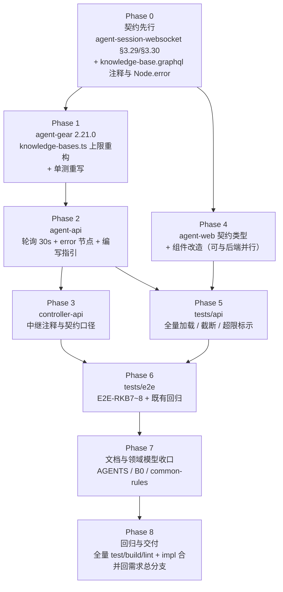

# 知识库优化二期 - 实现计划

**功能名称**: 知识库优化二期
**关联 PRD**: [`docs/product/draft/20261117-knowledge-base-optimization-phase2.md`](../../product/draft/20261117-knowledge-base-optimization-phase2.md)（v1.0）
**关联提案**: [`docs/engineering/proposals/20261117-feat-knowledge-base-optimization-phase2.md`](../proposals/20261117-feat-knowledge-base-optimization-phase2.md)（v1.0）
**计划版本**: v1.0
**创建日期**: 2026-11-17
**作者**: z-agent-bot
**需求总分支**: `feat/knowledge-base-optimization-phase2`（本计划直接提交到该分支）
**需求总 PR**: https://github.com/Deliay/z-agent-gear/pull/560
**feat-branch**: `feat/knowledge-base-optimization-phase2-impl`（开发分支，基于需求总分支切出；实现完成后合并回需求总分支，随 PR #560 收口）
**领域模型影响**: 提案已同步 `docs/knowledges/domain/B0-知识库/00-上下文概览.md` / `01-聚合与实体.md`、`00-领域模型库-索引.md` / `02-上下文地图.md` 与 `docs/engineering/common-rules.md`「仓库知识库约束」。本计划**不新增领域概念**，仅需按 D2/D4 回写两条既有口径：①「单文件超限文档以只读不可打开节点呈现（`error` 字段）」；②「`documentCount` 仅计可用文档」。

**上游评审结论**：PRD v1.0 / 提案 v1.0 经需求总 PR #560 提交（当前无 review、OPEN）。本计划按两文档 v1.0 推进；与提案的两处偏差（契约最小增量、轮询超时落点）在 §3 以 D2/D7 明确裁决，不改变产品口径。

**版本说明**：

- v1.0 首版：把提案 §5.2 的 6 个实现点拆成 9 个 Phase（契约 → agent-gear → agent-api → controller-api → agent-web → API 测试 → E2E 测试 → 文档/领域模型收口 → 交付），并补齐提案未覆盖的「文档级 `file too large` 如何在树上呈现」这一实现缺口（D2/D4）。

## 1. 实施顺序

严格按「契约 → 扫描器 → 服务端解析/指引 → 前端 → 测试收口 → 文档收口」推进，每个切片先写失败测试再实现（红-绿-重构）：



**关键路径**：Phase 1（扫描器上限重构）是需求语义本体——「取消总额限制 + 单文件夹 1000 + 单文件 1MiB」的唯一执行点；Phase 2 依赖 Phase 1 的回包形态（`truncated` 产生条件变化、文档级 `error` 保留）与 Phase 0 的契约字段。前端线（Phase 4）只依赖 Phase 0 的契约 SDL，可与 Phase 1/2 并行（按 z-coding 各用一个 subagent，各自从 impl 分支切工作分支、PR 回 impl，D1）。

### 关键约束（实现期不得回退）

- **响应结构最小增量**：仅 `RepoKnowledgeBaseNode` 新增可空 `error`（D2），其余字段/查询签名/事件载荷零变更；`truncated` 三级承载沿用（库级/来源级/整体）。
- **仓库为唯一事实源**：不落 MongoDB、不进知识库 MCP 工具、无任何写入口（现状不变）。
- **折叠懒加载**：`repoKnowledgeBaseHosts` 仍为纯 DB 读，零扫描；扫描只发生在「展开云电脑 / 缓存 miss / 重新检测」（现状不变）。
- **只读语义**：错误文档节点不可点击、不进入预览（`getDocument` 恒 null）。
- **不可回退的旧行为**：`knowledge-base.json` 超限整库 `error: 'file too large'` 且不读文档；单文档超限逐条剔除内容但保留可展示节点；权限失败整体 `permission denied`；目录不存在视为空。
- **禁止 rebase/squash**：遵循 z-git 规范，仅允许 merge。

## 2. 代码事实核对（计划期确认）

以下事实基于需求总分支 `feat/knowledge-base-optimization-phase2`（HEAD `71413e73`）实际代码。

| # | 事实 | 位置 | 对计划的影响 |
|---|------|------|--------------|
| F1 | 扫描器现行上限常量：`MAX_KNOWLEDGE_BASES_PER_SOURCE=20`、`MAX_DOCUMENTS_PER_BASE=50`、`MAX_SCHEMA_BYTES=64KiB`、`MAX_DOCUMENT_BYTES=128KiB`、`MAX_BASE_TOTAL_BYTES=1MiB`、`MAX_SOURCE_TOTAL_BYTES=2MiB`（全部导出） | `packages/agent-controller/src/knowledge-bases.ts:20-38` | Phase 1 删除前 1/2/5/6 四项与 3/4 合并为 `MAX_FILE_BYTES=1MiB`；新增 `MAX_ENTRIES_PER_FOLDER=1000` |
| F2 | `collectMarkdownFiles` 的 `walk` 每次 `readdir` 后**不排序、不截断**；收集完毕后在 `scanKnowledgeBase` 里对全量候选按 `relPath.localeCompare` 排序，再按 `MAX_DOCUMENTS_PER_BASE` 整库截断 | `knowledge-bases.ts:96-134,174-181` | 改为「每次 `readdir` 结果按 `entry.name.localeCompare` 排序后取前 1000（目录与文件合计）」，返回 `{files, truncated}`；最终仍整体排序保确定性（D3） |
| F3 | `scanKnowledgeBase` 逐文档 `stat` 预检 → 单库/单来源字节累计双闸 → `readFile` 后 `Buffer.byteLength` 复核双闸；单文档超限 `error:'file too large'` 不读内容；`knowledge-base.json` 超限整库 `error:'file too large'` | `knowledge-bases.ts:140-233` | 删除字节累计与文档数截断；保留 `stat` 预检 + 读后复核两道（统一 `MAX_FILE_BYTES`）；库级/文档级错误行为不变（D6） |
| F4 | `scanSource` 对来源目录 `readdir` 后按 `localeCompare` 排序，超过 20 截断并置来源 `truncated`；逐库把条目级 `truncated` 上浮到来源；`scanKnowledgeBases` 汇总整体 `truncated` | `knowledge-bases.ts:235-300` | 20 → 1000（D3）；来源级截断只置来源 `truncated:true`，不虚构库级截断；上浮路径不变（D5） |
| F5 | 错误归一 `mapFileError`：`EACCES/EPERM→permission denied`、`EFBIG/ERR_FS_FILE_TOO_LARGE→file too large`、其余 `not found`；来源目录读失败整体 `permission denied`；目录不存在该来源空列表 | `knowledge-bases.ts:63-104,235-300` | 白名单与失败口径零新增，前端契约类型的 `error` 直接复用该白名单文案 |
| F6 | agent-gear 当前版本 `2.20.0`；`AGENTS.md` 版本段与「仓库内建知识库扫描（2.19.0）」上限段需同步 | `packages/agent-controller/package.json:3`、`packages/agent-controller/AGENTS.md:60-61,96-110` | 版本升 MINOR 到 `2.21.0`；AGENTS 上限段改写为二期口径 |
| F7 | agent-api 轮询口径 `REPO_KB_POLL_INTERVAL_MS=500`、`REPO_KB_POLL_ATTEMPTS=30`（≈15s）；扫描失败统一 `repo knowledge base scan failed`；工作区级缓存 `repo-knowledge-bases:ws:{workspaceId}` EX 300；进程内 single-flight（无独立 TTL） | `servers/agent-api/src/services/repo-knowledge-bases.ts:27-34,182-190,584-635` | 仅 `ATTEMPTS 30→60`（≈30s）；缓存键/TTL/single-flight 零变更（D7） |
| F8 | controller-api `KnowledgeBasesService.handleScan` 只做「控制器→socketId→`socket.emit`」，**不存在等待/超时**；结果键写入 TTL 60s；注释中「轮询窗口 15s」为历史口径 | `servers/controller-api/src/services/knowledge-bases-service.ts:8-45` | 提案「中继等待 15s→30s」在代码中无对应物：Phase 3 仅改注释口径；契约 §3.30「约 15s 超时 / 500ms×30」改为 30s / ×60（D7） |
| F9 | 服务端解析在 `buildKnowledgeBase` 中对带 `error` 的文档直接 `continue`（**整条丢弃**），`documentCount` 只计通过校验的文档；`RepoKnowledgeBaseNode` 仅 `{kind,name,path}`（服务层/契约/前端类型三处一致） | `repo-knowledge-bases.ts:56-61,700-760`、`contracts/knowledge-base.graphql:171-178`、`apps/agent-web/src/graphql/knowledge-base.ts:334-338` | PRD 3.4 要求文档条目展示「文件过大」，现状骨架无字段承载 → D2 最小增量新增 `error: String` 并把错误文档保留为不可打开节点（D4） |
| F10 | `buildKnowledgeBaseChildren` 仅接受 `{path,title}` 列表，按 prefix 归并 FOLDER/DOCUMENT；不合法库 `listChildren` 返回 `[]`、`getDocument` 返回 `null` | `repo-knowledge-bases.ts:359-400,497-532` | 函数入参扩展可选 `error` 并透传到 DOCUMENT 节点；不合法库仍收敛 `[]`/`null` |
| F11 | `truncated` 在服务端原样透传（`raw.truncated === true`）并出现在 `RepoKnowledgeBase` 视图；前端已选择该字段但**未渲染任何标示** | `repo-knowledge-bases.ts:699-701,766-780`、`KnowledgeBase` GraphQL 选择集、`RepoKnowledgeBaseSection.tsx:133-185` | Phase 4 增加「已截断」徽标（D11），零契约变更 |
| F12 | `KnowledgeBaseSection` 空态条件：平台树 `loading && !data` → 「加载中…」；`items.length === 0` → 「暂无知识库」，与仓库分组是否渲染无关；`<RepoKnowledgeBaseSection />` 无 props | `apps/agent-web/src/components/knowledge-base/KnowledgeBaseSection.tsx:137-151,196-266` | hosts 查询上提 + 空态条件改为「平台空 且 hosts 已定态为空 且 查询成功」（D9） |
| F13 | `RepoKnowledgeBaseSection` 自行查询 hosts，`loading && !data`→加载中、`error`→失败重试、`hosts.length===0`→return null；`HostNode` 标题行是**单个 `<button>`** | `RepoKnowledgeBaseSection.tsx:237-283` | 改为 props 驱动；`HostNode` 拆为「折叠切换按钮 + 尾部图标按钮」两个兄弟按钮（禁止按钮嵌套，D10） |
| F14 | 「重新检测」现位于展开区 `RepoKnowledgeBaseList` 顶部独立一行（`刷新图标 + 文字`），仅在展开后挂载；实现为 `refetch({workspaceId, refresh:true})` + `client.cache.evict` 两个 field | `RepoKnowledgeBaseSection.tsx:187-223` | 整行移除；迁移到 `HostNode` 行尾并支持折叠态刷新（D10） |
| F15 | 编写指引 §3/§4/§6/§8 仍为旧上限（64KiB / 128KiB / 20 库 / 50 文档 / 1MiB / 2MiB）；防漂移守卫 T-RKB-P4 以字面量锚定，T-RKB-P2 断言上述锚点文本 | `servers/agent-api/src/services/knowledge-base-prompts.ts:83,110-118,134`、`knowledge-base-prompts.test.ts:26-58,64+` | Phase 2 改写文本与 P2/P4 锚点，锁死与实际加载规则同源（D12） |
| F16 | `knowledge-base` schema 契约测试按 `COMPARED_DEFINITIONS` 名单逐字段比对（含 `RepoKnowledgeBaseNode`），契约与 schema 同步即通过 | `servers/agent-api/src/graphql/schemas/knowledge-base.test.ts:18-60` | Phase 0/2 双写 `error` 字段即可，无需新增比对名单 |
| F17 | 存量用例与待改断言：扫描 `T-RKB-SCAN7/7b/7c`（库数/文档数/体积截断矩阵）；服务 `T-RKB-SVC4b`（文档级错误仅剔除）；前端 `T-RKB-WEB5`（展开区刷新按钮）；API fixture；E2E-RKB4（`repo-kb-refresh` 点击）/RKB6（空态零回归） | `knowledge-bases.test.ts:127-207`、`repo-knowledge-bases.test.ts:442-491`、`RepoKnowledgeBaseSection.test.tsx:189-208`、`tests/api/src/agent-api/repo-knowledge-base.test.ts`、`tests/e2e/src/repo-knowledge-base.spec.ts` | 按下表逐项改写；`T-RKB-SVC4b` 的「错误文档整条剔除」断言改为「节点保留 + error + 不可打开」 |
| F18 | `KnowledgeBaseSection.test.tsx` 的 `mockUseQuery` 已按文档名分流 `GetRepoKnowledgeBaseHosts`（返回空 hosts），hosts 上提后该 mock 结构可直接复用 | `apps/agent-web/.../__tests__/KnowledgeBaseSection.test.tsx:105-118` | Phase 4 测试改动小：新增空态矩阵用例即可 |
| F19 | 领域模型与规范已由提案同步：B0-知识库 00/01 已写二期上限表（含「单文件夹直接子项 ≤1000 / 无总额限制 / 文件超限语义」），`common-rules.md` 已写「单文件夹子项 ≤ 1000；单文件 ≤ 1 MiB；无文档数与总量限制」 | `docs/knowledges/domain/B0-知识库/00-上下文概览.md:116-126`、`01-聚合与实体.md:166-176`、`docs/engineering/common-rules.md` | Phase 7 仅补两条实现事实（错误文档节点、documentCount 口径），不重写上限表 |
| F20 | E2E fake controller 已支持 `repoKnowledgeBases` 可变 fixture 与 `scans[]` 计数；页面入口经 `sectionToggle('knowledgeBases')` 展开分区 | `tests/e2e/src/helpers.ts:304-330,358+`、`tests/e2e/src/repo-knowledge-base.spec.ts:16-96` | Phase 6 复用同一 fixture 机制，新增独立用户以隔离空态用例（D13） |

## 3. 计划期裁决（提案留白 / 含混处 / 提案偏差的实现口径）

| 编号 | 裁决 | 理由 |
|------|------|------|
| D1 | 本计划直接提交到需求总分支 `feat/knowledge-base-optimization-phase2`（随 PR #560 呈现）；实现另切 `feat/knowledge-base-optimization-phase2-impl`，后端线（agent-gear + agent-api）与前端线（agent-web）各从 impl 切工作分支、PR 回 impl；impl 全绿后合并回需求总分支 | 本节点要求「提交到需求总分支」；沿用 `feat/knowledge-base-repo-built-in(-impl)` 双分支先例；PR #560 已预告实现另切分支 |
| D2 | **契约最小增量**：`RepoKnowledgeBaseNode` 新增可空字段 `error: String`（白名单文案，当前仅 `file too large`），用于「文件过大」文档节点；其余仓库知识库契约零变更 | 提案称「响应结构零变更」，但 PRD 3.4 明确要求**文档条目**展示「文件过大」；现状服务端直接丢弃错误文档（F9），无字段可承载。纯增量可空字段向后兼容，是满足验收的最小改动 |
| D3 | 「单文件夹直接子项 ≤1000」的计数对象 = 该文件夹 `readdir` 的**直接子项（目录 + 文件合计）**；对两个来源目录（知识库文件夹层）与库内每个目录层同样生效；每层按 `entry.name.localeCompare` 排序取前 1000，超出部分不遍历；被截断目录所属知识库置 `truncated:true`，来源目录被截断置来源 `truncated:true` | 与提案 D3 和 PRD 措辞一致；在遍历层执行才能真正限制扫描工作量（现有「先全量收集后排序」会先遍历全部） |
| D4 | 单文档 `error` 的呈现：错误文档仍进入 `children` 列表，节点为 `{kind:'DOCUMENT', name:文件名去 .md, path:归一后路径, error:'file too large'}`；不计入 `documentCount`、不进入 `documents` 数组、`getDocument` 恒 null、不使知识库不合法；路径归一失败则丢弃该节点（极端脏数据） | 满足「标示文件过大且不进入预览」，同时保证 PRD「不影响同库其他文档」与现有一致性校验（冲突/非法路径）优先级 |
| D5 | `truncated` 上浮路径保持「文件夹 → 知识库 → 来源 → 整体」；来源目录层截断只置来源与整体 `truncated`，不绑定到任一知识库 | 契约三级字段结构与语义沿用（提案 D4）；避免为文件夹级新增字段 |
| D6 | 单文件上限统一 `MAX_FILE_BYTES = 1024*1024`，`knowledge-base.json` 与 `.md` 同值；`stat` 预检 + 读后 `Buffer.byteLength` 复核两道保留；超限语义不变（schema 超限整库 error、文档超限逐条 error） | 提案 D2；读后复核防 `stat` 与实际读取不一致（保留既有防御） |
| D7 | 扫描等待窗口只改 agent-api 轮询：`REPO_KB_POLL_ATTEMPTS 30→60`（500ms×60≈30s）；Redis 结果键 TTL 60s 不变；controller-api **无逻辑改动**，仅同步注释口径；契约 §3.30「约 15s 超时 / 500ms × 30」改为「约 30s / 500ms × 60」 | 代码事实 F8：中继没有等待逻辑，`workflow-templates:scan` 同型链路不动；TTL 60s > 30s 仍安全 |
| D8 | agent-gear 版本 `2.20.0 → 2.21.0`；**不提升** `isRepoKnowledgeBaseScanSupported` 门禁（保持 ≥2.19.0） | 提案 D8；旧 worker 按旧上限截断只是内容不全、无错误，属优雅降级；提升门禁会让存量云电脑整组不可用 |
| D9 | hosts 查询上提到 `KnowledgeBaseSection`（`cache-and-network`），以 props `{hosts, loading, error, onRetry}` 下发给 `RepoKnowledgeBaseSection`；空态渲染条件：`items.length===0` 且 `hostsError` 为空 且 hosts 已定态（`!hostsLoading || !!hostsData`）且 `hosts.length===0` 才展示「暂无知识库」；平台空 + hosts 在途展示「加载中…」（不展示空态文案）；hosts 查询失败不展示空态（分组自渲染「加载失败 + 重试」）；平台非空行为不变 | PRD 功能点 1 与 3.5 异常表；同查询同变量 Apollo 自动去重，避免二次请求；失败态优先展示可重试信息而非误导性空态 |
| D10 | 「重新检测」实现：`HostNode` 持有云电脑级列表查询（`useQuery(GET_REPO_KNOWLEDGE_BASES, {variables:{workspaceId}, skip:!expanded, fetchPolicy:'cache-and-network'})`），`RepoKnowledgeBaseList` 退化为展示组件（`bases/loading/error/onRetry` props）；刷新时展开态走 `refetch({workspaceId, refresh:true})`，折叠态走 `client.query({..., variables:{workspaceId, refresh:true}, fetchPolicy:'network-only'})`（结果写服务端缓存，展开时自然取到）；两种路径随后 `client.cache.evict({fieldName:'repoKnowledgeBaseDocumentChildren'|'repoKnowledgeBaseDocument'})`；按钮渲染仅限 `scanSupported`，`title`/`aria-label` 恒为「重新检测」，刷新中禁用 + `RefreshCw` 旋转，失败 toast「重新检测失败，请重试」 | 提案 §5.2 实现点 5 与 D5：折叠态必须有即时反馈；标题行拆两个兄弟按钮避免 `<button>` 嵌套；`client.query` 与 `refetch` 分别覆盖「列表未挂载/已挂载」两种状态 |
| D11 | 标示口径：知识库条目在 `truncated===true` 时渲染 `Badge`「已截断」（`data-testid="repo-kb-truncated-badge"`，`title` 说明「单文件夹子项超过 1000，按名称排序展示前 1000 项」）；文档节点 `error` 非空时灰显、无链接、展示「文件过大」徽标（`data-testid="repo-kb-document-error"`）；`knowledge-base.json` 超限整库沿用不合法库灰显 + `errors[0]` | PRD 3.4 表格；避免「静默少内容」；复用既有不合法库展示形态 |
| D12 | 编写指引口径：§3 文件上限改 1MiB；§4 单文档上限改 1MiB；§6 上限表改为三行「单文件（文档与 knowledge-base.json）≤ 1MiB / 单个文件夹直接子项（目录与文件合计）≤ 1000（超出截断）/ 文档数、知识库数、内容累计无上限」；§8 自检清单同步；防漂移守卫锚点改为 `1MiB`、`1000`、`无上限`/`不再限制`，并**移除** `20 个`/`50 个`/`64KiB`/`128KiB`/`2MiB` 旧锚点 | 提案 §5.2 实现点 3 与 D12；守卫必须能捕获上限口径回退 |
| D13 | E2E 空态矩阵使用**独立用户**隔离共享状态（平台库空 + 仓库分组存在、两者皆空、平台非空三种状态各用独立用户/工作区），避免既有 `E2E-RKB6` 创建的平台库污染后续用例；`E2E-RKB7` 排在 `E2E-RKB6` 之前或互不共享数据 | 现有 spec 在同一用户下建平台库（F20），串行执行会互相影响；新用例必须确定可重复 |

## 4. 变更清单

### 4.1 Phase 0：契约（先于代码）

| 文件 | 变更 |
|------|------|
| `contracts/agent-session-websocket.md` §3.29 | **约束**段「数量与体积上限」整条改写：每个文件夹直接子项（目录与文件合计）按 `localeCompare` 排序取前 1000（超出截断，知识库→来源→整体逐级 `truncated`）；`knowledge-base.json` >1 MiB 整库 `error:'file too large'`（不解析 schema、不读文档）；单文档 >1 MiB 该文档 `error:'file too large'`（不读内容，仍返回该文档条目）；无每库文档数 / 每来源知识库数 / 内容累计上限 |
| `contracts/agent-session-websocket.md` §3.30 | 字段表：`schema` 注释「≤64 KiB」→「≤1 MiB」；`documents[]` 注释补充「超限文档保留条目并附 `error`」；`knowledgeBases[].truncated` / `sources[].truncated` / `truncated` 注释改为「因单文件夹直接子项超 1000 截断」；**服务端行为**步骤 2/3：约 15s 超时 → 约 30s，`500ms × 30` → `500ms × 60` |
| `contracts/knowledge-base.graphql` | `RepoKnowledgeBase.truncated` 注释改为「因单文件夹直接子项超 1000 截断」；`RepoKnowledgeBaseNode` 新增 `# 文档级不可用原因（白名单文案，如 file too large）；非空时该文档不可打开 error: String`（D2） |

验收：三处契约无其他结构变更；`print()` 后 `knowledge-base` 契约测试（F16）与实现逐字段一致；上限文案与 §5 测试矩阵逐条可追溯。

### 4.2 Phase 1：agent-gear 扫描模块（TDD，版本 2.21.0）

| 文件 | 变更 |
|------|------|
| `packages/agent-controller/src/knowledge-bases.ts` | 常量：删 `MAX_KNOWLEDGE_BASES_PER_SOURCE` / `MAX_DOCUMENTS_PER_BASE` / `MAX_BASE_TOTAL_BYTES` / `MAX_SOURCE_TOTAL_BYTES`；`MAX_SCHEMA_BYTES`/`MAX_DOCUMENT_BYTES` 合并为 `MAX_FILE_BYTES = 1024*1024`；新增 `MAX_ENTRIES_PER_FOLDER = 1000`。`collectMarkdownFiles` 改为返回 `{ files: DocCandidate[]; truncated: boolean }`：`walk` 内每次 `readdir` 按 `entry.name.localeCompare` 排序，`length > 1000` 时 `slice(0,1000)` 并置位；符号链接过滤逻辑与「子目录不可读按空目录」口径保持不变。`scanKnowledgeBase`：schema `stat`/读后均用 `MAX_FILE_BYTES`；删文档数与字节累计；单文档 `stat` 超限推 `{path, error:'file too large'}`（不读）；读后 `Buffer.byteLength` 复核再剔除（保守，防 stat 失真）；合并 `collectMarkdownFiles().truncated` 到库级 `truncated` 并返回。`scanSource`：来源目录 `folders` 排序后 >1000 截断置来源 `truncated`；删 20 库限制与逐库 `state.truncated` 中断逻辑（保留条目级上浮）。模块头注释改为二期口径 |
| `packages/agent-controller/src/knowledge-bases.test.ts` | 删除 `T-RKB-SCAN7/7b/7c` 旧矩阵，改为 §5.1 的 `T-RKB2-SCAN1~5`；保留 `T-RKB-SCAN1~6/8` 全量回归（识别规则/错误口径/符号链接零变化） |
| `packages/agent-controller/package.json` | `version`: `2.20.0` → `2.21.0`（MINOR） |
| `packages/agent-controller/AGENTS.md` | 版本段补「扫描上限二期口径自 2.21.0 起」；「仓库内建知识库扫描（2.19.0）」标题改（2.21.0）并重写上限段（单文件夹 1000 / 单文件 1MiB / 无总额限制 / 错误文档保留条目） |

验收：`pnpm run test`（新增矩阵全绿）+ `pnpm run build`；既有扫描识别用例零回归；不新增依赖。

### 4.3 Phase 2：agent-api（TDD，先红后绿）

| 文件 | 变更 |
|------|------|
| `servers/agent-api/src/services/repo-knowledge-bases.ts` | `REPO_KB_POLL_ATTEMPTS 30→60`；`RepoKnowledgeBaseNode` 增 `error?: string`；`CachedRepoKnowledgeBase` 增 `errorDocuments: Array<{path:string; title:string; error:string}>`；`buildKnowledgeBase`：`rawDoc.error` 非空时归一路径（复用 `parseRepoDocument(rawPath, '')` 的 `path`/`title`，归一失败丢弃）并推入 `errorDocuments`，不再静默 `continue`；`buildKnowledgeBaseChildren(docs, prefix, errorDocs?)` 或统一入参 `Array<{path,title,error?}>`：DOCUMENT 节点透传 `error`；`listChildren` 合并 `documents` + `errorDocuments`；`documentCount` 仍只计可用文档（D4）；注释同步（文件头上限说明、§3.30 轮询窗口） |
| `servers/agent-api/src/services/repo-knowledge-bases.test.ts` | 改写 `T-RKB-SVC4b` 断言；新增 `T-RKB2-SVC1~3`（§5.1） |
| `servers/agent-api/src/services/knowledge-base-prompts.ts` | §3/§4/§6/§8 上限口径按 D12 改写；文件头常量来源注释改为 `MAX_FILE_BYTES` / `MAX_ENTRIES_PER_FOLDER` |
| `servers/agent-api/src/services/knowledge-base-prompts.test.ts` | `T-RKB-P2` 锚点改为 `.zag/knowledges/`、`docs/knowledges/`、`1MiB`、`1000`、`无上限`（或「不再限制」）并删除旧上限锚点；`T-RKB-P4` 防漂移字面量同步（`20 个`/`50 个`/`64KiB`/`128KiB`/`2MiB` 断言改为不存在 + 新值存在） |
| `servers/agent-api/src/graphql/schemas/knowledge-base.ts` | `RepoKnowledgeBaseNode` 增 `error: String`（与契约逐字双写） |
| `servers/agent-api/AGENTS.md` | 仓库知识库段（:590-615 附近）上限、错误文档节点、轮询 30s、编写指引口径同步 |

验收：`pnpm run test` + `pnpm run build`；`repo-knowledge-bases` 解析/缓存/查询行为除错误文档呈现外零变化；防漂移守卫变红→同步后变绿。

### 4.4 Phase 3：controller-api（仅口径）

| 文件 | 变更 |
|------|------|
| `servers/controller-api/src/services/knowledge-bases-service.ts` | 仅注释：`KNOWLEDGE_BASES_RESULT_TTL_SECONDS` 说明「轮询窗口 15s」→「30s」；逻辑零变更（D7） |
| `servers/controller-api/AGENTS.md`（如涉及） | 若存在轮询窗口描述，同步 30s；无则不改 |

验收：`pnpm run test` + `pnpm run build` 通过；`knowledge-bases-service.test.ts` 零改动仍绿（证明纯注释）。

### 4.5 Phase 4：agent-web（TDD，与后端并行）

| 文件 | 变更 |
|------|------|
| `apps/agent-web/src/graphql/knowledge-base.ts` | `RepoKnowledgeBaseNodeData` 增 `error?: string | null`；`GET_REPO_KNOWLEDGE_BASE_CHILDREN` 选择集增 `error` |
| `apps/agent-web/src/components/knowledge-base/KnowledgeBaseSection.tsx` | 新增 `useQuery<GetRepoKnowledgeBaseHostsQuery>(GET_REPO_KNOWLEDGE_BASE_HOSTS, {fetchPolicy:'cache-and-network'})`；空态按 D9 条件渲染（平台加载中或 hosts 在途 → 「加载中…」；双空 → 「暂无知识库」；hosts 失败 → 不展示空态）；`<RepoKnowledgeBaseSection hosts loading error onRetry />` 传 props |
| `apps/agent-web/src/components/knowledge-base/RepoKnowledgeBaseSection.tsx` | 删除内部 hosts 查询，改为 props 驱动（`loading && !data` 形态由 props 表达）；`HostNode`：行容器 flex，折叠切换按钮（`flex-1`，保留 `aria-expanded`/禁用逻辑）+ `scanSupported` 时的尾部图标按钮（`aria-label="重新检测"`、`title="重新检测"`、`data-testid="repo-kb-refresh"`、刷新中 disabled + `animate-spin`）；`HostNode` 持有 bases 查询（`skip:!expanded`）与 D10 刷新逻辑，`RepoKnowledgeBaseList` 改为接收 `bases/loading/error/onRetry`；删除展开区独立刷新行；`KnowledgeBaseItem` 增「已截断」徽标（D11）；`FolderNode` DOCUMENT 分支：`node.error` 非空 → 灰显无链接 + 「文件过大」徽标（`data-testid="repo-kb-document-error"`），否则保持原链接 |
| `apps/agent-web/src/components/knowledge-base/__tests__/KnowledgeBaseSection.test.tsx` | 新增 `T-RKB2-WEB1~3`（§5.1）；既有 `T-KBW1~4` 零回归（hosts mock 结构复用，F18） |
| `apps/agent-web/src/components/knowledge-base/__tests__/RepoKnowledgeBaseSection.test.tsx` | 组件改为传 props 渲染；改写 `T-RKB-WEB5`（刷新入口迁至 cloud host 行尾）；新增 `T-RKB2-WEB4~5`（§5.1）；`T-RKB-WEB1~4/6` 适配 props 与查询上提 |
| `apps/agent-web/AGENTS.md` | 「仓库内建知识库（#545）」段更新：空态双空口径、hosts 上提、行尾图标刷新（折叠可点）、已截断/文件过大标示、`RepoKnowledgeBaseNode.error` |

验收：`pnpm run test` + `pnpm run build` + `pnpm run lint`；E2E 入口 testid 与既有 `repo-kb-refresh` 保持一致。

### 4.6 Phase 5：tests/api（真实 agent-api + fake controller relay）

| 文件 | 变更 |
|------|------|
| `tests/api/src/agent-api/repo-knowledge-base.test.ts` | `REPO_KB_CHILDREN` 选择集增 `error`；`SCAN_FIXTURE` 增「单文档 `error:'file too large'`」与「`truncated:true` 库」；新增 `T-RKB2-API1~3`（§5.1）；既有 `T-RKB-API1~6/8` 适配（`T-RKB-API4` 断言错误文档节点存在且 `error` 透传） |
| `tests/api/AGENTS.md`（如列出用例矩阵） | 增补新用例编号 |

验收：`pnpm run test`（无 Mongo 套件 skip、有 Mongo 全绿）；真实 GraphQL 字段选择不报 unknown field。

### 4.7 Phase 6：tests/e2e（Playwright）

| 文件 | 变更 |
|------|------|
| `tests/e2e/src/repo-knowledge-base.spec.ts` | fixture 增 `error:'file too large'` 文档与 `truncated:true` 库；`E2E-RKB2` 增断言「已截断」徽标与「文件过大」节点不可点击；`E2E-RKB4` 适配行尾刷新（折叠态点击后展开可见新内容）；新增 `E2E-RKB7`（空态三态，D13 独立用户）、`E2E-RKB8`（刷新按钮位于云电脑条目标题行尾部、无文字、折叠态点击生效、重复点击禁用） |
| `tests/e2e/AGENTS.md` | 仓库内建知识库 E2E 段改为 E2E-RKB1~8，补 RKB7/8 描述并更新 RKB4/6 口径 |

验收：`pnpm run test`（依赖 `MONGODB_URI` 的用例在本机/Aspire 全量环境跑通）；无 `MONGODB_URI` 时既有 skip 口径不变。

### 4.8 Phase 7：文档与领域模型收口

| 文件 | 变更 |
|------|------|
| `docs/knowledges/domain/B0-知识库/01-聚合与实体.md` | `RepoKnowledgeBase` 行补「错误文档以 `error` 节点呈现且不计入 `documentCount`」；`RepoKnowledgeBaseNode` 补 `error`（可空，白名单文案） |
| `docs/knowledges/domain/B0-知识库/00-上下文概览.md` | 上限语义行补「文档级 `file too large` 保留不可打开节点」；不重写上限表（F19） |
| `docs/engineering/AGENTS.md` | 实现计划清单追加本计划条目（随本计划提交） |
| `docs/engineering/common-rules.md` | 核对「仓库知识库约束」行与新口径一致（提案已改，若发现偏差以代码为准回写） |
| `packages/agent-controller/AGENTS.md` / `servers/agent-api/AGENTS.md` / `apps/agent-web/AGENTS.md` / `tests/e2e/AGENTS.md` | 如 Phase 1~6 未同步，此处补齐（各 Phase 已列，避免重复） |

验收：领域模型与契约/代码逐条可验证；PR 描述列出受影响领域模型文档。

### 4.9 Phase 8：回归与交付

- 全量 `test` / `build` / `lint`；agent-gear、agent-api、controller-api、agent-web、tests/api、tests/e2e 逐包绿灯。
- 关键回归清单：平台托管知识库（列表/树/预览/编辑/历史/设置/MCP 六工具）、仓库知识库识别规则与只读语义、工作流模板扫描（`workflow-templates:scan`）、`fs:read-file`。
- `feat/knowledge-base-optimization-phase2-impl` 全绿后合并回需求总分支（merge，不 rebase/squash），随 PR #560 收口。

## 5. 测试矩阵

### 5.1 用例清单

| 编号 | 层级 | 覆盖 |
|------|------|------|
| `T-RKB2-SCAN1` | agent-gear 单测 | 单库 >50 篇文档且累计 >1 MiB：全部加载、`truncated:false`、无字节/数量截断 |
| `T-RKB2-SCAN2` | agent-gear 单测 | 单文件夹 >1000 直接子项（目录+文件混合）→ 仅前 1000（`localeCompare`）被遍历/收录，库级 `truncated:true` 上浮到来源与整体；其余目录不受影响 |
| `T-RKB2-SCAN3` | agent-gear 单测 | 单文档 >1 MiB → 该文档 `error:'file too large'` 不读内容，其余文档正常；库 `truncated:false` |
| `T-RKB2-SCAN4` | agent-gear 单测 | `knowledge-base.json` >1 MiB → 整库 `error:'file too large'`，不解析 schema、不读文档 |
| `T-RKB2-SCAN5` | agent-gear 单测 | 来源目录 >1000 子文件夹 → 前 1000 被识别，来源与整体 `truncated:true`；知识库条目级 `truncated` 不被误置 |
| `T-RKB2-SVC1` | agent-api 单测 | 扫描回包含 `error` 文档 → 列表 `documentCount` 不计入；`children` 返回带 `error` 的 DOCUMENT 节点；`getDocument('/big')` 为 null；库 `valid:true` |
| `T-RKB2-SVC2` | agent-api 单测 | `truncated:true` 库原样透传到视图；`buildKnowledgeBaseChildren` 中文件夹在前、错误文档与正常文档同组按名排序 |
| `T-RKB2-SVC3` | agent-api 单测 | 错误文档路径归一失败时丢弃该节点、不影响其余文档与库合法性 |
| `T-RKB2-P1` | agent-api 单测 | 编写指引含 `1MiB`/`1000`/无总额上限表述，且不含 `20 个`/`50 个`/`64KiB`/`128KiB`/`2MiB`；扫描器常量防漂移守卫（T-RKB-P4 改写） |
| `T-RKB2-WEB1` | agent-web 组件 | 平台库空 + hosts 非空 → 不出现「暂无知识库」，仓库分组正常展示 |
| `T-RKB2-WEB2` | agent-web 组件 | 平台库空 + hosts 空（已定态）→ 出现「暂无知识库」 |
| `T-RKB2-WEB3` | agent-web 组件 | hosts 在途 → 不出现「暂无知识库」（展示加载中）；hosts 失败 → 不出现空态、展示「加载失败 + 重试」 |
| `T-RKB2-WEB4` | agent-web 组件 | 刷新按钮位于云电脑条目标题行尾部、仅图标（`aria-label`/`title`「重新检测」）、无文字；折叠态点击触发 `refresh:true` 且失效子查询；展开态点击走 `refetch`；刷新中禁用；`scanSupported=false` 不渲染 |
| `T-RKB2-WEB5` | agent-web 组件 | `truncated:true` 库展示「已截断」；`error` 文档节点灰显「文件过大」、无链接；正常文档仍可导航 |
| `T-RKB2-API1` | tests/api | 超过原总额上限的 fixture（>50 文档 / 累计 >1 MiB）全量返回、`truncated:false` |
| `T-RKB2-API2` | tests/api | `children` 返回 `error` 字段；`documentCount` 不含错误文档；错误文档 `repoKnowledgeBaseDocument` 为 null |
| `T-RKB2-API3` | tests/api | 截断 fixture（`truncated:true`）在列表与 children 上口径一致，不报错 |
| `E2E-RKB7` | E2E | 空态三态：平台空+仓库有内容（无「暂无知识库」）、两者皆空（有）、平台非空（无）；独立用户隔离 |
| `E2E-RKB8` | E2E | 刷新图标在云电脑条目标题行尾部、无文字、悬停提示；折叠态点击后展开看到新内容；重复点击不异常 |
| 既有回归 | 全层 | `T-RKB-SCAN1~6/8`、`T-RKB-SVC1~13`（除 4b 改写）、`T-RKB-P1~P3`、`T-RKB-WEB1~4/6`、`T-RKB-API1~6/8`、`E2E-RKB1~6`、平台知识库全链路（`T-KB*` / `E2E-KB1~9`）、`workflow-templates:scan` 与 `fs:read-file` |

### 5.2 回归重点

- **平台托管知识库零回归**：`KnowledgeBaseSection` 新增 hosts 查询后，平台库列表/空态/「+」/树点击不改变；`T-KBW1~4` 全绿。
- **懒加载零破坏**：初始挂载只发 hosts 查询；`scans[]` 在未展开时保持为空（E2E-RKB1）。
- **只读语义**：错误文档节点无链接、无编辑/删除/历史入口；仓库知识库仍不出现在 MCP 工具结果。
- **上传/渲染体量**：大 fixture 用例避免在单测里构造 >1000 MiB；按「每文件 ~1 KiB × 1001 项」构造截断矩阵即可。

## 6. 命令参考

```bash
# 服务编排（全链路联调）
aspire start
aspire describe

# agent-gear 扫描模块
pnpm --dir packages/agent-controller test
pnpm --dir packages/agent-controller build

# 服务端
pnpm --dir servers/agent-api test
pnpm --dir servers/agent-api build
pnpm --dir servers/controller-api test
pnpm --dir servers/controller-api build

# 前端
pnpm --dir apps/agent-web test
pnpm --dir apps/agent-web build
pnpm --dir apps/agent-web lint

# 集成测试
pnpm --dir tests/api test
pnpm --dir tests/e2e test          # 需 Aspire 全量 + INTERNAL_API_TOKEN + MONGODB_URI
pnpm --dir tests/e2e typecheck

# 单测聚焦
pnpm --dir packages/agent-controller exec vitest run src/knowledge-bases.test.ts
pnpm --dir servers/agent-api exec vitest run src/services/repo-knowledge-bases.test.ts
pnpm --dir apps/agent-web exec vitest run src/components/knowledge-base/__tests__/RepoKnowledgeBaseSection.test.tsx
```

## 7. 验收 checklist

- [ ] Phase 0：契约 §3.29/§3.30 上限口径与 `RepoKnowledgeBaseNode.error` 落库，`knowledge-base` 契约对齐测试通过
- [ ] Phase 1：扫描器上限重构完成，`T-RKB2-SCAN1~5` 全绿，agent-gear 2.21.0
- [ ] Phase 2：轮询 30s、错误文档节点、`documentCount` 口径、编写指引与防漂移守卫同步
- [ ] Phase 3：controller-api 注释口径同步，逻辑零变更
- [ ] Phase 4：空态双空收敛、行尾图标刷新（折叠可点）、已截断/文件过大标示
- [ ] Phase 5：tests/api 新用例通过，既有仓库知识库 API 用例回归
- [ ] Phase 6：E2E-RKB7~8 通过，E2E-RKB1~6 回归
- [ ] Phase 7：领域模型 B0-知识库两条事实回写，`common-rules` 与各 AGENTS 索引同步
- [ ] Phase 8：全量 test/build/lint 绿；impl 分支合并回需求总分支并随 PR #560 收口
- [ ] 产品验收标准逐条对照 PRD §1.3 / §3.2 / §3.5（含「旧版 worker 按旧上限加载、展示侧不报错」兼容口径）

## 8. 风险与回滚

| 风险 | 影响 | 缓解 / 回滚 |
|------|------|-------------|
| 取消总额限制后单次扫描结果与 Redis value 体积上浮（提案 D6） | 极端仓库（多层 1000×1 MiB）可产生大 Socket.IO 报文与 Redis value | 需求明确不设总量安全阀；PRD 非功能已记录；如线上出现极端仓库，后续演进「列表缓存不含文档内容、文档按需读取」，不改对外口径 |
| 扫描耗时超过 30s 被误判为失败 | 超大仓库展开报 `repo knowledge base scan failed` | 轮询窗口 30s + 结果键 TTL 60s；失败可重试；后续可只调大 `REPO_KB_POLL_ATTEMPTS`（常量，无迁移） |
| 前端 hosts 上提引入平台空态误判 | 「暂无知识库」在仓库分组存在时闪现 | D9 条件包含「hosts 已定态」与「查询成功」；`T-RKB2-WEB1~3` 锁死三态 |
| 行尾刷新在折叠态触发扫描但列表未挂载 | 用户看不到即时结果 | 服务端缓存已刷新；展开时 `cache-and-network` 取新缓存；按钮加载态与 toast 提供反馈（D10） |
| 契约新增可空字段与提案「零结构变更」不一致 | 契约评审关注点 | D2 已在计划显式记录；纯增量可空字段，旧客户端不选择该字段即零影响 |
| 旧 worker（2.19.0/2.20.0）按旧上限加载 | 展示可能仍截断且无「已截断」语义 | 优雅降级、不报错；随 agent-gear 自动升级获取新上限（D8） |
| 回滚 | 需撤销二期口径 | 上限常量与解析逻辑为本期增量；回滚 = revert 对应 commit（agent-gear 回退版本号并重新发布、服务端回退轮询常量、前端回退组件），无数据迁移需处理 |

## 9. 相关文档

- PRD：[`docs/product/draft/20261117-knowledge-base-optimization-phase2.md`](../../product/draft/20261117-knowledge-base-optimization-phase2.md)
- 技术提案：[`docs/engineering/proposals/20261117-feat-knowledge-base-optimization-phase2.md`](../proposals/20261117-feat-knowledge-base-optimization-phase2.md)
- 上游实现计划：[`docs/engineering/plan/20261116-feat-knowledge-base-repo-built-in.md`](20261116-feat-knowledge-base-repo-built-in.md)
- 契约：`contracts/agent-session-websocket.md` §3.29/§3.30、`contracts/knowledge-base.graphql`
- 领域模型：`docs/knowledges/domain/B0-知识库/`
- 需求来源：[GitHub Issue #559](https://github.com/Deliay/z-agent-gear/issues/559)
- 需求总 PR：[#560](https://github.com/Deliay/z-agent-gear/pull/560)
