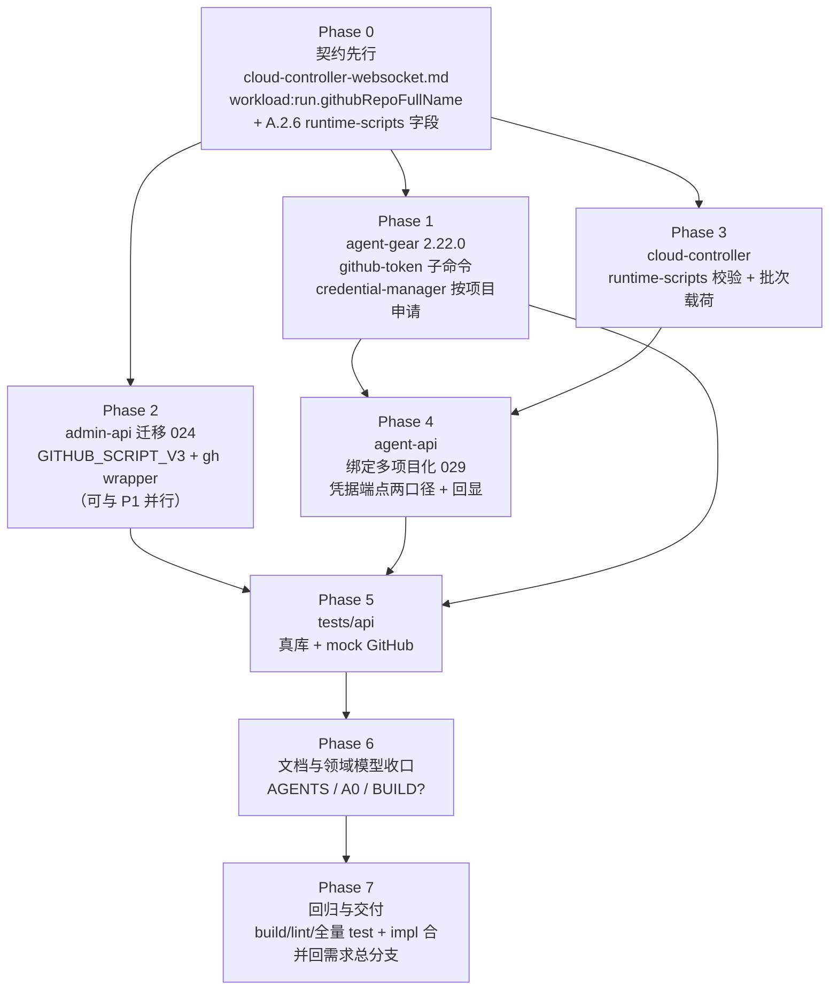

# 云电脑为不同项目获取不同的 Token - 实现计划

**功能名称**: 云电脑为不同项目获取不同的 Token
**关联 PRD**: [`docs/product/draft/20261118-github-project-token.md`](../../product/draft/20261118-github-project-token.md)（v1.0）
**关联提案**: [`docs/engineering/proposals/20261118-feat-github-project-token.md`](../proposals/20261118-feat-github-project-token.md)（v1.0）
**计划版本**: v1.0
**创建日期**: 2026-11-18
**作者**: z-agent-bot
**需求总分支**: `feat/github-project-token`（本计划直接提交到该分支）
**需求总 PR**: https://github.com/Deliay/z-agent-gear/pull/568
**feat-branch**: `feat/github-project-token-impl`（开发分支，基于需求总分支切出；实现完成后合并回需求总分支，随 PR #568 收口）
**领域模型影响**: 提案已同步 `docs/knowledges/domain/A0-GitHub集成/00-上下文概览.md` / `01-聚合与实体.md`（绑定组合唯一、项目级签发派生规则、核心不变量 4/8/9）。本计划不新增领域概念，仅需在 Phase 6 回写**一条既有口径**：`CloudHostGithubBinding` 被「默认分支解析」反查时必须按 **clone 路径匹配多条绑定**（一机多项目后不能再取首条）。

**上游评审结论**: PRD v1.0 / 提案 v1.0 经需求总 PR #568 提交（OPEN，暂无 review）。本计划按两文档 v1.0 推进；与提案的偏差（clone 前置凭据的 wrapper 绕行、agent-gear 二进制解析回退、stdout 污染约束、`gh` 版本 marker 硬校验口径）在 §3 以 D 编号显式裁决，均不改变产品口径。

**版本说明**

- v1.0 首版：把提案 §5.2 的 6 个实现点拆成 8 个 Phase（契约 → agent-gear → 工作负载脚本 → cloud-controller → agent-api → API 测试 → 文档/领域模型收口 → 回归交付），并把提案未覆盖的四处实现缺口落成可执行任务：① Git 设置脚本的 `gh repo clone` 在 wrapper 生效后会误用「当前 cwd 项目」的 token，必须显式绕行；② wrapper 里 `agent-gear` 依赖 PATH，非登录 shell / `sudo` 下会退化为 127；③ `github-token` 子命令必须零 stdout 日志（agent-gear 的 pino 同步写 fd 1）；④ 旧迁移 019 的 Github 幂等审计目标需同步到 V3，否则每次启动都会误报「manager 已自定义脚本」。

## 1. 实施顺序

严格「契约 → 容器命令（agent-gear + 工作负载脚本）→ 下发链路（cloud-controller → agent-api）→ 测试收口 → 文档收口」，每个切片先写失败测试再实现（红-绿-重构）：



**关键路径**：Phase 2（wrapper 落点与幂等收敛）与 Phase 1（项目解析 + 凭据申请）共同决定功能是否成立；Phase 4 决定「不同项目不同 token」的真实性（绑定与签发必须按仓库）；Phase 3 只影响 clone 前置凭据的正确性（不阻塞主链路）。两条线（P1/P2）无代码依赖，可按 z-coding 并行分发 subagent，各自从 `feat/github-project-token-impl` 切工作分支、PR 回 impl。

### 关键约束（实现期不得回退）

- **只提示、不报错退出**：wrapper 自身唯一非零退出场景是「找不到真实 gh」（127）。任何 token 获取失败都必须 `exec` 原生 gh，退出码恒为 gh 自身语义。
- **token 红线**：token 只存在于 wrapper 进程内存与单次 gh 子进程 env；不落盘、不进 argv、不进日志、不进提示信息。
- **不引入容器侧 token 缓存**：每次调用即时申请（服务端 `repoTokenCache` 兜住铸造成本），保证权限变化即时生效。
- **无 body = 主项目语义逐字不变**：旧 agent-gear / 周期续期路径的请求/响应/错误码零变化（除响应**新增** `repoFullName` 回显）。
- **安装脚本任意状态重复执行收敛**：镜像预装 gh / 旧脚本容器（无 wrapper）/ 新脚本容器，最终都收敛到同一份 wrapper（版本 marker + SKIP 硬校验）。
- **禁止 rebase/squash**：遵循 z-git 规范，仅允许 merge。

## 2. 代码事实核对（计划期确认）

以下事实基于需求总分支 `feat/github-project-token`（HEAD `46476c6d`）实际代码。

| # | 事实 | 位置 | 对计划的影响 |
|---|------|------|--------------|
| F1 | Github 预制脚本现状：`GITHUB_INIT_SCRIPT`（V1，无 sudo，`command -v gh → gh --version → exit 0`）经 012 变换为 `GITHUB_SCRIPT_V2 = sudoRootWrites(withSudo(V1))`；019 的幂等审计把 `oldScripts:[V1]` 收敛到 V2 | `servers/admin-api/src/migrations/007-preset-github.ts:20`、`012-worker-user-scripts.ts:21-48`、`019-workload-idempotent-anchors.ts:162-167` | 024 的 `oldScripts` 必须为 `[V1, V2]`；且 019 的 github target 需同步到 V3，否则 DB 已是 V3 时每次启动告警「script modified by admin」 |
| F2 | `withSudo` / `sudoRootWrites` 是 012 的**私有函数**（未导出），且后续新脚本（015/016/017）均为自包含 `${SUDO}` 正典形态 | `012-worker-user-scripts.ts:21-45`、`015-preset-playwright.ts` | D1：024 自包含 `${SUDO}`，不导出/复用 012 私有 helper（避免跨迁移耦合） |
| F3 | worker 镜像 `apt-get install ... git gh`（`/usr/bin/gh`）；`WORKER_PATH` 为 `…:/usr/local/sbin:/usr/local/bin:/usr/sbin:/usr/bin:/sbin:/bin`，`/usr/local/bin` 先于 `/usr/bin` | `deploy/images/worker/Dockerfile:60`、`entrypoint.sh:82` | wrapper 放 `/usr/local/bin/gh` 天然遮蔽；`command -v gh` 断言该顺序可锁定 |
| F4 | agent-gear 由 pnpm 全局安装于 `PNPM_HOME=/home/worker/.local/share/pnpm`，仅经 `profile.d` 进入交互式登录 shell 的 PATH；Job env 的 `ZAG_HOST_KEY/ZAG_CONTROLLER_ID/ZAG_AGENT_API_ENDPOINT` 只被 agent-gear 进程及其子进程继承 | `entrypoint.sh:75,151`、`container-service.ts:533-545` | D2：wrapper 解析 `agent-gear` 必须三级回退（`command -v` → `ZAG_AGENT_GEAR_BIN` → 绝对路径候选）；`sudo gh` 无 env 时按降级路径（不尝试提权） |
| F5 | `CloudHostGithubBinding.controllerId` 声明 `unique:true`；写入 filter 仅 `{controllerId}`；凭据端点 `findOne({controllerId, tenantId})`；`workspace-default-branch` 的 `findBoundRepoFullName` 取 `findOne({controllerId})` 后比对 clone 路径 | `models/cloud-host-github-binding.ts:8-19`、`services/cloud-host-github-service.ts:348-362`、`routes/internal-cloud-host.ts:148-163`、`services/workspace-default-branch.ts:27-42` | Phase 4 四处必须同步多项目化；`workspace-default-branch` 若只取首条会拿错仓库（多项目后必现） |
| F6 | 迁移编号：agent-api 最新 `028-knowledge-base`；admin-api 最新 `023-harness-configs` | `servers/agent-api/src/migrations/`、`servers/admin-api/src/migrations/` | 029 / 024 均未被占用，与提案一致 |
| F7 | `runtime-scripts` 端点仅校验 `githubAuth:boolean`，`startRuntimeBatch` 只收 `githubAuth`，`emitRun` 仅在 `githubAuth===true` 时写入该字段 | `servers/cloud-controller/src/routes/internal-api.ts:997-1030`、`workload-dispatcher.ts:529,1101-1118` | Phase 3 新增可选 `githubRepoFullName`，且只在 `githubAuth===true` 时下发 |
| F8 | agent-api 客户端 `startRuntimeScript` **恒发** `githubAuth: input.githubAuth === true` | `services/cloud-controller-client.ts:356-372` | 新字段必须同样按需（`undefined` 时不出现）附加，保持旧报文形状 |
| F9 | `GithubCredentialManager.refreshNow()` 无参数、无 body；单飞是**单个** `activeRefresh` Promise；`request()` 只按 status 判定，404 一律映射 `no-binding` | `packages/agent-controller/src/github/credential-manager.ts:130-220` | D8：单飞必须按 repo 键分流，否则并发不同项目会串用同一结果；D7：需解析响应 `error` 区分 `PROJECT_NOT_BOUND` |
| F10 | `gh-config.ts#runGh` 以 `spawn('gh', args, {stdio})` 启动，未注入 env | `src/github/gh-config.ts:22-35` | 必须加 `env: { ...process.env, ZAG_GH_WRAPPER_SKIP_TOKEN: '1' }`，否则 `gh auth login` 经 wrapper 自指递归 |
| F11 | agent-gear 的 pino **同步写 fd 1（stdout）** | `src/observability/logger.ts:4,102` | D5：`github-token` 全程零 logger 调用，失败信息只写 stderr |
| F12 | `WorkloadRunPayload` 已含 `githubAuth?`；`supervisor.beforeWorkloadBatch` 调 `credentialManager.refreshNow()`；`workload-executor` 仅透传 payload | `src/workload-executor.ts:44-58,330-350`、`src/cloud-host/supervisor.ts:213-220` | Phase 1 增加 `githubRepoFullName?` 并透传到 hook |
| F13 | `GITHUB_SETUP_SCRIPT` 在 **agent-gear 进程 cwd** 下执行 `gh repo clone`（目标目录尚未成形） | `servers/agent-api/src/services/cloud-host-github-service.ts:40-90,373-380` | D4（提案缺口）：clone 批次必须 `export ZAG_GH_WRAPPER_SKIP_TOKEN=1`，否则若 cwd 恰为另一项目仓库，wrapper 会注入**别的项目**的 token 顶掉批次预取的 `hosts.yml` 凭据 |
| F14 | 测试现状：`internal-cloud-host.test.ts`、`cloud-host-github-service.test.ts`、`github-setup-script.behavior.test.ts` 已存在；`tests/api` **无**凭据端点用例 | `servers/agent-api/src/**/*.test.ts`、`tests/api/src/agent-api/` | Phase 4 扩展现有单测；Phase 5 新建 `github-project-token.test.ts` |
| F15 | `tests/api/src/mock-github-server.ts` 已实现 `POST /app/installations/:id/access_tokens`（返回 `mock-installation-token`）；但 200 签发路径需要 `GITHUB_APP_PRIVATE_KEY` 可签发 App JWT | `tests/api/src/mock-github-server.ts:182-190`、`servers/agent-api/src/services/github.ts:737-741` | D11：API 用例分层——错误码/绑定/鉴权真库确定性覆盖；200 签发路径在 `GITHUB_APP_PRIVATE_KEY` + `GITHUB_API_BASE` 齐备时执行，否则跳过（与既有 App 用例同口径），200 语义由单测锁定 |
| F16 | agent-gear 当前 `2.21.0`；cloud-controller `MIN_HARNESS_WORKER_VERSION='2.17.1'`，`MIN_WORKER_VERSION='2.2.0'`；本能力在旧版 agent-gear 上自然降级 | `packages/agent-controller/package.json`、`servers/cloud-controller/src/services/worker-version.ts:12,20` | D12：版本升 `2.22.0`，**不提升任何注册门禁**（旧版仅多一行提示） |

## 3. 计划期裁决（提案留白 / 含混处 / 提案偏差的实现口径）

| # | 议题 | 裁决 | 理由 |
|---|------|------|------|
| D1 | V3 脚本如何生成 | 024 **自包含** `${SUDO}` 形态（不复用 012 私有 helper，导出 `GITHUB_SCRIPT_V3` + `GH_WRAPPER_SCRIPT`）；019 的 github target 同步为 `oldScripts:[V1,V2] / newScript:V3`（同 018→019 的「最新标准版本」耦合先例） | 避免跨迁移 import 私有函数；两迁移无论执行顺序都收敛到 V3 且不产生误导性「管理员已定制」告警 |
| D2 | wrapper 如何找到 `agent-gear` | 解析顺序：`$ZAG_AGENT_GEAR_BIN` → `command -v agent-gear` → 固定候选 `/home/worker/.local/share/pnpm/agent-gear`、`/home/worker/.local/share/pnpm/bin/agent-gear`、`/usr/local/bin/agent-gear`；全部不可用时按降级路径（stderr 一行）执行原生 gh | F4：非登录 shell / `sudo` 下 PATH 不含 PNPM_HOME；不引入新的路径写入（避免与 `/home/worker` 持久化存储耦合） |
| D3 | 安装脚本的 `gh --version` 硬校验 | 一律 `ZAG_GH_WRAPPER_SKIP_TOKEN=1 gh --version`（锚点检查直接用 `$REAL_GH`），安装期不触发项目识别/网络 | 否则安装时若 cwd 是仓库会多一次 HTTP + 可能的提示噪声；且 `sudo` 下必然退化 |
| D4 | Git 设置批次的 `gh repo clone` | `GITHUB_SETUP_SCRIPT` 首部 `export ZAG_GH_WRAPPER_SKIP_TOKEN=1`，强制走原生 gh + 批次预取的 `hosts.yml` 凭据 | 目标目录 clone 前尚不存在，cwd 不是目标项目；wrapper 的「按 cwd 取 token」在此时语义错误 |
| D5 | `github-token` 的输出纪律 | 子命令内**禁用 logger**（pino 同步写 fd 1）；成功仅 stdout 一行 token；所有失败仅 stderr 一行；命令不注册 startup span、不写文件 | F11：任何日志都会污染 token 通道 |
| D6 | 退出码分档 | `0` 已输出 token；`3` 非 GitHub 项目（wrapper 静默）；`4` 项目未初始化/主机无绑定；`5` 账号无仓库权限；`6` 其它（env 缺失、平台不可达、超时、回显不匹配、非法响应/多行 token） | wrapper 只需区分 0/3，其余统一「打印一行 + 降级」；分段码便于行为测试与线上排障 |
| D7 | token 与回显校验 | token 必须单行、非空、无空白、≤4096 字符；响应 `repoFullName` 必须存在且与请求大小写不敏感相等；缺失即按 `6` 处理 | 封堵「新 agent-gear + 旧 agent-api 忽略 body 返回主项目 token」；同时拒绝任何带换行的可疑输出 |
| D8 | `credential-manager` 单飞粒度 | 以 `repoFullName.toLowerCase()` 为键维护 `Map<string, Promise>`（空键 = 主项目口径，保持原语义）；401/403 退避仅在对应键内生效 | 并发两个项目时不能共享一次请求结果（会串 token） |
| D9 | 绑定查询与大小写 | 读取：`find({controllerId, tenantId})` 后在内存中大小写不敏感精确匹配（**不用 `$regex`**，免注入与索引失效）；写入：filter `{controllerId, tenantId, repoFullName}`，`$set` 显式写 `tenantId`（取 `host.tenantId`） | GitHub 仓库名大小写不敏感；两键索引仍为 `{controllerId, repoFullName}`（与提案 §4.1 一致） |
| D10 | E2E 口径 | **不新增** E2E；wrapper 用 bash 行为矩阵测试（stub `agent-gear` + stub 原生 gh，同 `github-setup-script.behavior.test.ts` 模式）；仅跑既有 `tests/e2e/src/github-workload.spec.ts` 作零回归证据 | 容器内命令行能力无真实 GitHub 凭据时 E2E 不可信，行为测试是唯一确定覆盖 |
| D11 | API 测试层次 | 真库确定性覆盖：双鉴权、`PROJECT_NOT_BOUND`、`REPO_NOT_AUTHORIZED`、非法 body、无 body 主项目选择（用「无绑定」路径断言 404 语义）；200 签发与回显在 `GITHUB_APP_PRIVATE_KEY`+`GITHUB_API_BASE` 齐备时执行（mock GitHub），否则跳过 | F15：App JWT 依赖私钥，CI 不可假设存在 |
| D12 | 版本与门禁 | `agent-gear` → `2.22.0`；不提升 `MIN_WORKER_VERSION` / `MIN_HARNESS_WORKER_VERSION`；worker 镜像无需重建（`gh` 已预装，agent-gear 走保活自升级） | 旧版 agent-gear + 新 wrapper 已定义降级路径（PRD 功能点 3） |
| D13 | GitHub Events 之外的契约面 | 仅改 `contracts/cloud-controller-websocket.md`（`workload:run` 载荷 + A.2.6）；**不改** GraphQL/OpenAPI/MCP 工具清单 | 项目级凭据是容器内部链路，无用户面新增能力 |
| D14 | 升级门禁「防漂移」断言的语义（返工期补记） | `worker-version.test.ts` 的 T-UPG-V2 由「`MIN_UPGRADE_WORKER_VERSION` == `packages/agent-controller/package.json` 版本」放宽为「当前包版本 **≥** 门禁常量」（`isSupportedWorkerVersion` 判定）；门禁常量只在能力语义变化时上调 | 需求总分支上该断言在 agent-gear 2.21.0 时已红灯（常量仍 2.20.0）；且「发版必须同步提升门禁」会无谓收紧旧容器接受 `agent-gear:upgrade` 事件的能力，与 D12「不提升任何注册门禁」一致。`servers/cloud-controller/AGENTS.md` 同步该口径 |

## 4. 变更清单

### 4.1 Phase 0：契约（先于代码）

**`contracts/cloud-controller-websocket.md`**

1. `workload:run` 载荷表追加一行：

   ```markdown
   | `githubRepoFullName` | `string` | 否 | 本批针对的仓库 `owner/repo`；仅在 `githubAuth=true` 时有意义。提供时客户端按该项目预取凭据（项目级 token），缺省保持主项目语义 |
   ```

2. 载荷示例（§「示例」处）补 `"githubRepoFullName": "owner/repo"`，并注明「旧服务端不下发该字段 → 客户端走主项目」。
3. §A.2.6（在线容器 runtime 单脚本）请求示例补 `"githubRepoFullName": "owner/repo"`，并补校验口径：可缺省；存在时必须匹配 `^[\w.-]+/[\w.-]+$` 且长度 ≤ 200，否则 `400 INVALID_SCRIPT`。

无 GraphQL/OpenAPI 变更。

### 4.2 Phase 1：agent-gear `2.22.0`（TDD，先红后绿）

**新增 `packages/agent-controller/src/github/project-token.ts`**

- 常量：`EXIT_OK=0`、`EXIT_NOT_PROJECT=3`、`EXIT_NOT_BOUND=4`、`EXIT_UNAUTHORIZED=5`、`EXIT_FAILED=6`；`REQUEST_TIMEOUT_MS=10_000`；`MAX_TOKEN_LENGTH=4096`。
- `normalizeGitHubRemote(remote: string): string | null`（纯函数）：
  - trim；剥 `https://`/`http://`/`ssh://`/`git://` 前缀与 userinfo（`*@`）；支持 `github.com:owner/repo` 形态；
  - 去尾部 `/` 与 `.git`；host 大小写不敏感等于 `github.com`；路径必须恰两段且均匹配 `^[\w.-]+$`；
  - 返回 `owner/repo`（**保留原大小写**，与服务端 `GITHUB_SETUP_SCRIPT#normalize_remote` 口径一致）。
- `resolveGitProject(cwd: string, deps?): Promise<{ kind:'project'; repoFullName:string } | { kind:'not-project' }>`：
  - `git -C <cwd> rev-parse --show-toplevel`（失败/超时 → `not-project`）；
  - `git -C <root> remote get-url origin`（失败 → `not-project`）；
  - 归一失败 → `not-project`。
- `requestProjectToken({ repoFullName, env, fetch? }): Promise<{ kind:'token'; token:string } | { kind:'error'; code:4|5|6; message:string }>`：
  - env 三元组（`ZAG_AGENT_API_ENDPOINT` / `ZAG_CONTROLLER_ID` / `ZAG_HOST_KEY`）缺失 → `6`，message 只列变量名；
  - `POST {endpoint}/internal/cloud-hosts/{controllerId}/github-credential`，`Authorization: Bearer`，body `{repoFullName}`，`AbortController` 10s；
  - `200`：校验 `repoFullName` 回显（大小写不敏感）、token 单行非空无空白且 ≤4096 → `token`；否则 `6`；
  - `404`：body `error==='PROJECT_NOT_BOUND'` → `4`，其余 → `4`（主机不存在同样不可用，文案区分）；
  - `403`：`REPO_NOT_AUTHORIZED` → `5`，其余 → `6`；
  - 其它/网络/超时/非法 JSON → `6`；**所有 message 不含 token/响应体原文**。
- `runGithubTokenCommand(options: { cwd?: string; deps? }): Promise<number>`：编排 + 输出（stdout 仅 token，stderr 仅 message），返回退出码。

**新增 `packages/agent-controller/src/commands/github.ts`**

- `registerGithubCommands(program: Command, deps: RegisterGithubCommandsDeps = {})` → `agent-gear github-token [--cwd <dir>]`（缺省 `process.cwd()`），action 内 `process.exit(code)`。
- 文件头注释声明：**零 logger**、stdout 唯一输出通道（D5）。

**修改 `packages/agent-controller/src/index.ts`**

- `registerGithubCommands(program)`（与 `registerHarnessCommands` 同位，`program.parse()` 之前）。

**修改 `packages/agent-controller/src/github/credential-manager.ts`**

- `refreshNow(repoFullName?: string)`；内部 `doRefresh(repoFullName?)`：
  - 有值 → body `JSON.stringify({repoFullName})` + `Content-Type: application/json`；无值 → 保持无 body（逐字不变）；
  - 解析响应 `repoFullName` 回显并做大小写不敏感校验；不一致/缺失 → `{ok:false, error:'repo-mismatch'}`（不写 gh 配置）；
  - 404：读 body `error` → `PROJECT_NOT_BOUND` 映射 `project-not-bound`，其余 `no-binding`（不告警）；
  - 403：映射 `repo-not-authorized`（保留既有退避语义）。
- 单飞改为 `Map<string, Promise>`（键 = `repoFullName?.toLowerCase() ?? ''`），暴露 `clearInFlightForTest`? 仅测试可用 `__reset` 思路沿用现有测试钩子。

**修改 `packages/agent-controller/src/github/gh-config.ts`**

- `runGh(..., env?: NodeJS.ProcessEnv)`；`writeGhAuth` 两处 spawn 传 `{...process.env, ZAG_GH_WRAPPER_SKIP_TOKEN:'1'}`。

**修改 `packages/agent-controller/src/workload-executor.ts` / `src/cloud-host/supervisor.ts`**

- `WorkloadRunPayload` 增 `githubRepoFullName?: string`（注释：仅 `githubAuth===true` 有意义）。
- `beforeWorkloadBatch` → `credentialManager.refreshNow(payload.githubRepoFullName)`；新增错误映射 `project-not-bound → 「该项目尚未在平台初始化」`、`repo-not-authorized → 「当前账号无该项目权限」`（其余保持既有文案）。

**修改 `packages/agent-controller/package.json`** → `2.22.0`；`packages/agent-controller/AGENTS.md` 增「Github 项目级凭据（2.22.0）」小节（命令契约、退出码、SKIP 旁路、stdout 纪律、README 事实同步）。

**测试（新增/扩展）**

- `src/github/project-token.test.ts`：`normalizeGitHubRemote` 矩阵（https/ssh/凭据 URL/`git@`/`.git`/尾斜杠/大写 host/非 github/单段/三段/空）；`resolveGitProject`（真跑 git，临时目录 init + remote）；`requestProjectToken`（注入 fetch：200 正常/回显不符/多行 token/空 token/404 两码/403/500/超时/非法 JSON/env 缺失）。
- `src/commands/github.test.ts`：注入 `runGithubTokenCommand` 依赖，断言 stdout 只写 token、stderr 只写 message、退出码分档。
- `src/github/credential-manager.test.ts` 扩展（T-CM-P1~5）：body 形态、回显校验、`project-not-bound`、按 repo 键单飞不串、SKIP 环境（gh-config）。
- `src/github/gh-config.test.ts` 扩展（T-GHC-SKIP）：两次 spawn 的 env 均含 `ZAG_GH_WRAPPER_SKIP_TOKEN=1` 且保留 process.env。
- `src/workload-executor.test.ts` / `src/cloud-host/supervisor.test.ts` 扩展：`githubRepoFullName` 透传到 hook；缺省时 `refreshNow(undefined)`（零行为变化）。

### 4.3 Phase 2：admin-api 迁移 024（工作负载脚本 V3 + wrapper）（TDD）

**新增 `servers/admin-api/src/migrations/024-github-gh-wrapper.ts`**

- 导出 `name='024-github-gh-wrapper'`、`GH_WRAPPER_MARKER='# zag-gh-wrapper:v1'`、`GH_WRAPPER_SCRIPT`（`/usr/local/bin/gh` 内容，见下）、`GITHUB_INIT_SCRIPT_V3`（自包含 `${SUDO}`）。
- `run()`：`findWorkload('github','Github')` → 缺失静默跳过；`initScript === V3` 直接返回；`initScript ∈ [V1, V2]` 才替换并 `markModified/save`；否则 `warn('script modified by admin, skipping')`（沿用 017/019 形态）。
- `GH_WRAPPER_SCRIPT` 关键约束（D2/D3/D5）：

  ```bash
  #!/usr/bin/env bash
  # zag-gh-wrapper:v1
  set -u
  REAL_GH="${ZAG_GH_REAL:-/usr/bin/gh}"
  [ -x "$REAL_GH" ] || REAL_GH=/usr/local/bin/gh.zag-real
  [ -x "$REAL_GH" ] || { echo "gh-wrapper: 未找到原生 gh（$REAL_GH）" >&2; exit 127; }
  if [ -n "${ZAG_GH_WRAPPER_SKIP_TOKEN:-}" ]; then exec "$REAL_GH" "$@"; fi

  AGENT_GEAR="${ZAG_AGENT_GEAR_BIN:-}"
  if [ -z "$AGENT_GEAR" ]; then
    AGENT_GEAR="$(command -v agent-gear 2>/dev/null || true)"
  fi
  if [ -z "$AGENT_GEAR" ]; then
    for candidate in /home/worker/.local/share/pnpm/agent-gear \
                     /home/worker/.local/share/pnpm/bin/agent-gear \
                     /usr/local/bin/agent-gear; do
      [ -x "$candidate" ] && { AGENT_GEAR="$candidate"; break; }
    done
  fi

  TOKEN=''
  if [ -n "$AGENT_GEAR" ] && OUT="$("$AGENT_GEAR" github-token </dev/null 2>/dev/null)"; then
    case "$OUT" in
      *$'\n'*|*' '*|*$'\t'*) : ;;
      ?*) [ "${#OUT}" -le 4096 ] && TOKEN="$OUT" ;;
    esac
  else
    RC=$?
    if [ "$RC" -ne 3 ]; then
      echo "gh-wrapper: 无法获取项目级 GITHUB_TOKEN，按原样执行 gh（agent-gear exit $RC）" >&2
    fi
  fi

  if [ -n "$TOKEN" ]; then export GITHUB_TOKEN="$TOKEN"; fi
  exec "$REAL_GH" "$@"
  ```

- `GITHUB_INIT_SCRIPT_V3` 结构（顺序即幂等契约）：

  ```bash
  #!/usr/bin/env bash
  set -euo pipefail

  SUDO=sudo; command -v sudo >/dev/null || SUDO=
  REAL_GH=/usr/bin/gh
  WRAP_PATH=/usr/local/bin/gh
  WRAP_MARKER='# zag-gh-wrapper:v1'

  # 0) 幂等锚点：真实 gh 可用 且 wrapper 已是最新 → SKIP 硬校验后成功
  if [ -x "$REAL_GH" ] && head -n 2 "$WRAP_PATH" 2>/dev/null | grep -qF "$WRAP_MARKER"; then
    ZAG_GH_WRAPPER_SKIP_TOKEN=1 "$WRAP_PATH" --version >/dev/null
    exit 0
  fi

  # 1) 确保真实 gh（镜像已预装；缺失走内网 apt 代理，含 ${SUDO} 每处 root 写）
  if [ ! -x "$REAL_GH" ]; then
    ${SUDO} install -m 0755 -d /etc/apt/keyrings
    ${SUDO} curl -fsSL https://nexus.internal.fffdan.com/repository/github-cli-apt-proxy/githubcli-archive-keyring.gpg \
      -o /etc/apt/keyrings/githubcli-archive-keyring.gpg
    ${SUDO} chmod a+r /etc/apt/keyrings/githubcli-archive-keyring.gpg
    printf '%s\n' 'deb [signed-by=/etc/apt/keyrings/githubcli-archive-keyring.gpg] https://nexus.internal.fffdan.com/repository/github-cli-apt-proxy/ stable main' \
      | ${SUDO} tee /etc/apt/sources.list.d/github-cli.list >/dev/null
    ${SUDO} apt-get update
    ${SUDO} apt-get install -y gh
  fi

  # 2) 旧容器无 wrapper / 版本过旧 → 无条件覆盖；非本 wrapper 的现存文件让位
  if [ -e "$WRAP_PATH" ] && ! head -n 2 "$WRAP_PATH" 2>/dev/null | grep -qF "$WRAP_MARKER"; then
    ${SUDO} mv "$WRAP_PATH" "$WRAP_PATH.zag-real"
  fi
  ${SUDO} tee "$WRAP_PATH" >/dev/null <<'WRAP'
  ...（GH_WRAPPER_SCRIPT 逐字）...
  WRAP
  ${SUDO} chmod 0755 "$WRAP_PATH"

  # 3) 硬校验：PATH 解析到 wrapper，且经 SKIP 旁路可用
  command -v gh | grep -qxF "$WRAP_PATH"
  ZAG_GH_WRAPPER_SKIP_TOKEN=1 gh --version >/dev/null
  ```

**修改 `servers/admin-api/src/migrations/019-workload-idempotent-anchors.ts`**

- github target：`oldScripts:[GITHUB_INIT_SCRIPT, GITHUB_SCRIPT_V2]`、`newScript:GITHUB_SCRIPT_V3`（D1；导入自 024，不产生循环）。

**修改 `servers/admin-api/src/index.ts`** → 注册 `024-github-gh-wrapper`。

**测试**

- `024-github-gh-wrapper.test.ts`（T-MIG-GW1~6）：V3 含 `${SUDO} apt-get install -y gh`、wrapper marker 位于第 2 行、`ZAG_GH_WRAPPER_SKIP_TOKEN`、`exec "$REAL_GH"`、`</dev/null`；`run()` 对 V1→V3、V2→V3、V3 幂等（不 save）、管理员定制跳过（warn、不 save）、缺失跳过。
- `024-github-gh-wrapper.behavior.test.ts`（T-WRP1~10，真跑 bash + 临时 PATH）：写 wrapper 到 tmp、stub `agent-gear`/原生 gh；
  1. token 注入（env 断言）与 argv/退出码透传；2. exit 3 静默；3. exit 4/5/6 各打印一行且仍执行 gh；4. 多行/带空白输出拒受；5. SKIP 旁路不调用 agent-gear；6. 无 agent-gear（PATH 空 + 候选不存在）→ 127 文案 + 仍执行 gh；7. stdin 透传（`cat` 类参数）；8. `ZAG_GH_REAL` 覆盖；9. 真实 gh 缺失 → 127；10. 重复执行安装脚本（锚点早退）不改写文件（mtime/内容不变）。
- `019-workload-idempotent-anchors.test.ts` 更新：github target 目标素为 V3（既有 regex `gh --version` 仍命中）。

### 4.4 Phase 3：cloud-controller 批次载荷

**`servers/cloud-controller/src/routes/internal-api.ts`**

- 校验可选 `githubRepoFullName`（`typeof string`、trim、`^[\w.-]+/[\w.-]+$`、≤200）→ 非法 `400 INVALID_SCRIPT`；
- 透传 `githubRepoFullName: body.githubRepoFullName` 给 `startRuntimeBatch`。

**`servers/cloud-controller/src/services/workload-dispatcher.ts`**

- `StartRuntimeBatchInput` 增 `githubRepoFullName?: string`；
- `emitRun(..., githubAuth?, githubRepoFullName?)`：仅 `githubAuth===true && githubRepoFullName` 时写 payload 字段。

**测试**：`internal-api.test.ts`（T-CC-RS1~4：合法透传/缺省不出现/非法 400/`githubAuth=false` 时不写入 payload）；`workload-dispatcher.test.ts` 扩展（T-CC-RS5）。

### 4.5 Phase 4：agent-api（绑定多项目化 + 凭据端点两口径）

**`servers/agent-api/src/models/cloud-host-github-binding.ts`**

- `controllerId` 去掉 `unique:true`（保留 `index` 语义按需）；新增
  `schema.index({controllerId:1, repoFullName:1}, {unique:true, name:'uniq_cloud_host_github_binding'})`；注释改为「一机多项目」。

**新增 `servers/agent-api/src/migrations/029-github-binding-per-repo.ts`(+test)**

- 顺序硬约束（D9/提案 §4.1）：① `ensureIndex({controllerId,repoFullName}, {unique,name:'uniq_cloud_host_github_binding'})`；② 成功后 `dropIndex('controllerId_1')`（存在才删，`IndexNotFound` 吞掉）；零回填（存量每机至多一行天然满足组合唯一）。
- 测试（T-MIG-GB1~3，MongoMemoryServer）：索引建立与旧索引删除、幂等重跑、存量单行兼容 + 同机多行插入成功。

**`servers/agent-api/src/routes/internal-cloud-host.ts`**

- 解析 body：`repoFullName` 可选；trim 后非空时校验 `^[\w.-]+/[\w.-]+$` 且 ≤200，非法 → `400 {error:'INVALID_REPO'}`。
- 无 `repoFullName`：`findOne({controllerId, ...(tenantId?{tenantId}:{})}).sort({createdAt:1})`（D9），缺失 → `404 NO_BINDING`；`minRemainingMs` 仍为 `CONTAINER_CREDENTIAL_MIN_REMAINING_MS`。
- 有 `repoFullName`：`find({controllerId, ...(tenantId?{tenantId}:{})})` 后大小写不敏感匹配 → 未命中 `404 PROJECT_NOT_BOUND`；`createRepoScopedToken(accountId, repo, {minRemainingMs: TOKEN_EXPIRY_MARGIN_MS})`（默认 5 分钟），抛 `repository is not authorized` → `403 REPO_NOT_AUTHORIZED`。
- 响应恒加 `repoFullName` 回显（无 body 请求回显主项目仓库名）。
- 保持：鉴权/`HOST_NOT_RUNNING`/`502 GITHUB_UNAVAILABLE`/零日志。

**`servers/agent-api/src/services/cloud-host-github-service.ts`**

- `runGitSetupStep` upsert：filter `{controllerId, tenantId: host.tenantId, repoFullName}`，`$set` 显式含 `tenantId`（D9）；
- `startRuntimeScript` 调用追加 `githubRepoFullName: repoFullName`；
- `GITHUB_SETUP_SCRIPT` 首行后插入 `export ZAG_GH_WRAPPER_SKIP_TOKEN=1`（D4）。

**`servers/agent-api/src/services/cloud-controller-client.ts`**

- `StartRuntimeScriptInput` 增 `githubRepoFullName?: string`，body 仅在有值时附加（F8）。

**`servers/agent-api/src/services/workspace-default-branch.ts`**

- `findBoundRepoFullName` 改为遍历 `find({controllerId, ...(tenantId?...:{})})`，逐条按 clone 路径精确匹配返回（多项目正确性）。

**测试**

- `internal-cloud-host.test.ts` 扩展（T-ICG-P1~9）：有 body 正常签发与回显、`PROJECT_NOT_BOUND`、`REPO_NOT_AUTHORIZED`、`INVALID_REPO`、无 body 主项目（多条绑定取最早）、无 body 单绑定存量逐字兼容、非 RUNNING、双鉴权不变、502 兜底。
- `cloud-host-github-service.test.ts` 扩展（T-CHG-U1~3）：upsert 三键与显式 tenantId、runtime 载荷含 `githubRepoFullName`、clone 脚本含 SKIP 导出。
- `github-setup-script.behavior.test.ts` 增补：带 SKIP 时 wrapper 桩不被调用（可用假 `gh` 记录 env 断言）。
- `workspace-default-branch.test.ts` 扩展（T-WDB-M1~2）：同机两条绑定时按 clone 路径命中正确仓库。
- `migrations/029-...test.ts` 见上。

### 4.6 Phase 5：tests/api（真实 agent-api + 真库 + mock GitHub）

**新增 `tests/api/src/agent-api/github-project-token.test.ts`**

- 前置：`API_URL`、`INTERNAL_API_TOKEN`、`MONGODB_URI`（缺 `MONGODB_URI` 显式失败，不静默跳过——参 `tests/api/AGENTS.md` 对绑定/索引类断言的要求）。
- 夹具：直插 `controllers`（`keyId` 与临时 key 对齐，或用 `INTERNAL_API_TOKEN` 走服务间鉴权）、`cloudhosts`（RUNNING + 匹配 `controllerId`/`tenantId`）、`githubaccounts`、`githubinstallations`（repos 含 A/B 两个仓库）、`cloud_host_github_bindings` 两条（A、B）。
- 用例（T-GPT-API1~6）：
  1. `POST .../github-credential {repoFullName:A}` → 200 且 `repoFullName` 回显 A（需 `GITHUB_APP_PRIVATE_KEY`+`GITHUB_API_BASE`，否则 skip 并打印原因）；
  2. `{repoFullName:'owner/unknown'}` → 404 `PROJECT_NOT_BOUND`；
  3. `{repoFullName:B}` 但 installation 快照不含 B → 403 `REPO_NOT_AUTHORIZED`；
  4. `{repoFullName:'bad'}` → 400 `INVALID_REPO`；
  5. `{repoFullName:'OWNER/A'}` 大小写不敏感命中 → 200 / 或与 1 同条件；
  6. 无 body → 主项目（`createdAt` 最早）回显（同 1 的条件门槛）。
- 与 `mock-github-server` 同进程启动、`GITHUB_API_BASE` 需在 agent-api 启动前注入（沿用 `github-setup-upsert.test.ts` 的启停口径）。

### 4.7 Phase 6：文档与领域模型收口

| 文档 | 变更 |
|---|---|
| `docs/knowledges/domain/A0-GitHub集成/01-聚合与实体.md` | 「派生与解析规则」表补一行：**绑定反查（默认分支解析）按 clone 路径在 `{controllerId}` 全部绑定中匹配**，不得取首条 |
| `docs/knowledges/domain/00-领域模型库-索引.md` / `02-上下文地图.md` | 无新增上下文/文档，核对 A0 索引项描述仍准确（无需改动即记录结论） |
| `packages/agent-controller/AGENTS.md` | 新增「Github 项目级凭据（2.22.0）」：`github-token` 命令契约/退出码、stdout 纪律、`ZAG_GH_WRAPPER_SKIP_TOKEN` 旁路、`credential-manager.refreshNow(repo)` 与按 repo 单飞、版本清单补 2.22.0 |
| `servers/agent-api/AGENTS.md` | 「云主机工作负载与 Github 项目设置」段更新：绑定 `{controllerId, repoFullName}`、凭据端点两口径与错误码、clone 批次 `githubRepoFullName` + SKIP、`workspace-default-branch` 多绑定匹配、迁移 029 |
| `servers/admin-api/AGENTS.md` | 工作负载段补一句：Github 工作负载脚本 V3（024）覆盖 `/usr/local/bin/gh` wrapper，019 目标同步 V3 |
| `servers/cloud-controller/AGENTS.md` | runtime-scripts 校验补 `githubRepoFullName`，批次字段说明 |
| `docs/engineering/AGENTS.md` | proposal/plan 索引补 `20261118-feat-github-project-token.md`（提案 + 计划） |
| `docs/product/AGENTS.md` | `draft/` 索引补 `20261118-github-project-token.md` |
| `tests/api/AGENTS.md` | 补 `github-project-token.test.ts`（T-GPT-API1~6）一行与前置条件 |
| `deploy/images/worker/BUILD.md` | 验收清单补一条：容器内 `command -v gh` 指向 `/usr/local/bin/gh` 且 `ZAG_GH_WRAPPER_SKIP_TOKEN=1 gh --version` 成功（不影响镜像构建流程） |

### 4.8 Phase 7：回归与交付

1. 单包 lint/build/test：`packages/agent-controller`、`servers/{admin-api,agent-api,cloud-controller}`。
2. `tests/api` 全量（含既有 `github.test.ts` / `github-setup-upsert.test.ts` / `cloud-host-workload.test.ts` 零回归）。
3. `tests/e2e` 仅跑 `github-workload.spec.ts`（D10）。
4. `aspire start` 冒烟：新容器安装 Github 工作负载 → `command -v gh` 为 wrapper → 在项目目录 `gh api user` 正常；空目录 `gh --version` 无提示。
5. 开发分支 `feat/github-project-token-impl` 合并回 `feat/github-project-token`（merge，不 rebase），随 PR #568 复审。

## 5. 测试矩阵

### 5.1 用例清单

| 层 | 用例 | 覆盖点 |
|---|---|---|
| agent-gear 单测 | T-GPT1~12（`project-token.test.ts`） | remote 归一矩阵、git 项目解析、凭据申请成功/回显/多行/404/403/500/超时/env 缺失 |
| agent-gear 单测 | T-GPTC1~3（`commands/github.test.ts`） | stdout 仅 token、stderr 仅提示、退出码 |
| agent-gear 单测 | T-CM-P1~5（`credential-manager.test.ts`） | repo body、回显校验、`project-not-bound`、按 repo 单飞、无 body 逐字兼容 |
| agent-gear 单测 | T-GHC-SKIP（`gh-config.test.ts`） | 内部调 gh 注入 SKIP |
| agent-gear 单测 | T-WE-G5/G6、T-SUP-G2/G3 | `githubRepoFullName` 透传与 hook 参数 |
| admin-api 迁移 | T-MIG-GW1~6（`024-*.test.ts`） | V3 常量、V1/V2→V3、幂等、定制跳过、缺失跳过 |
| admin-api 行为（bash） | T-WRP1~10（`024-*.behavior.test.ts`） | token 注入、exit 3 静默、4/5/6 提示、多行拒受、SKIP 旁路、无 agent-gear、stdin/argv/退出码、`ZAG_GH_REAL`、真 gh 缺失、安装幂等 |
| admin-api 迁移 | T-MIG-019（既有 + 更新） | 019 github 目标素 = V3 |
| cloud-controller | T-CC-RS1~5 | 载荷字段校验/透传/不出现/非法 400 |
| agent-api 单测 | T-ICG-P1~9 | 两口径、错误码、回显、主项目、非法 body、鉴权/状态门 |
| agent-api 单测 | T-CHG-U1~3 | 绑定 upsert 三键、runtime 载荷、clone 脚本 SKIP |
| agent-api 单测 | T-WDB-M1~2 | 多绑定按 clone 路径反查 |
| agent-api 迁移 | T-MIG-GB1~3（MongoMemoryServer） | 先建后删、幂等、存量兼容 |
| API | T-GPT-API1~6 | 端到端凭据端点（错误码确定性；200 条件执行） |
| E2E | 既有 `T-EG1/T-EG4/T-EG5` | 工作负载安装与工作区链路零回归 |

### 5.2 回归重点

- **旧调用形态逐字兼容**：旧 agent-gear（无 body）拿到的响应除多一个 `repoFullName` 外与现状一致；401/403/404/409/502 状态与 `error` 枚举不变（`NO_BINDING` 语义保留）。
- **单绑定存量容器**：`hosts.yml` 主项目 token 的 50 分钟续期链路不变（`refreshNow()` 无参）。
- **工作负载安装其它项**：019 其它 9 项目标的幂等审计不受影响；Github 项在 V3 下不再告警。
- **Git 项目设置三步**：clone 复用/空目录/冲突分支行为矩阵（T-GHS1~14）不变（仅多一行 SKIP 导出）。
- **内部 gh 调用**：`gh auth login` / `gh auth setup-git` 不自指递归、不打印 token（T-GHC-SKIP + 凭据管理器既有断言）。

## 6. 命令参考

```bash
# 服务编排（全链路联调）
aspire start
aspire wait agent-api admin-api controller-api

# agent-gear
cd packages/agent-controller
pnpm run build && pnpm test
pnpm vitest run src/github/project-token.test.ts src/commands/github.test.ts

# admin-api（迁移 + 行为）
cd servers/admin-api
pnpm test
pnpm vitest run src/migrations/024-github-gh-wrapper.test.ts src/migrations/024-github-gh-wrapper.behavior.test.ts

# agent-api
cd servers/agent-api
pnpm test
pnpm vitest run src/routes/internal-cloud-host.test.ts src/services/cloud-host-github-service.test.ts src/services/workspace-default-branch.test.ts

# cloud-controller
cd servers/cloud-controller
pnpm test

# 集成 API（需 Aspire 就绪）
cd tests/api
API_URL=http://localhost:10001/graphql \
ADMIN_API_URL=http://localhost:10003/graphql \
CONTROLLER_API_URL=http://localhost:35273 \
MONGODB_URI='<aspire mongodb uri>' \
INTERNAL_API_TOKEN='<internal token>' \
pnpm test

# E2E（仅既有 Github 工作负载零回归）
cd tests/e2e
pnpm test -- github-workload.spec.ts
```

## 7. 验收 checklist

**Phase 0（契约）**

- [ ] `contracts/cloud-controller-websocket.md` 载荷表/示例/A.2.6 三处同步，校验口径写明
- [ ] 无 GraphQL/OpenAPI 变更（已确认）

**Phase 1（agent-gear 2.22.0）**

- [ ] `agent-gear github-token` 在项目目录输出单行 token（stdout 无其它字节）；非项目目录退出 3 且无输出
- [ ] env 缺失 / 平台不可达 / 回显不符 → 非 0/3 退出、stderr 一行、stdout 为空
- [ ] `refreshNow(repo)` 请求带 body 且校验回显；无参保持无 body；并发不同 repo 不串结果
- [ ] 内部 `gh auth login --with-token` / `setup-git` 带 `ZAG_GH_WRAPPER_SKIP_TOKEN=1`
- [ ] 版本号 2.22.0，AGENTS.md 已更新

**Phase 2（工作负载脚本 V3）**

- [ ] 新容器安装后 `command -v gh` = `/usr/local/bin/gh`，marker 在第 2 行
- [ ] 镜像预装 gh / V1 容器 / V2 容器重复执行安装均收敛到 V3，连续两次执行零变更
- [ ] 管理员定制脚本不被覆盖（warn）
- [ ] 安装过程不触发项目凭据申请（SKIP 硬校验），无 stderr 噪声
- [ ] wrapper 行为矩阵 T-WRP1~10 全绿

**Phase 3/4（下发与签发）**

- [ ] 同机两个项目目录 `gh` 各用各的项目级 token（bash stub 断言 env）
- [ ] 未初始化目录 / 无权限 / 平台不可达 / 旧 agent-gear：执行原生 gh、仅一行提示、退出码为 gh 语义
- [ ] 无 body 请求返回主项目 token（最早绑定）且 55 分钟余量语义不变
- [ ] 带 body 请求：`PROJECT_NOT_BOUND` / `REPO_NOT_AUTHORIZED` / `INVALID_REPO` 与大小写不敏感命中
- [ ] 迁移 029 先建后删；同机多绑定可共存；`workspace-default-branch` 多绑定时不取错仓库
- [ ] clone 批次携带 `githubRepoFullName`，脚本以 SKIP 走原生 gh 并使用预取 `hosts.yml` 凭据

**Phase 5/6/7（测试与交付）**

- [ ] `tests/api` T-GPT-API1~6 通过（200 路径在私钥缺失时按 D11 跳过并打印原因）
- [ ] 既有 API/E2E 零回归（github-workload、cloud-host-workload、github.test、github-setup-upsert）
- [ ] token 不落盘、不进日志、不进 argv（行为测试 + 日志扫描断言）
- [ ] 领域模型与 AGENTS 索引收口；实现分支已 merge 回需求总分支

## 8. 风险与回滚

| # | 风险 | 影响 | 缓解 / 回滚 |
|---|------|------|-------------|
| R1 | 每次 `gh` 调用多一次 Node 启动 + 内网 HTTP（预计 200~400ms） | 体感变慢（PRD 允许亚秒级~秒级） | 服务端 `repoTokenCache` 复用；CLI 不引入额外依赖；必要时后续加容器内存缓存（本期明确不做） |
| R2 | wrapper 找不到 `agent-gear`（sudo/非登录 shell） | 退化为原生 gh + 一行提示 | D2 三级回退；`sudo` 场景明确不承诺（无 env 亦无法申请） |
| R3 | 安装脚本覆盖 `/usr/local/bin/gh` 与用户手工放置冲突 | 手工 gh 被让位为 `gh.zag-real` | 覆盖前 marker 检查 + `mv` 让位；`ZAG_GH_REAL` 可覆盖 |
| R4 | 回滚期间「新 wrapper + 旧 agent-gear」 | 每次 gh 多一行提示（功能不生效） | 已定义降级；回滚顺序：先回滚 admin-api 脚本（下次安装恢复 V2 需手工，或直接回滚 agent-gear 无害） |
| R5 | 绑定索引切换失败（唯一键冲突/旧索引删除失败） | 服务启动告警、多项目写入失败 | 迁移「先建后删」+ 存量单行天然兼容；失败不阻断启动，日志可定位；可手动 `dropIndex` |
| R6 | 大小写不一致导致 `PROJECT_NOT_BOUND` 误判 | 单项目降级提示 | 读取走大小写不敏感匹配（D9）；写入保留 GitHub 原大小写 |
| R7 | clone 批次未绕行 wrapper | 多项目机器上 clone 用错 token | D4 已列为硬约束；T-CHG-U3 + 行为断言锁定 |

**发布顺序**：agent-api（迁移 029 + 端点兼容新旧调用方）→ admin-api（024 刷新脚本）与 cloud-controller、agent-gear 2.22.0 → 存量云电脑重跑 Github 工作负载安装（或经设置流程触达）→ 观察 wrapper 提示与项目级 token 生效。

## 9. 相关文档

- 关联 PRD：[`docs/product/draft/20261118-github-project-token.md`](../../product/draft/20261118-github-project-token.md)
- 关联提案：[`docs/engineering/proposals/20261118-feat-github-project-token.md`](../proposals/20261118-feat-github-project-token.md)
- 关联 Issue：[Deliay/z-agent-gear#566](https://github.com/Deliay/z-agent-gear/issues/566)
- 相关提案/计划：[`20261021-feat-github-workload.md`](20261021-feat-github-workload.md)、[`20261104-fix-github-project-setup-optimization.md`](20261104-fix-github-project-setup-optimization.md)、[`20261117-feat-cloud-agent-gear-upgrade-optimization.md`](20261117-feat-cloud-agent-gear-upgrade-optimization.md)（agent-gear 自升级送达新版）
- 契约：`contracts/cloud-controller-websocket.md`（`workload:run` / §A.2.6）
- 规范：`docs/engineering/common-rules.md`（Domain Model Sync / TDD / 日志红线）、`docs/engineering/backend-rules.md`、`docs/engineering/plan/AGENTS.md`
- 领域模型：`docs/knowledges/domain/A0-GitHub集成/00-上下文概览.md`、`01-聚合与实体.md`
- 相关模块说明：`packages/agent-controller/AGENTS.md`、`servers/agent-api/AGENTS.md`、`servers/admin-api/AGENTS.md`、`servers/cloud-controller/AGENTS.md`
