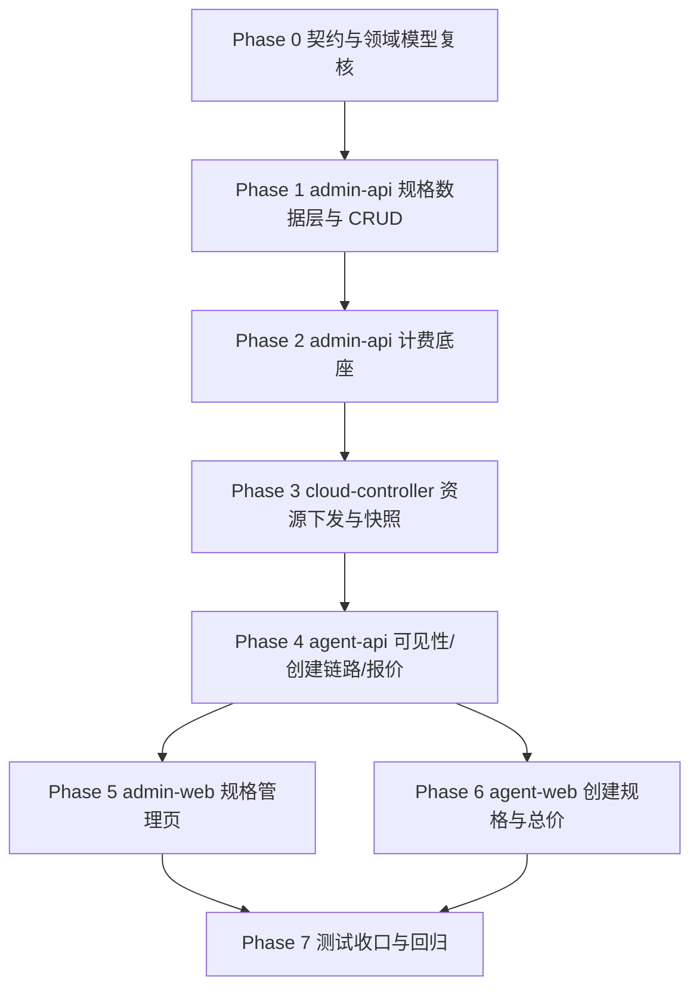

# 容器规格管理与云电脑分段计费 - 实现计划

**功能名称**: 容器规格管理与云电脑分段计费
**关联提案**: [[../proposals/20261124-feat-container-spec-tiered-billing.md]]
**关联 PRD**: [[../../product/draft/20261124-container-spec-tiered-billing.md]]
**计划版本**: v1.0
**创建日期**: 2026-11-24
**feat-branch**: `feat/container-spec-tiered-billing`

## 1. 目标与范围

### 1.1 目标

按提案拆解为可执行任务：`cloudhostspecs` 规格聚合（admin-api 唯一写方 + 迁移 025 预制播种 + 白名单可见性）、创建链路 `specId` 快照贯通到 cloud-controller K8s `resources.limits`、新版云电脑 CPU/内存/临时存储七档超额累进小时计费（`cloudbillingcursors` + `quoteSpecHourly`），旧版云电脑 `container.minute` 计费逐字不变。

### 1.2 不在范围

- 旧版云电脑迁移/重计费；运行中云电脑的规格变更（只影响后续创建）；
- 规格自动伸缩、按租户差异化定价；云存储计费口径变化；
- worker 镜像 / agent-gear 变更；`BillingCategory` 枚举扩展（沿用 `container`）。

## 2. 实现顺序



- 依赖关系：契约先行（Phase 0）→ admin-api 写方与计费（Phase 1/2）→ cloud-controller 载荷消费（Phase 3）→ agent-api 创建链路（Phase 4）→ 双前端可并行（Phase 5/6）→ 测试收口（Phase 7，TDD 先红后绿贯穿各 Phase）。
- **发布顺序严格先后**（保证「有 spec 的主机必有带 spec 的事件」）：admin-api → cloud-controller → agent-api → admin-web/agent-web；回滚口径见提案 §9.2。

## 3. 代码事实核对（F）

提案附录 F1~F14 已核对；本计划补充/校正如下事实（与提案冲突处以本表为准）：

| 编号 | 事实 | 位置 |
|---|---|---|
| F15 | admin-api 当前最大迁移编号 **024**（`024-github-gh-wrapper.ts`），迁移经 `src/index.ts` 逐个 import 后传入 `runMigrations([...])`，`Migration = { name, run }` 按 name 去重幂等 | `servers/admin-api/src/index.ts:75,181`、`migrations/runner.ts` |
| F16 | 预制幂等范式细部：`presetKey` 用 partial unique（`partialFilterExpression: { presetKey: { $type: 'string' } }`，注释明确不用 sparse），同 `cloudworkloads` | `servers/admin-api/src/models/cloud-workload.ts` |
| F17 | **无 `JOB_EPHEMERAL_STORAGE` 模块常量**：ephemeral-storage 实为 `JobManagerConfig.ephemeralStorage`（env `JOB_EPHEMERAL_STORAGE`，缺省 `'10Gi'`），`buildManifest` 仅 limits 注入 | `servers/cloud-controller/src/config/index.ts`、`services/k8s-job-manager.ts` |
| F18 | NewCloudHostDialog 现状**无存储报价展示**（只列已有云存储，未调 `cloudStorageBillingQuote`）；该查询已存在（`contracts/cloud-storage.graphql:165`、agent-api resolvers/cloud-storage.ts） | `apps/agent-web/src/components/cloud-host/NewCloudHostDialog.tsx` |
| F19 | `storagebillingcursors` 索引由模型声明（`{storageId:1}` unique、`{closedAt:1}`）随 autoIndex 建立，无独立迁移；`StorageTickService` 桶锚点/24 桶上限/幂等键 `cloud_storage.hour:<storageId>:<bucketEndEpochHour>` 为同构参照 | `servers/admin-api/src/models/storage-billing-cursor.ts`、`services/billing/storage-tick.ts` |
| F20 | `POST /internal/billing/charges` 目前仅放行 `productId='cloud_host.create'`；规格出账不走该端点，由 spec-tick 内部走 `chargeAndInvoice` 幂等口径 | `servers/admin-api/src/routes/internal-billing.ts` |
| F21 | admin-api `PricingService.ensureDefaultPrices()` 以 `updateOne(..., { upsert: true })` 播种默认价（不覆盖调价），`getPrice(productId, at)` 按 `effectiveFrom <= at` 取价 | `servers/admin-api/src/services/billing/pricing.ts` |
| F22 | agent-api 只读镜像纪律：`autoIndex: false` + 不声明索引（`harness-config.ts`、`auth-provider.ts` 同款）；`cloudworkloads` 镜像 `strict: false` | `servers/agent-api/src/models/harness-config.ts` 等 |
| F23 | admin-web 白名单 combo 数据源现成：`ADMIN_TENANTS(keyword, page, pageSize)` 查询与 `TenantsPage` 分页用法可直接复用 | `apps/admin-web/src/graphql/queries.ts:365`、`pages/TenantsPage.tsx` |
| F24 | `cloudStorageBillingQuote(sizeGi)` 返回 `{ sizeGi, full, archived, availableBalance }`，`CloudStorageRateQuote.tiers: [{label, amountCredits}]` 即提案 CloudHostSpecBillingQuote 的对齐口径 | `contracts/cloud-storage.graphql:122,133,165` |

## 4. 实现步骤

### Phase 0：契约与领域模型

1. 新增 `contracts/admin-cloud-spec.graphql`（提案 §3.1.1 全文）：`AdminCloudSpec` / `AdminCloudSpecInput` / `adminCloudSpecs` / `adminCloudSpec` / `adminCreateCloudSpec` / `adminUpdateCloudSpec` / `adminDeleteCloudSpec`；错误文案逐字（`name is required` / `name is too long` / `spec name already exists` / `invalid spec resources` / `invalid tenant in whitelist`）；`allowedTenantIds` ≤ 200。
2. `contracts/cloud-host.graphql` 增量（提案 §3.1.2）：`CloudHostSpec` / `CloudHostSpecBillingQuote` / `CloudHostSpecQuoteTier`（tiers 口径对齐 `CloudStoragePriceTier`，F24）、`Query.cloudHostSpecs` / `Query.cloudHostSpecBillingQuote(specId)`、`CreateCloudHostInput.specId: ID!`、`CloudHost.spec`（快照装配）；`cloudHostBillingQuote.perMinuteCredits` 标注 deprecated（仅旧版展示语义）。
3. `contracts/admin-billing.graphql` 增量（提案 §3.1.3）：头注内部端点表增补 `GET /internal/billing/spec-quote`；七档价目注记（`cloud_spec.cpu.tier1/tier2`、`cloud_spec.mem.tier1~4`、`cloud_spec.ephemeral.tier`，per_unit 整数分）；`BillingCategory` 不变。
4. `contracts/billing-events.asyncapi.yaml` 增量（提案 §3.1.4）：`ContainerReadyEvent` payload 增加可缺省 `spec` 对象；`container.destroyed` 不变。
5. `contracts/cloud-controller-websocket.md` 附录 A 增量（提案 §3.1.5）：`POST /internal/containers` 可选 `spec` 载荷、下发规则（缺省=现状、全零=不设置 resources、普通=limits 按规格）、校验（整数 0..64/256/512，全零或全正，部分为 0 → 400 invalid spec）、`cloudcontainers` 快照五字段。
6. 领域模型复核（见 §6，提案阶段已同步，本阶段仅复核）。

### Phase 1：admin-api 规格数据层与后台 CRUD（TDD：T-SPV*/T-MIG-SP* 先红）

1. `servers/admin-api/src/models/cloud-host-spec.ts`（新增）：`cloudhostspecs` 集合——`name`（trim 1..64，unique）、`cpu`/`memoryGi`/`ephemeralStorageGi`（整数 0..上限）、`whitelistEnabled`（默认 false）、`allowedTenantIds: [String]`（默认 []）、`isPreset`、`presetKey`（默认 null，partial unique 同 F16）、timestamps；索引 `name` unique、`presetKey` partial unique、`{whitelistEnabled, allowedTenantIds}`。
2. `servers/admin-api/src/migrations/025-preset-cloud-host-specs.ts`（新增，`logger.child({ component: 'migration/025-preset-cloud-host-specs' })`）：
   - 播种 6 款预制规格（presetKey = `8c16g-20g` / `8c8g-20g` / `4c8g-20g` / `2c4g-10g` / `1c2g-5g` / `unlimited-0c0g`）；幂等口径与预制工作负载一致：`findOne({presetKey})` → `findOne({name})` → 均未命中才插入，**命中即跳过**（不覆盖修改、删除不重建）；
   - `unlimited-0c0g` 播种 `whitelistEnabled: true, allowedTenantIds: []`（默认无租户可见），其余 `whitelistEnabled: false`；
   - 显式 `CloudBillingCursor.createIndexes()` 幂等兜底（见 D2）。
3. 注册：`servers/admin-api/src/index.ts` import `025-preset-cloud-host-specs` 并加入 `runMigrations([...])`。
4. `servers/admin-api/src/graphql/schemas/cloud-host-spec.ts` + `resolvers/cloud-host-spec.ts`（新增）：admin CRUD；校验——名称必填/长度/唯一、组合规则（全零为唯一含 0 组合，普通三项 ≥1 且不超上限）、`whitelistEnabled=false` 保存时 `allowedTenantIds` 置空、白名单租户存在性校验（`invalid tenant in whitelist`）、上限 200。契约与手写 schema 双写。

### Phase 2：admin-api 计费底座（TDD：T-SPQ*/T-SPT* 先红）

1. `servers/admin-api/src/models/cloud-billing-cursor.ts`（新增）：`cloudbillingcursors`——`resourceId`（unique，容器 id）、`hostId`/`hostName`、`accountId`/`tenantId`、`specId`/`specName`/`specCpu`/`specMemoryGi`/`specEphemeralStorageGi`、`billingStartedAt`（桶锚点）、`chargedMinutes`（默认 0）、`lastChargedAt`/`closedAt`/`lastError`；索引 `{resourceId}` unique、`{closedAt, lastChargedAt}`（结构对齐 `storagebillingcursors`，F19）。
2. `servers/admin-api/src/services/billing/pricing.ts`（增量）：七档默认价常量 + `ensureDefaultPrices()` 增补播种（1500/3000/1500/3000/4500/6000/1000 分，`$setOnInsert`/upsert 不覆盖调价，F21）。
3. `servers/admin-api/src/services/billing/spec-pricing.ts`（新增）：`quoteSpecHourly(spec, prices)` 纯函数（超额累进公式见提案 §5.1；全零规格恒 0），返回结构对齐 `quoteStorageHourly`（`{hourlyCents, hourlyCredits, items[]}` 分档拆条）。
4. `servers/admin-api/src/services/billing/spec-tick.ts`（新增）：`SpecTickService.tick()`（结构对齐 `StorageTickService`）——扫描未 closed 游标、桶锚点 `billingStartedAt`、活跃 `due = floor((now-start)/1h)`、单次最多 24 桶、逐桶按**桶末时刻**取价、幂等键 `cloud_host.spec.hour:<resourceId>:<bucketEndEpochHour>`（整桶）与 `cloud_host.spec.tail:<resourceId>`（尾段至多一次）、游标 `$max` 推进绝不回退、尾段 `hourlyCents × ceil(尾段分钟)/60`（不足 1 分钟按 1 分钟）出账后置 `closedAt`、余额不足记 `lastError` + `markInsufficient` 下个 tick 重试、`exitedAt` 缺失以事件时刻兜底。
5. `servers/admin-api/src/services/billing/scheduler.ts` + `src/index.ts`（增量）：`specTick` 可选项注册（同 `storageTick` 模式）、`SPEC_BILLING_TICK_MS` 默认 300000。
6. `servers/admin-api/src/routes/internal-billing.ts`（增量）：`GET /internal/billing/spec-quote?specId=...`（或 `cpu/memoryGi/ephemeralStorageGi` 三元组直接报价），出参 `{hourlyCredits, tiers[], prices}` 结构对齐 `/internal/billing/storage-quote`；不缓存（价目实时）。
7. `servers/admin-api/src/services/billing/billing-service.ts`（增量，分流判据唯一）：
   - `handleContainerReady`：payload 带 `spec` → upsert `cloudbillingcursors` 游标、**不进预留路径**（0 费用规格也走此路径，仅不出账）；不带 → 既有预留路径逐字不变；
   - `handleContainerDestroyed`：有游标 → 尾段折算出账 + `closedAt` 收口；无游标 → 既有 `billLegacyContainer` / `finalizeReservation` 不变；
   - 出账 `category=container`、`refType=cloud_host`、`refId=hostId`（经 admin-api `cloudcontainers` 只读镜像按 resourceId 解析），items 按分档拆条、description 注明规格名与分档口径；幂等键防重复出账（D7）；
   - 防御日志：host 快照含 spec 而 payload 无 spec → warn。

### Phase 3：cloud-controller 资源下发与快照（TDD：T-KSP*/T-PRS* 先红）

1. `servers/cloud-controller/src/models/cloud-container.ts`（增量）：`specId`/`specName`（String 默认 null）、`specCpu`/`specMemoryGi`/`specEphemeralStorageGi`（Number 默认 null）——零迁移可缺省。
2. `servers/cloud-controller/src/routes/internal-api.ts`（增量）：`parseHarnessRequest` 字段白名单新增可选 `spec`（三项整数 0..64/256/512；全零或全正，部分为 0 → 400 `INVALID_HARNESS`/`invalid spec`）；handler 透传至 `containerService.start`。
3. `servers/cloud-controller/src/services/k8s-job-manager.ts`（增量）：`CreateJobInput` 增加可选 `resources`；`buildManifest` 由「模块常量拷贝」改为「按入参选择」——无 spec → 现状 `JOB_RESOURCES` + `cfg.ephemeralStorage ?? '10Gi'`（F17）逐字不变；全零 spec → 省略 resources（requests/limits 均不设）；普通 spec → `limits = {cpu, memory: '<memoryGi>Gi', 'ephemeral-storage': '<ephemeralStorageGi>Gi'}`、`requests` 保持现状小值（0.1/256Mi，D-提案 6.1 D1/D2）。
4. `servers/cloud-controller/src/services/container-service.ts`（增量）：落 `cloudcontainers` 规格快照；`container.ready` payload 增加 `spec` 快照（`billingStartedAt` 不变）。
5. 旧链路（idle|admin-task|workflow|session，不带 spec）行为逐字不变。

### Phase 4：agent-api 可见性 / 创建链路 / 报价（TDD：T-SPVIS*/T-CHS* 先红）

1. `servers/agent-api/src/models/cloud-host.ts`（增量）：`specId`/`specName`/`specCpu`/`specMemoryGi`/`specEphemeralStorageGi` 快照字段（默认 null = 旧版云电脑）。
2. `servers/agent-api/src/models/cloud-host-spec.ts`（新增）：只读镜像（`autoIndex: false`、不声明索引，F22）。
3. `servers/agent-api/src/services/cloud-host-spec-service.ts`（新增）：可见性唯一口径 `{ $or: [{ whitelistEnabled: false }, { allowedTenantIds: tenantId }] }`（`String(tenantId)` 归一），排序 `cpu desc, memoryGi desc, ephemeralStorageGi desc`；不挂 workspace-scope 插件（规格是平台目录，提案 F13）。
4. `servers/agent-api/src/services/billing-client.ts`（增量）：`getSpecQuote(...)`（`get*` 命名风格 + wire types，对齐 `getStorageQuote`）。
5. `servers/agent-api/src/services/cloud-host-service.ts`（增量）：`create` 链路——`specId` 必填、服务端强制校验对当前租户可见（不可见/不存在 → 拒绝）、`cloudhosts` 落规格快照、`startHarness` 载荷带 `spec`；`cloud_host.create` 一次性扣费与退款口径不变。
6. `servers/agent-api/src/graphql/schemas/cloud-host.ts` + `resolvers/cloud-host.ts`（增量）：`cloudHostSpecs`（`hourlyCredits` 填充见 D3）、`cloudHostSpecBillingQuote(specId)`（经 `getSpecQuote`）、`CloudHost.spec`（按快照字段装配，**不回查规格表**，规格删除后仍可展示）。契约与手写 schema 双写。

### Phase 5：admin-web 规格管理页

1. `apps/admin-web/src/pages/CloudHostSpecsPage.tsx`（新增）：规格表格（名称/CPU/内存/临时存储/白名单状态/可见租户数/预制标识）、新增按钮、行内编辑/删除（列表/表单/删除模式复用 `CloudWorkloadsPage` 模式）。
2. `apps/admin-web/src/components/cloud-host-specs/SpecFormDialog.tsx`、`DeleteSpecDialog.tsx`（新增）：「开启白名单」checkbox（勾选才出现多选租户 combo，不勾隐藏）、租户多选 combo 复用 `ADMIN_TENANTS` keyword 搜索 + 分页（F23）、新建「0C 0G」时白名单默认勾选、非法组合即时校验提示（文案与契约错误白名单一致）。
3. `apps/admin-web/src/graphql/{queries,mutations,types}.ts`（增量）：`ADMIN_CLOUD_SPECS` / `CREATE_/UPDATE_/DELETE_CLOUD_SPEC`。
4. `apps/admin-web/src/App.tsx`（增量）：路由 `cloud-host-specs` + 导航入口。

### Phase 6：agent-web 创建规格与总价

1. `apps/agent-web/src/components/cloud-host/NewCloudHostDialog.tsx`（增量）：
   - 新增「规格」单选卡片区（仅当前租户可见规格、按算力降序、资源明细与每小时费用、`unlimited` 渲染「不限制容器，随时可能会被系统销毁」徽标且每小时费用 0）；无可用规格明确提示并禁用创建；
   - 选中即调 `cloudHostSpecBillingQuote(specId)` 刷新总价区：一次性创建费用（`cloudHostBillingQuote.createCredits` 不变）+ 每小时运行费用与 CPU/内存/临时存储分档明细 + **挂载云存储费用并列列示**（新增调用既有 `cloudStorageBillingQuote(sizeGi)`，见 D4/F18）；
   - `specId` 随 `CREATE_CLOUD_HOST` 提交；新版对话框不再展示「x credit/分钟」（`perMinuteCredits` 仅旧版详情保留）。
2. `apps/agent-web/src/graphql/*`（增量）：`CLOUD_HOST_SPECS` / `CLOUD_HOST_SPEC_BILLING_QUOTE`（+ 存储报价查询接入）。

### Phase 7：测试收口（TDD 红-绿-重构，各 Phase 内先红后绿）

| 编号 | 层 | 断言 | 预期 |
|---|---|---|---|
| T-SPV1~6 | admin-api 单测 | 规格校验：名称唯一/长度、数值上限（64/256/512）、全零或全正（部分 0 拒绝）、`whitelistEnabled=false` 置空名单、租户存在性、上限 200 | 红 |
| T-MIG-SP1~5 | admin-api 迁移单测 | 6 款就位、`unlimited-0c0g` 白名单默认开启空名单、幂等重跑零变更、不覆盖管理员修改、删除不重建 | 红 |
| T-SPQ1~8 | admin-api 单测 | 计价：七档边界（4C/4-8-16G/10G）、8C 16G 20G = 820 credits 示例、全零=0、价目缺失回落、按桶末取价 | 红 |
| T-SPT1~8 | admin-api 单测 | 结算：整桶推进/单次 24 桶上限/幂等重放/尾段分钟折算/尾段至多一次/`closedAt` 收口/余额不足 `lastError`+`markInsufficient`/销毁事件兜底 | 红 |
| T-SPVIS1~4 | agent-api 单测 | 可见性：公开/白名单命中/空名单不可见/移出名单不可见 | 红 |
| T-CHS1~3 | agent-api 单测 | specId 不存在/不可见拒绝、快照落库、旧输入兼容 | 红 |
| T-KSP1~4 | cloud-controller 单测 | 普通 spec limits 映射/requests 保持现状小值/全零省略 resources/无 spec 回退现状逐字不变 | 红 |
| T-PRS1~3 | cloud-controller 单测 | spec 载荷校验、非法组合 400、cloudcontainers 快照 | 红 |
| T-SP-API1~5 | tests/api | adminCloudSpecs CRUD 全操作与错误文案逐字；cloudHostSpecs 租户可见性；createCloudHost(specId) 拒绝矩阵；`/internal/billing/spec-quote`；container.ready 带/不带 spec 分流（带→游标+出账，不带→旧预留零回归） | 红 |
| E2E-SP1~4 | tests/e2e | 后台规格增删改 + 白名单 combo 行为（勾选出现/不勾隐藏/空名单无租户可见/0C 0G 默认勾选）；创建对话框规格排序过滤与总价（含 820 credits/小时）、「不限制容器，随时可能会被系统销毁」文案；旧云电脑账单零回归 | 红 |
| 回归锚点 | 既有测试 | `k8s-job-manager.test.ts` T-K5/T-K5b、`tests/api` T-IC-EPH1/2、`tests/e2e` E2E-4（`admin-cloud-container.spec.ts`）——旧断言保留，新 spec 断言并列新增 | 绿 → 绿 |

测试落点：`servers/admin-api/src/{models,services/billing,migrations}` 各自同目录 `*.test.ts`；`tests/api/src/admin-api/cloud-host-spec.test.ts`、`tests/api/src/cloud-controller/internal-api.test.ts`（增量）、`tests/api/src/agent-api/cloud-host.test.ts`（增量）；`tests/e2e/src/admin-cloud-host-spec.spec.ts`（新增）、`cloud-host.spec.ts`（增量）。

## 5. 领域模型同步

- **无新增领域概念**：`CloudHostSpec` / `CloudHost` / `CloudContainer` 规格快照 / `CloudBillingCursor` / 七档 `cloud_spec.*` 价目 / `container.ready` payload.spec / 幂等键命名均已在提案阶段同步落库（`40-云资源与Harness/00-上下文概览.md`+`01-聚合与实体.md`、`80-计费与计量/00-上下文概览.md`+`01-聚合与实体.md`、`02-上下文地图.md`、`01-通用语言-术语表.md`、`00-领域模型库-索引.md`），本计划仅承载拆解不引入新聚合/状态机/权限面。
- `CloudHostSpecBillingQuote` / `CloudHostSpecQuoteTier` 为报价 DTO，已在 `40-云资源与Harness/00-上下文概览.md`「对外契约」表登记，无需单列聚合条目。
- 实现中发现代码事实与领域模型不一致时，**以代码为准回写修正**对应上下文文档（common-rules「Domain Model Sync」）。

## 6. 计划期裁决（D）

| 编号 | 裁决 | 原因 |
|---|---|---|
| D1 | 迁移编号取 **025**（`025-preset-cloud-host-specs`） | 当前最大 024（F15）；若并行分支抢占则顺延并在 PR 中说明 |
| D2 | `cloudbillingcursors` 索引由模型声明（`storagebillingcursors` 同口径，F19），迁移 025 中显式 `createIndexes()` 幂等兜底 | 落实提案「同迁移建索引」意图，同时与既有游标集合建索引方式一致 |
| D3 | `cloudHostSpecs.hourlyCredits` 由 agent-api 对每档可见规格并发调用 `GET /internal/billing/spec-quote` 填充；计费服务不可用时降级用七档默认价常量本地计算（常量与 `pricing.ts` 播种值一致、注释互指防漂移）并记 warn | 规格数小（个位数）、低频；降级先例同 `cloudHostBillingQuote` 降级常量（F5）；实时报价 `cloudHostSpecBillingQuote` 仍以 admin-api 为单一计价来源（提案 D8 不变） |
| D4 | NewCloudHostDialog **新增**云存储费用列示（调用既有 `cloudStorageBillingQuote`） | 提案按「既有并列展示」表述，但现状对话框无存储报价（F18）；PRD 功能点 3 明确要求存储费用一并计入并单独列示 |
| D5 | ephemeral-storage 事实按 F17 校正实现：spec 路径覆盖 `cfg.ephemeralStorage` 注入点，无 `JOB_EPHEMERAL_STORAGE` 常量可改 | 提案 F1 描述为模块常量，实为 config 读 env（F17）；行为口径不变 |
| D6 | spec 载荷校验落在 `parseHarnessRequest` 字段白名单（400 `INVALID_HARNESS` / `invalid spec`） | 与既有 workloadPlan/secrets 校验同位，入口唯一 |
| D7 | 规格出账复用 billing 既有 `chargeAndInvoice` 幂等出账口径，不走 `/internal/billing/charges`（该端点仅放行 `cloud_host.create`，F20） | 零新账本语义；幂等键 `cloud_host.spec.hour/tail` 防重 |
| D8 | 旧测试锚点（T-K5/T-K5b/T-IC-EPH1/2/E2E-4）断言保留，新 spec 断言并列新增 | 防基线腐化，旧路径「逐字不变」以旧断言为证（提案实现点 3 风险） |
| D9 | 白名单租户 combo 复用 `adminTenants(keyword, page, pageSize)` | 零契约新增，满足 PRD 4.1 分页/搜索要求（F23） |
| D10 | `CloudHost.spec` 仅按 `cloudhosts` 快照装配，不回查 `cloudhostspecs` | 规格删除后仍可展示（提案 3.1.2）；计费同以快照为准（提案 D9） |
| D11 | 0C 0G（全零）规格走新计费路径但不出账（0 费用） | 分流判据唯一（有 spec 即新路径），防止误入分钟计费（提案 D13） |
| D12 | 契约文件名 `admin-cloud-spec.graphql` | 与 `admin-cloud-workload.graphql` 同族命名（提案 §3.1.1） |

## 7. 命令参考

```bash
# 单测（先红后绿）
cd servers/admin-api && pnpm run test -- src/services/billing/spec-pricing.test.ts
cd servers/admin-api && pnpm run test
cd servers/agent-api && pnpm run test -- src/services/cloud-host-spec-service.test.ts
cd servers/cloud-controller && pnpm run test -- src/services/k8s-job-manager.test.ts

# 类型 / 构建 / Lint
cd servers/admin-api && pnpm run build
cd apps/admin-web && pnpm run build && pnpm run lint
cd apps/agent-web && pnpm run build && pnpm run lint

# API 集成测试（需 MONGODB_URI）
cd tests/api && pnpm run test

# E2E（端口以 aspire describe 为准，见 tests/e2e/AGENTS.md）
aspire start && aspire wait agent-api && aspire wait agent-web && aspire wait admin-web
cd tests/e2e && BASE_URL=<agent-web> API_URL=<agent-api>/graphql \
  CONTROLLER_API_URL=<controller-api> pnpm exec playwright test src/admin-cloud-host-spec.spec.ts --workers=1
```

## 8. 回归清单

- [ ] 旧版云电脑计费零改动：`priceContainer` / `billingreservations` / `settlement-tick` / `billLegacyContainer` 代码路径一行未改，账单金额与节奏一致。
- [ ] 无 spec 载荷的 `POST /internal/containers`（idle|admin-task|workflow|session）→ `JOB_RESOURCES` + `cfg.ephemeralStorage ?? '10Gi'` 行为逐字不变（T-KSP4 + T-IC-EPH1/2 + E2E-4）。
- [ ] `cloud_host.create` 一次性扣费 5 credits 与失败退款口径不变。
- [ ] 云存储计费（`storage-tick` / `storagebillingcursors` / 归档半价）零变化。
- [ ] 迁移幂等：重跑零变更、不覆盖管理员修改、删除不重建。
- [ ] `BillingCategory` 枚举不变（规格账单仍 `container`）；既有账单/流水/收据查看方式不变。
- [ ] 旧输入（无 `specId` 之外字段）创建链路除必填校验外无行为变化；旧数据 `spec*` 全 null = 旧版云电脑。

## 9. 验收 checklist

- [ ] 契约评审通过（`admin-cloud-spec.graphql` 新增；`cloud-host`/`admin-billing`/`billing-events`/`cloud-controller-websocket` 增量）。
- [ ] 领域模型同步状态确认（§5）。
- [ ] 6 款预制规格播种就位，0C 0G 默认白名单开启且无租户可见；幂等口径验证（T-MIG-SP1~5）。
- [ ] 后台规格增删改 + 白名单多选租户 combo 全流程可用（E2E-SP1）。
- [ ] 创建云电脑按可见规格展示并计算总价，8C 16G 20G = 820 credits/小时核对一致（E2E-SP2）。
- [ ] 新版云电脑分段计费出账正确：分档明细、小时桶、尾段折算、幂等重放（T-SPT1~8 + T-SP-API5）。
- [ ] 0C 0G 规格云电脑运行费用为 0 且展示「不限制容器，随时可能会被系统销毁」。
- [ ] 旧版云电脑计费与旧链路资源下发零回归（回归清单全勾）。
- [ ] 单测覆盖率 ≥ 80%（新增模块）、tests/api 通过（需 `MONGODB_URI`）、tests/e2e 通过（需 Aspire 全量）。
- [ ] 发布顺序按提案 §9.2 执行（admin-api → cloud-controller → agent-api → 前端）。
