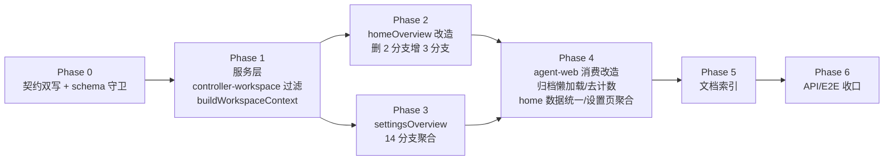
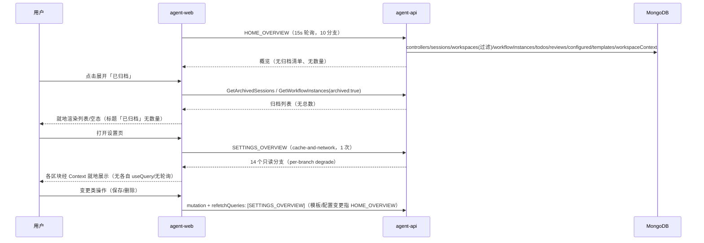

# 接口性能优化 - 实现计划

**功能名称**: 接口性能优化
**关联 PRD**: [`docs/product/draft/20261126-api-performance-optimization.md`](../../product/draft/20261126-api-performance-optimization.md)
**关联提案**: [`docs/engineering/proposals/20261126-feat-api-performance-optimization.md`](../proposals/20261126-feat-api-performance-optimization.md)
**计划版本**: v1.0
**创建日期**: 2026-11-27
**作者**: ZeroAsh Agent
**需求总分支**: `feat/api-performance-optimization`
**feat-branch**: `feat/api-performance-optimization`
**需求总 PR**: https://github.com/Deliay/z-agent-gear/pull/585

## 1. 实施顺序

严格按「契约双写 → 服务层过滤/复用 → homeOverview 改造 → settingsOverview 聚合 → 前端消费改造 → 文档索引 → API/E2E 收口」推进，每个切片先写失败测试再实现（红-绿-重构）：



**关键路径**：Phase 0 必须先于一切代码——手写 schema 漏改即运行时 `Cannot query field`（契约双写守卫拦截）。Phase 2/3 均依赖 Phase 1 的服务口径（过滤、单次复用），可互相并行；Phase 4 依赖契约（可与 2/3 并行开发，联调需后端就绪）。

**需求追溯**（Issue [#584](https://github.com/Deliay/z-agent-gear/issues/584) 四点）：

| # | 诉求 | 实现点 | Phase |
|---|------|--------|-------|
| 1 | 归档会话/工作流展开时才获取、去掉计数展示、干掉 homeOverview 归档场景 | 实现点 1（提案 §5.2） | 0/2/4 |
| 2 | configuredWorkflows、workflowTemplates、GetWorkspaceContext 并入 homeOverview 定时刷新 | 实现点 2 | 0/2/4 |
| 3 | workspaces 不返回已删除/已离线控制器条目 | 实现点 3 | 0/1/4 |
| 4 | 聚合设置页 GraphQL 调用、减少请求次数 | 实现点 4 | 0/3/4 |

**回归重灾区**：`tests/api/src/agent-api/home.test.ts`（T-H1/T-W5/T-W6 的归档断言必须改写）、`session-archive.test.ts` T-ARCH-API4（homeOverview.archivedSessions 互补断言失效）、`apps/agent-web/src/components/__tests__/Sidebar.test.tsx`（T-BDG1/T-BDG2/T-UI4-AGG2/T-WEB2 的「已归档（N）」计数与「无归档不渲染」断言）、`graphql/__tests__/home.test.ts` 选择集断言、`hooks/__tests__/useWorkspaceContextSync.test.tsx`（独立轮询断言）、`tests/e2e/src/session-archive.spec.ts`（E2E-SARCH1/SARCH2 计数文案）、`tests/e2e/src/home.spec.ts` T-E1/T-E2（请求计数 helper 需随选择集更新）。

## 2. 代码事实核对（计划期确认）

以下事实基于需求总分支 `feat/api-performance-optimization`（HEAD `b9b8afe5`）实际代码：

| # | 事实 | 位置 | 对计划的影响 |
|---|------|------|--------------|
| F1 | `HomeOverview` 契约 9 分支，含 `archivedSessions`（:19）/`archivedWorkflowInstances`（:25）；无 `WorkspaceContext` 类型；手写 schema `schemas/home.ts:3-24` 与契约 1:1，**无 home 契约双写守卫**（9 个守卫测试不含 home） | `contracts/home.graphql:11-32`、`graphql/schemas/home.ts` | Phase 0 删 2 增 3 + 补守卫（D6） |
| F2 | `resolvers/home.ts`：`degrade()` :19-26；`Promise.all` :65-137 九分支（archivedSessions :81-89、archivedWorkflowInstances :101-106）；`sessionTotalCount = sessions.length` :142（活跃口径派生值）；组装 :139-150 | `servers/agent-api/src/graphql/resolvers/home.ts` | 删两归档分支；新分支同构接 `degrade()`；sessionTotalCount 口径不变 |
| F3 | `controllerWorkspaceService.findAllByUser` :50-63 两分支（无上下文 `find({userId})`；有上下文 `visibleControllerIds` :14-17 → `find({controllerId:{$in}})`），**无软删/状态过滤**；调用方 `resolvers/controller-workspace.ts:19-28` 与 `resolvers/home.ts:91` | `services/controller-workspace.ts` | 过滤单点落此（D11），双查询自动同口径 |
| F4 | `controllerService.findAllByUser` :25-44 **已剔除软删云电脑**（`CloudHost.deletedAt != null` 的 controller 剔除，:34-43）；删除云电脑后 Controller 留档 `status:'offline'`（:66-70）；`unavailable.ts:10-15`：文档缺失→`CONTROLLER_DELETED`、`status !== 'online'`→`CONTROLLER_OFFLINE` | `services/controller.ts`、`services/workflow/unavailable.ts` | 过滤口径三条件对齐（D11） |
| F5 | `workspace-service.ts` `accessibleWorkspaces` :145-174；`resolvers/workspace.ts` `toWorkspaceView` :39-58（每工作区 `workspaceFacets`，≈3 查询/工作区）、`myWorkspaces` :62-66、`myTenants` :67-85（`memberCount: 0` 固定）；前端 `GetWorkspaceContext` 组合查询（`queries.ts:1001-1028`）双跑 `accessibleWorkspaces` | `services/workspace-service.ts`、`resolvers/workspace.ts` | 抽 `buildWorkspaceContext` 单次复用（D5） |
| F6 | `configuredWorkflowService.listForUser` :187-191、`workflowTemplateService.listForUser` :182-186；`resolvers/workflow.ts` `mapTemplate` :43 / `mapConfigured` :58 / `workflowTemplates` :207-211 / `configuredWorkflows` :217-225 | `services/workflow/{configured,template}.ts`、`resolvers/workflow.ts` | 新分支原样复用 + 既有映射 |
| F7 | 前端 `HOME_OVERVIEW`（`graphql/home.ts:36-203`）选择集含 `archivedSessions`（:90-108）/`archivedWorkflowInstances`（:135-137）；`types.ts` `HomeOverviewData` :1291-1305；`stores/homeOverview.ts` Context（`useHomeOverview()`）；`MainLayout.tsx:42-50` 唯一查询 `pollInterval: 15000`（`MainLayout.test.tsx` T-F1 守卫） | `apps/agent-web/src/graphql/home.ts` 等 | 选择集/类型/新分支同步；T-F1 零回归 |
| F8 | `Sidebar.tsx`：`useHomeOverview()` :105；归档数据取自 homeOverview（:114/:118）；条件渲染 `length > 0` 才渲染分组（:491-493/:528-534）；`ArchivedWorkflowGroup` :692-716（「已归档（{n}）」:705）、`ArchivedSessionGroup` :754-794（:775） | `components/Sidebar.tsx` | 常驻可展开 + 去计数 + 懒加载（D4/D10） |
| F9 | `useWorkspaceContextSync.ts`：独立 15s 轮询（:28、:38-42）、focus/visibility 立即 refetch（:47-59）、`workspace not found` 失效回退（:62-70） | `hooks/useWorkspaceContextSync.ts` | 删独立轮询改消费 home 数据（D9） |
| F10 | 归档按需能力：服务端 `sessions(archived)`（`agent-session.graphql:566-567`）与 `workflowInstances(archived)`（`workflow.graphql:490-491`）已有；前端 `GET_WORKFLOW_INSTANCES` 已带 `$archived`（`workflow.ts:444-446`）无调用点；**前端 sessions 查询无 archived 变量**（`queries.ts:76-77` `GetSessions` 无参数） | `contracts/*`、`apps/agent-web/src/graphql/*` | 服务端零新增；前端补归档查询（D4） |
| F11 | 设置页：`SettingsPage.tsx:209-285` 挂载 12 区块 + `CLOUD_STORAGE_CAPABILITIES`（:108-111 `storageEnabled`）；`apollo.ts:52-58` 普通 HttpLink 无批处理；`ControllerListSection` 自带 `pollInterval: 15000`（:97、:110-112）；`WorkflowSection` cache-and-network + mount 双发（:31-51）；`CloudStorageSection` 双查询（:189-197） | `apps/agent-web/src/pages/SettingsPage.tsx`、`components/settings/*` | 设置页 18~20 请求 → 1 次 SETTINGS_OVERVIEW（D7） |
| F12 | settingsOverview 分支契约真值类型：`providers/models`（`llm.graphql:109-110`）、`controllerKeys`（`agent-controller.graphql:102`）、`mcpServers`（`mcp-server.graphql:60`）、`valutEntries: [ValutNamespaceGroup!]!`（`valut.graphql:65`）、`customMcpServers`（`custom-mcp.graphql:81`）、`customTools`（`custom-tool.graphql:164`）、`githubAccounts: [GitHubAccount!]!` / `githubAppUrl: GitHubAppUrl!`（`{url,state}`，`github.graphql:35-38,81-82`）/ `commitSettings`（:84）、`authProviders: [AuthProviderInfo!]!` / `myExternalLogins: [ExternalLoginInfo!]!`（`auth.graphql:78-80`）、`cloudStorages` / `cloudStorageCapabilities`（`cloud-storage.graphql:162,166`）。`contracts/settings.graphql` **不存在** | `contracts/*` | 契约字段类型以真值为准校正提案笔误（D2） |
| F13 | `githubAppUrl` resolver **有副作用**：求值即 `getAppUrl` + Redis 写 `github:oauth:state:*`（一次性绑定票据），只读上下文抛 `global workspace is read-only`；前端 `GithubBindingSection.tsx:15,51-52,87`（url 空 → 按钮禁用） | `resolvers/github.ts:27+` | 并入聚合后的求值语义裁决（D3） |
| F14 | 契约双写守卫范式：`schemas/workflow.test.ts:7-42`（readFileSync contracts + parse + 逐字/计数比对，T-SCHEMA1）；`resolvers/index.test.ts` 登记守卫；`schemas/index.ts` typeDefs 数组登记（:12、:28）；`schemas/settings.ts`/`resolvers/settings.ts` 均不存在 | `graphql/schemas/*` | 新增 settings 守卫 + 补 home 守卫（D6） |
| F15 | 测试面：`tests/api/src/agent-api/home.test.ts` T-H0~T-H3（:291-332）、T-W5/T-W6（:381，断言 `homeOverview.archivedWorkflowInstances` :399-406）、T-S1~T-S4（:417-446）；`session-archive.test.ts` T-ARCH-API4（断言 `homeOverview.archivedSessions` 互补）；`workspace.test.ts` workspaces 查询（:337-350）；`home.spec.ts` T-E1/T-E2（:143-170，`trackHomeOverviewRequests` :131-140）；`session-archive.spec.ts` E2E-SARCH1/SARCH2（「已归档（1）」断言） | `tests/api`、`tests/e2e` | 归档断言全部改写（§6.4 回归清单） |
| F16 | 归档操作组件真实路径为 `components/session/SessionView.tsx`（提案「`SessionView.tsx:566`」为笔误，无 `pages/SessionView.tsx`）；既有 `SessionView.archive.test.tsx` | `apps/agent-web/src/components/session/` | 变更清单按真实路径（D10） |
| F17 | 弹窗/区块既有查询：`InstantiateWorkflowDialog`（`GET_CONFIGURED_WORKFLOWS`:85-88、`GET_WORKFLOW_TEMPLATES`:89-92、`GET_WORKSPACES`:93-96、`DETECT_GIT_REPO`:97-100、`GET_ACP_CAPABILITIES`:101-104、已有 `refetchQueries:[HOME_OVERVIEW]` :220）、`IssuesLinkageDialog`（:73-77）、`ConfigureWorkflowDialog`（:66-68）、`RepoWorkflowSection`（:87-88 + refetch :105）；`McpDefaultSection` 挂 `ControllerConfigPage`（提案范围外） | `apps/agent-web/src/components/**` | 改读 home 数据清单与按需保留清单（D7/D8） |
| F18 | 领域模型提案期已同步（commit `b9b8afe5`）：`30-控制器/00-上下文概览.md`:102（项目工作区读口径过滤）、`50-会话与交互/00-上下文概览.md`:147（归档会话按需）、`60-工作流/00-上下文概览.md`:176（归档实例按需）；`02-上下文地图` 与 `00-领域模型库-索引` 无相关条目 | `docs/knowledges/domain` | §9 领域模型同步结论 |

## 3. 数据模型与状态机

**零变更**：不新增/修改集合、字段、索引与迁移。`sessions`/`workflowinstances` 既有 `{userId, archivedAt, createdAt}` 索引支撑按需归档查询；`controllerworkspaces` 查询路径不变（过滤在应用层）。`sessionTotalCount` 保持活跃会话口径（`sessions.length` 派生值）。状态机、权限过滤零变化（聚合仅合并请求，不放宽 actor/tenant/workspace 过滤）。

## 4. 核心时序



## 5. 变更清单

### 5.1 Phase 0：契约与双写（先于代码）

| 文件 | 变更 |
|------|------|
| `contracts/home.graphql` | ① `HomeOverview` 删除 `archivedSessions`/`archivedWorkflowInstances`（注释注明：归档清单改为 `sessions(archived:true)`/`workflowInstances(archived:true)` 按需拉取，不提供数量）；② 新增 `configuredWorkflows: [ConfiguredWorkflow!]!`、`workflowTemplates: [WorkflowTemplate!]!`、`workspaceContext: WorkspaceContext!`（注释：随 15s 轮询定时刷新）；③ 新增 `type WorkspaceContext { myWorkspaces: [Workspace!]! myTenants: [TenantMembership!]! }`（既有契约类型引用，零类型新增除包络） |
| `contracts/settings.graphql`（新增） | `type SettingsOverview` 14 字段（类型以 F12 真值为准）+ `extend type Query { settingsOverview: SettingsOverview! }`；注释注明：各分支与被替代查询返回口径逐字段一致、单分支失败 degrade 降级、`controllers` 复用 `homeOverview.controllers`、`workflowTemplates`/`configuredWorkflows` 并入 `homeOverview`、按需清单（D8） |
| `contracts/controller-workspace.graphql` | `workspaces` 查询（:56）增补注释：不返回已删除控制器（文档缺失或云电脑软删）或 `status != 'online'` 控制器下的项目工作区；数据保留，控制器恢复 online 后重新返回 |
| `servers/agent-api/src/graphql/schemas/home.ts` | 与契约逐字同删同增 |
| `servers/agent-api/src/graphql/schemas/settings.ts`（新增） | `settingsOverview` 手写 schema 对齐 `contracts/settings.graphql` |
| `servers/agent-api/src/graphql/schemas/index.ts` | 登记 `settingsTypeDefs` |
| `servers/agent-api/src/graphql/schemas/settings.test.ts`（新增） | T-SCHEMA2 契约双写守卫（对齐 `workflow.test.ts` T-SCHEMA1 范式） |
| `servers/agent-api/src/graphql/schemas/home.test.ts`（新增） | T-SCHEMA3 home 契约双写守卫（本次字段增删正处双写漂移高危期，D6） |

### 5.2 Phase 1：服务层（agent-api）

| 文件 | 变更 |
|------|------|
| `services/controller-workspace.ts` | `findAllByUser` 增加控制器可用性过滤（D11）：两分支统一「取行 → 按可用集过滤」；可用集 = 控制器文档存在 ∧ 云电脑未软删（复用 `controllerService.findAllByUser` 的 `CloudHost.deletedAt` 剔除口径）∧ `status === 'online'`；仅过滤返回值，`ensureWorkspace`/写路径/按 id 详情零改动 |
| `resolvers/workspace.ts` | 抽取并导出 `buildWorkspaceContext(userId)`：单次 `accessibleWorkspaces` 同时产出 `{ myWorkspaces, myTenants }`（`toWorkspaceView` 映射 + 既有 tenants 组装、`memberCount: 0` 保持）；`Query.myWorkspaces`/`Query.myTenants` 委托同一 helper（D5） |

### 5.3 Phase 2：homeOverview 改造（agent-api）

| 文件 | 变更 |
|------|------|
| `graphql/resolvers/home.ts` | ① 删除 `archivedSessions`/`archivedWorkflowInstances` 两个 `degrade` 分支与组装行；② 新增三分支（均包 `degrade()`）：`configuredWorkflows` = `configuredWorkflowService.listForUser(userId)` + `mapConfigured`、`workflowTemplates` = `workflowTemplateService.listForUser(userId)` + `mapTemplate`（自 `resolvers/workflow.ts` 既有导出）、`workspaceContext` = `buildWorkspaceContext(userId)`；③ `sessionTotalCount` 口径不变（:142） |
| `graphql/resolvers/index.ts` / `index.test.ts` | 登记守卫扩展（`HomeOverview` 新字段 resolver 形状如有类型级字段则 spread 登记） |

### 5.4 Phase 3：settingsOverview 聚合（agent-api）

| 文件 | 变更 |
|------|------|
| `graphql/resolvers/settings.ts`（新增） | `settingsOverview`：`Promise.all` + per-branch `degrade()`（复用 `resolvers/home.ts:19-26` 范式或抽共享 helper），14 分支原样复用既有服务调用（来源：`resolvers/{github,auth,provider,model,controller,mcp-server,valut,custom-mcp,custom-tool,cloud-storage}.ts` 对应 Query 实现）；兜底形态按 D12；不放宽任何权限过滤（`githubAppUrl` 只读上下文抛错经 degrade 降级，D3） |
| `graphql/resolvers/index.ts` / `index.test.ts` | 登记 `settingsResolvers.Query.settingsOverview`（登记守卫） |
| `graphql/resolvers/settings.test.ts`（新增） | T-SO1~3（§6.1） |

### 5.5 Phase 4：前端消费改造（apps/agent-web）

| 文件 | 变更 |
|------|------|
| `src/graphql/home.ts` | HOME_OVERVIEW 选择集删两段归档字段、增 `configuredWorkflows`/`workflowTemplates`（复用既有字段集）与 `workspaceContext { myWorkspaces { … } myTenants { … } }`（选择集并入原 `GetWorkspaceContext` 字段） |
| `src/graphql/queries.ts` | 新增 `GET_ARCHIVED_SESSIONS`（`sessions(archived:true)`，字段集复用归档选择集，D4）；`GET_WORKSPACE_CONTEXT` 已无活动消费方，随本期删除（工作区上下文统一由 `homeOverview.workspaceContext` 下发） |
| `src/graphql/types.ts` | `HomeOverviewData` 删 `archivedSessions`/`archivedWorkflowInstances`、增三分支类型（`sessionTotalCount` 保留）；新增 `GetArchivedSessionsQuery` 等类型 |
| `src/components/Sidebar.tsx` | ① `ArchivedSessionGroup`/`ArchivedWorkflowGroup` 改自足组件：`useQuery(GET_ARCHIVED_SESSIONS / GET_WORKFLOW_INSTANCES, { variables: { archived: true }, skip: !open, fetchPolicy: 'cache-and-network' })`；② 去计数：「已归档（{n}）」→「已归档」（:705、:775），展开列表不渲染任何计数；③ 常驻可展开：移除 `length > 0` 条件渲染（:491-493、:528-534），空态「暂无归档」，加载/错误态就地展示（错误带重试）；④ 活跃列表与分区 badge 口径不变 |
| `src/components/session/SessionView.tsx` | 归档/取消归档 `refetchQueries`/`evict` 增补归档列表查询，展开内容即时一致（D10） |
| `src/hooks/useWorkspaceContextSync.ts` | 删独立 15s 轮询；改消费 `useHomeOverview().data.workspaceContext` 并沿用 `syncWorkspaceContext` 写 `stores/workspace.ts`；focus/visibility → `refetch()` HOME_OVERVIEW；`workspace not found` 失效回退保留（refetch 目标改 HOME_OVERVIEW）（D9） |
| `src/stores/settingsOverview.ts`（新增） | 与 `homeOverview.ts` 同构 Context（`useSettingsOverview()`），承载 SETTINGS_OVERVIEW 数据与 `refetch` |
| `src/pages/SettingsPage.tsx` | 单一 `useQuery(SETTINGS_OVERVIEW, { fetchPolicy: 'cache-and-network' })` 经 Context 下发；`storageEnabled` 改读聚合分支 `cloudStorageCapabilities`；各区块删除自身只读 useQuery 改消费 Context（D7） |
| `src/components/settings/{ExternalLoginBindingSection,GithubBindingSection,GitSettingsSection,ProviderSection,ModelSection,ControllerListSection,McpRegistrySection,ValutSection,CustomMcpSection,CustomToolSection,CloudStorageSection}.tsx` | 删除只读 useQuery 改 `useSettingsOverview()`；写操作 `refetchQueries: [SETTINGS_OVERVIEW]`；`ControllerListSection` 移除 `pollInterval: 15000`，控制器状态改读 `homeOverview.controllers`（与首页同源同新鲜度）；`CloudStorageSection` 主查询改读聚合分支，「含已销毁」切换仍按需查 `CLOUD_STORAGES(includeDestroyed:true)` |
| `src/components/settings/WorkflowSection.tsx` | 改读 home 数据（`workflowTemplates`/`configuredWorkflows`/`controllers`），mount 时 `refetch()` HOME_OVERVIEW（替代 cache-and-network 双发）；变更类操作 `refetchQueries` 指 `HOME_OVERVIEW` |
| `src/components/workflow/{InstantiateWorkflowDialog,ConfigureWorkflowDialog}.tsx`、`src/components/cloud-host/{IssuesLinkageDialog,RepoWorkflowSection}.tsx` | 模板/配置改读 home 数据 + 打开时 `refetch()` HOME_OVERVIEW（「打开即最新」）；`GET_WORKSPACES`/`DETECT_GIT_REPO`/`GET_ACP_CAPABILITIES`/`GET_GITHUB_ACCOUNTS`/`repoWorkflowTemplates` 等按需查询保留（D8） |

### 5.6 Phase 5：文档索引

| 文件 | 变更 |
|------|------|
| `servers/agent-api/AGENTS.md` | 「首页聚合查询」小节更新：归档分支移除、新增三分支（10 分支口径）、`sessionTotalCount` 口径注记；新增「设置页聚合查询（settingsOverview）」小节（14 分支、degrade、controllers 复用 home、按需清单）；项目工作区小节补「控制器可用性过滤」口径 |
| `apps/agent-web/AGENTS.md` | HOME_OVERVIEW 消费口径更新（含 workspaceContext/模板/配置）；「已归档（N）」→「已归档」常驻懒加载；设置页聚合消费与「设置页无独立轮询」口径；分区 badge 口径句同步 |
| `tests/api/AGENTS.md` | 追加 T-HP*/T-WSF*/T-SET* 条目；改写 T-ARCH-API4 口径 |
| `tests/e2e/AGENTS.md` | 追加 E2E-HP*/E2E-WSF1/E2E-SET1 条目；E2E-SARCH1/SARCH2 口径更新 |
| `docs/engineering/AGENTS.md` | 「实现计划（plan/）」索引登记本文件（产出本计划时已登记） |

### 5.7 Phase 6：API/E2E 收口

见 §6.3/§6.4；实现顺序按 Phase 逐切片 RED→GREEN。

## 6. TDD 测试矩阵

### 6.1 单元（agent-api，Vitest）

| 编号 | 文件 | 断言 |
|------|------|------|
| T-HO1 | `graphql/resolvers/home.test.ts`（扩展） | 10 分支组装：无 `archivedSessions`/`archivedWorkflowInstances`；`configuredWorkflows`/`workflowTemplates`/`workspaceContext` 与独立查询口径一致（mock 服务） |
| T-HO2 | 同上 | 单分支失败仅降级该分支（含 3 个新分支），`sessionTotalCount` 保持 `sessions.length` 活跃口径 |
| T-SO1 | `graphql/resolvers/settings.test.ts`（新增） | 14 分支组装与被替代查询逐字段一致（mock 各服务，逐分支对照） |
| T-SO2 | 同上 | 单分支失败不拖垮整页：非空分支按 D12 兜底形态返回（`commitSettings` UNSET 默认 / `githubAppUrl {url:'',state:''}` / `cloudStorageCapabilities {enabled:false}`） |
| T-SO3 | 同上 | 权限过滤原样保留（只读上下文/actor 过滤透传不放宽；`githubAppUrl` 只读抛错经 degrade 降级） |
| T-CWF1 | `services/controller-workspace.test.ts`（新增/扩展） | 过滤矩阵：online 返回；offline/registering/unbound 不返回；控制器文档缺失不返回；云电脑软删不返回；恢复 online 重新返回；无上下文分支同口径 |
| T-CWF2 | 同上 | `ensureWorkspace`、按 id 详情、写路径零影响 |
| T-WCTX1 | `resolvers/workspace.test.ts`（新增/扩展） | `buildWorkspaceContext` 单次 `accessibleWorkspaces`（mock 调用计数），`myWorkspaces`/`myTenants` 同源；`Query.myWorkspaces`/`myTenants` 委托后既有语义零回归 |
| T-SCHEMA2/3 | `graphql/schemas/{settings,home}.test.ts` | 契约双写守卫（parse + 逐字/计数比对） |
| T-REG1 | `graphql/resolvers/index.test.ts` | 登记守卫扩展（settingsOverview 登记） |

### 6.2 前端（Vitest + RTL）

| 编号 | 文件 | 断言 |
|------|------|------|
| T-WEB-ARCH1 | `components/__tests__/Sidebar.test.tsx`（改写+新增） | 归档分组常驻可展开（无数据也渲染）、「已归档」无计数、空态「暂无归档」、加载/错误态就地展示；T-BDG1/T-BDG2/T-UI4-AGG2/T-WEB2 计数断言改写 |
| T-WEB-ARCH2 | 同上 | 展开才发 `GetArchivedSessions`/`GetWorkflowInstances(archived:true)` 各 1 次（`skip: !open`）；折叠再展开命中缓存；归档操作后列表即时一致 |
| T-WEB-HOME1 | `graphql/__tests__/home.test.ts`（改写） | 选择集无归档字段、含三分支；MainLayout T-F1（单一 HOME_OVERVIEW + 15s）零回归 |
| T-WEB-WCTX1 | `hooks/__tests__/useWorkspaceContextSync.test.tsx`（改写） | 消费 home 数据写 `stores/workspace.ts`；无独立轮询；focus/visibility → `refetch()` HOME_OVERVIEW；not-found 回退保留 |
| T-WEB-SET1 | `pages/__tests__/SettingsPage.test.tsx`（扩展） | 单一 SETTINGS_OVERVIEW 下发；各区块无自身只读 useQuery；`storageEnabled` 来自聚合分支 |
| T-WEB-SET2 | `components/settings/__tests__/*`（扩展） | `ControllerListSection` 无 `pollInterval`、控制器状态与 home 同源；`GET_PROVIDERS`/`GET_CONTROLLERS` 双查消除 |
| T-WEB-SET3 | 同上 | 写操作 `refetchQueries: [SETTINGS_OVERVIEW]`；模板/配置变更指 `HOME_OVERVIEW`；弹窗 mount `refetch()`（「打开即最新」） |

### 6.3 API（tests/api）

| 编号 | 文件 | 断言 |
|------|------|------|
| T-HP1 | `tests/api/src/agent-api/home.test.ts`（改写/新增） | homeOverview 无 `archivedSessions`/`archivedWorkflowInstances`，含 `configuredWorkflows`/`workflowTemplates`/`workspaceContext`，与既有独立查询逐字段一致 |
| T-HP2 | 同上 | `workspaceContext` 与 `myWorkspaces`/`myTenants` 口径一致 |
| T-WSF1 | 同上 / `workspace.test.ts` | workspaces 过滤矩阵（含恢复在线重新可见、数据不丢失、在线控制器零变化） |
| T-SET1 | `tests/api/src/agent-api/settings-overview.test.ts`（新增） | settingsOverview 14 分支与原查询逐字段一致（对照直查各原查询） |
| T-SET2 | 同上 | 单分支降级不拖垮整页（API 层用只读上下文触发 `githubAppUrl` 正常降级形态，其余 13 分支正常返回；`degrade()` 的 catch 路径由单元 T-SO2 mock 覆盖，本期不做 API 故障注入） |

### 6.4 E2E（tests/e2e）与回归清单

| 编号 | 文件 | 断言 |
|------|------|------|
| E2E-HP1 | `home.spec.ts`（改写 T-E1/T-E2 helper） | 首屏仅 1 次 HomeOverview 且无归档清单请求（`sessions(archived`/`workflowInstances(archived` 首屏 0 次） |
| E2E-HP2 | 同上 / 新增 | 展开「已归档」才发归档请求、标题与列表无数量、空态可展开；折叠再展开按 `cache-and-network` 重新拉取（本期不承诺复用缓存） |
| E2E-HP3 | 新增 | workspaceContext/模板/配置随 15s 轮询刷新（建数据后一个周期内可见） |
| E2E-WSF1 | 新增 | 「新建工作流」弹窗与工作区列表不展示离线/删除控制器工作区 |
| E2E-SET1 | 新增 | 设置页打开请求 ≤ 3（1 次 SETTINGS_OVERVIEW + 少量按需），各区块内容完整、操作后即时更新 |
| E2E-SARCH1/SARCH2 | `session-archive.spec.ts`（改写） | 「已归档（1）」计数断言改为「已归档」无数量 + 展开加载；归档/取消归档行为不变 |

**回归清单（必须同批全绿）**：`tests/api/src/agent-api/home.test.ts`（T-H1/T-W5/T-W6 改写后）、`session-archive.test.ts`（T-ARCH-API4 改写）、`workspace.test.ts`、`multi-tenant.test.ts`（myWorkspaces/myTenants）；`apps/agent-web` 既有 Sidebar/MainLayout/home/SessionView.archive/useWorkspaceContextSync 测试；`tests/e2e/src/sidebar-phase4.spec.ts`（T-BDG1/T-BDG2 相关口径改写）。

## 7. 计划期裁决

| 编号 | 裁决 | 理由 |
|------|------|------|
| D1 | 分支计数以代码事实为准：homeOverview 改造后 **10 分支**（9−2+3；提案架构图「11 分支」为计数笔误，`sessionTotalCount` 是派生值非分支）；settingsOverview **14 分支**（提案正文「13 个只读分支」为计数笔误，以 §3.1.2 字段清单为准） | F2/F12；字段清单逐项可验证 |
| D2 | settingsOverview 字段类型按契约真值校正提案笔误：`githubAppUrl: GitHubAppUrl!`（非 `String`）、`valutEntries: [ValutNamespaceGroup!]!`、`githubAccounts: [GitHubAccount!]!`、`authProviders: [AuthProviderInfo!]!`、`myExternalLogins: [ExternalLoginInfo!]!` | F12：「与被替代查询返回口径逐字段一致」是提案自身约束，类型必须取契约真值 |
| D3 | `githubAppUrl` 分支保留「求值即签发 OAuth state」语义：仅随 SETTINGS_OVERVIEW 首次加载/显式 refetch 求值（**settingsOverview 不轮询**），每次打开设置页签发一次 state 与现状一致；只读上下文抛错经 degrade 降级 `{url:'',state:''}`（按钮禁用）与现状等价 | F13：求值有副作用且带只读门；不轮询保证不放大 state 签发频率 |
| D4 | 归档会话前端新增专用查询 `GET_ARCHIVED_SESSIONS`（`sessions(archived:true)`），**不改** `GetSessions`（无变量、多消费点）；归档工作流复用 `GET_WORKFLOW_INSTANCES($archived:true)`（变量已存在零新增） | F10：最小变更面，避免波及 `GetSessions` 既有消费点 |
| D5 | 「消掉该路径的 N+1 重复查询」落地口径：抽 `buildWorkspaceContext(userId)` 单次 `accessibleWorkspaces`（`myWorkspaces`/`myTenants`/`workspaceContext` 共享一次结果）；`workspaceFacets` 逐工作区组装保留现状、本期不批量化 | 提案 §3.2 内部接口表仅列入 `accessibleWorkspaces` 单请求复用；净查询下降已由归档移出与双跑消除覆盖，批量化可另立提案 |
| D6 | 契约双写守卫：新增 `schemas/settings.test.ts`（T-SCHEMA2）并补 `schemas/home.test.ts`（T-SCHEMA3） | F1/F14：home 本次字段增删正处双写漂移高危期；新契约文件必须有守卫（既有 9 守卫范式） |
| D7 | 设置页消费形态：`SettingsPage` 单 `useQuery(SETTINGS_OVERVIEW)`（`cache-and-network`，每次打开恰 1 次网络请求）+ 新增 `stores/settingsOverview.ts` Context 下发；写操作 `refetchQueries: [SETTINGS_OVERVIEW]`；`controllers` 复用 `homeOverview.controllers`（去 15s 轮询）；模板/配置改读 home 数据 | 提案 §6 D5/D6/D8 一致；18~20 请求 → 1 次 |
| D8 | 保持按需（不进聚合）清单：`GET_VALUT_MANUAL_OPTIONS`、`CLOUD_STORAGES(includeDestroyed:true)`、`personalGithubAccounts`（ImportGithubAccountDialog）、`GET_WORKSPACES`/`DETECT_GIT_REPO`/`GET_ACP_CAPABILITIES`（弹窗按需）、`GET_GITHUB_ACCOUNTS`（IssuesLinkageDialog 弹窗内）、`repoWorkflowTemplates`、`McpDefaultSection`（ControllerConfigPage，提案范围外） | 提案 §3.1.2「保持按需」+ 弹窗级数据不必常驻聚合 |
| D9 | 「打开即最新」语义：弹窗/设置-工作流区块 mount 时 `refetch()` HOME_OVERVIEW（替代原 cache-and-network + 显式 refetch 双发）；`useWorkspaceContextSync` 删独立 15s 轮询、focus/visibility 改 `refetch()` HOME_OVERVIEW、workspace-not-found 回退保留（refetch 目标改 HOME_OVERVIEW） | 提案实现点 2；HOME_OVERVIEW 已是 15s 唯一轮询源 |
| D10 | 归档分组常驻可展开（不依赖 `length > 0`）、去计数「已归档」、空态「暂无归档」、加载/错误态就地展示；`components/session/SessionView.tsx`（真实路径，F16）归档操作增补归档查询失效/刷新 | 提案实现点 1 与 PRD 功能点 1；否则未加载时无法判断显隐 |
| D11 | workspaces 过滤口径三条件：控制器文档存在 ∧ 云电脑未软删（`CloudHost.deletedAt` 剔除，同 `controllerService.findAllByUser`）∧ `status === 'online'`（覆盖 offline/registering/unbound，同 `unavailable.ts` CONTROLLER_OFFLINE 语义）；落点 `services/controller-workspace.ts findAllByUser` 单点，仅过滤返回值 | 提案实现点 3 + `30-控制器` 领域口径（F4/F18）；双查询同口径单点维护 |
| D12 | 非空分支 degrade 兜底形态：`commitSettings` → `{committerType:'UNSET',customName:null,customEmail:null,commitWithBot:false}`；`githubAppUrl` → `{url:'',state:''}`；`cloudStorageCapabilities` → `{enabled:false}`；`workspaceContext` → `{myWorkspaces:[],myTenants:[]}`；数组分支 → `[]` | 非空契约下兜底必须满足类型；空值形态与「查询失败/未配置」展示语义一致 |
| D13 | 不做：`ControllerConfigPage` 内部查询合并、Apollo BatchLink、归档数据生命周期变更、性能埋点、`workflowInstances.workspace/controller` 惰性字段 N+1 批量化（归档移出后该 2N 中归档部分自然消失，剩余本期不动） | 提案 §1.4 范围锁定 |

## 8. 风险与回滚

| 风险 | 影响 | 缓解 |
|------|------|------|
| `homeOverview` 归档字段删除属破坏性契约变更 | 新旧前后端错配即 `Cannot query field` | 同版本发布（monorepo 整体部署天然满足）；T-SCHEMA2/3 守卫；灰度先发服务端需回退前端（提案 §9.2） |
| HOME_OVERVIEW 载荷新增模板/配置全量节点图 | 单轮询载荷上升 | 与移除的归档清单大致对冲、净预期下降（提案实现点 2 风险注记）；膨胀再做字段裁剪（本期不做） |
| settingsOverview 单分支服务异常 | 若无兜底会拖垮整页 | per-branch `degrade()` + D12 兜底形态；T-SO2/T-SET2 锁定 |
| 归档分组常驻后空态暴露 | 无归档用户看到「暂无归档」 | PRD 功能点 1 明确要求常驻可展开 + 空态文案 |
| 旧测试基线腐化（计数/归档断言） | 假失败掩盖真回归 | §6.4 回归清单同批改写；状态语义变更回填断言（common-rules Test Pitfalls） |
| 回滚 | — | 整版本回退即可；零数据迁移、无数据丢失风险；契约字段变更为增量/删除同版本内闭环 |

## 9. 领域模型同步

**提案期已同步**（commit `b9b8afe5`，见 F18），本计划核对一致：

| 文档 | 已同步口径 | 本计划动作 |
|------|-----------|-----------|
| `docs/knowledges/domain/30-控制器/00-上下文概览.md`（:102） | 项目工作区读口径按控制器可用性过滤（已删除/软删/非 online 不返回，数据保留） | 无新增；实现按 D11 落地，发现不一致以代码为准回写 |
| `docs/knowledges/domain/50-会话与交互/00-上下文概览.md`（:147） | 归档会话清单按需获取、homeOverview 不再返回归档清单与数量 | 无新增 |
| `docs/knowledges/domain/60-工作流/00-上下文概览.md`（:176） | 归档实例清单按需获取、homeOverview 不再返回归档清单与数量 | 无新增 |

**无新增领域变化的理由**：本计划是已评审提案（锁定）的纯实现拆解——数据模型/聚合/字段/状态机/权限零变化（§3）；`settingsOverview` 与 `workspaceContext` 是既有读模型的查询聚合（契约层），不引入新领域概念、上下文边界、依赖或集成事件，故 `02-上下文地图.md` 与 `00-领域模型库-索引.md` 无需更新（其同步触发条件为边界/依赖/事件/文档增删，见 common-rules Domain Model Sync）。实现中发现代码事实与领域模型不一致时，以代码为准回写修正对应上下文文档。

## 10. 命令参考

```bash
# 依赖（仓库已迁移 pnpm）
pnpm install

# agent-api 单测 / 构建
cd servers/agent-api && pnpm test
cd servers/agent-api && pnpm exec vitest run src/graphql/resolvers/home.test.ts
cd servers/agent-api && pnpm exec vitest run src/graphql/resolvers/settings.test.ts
cd servers/agent-api && pnpm exec vitest run src/graphql/schemas/settings.test.ts src/graphql/schemas/home.test.ts
cd servers/agent-api && pnpm run build

# agent-web 单测 / 构建
cd apps/agent-web && pnpm test
cd apps/agent-web && pnpm exec vitest run src/components/__tests__/Sidebar.test.tsx
cd apps/agent-web && pnpm run build

# 服务编排（API/E2E 前置）
aspire start
aspire wait agent-api controller-api agent-web

# API 集成（需 MONGODB_URI / INTERNAL_API_TOKEN / REDIS_URL）
cd tests/api && pnpm exec vitest run src/agent-api/home.test.ts
cd tests/api && pnpm exec vitest run src/agent-api/settings-overview.test.ts

# E2E
cd tests/e2e && pnpm exec playwright test src/home.spec.ts
cd tests/e2e && pnpm exec playwright test src/settings-overview.spec.ts

# lint / 类型检查（提交前）
pnpm run lint && pnpm run typecheck
```

## 11. 验收 checklist

### 11.1 Phase 0（契约/双写）

- [ ] `contracts/home.graphql` 删 2 增 3 + `WorkspaceContext`；`contracts/settings.graphql` 14 分支；`contracts/controller-workspace.graphql` 注释增补
- [ ] 手写 schema 与契约双写一致；T-SCHEMA2/T-SCHEMA3 绿
- [ ] `schemas/index.ts` 登记 settingsTypeDefs；T-REG1 绿

### 11.2 Phase 1~3（服务/接线）

- [ ] `findAllByUser` 过滤矩阵逐条命中（online/offline/registering/unbound/文档缺失/云电脑软删/恢复在线）
- [ ] `buildWorkspaceContext` 单次 `accessibleWorkspaces` 由测试锁定；`myWorkspaces`/`myTenants` 零回归
- [ ] homeOverview 10 分支组装、`sessionTotalCount` 口径不变
- [ ] settingsOverview 14 分支与原查询逐字段一致；单分支故障不拖垮整页；权限过滤不放宽

### 11.3 Phase 4（前端）

- [ ] 打开应用不加载归档清单；展开「已归档」才请求；标题与列表均无数量；空态「暂无归档」
- [ ] workspaceContext/模板/配置随 HOME_OVERVIEW 15s 刷新；独立轮询与双发已消除
- [ ] 设置页打开 1 次 SETTINGS_OVERVIEW、无区块级只读 useQuery、无独立轮询；操作后即时更新
- [ ] 工作区列表不出现已删除/离线控制器条目

### 11.4 Phase 5~6（文档/测试收口）

- [ ] 单测矩阵 T-HO*/T-SO*/T-CWF*/T-WCTX*/T-WEB-* 全绿；新增分支覆盖达标
- [ ] API：T-HP1/T-HP2/T-WSF1/T-SET1/T-SET2 全绿；§6.4 回归清单全绿
- [ ] E2E：E2E-HP1~3 / E2E-WSF1 / E2E-SET1 通过；E2E-SARCH1/SARCH2 改写后通过
- [ ] `servers/agent-api/AGENTS.md`、`apps/agent-web/AGENTS.md`、`tests/api/AGENTS.md`、`tests/e2e/AGENTS.md` 已同步
- [ ] 需求四点逐条可演示（追溯表 §1）

## 12. 相关文档

- [产品需求 v1.0](../../product/draft/20261126-api-performance-optimization.md)
- [技术提案 v1.0](../proposals/20261126-feat-api-performance-optimization.md)
- [首页展示优化实现计划（homeOverview 聚合模式先例）](./20261013-feat-unified-home-display.md)
- [会话管理优化实现计划（归档能力来源）](./20261104-feat-session-management-optimization.md)
- 契约：[`contracts/home.graphql`](../../../contracts/home.graphql)、[`contracts/settings.graphql`](../../../contracts/settings.graphql)、[`contracts/controller-workspace.graphql`](../../../contracts/controller-workspace.graphql)
- [agent-api AGENTS](../../../servers/agent-api/AGENTS.md)、[agent-web AGENTS](../../../apps/agent-web/AGENTS.md)
- 开发规范：[`docs/engineering/common-rules.md`](../common-rules.md)
- 来源 Issue：[Deliay/z-agent-gear#584](https://github.com/Deliay/z-agent-gear/issues/584)
- 需求总 PR：https://github.com/Deliay/z-agent-gear/pull/585
