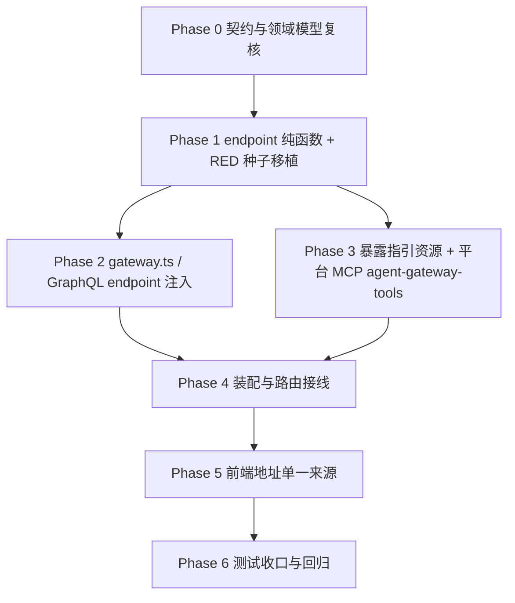

# 网关功能更新（网关 MCP endpoint 返回与服务暴露指引） - 实现计划

**功能名称**: 网关端点返回与服务暴露指引
**关联提案**: [[../proposals/20261126-feat-gateway-mcp-endpoint.md]]
**关联 PRD**: [[../../product/draft/20261126-gateway-mcp-endpoint.md]]
**计划版本**: v1.0
**创建日期**: 2026-11-26
**feat-branch**: `feat/gateway-mcp-endpoint`

## 1. 目标与范围

### 1.1 目标

按提案拆解为可执行任务：endpoint 派生单一来源（`services/gateway-endpoint.ts` 纯函数，`PUBLIC_BASE_URL` 为唯一事实源）、GraphQL `Gateway.endpoint` 与 MCP 返回同源、平台 MCP `agent-gateway-tools`（3 工具 + 1 暴露指引资源，恒装配全部会话）、前端地址改读字段消除 `window.location.origin` 双源漂移，UI 与工具返回地址逐字一致（PRD 功能点 3）。

### 1.2 不在范围

- 不恢复 MCP prompts（#580 裁决：平台片段只用 resources）；不改造代理数据面（无 WebSocket upgrade / 匿名访问，以指引显式规避）；
- 不改 `port-forward:command` 协议与 `gateway-proxy` 鉴权/超时语义；无新集合、无迁移（endpoint 为派生字段不落库）；
- 不切换网关 `{userId}` 作用域口径（提案 D6）；不改 `GatewayList.limit` 现状（见 D1）。

## 2. 实现顺序



- 依赖关系：契约先行（Phase 0）→ 纯函数底座（Phase 1，TDD RED 种子先行）→ 服务/GraphQL 注入（Phase 2）与 MCP 工具/资源（Phase 3）可并行 → 装配接线（Phase 4，两模块就绪后）→ 前端（Phase 5）→ 测试收口（Phase 6，先红后绿贯穿各 Phase）。
- **发布顺序**：全部改动随 `feat/gateway-mcp-endpoint` 同 PR 合并，agent-api（契约/后端）先于 agent-web 生效无兼容窗口；回滚 = 下线 `agent-gateway-tools` 装配与 `Gateway.endpoint` 字段（提案 §6.2），网关既有能力不受影响。

## 3. 代码事实核对（F）

以下为本计划核对的代码事实（与提案表述冲突处以本表为准）：

| 编号 | 事实 | 位置 |
|---|---|---|
| F1 | `mapGateway` 现状输出 6 字段 `id/controllerId/name/port/status/createdAt`（ISO），无 `endpoint`/`basePath`；`findAllByController` 返回 `limit: 0` **硬编码**（GraphQL `GatewayList.limit` 恒 0） | `servers/agent-api/src/services/gateway.ts:10-17,70-79` |
| F2 | `GatewayService.create(controllerId, userId, name, port, maxPerController)` 五参签名；上限由调用方传 `config.gatewayMaxPerController`（env `GATEWAY_MAX_PER_CONTROLLER` 默认 5）；`countDocuments` 计数、`findOne({controllerId,name})` 重名校验（不带 userId）、`actorFilter(userId)` 控制器可见性；错误白名单逐字 5 条（`Controller not found` / `Controller is not online` / `Name can only contain letters, numbers, hyphens, and underscores` / `Name length must be 1-50 characters` / `Gateway name already exists` / `` `Maximum ${max} gateways per controller` ``）；`publish('port-forward:command', {type:'tunnel:create'\|'tunnel:close', controllerId, port})` | `servers/agent-api/src/services/gateway.ts:7,19-68`、`config/index.ts:34`、`graphql/resolvers/gateway.ts:25-31` |
| F3 | `config.publicBaseUrl = (PUBLIC_BASE_URL \|\| 'http://localhost:10001').replace(/\/+$/, '')`（去尾斜杠）；现仅 OAuth 回调使用，网关未使用 | `servers/agent-api/src/config/index.ts:45`、`services/oidc-client.ts:200-202` |
| F4 | 代理路由 `router.all('/gateway/:controllerId/:name/{*path}')` 挂 `/api`（Express v5 splat）；鉴权在 handler 内 `authenticateExpressUser`（Bearer/cookie → 401 `Not authenticated`）；未命中 404 `Gateway not found or not active`；`PROXY_TIMEOUT_MS = 30_000` → 502 `Proxy timeout` | `servers/agent-api/src/routes/gateway-proxy.ts:17,27-65,122-124`、`index.ts:167` |
| F5 | 恒装配现状：默认 MCP `$nin` 排除名单 5 名（`agent-cloud-host-tools` / `agent-session-preview-tools` / `agent-valut-tools` / `agent-custom-tools` / `agent-knowledge-base-tools`）；**公共路径恒装配 4 个**（preview/valut/custom/knowledge-base），`agent-cloud-host-tools` 仅 `controller.type === 'cloud'` 装配；第二处 `$nin` 在 `services/controller.ts` `setDefaultMcp`（**agent-api 无 `controllers/` 目录**，提案 §7 的 `controllers/controller.ts` 应为 `services/controller.ts`，GraphQL 层为 `graphql/resolvers/controller.ts:157`） | `servers/agent-api/src/services/session.ts:404-465`、`services/controller.ts:135-191` |
| F6 | `mcp-dispatch` platform 分支为 serverName **三元链**（ADMIN → WORKFLOW → CLOUD → PREVIEW → VALUT → CUSTOM → KNOWLEDGE_BASE → fallback `SERVER_NOT_FOUND 'Unsupported platform server'`）；caller 统一 `{userId, sessionId}`；会话上下文 `workspaceService.buildSessionWorkspaceContext(sessionId, userId)` 懒加载供 `runWithWorkspace`，**不向 handler 透传 controllerId** | `servers/agent-api/src/services/mcp-dispatch.ts:157-233` |
| F7 | 平台 MCP 范式：`ensure*Server(userId)` upsert `{userId,name,transport:'platform',source:'platform',enabled:true,tools}`（E11000 重读兜底）+ handler method switch（`valut-tools.ts:35-115`）；**resources 分支正典**在 `knowledge-base-tools.ts:236-283` 与 `workflow/admin-tools.ts:489-533`（`initialize` 声明 `capabilities:{tools:{},resources:{}}`、`resources/list`、`resources/read` 未知/缺 uri → `INVALID_PARAMS` 附可用 URI 列表、`contents[].mimeType='text/markdown'`）；`tools/call` 错误 `isError:true` + `content[{type:'text',text:JSON.stringify({code,message})}]`（`admin-tools.ts:543-549`） | `servers/agent-api/src/services/valut-tools.ts`、`knowledge-base-tools.ts`、`workflow/admin-tools.ts` |
| F8 | #580 后 `admin-prompts.ts` 已是**资源注册表**（`ADMIN_PROMPT_RESOURCES`/`getAdminPromptResource`、URI 前缀 `zag://agent-workflow-admin-tools/prompt/`），`prompts/list\|get` → `METHOD_NOT_FOUND`（T-AP11 锁定）；`knowledge-base-prompts.ts` 为同构第二参照 | `servers/agent-api/src/services/workflow/admin-prompts.ts:34,152-194`、`services/knowledge-base-prompts.ts:31-32` |
| F9 | `Session.controllerId` 必填 + index；`workspace-service.buildSessionWorkspaceContext` 是 canonical 会话上下文解析（sessionId → controllerId → workspaceId） | `servers/agent-api/src/models/session.ts:20`、`services/workspace-service.ts:435-470` |
| F10 | 前端 `GatewayItem.tsx:19` `accessUrl = \`${window.location.origin}/api/gateway/${controllerId}/${gateway.name}/\``（**无段编码、双源拼接**）；`HOME_OVERVIEW` 与 `GET_GATEWAYS` 各取 6 字段；网关列表渲染于 `Sidebar.tsx`（仅在线控制器）；`home.ts` resolver degrade 兜底 `{gateways:[],total:0,limit:0}` | `apps/agent-web/src/components/GatewayItem.tsx`、`graphql/home.ts:54-65`、`graphql/queries.ts:676-689`、`graphql/resolvers/home.ts:155-165` |
| F11 | GraphQL schema `Gateway` 6 字段 + `GatewayList{gateways,total,limit}`；resolver 无字段级投影（`mapGateway` 即投影，注入 `endpoint` 后自动透出）；`contracts/gateway.graphql` 同形无 `endpoint` | `servers/agent-api/src/graphql/schemas/gateway.ts:2-23`、`graphql/resolvers/gateway.ts`、`contracts/gateway.graphql` |
| F12 | 契约登记形态：`mcp-server.graphql` 平台服务以 `McpServerSource.platform` 枚举**注释散文**登记（resources URI 约定、`INVALID_PARAMS` 形态）；`agent-session-websocket.md` §2.12.1 路由表 7 行 + 说明段（「平台服务均由 `sessionService.create` 公共路径恒装配并去重」为通用句，新增服务无需改该句） | `contracts/mcp-server.graphql:8-29`、`contracts/agent-session-websocket.md:482-497` |
| F13 | RED 种子 `gateway-endpoint.repro.test.ts`（`bugfix/gateway-mcp-endpoint` 分支，82 行，当前稳定 RED）：`T-GMCP-REPRO-1` 断言 `create` 返回 `endpoint === 'http://localhost:10001/api/gateway/ctrl1/my-service/'`（默认 `PUBLIC_BASE_URL`）；`T-GMCP-REPRO-2` 动态 `import('./gateway-tools.js')` 非空；mock 打在 `../middleware/redis.js`，而 `gateway.ts` 实经 `middleware/publish.js` 间接用 redis（移植时见 D5） | `git show bugfix/gateway-mcp-endpoint:servers/agent-api/src/services/gateway-endpoint.repro.test.ts` |
| F14 | 测试基建：agent-api vitest（`src/**/*.test.ts` 同目录 colocated、纯模块 mock 无内存 Mongo）；`gateway.test.ts` 既有 11 用例；`tests/api/src/agent-api/mcp-server.test.ts` fake controller relay 范式（`mcp:request`/`mcp:response`、`start.mcpEndpoint.serverNames/token` 断言、resources 形态断言 T-AP-API1~3）；`tests/api/src/agent-api/gateway.test.ts`（GraphQL CRUD + 隧道端到端）；`tests/e2e/src/gateway.spec.ts`（创建/重名/删除/代理 200） | `servers/agent-api/vitest.config.ts`、`tests/api/src/agent-api/`、`tests/e2e/src/gateway.spec.ts` |
| F15 | `gateways` 集合：`status` enum `active/inactive/error` 仅写 `active`；索引 `{controllerId,name}` unique、`{userId}`、`{controllerId,status}`；`tenantId` 必填 + `applyTenantScope` | `servers/agent-api/src/models/gateway.ts:4-17` |

## 4. 实现步骤

### Phase 0：契约与领域模型复核

1. `contracts/gateway.graphql`（修改）：`Gateway` 增加 `endpoint: String!`（注释：对外访问地址，服务端单一来源派生、含尾斜杠，如 `https://host/api/gateway/{controllerId}/{name}/`；派生只读不落库）。
2. `contracts/mcp-server.graphql`（修改）：`McpServerSource.platform` 注释增补 `agent-gateway-tools` 段——工具清单（`gateway_list`/`gateway_create_endpoint`/`gateway_delete_endpoint`）、resources 能力与 URI 约定 `zag://agent-gateway-tools/prompt/gateway-exposure-guidance`、`isError` 白名单文案与 `INVALID_PARAMS` 形态、操作对象为会话所在控制器、工具 description 发现引导。
3. `contracts/agent-session-websocket.md` §2.12.1（修改）：路由表新增一行——`agent-gateway-tools` | 全部会话（恒装配） | `gateway_list`/`gateway_create_endpoint`/`gateway_delete_endpoint` | 本地 handler 直发；操作对象为会话所在控制器（`caller.sessionId → Session.controllerId`，不接受外部 controllerId）；含暴露指引资源（resources 通道）。
4. 领域模型复核（见 §5；提案阶段已同步，本阶段仅核对与本计划 D 裁决一致）。

### Phase 1：endpoint 单一来源纯函数 + RED 种子移植（TDD：T-GWE* 先红）

1. `servers/agent-api/src/services/gateway-endpoint.ts`（新增）：
   - `buildGatewayEndpoint(publicBaseUrl, controllerId, name)` → `{publicBaseUrl}/api/gateway/{controllerId}/{name}/`；
   - `buildGatewayBasePath(controllerId, name)` → `/api/gateway/{controllerId}/{name}/`；
   - 纯函数零 IO；`publicBaseUrl` 去尾斜杠归一、`controllerId`/`name` 走 `encodeURIComponent` 路径段编码、恒以 `/` 开头结尾；与代理路由 `router.all('/gateway/:controllerId/:name/{*path}')`（挂 `/api`，F4）逐字对齐；**禁止第二处拼接**。
2. `servers/agent-api/src/services/gateway-endpoint.test.ts`（新增）：T-GWE1~6（见 §4 Phase 6 矩阵）。
3. **RED 种子移植**（F13/D5）：把 `bugfix/gateway-mcp-endpoint` 的 `gateway-endpoint.repro.test.ts` 移植为正式测试——`T-GMCP-REPRO-1` 并入 `gateway.test.ts`（`create` 返回 `endpoint`），`T-GMCP-REPRO-2` 转入 `gateway-tools.test.ts`（handler 模块存在 + 行为）；mock 由 `../middleware/redis.js` 改为直接 `vi.mock('../middleware/publish.js')`；移植后先确认 RED，再随 Phase 2/3 转绿。

### Phase 2：gateway.ts / GraphQL endpoint 注入（TDD：T-GWS* 先红）

1. `servers/agent-api/src/services/gateway.ts`（修改）：`mapGateway` 追加 `endpoint: buildGatewayEndpoint(config.publicBaseUrl, controllerId, name)`（含 `create`/`findAllByController` 两处输出）；**其余签名/校验/错误文案/Redis 发布零变化**（F2）。
2. `servers/agent-api/src/graphql/schemas/gateway.ts` + `resolvers/gateway.ts`（修改）：`Gateway.endpoint: String!` 契约与手写 schema 双写；resolver 无字段级投影改动（F11）。
3. `servers/agent-api/src/services/gateway.test.ts`（修改）：T-GWS1~4——`create`/`findAllByController` 返回 `endpoint` 且与 helper 一致；`T-GMCP-REPRO-1` 转绿；既有 11 用例零回归。

### Phase 3：暴露指引资源 + 平台 MCP `agent-gateway-tools`（TDD：T-GT*/T-GP* 先红）

1. `servers/agent-api/src/services/gateway-prompts.ts`（新增，照 `admin-prompts.ts`/`knowledge-base-prompts.ts` 资源注册表同构，F8）：
   - `GATEWAY_PROMPT_RESOURCE_URI_PREFIX = 'zag://agent-gateway-tools/prompt/'`；单一资源 `gateway-exposure-guidance`（`{uri, name, description, mimeType: 'text/markdown'}`）；
   - 指引 Markdown 单一来源常量，内容要点（与提案实现点 3 同源）：① `endpoint` 是完整外网 URL、`basePath` 是其 path 部分，**必须使用工具返回值，禁止自行拼接 `localhost:{port}`**；② 以 basePath 作为服务外网访问基础路径——Vite `base: '<basePath>'`（开发与构建同效）、`server.allowedHosts` 放行平台域名、**`server.hmr: false`（网关不支持 WebSocket upgrade）**或改轮询、静态资源走相对路径；③ 其他框架同义映射（Next.js `basePath`/`assetPrefix`、Nuxt `app.baseURL`、Spring `context-path`）；④ 访问前提与限制（需登录访问、单请求 30s 超时、上限 5/控制器、命名 `[a-zA-Z0-9_-]{1,50}` 控制器内唯一）；⑤ 仅在用户要求暴露服务时创建端点、用完建议删除；
   - `getGatewayPromptResource(uri)` 供 resources/read 使用。
2. `servers/agent-api/src/services/gateway-prompts.test.ts`（新增）：T-GP1~4 防漂移守卫（正文含 Vite `base`/`hmr: false`/`allowedHosts`/登录鉴权/30s/上限 5/命名规则/禁拼 `localhost` 关键词字面量断言）。
3. `servers/agent-api/src/services/gateway-tools.ts`（新增，`ensure*Server` 照 valut-tools、resources/tools/call 形态照 knowledge-base-tools/admin-tools，F7/D3）：
   - `GATEWAY_TOOLS_SERVER_NAME = 'agent-gateway-tools'`；`GATEWAY_TOOL_DEFINITIONS` 三工具（入参/出参/错误表逐字按提案 §3.1）；
   - `ensureGatewayToolsServer(userId)`：upsert `McpServer` 行（`{userId, name, transport:'platform', source:'platform', enabled:true, tools:[...]}`，E11000 重读兜底）；
   - `handleGatewayToolsMcpRequest(caller: {userId, sessionId}, request)`：
     - `initialize` → `capabilities: { tools: {}, resources: {} }`（**不声明 prompts**，同 T-AP11 口径）；`notifications/*`/`ping` → `{result:{}}`；
     - `resources/list` → `GATEWAY_PROMPT_RESOURCES`；`resources/read` 缺/未知 uri → `INVALID_PARAMS` 附可用 URI 列表（F7 正典形态）；
     - `tools/list` → 三工具定义（description 统一附加发现引导：「创建端点后请阅读资源 `zag://agent-gateway-tools/prompt/gateway-exposure-guidance`，以返回的 endpoint 作为外网 basePath 配置服务（如 Vite `base`）」+「仅在用户要求暴露服务时使用」）；
     - `tools/call`：先 `Session.findById(caller.sessionId).select('controllerId')` 解析操作控制器（D2，无 controllerId → `isError` `Controller not found` 逐字）；`gateway_list` → `{gateways:[{name,port,status,endpoint,basePath}], limit}`（`limit = config.gatewayMaxPerController`，D1/D9）；`gateway_create_endpoint` → 入参校验（缺/非法 → `INVALID_PARAMS` 附字段规则）后 `gatewayService.create(controllerId, userId, name, port, config.gatewayMaxPerController)`，白名单错误逐字 `isError`，成功 `{name,port,status,endpoint,basePath}`（`basePath` 由 `buildGatewayBasePath` 生成）；`gateway_delete_endpoint` → `gatewayService.delete(...)`，返回 `false` → `isError` `Gateway not found or not active`（D7），成功 `{deleted:true}`；未知工具 → `METHOD_NOT_FOUND`；
     - 错误形态统一 `{result:{content:[{type:'text',text:JSON.stringify({code,message})}], isError:true}}`。
4. `servers/agent-api/src/services/gateway-tools.test.ts`（新增）：T-GT1~8（含 `T-GMCP-REPRO-2` 转绿）。

### Phase 4：装配与路由接线（TDD：T-GA*/T-GD* 先红）

1. `servers/agent-api/src/services/session.ts`（修改）：默认 MCP 候选 `$nin` 五名 → 六名（追加 `GATEWAY_TOOLS_SERVER_NAME`）；公共路径新增 `ensureGatewayToolsServer(userId)` 恒装配去重块（照 knowledge-base 块形态，普通/云/工作流节点会话全覆盖）；同步注释「上述五个」→ 六个。
2. `servers/agent-api/src/services/controller.ts`（修改）：`setDefaultMcp` 的 `$nin`（L158-165）追加 `GATEWAY_TOOLS_SERVER_NAME`（选平台服务仍报 `MCP_SERVER_NOT_SELECTABLE`，F5/D12）。
3. `servers/agent-api/src/services/mcp-dispatch.ts`（修改）：platform 三元链 KNOWLEDGE_BASE 分支后追加 `GATEWAY_TOOLS_SERVER_NAME → handleGatewayToolsMcpRequest({userId, sessionId}, request)`；fallback `SERVER_NOT_FOUND` 形态不变（F6）。
4. 单测：`session.test.ts`（恒装配第 5 个公共平台服务 + 去重 + `$nin` 六名）、`controller.test.ts`（`$nin` 六名）、`mcp-dispatch.test.ts`（platform 链尾直发、未知 serverName 仍 `SERVER_NOT_FOUND`）。

### Phase 5：前端地址单一来源

1. `apps/agent-web/src/graphql/home.ts`（`HOME_OVERVIEW`）与 `graphql/queries.ts`（`GET_GATEWAYS`）：`gateways` 字段集追加 `endpoint`。
2. `apps/agent-web/src/components/GatewayItem.tsx`（修改）：`accessUrl = gateway.endpoint`（删除 `${window.location.origin}/api/gateway/...` 拼接，F10）；展示与「复制地址」按钮同源；`endpoint` 缺失（旧缓存/降级）时展示空并禁用复制，**不拼假地址**（D6）。
3. `apps/agent-web` build + lint 收口。

### Phase 6：测试收口（TDD 红-绿-重构，各 Phase 内先红后绿）

| 编号 | 层 | 断言 | 预期 |
|---|---|---|---|
| T-GWE1~6 | agent-api 单测 | 纯函数：`publicBaseUrl` 尾斜杠归一、controllerId/name 段编码、恒尾 `/`、basePath 形态、默认 base、与代理路由形态对齐 | 红 |
| T-GWS1~4 | agent-api 单测 | `create`/`findAllByController` 返回 `endpoint` 与 helper 一致；`T-GMCP-REPRO-1` 转绿；既有 11 用例零回归 | 红 |
| T-GT1~8 | agent-api 单测 | initialize 声明 tools+resources（无 prompts）；三工具出入参；错误白名单逐字（命名/长度/重名/上限/离线）；`INVALID_PARAMS` 附规则；`delete` 未命中 `Gateway not found or not active`；resources read/未知 URI；description 含发现引导；`T-GMCP-REPRO-2` 转绿 | 红 |
| T-GP1~4 | agent-api 单测 | 防漂移守卫：指引正文含 Vite `base`/`hmr: false`/`allowedHosts`/登录鉴权/30s/上限/命名规则/禁拼 `localhost` 关键词 | 红 |
| T-GA1~4 | agent-api 单测 | `session.ts` 恒装配第 5 个公共平台服务 + 去重；两处 `$nin` 六名；`controller.ts` 选平台服务 `MCP_SERVER_NOT_SELECTABLE` | 红 |
| T-GD1~3 | agent-api 单测 | `mcp-dispatch` platform 链尾分支直发；未装配 serverName 仍 `SERVER_NOT_FOUND`；fallback 不变 | 红 |
| T-GMCP-API1~6 | tests/api | 会话 `mcpEndpoint.serverNames` 含 `agent-gateway-tools`；`tools/call` 创建返回 `endpoint` 与 GraphQL `Gateway.endpoint`、`buildGatewayEndpoint` **逐字一致**；`gateway_list`/`gateway_delete_endpoint` 全链路；`resources/read` 正文可达且含 Vite 示例；错误文案逐字；安全回归（匿名 401、不可见/不可删他人端点） | 红 |
| E2E-GMCP1~3 | tests/e2e | `gateway.spec.ts` 扩展：UI 展示/复制地址与 MCP 返回 `endpoint` **逐字一致**（对比口径不硬编码域名，D10）；创建/重名/删除零回归；代理 401/404/502 文案零变化 | 红 |
| 回归锚点 | 既有测试 | `gateway.test.ts` 既有 11 用例、`tests/api` gateway CRUD + 隧道端到端、`tests/e2e` gateway.spec.ts 既有用例——旧断言保留、新断言并列新增 | 绿 → 绿 |

测试落点：`servers/agent-api/src/services/{gateway-endpoint,gateway-tools,gateway-prompts}.test.ts`（新增）、`{gateway,session,controller,mcp-dispatch}.test.ts`（增量）；`tests/api/src/agent-api/mcp-server.test.ts`（增量）与 `gateway.test.ts`（增量）；`tests/e2e/src/gateway.spec.ts`（增量）。

## 5. 领域模型同步

- **无新增领域概念**：endpoint 派生口径、`agent-gateway-tools` 三工具、暴露指引资源 URI、代理限制（无 WS upgrade / 需登录 / 30s）已在提案阶段同步落库（`docs/knowledges/domain/70-模型网关/00-上下文概览.md` L98-107、`01-聚合与实体.md`「派生字段/网关 MCP 工具」节），本计划仅承载拆解，不引入新聚合/状态机/权限面。
- 本计划 D1（`gateway_list.limit` = 每控制器上限）、D2（`caller.sessionId → Session.controllerId`）、D9（`gateway_list` 出参形态）与领域模型登记口径一致，无需回写。
- 实现中发现代码事实与领域模型不一致时，**以代码为准回写修正**对应上下文文档（common-rules「Domain Model Sync」）。

## 6. 计划期裁决（D）

| 编号 | 裁决 | 原因 |
|---|---|---|
| D1 | `gateway_list` 出参 `limit` 返回 `config.gatewayMaxPerController`（每控制器上限，便于 Agent 判断余量）；**不改** `findAllByController` 的 `limit: 0`（GraphQL `GatewayList.limit` 现状零回归） | F1 现状 `limit: 0` 硬编码；提案出参示例 `limit: 5` 语义按上限解释，避免顺手改既有 GraphQL 行为 |
| D2 | 工具操作控制器由 handler 内 `Session.findById(caller.sessionId).select('controllerId')` 解析；不改 `mcp-dispatch` caller 形态；无 controllerId/控制器不可见 → `isError` `Controller not found` 逐字 | 领域模型已定口径「`caller.sessionId → Session.controllerId`，不接受外部 controllerId」（提案 D8）；dispatch 现状 caller 仅 `{userId,sessionId}`（F6），改签名扩面 |
| D3 | `ensure*Server` 照 `valut-tools.ts`；**resources 分支与 `tools/call` 错误形态照 `knowledge-base-tools.ts`/`admin-tools.ts`**（`isError` content、`INVALID_PARAMS` 附可用列表），不照 valut-tools 的协议级 `error` | F7：valut-tools 无 resources 且错误形态不同；提案「照 valut-tools 范式」按 #580 后正典理解 |
| D4 | 暴露指引为独立资源注册表 `gateway-prompts.ts`（照 `admin-prompts.ts`/`knowledge-base-prompts.ts` 同构），URI `zag://agent-gateway-tools/prompt/gateway-exposure-guidance` 单资源，经 `resources/list`/`resources/read` 投递 | #580 裁决（提案 D4）；F8 双参照防漂移 |
| D5 | RED 种子转正：`T-GMCP-REPRO-1` 并入 `gateway.test.ts`、`T-GMCP-REPRO-2` 转 `gateway-tools.test.ts`；mock 由 `../middleware/redis.js` 改 `vi.mock('../middleware/publish.js')` 直接短路 | F13：`gateway.ts` 经 `middleware/publish.js` 发布，直接 mock 发布层更稳且不依赖 redis 内部实现 |
| D6 | 前端 `endpoint` 缺失（旧缓存查询缺字段/degrade）时展示空 + 复制按钮禁用，**不拼假地址** | 提案实现点 5 风险；PRD「地址口径唯一」禁止任何一方自行拼接 |
| D7 | `gateway_delete_endpoint` 未命中（不存在/他人端点）统一 `isError` `Gateway not found or not active`（`gatewayService.delete` 返回 `false` 即映射），不泄露存在性 | 提案 §3.1 删除工具口径；与代理 404 文案同字（F4） |
| D8 | `tools/call` 入参校验先于服务调用：name 非 string/缺失、port 非整数或越界 → `INVALID_PARAMS` 附字段名与取值规则；命中 `GatewayService` 白名单错误时逐字透传 `isError` | 提案 §3.1 错误表（D9 决策：白名单逐字、零新增错误面） |
| D9 | `gateway_list` 出参不含 `total`，形态按契约/领域模型 `{gateways:[{name,port,status,endpoint,basePath}], limit}` | 提案 §3.1 与领域模型 `01-聚合与实体.md` 同口径 |
| D10 | E2E 地址一致性断言用「UI 展示串 === MCP 返回串」对比，不硬编码域名 | `PUBLIC_BASE_URL` 部署可变（R1）；一致性是行为口径而非固定字面值 |
| D11 | GraphQL `Gateway` 仅加 `endpoint`；`basePath` 仅 MCP 侧由 `buildGatewayBasePath` 生成，不进 GraphQL | 契约变更 1 仅 `endpoint`（提案 §3.1）；UI 展示完整地址即可 |
| D12 | 提案 §7 项目结构校正：`controllers/controller.ts` → `services/controller.ts`（`$nin` 落点），GraphQL 层 `graphql/resolvers/controller.ts` | F5：agent-api 无 `controllers/` 目录 |

## 7. 命令参考

```bash
# 单测（先红后绿）
cd servers/agent-api && pnpm run test -- src/services/gateway-endpoint.test.ts
cd servers/agent-api && pnpm run test -- src/services/gateway-tools.test.ts
cd servers/agent-api && pnpm run test

# 类型 / 构建 / Lint
cd servers/agent-api && pnpm run build
cd apps/agent-web && pnpm run build && pnpm run lint

# API 集成测试（需 MONGODB_URI）
cd tests/api && pnpm run test -- src/agent-api/mcp-server.test.ts
cd tests/api && pnpm run test

# E2E（端口以 aspire describe 为准，见 tests/e2e/AGENTS.md）
aspire start && aspire wait agent-api && aspire wait agent-web
cd tests/e2e && BASE_URL=<agent-web> API_URL=<agent-api>/graphql \
  CONTROLLER_API_URL=<controller-api> pnpm exec playwright test src/gateway.spec.ts --workers=1
```

## 8. 回归清单

- [ ] 既有网关能力零变化：创建/删除校验与错误文案逐字、`port-forward:command` 发布形态、`gateway-proxy` 鉴权/401/404/502/30s 超时行为（F2/F4 旧断言保留）。
- [ ] `GatewayList` 既有行为零变化（含 `limit: 0` 现状，D1）；`mapGateway` 除追加 `endpoint` 外字段不变。
- [ ] 默认 MCP 候选/`setControllerDefaultMcp` 选平台服务仍报 `MCP_SERVER_NOT_SELECTABLE`；用户自选 MCP 校验链路零变化（T-GA）。
- [ ] `mcp-dispatch` 既有 platform 服务路由与 fallback `SERVER_NOT_FOUND` 零变化（T-GD）。
- [ ] 旧版本会话/未读取指引的会话无影响（缺失资源优雅降级，工具照常可用）；匿名访问 endpoint 仍 401。
- [ ] 前端除地址读取来源外零变化：创建/删除/复制/空态/离线隐藏行为不变（E2E-GMCP 回归锚点）。

## 9. 验收 checklist

- [ ] 契约评审通过（`gateway.graphql` / `mcp-server.graphql` / `agent-session-websocket.md` §2.12.1）。
- [ ] 领域模型同步状态确认（§5，与 `70-模型网关` 口径一致）。
- [ ] `gateway_create_endpoint` 创建成功返回具体 `endpoint` 与 `basePath`，与 GraphQL `Gateway.endpoint`、UI 展示**逐字一致**（T-GMCP-API + E2E-GMCP1）。
- [ ] 暴露指引资源可读且覆盖 Vite 示例、鉴权/HMR/超时/命名上限限制、禁拼地址要求（T-GP1~4 + T-GMCP-API）。
- [ ] 代码实现完成（含两处 `$nin` 六名与 dispatch 分支接线，T-GA/T-GD）。
- [ ] 单元测试覆盖达标（≥ 80%，含 RED 种子 `T-GMCP-REPRO-1/2` 转绿）。
- [ ] API 测试通过（MCP relay 全链路 + 安全回归）；E2E 测试通过（地址一致性 + 网关既有行为零回归）。
- [ ] 回归清单全勾（§8）。

## 10. 实现记录（代码实现节点）

- **契约**：`contracts/gateway.graphql` 增 `Gateway.endpoint: String!`；`contracts/mcp-server.graphql` 增
  `agent-gateway-tools` 平台服务注解；`contracts/agent-session-websocket.md` §2.12.1 路由表增一行。
- **agent-api**：新增 `services/gateway-endpoint.ts`（纯函数单一来源）、`services/gateway-prompts.ts`
  （暴露指引资源）、`services/gateway-tools.ts`（三工具 handler）；`gateway.ts` 的 `mapGateway` 注入 `endpoint`；
  `graphql/schemas/gateway.ts` 双写字段；`session.ts` / `controller.ts` 两处 `$nin` 六名 + 公共路径恒装配；
  `mcp-dispatch.ts` platform 链尾分支。
- **agent-web**：`HOME_OVERVIEW` / `GET_GATEWAYS` 选择集追加 `endpoint`；`GatewayItem` 改读
  `gateway.endpoint`（缺失禁用复制、不拼假地址），删除 `window.location.origin` 拼接。
- **测试**：`gateway-endpoint.test.ts`（T-GWE1~6）、`gateway.test.ts`（T-GWS1~4 + `T-GMCP-REPRO-1`）、
  `gateway-tools.test.ts`（T-GT1~8 + `T-GMCP-REPRO-2`）、`gateway-prompts.test.ts`（T-GP1~4），
  `session/controller/mcp-dispatch` 单测增量；`tests/api` GraphQL + MCP relay（T-GMCP-API1~6）；
  `tests/e2e` 地址一致性（E2E-GMCP1）。全量单测：agent-api 2567 通过、agent-web 1531 通过。
