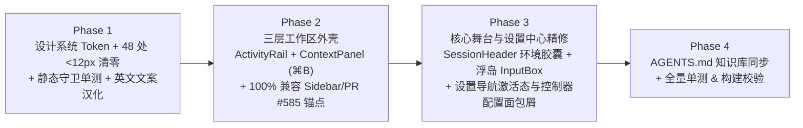

# 整体工作区 UI/UX 重构与视觉规范升级 - 实现计划

**功能名称**: 整体工作区 UI/UX 重构与视觉规范升级
**关联 PRD**: [`docs/product/draft/20261126-ui-ux-workspace-overhaul.md`](../../product/draft/20261126-ui-ux-workspace-overhaul.md)
**关联提案**: [`docs/engineering/proposals/20261126-refactor-ui-ux-workspace-overhaul.md`](../proposals/20261126-refactor-ui-ux-workspace-overhaul.md)
**关联规范**: [`docs/engineering/ui-ux-standards.md`](../ui-ux-standards.md)
**计划版本**: v1.0
**创建日期**: 2026-11-26
**作者**: ZeroAsh Agent
**需求总分支**: `refactor/ui-ux-workspace-overhaul`
**实现分支**: `refactor/ui-ux-workspace-overhaul-impl`
**需求总 PR**: https://github.com/Deliay/z-agent-gear/pull/587

## 1. 实施顺序

严格遵循 TDD（红-绿-重构）垂直切片循环推进，每个阶段先编写失败测试（RED），再编写最小实现通过测试（GREEN），最后清理重构（REFACTOR）：

## 2. 代码事实与回归边界核对

| 编号 | 存量代码事实与测试契约 | 处理策略 |
|------|---------------------|---------|
| F1 | `apps/agent-web/src` 共 18 个组件文件存在 48 处 `text-[9px]` / `text-[10px]` / `text-[11px]`；`apps/admin-web/src` 存在 0 处 | Phase 1 新增 `src/__tests__/ui-ux-standards.test.ts` 守卫单测，递归扫描 `apps/agent-web/src` 与 `apps/admin-web/src` 断言 0 处 `text-[9px\|10px\|11px]`，随后逐一升级为 `text-xs` |
| F2 | `InputBox.tsx:365-404` 按钮与 placeholder 为英文 `Send` / `Stop` / `Type your message...` / `Session is not active...` / `Agent is processing...`；存量单测 `InputBox.test.tsx` 等通过 `/send/i` 或 `/stop/i` 或 placeholder 查询 | 为保证存量测试与中文 UI 双赢，按钮文案升级为中文「发送」/「停止」（保留或兼容 aria-label / testid，并同步更新 `InputBox.test.tsx` 等断言） |
| F3 | `MainLayout.tsx` 已在 PR #585/#588 合入 `HomeOverviewContext.Provider` + `WorkspaceContextSyncBridge`（含 `loading` 与 `error && !data` 早退分支包裹），`MainLayout.test.tsx` 对 grid 布局与 `HOME_OVERVIEW` 唯一轮询有严格断言 | `MainLayout.tsx` 引入 `ActivityRail` 与二级面板折叠开关（`Cmd+B`），保持 `HomeOverviewContext.Provider` 与 `WorkspaceContextSyncBridge` 结构零回归，并扩展 `MainLayout.test.tsx` |
| F4 | `Sidebar.tsx` 已在 PR #585/#588 合入 `ArchivedWorkflowGroup` 与 `ArchivedSessionGroup`（无计数、按需查询、`data-testid="sidebar-archived-workflow-list"` / `sidebar-archived-session-list`），且 E2E 依赖 `nav[aria-label="Sidebar"]` 与 `sidebar-section-*` | `ActivityRail` 作为一级导航轨联动 `Sidebar` 分区聚焦与路由跳转；`Sidebar` 顶部增加快速筛选框与折叠按钮，保留全部 `data-testid="sidebar-section-*"` 与归档组件契约不变 |
| F5 | `SettingsPage.tsx` 已在 PR #585/#588 合入 `SETTINGS_OVERVIEW`（14 分支）与 `SettingsOverviewContext`（`skip: Boolean(controllerId)`）；`ControllerConfigPage.tsx` 由 `controllerId` 参数切换渲染 | `SettingsPage.tsx` 增加当前激活分类高亮（`activeSection`）与顶栏状态；`ControllerConfigPage.tsx` 顶部增加面包屑导航栏（`设置 / 控制器管理 / {controller.name}`）且保持 `skip: Boolean(controllerId)` 不额外触发请求 |

## 3. 分阶段实施清单与测试矩阵

### 3.1 Phase 1：设计系统 Token、48 处微字号清零与文案汉化

- **测试（RED）**：
  - `apps/agent-web/src/__tests__/ui-ux-standards.test.ts`：
    - `T-UIUX-FONT1`：扫描 `apps/agent-web/src` 下所有 `.tsx`/`.ts`（排除测试文件），断言不存在 `text-[9px]`、`text-[10px]`、`text-[11px]`。
    - `T-UIUX-FONT2`：扫描 `apps/admin-web/src` 下所有 `.tsx`/`.ts`，断言不存在 `text-[9px]`、`text-[10px]`、`text-[11px]`。
- **实现（GREEN）**：
  - 升级 `apps/agent-web/src/index.css` 与 `apps/admin-web/src/index.css` 的 OKLCH 表面明度变量（区分 `--background`、`--sidebar`、`--card`、`--popover` 明度层级）。
  - 将 18 个组件中的 48 处 `text-[9px|10px|11px]` 全部替换为 `text-xs`。
  - 统一 `InputBox.tsx` 等处的操作文案与占位符为简体中文，并同步更新相关单测。

### 3.2 Phase 2：三层工作区外壳（`ActivityRail` + `ContextPanel` + `MainStage`）

- **测试（RED）**：
  - `apps/agent-web/src/components/layout/__tests__/ActivityRail.test.tsx`：
    - `T-UIUX-RAIL1`：渲染一级导航轨（概览、会话、工作流、知识库、主机、费用、设置），点击域按钮触发路由或聚焦回调，存在待处理 Review 时展示提醒圆点。
    - `T-UIUX-RAIL2`：点击折叠按钮或按 `Ctrl/Cmd+B` 可切换二级上下文面板（Sidebar）的收起与展开状态。
- **实现（GREEN）**：
  - 新增 `apps/agent-web/src/components/layout/ActivityRail.tsx`。
  - 更新 `apps/agent-web/src/pages/MainLayout.tsx`：桌面端集成 `ActivityRail` + 可收起/可拖拽调宽的 `Sidebar`（二级上下文面板）+ `main` 主工作舞台。
  - 更新 `apps/agent-web/src/components/Sidebar.tsx`：支持通过 `ActivityRail` 快速聚焦对应分区，顶部提供快速筛选输入框过滤当前列表条目。

### 3.3 Phase 3：会话舞台、设置中心与控制器配置面包屑精修

- **测试（RED）**：
  - `apps/agent-web/src/pages/__tests__/ControllerConfigPage.test.tsx` 与 `SettingsPage.test.tsx`：
    - `T-UIUX-SET1`：设置中心左侧导航点击某项时高亮当前激活项。
    - `T-UIUX-CTRL1`：进入控制器配置页时顶部渲染面包屑导航（`设置` / `控制器管理` / 控制器名称），点击面包屑「设置」可返回设置列表。
- **实现（GREEN）**：
  - `SettingsPage.tsx`：左侧导航增加激活态样式与顶部「设置中心」标题栏。
  - `ControllerConfigPage.tsx`：右侧主区顶部增加面包屑导航栏（`设置 / 控制器管理 / {controller.name}`）。
  - `SessionHeader.tsx` & `InputBox.tsx`：优化紧凑度与视觉层次，保持既有全部 `data-testid` 零回归。

### 3.4 Phase 4：文档同步与验证

- 更新 `apps/agent-web/AGENTS.md`、`docs/engineering/AGENTS.md`（登记本 plan 文档）。
- 运行 `apps/agent-web` 与 `apps/admin-web` 全量 Vitest 单元测试与 TypeScript 类型检查 / 生产构建。
