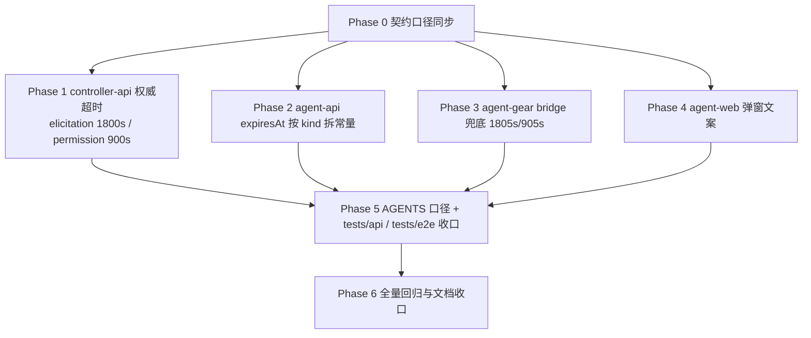

# 提问超时提升为 30 分钟、权限审批提升为 15 分钟 - 实现计划

**功能名称**: 提问超时提升为 30 分钟、权限审批提升为 15 分钟
**关联提案**: [[../proposals/20261127-fix-question-timeout-300s.md]]
**关联 PRD**: [[../../product/draft/20261127-question-timeout-300s.md]]
**计划版本**: v1.0
**创建日期**: 2026-11-27
**feat-branch**: `feat/question-timeout-300s`

## 1. 目标与范围

### 1.1 目标

按提案拆解为可执行任务：六个超时落点（controller-api 两个权威 timer、agent-api `expiresAt` 两个 kind、agent-gear 两条兜底 timer）与四处文案（两个弹窗、detail 示例、AGENTS 口径、契约口径）全部换值为**提问 30 分钟（1_800_000ms）/ 权限审批 15 分钟（900_000ms）**；`sessioninteractions.expiresAt` 由两 kind 共用一常量改为按 kind 拆常量（单一来源）；超时收敛语义零变化；全链路 TDD 覆盖取值、文案、分 kind 断言与两类互不串线，长超时下的测试可行性按 D1 收口。

### 1.2 不在范围

- 不做超时时长 env/用户级可配配置（D3，提案裁决）；测试短超时/fake timers 仅测试可达，不新增生产旋钮（D1）。
- 不改超时后交互语义（reason 映射、CAS 单调、租户隔离、权限超时默认不放行、`permissionTimeoutAction`）。
- 不动 `TodoItem` 5 分钟通知 TTL（通知先于作答窗口过期属预期，D9）。
- 不新增/变更协议结构：契约仅描述与注释（提案 §3.2）；无 Schema/索引变更、无迁移。

## 2. 实现顺序



- 依赖关系：契约先行（Phase 0）→ 三个服务/客户端改动（Phase 1/2/3/4 相互独立可并行，各自 TDD 先红后绿）→ AGENTS 与集成/E2E 测试收口（Phase 5，依赖全部落点就绪）→ 全量回归（Phase 6）。
- **发布顺序**（提案 R1）：controller-api 与 agent-gear 同批发版——旧 bridge 65s 兜底会先于新权威超时触发（表现≈现状 60s 口径，无回归但不享受新时限）；agent-api/agent-web 无兼容窗口（`detail` 仅展示、逻辑只看 `reason`，新旧混部安全）。
- 全部改动随 `feat/question-timeout-300s` 同 PR 落地；回滚 = 恢复常量取值（无数据迁移）。

## 3. 代码事实核对（F）

以下为本计划核对的代码事实（与提案表述冲突处以本表为准）：

| 编号 | 事实 | 位置 |
|---|---|---|
| F1 | `elicitation-manager.ts` L56 `const TIMEOUT_MS = 60_000`（模块级常量，无 env/配置读取）、L138 `setTimeout(..., TIMEOUT_MS)`、L246 `detail: 'controller-api timeout (60s)'`、L132/L237/L267 注释「60s」 | `servers/controller-api/src/services/elicitation-manager.ts` |
| F2 | `permission-manager.ts` L40 `TIMEOUT_MS = 60_000`、L95 注册 timer、L150 `detail: 'controller-api timeout (60s)'`、L141 注释「60s 是唯一用户可见超时口径」 | `servers/controller-api/src/services/permission-manager.ts` |
| F3 | `session-interaction-service.ts` L7-8 `SESSION_INTERACTION_TIMEOUT_MS = 60_000`（命名导出，仅 L173 elicitation / L193 permission 两处引用 + 测试导入）；L132 注释「+ 60s」；expiresAt 是 CAS 过期判定与卡片倒计时唯一依据 | `servers/agent-api/src/services/session-interaction-service.ts` |
| F4 | `bridge.ts` elicitation 兜底 L1038-1057（L1057 `setTimeout(..., 65_000)`）、L1048 日志 `elicitation timed out after 65s`、L1054 `detail: 'bridge timeout (65s)'`；permission 兜底 L978-982（L982 `65_000`，静默 resolve `cancelled` 无 detail）；L421/L445/L1127/L1208 注释「65s」 | `packages/agent-controller/src/acp/bridge.ts` |
| F5 | `ElicitationDialog.tsx` L86 / `PermissionDialog.tsx` L48「该请求将在约 1 分钟后过期；…」；agent-web 全库无其他硬编码作答时长文案（InteractionCard 倒计时由 `expiresAt` 驱动，零逻辑改动） | `apps/agent-web/src/components/` |
| F6 | `agent-session.graphql` **两处** 60s 口径：L259 `EXPIRED # 已过期（60s 内未响应）`（提案 F6 未列，计划期补齐，D4）与 L299 `expiresAt` 注释「创建 + 60s，与 controller-api TIMEOUT_MS 一致」 | `contracts/agent-session.graphql` |
| F7 | `agent-session-websocket.md` 待改点：L931/L939「65s」（elicitation 语境）；§2.34.1 L966「60s 超时」、L976 detail 示例 `controller-api timeout (60s)`、L983「60s 未响应」、L989-991「作答时限统一口径」段。**无关字样不改**（D6）：L465-466 MCP 转发 60s/30min、L1024 kimi 登录 60s、L1042/L1578+ Redis TTL 60s | `contracts/agent-session-websocket.md` |
| F8 | 超时链路现状：controller-api 权威超时（60s）先于 bridge 兜底（65s）触发；`permission:resolved` 仅两个生产者——`handleTimeout`（timer）与 `clearForSocket`（断连，`reason:'cancelled', detail:'socket disconnected'`）；**无 `acp:permission:resolved` socket 事件**（elicitation 有 `acp:elicitation:resolved`，API-SI3 可由 fake controller 注入）——tests/api 无法黑盒触发 permission 超时收敛（→ D1） | `permission-manager.ts`、`socketio.ts` L402 |
| F9 | `permission-subscriber.ts` L43-44 `RESOLUTION_BY_REASON = { timeout: 'EXPIRED', cancelled: 'CANCELLED' }`（单测覆盖映射）；CAS 单调收敛仅 `PENDING → 终态` | `servers/agent-api/src/services/permission-subscriber.ts` |
| F10 | 测试触点（实测校对）：`elicitation-manager.test.ts` L144/164/178/340 `advanceTimersByTime(60_000)`（T-S5 L169/T-S8 L301）；`permission-manager.test.ts` L143/168/248/295/321 五处 `60_000` + L264 detail；`bridge.test.ts` L112/120、L213（permission 兜底）与 T-B4 L882/T-B5 L916/T-B5c L961/T-B11 L1104（elicitation 兜底）含 L900 `detail: 'bridge timeout (65s)'`；`tests/acp-bridge.test.ts` L522/L530/L612/L622 | 各测试文件 |
| F11 | `session-interaction-service.test.ts` T-SI1 L146（`expiresAt≈+60s`，L156-157 经导出常量断言）、T-SI5 L213（过期拒答）、T-SI7 L237-250（单调收敛 fixture `detail: 'controller-api timeout (60s)'`）；`permission-subscriber.test.ts` L151/159 detail fixture | `servers/agent-api/src/services/*.test.ts` |
| F12 | tests/api：`elicitation.test.ts` API-SI1/SI2 L439-460（窗口断言 `remaining ≤ 65_000`）、API-SI3 L498 fixture detail（fake controller 注入 `acp:elicitation:resolved`，无真实等待）；`permission.test.ts` API-SI7 L794-843（真实等待 controller-api 权威 timer：150×500ms 轮询、用例超时 90_000，断言 `EXPIRED:system` 与拒答文案 `Todo item not found or already handled`） | `tests/api/src/agent-api/` |
| F13 | tests/e2e `elicitation.spec.ts` L251 fixture detail（fake controller 注入 resolved，无真实等待）；断言过期卡片态 | `tests/e2e/src/elicitation.spec.ts` |
| F14 | AGENTS 口径落点：`servers/controller-api/AGENTS.md` L44-46、`servers/agent-api/AGENTS.md` L53、`packages/agent-controller/AGENTS.md` L344/L349（65s 兜底描述） | 三份 AGENTS.md |
| F15 | `interrupt-retry.test.ts` L124/128/184/281 的 `60_000`/`960_000` 与「约 1 分钟后执行」为**重试退避/空闲等待取值**，与交互作答时限无关，不改（提案 F9 该处表述以实测为准，D6） | `servers/agent-api/src/services/workflow/interrupt-retry.test.ts` |
| F16 | 两 manager / session-interaction-service 均无 `process.env` 读取（生产默认值即模块常量）；tests/api 无 fake timers、无服务内测试钩子（黑盒 HTTP + Socket.IO） | 全库 grep |
| F17 | 超时收敛语义现状（本次零变化）：reason 映射、`filter.resolution = null` 单调、租户隔离（缺 `userId` 拒绝）、权限超时默认不放行、重复 requestId 清旧 timer（T-S8）、`clearForSocket` 断连清理 | 提案 F1/F2/§3.2 |
| F18 | `SESSION_INTERACTION_TIMEOUT_MS` 波及面：生产引用仅 F3 两处 + 测试 1 处导入（改名成本极低） | grep 全库 |
| F19 | 契约 `SessionInteractionStatus` 状态机注释（L253-260）与 `SessionInteraction.expiresAt`（L299）是仅有的两处时限口径；`TodoItem.expiresAt` 注释（L371/393）为通知 TTL 口径不动 | `contracts/agent-session.graphql` |

## 4. 实现步骤

TDD 总口径：每 Phase 先改测试断言（红）→ 改实现（绿）→ 常量收敛单一来源（重构）。

### Phase 0：契约口径同步（实现点 6，D4/D5/D6）

1. `contracts/agent-session.graphql`（修改，仅注释）：
   - L259 `EXPIRED # 已过期（60s 内未响应）` → `# 已过期（超时未响应：提问 30 分钟 / 权限审批 15 分钟）`；
   - L299 → `# 作答截止（提问 = 创建 + 30 分钟、权限审批 = 创建 + 15 分钟，分别对齐 controller-api elicitation/permission TIMEOUT_MS）`。
2. `contracts/agent-session-websocket.md`（修改，仅描述）：
   - L931/L939「65s」→「1805s」（bridge elicitation 兜底口径）；
   - §2.34.1：L966「60s 超时」→「超时未作答」；L976 detail 示例 → `controller-api timeout (1800s)`（elicitation）/ `controller-api timeout (900s)`（permission）/ `socket disconnected`；L983「60s 未响应」→「15 分钟未响应」；L989-991「作答时限统一口径」→ 拆分口径（逐字按提案 §3.1：提问 30 分钟 / 权限审批 15 分钟、`expiresAt` 按 kind 写入、TodoItem 5min 仅通知 TTL 且通知先过期属预期）。

### Phase 1：controller-api 权威超时（实现点 1/2，TDD：T-ET1/T-ET2 先红）

1. 测试先红：`elicitation-manager.test.ts`——T-S5/T-S8 等 `advanceTimersByTime(60_000)` → `1_800_000`（L144/164/178/340）、用例标题与 detail 断言 → `controller-api timeout (1800s)`、边界断言（推进 1_799_999 不触发 / 1_800_000 触发）；`permission-manager.test.ts`——5 处 `60_000` → `900_000`（L143/168/248/295/321）、L264 detail → `(900s)`、T-PM1 标题。
2. `servers/controller-api/src/services/elicitation-manager.ts`（修改）：L56 `TIMEOUT_MS = 1_800_000`；L246 `detail: 'controller-api timeout (1800s)'`；L132/L237/L267 注释「60s」→「1800s」。收敛不变量（`filter.resolution = null`、缺 `userId` 拒绝、重复 requestId 清旧 timer）零变化（F17）。
3. `servers/controller-api/src/services/permission-manager.ts`（修改）：L40 `TIMEOUT_MS = 900_000`；L150 `detail: 'controller-api timeout (900s)'`；L141 注释同步。`permission:resolved` 链路、超时默认不放行、`clearForSocket` 零变化。
4. 双向不串线断言（D8）：elicitation 用例推进 900_000 断言不触发、permission 用例推进 900_000 触发且不残留 elicitation 侧副作用，反之亦然。

### Phase 2：agent-api `expiresAt` 按 kind 拆常量（实现点 3，TDD：T-ET4 先红）

1. 测试先红：`session-interaction-service.test.ts`——T-SI1 `expiresAt ≈ +30 分钟`（L156-157 断言改引新常量）、**新增** permission `expiresAt ≈ +15 分钟` 断言、T-SI5 过期拒答不变、T-SI7 fixture detail → `(1800s)`；`permission-subscriber.test.ts` L151/159 fixture detail → `(900s)`。
2. `servers/agent-api/src/services/session-interaction-service.ts`（修改）：删除 `SESSION_INTERACTION_TIMEOUT_MS`，新增 `ELICITATION_TIMEOUT_MS = 1_800_000` 与 `PERMISSION_TIMEOUT_MS = 900_000`（命名导出、单一来源、禁止散落字面量，D2）；L173（elicitation）用前者、L193（permission）用后者；L7-8/L132 注释同步。
3. `expiresAt` 仍是 CAS 过期判定（`expiresAt: { $gt: now }`）与卡片倒计时唯一依据，逻辑零变化（F3/F17）。

### Phase 3：agent-gear bridge 两条兜底 timer（实现点 4，TDD：T-ET3 先红）

1. 测试先红：`bridge.test.ts`——L112/120、L213（permission 兜底）→ `905_000`；T-B4/T-B5/T-B5c/T-B11（elicitation 兜底）→ `1_805_000`，L900 detail → `bridge timeout (1805s)`；`tests/acp-bridge.test.ts` L522/L530/L612/L622 按语义替换；`clearTimeout` 收敛类用例（响应后不发 timeout）推进值同步。
2. `packages/agent-controller/src/acp/bridge.ts`（修改）：新增模块常量 `ELICITATION_FALLBACK_TIMEOUT_MS = 1_805_000` / `PERMISSION_FALLBACK_TIMEOUT_MS = 905_000`（= 权威 + 5s race 余量，D2）；L1057 → elicitation 常量、L1048 日志 `elicitation timed out after 1805s, auto-cancelling`、L1054 `detail: 'bridge timeout (1805s)'`；L982 → permission 常量（静默 resolve `cancelled` 口径不变）；L421/L445/L1127/L1208 注释按语义改「1805s」/「905s」。
3. 收敛路径（`clearTimeout` + `resolved{cancelled}`）与 `settlePendingOnDisconnect`/`stop()`/`spawner.closed` 语义零变化（F17）。

### Phase 4：agent-web 过期提示文案（实现点 5，TDD：T-ET7 先红）

1. 测试先红：`ElicitationDialog.test.tsx` L78「约 30 分钟后过期」；`PermissionDialog.test.tsx` L52「约 15 分钟后过期」。
2. `apps/agent-web/src/components/ElicitationDialog.tsx` L86 → 「该请求将在约 30 分钟后过期；请在会话内的提问卡片中填写并提交。」；`PermissionDialog.tsx` L48 → 「该请求将在约 15 分钟后过期；请在会话内的权限审批卡片中选择。」；「已过期」文案不变；倒计时组件零逻辑改动（F5）。

### Phase 5：AGENTS 口径 + tests/api / tests/e2e 收口（实现点 7/8，T-ET5/T-ET6）

1. AGENTS 口径（F14）：`servers/controller-api/AGENTS.md` L44-46（`TIMEOUT_MS` 提问 1800s / 权限审批 900s 拆分口径与 detail 文案）、`servers/agent-api/AGENTS.md` L53（expiresAt = 到达 + 提问 30 分钟 / 权限审批 15 分钟）、`packages/agent-controller/AGENTS.md` L344/L349（兜底 1805s/905s）。
2. `tests/api/src/agent-api/elicitation.test.ts`（修改）：API-SI1/SI2 L460 窗口断言 → 30 分钟口径（`0 < remaining ≤ 1_800_000` 且 `> 1_740_000`，容差 60s，不真实等待，D7）；API-SI3 fixture detail → `(1800s)`；过期拒答文案断言不变。
3. `tests/api/src/agent-api/permission.test.ts` API-SI7 改造（D1，去真实等待）：
   - 窗口断言：PENDING + `expiresAt ≈ +15 分钟`（同 D7 形态，`900_000` 口径）；
   - 超时收敛 EXPIRED 下沉单测（T-ET2 `handleTimeout` 发布 + `permission-subscriber` `timeout→EXPIRED` 映射）；API 层改用**断连路径** `clearForSocket → permission:resolved{reason:'cancelled', detail:'socket disconnected'} → CANCELLED:system` + 后续作答被拒（文案 `Todo item not found or already handled` 不变）——真实 Redis 订阅收敛/拒答/SSE 链路覆盖不减（F8：`permission:resolved` 真实生产者之二）；
   - 删除 150×500ms 真实等待轮询与 90s 用例超时（用例回归常规超时）。
4. `tests/e2e/src/elicitation.spec.ts`（修改）：L251 fixture detail → `(1800s)`；超时窗口/过期卡片态断言按 30 分钟口径核对（fake controller 注入 resolved 路径不变，F13）。

### Phase 6：全量回归与文档收口

1. controller-api / agent-api / agent-controller / agent-web 全量单测 + build + lint；`tests/api`、`tests/e2e` 按 §7 命令执行。
2. 文档索引：`docs/engineering/AGENTS.md`「实现计划」追加本计划条目。
3. 领域模型复核（§5；提案阶段已同步，本阶段仅核对与 D 裁决一致）。

## 5. 领域模型同步

- **无新增领域概念，无需更新 `docs/knowledges/domain`**：交互作答时限按 kind 拆分（提问 30 分钟 / 权限审批 15 分钟）、`expiresAt` 语义、「作答时限 ≠ 通知 TTL」口径已在提案 v1.1 阶段同步落库（`50-会话与交互/00-上下文概览.md` L63/L140、`01-聚合与实体.md` L70、`01-通用语言-术语表.md` L61/L65）。本计划仅承载拆解，不引入新聚合/字段/状态机/权限面。
- 实现中发现代码事实与领域模型不一致时，**以代码为准回写修正**对应上下文文档（common-rules「Domain Model Sync」）。

## 6. 计划期裁决（D）

| 编号 | 裁决 | 原因 |
|---|---|---|
| D1 | 长超时的测试可行性（细化实现点 8）：**不引入 test-only env/构造传参**，采用「API 层去真实等待 + 单测 fake timers 锁定超时链路」——`handleTimeout`→publish 由 T-ET2 fake timers 覆盖、`timeout→EXPIRED` 映射由 permission-subscriber 单测覆盖（F9）、API 层以断连 `clearForSocket`（`permission:resolved` 真实生产者之二，F8）覆盖 Redis 订阅收敛/拒答/SSE 链路 | 跨进程注入（tests/api 黑盒打真实服务）需要 controller-api 暴露测试旋钮（env/HTTP 钩子）：env 即用户可写配置（违反提案 D3），AppHost 测试接线又污染生产编排；fake timers 在单测已可推进 900_000/1_800_000，唯一真实等待点 API-SI7 的「计时器真实触发」信息量已被 T-ET2 全覆盖。修正提案 T-ET5「短超时注入」表述 |
| D2 | 常量单一来源形态：agent-api 删 `SESSION_INTERACTION_TIMEOUT_MS` 改 `ELICITATION_TIMEOUT_MS`/`PERMISSION_TIMEOUT_MS` 命名导出（测试导入同步改名）；bridge 新增 `ELICITATION_FALLBACK_TIMEOUT_MS`/`PERMISSION_FALLBACK_TIMEOUT_MS`（现状两处裸 `65_000` 字面量收敛）；controller-api 两 manager 各自 `TIMEOUT_MS` 仅换值不改结构 | 提案实现点 3「单一来源、禁止散落字面量」；F3/F18 波及面极小 |
| D3 | detail 文案口径 `(1800s)`/`(900s)`/`(1805s)`，测试 fixture 同步换值 | 执行提案 D8：detail 仅展示/日志、逻辑只看 `reason`，沿用「秒」格式避免混部误导 |
| D4 | 契约 `SessionInteractionStatus.EXPIRED` 注释（L259「60s 内未响应」）一并更新 | 提案 F6 仅列 L299；F6 实测发现第二处 60s 口径，不改即契约内部自相矛盾 |
| D5 | 契约与三份 AGENTS 口径随实现同 PR 落地（Phase 0/5） | 执行提案 D6：无结构变更、描述与现实不符即误导 |
| D6 | 「60s/65s」字样甄别：MCP 转发超时、git:* Redis TTL、kimi 登录 60s、interrupt-retry 退避取值均与交互作答时限无关，**不改** | F7/F15：误改会破坏无关口径；提案 §3.1 只授权作答时限口径同步 |
| D7 | API 窗口断言形态：`0 < remaining ≤ 上限` 且 `> 上限 - 60_000`（60s 轮询容差），不真实等待 | 造数到断言存在轮询延迟，区间断言既锁定口径又不脆断；上限分别 1_800_000/900_000 |
| D8 | 「两类互不串线」双向断言落在 T-ET1/T-ET2/T-ET4：推进边界（900_000/1_800_000 前后）交叉断言两类 timer/常量独立 | 提案 §8.1 硬要求：提问 1800s 不被 900s 影响、反之亦然 |
| D9 | 测试矩阵编号沿用提案 T-ET1~7，T-ET5 按 D1 修正语义；不新增测试编号体系 | 提案已评审锁定编号，避免漂移 |

## 7. 命令参考

```bash
# 单测（先红后绿）
cd servers/controller-api && pnpm run test -- src/services/elicitation-manager.test.ts
cd servers/controller-api && pnpm run test -- src/services/permission-manager.test.ts
cd servers/agent-api && pnpm run test -- src/services/session-interaction-service.test.ts
cd servers/agent-api && pnpm run test -- src/services/permission-subscriber.test.ts
cd servers/agent-api && pnpm run test
cd packages/agent-controller && pnpm run test -- src/acp/bridge.test.ts
cd packages/agent-controller && pnpm run test -- tests/acp-bridge.test.ts
cd apps/agent-web && pnpm run test -- src/components/ElicitationDialog.test.tsx src/components/PermissionDialog.test.tsx

# 类型 / 构建 / Lint
cd servers/controller-api && pnpm run build
cd servers/agent-api && pnpm run build
cd packages/agent-controller && pnpm run build
cd apps/agent-web && pnpm run build && pnpm run lint

# API 集成测试（Aspire 编排，见 tests/api/AGENTS.md）
aspire start && aspire wait agent-api && aspire wait controller-api
cd tests/api && API_URL=<agent-api>/graphql CONTROLLER_API_URL=<controller-api> \
  INTERNAL_API_TOKEN=<token> pnpm test -- src/agent-api/elicitation.test.ts src/agent-api/permission.test.ts

# E2E（端口以 aspire describe 为准，见 tests/e2e/AGENTS.md）
cd tests/e2e && BASE_URL=<agent-web> API_URL=<agent-api>/graphql \
  CONTROLLER_API_URL=<controller-api> pnpm exec playwright test src/elicitation.spec.ts --workers=1
```

## 8. 回归清单

- [ ] 超时收敛语义零变化：reason 映射、CAS 单调（迟到 timeout 不覆盖已 ACCEPTED，T-SI7）、租户隔离（缺 `userId` 拒绝）、权限超时默认不放行、重复 requestId 清旧 timer（T-S8）、`clearForSocket`/`stop()`/`spawner.closed` 收敛（F17）。
- [ ] 提问/权限审批双向不串线：1800s 断言不被 900s 影响、反之亦然（D8）。
- [ ] `TodoItem` 5 分钟通知 TTL 与 `permissionTimeoutAction` 语义零变化（D9 提案裁决）。
- [ ] detail 为展示字段：新旧混部下逻辑分支只看 `reason`，无行为差异（D3）。
- [ ] 无关 60s/65s 口径零误改：MCP 转发、git:* TTL、kimi 登录、重试退避（D6）。
- [ ] agent-web 除两弹窗文案外零变化：倒计时由 `expiresAt` 驱动、已过期文案与置灰行为不变（F5）。
- [ ] 既有测试旧断言保留语义、仅换取值/文案：T-S5/T-S8/T-PM1/T-B4/T-B5/T-SI1/T-SI5/T-SI7/API-SI1~3/E2E 既有用例零语义回归。

## 9. 验收 checklist

- [ ] 契约口径描述评审通过（`agent-session.graphql` 两处注释 + `agent-session-websocket.md` §2.34/§2.34.1 拆分口径）。
- [ ] 代码实现完成（F1~F5 六个超时落点 + 两弹窗文案 + 契约/AGENTS 口径）。
- [ ] 单元测试覆盖达标（T-ET1~T-ET4、T-ET7 先红后绿，含双向不串线断言）。
- [ ] API 测试通过（T-ET5：窗口断言 + 断连收敛 + 拒答，无真实长等待）；E2E 测试通过（T-ET6）。
- [ ] 提问 30 分钟内作答有效、超时自动过期；权限审批 15 分钟内作答有效、超时默认不放行；两类口径互不串线。
- [ ] 领域模型复核完成（§5）；`docs/engineering/AGENTS.md` 索引已收口。
- [ ] 回归清单全勾（§8）。

## 10. 相关文档

- 关联提案：[[../proposals/20261127-fix-question-timeout-300s.md]]（F1~F10 代码事实、D1~D9 决策、R1~R3 风险）
- 关联 PRD：[[../../product/draft/20261127-question-timeout-300s.md]]
- 需求来源：[Deliay/z-agent-gear#602](https://github.com/Deliay/z-agent-gear/issues/602)；评审修订：[PR #603](https://github.com/Deliay/z-agent-gear/pull/603)
- 关联 Contract：`contracts/agent-session.graphql`、`contracts/agent-session-websocket.md`
- 开发规范：`docs/engineering/common-rules.md`（TDD Workflow / Domain Model Sync）
- 领域模型文档：`docs/knowledges/domain/50-会话与交互/00-上下文概览.md`、`docs/knowledges/domain/50-会话与交互/01-聚合与实体.md`、`docs/knowledges/domain/01-通用语言-术语表.md`
