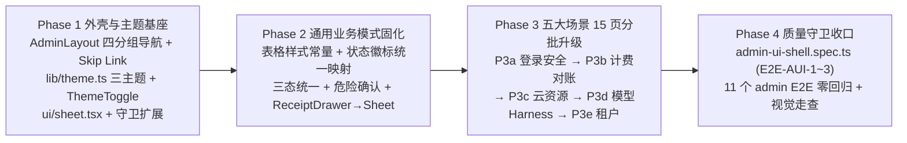

# 后台 UI 重构（管理后台全量 UI 升级） - 实现计划

**功能名称**: 后台 UI 重构（管理后台全量 UI 升级）
**关联 PRD**: [`docs/product/draft/20261127-admin-web-ui-overhaul.md`](../../product/draft/20261127-admin-web-ui-overhaul.md)
**关联提案**: [`docs/engineering/proposals/20261127-refactor-admin-web-ui-overhaul.md`](../proposals/20261127-refactor-admin-web-ui-overhaul.md)
**关联规范**: [`docs/engineering/ui-ux-standards.md`](../ui-ux-standards.md) · [`prototypes/20261127-ui-specification.md`](../prototypes/20261127-ui-specification.md) · [`prototypes/20261126-ui-ux-workspace-overhaul.html`](../prototypes/20261126-ui-ux-workspace-overhaul.html) · [`prototypes/20261127-ui-specification.html`](../prototypes/20261127-ui-specification.html)
**计划版本**: v1.0
**创建日期**: 2026-11-27
**作者**: z-agent-bot
**需求总分支**: `feat/admin-web-ui-overhaul`
**实现分支**: `feat/admin-web-ui-overhaul-impl`
**需求总 PR**: https://github.com/Deliay/z-agent-gear/pull/594

## 1. 实现顺序

严格遵循 TDD（红-绿-重构）垂直切片循环推进：每个阶段先编写失败测试（RED），再编写最小实现通过测试（GREEN），最后清理重构（REFACTOR）；每批次完成后全量回归，**随时可发布、可中止不烂尾**（提案决策 D5）。



依赖关系：Phase 2 的通用模式（表格常量/徽标映射/Sheet）是 Phase 3 各批次的公共底座，必须先行；Phase 3 内 P3a~P3e 相互独立，可按批次独立回归与发布，批次内页面与组件成对推进、测试跟随每一批提交。

## 2. 代码事实与回归边界核对

| 编号 | 存量代码事实与测试契约 | 处理策略 |
|------|---------------------|---------|
| F1 | `components/AdminLayout.tsx`（77 行）：`grid-cols-[240px_1fr]` 固定 240px 单列导航，`NAV_ITEMS` 11 项扁平平铺（模型配置/基础镜像/云端容器/工作负载/容器规格/Harness 配置/租户管理/费用中心/对账中心/登录认证/账号安全），底部仅用户名 + 退出登录；`components/__tests__/AdminLayout.test.tsx` 断言「renders sidebar navigation and outlet」与 `T-F6` 退出登录清 token 跳 `/login` | 重组为四分组结构（组头 + 组内 `NavLink`），保留 `aria-label="后台导航"`、全部 `to` 路径与退出登录行为；分组引入新 DOM 层级后逐条核对 `AdminLayout.test.tsx` 与页面测试中按 `ul > li` 计数/按序定位的断言并同步更新 |
| F2 | `index.css` `.dark` Token 块已就位（含 `color-scheme: light dark`），但全包无 `classList`/`matchMedia`/`theme` 持久化——`.dark` 类永远不会被应用 | 新增 `lib/theme.ts` 三态单源 + `main.tsx` 启动接线 + `ThemeToggle`；`index.css` 零色值改动（决策 D7） |
| F3 | `components/ui/` 已有 16 个原子组件（badge/button/card/checkbox/collapsible-group/confirm-dialog/dialog/dropdown-menu/empty-state/input/label/popover/query-error/scroll-area/select/switch），button 变体/尺寸已对齐规范 §4；**缺 `ui/sheet.tsx`** | 以 `@base-ui/react` 补齐 `sheet.tsx`（与前台同 API 独立副本，禁止跨项目 import）；其余 16 件逐件对照规范 §4 校对补缺，props 只增不收紧（决策 D5） |
| F4 | `components/billing/ReceiptDrawer.tsx`（86 行）以居中 `Dialog`（`sm:max-w-lg`）实现收据详情 | 改造为 `Sheet` 右侧抽屉（提案决策 D3），金额 `tabular-nums` 右对齐、入账 `text-success`、异常 `text-destructive` |
| F5 | 15 个页面各自实现表格/表单/空态/错误态（`BillingPage.tsx` 592 行、`AuthProvidersPage.tsx` 467 行）；表头/行密度/操作列/状态徽标样式不统一，容器状态文案映射散落在 `components/cloud-containers/labels.ts` 等处 | 以「样式常量 + 既有 JSX 结构微调」统一（提案决策 D2，不做通用 DataTable 抽象），收敛映射到 `lib/status-labels.ts` |
| F6 | 金额/计数展示未统一 `tabular-nums`；危险操作确认文案口径不一（`DeleteConfirmDialog`/`DestroyConfirmDialog`/`DeleteSpecDialog`/`DeleteWorkloadDialog` 等各写一套） | 统一 `ConfirmDialog` 危险确认 + 影响范围文案；金额/计数/时间统一等宽数字右对齐 |
| F7 | `tests/e2e/src/admin-*.spec.ts` 共 **11 个**（admin-auth / admin-auth-oauth / admin-base-image / admin-billing / admin-cloud-container / admin-cloud-host-spec / admin-cloud-workload / admin-harness-config / admin-model-config / admin-team-tenant / admin-tenant），选择器以可访问名称为主（如 `getByRole('button', { name: '保存' })`、`getByRole('heading', { name: '可用模型' })`） | 文案/结构调整时逐条核对选择器再改，禁止无脑替换导致断言漂移（决策 D9）；11 个 spec 本身零改动，作为零行为变更证据 |
| F8 | `src/__tests__/ui-ux-standards.test.ts` 仅含 `T-UIUX-FONT2`（`MICRO_FONT_REGEX` 扫描 `src/**` 非测试文件断言 0 处 `text-[9px\|10px\|11px]`） | 保持 `T-UIUX-FONT2` 持续通过；在同文件扩展 `T-UIUX-COLOR1`（禁硬编码 hex 色值）与 `T-UIUX-TABLE1`（表格样式常量引用口径），随 Phase 1 落地 |
| F9 | `index.css` 已含 `--success`/`--warning`/`--chart-1~5` 语义 Token（明暗双套，`@theme inline` 映射 `--color-success` 等） | 状态/金额/图表配色一律取语义 Token（`text-success`/`text-warning`/`text-destructive`/`--chart-N`），零色值新增零改动 |
| F10 | 测试基线：`pages/__tests__/` 13 个页面测试、`components/__tests__/` 11 个业务组件测试、`components/ui/__tests__/` 2 个（button/empty-state）；`App.tsx` 路由表 15 页 + index 重定向 `/models` | 类名/结构调整随批次同步更新对应测试；路由表与默认落点零改动（PRD 功能点 1） |
| F11 | `graphql/{queries,mutations,auth-providers,harness-config,types}.ts` 与 `lib/{cloud-host-spec,harness-config,workload-params,workload-plan,billing-format,format,auth-oauth}.ts` 承载查询文档、前端预校验与格式化口径 | **零改动红线**：仅触碰 JSX/className/文案呈现层；`useQuery`/`useMutation` 文档、变量、轮询间隔（容器 10s、日志 5s）、错误映射逐字节保持（PRD 4.1 性能不变量） |
| F12 | 登录/改密页在 `AdminLayout` 之外（`/login`、`/login/callback`、`/change-password`）；`LoginPage` 有 `adminAuthProviders` 查询与 `?error=` 映射，`ChangePasswordPage` 有就地校验 | P3a 一并统一三页 + `LoginCallbackPage` 的错误提示条与卡片规格（提案批次表未列 `LoginCallbackPage`，见决策 D2） |

## 3. 分阶段实施清单与测试矩阵

### 3.1 Phase 1：外壳、主题与原子组件基座

- **测试（RED）**：
  - `src/lib/__tests__/theme.test.ts`：
    - `T-AUI-TH1`：`setTheme('dark'|'light'|'system')` 写 `localStorage('theme')` 并驱动 `document.documentElement.classList`；`system` 时按 `matchMedia('(prefers-color-scheme: dark)')` 跟随且监听变化。
    - `T-AUI-TH2`：初始 `getTheme()` 缺省 `system`；`subscribe()` 通知订阅者；非法持久值回落 `system`。
  - `src/components/ui/__tests__/sheet.test.tsx`：
    - `T-AUI-SH1`：`Sheet` 右侧滑出渲染标题/内容，`Esc` 关闭并回调，焦点圈定在抽屉内。
    - `T-AUI-SH2`：受控 `open`/`onOpenChange` 语义与 `Dialog` 同形，`side="right"` 宽度类 `sm:max-w-[560px]` 档位存在。
  - `src/components/__tests__/AdminLayout.test.tsx`（扩展）：
    - `T-AUI-NAV1`：渲染「云资源管理 / 模型与 Harness / 租户与计费 / 系统安全」四分组标题，11 个入口全部可达且 `to` 路径逐一对齐 F1 表。
    - `T-AUI-NAV2`：当前路由项带 `aria-current="page"`；底部用户栏渲染 `ThemeToggle` 与「退出登录」；存在「跳到主要内容」Skip Link 指向 `#main-content`。
  - `src/__tests__/ui-ux-standards.test.ts`（扩展）：`T-UIUX-COLOR1` 断言 `src/**`（除 `index.css`/测试）无硬编码 hex 色值。
- **实现（GREEN）**：
  - 新增 `src/lib/theme.ts`：`theme ∈ {light, dark, system}` 单源，`localStorage('theme')` 持久化 + `matchMedia` 订阅 + `documentElement.classList.toggle('dark')`；`src/main.tsx` 渲染前同步应用已存主题（防亮→暗闪烁）。
  - 新增 `src/components/ui/sheet.tsx`：`@base-ui/react` 右侧抽屉（`w` 档 400–560px、移动端 `w-full`、`Esc` 关闭、焦点圈定），API 与前台同形独立副本。
  - 重构 `src/components/AdminLayout.tsx`：`NAV_ITEMS` 重组为 `NAV_GROUPS` 四分组（云资源管理：云端容器/容器规格/工作负载/基础镜像；模型与 Harness：模型配置/Harness 配置；租户与计费：租户管理/费用中心/对账中心；系统安全：登录认证/账号安全），组头 `text-xs text-muted-foreground`，激活项保留 `aria-current="page"` + 底色高亮；底部用户栏追加 `ThemeToggle`（Monitor/Sun/Moon 三态）；主区补 Skip Link → `#main-content`（各页 `main`/容器补 `id`）。
  - `src/__tests__/ui-ux-standards.test.ts` 追加 `T-UIUX-COLOR1`（硬编码 hex 守卫，`index.css` 白名单）。

### 3.2 Phase 2：通用业务模式固化

- **测试（RED）**：
  - `src/lib/__tests__/status-labels.test.ts`：`T-AUI-ST1` 状态徽标映射单一来源——同一状态键（如容器「初始化中」「在线」「失败」、账单入账/扣费/异常、租户类型/成员角色）恒返回同一 `Badge` 变体与文案；未知键回落 `muted` 且不抛错。
  - `src/lib/__tests__/table-styles.test.ts`：`T-AUI-TB1` 表格样式常量存在且符合规范 §6 场景 I（表头 `text-xs font-medium text-muted-foreground bg-muted/40`、单元格 `text-sm py-2.5 px-3`、操作列常量）。
  - `src/components/__tests__/billing.test.tsx`（扩展）：`T-AUI-RD1` `ReceiptDrawer` 以 `Sheet` 呈现（非居中 Dialog），金额行 `tabular-nums` 右对齐，入账成功色、异常警示色，分段/折算明细完整展示。
  - `src/__tests__/ui-ux-standards.test.ts`（扩展）：`T-UIUX-TABLE1` 列表页 `<th>` 断言引用 `TABLE_HEAD_CLASS` 常量口径（防回潮）。
- **实现（GREEN）**：
  - 新增 `src/lib/table-styles.ts`（`TABLE_HEAD_CLASS`/`TABLE_CELL_CLASS`/`TABLE_ACTION_CLASS` 等常量）与 `src/lib/status-labels.ts`（`statusBadgeProps()` 统一映射，对齐规范 §2.4 状态色矩阵 success/warning/info/destructive/muted；收敛 `components/cloud-containers/labels.ts`、`components/tenants/roles.ts` 散落口径为转发薄层）。
  - 三态统一：全部列表/详情接入 `loading && !data`（Apollo v4 口径，`frontend-rules.md`）→ `QueryError` + 重试 → `EmptyState`（不堆叠占位卡片、不显示误导「0」计数）。
  - 危险确认统一：全部删除/销毁/移除走 `components/ui/confirm-dialog.tsx`，确认文案明确影响范围（如连带数量、`last-admin` 保护提示、按模型名调用将返回「模型不存在」等既有口径逐字保留）。
  - `components/billing/ReceiptDrawer.tsx`：`Dialog` → `Sheet`，金额 `tabular-nums` 右对齐（`--color-success`/`--color-destructive`/`--color-warning` 取 Token，零色值新增）。

### 3.3 Phase 3：五大场景 15 页分批升级（P3a→P3e）

每批次纪律：仅触碰呈现层（JSX/className/文案），GraphQL 文档/变量/轮询/错误映射/前端预校验零改动；测试（RED 先写结构断言 → GREEN 改 JSX）跟随批次提交；批次完成即全量 `pnpm test` 回归。

| 批次 | 页面 | 组件 | 测试落点 | 升级重点 |
|------|------|------|---------|---------|
| P3a 登录与安全 | `pages/LoginPage.tsx`、`pages/ChangePasswordPage.tsx`、`pages/LoginCallbackPage.tsx`、`pages/AuthProvidersPage.tsx`、`pages/SecurityPage.tsx` | —（页面内卡片/表单直接换用 `ui/` 原子件） | `pages/__tests__/{LoginPage,ChangePasswordPage,LoginCallbackPage,AuthProvidersPage,SecurityPage}.test.tsx` | 居中单卡片 `max-w-[400px] rounded-xl p-6`、第三方登录 `variant="outline" w-full` 按钮组（仅后台启用时出现）、错误提示条 `bg-destructive/10 text-destructive`、改密页密码要求 + 就地校验、secret 恒「已设置/未设置」不回显明文 |
| P3b 计费与对账 | `pages/BillingPage.tsx`、`pages/ReconciliationPage.tsx` | `components/billing/{AccountTable,InvoiceTable,ModelPricingSection,MyApiKeyManager,ReceiptDrawer,RechargeDialog,RollupChart}.tsx` | `pages/__tests__/BillingPage.test.tsx`、`components/__tests__/{billing,billing-dialogs}.test.tsx` | 金额/单价 `tabular-nums` 右对齐、入账成功色/扣费中性/异常警示、账单行点击右侧 `Sheet` 完整计费拆解（分段/折算）、`RollupChart` 图表色映射 `--chart-1~5`、`RechargeDialog`/`ModelPricingSection`/`MyApiKeyManager` 控件统一、对账差异项醒目 |
| P3c 云资源管理 | `pages/{CloudContainersPage,CloudHostSpecsPage,CloudWorkloadsPage,BaseImagePage}.tsx` | `components/cloud-containers/{ContainerStatusBadge,DestroyConfirmDialog,StartContainerDialog,WorkloadLogsDialog,WorkloadParamsForm,labels}.tsx`、`components/cloud-host-specs/{DeleteSpecDialog,SpecFormDialog,SpecTable,TenantWhitelistPicker}.tsx`、`components/cloud-workloads/{DeleteWorkloadDialog,ParamSchemaEditor,WorkloadFormDialog,WorkloadTable}.tsx`、`components/base-images/{BaseImageFormDialog,BaseImageTable,DeleteConfirmDialog}.tsx` | `pages/__tests__/{CloudContainersPage,CloudHostSpecsPage,CloudWorkloadsPage,BaseImagePage}.test.tsx`、`components/__tests__/{StartContainerDialog,WorkloadLogsDialog,ParamSchemaEditor,BaseImageFormDialog}.test.tsx` | 表格规范、状态徽标映射（「初始化中」展示 `currentWorkloadName` 进度文案）、`StartContainerDialog`/`WorkloadParamsForm`/`ParamSchemaEditor`/`TenantWhitelistPicker` 控件统一（参数设计器草稿文本/依赖环拦截等既有交互零回归）、`WorkloadLogsDialog` 等宽深色日志区、销毁/删除影响范围二次确认 |
| P3d 模型与 Harness | `pages/{ModelConfigPage,HarnessConfigsPage}.tsx` | `components/models/{CustomModelDialog,ImportModelsDialog,ModelGroup,ModelItem,ModelRenameRecordsPanel,ModelSection}.tsx`、`components/providers/{BatchActionBar,ProviderActionMenu,ProviderFormDialog,ProviderItem,ProviderSection}.tsx` | `pages/__tests__/{ModelConfigPage,HarnessConfigsPage}.test.tsx`、`components/__tests__/{ImportModelsDialog,ModelRenameRecordsPanel,ModelSection,ProviderSection}.test.tsx` | 分组折叠（`CollapsibleGroup`）、`ImportModelsDialog` 过滤/全选/禁选/重试与 `CustomModelDialog` 表单统一（含上下文编辑）、`ModelRenameRecordsPanel` 只读折叠区块、`HarnessConfigsPage` 逐行保存表单校验态统一（`validateCompactCommand` 口径零改动）、拖拽排序/批量操作不回归 |
| P3e 租户管理 | `pages/{TenantsPage,TenantDetailPage}.tsx` | `components/tenants/{AddMemberDialog,ChangeMemberRoleDialog,roles}.tsx` | `pages/__tests__/{TenantsPage,TenantDetailPage}.test.tsx` | 租户类型/成员角色徽标统一、开户/创建团队租户弹窗统一（错误映射逐字保留）、移除成员/变更角色影响说明与二次确认（`last-admin` 提示）、只读区域（personal 成员、工作区列表）表达强化且不出现无效入口 |

### 3.4 Phase 4：质量守卫与回归收口

- **测试（RED）**：
  - 新增 `tests/e2e/src/admin-ui-shell.spec.ts`：
    - `E2E-AUI-1`：登录后四分组导航全部入口可达、当前页 `aria-current` 高亮、默认落点 `/models`。
    - `E2E-AUI-2`：主题三态切换即时生效（`html.dark` 断言），刷新后持久化保持。
    - `E2E-AUI-3`：抽查表格规范（表头/操作列）与危险操作二次确认 + 影响范围文案。
- **实现（GREEN）与回归**：
  - 11 个既有 `admin-*.spec.ts` 全量回归（E2E 串行执行，见 `common-rules.md` Test Pitfalls），作为零行为变更证据。
  - 页面/组件全量 Vitest 与 `T-UIUX-FONT2`/`T-UIUX-COLOR1`/`T-UIUX-TABLE1` 通过。
  - 视觉走查：亮/暗双主题 × 15 页（对比度 WCAG AA、长文本截断、1280/1440/1920 宽屏不破版；`frontend-rules.md` 溢出三件套）。
  - 性能不变量抽查：各页 GraphQL 请求数与重构前一致（零新增查询、轮询节奏不变）。

## 4. 文件变更清单（apps/admin-web + tests/e2e）

### 4.1 新增文件

| 文件 | 职责 |
|------|------|
| `apps/admin-web/src/lib/theme.ts` | 主题三态单源（`getTheme/setTheme/subscribe`，`localStorage('theme')` + `matchMedia` + `html.dark`） |
| `apps/admin-web/src/components/ui/sheet.tsx` | 右侧抽屉原子组件（与前台同 API 独立副本） |
| `apps/admin-web/src/lib/table-styles.ts` | 表格样式常量（表头/单元格/操作列） |
| `apps/admin-web/src/lib/status-labels.ts` | 状态徽标统一映射（`statusBadgeProps()`，收敛 labels.ts/roles.ts 口径） |
| `apps/admin-web/src/lib/__tests__/theme.test.ts` | T-AUI-TH1~2 |
| `apps/admin-web/src/lib/__tests__/table-styles.test.ts` | T-AUI-TB1 |
| `apps/admin-web/src/lib/__tests__/status-labels.test.ts` | T-AUI-ST1 |
| `apps/admin-web/src/components/ui/__tests__/sheet.test.tsx` | T-AUI-SH1~2 |
| `tests/e2e/src/admin-ui-shell.spec.ts` | E2E-AUI-1~3 |

### 4.2 修改文件

| 阶段 | 文件 |
|------|------|
| Phase 1 | `apps/admin-web/src/main.tsx`（主题初始应用接线）、`apps/admin-web/src/components/AdminLayout.tsx`（四分组导航 + ThemeToggle + Skip Link）、`apps/admin-web/src/components/__tests__/AdminLayout.test.tsx`（T-AUI-NAV1~2）、`apps/admin-web/src/__tests__/ui-ux-standards.test.ts`（T-UIUX-COLOR1）、`apps/admin-web/src/index.css`（仅 `color-scheme` 微调如需，零色值改动） |
| Phase 2 | `apps/admin-web/src/components/billing/ReceiptDrawer.tsx`、`apps/admin-web/src/components/cloud-containers/labels.ts` 与 `apps/admin-web/src/components/tenants/roles.ts`（转发 `lib/status-labels.ts`）、`apps/admin-web/src/components/ui/{badge,button,card,checkbox,collapsible-group,confirm-dialog,dialog,dropdown-menu,empty-state,input,label,popover,query-error,scroll-area,select,switch}.tsx`（逐件校对 §4 补缺）、`components/__tests__/billing.test.tsx`、`components/ui/__tests__/`（结构调整跟随） |
| Phase 3 | 15 个 `pages/*.tsx` 与 `pages/__tests__/*.test.tsx`（13 个）、`components/{billing,cloud-containers,cloud-host-specs,cloud-workloads,base-images,models,providers,tenants}/*.tsx` 与对应 `components/__tests__/*.test.tsx`，逐批次按 §3.3 表推进 |

### 4.3 零改动红线（回归时 diff 核对）

- `apps/admin-web/src/graphql/**`、`apps/admin-web/src/lib/{cloud-host-spec,harness-config,workload-params,workload-plan,billing-format,format,auth-oauth,auth-error,apollo,api-base,base-path,bootstrap,credential,logger,runtime,storage-keys,utils}.ts`、`apps/admin-web/src/App.tsx`（路由表与默认落点）、`apps/admin-web/src/stores/**`、`apps/admin-web/vite.config.ts`。
- `contracts/**`、`servers/**`、`tests/api/**`、11 个 `tests/e2e/src/admin-*.spec.ts`、`packages/**`。

## 5. 计划期裁决

| # | 问题 | 裁决 |
|---|------|------|
| D1 | 导航分组归属 | 按 PRD 功能点 1 四分组固定归属（云资源管理 4 项 / 模型与 Harness 2 项 / 租户与计费 3 项 / 系统安全 2 项，共 11 项）；`/tenants/:id` 详情页归属「租户管理」激活态，`/settings/security` 归属「账号安全」 |
| D2 | `LoginCallbackPage` 未列入提案批次表 | 归入 P3a 登录与安全批次一并统一（错误提示条与卡片规格），15 页全覆盖不留死角 |
| D3 | 主题切换入口 | 左侧导航底部用户栏（提案 D4 已裁决），`ThemeToggle` 三态 Monitor/Sun/Moon |
| D4 | 收据详情呈现 | 右侧 `Sheet`（提案 D3 已裁决），`ReceiptDrawer` 组件名与 props 签名保持，仅容器层替换 |
| D5 | 原子组件校对的 API 兼容 | props 只增不收紧；确需收紧时同步更新全部引用点与组件测试，禁止静默破坏 |
| D6 | 表格统一方式 | 样式常量 + 既有 JSX 微调（提案 D2 已裁决），不做通用 DataTable 抽象 |
| D7 | 暗色 Token | 复用 `index.css` 现有 `.dark` 块（提案 D7 已裁决），零色值改动；语义色一律取 `--color-success/warning/destructive/chart-1~5` |
| D8 | 守卫扩展程度 | 适度（提案 D8 已裁决）：`T-UIUX-COLOR1`（禁硬编码 hex，`index.css` 白名单）+ `T-UIUX-TABLE1`（表格常量口径），不做重型视觉回归基线 |
| D9 | E2E 选择器纪律 | 11 个 admin E2E 以可访问名称定位；文案统一（如「删除」→「删除镜像」）前先检索 spec 内 `name:` 断言并同步更新，禁止无脑替换 |
| D10 | 状态徽标收敛方式 | `lib/status-labels.ts` 为唯一映射源；既有 `labels.ts`/`roles.ts` 保留为转发薄层，避免大面积改 import 制造回归面 |
| D11 | PRD 异常边界（会话过期跳转、「-」/0 数值口径、`null`/`undefined` 兜底） | 归入对应场景批次落地：三态与格式化呈现统一时逐页核对，`lib/format.ts`/`billing-format.ts` 逻辑零改动，仅 JSX 展示口径统一 |
| D12 | `EmptyState` 误导「0」计数 | 空态不渲染计数徽标（PRD 功能点 5），各列表页 JSX 层调整，查询计数口径零改动 |

## 6. 领域模型同步

**无领域模型影响，`docs/knowledges/domain` 无需更新。** 本计划是纯前端（`apps/admin-web`）视觉与交互重构的实现拆解：不新增/修改任何领域概念、聚合、字段、状态机、领域事件与权限口径，GraphQL 查询/变更调用零增删改（`contracts/` 零改动），与提案「领域模型影响：无影响」结论一致（提案阶段已评审通过）。实现中若发现界面文案与领域术语不一致，**以领域模型为准修正文案**（不回写领域模型）；若发现代码事实与领域模型不一致，以代码为准回写修正（`common-rules.md`「Domain Model Sync」）。

## 7. 命令参考

```bash
# 依赖安装（monorepo 根）
pnpm install

# admin-web 单测（Vitest + RTL，含静态守卫）
cd apps/admin-web && pnpm test

# 类型检查与生产构建（tsc -b && vite build）
pnpm run build

# Lint
pnpm run lint

# E2E（Aspire 编排启动后串行执行；禁止直接 docker 命令）
aspire start && aspire wait agent-api && aspire wait agent-web
cd tests/e2e && pnpm test                       # 全量
cd tests/e2e && pnpm test src/admin-ui-shell.spec.ts   # 新增外壳用例
cd tests/e2e && pnpm test src/admin-*.spec.ts   # 11 个既有 admin 回归
```

## 8. 风险与回滚

| 风险 | 缓解 |
|------|------|
| 分组导航 DOM 层级变化破坏 `ul > li` 计数/序号断言 | Phase 1 同步核对 `AdminLayout.test.tsx` 与页面测试，T-AUI-NAV1~2 先立契约 |
| 大文件页面（`BillingPage` 592 行）改动面大 | P3b 按子组件切片推进（AccountTable → InvoiceTable → ReceiptDrawer → Dialogs → 页面壳），逐块回归 |
| E2E 可访问名称随文案统一漂移 | 决策 D9 纪律 + 每批次 `admin-*.spec.ts` 抽查回归；E2E 串行执行避免假失败 |
| 主题切换闪烁/测试环境污染 | `main.tsx` 渲染前应用主题；Vitest 每用例清理 `localStorage` 与 `documentElement.classList` |
| 样式类名变更使类名/快照断言失效 | 测试更新跟随每批次提交，禁止积压到 Phase 4 |
| 回滚 | 纯前端变更，回退构建版本即完全回滚，无数据迁移、无兼容窗口（提案 §9.2） |

## 9. 验收 checklist

- [ ] Phase 1：四分组导航与 11 入口可达、`aria-current` 高亮、默认落点 `/models`、Skip Link、ThemeToggle 三主题即时生效且刷新持久化；`T-UIUX-FONT2`/`T-UIUX-COLOR1` 通过
- [ ] Phase 2：`ui/sheet.tsx` 就位且 §4 逐件校对完成；表格常量/状态徽标映射/三态/危险确认/`ReceiptDrawer`→`Sheet` 五类通用模式落地（抽查清单通过）
- [ ] Phase 3：15 页分批升级完成，`useQuery`/`useMutation` 文档与轮询节奏逐字节不变（diff 核对 §4.3 红线零改动）
- [ ] 亮/暗双主题下文字对比度达 WCAG AA；全站无 <12px 字号；金额/计数等宽数字对齐
- [ ] 危险操作全部二次确认且展示影响范围；密钥类字段任何界面不回显明文；交互文案 100% 简体中文
- [ ] Phase 4：`admin-ui-shell.spec.ts` E2E-AUI-1~3 通过；11 个既有 admin E2E 零回归；全部组件/页面单测通过
- [ ] 视觉走查：亮/暗 × 15 页、1280/1440/1920 宽屏不破版、长文本截断可看全量
- [ ] lint / `pnpm run build` 通过
- [ ] 领域模型同步状态确认（§6，无影响）
