# Agent Web 全场景 UI 重构 - 实现计划

**功能名称**: Agent Web 全场景 UI 重构
**关联 PRD**: [`docs/product/draft/20261127-agent-web-full-ui-rework.md`](../../product/draft/20261127-agent-web-full-ui-rework.md)
**关联提案**: [`docs/engineering/proposals/20261127-refactor-agent-web-full-ui-rework.md`](../proposals/20261127-refactor-agent-web-full-ui-rework.md)
**关联规范**: [`docs/engineering/prototypes/20261127-ui-specification.md`](../prototypes/20261127-ui-specification.md)（UI 规范正文，唯一验收基准）· [交互式演示手册](../prototypes/20261127-ui-specification.html) · [工作区重构交互原型](../prototypes/20261126-ui-ux-workspace-overhaul.html) · [`docs/engineering/ui-ux-standards.md`](../ui-ux-standards.md)
**计划版本**: v1.2（返工修订：Phase 4 会话场景本体落地——会话标题/时间线气泡与阅读宽/一体化输入浮岛/中文主按钮；E2E-UIUX-4/5 静态自洽与 socket 清理；UI 规范正文与交互手册同步 `*-text` Token；补充 `destructive-text` 与 10% 语义底对比度审计）
**创建日期**: 2026-11-27
**作者**: ZeroAsh Agent
**需求总分支**: `feat/agent-web-full-ui-rework`
**实现分支**: `feat/agent-web-full-ui-rework-impl`
**需求总 PR**: https://github.com/Deliay/z-agent-gear/pull/593
**领域模型影响**: 无（见 [§6 领域模型同步](#6-领域模型同步)：纯前端表现层重构，零契约、零持久化实体、零状态机/权限变化）

## 1. 实现顺序

严格遵循 TDD（红-绿-重构）垂直切片循环推进，每个 Phase 先编写失败守卫/测试（RED），再最小实现通过（GREEN），最后重构收口（REFACTOR）；每个 Phase 独立提交、可独立回滚（`git revert` 按 Phase 粒度，只 merge 不 rebase）：

```mermaid
flowchart LR
    P0["Phase 0<br/>差距审计工具化<br/>场景×规范条目基线清单"] --> P1["Phase 1<br/>设计基准层收口 G1/G2/G5<br/>硬编码色值清零 + tabular-nums<br/>+ 状态色矩阵唯一映射"]
    P1 --> P2["Phase 2<br/>工作区外壳与导航 G6<br/>ActivityRail/Sidebar/⌘K 快速新建"]
    P2 --> P3["Phase 3<br/>场景 A/B：认证与概览"]
    P3 --> P4["Phase 4<br/>场景 C：会话与实时分屏预览 G3"]
    P4 --> P5["Phase 5<br/>场景 D：工作流 DAG"]
    P5 --> P6["Phase 6<br/>场景 E：云电脑/Worktree/网关"]
    P6 --> P7["Phase 7<br/>场景 F：知识库"]
    P7 --> P8["Phase 8<br/>场景 G：设置中心"]
    P8 --> P9["Phase 9<br/>场景 H：费用中心"]
    P9 --> P10["Phase 10<br/>响应式与移动端收口"]
    P10 --> P11["Phase 11<br/>质量守卫扩展 G7<br/>+ 文档收口"]
```



- **依赖关系**：Phase 1 是全部场景 Phase 的前置（场景层不得就地硬编码色值/状态色，必须消费基准层）；Phase 2 外壳先于场景（场景页面挂在 MainStage 内）；Phase 3→9 串行逐场景（提案 D10：基准先行避免场景间返工）；Phase 10 依赖全部场景组件定型；Phase 11 守卫扩展覆盖全量后收口。
- **数据流零改动**：所有 Phase 均不得触碰 `graphql/`、`stores/` 数据读写口径（提案 §3.2 受保护不变量清单为硬约束）。

## 2. 代码事实与回归边界核对

对 `main`（基线 03e2ddbd + PR #593 已合入的 PRD/提案）代码逐条核对，作为拆解依据：

| 编号 | 存量代码事实与测试契约 | 处理策略 |
|------|---------------------|---------|
| F1 | 硬编码调色板色值（`text-\|bg-\|border-<palette>-<n>`）非测试文件复核约 **84 处**、分布于 20+ 文件（`pages/BillingPage.tsx`、`components/session/preview/*`、`components/session/MessageList.tsx`、`components/workflow/*`、`components/knowledge-base/*` 等；提案 G1 审计口径 79 处，差异源于前缀/排除集口径，以 Phase 0 固化的 rg 基线清单为准） | Phase 1 先落 T-UIUX-COLOR 守卫（红）再按六类语义映射替换为 Token 类，清零后守卫长期拦截 |
| F2 | `tabular-nums` 仅 **8 个文件**使用：`BillingPage.tsx`、`preview/ReviewPanel.tsx`、`workflow/graph/WorkflowNodeCard.tsx`、`workflow/graph/ResourceChip.tsx`、`workflow/NodeDetailDrawer.tsx`、`sidebar/SidebarSection.tsx`、`knowledge-base/RepoKnowledgeBaseSection.tsx`、`tree/TreeSection.tsx`；规范 §1.2 要求金额/Token/倒计时/计数徽章/表格数值列全量覆盖 | Phase 1 补齐清单式覆盖（含 `HarnessLoginDialog` 倒计时、`InteractionCard` 倒计时、`UsageCard`/`ModelItem` 数值列等），T-UIUX-TABULAR 清单式守卫 |
| F3 | `components/session/SessionHeader.tsx:46` `TOOLBAR_MIN_INFO_WIDTH = 192` 被动折叠机制（`:97` 注释、`:113` `shouldCollapse` 判定），环境信息以裸文本平铺 | Phase 4 移除该机制，重构为单行 `h-12` 顶栏 + 环境信息胶囊（G3，规范 §6-C） |
| F4 | 状态色现状三套并存：会话 `session/status-colors.ts`（6 态 dot/badge/labels，已与规范 §2.4 对齐）；工作流 `WorkflowNodeTreeConstants.ts` 的 `NODE_STATUS_VISUAL`（**8 态**：INITIALIZING/READY/RUNNING/DONE/REJECT/REWORK/FAILED/RETRY_FAILED，`spine/tint/badge` 三段式）；云电脑 `cloud-host/cloud-host-status.ts`（5 态文案 + `CLOUD_HOST_STATUS_LABELS`） | Phase 1 收敛为共享状态色矩阵唯一实现（规范 §2.4），保留既有导出名兼容（见 D2） |
| F5 | 既有守卫：`apps/agent-web/src/__tests__/ui-ux-standards.test.ts`（T-UIUX-FONT1，`import.meta.glob` 递归扫描）、`apps/admin-web/src/__tests__/ui-ux-standards.test.ts`（T-UIUX-FONT2）；E2E `tests/e2e/src/ui-ux-workspace.spec.ts`（E2E-UIUX-1/2：3-Tier Shell、`⌘B`、设置导航激活态、控制器配置面包屑） | Phase 1/11 在同一守卫文件扩展 T-UIUX-COLOR/TABULAR/FOCUS，E2E-UIUX 扩展 ⌘K 与状态色抽样 |
| F6 | 性能不变量锚点：`tests/e2e/src/home.spec.ts`（T-E1~T-E5 / E2E-HP1~HP3 首屏零冗余查询）、`settings-overview.spec.ts`（E2E-SET1 设置单请求）；数据流口径（`MainLayout` 唯一 `HOME_OVERVIEW` 15s 轮询、`SETTINGS_OVERVIEW` 单次聚合、归档分组无计数按需懒加载、`loading && !data` 轮询不卸载）固化于 `apps/agent-web/AGENTS.md` | 全部 Phase 硬约束：不得新增任何查询/轮询/订阅；⌘K 打开面板仅复用既有对话框查询（D9） |
| F7 | `src/index.css`（193 行）已含 OKLCH 语义 Token：`--primary/--primary-foreground/--ring/--success/--warning/--info/--destructive(+foreground)`、`--chart-1~5`、`--background/--sidebar/--card/--popover` 表面层级、`--radius-sm/md/lg/xl`（PR #587 已落地） | Phase 1 按规范 §2 校准色值与圆角/间距 Token，**保持既有变量名不破坏消费方**；admin-web 仅共用规范被动受益（D8） |
| F8 | E2E 锚点被 60+ spec 依赖：`nav[aria-label="Sidebar"]`、`sidebar-section-*`、`data-testid="session-header-overflow"`、`controller-config-breadcrumb`、`rail-attention-dot`、`sidebar-archived-*-list`、`session-readonly-notice`、`workflow-instance-unavailable` 等；localStorage 键 `sidebar-width`/`sidebar-sections-expanded`/`theme`/`session-split-mode:{id}` | D5 兼容策略：锚点与键名保持不变，确需变更同步改写用例并在 PR 描述逐条留档 |
| F9 | `ChangePasswordPage` 仅存在于 `apps/admin-web/src/pages/`（后台首登强制改密）；`apps/agent-web` 14 个页面无此页 | 见 D11：不在本期 agent-web 对齐清单内 |
| F10 | `components/ui/button.tsx:28` `sm` 尺寸含 `text-[0.8rem]`（12.8px，≥12px 合规）；微字号守卫正则仅拦 `text-[9px]\|[10px]\|[11px]` | 字号守卫口径不变（拦 <12px）；`0.8rem` 属按钮次要尺寸保留，Phase 1 组件校准时核对规范 §4 Button 规格 |
| F11 | `NewSessionDialog` 的 `onCreate` 为 10 个位置参数、三调用点（`Sidebar`/`SessionPage`/`WorktreeSidebarGroup`）各带映射单测；`InstantiateWorkflowDialog` 提交链路独立 | ⌘K 快速新建（D6）复用两对话框与既有调用点参数映射，不新增提交链路、不改 `onCreate` 签名 |
| F12 | 不可回退交互口径清单（`apps/agent-web/AGENTS.md`）：归档分组不计数按需加载、设置一次加载、首屏零冗余请求、工作区仅展示在线可用、网关地址唯一来源 `Gateway.endpoint`、轮询不卸载、云电脑只读判定读 `GET_SESSION.readOnlyReason` | 每 Phase 验收对照本清单回归勾选；性能不变量 E2E 全量跑通 |

## 3. 计划期裁决

| 裁决 | 选项 | 最终选择 | 原因 |
|------|------|---------|------|
| D1 实施策略 | 整页一次性重写 / 分阶段渐进对齐 | 分阶段（沿用提案 D1） | 每 Phase 独立提交/回滚，E2E 零回归可控 |
| D2 状态色矩阵落点 | 各场景自行维护 / 收敛共享模块 | 新增 `src/lib/status-matrix.ts` 作为唯一映射（会话 6 态 + 云电脑 5 态 + 工作流节点 8 态的 dot/动效/badge/文案） | 解决 G5 多套写法；`session/status-colors.ts` 改为薄兼容层（`getStatusDotColor`/`getStatusBadgeClass`/`STATUS_LABELS` 导出名保留），`WorkflowNodeTreeConstants` 与 `cloud-host-status.ts` 的文案/视觉值改从矩阵派生；规范 §2.4 未列的 `REJECT/RETRY_FAILED/INITIALIZING/READY` 按语义并入（REJECT→warning、RETRY_FAILED→destructive、INITIALIZING/READY→muted-foreground），映射表随 Phase 1 PR 留档 |
| D3 硬编码色值替换口径 | 就地换近似色 / 归入语义 Token | 六类语义映射（成功/警告/信息/危险/品牌/中性）替换；确无语义可归的新增语义 Token（沿用提案 D3） | 规范 §2 单一事实来源；规范 §2.3 专色（`.zag-focus-highlight`、`[data-zag-hover/selected]`、`.md-annotation-highlight`、`lib/terminal-theme.ts` 深黑终端调色板）列入守卫豁免白名单（附注原因） |
| D4 T-UIUX-TABULAR 实现方式 | 全文扫描启发式 / 清单式断言 | 清单式：维护「金额/Token/倒计时/计数徽章/表格数值列」组件×选择器清单，断言对应容器含 `tabular-nums` | 启发式误报高；清单与规范 §1.2 逐项对应，新增数值场景时补清单 |
| D5 E2E 锚点 | 随重构自由调整 / 保持兼容 | 保持 `data-testid`/`aria-label`/localStorage 键兼容（沿用提案 D5） | 保护既有 130+ 用例，降低回归面 |
| D6 ⌘K 快速新建落点 | 新写创建表单 / 复用既有对话框 | 新增 `components/layout/QuickCreatePanel.tsx`（⌘K/Ctrl+K 全局唤起、Esc 关闭、键盘可达），条目仅「快速拉起会话 / 实例化工作流」，点击打开既有 `NewSessionDialog` / `InstantiateWorkflowDialog`（沿用提案 D8） | 零新领域语义、零提交链路改动、零新查询 |
| D7 移动端 | 独立移动实现 / 同批组件断点适配 | 同批组件断点适配 `<768px`（沿用提案 D7） | 规范 §3.3 为同一套组件的响应式回退 |
| D8 admin-web 范围 | 一并场景重构 / 仅被动受益 | 本期仅 agent-web（沿用提案 D9）；admin-web 仅保留 T-UIUX-FONT2 守卫与共用规范口径 | 需求范围明确「整个 agent-web」 |
| D9 性能口径 | 顺带优化数据流 / 零改动 | 零改动（沿用提案 D2）；⌘K 面板自身不发查询，打开对话框时才触发既有查询 | 性能不变量是硬约束（F6/F12） |
| D10 场景验收留档 | 仅测试通过 / 「规范条目→实现位置→验收结果」对照记录 | 每场景 Phase 产出对照记录附于该 Phase PR 描述 | 提案 §5.1 逐场景验收要求，供评审逐条核对 |
| D11 ChangePasswordPage | 纳入 agent-web 对齐 / 不在本期 | 不在本期（见 F9） | 该页属 admin-web 后台首登强制改密，agent-web 无此页面；PRD 功能点 2 中「强制改密页」按 admin-web 另立需求处理，agent-web 认证场景对齐 `LoginPage`/`LoginCallbackPage`/`IdentityChoicePage` 三页 + 「无任何注册入口」验收项 |
| D12 守卫测试文件组织 | 新建独立守卫文件 / 扩展既有文件 | 扩展 `apps/agent-web/src/__tests__/ui-ux-standards.test.ts`（T-UIUX-COLOR/TABULAR/FOCUS 与 FONT 同文件） | 单一守卫入口，避免扫描基建重复 |

## 4. 分阶段实施清单与测试矩阵

### 4.1 Phase 0：差距审计工具化与基准清单

- **产出（无代码变更）**：
  - 「场景 × 规范条目」核对矩阵（规范 §1–§7 条目 × 九大场景），覆盖 G1–G7 全部差距，随首个 Phase 的 PR 描述留档并逐 Phase 勾选。
  - 以 `rg` 固化基线数字：硬编码色值逐条清单（目标 0）、`tabular-nums` 缺口清单（8 文件 → 目标清单全量），作为清零进度度量（本计划 §2 F1/F2 即基线快照）。

### 4.2 Phase 1：设计基准层收口（G1/G2/G5）

- **测试（RED）**：
  - `apps/agent-web/src/__tests__/ui-ux-standards.test.ts` 扩展（D12）：
    - `T-UIUX-COLOR`：扫描 `apps/agent-web/src` 全部非测试 `.ts/.tsx`，断言不存在 `text-|bg-|border-<palette>-<n>` 硬编码调色板类（豁免白名单：`lib/terminal-theme.ts`、规范 §2.3 专色类定义处，逐条附注原因）。
    - `T-UIUX-TABULAR`：按 D4 清单断言金额/Token/倒计时/计数徽章/表格数值列容器含 `tabular-nums`。
  - `lib/__tests__/status-matrix.test.ts`：`T-SMX1` 会话/云电脑/工作流节点全状态值均在矩阵内且 dot/badge/文案与规范 §2.4 一致（REJECT/RETRY_FAILED 等按 D2 扩展映射）；`T-SMX2` 未知状态回退 `muted-foreground`。
- **实现（GREEN/REFACTOR）**：
  - 新增 `src/lib/status-matrix.ts`（唯一映射，D2）；`components/session/status-colors.ts` 改兼容薄层；`components/workflow/WorkflowNodeTreeConstants.ts`、`components/cloud-host/cloud-host-status.ts` 视觉/文案改从矩阵派生（`NODE_STATUS_VISUAL`、`CLOUD_HOST_STATUS_LABELS` 导出名与形状保持兼容，`WorkflowNodeTreeConstants.test.ts` 等存量断言零改或同步等值更新）。
  - `src/index.css`：按规范 §2 校准中性表面/品牌/语义色/图表专色/圆角 Token（OKLCH 亮暗双套，变量名不变）。
  - **硬编码色值清零**：F1 全部 84 处按六类语义替换为 Token 类；图表与预览批注改用规范 §2.3 专色；确无语义可归新增语义 Token（D3）。
  - `tabular-nums` 补齐：8 文件之外新增 `HarnessLoginDialog`（倒计时）、`InteractionCard`（倒计时）、`UsageCard`（用量）、`ModelItem`（contextLength）、`HomePage`（统计卡）、`BillingPage` 数值列复核等清单项。
  - 焦点呈现统一 `focus-visible:ring-3 focus-visible:ring-ring/50`（规范 §4 Button/Form 规格），间距/圆角按规范 §1.3 网格校准。
- **验收**：T-UIUX-COLOR/TABULAR/FONT1 全绿；主题切换（亮/暗/跟随系统）对比度抽查通过；§2 F12 清单零回归。

### 4.3 Phase 2：工作区外壳与导航收口（G6 + 规范 §3/§5）

- **测试（RED）**：
  - `components/layout/__tests__/ActivityRail.test.tsx` 扩展：`T-UIUX-RAIL1/2`（既有）+ `T-UIUX-RAIL3` 激活指示条 2px 品牌色、图标下 12px 标签、底部在线计数 `tabular-nums`。
  - 新增 `components/layout/__tests__/QuickCreatePanel.test.tsx`：`T-QCP1` ⌘K/Ctrl+K 唤起、Esc 关闭、焦点圈定；`T-QCP2` 两条目分别打开 `NewSessionDialog`/`InstantiateWorkflowDialog` 且零新增查询（mock client 断言）；`T-QCP3` 键盘上下选择 + Enter 确认。
  - `tests/e2e/src/ui-ux-workspace.spec.ts` 扩展：`E2E-UIUX-3`（⌘K 唤起 → 快速拉起会话对话框出现 → Esc 关闭）。
- **实现（GREEN/REFACTOR）**：
  - `components/layout/ActivityRail.tsx`：按规范 §5 校准 56px 轨道细节（`⌘B` 行为、`rail-attention-dot` 保持）。
  - `components/Sidebar.tsx` / `components/sidebar/SidebarSection.tsx` / `components/tree/TreeSection.tsx`：分区头 `h-8` + 悬浮「+」+ `tabular-nums` 计数徽章；「已归档」分组保持无计数按需懒加载（F12）；空态收敛。
  - `components/SidebarResizer.tsx`：`role="separator"`、热区/视觉线、`220–420px` 与 localStorage 持久化口径保持。
  - `components/WorkspaceSwitcher.tsx` / `ThemeToggle.tsx` / `TodoListPanel.tsx`：规范 §5 细节对齐（ThemeToggle 三态图标 Monitor/Sun/Moon）。
  - 新增 `components/layout/QuickCreatePanel.tsx`（D6）；`pages/MainLayout.tsx` 挂载全局快捷键（不改 `HOME_OVERVIEW` Provider/`WorkspaceContextSyncBridge` 结构）。
  - `components/ui/*`（button/badge/card/input/select/checkbox/switch/label/dialog/confirm-dialog/sheet/popover/dropdown-menu/collapsible-group/empty-state/DirectoryPicker）：规范 §4 变体/尺寸/无障碍规格对齐（`aria-label` 强制、`focus-visible` 统一、Badge `rounded-full ... text-xs` + 计数 `tabular-nums`）。
- **验收**：T-UIUX-SHELL1（既有）+ 扩展用例全绿；E2E-UIUX-1/2/3 通过；侧栏拖拽/折叠/⌘B 零回归（`sidebar-phase4.spec.ts`）。

### 4.4 Phase 3：认证与概览场景（规范 §6-A/§6-B）

- **测试（RED）**：`pages/__tests__/HomePage.test.tsx` 扩展 `T-HOME-KPI`（3 列 KPI 统计卡 `tabular-nums`、最近会话卡片直达入口）；`pages/LoginPage.test.tsx` 扩展 `T-AUTH-CARD`（居中单卡片 `max-w-[400px]`、第三方登录按钮组 `variant="outline" w-full` 统一、无注册入口）；`pages/__tests__/IdentityChoicePage.test.tsx` 扩展 `T-AUTH-CHOICE`（双选卡片分流 + 来源信息 + 统一错误提示条）。
- **实现（GREEN/REFACTOR）**：
  - `pages/LoginPage.tsx` / `pages/LoginCallbackPage.tsx` / `pages/IdentityChoicePage.tsx`：居中单卡片统一（D11：无 ChangePasswordPage）。
  - `pages/HomePage.tsx`：欢迎区 + KPI 统计卡 + 最近活跃会话 + 工作流/协同动态区（消费 `stores/homeOverview`，零新查询）。
  - `pages/WorkspacePage.tsx` / `pages/TenantMembersPage.tsx` / `components/settings/WorkspaceContextBanner.tsx` / `components/settings/WorkspaceManagerDialog.tsx` / `components/workspace/*`：角色徽标（admin=primary/developer=secondary）、last-admin 保护禁用态、只读徽标醒目化、工作区切换器分组。
- **验收**：场景 A/B 对照记录留档；`auth.spec.ts`/`auth-oauth.spec.ts`/`auth-oidc-binding.spec.ts`/`home.spec.ts`/`workspace.spec.ts` 零回归。

### 4.5 Phase 4：会话与实时分屏预览场景（规范 §6-C，G3）

- **测试（RED）**：
  - `components/session/SessionHeader.test.tsx` 扩展 `T-SESS-H1`：单行 `h-12` 顶栏（**标题取 `Session.title`** + 状态圆点 + 工作区/分支）、环境信息胶囊悬停可见（控制器/工作目录/Worktree/Harness/时间）、右侧操作收纳完整；`T-SESS-H2`：`TOOLBAR_MIN_INFO_WIDTH` 被动折叠机制移除（窄屏锚点保留、行为改 CSS 断点驱动）。
  - 新增 `components/session/__tests__/SessionScenario.test.tsx`：`T-SESS-TL1/2/3`（用户浅色气泡 `bg-muted/60`、AI 无边框流式、`MessageList` `max-w-3xl` 居中阅读宽）、`T-SESS-TC1/2`（合并工具调用卡标题不退化、时间线消费合并结果）。
  - `components/session/InputBox.test.tsx` 扩展 `T-SESS-IN1~6`：一体化浮岛（`rounded-xl` + `max-w-3xl` + 底栏）、中文「发送 ⌘↵ / 停止」、只读/处理中占位文案、Ctrl/Cmd+Enter、`/` 命令建议。既有 tool-call-state 三态合并、滚动跟随（IntersectionObserver stub）口径零改。
- **实现（GREEN/REFACTOR）**：
  - `components/session/SessionHeader.tsx`（G3 重构：`Session.title` 标题 + 状态圆点 + 环境胶囊；控制器名仅入胶囊）、`ModelSwitcher.tsx`/`ModeSwitcher.tsx`/`AgentCapabilityPanel.tsx`/`ConfigOptionsPanel.tsx`/`AvailableCommandsCard.tsx`。
  - 时间线：`MessageList.tsx`（`max-w-3xl` 居中阅读列）、`MessageItem.tsx`（用户 `bg-muted/60` 浅色气泡 / AI 无边框流式）、`ThoughtBlock.tsx`/`MarkdownContent.tsx`/`markdown/*`（CodeBlock 表头/MermaidBlock 懒加载口径不变）/`MessageActions.tsx`/`ScrollToBottomButton.tsx`（智能跟随口径不变）。
  - 工具调用族：`ToolCallCard.tsx`/`ReadCard.tsx`/`FetchCard.tsx`/`SubAgentCard.tsx`/`AcpCard.tsx`/`ToolCallRawSection.tsx`/`DiffView.tsx`/`TerminalOutput.tsx`（零 `dangerouslySetInnerHTML`）/`UsageCard.tsx`/`ContentBlockRenderer.tsx`/`tool-call-icons.tsx`，卡片规格对齐规范 §4 Card（≤2 层嵌套）。
  - 内联交互：`InteractionCard.tsx`/`elicitation-form.tsx`/`PendingElicitationBanner.tsx`/`PlanCard.tsx`/`PlanFloatingCard.tsx`（倒计时 `expiresAt` 唯一依据口径不变、`tabular-nums`）。
  - 输入区：`InputBox.tsx`（一体化浮岛：模式/模型/配置/附件/片段收进卡片底栏，中文主按钮「发送 ⌘↵ / 停止」）、`CommandSuggest.tsx`（`/` 唤起）、`ResumeConfirmDialog.tsx`、只读态收敛提示条。
  - 分屏预览族：`preview/PreviewPane.tsx`（三态）/`PreviewTabBar.tsx`/`CodePreview.tsx`（`.zag-focus-highlight` 行定位）/`HtmlPreview.tsx`（`data-zag-hover/selected`）/`MarkdownPreview.tsx`（`.md-annotation-highlight`）/`ReviewPanel.tsx`/`AnnotationPopup.tsx`/`AnnotationList.tsx`，专色按规范 §2.3。
  - `pages/SessionPage.tsx` / `components/session/SessionView.tsx`：布局壳与三态分屏门控（`matchMedia` 1024px）口径不变。
- **验收**：场景 C 对照记录留档；`session-*.spec.ts` 全族（chat/message/rendering/preview/mobile/status/archive/capabilities/mode-switch/scroll-loading）零回归。

### 4.6 Phase 5：工作流编排场景（规范 §6-D）

- **测试（RED）**：`components/workflow/__tests__/WorkflowInstanceCard.test.tsx` 扩展 `T-WF-CARD`（两行卡片：实例名+状态圆点+待人工徽标 / 工作区+进度计数 `tabular-nums`）；`graph/__tests__/WorkflowNodeCard.test.tsx` 扩展 `T-WF-NC`（`bg-card` 不透明 + 顶部语义色状态条 + `ResourceChip` + 静态「正在思考」动态行）；`__tests__/NodeDetailDrawer.test.tsx` 扩展 `T-WF-DR`（PR 区块前置、人类节点就地审批/打回、「立即失败」二次确认、`failSourceText` 六来源展示保持）。
- **实现（GREEN/REFACTOR）**：
  - `WorkflowInstanceCard.tsx`、`graph/WorkflowGraphView.tsx`/`graph/WorkflowNodeCard.tsx`/`graph/ResourceChip.tsx`/`graph/graph-layout.ts`（dagre TB、`pickFocusWindow` fitView 防抖口径不变）、`WorkflowNodeTree.tsx`、`WorkflowNodeTreeConstants.ts`（视觉值消费 Phase 1 矩阵，Handle 勿删——F8/E2E-UI4G4 守卫）。
  - `NodeDetailDrawer.tsx`（`ui/sheet.tsx` 抽屉规格对齐规范 §4）、`BlackboardPanel.tsx`、`SessionSidePanel.tsx`、`HumanNodeActions.tsx`、`useHumanNodeActions`/`useFailNodeAction`/`useNodeSessionActivity`（行为零改）。
  - 弹窗族 `TemplateEditorDialog.tsx`/`ConfigureWorkflowDialog.tsx`/`ConfigureRepoWorkflowDialog.tsx`/`InstantiateWorkflowDialog.tsx`/`ContinueWorkflowDialog.tsx`/`EditInstanceNodeDialog.tsx`/`WorkflowGraphEditor.tsx`（含 `SessionBehaviorFields`）/`template-validation.ts`：表单风格统一、不可用项徽标明确。
  - `pages/WorkflowInstancePage.tsx`：改名入口、不可用提示条、`?continue=1` 深链行为不变。
- **验收**：场景 D 对照记录留档；`workflow*.spec.ts`（workflow/graph/continuation/manual-fail/session-behavior）零回归。

### 4.7 Phase 6：云电脑、控制器、Worktree 与网关场景（规范 §6-E）

- **测试（RED）**：`components/cloud-host/__tests__/NewCloudHostDialog.test.tsx` 扩展 `T-CH-STEP`（分步编排视觉统一：规格选择卡+实时报价+云存储+工作负载多选+GitHub 锁定）；`__tests__/StopCloudHostDialog.test.tsx` 扩展 `T-CH-STOP`（影响范围列示 + 归档勾选 + 二次确认）；`lib/__tests__/cloud-host-status`（新增/扩展）`T-CH-STATUS`：状态文案/颜色接入 Phase 1 矩阵（启动中/运行中/停止中/已销毁/失败 + `storageRestoring` 追加文案保持）。
- **实现（GREEN/REFACTOR）**：
  - `NewCloudHostDialog.tsx`/`StopCloudHostDialog.tsx`/`DeleteCloudHostDialog.tsx`（收费详情区块、余额不足提示不前置禁用等口径不变）。
  - `CloudHostWorkloadsSection.tsx`/`CloudHostIssuesLinkageSection.tsx`/`IssuesLinkageDialog.tsx`/`GithubProjectSetupDialog.tsx`/`GithubSetupProgressDialog.tsx`/`RepoWorkflowSection.tsx`/`RepoWorkflowPromptDialog.tsx`/`cloud-host-status.ts`。
  - `components/worktree/WorktreeSidebarGroup.tsx`、`components/GatewaySection.tsx`/`GatewayItem.tsx`/`GatewayDialog.tsx`（地址唯一来源 `Gateway.endpoint` 口径不变，F12）、`components/harness/HarnessLoginDialog.tsx`（`tabular-nums` 倒计时）。
  - `pages/ControllerConfigPage.tsx` 的 `CloudHostPanel`（版本区块、停止/删除入口）、`components/Sidebar.tsx` 主机树（云图标/状态/只读提示）。
- **验收**：场景 E 对照记录留档；`cloud-host*.spec.ts`/`cloud-storage*.spec.ts`/`gateway.spec.ts`/`harness-login.spec.ts`/`github-workload.spec.ts`/`worktree.spec.ts`/`cloud-host-readonly.spec.ts` 零回归。

### 4.8 Phase 7：知识库场景（规范 §6-F）

- **测试（RED）**：`components/knowledge-base/__tests__/*` 扩展 `T-KB-VIS`（来源徽标/只读收敛/截断超限标识/空态收敛）；`pages/__tests__/KnowledgeBasePage.test.tsx` 扩展 `T-KB-PREVIEW`（front matter 表格 + 预览排版 `max-w-3xl` 靠左防溢出）。
- **实现（GREEN/REFACTOR）**：
  - `KnowledgeBaseSection.tsx`/`RepoKnowledgeBaseSection.tsx`/`RepoKnowledgeBaseContent.tsx`（双来源区分、懒加载树、`truncated`/「文件过大」标识、「重新检测」图标入口行为不变）。
  - `KnowledgeBasePreview.tsx`/`KnowledgeBaseEditor.tsx`（分栏 + 草稿 + 路径移动 + `TagBadgeInput.tsx` 徽章编辑）、`KnowledgeBaseHistoryDrawer.tsx`（CREATE/UPDATE/MOVE/DELETE 事件流、`fromPath → path` 展示）、`KnowledgeBaseSettingsDialog.tsx`/`CreateKnowledgeBaseDialog.tsx`。
  - `pages/KnowledgeBasePage.tsx`、`lib/front-matter.ts` 表格渲染、`lib/knowledge-base*.ts` 错误映射不变。
- **验收**：场景 F 对照记录留档；`knowledge-base.spec.ts`/`repo-knowledge-base.spec.ts` 零回归。

### 4.9 Phase 8：设置中心与控制器配置场景（规范 §6-G）

- **测试（RED）**：`pages/__tests__/SettingsPage.test.tsx` 扩展 `T-SET-NAV`（200px 分组导航、分组标题、`data-active="true"` 激活高亮、可见 H1）；`pages/__tests__/ControllerConfigPage.test.tsx` 扩展 `T-SET-BC`（面包屑 `设置 / 控制器 / {分组}`、左侧分组切换、云端控制器隐藏本地专属危险操作——T-CCOP 口径零改）；`components/settings/__tests__/ValutSection.test.tsx` 扩展 `T-SET-VALUT`（明文不出服务端视觉契约：列表仅名称/命名空间/引用计数）。
- **实现（GREEN/REFACTOR）**：
  - `pages/SettingsPage.tsx`/`pages/ControllerConfigPage.tsx`（`SettingsOverviewContext` 单次聚合、`skip: Boolean(controllerId)` 零改，F6）。
  - 各 Section 表单/开关/列表/空态统一：`ProviderSection.tsx`/`ProviderItem.tsx`/`ProviderFormDialog.tsx`/`ModelSection.tsx`/`ModelGroup.tsx`/`ModelItem.tsx`/`CustomModelDialog.tsx`/`ControllerListSection.tsx`/`HarnessToolsSection.tsx`/`WorkspaceSection.tsx`/`McpRegistrySection.tsx`/`McpDefaultSection.tsx`/`CustomMcpSection.tsx`/`CustomToolSection.tsx`/`CustomToolDialog.tsx`/`ValutSection.tsx`/`GitSettingsSection.tsx`/`GithubBindingSection.tsx`/`CloudStorageSection.tsx`/`CloudStorageDetailDialog.tsx`/`NewCloudStorageDialog.tsx`/`ForkCloudStorageDialog.tsx`/`ExternalLoginBindingSection.tsx`/`ResourceSourceBadge.tsx`/`BatchActionBar.tsx`/`UnbindConfirmDialog.tsx`/`ImportGithubAccountDialog.tsx`/`HistorySessionDialog.tsx`/`GenerateKeyDialog.tsx`/`AddWorkspaceDialog.tsx`/`WorkspaceManagerDialog.tsx`。
  - `components/common/fragment-editor/FragmentEditor.tsx`、`components/common/args-list-editor/*`：chip/补全视觉对齐（不求值红线不变）。
  - 错误文案映射单一来源（`lib/valut.ts`/`lib/custom-mcp.ts`/`lib/auth-oauth.ts` 等）零改。
- **验收**：场景 G 对照记录留档；`settings-*.spec.ts` 全族 + `settings-overview.spec.ts`（E2E-SET1）零回归。

### 4.10 Phase 9：费用中心场景（规范 §6-H）

- **测试（RED）**：`pages/__tests__/BillingPage.test.tsx` 扩展 `T-BILL-NUM`（余额/单价/增减明细 `tabular-nums` 右对齐、充值 `text-success`、异常 `text-destructive`）。
- **实现（GREEN/REFACTOR）**：`pages/BillingPage.tsx`（前台）：余额/趋势/明细列表视觉统一；账单行 → 明细抽屉（计费维度拆解：输入/输出/缓存/中断折算/存储）展示口径不变。
- **验收**：场景 H 对照记录留档；`billing.spec.ts` 零回归。

### 4.11 Phase 10：响应式与移动端收口（规范 §3.3）

- **测试（RED）**：`tests/e2e/src/responsive-layout.spec.ts` 扩展 `E2E-RWD-1`（`<768px` 隐藏 ActivityRail/SidebarResizer、底部「我的费用/设置」导航行、详情页 MobileBackButton、无横向溢出 `document.documentElement.scrollWidth <= clientWidth`）；`session-mobile.spec.ts` 扩展 `E2E-RWD-2`（移动端核心任务四连：进入会话/处理待办/查看费用/修改设置）。
- **实现（GREEN/REFACTOR）**：
  - `pages/MainLayout.tsx`（移动端列表/详情推入式导航）、`components/MobileBackButton.tsx`、`components/Sidebar.tsx`（mobile 全屏列表）、对话框/输入区宽度约束（禁止横向溢出）。
- **验收**：`responsive-layout.spec.ts`/`session-mobile.spec.ts` 零回归 + 移动端核心任务清单通过。

### 4.12 Phase 11：质量守卫扩展与文档收口（G7 + 规范 §7）

- **测试（RED/收口）**：
  - `apps/agent-web/src/__tests__/ui-ux-standards.test.ts`：`T-UIUX-FOCUS`（可交互元素焦点呈现抽样清单断言 `focus-visible`）、`T-UIUX-SEMANTIC-TEXT`（正文禁用裸 `text-success/warning/info/destructive`）；确认 T-UIUX-FONT1/FONT2/COLOR/OVERLAY/TABULAR 全绿。
  - `tests/e2e/src/ui-ux-workspace.spec.ts`：`E2E-UIUX-4`（状态色抽样：会话/云电脑/工作流节点各取一态断言 dot/badge 类与规范 §2.4 一致）、`E2E-UIUX-5`（设置导航激活态 + 控制器配置面包屑复核）。
  - 性能不变量全量回归：`home.spec.ts`（T-E1~T-E5/E2E-HP1~HP3）、`settings-overview.spec.ts`（E2E-SET1）。
- **实现（文档收口）**：
  - `apps/agent-web/AGENTS.md`：新增「全场景 UI 重构」章节（状态色矩阵唯一来源、硬编码色禁令、`tabular-nums` 口径、⌘K 入口、守卫清单）。
  - `docs/engineering/AGENTS.md`：本 plan 索引登记（计划产出时已登记，实施时核对完整性）；各 Phase 的「规范条目→实现位置→验收结果」对照记录归档于对应 PR 描述。
  - `docs/product/draft/20261127-agent-web-full-ui-rework.md` 按产品文档生命周期流转（进入 `shipping/`，由需求流程节点执行）。
- **验收**：静态守卫 + E2E 守卫全量通过；既有 E2E 130+ 用例零回归。

## 5. 子项目任务总览

| 子项目 | 任务 | 主要文件 |
|--------|------|---------|
| `apps/agent-web` | Phase 1~10 全部界面重构（纯表现层，`graphql/`/`stores/` 数据口径零改动） | `src/index.css`、`src/lib/status-matrix.ts`（新增）、`src/__tests__/ui-ux-standards.test.ts`、`components/ui/*`、`components/layout/*`（含 `QuickCreatePanel.tsx` 新增）、`components/{session,workflow,cloud-host,knowledge-base,settings,sidebar,tree,worktree,workspace,common,harness}/*`、`pages/*`（14 页） |
| `tests/e2e` | 守卫扩展与场景回归（仅新增/扩展用例，不改既有断言语义） | `src/ui-ux-workspace.spec.ts`、`src/responsive-layout.spec.ts`、`src/session-mobile.spec.ts`、各场景 spec 零回归 |
| `docs` | 计划登记与口径同步 | `docs/engineering/AGENTS.md`、`apps/agent-web/AGENTS.md` |
| `contracts/` · `servers/` · `packages/` | **零改动**（提案 §3/§4 硬约束） | — |

## 6. 领域模型同步

**本次实现不更新 `docs/knowledges/domain` 任何文档**，理由（与提案 §12 逐上下文核对结论一致，此处留档）：

- 纯前端表现层重构：零契约（`contracts/` 零改动）、零持久化实体/迁移、零状态机与权限变化；状态色矩阵（规范 §2.4）是既有状态的**展示口径**，非新状态/新状态机。
- 逐上下文：10-身份与租户 / 20-工作区 / 30-控制器 / 40-云资源与Harness / 50-会话与交互 / 60-工作流 / 70-模型网关 / 80-计费与计量 / 90-密钥与工具 / A0-GitHub集成 / B0-知识库 —— 概念、聚合、字段、状态机、领域事件、权限判定全部不变，仅改视觉呈现。
- 数据读口径 100% 复用 PR #585 已同步的领域模型口径（归档/聚合/过滤语义）；实现阶段若发现代码事实与领域模型不一致，按 common-rules「Domain Model Sync」以**代码为准**回写修正，并在对应 Phase PR 描述留档。

## 7. 命令参考

```bash
# 服务编排（开发/联调）
aspire start                      # 启动全部服务；aspire describe 查看 agent-web endpoint

# 单测 / 类型 / 构建（apps/agent-web）
cd apps/agent-web
pnpm run test                     # Vitest 全量（含 ui-ux-standards 静态守卫）
pnpm run test -- --watch          # TDD 红-绿-重构循环
pnpm run lint                     # ESLint
pnpm run build                     # tsc -b && vite build

# E2E（tests/e2e，需 aspire start 就绪；与 API 套件串行执行）
cd tests/e2e
pnpm test                         # Playwright 全量
pnpm test -- ui-ux-workspace.spec.ts   # 单 spec
pnpm run typecheck
```

## 8. 验收 checklist

分阶段验证点（每 Phase 勾选后进入下一 Phase）：

- [x] Phase 0：「场景 × 规范条目」矩阵与 rg 基线清单产出并留档
- [x] Phase 1：硬编码色值清零（T-UIUX-COLOR/T-UIUX-OVERLAY 绿）/ `tabular-nums` 清单全量（T-UIUX-TABULAR 绿）/ 状态色矩阵唯一映射（T-SMX1/2 绿）/ 主题切换对比度抽查通过（见 §8.2；含 `destructive-text` 对 10% 语义底 ≥ 4.5:1）
- [x] Phase 2：外壳与 ⌘K 落地（T-UIUX-RAIL*/T-QCP1~4b/E2E-UIUX-3 绿；控制器离线零回退）
- [x] Phase 3~9：九大场景逐场景「规范条目→实现位置→验收结果」对照记录勾选留档（见 §8.1 场景 A~H；场景 C 会话时间线/输入浮岛/标题契约已按提案 Phase 4 落地）
- [x] Phase 10：桌面/移动双形态无横向溢出、移动端底部导航与核心任务可完成（E2E-RWD-1/2 用例补齐）
- [x] Phase 11：T-UIUX-FONT1/FONT2/COLOR/OVERLAY/TABULAR/FOCUS/SEMANTIC-TEXT 全绿；E2E-UIUX-1~5 已补齐且选择器/清理静态自洽
- [ ] 既有 E2E 130+ 用例零回归；性能不变量 T-E1~T-E5 / E2E-HP1~HP3 / E2E-SET1 通过（需 Aspire 全栈联调环境补跑留档，本地未执行）
- [ ] 既有 E2E 130+ 用例零回归；性能不变量 T-E1~T-E5 / E2E-HP1~HP3 / E2E-SET1 通过（需 Aspire 全栈联调环境补跑留档，本地未执行）
- [x] 不可回退口径清单（§2 F12）逐项复核通过（控制器仅在线可回退、网关 endpoint 唯一来源、归档无计数、设置单请求、零新增查询）
- [x] 文档收口：`apps/agent-web/AGENTS.md` 视觉口径同步、索引登记完整
- [x] 提案 §10 验收标准全部满足（G1~G7 清零/落地；G3 见 §8.1 场景 C）

### 8.1 场景验收对照（规范条目 → 实现位置 → 验收结果）

| 场景 | 计划用例 | 实现位置 | 验收结果 |
|------|---------|---------|---------|
| A 认证 | T-AUTH-CARD / T-AUTH-CHOICE | `pages/LoginPage.tsx`、`LoginCallbackPage.tsx`、`IdentityChoicePage.tsx`（居中 `max-w-[400px]` 单卡片、第三方按钮 `variant="outline" w-full`、无注册入口；身份选择双卡片分流） | 绿（`LoginPage.test.tsx`、`pages/__tests__/IdentityChoicePage.test.tsx`） |
| B 概览 | T-HOME-KPI | `pages/HomePage.tsx`：3 列 KPI + 最近会话 + 工作流与协同动态区（消费 `HOME_OVERVIEW`，零新增查询） | 绿（`pages/__tests__/HomePage.test.tsx`） |
| C 会话 | T-SESS-H1/H2、T-SESS-TL1~3、T-SESS-TC1~2、T-SESS-IN1~6 | `SessionHeader` 单行 + **`Session.title` 标题** + 状态圆点 + 工作区/分支 + 环境胶囊含控制器；移除被动折叠（断点驱动收纳）；`MessageList` `max-w-3xl` 居中阅读列；`MessageItem` 用户 `bg-muted/60` 浅色气泡 / AI 无边框流式；`InputBox` 一体化浮岛 + 中文「发送 ⌘↵ / 停止」；`preview` 族沿用既有实现并统一 Token | 绿（`SessionHeader.test.tsx` T-SESS-H1/H2、`__tests__/SessionScenario.test.tsx`、`InputBox.test.tsx`；既有 session 套件零回归） |
| D 工作流 | T-WF-NC / T-WF-DR / T-WF-CARD | `graph/WorkflowNodeCard.tsx`（bg-card 不透明 + 语义脊 + ResourceChip + 静态动态行）；`NodeDetailDrawer.tsx`（PR 前置/人类节点就地审批/立即失败二次确认/失败来源六态）；`WorkflowInstanceCard.tsx`（状态圆点） | 绿（`WorkflowNodeCard.test.tsx`、`NodeDetailDrawer.test.tsx`、`WorkflowInstanceCard.test.tsx`） |
| E 云资源 | T-CH-STEP / T-CH-STOP / T-CH-STATUS | `NewCloudHostDialog.tsx` 六步序号编排；`StopCloudHostDialog.tsx` 影响范围标题 + 会话列示 + 归档勾选与影响文案；`cloud-host-status.ts` 全量接入矩阵 | 绿（`NewCloudHostDialog.test.tsx`、`StopCloudHostDialog.test.tsx`、`lib/__tests__/cloud-host-status.test.ts`） |
| F 知识库 | T-KB-VIS / T-KB-PREVIEW | `RepoKnowledgeBaseSection.tsx` 只读徽标 + 截断/文件过大/空态收敛；`KnowledgeBasePage.tsx` 只读提示 + `max-w-3xl` 靠左 + front matter 表格 | 绿（`RepoKnowledgeBaseSection.test.tsx`、`pages/__tests__/KnowledgeBasePage.test.tsx`） |
| G 设置 | T-SET-NAV / T-SET-BC / T-SET-VALUT | `SettingsPage.tsx` 200px 分组导航（含单项分组标题）+ `data-active` + H1；`ControllerConfigPage.tsx` 面包屑三段与分组切换；`ValutSection` 明文零出参 | 绿（`SettingsPage.test.tsx`、`ControllerConfigPage.test.tsx`、`ValutSection.test.tsx`） |
| H 费用 | T-BILL-NUM | `BillingPage.tsx` 金额列 `text-right tabular-nums`、充值 `text-success-text`、异常 `text-destructive` | 绿（`BillingPage.test.tsx`） |
| 响应式 | E2E-RWD-1 / E2E-RWD-2 | `MainLayout.tsx` 移动端底部导航 + 无横向溢出；`SidebarResizer`/ActivityRail 桌面专属 | 用例已补齐（需 Aspire 全栈联调执行留档） |
| 守卫 | E2E-UIUX-3/4/5 | `tests/e2e/src/ui-ux-workspace.spec.ts`：⌘K、状态色抽样（会话圆点 + 工作流徽标，按钮文案「图表」、`data-status` 落徽标）、设置导航/分组标题复核 | 用例已补齐且静态自洽（需 Aspire 全栈联调执行留档） |

### 8.2 主题对比度抽查（WCAG AA 正文 4.5:1）

| Token | 浅色（对白底 / 对 10% 语义底） | 深色（对深底） | 结论 |
|-------|------------------------------|---------------|------|
| `warning-text` | 7.25:1 / 6.64:1 | 12.35:1 | 通过 |
| `success-text` | 7.31:1 / 6.40:1 | 11.88:1 | 通过 |
| `info-text` | 7.28:1 / 6.40:1 | 10.69:1 | 通过 |
| `destructive-text` | 7.22:1 / 6.50:1 | 9.98:1 | 通过 |
| `destructive`（语义底色，仅圆点/图标/徽标底） | 4.78:1（对白底） | — | 正文改用 `destructive-text` |
| `warning`（仅圆点/图标/徽标底） | 2.47:1（正文禁用） | — | 语义底色专用，已由设计确认 |

> 规范 §2.4 徽标沿用 `bg-*/15 + text-*-text` 组合（正文级深色 Token），不再直接以 `text-warning/success/info/destructive` 作为正文文本；浅色主题 `destructive-text` 对 `bg-destructive/10` 实测 6.50:1，修复此前 `text-destructive` 约 3.99:1 的 AA 缺口。


## 9. 相关文档

- 关联 PRD：[`docs/product/draft/20261127-agent-web-full-ui-rework.md`](../../product/draft/20261127-agent-web-full-ui-rework.md)
- 关联提案：[`docs/engineering/proposals/20261127-refactor-agent-web-full-ui-rework.md`](../proposals/20261127-refactor-agent-web-full-ui-rework.md)
- 唯一验收基准：[UI 规范正文](../prototypes/20261127-ui-specification.md) · [交互式演示手册](../prototypes/20261127-ui-specification.html) · [工作区重构原型](../prototypes/20261126-ui-ux-workspace-overhaul.html)
- 前置实现计划：[20261126-refactor-ui-ux-workspace-overhaul.md](20261126-refactor-ui-ux-workspace-overhaul.md)（一期外壳）· [20261126-feat-api-performance-optimization.md](20261126-feat-api-performance-optimization.md)（聚合数据流）
- 开发规范：[`common-rules.md`](../common-rules.md) · [`frontend-rules.md`](../frontend-rules.md) · [`ui-ux-standards.md`](../ui-ux-standards.md) · [`apps/agent-web/AGENTS.md`](../../../apps/agent-web/AGENTS.md)
