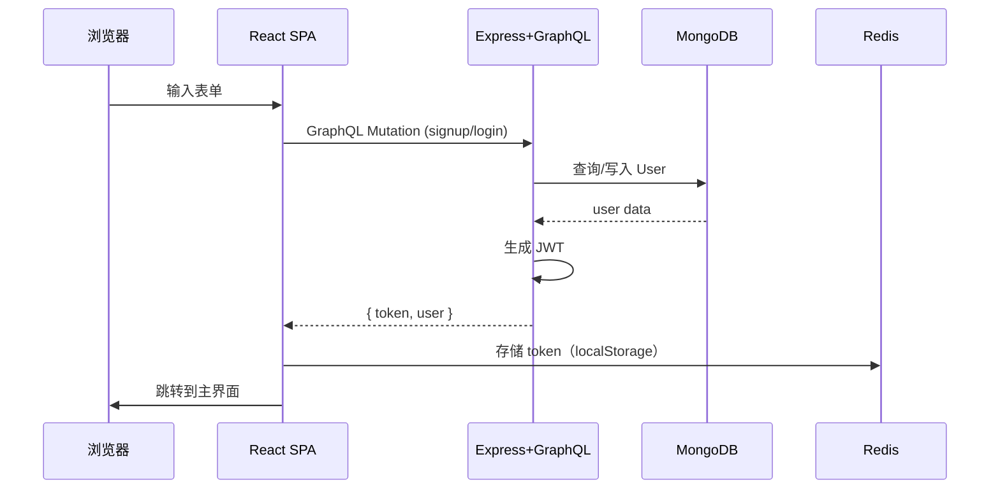
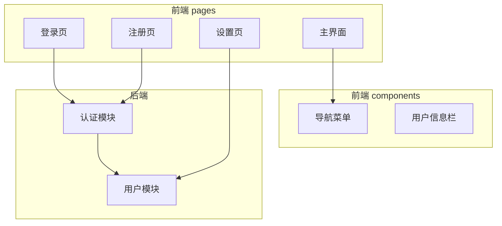
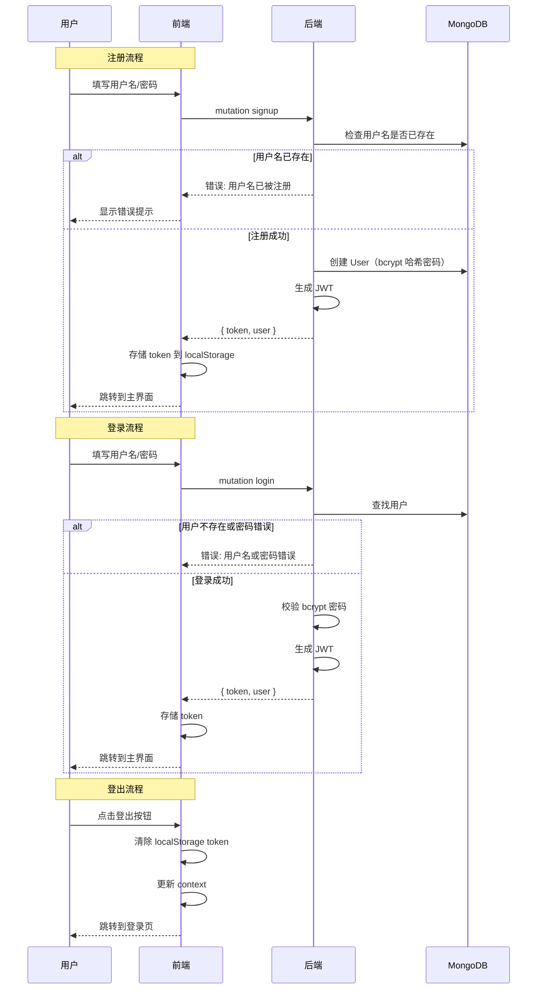

# 用户认证与设置页 - 技术提案

**功能名称**: 用户认证与设置页
**关联 PRD**: `user-auth-and-settings.md`
**技术提案版本**: v1.0
**创建日期**: 2026-05-17
**作者**: ZeroAsh
**feat-branch**: `feat/user-auth`

## 1. 概述

### 1.1 背景

基于 PRD `user-auth-and-settings.md`，需要为用户提供注册/登录能力以及登录后的导航布局和设置页面。目前系统没有用户认证机制和相关的页面结构。

### 1.2 目标

- 实现用户名/密码注册与登录
- 实现 JWT 认证流程（access token + refresh token）
- 实现登录后 2-column 导航布局
- 实现设置页（含帐号信息展示和登出）

### 1.3 范围

- 包含：注册页、登录页、主界面布局、设置页
- 不包含：OAuth 第三方登录、密码找回、多因素认证

## 2. 技术架构

### 2.1 系统架构图



### 2.2 技术栈

| 层级 | 技术选型 | 说明 |
|------|---------|------|
| 前端 | React 19 + TypeScript | SPA |
| 前端路由 | React Router v7 | 页面路由与守卫 |
| 前端状态 | React Context | 用户认证状态管理 |
| 前端样式 | Tailwind CSS v4 | 2-column 布局 |
| 前端 API | Apollo Client | GraphQL 客户端 |
| 后端 | Express v5 + GraphQL-Yoga | API 服务 |
| 数据库 | MongoDB + Mongoose | 用户数据存储 |
| 认证 | JWT (jsonwebtoken) | 无状态认证 |

### 2.3 模块划分



| 模块 | 职责 | 关键技术点 |
|------|------|-----------|
| 前端认证上下文 | 管理登录态，存储/清除 token | React Context + localStorage |
| 前端路由守卫 | 未登录时重定向到登录页 | React Router loader/guard |
| 后端认证模块 | signup/login/logout mutation + me query | JWT 签发与验证 |
| 后端用户模型 | 用户数据存取 | Mongoose Schema + bcrypt 哈希 |

## 3. API 设计

### 3.1 GraphQL Schema

```graphql
type User {
  id: ID!
  username: String!
  createdAt: String!
}

type AuthPayload {
  token: String!
  user: User!
}

type Query {
  me: User
}

type Mutation {
  signup(username: String!, password: String!): AuthPayload!
  login(username: String!, password: String!): AuthPayload!
}
```

### 3.2 认证机制

- 使用 `jsonwebtoken` 签发 JWT
- Token 包含 `userId`，有效期 7 天
- 客户端通过 `Authorization: Bearer <token>` 请求头传递
- GraphQL context 中解析 token 并注入当前用户

## 4. 数据模型

### 4.1 User 集合

| 字段 | 类型 | 说明 |
|------|------|------|
| _id | ObjectId | 主键 |
| username | String, unique, required | 用户名，2-20 字符 |
| passwordHash | String, required | bcrypt 哈希后的密码 |
| createdAt | Date | 创建时间 |

### 4.2 缓存设计

- 无（JWT 无状态，不需要服务端 session 缓存）

## 5. 技术实现方案

### 5.1 核心流程



### 5.2 关键实现点

#### 实现点 1: 后端 JWT 认证中间件

- **描述**: GraphQL context 中从请求头提取 token，解析 userId，并加载用户
- **技术细节**: 使用 `jsonwebtoken` 的 `verify` 方法，`GraphQL-Yoga` 的 `context` 函数
- **风险点**: token 过期处理——前端在 Apollo Client 的 error link 中检测 401 并跳转到登录页

#### 实现点 2: 前端 2-column 布局

- **描述**: 主界面和设置页均使用左侧固定宽度导航 + 右侧自适应内容
- **技术细节**: Tailwind CSS `grid grid-cols-[240px_1fr]` 布局，左侧 `<aside>` + 右侧 `<main>`

#### 实现点 3: 前端路由设计

| 路径 | 组件 | 权限 |
|------|------|------|
| `/login` | LoginPage | 未登录 |
| `/register` | RegisterPage | 未登录 |
| `/` | MainLayout | 需登录 |
| `/settings` | SettingsPage (在 MainLayout 内) | 需登录 |

路由守卫通过封装 `ProtectedRoute` 组件实现：检查 context 中是否有 token，无则重定向到 `/login`。

#### 实现点 4: 设置页布局

- 左侧列出设置分类列表（目前仅「帐号」）
- 点击「帐号」在右侧展示用户名和登出按钮
- 登出按钮点击后清除 token 并跳转到登录页

## 6. 技术决策

### 6.1 决策列表

| 决策 | 选项 A | 选项 B | 最终选择 | 原因 |
|------|--------|--------|---------|------|
| 认证方式 | JWT | Session + Cookie | JWT | 无状态，适合前后端分离 SPA |
| 密码哈希 | bcrypt | argon2 | bcrypt | 成熟稳定，Node 生态支持好 |
| 前端状态 | React Context | Zustand | React Context | 认证状态简单，无需额外依赖 |
| Token 存储 | localStorage | httpOnly Cookie | localStorage | 实现简单，配合 JWT 前端可控 |

### 6.2 依赖与约束

| 类型 | 内容 | 说明 |
|------|------|------|
| 依赖 | `jsonwebtoken` | 后端 JWT 签发与验证 |
| 依赖 | `bcryptjs` | 后端密码哈希（纯 JS 实现，无需编译） |
| 依赖 | `@apollo/client` | 前端 GraphQL 客户端（已有） |
| 依赖 | `react-router-dom` | 前端路由（已有） |
| 约束 | 前端遵循 `docs/engineering/frontend-rules.md` | |
| 约束 | 后端遵循 `docs/engineering/backend-rules.md` | |

## 7. 项目结构

```
# 后端新增
servers/agent-api/
├── src/
│   ├── graphql/
│   │   ├── schemas/
│   │   │   └── auth.ts          # GraphQL auth typeDefs
│   │   └── resolvers/
│   │       └── auth.ts          # auth resolvers (signup/login/me)
│   ├── models/
│   │   └── user.ts              # User Mongoose model
│   ├── services/
│   │   └── auth.ts              # 认证业务逻辑 (hash, compare, sign)
│   ├── middleware/
│   │   └── auth.ts              # JWT 解析中间件
│   └── index.ts                 # 更新：注册 typeDefs/resolvers

# 前端新增
apps/agent-web/
├── src/
│   ├── pages/
│   │   ├── LoginPage.tsx        # 登录页
│   │   ├── RegisterPage.tsx     # 注册页
│   │   ├── MainLayout.tsx       # 2-column 主布局
│   │   └── SettingsPage.tsx     # 设置页
│   ├── components/
│   │   ├── ProtectedRoute.tsx   # 路由守卫
│   │   └── Sidebar.tsx          # 左侧导航组件
│   ├── stores/
│   │   └── auth.tsx             # AuthContext / AuthProvider
│   ├── lib/
│   │   └── apollo.ts            # Apollo Client 配置（含 auth link）
│   └── App.tsx                  # 更新：注册路由
```

## 8. 测试策略

### 8.1 测试覆盖要求

- API 测试覆盖：signup、login、me query
- 前端组件测试覆盖：LoginPage、RegisterPage、ProtectedRoute、AuthContext

### 8.2 测试类型

| 类型 | 工具 | 覆盖范围 |
|------|------|---------|
| 后端 GraphQL 测试 | Vitest + 集成测试 | signup/login/me/middleware |
| 前端组件测试 | Vitest + React Testing Library | 页面渲染、表单交互、路由守卫 |

## 9. 部署方案

### 9.1 环境规划

| 环境 | 用途 | 部署方式 |
|------|------|---------|
| 开发 | 本地开发 | npm run dev |
| 生产 | 线上部署 | Aspire 编排 |

### 9.2 配置管理

| 配置项 | 说明 |
|--------|------|
| JWT_SECRET | JWT 签名密钥，必须设置 |
| PORT | API 端口（默认 4000） |
| MONGODB_URI | MongoDB 连接字符串 |

## 10. 验收标准

- [ ] 技术方案评审通过
- [ ] Contract 评审通过
- [ ] 代码实现完成
- [ ] API 测试通过
- [ ] 前端组件测试通过

## 11. 相关文档

- [关联 PRD](../../product/reviewed/user-auth-and-settings.md)
- [前端规范](../frontend-rules.md)
- [后端规范](../backend-rules.md)
