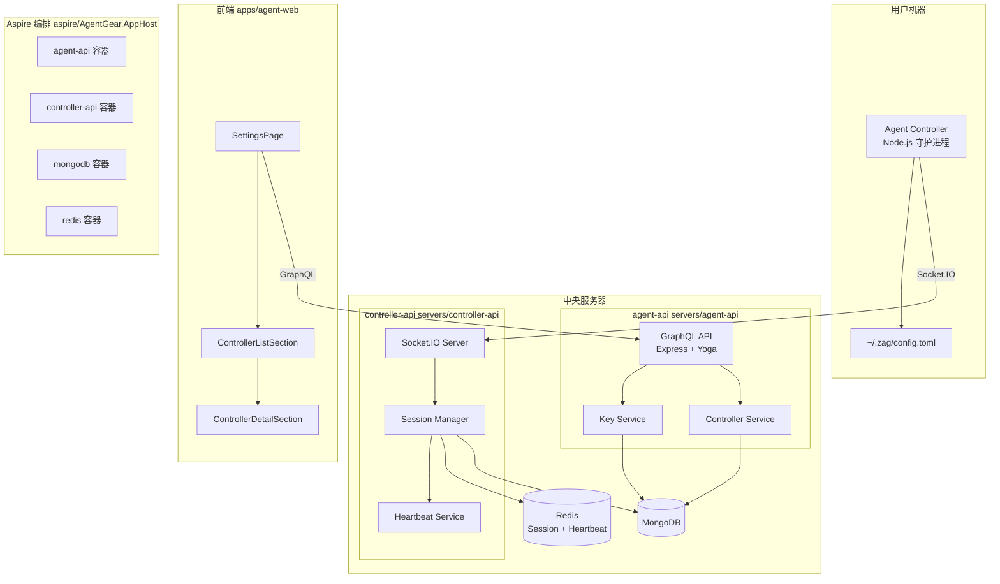
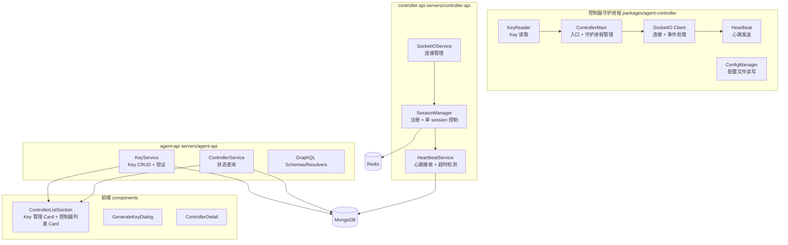
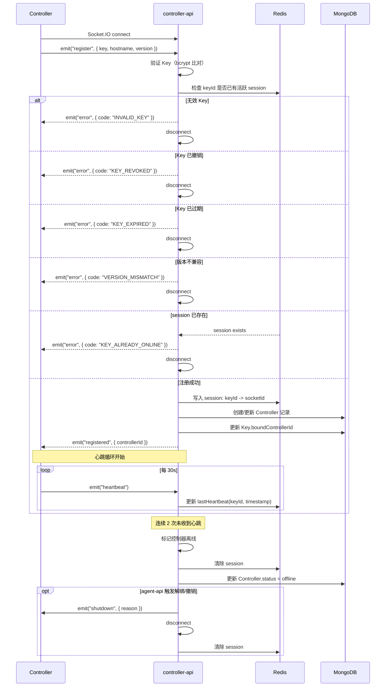
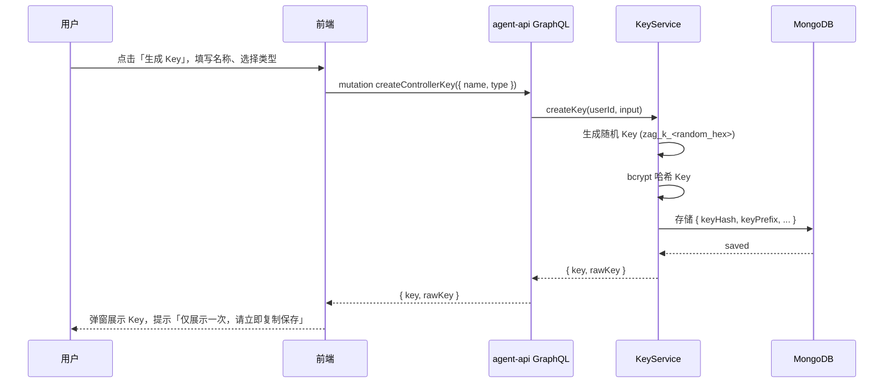
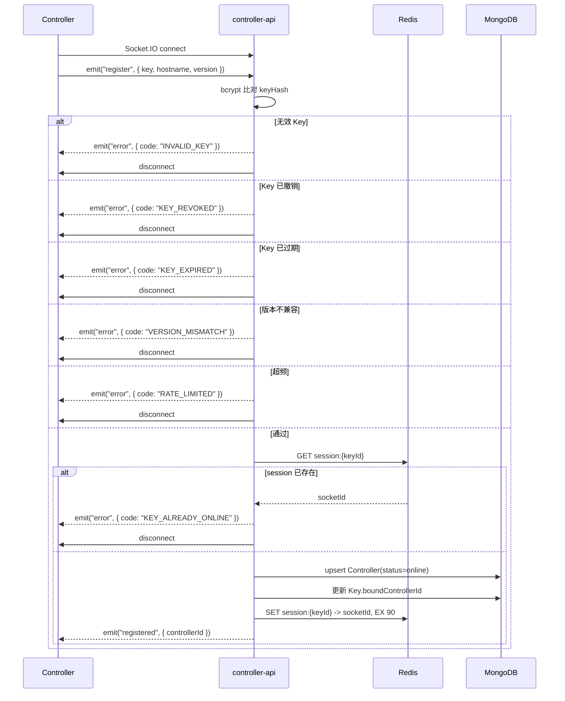
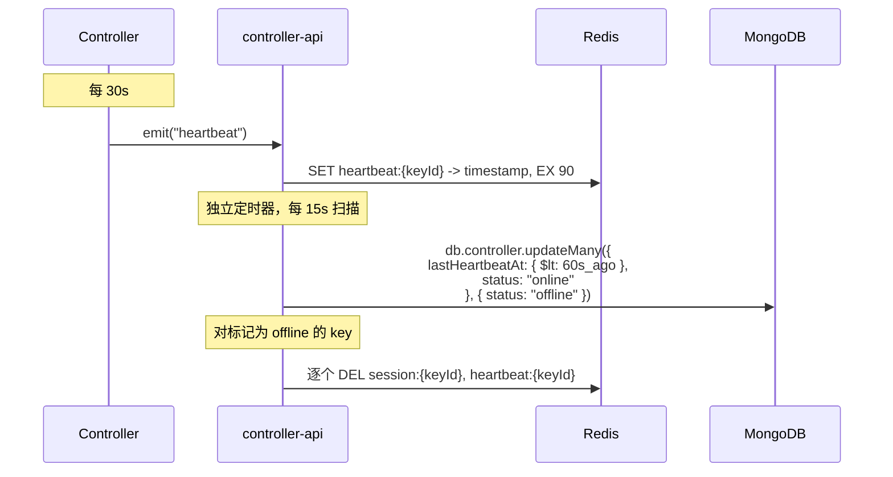
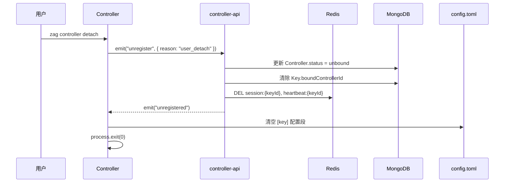
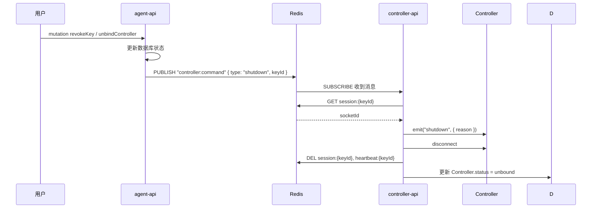

# Agent 控制器管理 v1 - 技术提案

**功能名称**: Agent 控制器管理
**关联 PRD**: `agent-controller-v1.md`
**技术提案版本**: v1.2
**创建日期**: 2026-05-17
**作者**: ZeroAsh
**feat-branch**: `feat/agent-controller`

## 1. 概述

### 1.1 背景

基于 PRD `agent-controller-v1.md`，需要实现 Agent 控制器管理体系。用户需要在多台远程机器上运行 AI Agent 实例，但目前缺乏统一的管理入口。需要一个控制器守护进程，与中央服务器保持长连接，向服务器报告自身状态，使用户能够集中查看所有控制器的在线状态。

v1 聚焦于「本地控制器」类型——用户在自己的机器上安装运行控制器守护进程。

### 1.2 目标

- 定义控制器类型体系（v1 支持 `local`，为后续 `cloud`、`github` 类型做好扩展准备）
- 用户可在 Web 设置页面生成/管理控制器 Key
- 控制器通过 Key 向 controller-api 注册并绑定到用户账号
- 控制器与 controller-api 建立 Socket.IO 长连接，定期发送心跳
- 用户可在 Web 界面查看所有控制器状态（在线/离线）并管理

### 1.3 范围

- 包含：控制器 Key 生成与管理、控制器注册与绑定、Socket.IO 长连接与心跳、控制器列表与管理页面、controller-api 独立服务
- 不包含：控制器自动安装脚本、云端控制器一键部署、GitHub Pipeline 集成、控制器日志收集与远程执行

## 2. 技术架构

### 2.1 系统架构图



### 2.2 技术栈

| 层级 | 技术选型 | 说明 |
|------|---------|------|
| 控制器守护进程 | Node.js 24+ TypeScript + ESM | 在用户机器上作为后台进程运行 |
| 控制器配置 | `toml` (smol-toml) | `~/.zag/config.toml` 配置文件 |
| 控制器通信 | `socket.io-client` | Socket.IO 客户端，自动重连、事件路由 |
| controller-api | Express v5 + GraphQL-Yoga + Socket.IO | 独立服务，处理控制器长连接 |
| agent-api | Express v5 + GraphQL-Yoga | 已有，处理 Web 端 GraphQL 请求 |
| 会话管理 | Redis + Socket.IO Redis adapter | 单 key 单 session 控制，支持多实例 |
| 前端 | React 19 + TypeScript + Tailwind v4 | 已有 |
| 前端 GraphQL | Apollo Client | 已有 |
| 前端 UI | shadcn/ui (Base UI) | 已有 |
| 数据库 | MongoDB + Mongoose | 已有，新增 Controller/ControllerKey 集合 |
| 服务编排 | .NET Aspire | 统一编排 agent-api + controller-api + MongoDB + Redis |

### 2.3 模块划分



| 模块 | 职责 | 关键技术点 |
|------|------|-----------|
| 控制器守护进程 | 作为后台进程运行在用户机器上，与 controller-api 保持连接 | 进程管理（PID file）、自动重连 |
| KeyReader | 按优先级读取 Key：`--key` > `~/.zag/config.toml` > `ZAG_CONTROLLER_KEY` | 优先级链、首次输入持久化 |
| controller-api SessionManager | 管理 Socket.IO 连接会话，确保单 key 单 session | Redis 存储 session 映射，重复连接拒绝 |
| controller-api HeartbeatService | 心跳接收与超时检测 | 30s 间隔、2 次超时离线 |
| agent-api KeyService | 生成、验证、撤销控制器 Key | Key 唯一性、绑定状态管理 |
| agent-api ControllerService | 控制器状态查询、重命名、解绑 | 数据读取，实际状态由 controller-api 写入 |

## 3. API 设计

### 3.1 GraphQL Schema（agent-api Web API）

新增 `contracts/agent-controller.graphql`：

```graphql
enum ControllerType {
  local
  cloud
  github
}

enum ControllerStatus {
  online
  offline
  registering
  unbound
}

enum ControllerKeyStatus {
  active
  revoked
  expired
}

type ControllerKey {
  id: ID!
  name: String!
  type: ControllerType!
  keyPrefix: String!
  status: ControllerKeyStatus!
  lastUsedAt: String
  createdAt: String!
  updatedAt: String!
}

type Controller {
  id: ID!
  name: String!
  hostname: String!
  type: ControllerType!
  status: ControllerStatus!
  keyId: ID!
  version: String!
  lastHeartbeatAt: String
  createdAt: String!
  updatedAt: String!
}

input CreateKeyInput {
  name: String!
  type: ControllerType! = local
}

input RenameInput {
  id: ID!
  name: String!
}

type CreateKeyPayload {
  key: ControllerKey!
  rawKey: String!
}

type Query {
  controllerKeys: [ControllerKey!]!
  controllers: [Controller!]!
  controller(id: ID!): Controller
}

type Mutation {
  createControllerKey(input: CreateKeyInput!): CreateKeyPayload!
  renameControllerKey(input: RenameInput!): ControllerKey!
  revokeControllerKey(id: ID!): Boolean!

  renameController(input: RenameInput!): Controller!
  unbindController(id: ID!): Boolean!
}
```

### 3.2 Socket.IO 协议（controller-api <-> 控制器）

#### 事件定义

| 方向 | 事件名 | Payload | 说明 |
|------|--------|---------|------|
| 控制器 → 服务端 | `register` | `{ key, hostname, version }` | 注册/认证。`version` 为 semver 格式（如 `1.0.0`），服务端校验 major 版本是否匹配 |
| 服务端 → 控制器 | `registered` | `{ controllerId }` | 注册成功 |
| 服务端 → 控制器 | `error` | `{ code, message }` | 错误。code: `INVALID_KEY` / `KEY_REVOKED` / `KEY_EXPIRED` / `KEY_ALREADY_ONLINE` / `VERSION_MISMATCH` / `RATE_LIMITED` |
| 控制器 → 服务端 | `heartbeat` | `{}` | 心跳 |
| 控制器 → 服务端 | `unregister` | `{ reason }` | 控制器主动注销（如用户执行 `zag controller detach`） |
| 服务端 → 控制器 | `unregistered` | `{}` | 注销成功确认 |
| 服务端 → 控制器 | `shutdown` | `{ reason }` | 服务器主动关闭（解绑/撤销 Key） |

#### 连接生命周期



### 3.3 跨服务调用（agent-api <-> controller-api）

agent-api 在需要主动通知控制器退出（解绑/撤销 Key）时，通过 Redis Pub/Sub 向 controller-api 发送指令：

```
channel: "controller:command"
message: { type: "shutdown", keyId: "..." }
```

controller-api 订阅该频道，根据 keyId 查找 session 并执行断开。

后续可演进为 gRPC 或消息队列，v1 用 Redis Pub/Sub 保持轻量。

## 4. 数据模型

### 4.1 ControllerKey 集合（MongoDB）

| 字段 | 类型 | 说明 |
|------|------|------|
| _id | ObjectId | 主键 |
| userId | ObjectId, ref: User, required, index | 所属用户 |
| name | String, required | Key 名称 |
| type | String, enum: local/cloud/github, required | 控制器类型 |
| keyHash | String, required, unique | Key 的 bcrypt 哈希 |
| keyPrefix | String, required | Key 前 8 位，用于前端展示 |
| status | String, enum: active/revoked/expired, default: active | 状态 |
| boundControllerId | ObjectId, ref: Controller, default: null | 已绑定的控制器 ID |
| lastUsedAt | Date | 最后使用时间 |
| createdAt | Date | 创建时间 |
| updatedAt | Date | 更新时间 |

索引：`{ userId: 1, status: 1 }`

### 4.2 Controller 集合（MongoDB）

| 字段 | 类型 | 说明 |
|------|------|------|
| _id | ObjectId | 主键 |
| userId | ObjectId, ref: User, required, index | 所属用户 |
| name | String, default: hostname | 控制器名称 |
| hostname | String, required | 机器 hostname |
| type | String, enum: local/cloud/github, required | 控制器类型 |
| status | String, enum: online/offline/registering/unbound, default: registering | 在线状态 |
| keyId | ObjectId, ref: ControllerKey, required, unique | 绑定的 Key |
| version | String, required | 控制器版本号 |
| lastHeartbeatAt | Date | 最后心跳时间 |
| lastIp | String | 最后连接 IP |
| createdAt | Date | 创建时间 |
| updatedAt | Date | 更新时间 |

索引：`{ userId: 1, status: 1 }`, `{ keyId: 1 }` (unique)

### 4.3 Redis 数据结构

```
# Session 映射：keyId -> socketId（用于单 session 控制和下发 shutdown）
key: "session:{keyId}"
value: socketId string
TTL: 90s（2 次心跳 + 余量，每次心跳刷新）

# Heartbeat 时间戳（用于心跳检测）
key: "heartbeat:{keyId}"
value: ISO timestamp string
TTL: 90s（每次心跳刷新）
```

## 5. 技术实现方案

### 5.1 核心流程

#### 生成 Key 流程



#### 控制器注册流程



#### 心跳检测流程



#### 控制器主动注销流程



#### 解绑/撤销通知流程



### 5.2 关键实现点

#### 实现点 1: controller-api 独立服务

- **描述**: 新增 `servers/controller-api/` 服务，技术栈与 agent-api 一致，通过 Aspire 编排
- **技术细节**:
  - Node.js 24 + Express v5 + TypeScript strict + ESM
  - 提供两个端点：
    - `GET /health` — 健康检查（给 Aspire）
    - `Socket.IO /` — 控制器长连接入口（默认端口 4001）
  - 依赖 MongoDB（共享 agent-api 的同一实例）+ Redis
  - Redis 连接配置：`REDIS_URI` 环境变量
  - controller-api 不自持 GraphQL，不对外提供 HTTP API，仅通过 Redis Pub/Sub 与 agent-api 通信
  - Aspire 中编排为独立容器，与 agent-api、MongoDB、Redis 共同启动
  - 支持 graceful shutdown：收到 SIGTERM 时关闭所有 Socket.IO 连接、清理 Redis session、断开数据库连接

- **项目结构**:
```
servers/controller-api/
├── src/
│   ├── config/
│   │   └── index.ts          # 配置（端口、MongoDB URI、Redis URI）
│   ├── services/
│   │   ├── socketio.ts       # Socket.IO 初始化 + 事件处理
│   │   ├── session.ts        # Session 管理（单 key 单 session）
│   │   ├── heartbeat.ts      # 心跳接收 + 超时检测定时器
│   │   └── command.ts        # Redis Pub/Sub 命令订阅
│   ├── models/               # Mongoose models（引用 agent-api 相同 schema）
│   │   ├── controller.ts
│   │   └── controller-key.ts
│   ├── middleware/
│   │   └── redis.ts          # Redis 客户端初始化
│   └── index.ts              # 入口
├── package.json
├── tsconfig.json
└── tests/
```

#### 实现点 2: Socket.IO 服务端 + Session 管理

- **描述**: 使用 Socket.IO 替代裸 `ws`，内置 room、session、自动重连支持
- **技术细节**:
  - 使用 `socket.io`（服务端）+ `socket.io-redis` adapter（多实例横向扩展留接口）
  - 连接事件顺序：
    1. `connection` — 客户端连接，此时未认证
    2. `register` — 客户端发送 Key 进行认证
    3. 认证通过后，将 socket 加入 `user:{userId}` room（便于后续广播）
  - 单 key 单 session 控制：
    - 注册时查询 Redis `GET session:{keyId}`
    - 如果存在活跃 session，拒绝当前连接，返回 `KEY_ALREADY_ONLINE`
    - 注册成功后写入 Redis `SET session:{keyId} -> socketId, EX 90`
    - 心跳刷新 TTL（`EXPIRE session:{keyId} 90`）
    - 断开连接时清理 `DEL session:{keyId}`
  - Socket.IO 自动重连：客户端内置指数退避，无需手动实现
  - 速率限制：`register` 事件按 IP 限流（`redis-rate-limiter`，每分钟最多 10 次），防止 bcrypt 计算耗尽 CPU；`heartbeat` 事件按 keyId 限流（每 15s 最多 1 次），防止高频心跳放大

```typescript
// 核心伪代码
import { Server as SocketIOServer } from 'socket.io';
import { createAdapter } from '@socket.io/redis-adapter';
import { createClient } from 'redis';

const io = new SocketIOServer(httpServer, {
  cors: { origin: '*' }, // 控制器连接，无跨域限制
});

io.on('connection', (socket) => {
  let authenticated = false;

  socket.on('register', async (payload) => {
    const { key, hostname, version } = payload;
    const keyDoc = await validateKey(key);
    if (!keyDoc) return socket.emit('error', { code: 'INVALID_KEY' });
    if (keyDoc.status === 'revoked') return socket.emit('error', { code: 'KEY_REVOKED' });
    if (keyDoc.status === 'expired') return socket.emit('error', { code: 'KEY_EXPIRED' });
    // 检查版本兼容性（major 版本必须匹配）
    const ctrlVersion = version?.split('.')[0];
    const expectedMajor = '1'; // 当前控制器 API major 版本
    if (ctrlVersion !== expectedMajor) return socket.emit('error', { code: 'VERSION_MISMATCH' });

    // 检查单 session
    const existing = await redis.get(`session:${keyDoc.id}`);
    if (existing) return socket.emit('error', { code: 'KEY_ALREADY_ONLINE' });

    // 注册成功
    await redis.set(`session:${keyDoc.id}`, socket.id, { EX: 90 });
    authenticated = true;
    socket.data.keyId = keyDoc.id;
    socket.data.userId = keyDoc.userId;
    socket.data.lastIp = socket.handshake.address;
    socket.join(`user:${keyDoc.userId}`);

    const controller = await registerController(keyDoc, hostname);
    socket.emit('registered', { controllerId: controller.id });
  });

  socket.on('heartbeat', async () => {
    if (!authenticated) return;
    await redis.expire(`session:${socket.data.keyId}`, 90);
    await redis.set(`heartbeat:${socket.data.keyId}`, new Date().toISOString(), { EX: 90 });
  });

  socket.on('unregister', async (payload) => {
    if (!authenticated) return;
    const { keyId, userId } = socket.data;
    await Controller.updateOne({ keyId }, { status: 'unbound' });
    await ControllerKey.updateOne({ _id: keyId }, { boundControllerId: null });
    await redis.del(`session:${keyId}`, `heartbeat:${keyId}`);
    socket.emit('unregistered');
    socket.disconnect(true);
  });

  socket.on('disconnect', async () => {
    if (socket.data.keyId) {
      await redis.del(`session:${socket.data.keyId}`);
    }
  });
});
```

#### 实现点 3: 控制器守护进程 — 连接 controller-api

- **描述**: 控制器通过 Socket.IO 客户端连接到 controller-api，而非 agent-api
- **技术细节**:
  - 使用 `socket.io-client` 替代 `ws`
  - endpoint 读取优先级：`--server` 命令行参数 > `~/.zag/config.toml` 中的 `[server].endpoint` > `ZAG_SERVER_ENDPOINT` 环境变量
  - endpoint 示例：`http://localhost:4001`（开发）或 `https://ctrl-api.example.com`（生产）
  - Socket.IO client 自动处理重连（内置指数退避），无需手写重连逻辑
  - 连接成功后发送 `register` 事件，失败时输出友好错误信息
  - `version` 字段为 semver 格式（如 `1.2.3`），服务端仅校验 major 版本（`MAJOR.MINOR.PATCH` 中的 major），与 controller-api 的 major 版本一致才允许注册
  - 主动注销：用户执行 `zag controller detach` 时，发送 `unregister` 事件，服务端清理后本地清除 config 中的 Key
  - 收到 `shutdown` 事件时，同样调用 `clearConfigKey()` 清除本地配置文件中的 Key 段，确保 Key 不被残留重用
  - 进程退出前（SIGINT/SIGTERM）发送 `unregister` 事件完成主动注销

```typescript
// 核心伪代码
import { io as createSocketIOClient } from 'socket.io-client';

const socket = createSocketIOClient(endpoint, {
  transports: ['websocket'], // 强制 WebSocket，避免长轮询
  reconnection: true,
  reconnectionDelay: 1000,
  reconnectionDelayMax: 60000,
});

socket.on('connect', () => {
  socket.emit('register', { key, hostname, version });
});

socket.on('registered', (data) => {
  console.log(`Controller registered: ${data.controllerId}`);
  // 启动心跳
  setInterval(() => socket.emit('heartbeat', {}), 30_000);
});

socket.on('unregistered', () => {
  clearConfigKey(); // 清空 config.toml 中的 [key] 段
  socket.close();
  process.exit(0);
});

socket.on('shutdown', (data) => {
  console.log(`Shutdown requested: ${data.reason}`);
  clearConfigKey(); // 服务器端解绑/撤销，本地 Key 不再有效
  socket.close();
  process.exit(0);
});
```

#### 实现点 4: 控制器 Key 生成与安全

- **描述**: 生成安全的控制器 Key，仅创建时展示一次明文
- **技术细节**:
  - Key 格式：`zag_k_<formatVersion>_<random>`，如 `zag_k_1_a1b2c3d4e5f6...`。`formatVersion` 是 Key 格式版本号，后续如需更改 Key 结构（如调整随机数长度或哈希算法），通过递增此版本号实现向后兼容
  - 使用 Node.js `crypto.randomBytes(24)` 生成 24 字节随机数 → 48 hex chars
  - 数据库中仅存储 bcrypt 哈希（`keyHash`），明文 Key 永不落盘
  - 前端仅保存 `keyPrefix`（前 8 位）用于展示识别
  - 撤销 Key 时，设置 `status = revoked`，通过 Redis Pub/Sub 通知 controller-api 推送 `shutdown`

#### 实现点 5: 心跳超时检测（controller-api）

- **描述**: controller-api 通过 MongoDB 批量检测控制器是否在线，避免 Redis SCAN O(n) 性能问题
- **技术细节**:
  - 心跳写入 Redis：`SET heartbeat:{keyId} -> timestamp, EX 90`（每次心跳重置 TTL），用于单 session TTL 刷新
  - 超时检测不扫描 Redis，改用 MongoDB 批量更新：
    - 独立 `setInterval` 每 15s 执行 `Controller.updateMany({ lastHeartbeatAt: { $lt: 60s_ago }, status: 'online' }, { status: 'offline' })`
    - 60s = 2 次心跳间隔 + 缓冲，与 PRD 要求的 2 次心跳超时一致
  - 超时后：对标记为 offline 的 key，逐个 `DEL session:{keyId}` 并断开对应 socket
  - MongoDB 批量更新为 O(1) 操作，不随控制器数量增长，天然支持多实例部署

#### 实现点 6: 跨服务命令通道（agent-api -> controller-api）

- **描述**: agent-api 在解绑/撤销 Key 时，通过 Redis Pub/Sub 通知 controller-api 执行断开
- **技术细节**:
  - agent-api 收到 `revokeControllerKey` 或 `unbindController` mutation 后：
    1. 更新数据库状态
    2. `PUBLISH "controller:command" { type: "shutdown", keyId }`
  - controller-api 订阅 `controller:command` 频道：
    1. 收到消息后 `GET session:{keyId}` 获取 socketId
    2. 通过 `io.to(socketId).emit("shutdown", { reason })` 发送消息
    3. 清理 Redis session + 更新 DB

#### 实现点 7: 前端控制器管理页面

- **描述**: 在 SettingsPage 新增「控制器管理」导航和 ControllerListSection
- **技术细节**:
  - 在 `SettingsPage.tsx` 左侧导航新增「控制器管理」分类
  - 右侧内容区新增 `ControllerListSection`，包含两个 Card：
    - **Key 管理 Card**：Key 列表（名称、类型、前缀、状态、创建时间）、生成 Key 按钮、重命名/撤销操作
    - **控制器列表 Card**：控制器列表（hostname、类型标签、在线/离线状态、最后心跳时间）、类型筛选、重命名/解绑操作
  - 生成 Key 后弹窗展示完整 Key，提示「请立即复制保存，关闭后将不再显示」
  - 列表使用轮询（v1 先用 15s 轮询 agent-api GraphQL）更新在线状态

## 6. 技术决策

### 6.1 决策列表

| 决策 | 选项 A | 选项 B | 最终选择 | 原因 |
|------|--------|--------|---------|------|
| 控制器通信协议 | Socket.IO | 裸 `ws` | Socket.IO | 内置自动重连、事件路由、room 支持；后续 ACP 协议需要事件级消息路由 |
| 服务拆分 | 独立 controller-api | 合并在 agent-api | 独立 controller-api | 控制器连接和 ACP 协议 IO 是独立职责，分开部署可独立扩缩容、不影响 Web API |
| 服务编排 | .NET Aspire | Docker Compose | Aspire | 项目已有 Aspire 编排，统一管理 agent-api + controller-api + MongoDB + Redis |
| Session 存储 | Redis | 内存 Map | Redis | 支持多实例部署，agent-api 和 controller-api 可共享 session 状态 |
| 跨服务通信 | Redis Pub/Sub | gRPC | Redis Pub/Sub | 轻量、与 Redis 基础设施一致，v1 够用 |
| Key 存储方式 | bcrypt 哈希 | 加密存储（AES） | bcrypt 哈希 | Key 仅用于注册验证，无需解密，bcrypt 不可逆更安全 |
| 心跳检测方式 | 客户端主动发送 | 服务端主动 PING | 客户端主动发送 | 减少服务端资源消耗，控制器自治 |
| 离线检测周期 | 2 次心跳（60s） | 3 次心跳（90s） | 2 次心跳（60s） | 符合 PRD 要求，快速感知离线 |
| 前端状态更新 | 轮询 15s | GraphQL Subscription | 轮询 15s | Subscription 需要 WebSocket 支持，v1 简化实现 |
| 控制器包位置 | `packages/agent-controller` | `servers/agent-controller` | `packages/agent-controller` | 控制器是客户端程序 |

### 6.2 依赖与约束

| 类型 | 内容 | 说明 |
|------|------|------|
| 依赖 | `socket.io` + `socket.io-client` | 控制器与 controller-api 通信 |
| 依赖 | `ioredis` 或 `redis` | Redis 客户端（Node.js） |
| 依赖 | `smol-toml` | 控制器配置文件解析 |
| 依赖 | `commander` 或 `yargs` | 控制器 CLI 参数解析 |
| 约束 | 前端遵循 `docs/engineering/frontend-rules.md` | |
| 约束 | 后端遵循 `docs/engineering/backend-rules.md` | |
| 约束 | Key 明文仅创建时展示一次，不得在前端或日志中持久化 | |
| 约束 | 一个 Key 仅允许一个活跃 session | |
| 约束 | v1 仅支持 `local` 类型的控制器 | |

## 7. 项目结构

```
# agent-api 新增/修改
servers/agent-api/
├── src/
│   ├── graphql/
│   │   ├── schemas/
│   │   │   ├── index.ts                  # 修改：注册 controller typeDefs
│   │   │   ├── controller-key.ts         # 新增
│   │   │   └── controller.ts             # 新增
│   │   └── resolvers/
│   │       ├── index.ts                  # 修改
│   │       ├── controller-key.ts         # 新增
│   │       └── controller.ts             # 新增
│   ├── models/
│   │   ├── controller-key.ts             # 新增
│   │   └── controller.ts                 # 新增
│   ├── services/
│   │   ├── controller-key.ts             # 新增
│   │   ├── controller.ts                 # 新增：仅状态查询+重命名+解绑逻辑
│   │   └── command.ts                    # 新增：Redis Pub/Sub 命令发送
│   └── index.ts                          # 修改：初始化 Redis 客户端
├── contracts/
│   └── agent-controller.graphql          # 新增
└── tests/
    ├── controller-key.test.ts
    └── controller.test.ts

# 新增 controller-api 服务
servers/controller-api/
├── src/
│   ├── config/
│   │   └── index.ts                      # 端口、MongoDB URI、Redis URI
│   ├── services/
│   │   ├── socketio.ts                   # Socket.IO 初始化 + 事件处理
│   │   ├── session.ts                    # Session 管理（单 key 单 session 控制）
│   │   ├── heartbeat.ts                  # 心跳接收 + 超时检测定时器
│   │   └── command.ts                    # Redis Pub/Sub 命令订阅（shutdown）
│   ├── models/                           # Mongoose models（引用 agent-api schema）
│   │   ├── controller.ts
│   │   └── controller-key.ts
│   ├── middleware/
│   │   └── redis.ts                      # Redis 客户端初始化
│   └── index.ts                          # 入口
├── package.json
├── tsconfig.json
└── tests/
    ├── session.test.ts
    ├── heartbeat.test.ts
    └── socketio.test.ts

# 前端新增/修改
apps/agent-web/
├── src/
│   ├── pages/
│   │   └── SettingsPage.tsx              # 修改：新增控制器管理导航
│   ├── components/
│   │   └── settings/
│   │       ├── ControllerListSection.tsx  # 新增：Key 管理 Card + 控制器列表 Card
│   │       ├── GenerateKeyDialog.tsx      # 新增
│   │       └── ControllerDetail.tsx       # 新增
│   ├── graphql/
│   │   ├── queries.ts                    # 修改：新增 controller queries
│   │   └── mutations.ts                  # 修改：新增 controller mutations
│   └── lib/
│       └── controller.ts                 # 新增

# 新增控制器守护进程包
packages/agent-controller/
├── src/
│   ├── index.ts                          # 入口：CLI 解析 + 守护进程化
│   ├── config.ts                         # Key 读取优先级 + endpoint 优先级
│   ├── socketio-client.ts                # Socket.IO 客户端
│   ├── heartbeat.ts                      # 心跳发送
│   └── daemon.ts                         # 守护进程管理（PID 文件、信号处理）
├── package.json
├── tsconfig.json
└── README.md

# Aspire 编排
aspire/AgentGear.AppHost/
├── Program.cs                            # 修改：注册 controller-api + Redis
└── ...
```

## 8. 测试策略

### 8.1 测试覆盖要求

- agent-api GraphQL 测试覆盖：ControllerKey CRUD + Controller 查询/重命名/解绑
- controller-api Socket.IO 测试覆盖：注册流程、单 session 控制、心跳接收、超时检测、shutdown 通知
- 控制器守护进程测试覆盖：Key 读取优先级、endpoint 读取优先级、配置文件读写
- 跨服务通信测试：Redis Pub/Sub shutdown 命令传递

### 8.2 测试类型

| 类型 | 工具 | 覆盖范围 |
|------|------|---------|
| agent-api GraphQL 测试 | Vitest + supertest | controller-key/controller mutation/query |
| controller-api 集成测试 | Vitest + socket.io-client | 注册、心跳、超时、单 session |
| controller-api 单元测试 | Vitest | session 管理、心跳检测逻辑 |
| 控制器单元测试 | Vitest | Key/endpoint 读取优先级、配置文件读写 |

## 9. 部署方案

### 9.1 环境规划

| 环境 | 用途 | 部署方式 |
|------|------|---------|
| 中央服务器 | 运行 agent-api + controller-api + MongoDB + Redis | Aspire 编排 |
| 用户机器 | 运行 agent-controller | 用户自行安装（npm i -g + 手动启动或 systemd） |

### 9.2 配置管理

#### agent-api 配置

| 配置项 | 说明 | 是否必填 |
|--------|------|---------|
| `PORT` | 端口（默认 4000） | 否 |
| `MONGODB_URI` | MongoDB 连接字符串 | 是 |
| `JWT_SECRET` | JWT 签名密钥 | 是 |
| `REDIS_URI` | Redis 连接字符串 | 是 |

#### controller-api 配置

| 配置项 | 说明 | 是否必填 |
|--------|------|---------|
| `PORT` | 端口（默认 4001） | 否 |
| `MONGODB_URI` | MongoDB 连接字符串 | 是 |
| `REDIS_URI` | Redis 连接字符串 | 是 |

#### 控制器配置（`~/.zag/config.toml`）

```toml
[key]
value = "zag_k_1_a1b2c3d4..."

[server]
endpoint = "http://ctrl-api.example.com"

[controller]
name = "my-dev-machine"
```

CLI 参数优先级：`--key` > `--server` > 配置文件 `~/.zag/config.toml` > 环境变量 `ZAG_CONTROLLER_KEY` / `ZAG_SERVER_ENDPOINT`

## 10. 验收标准

- [ ] 技术方案评审通过
- [ ] Contract 评审通过
- [ ] agent-api ControllerKey CRUD GraphQL 接口实现并测试通过
- [ ] agent-api Controller 查询/重命名/解绑接口实现并测试通过
- [ ] controller-api Socket.IO 服务端实现（注册、单 session 控制、心跳、超时检测）并测试通过
- [ ] 控制器守护进程实现（Key 读取、endpoint 配置、Socket.IO 连接、心跳发送）并测试通过
- [ ] Aspire 编排 controller-api + agent-api + MongoDB + Redis 启动正常
- [ ] 跨服务通信（解绑/撤销 → Redis Pub/Sub → controller-api 推 shutdown）测试通过
- [ ] 前端 Key 管理 Card 可用（生成、列表、重命名、撤销）
- [ ] 前端控制器列表 Card 可用（状态展示、筛选、重命名、解绑）
- [ ] 端到端流程：生成 Key → 启动控制器 → 页面展示在线 → 离线检测

## 11. 相关文档

- [关联 PRD](../../product/reviewed/agent-controller-v1.md)
- [前端规范](../frontend-rules.md)
- [后端规范](../backend-rules.md)
- [Common Rules](../common-rules.md)
- [LLM 供应商设置技术方案](./llm-provider-settings.md)
