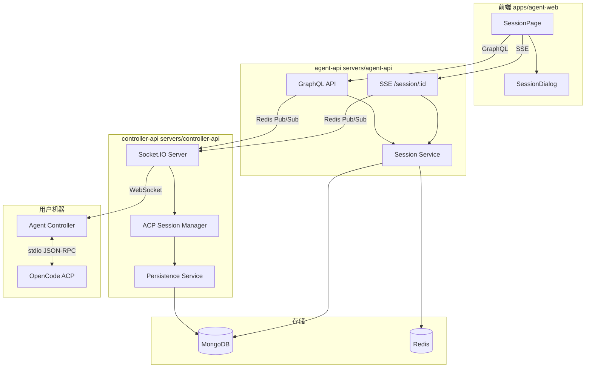
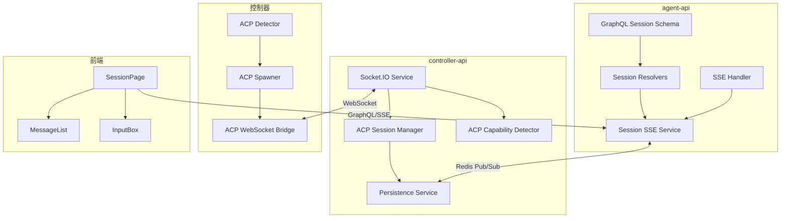
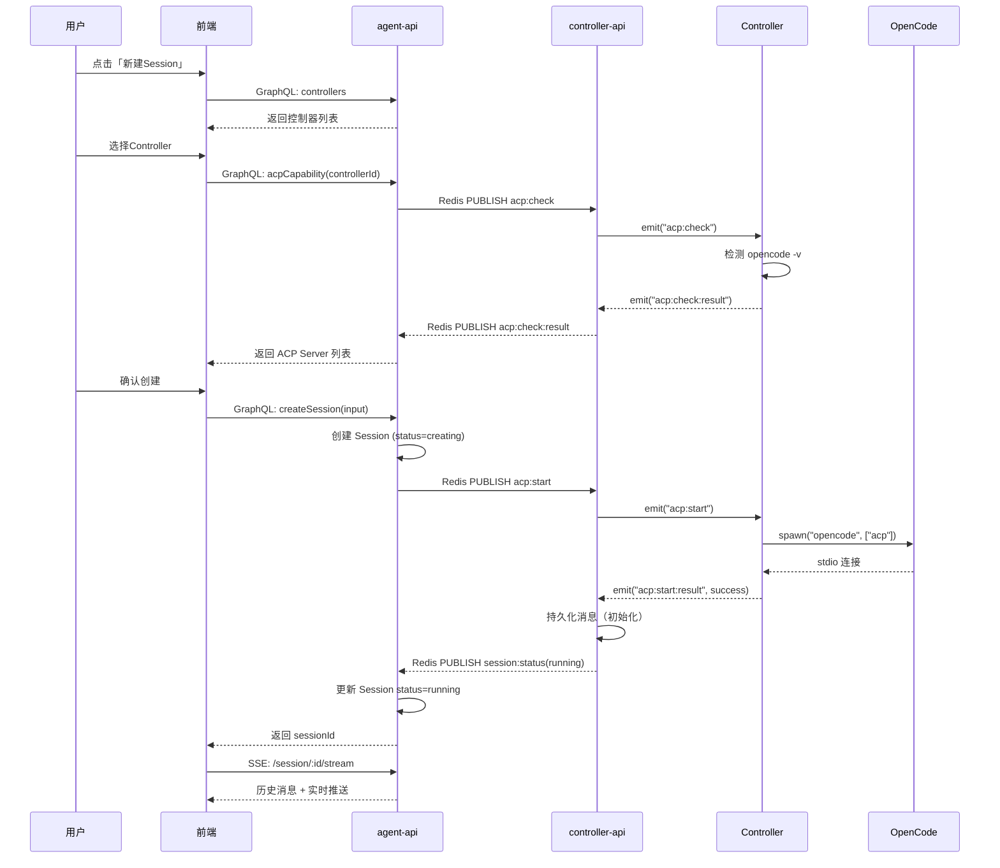
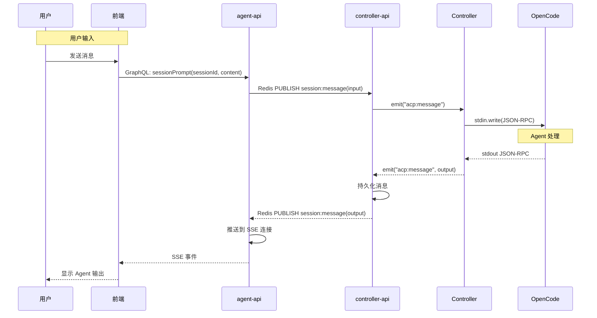
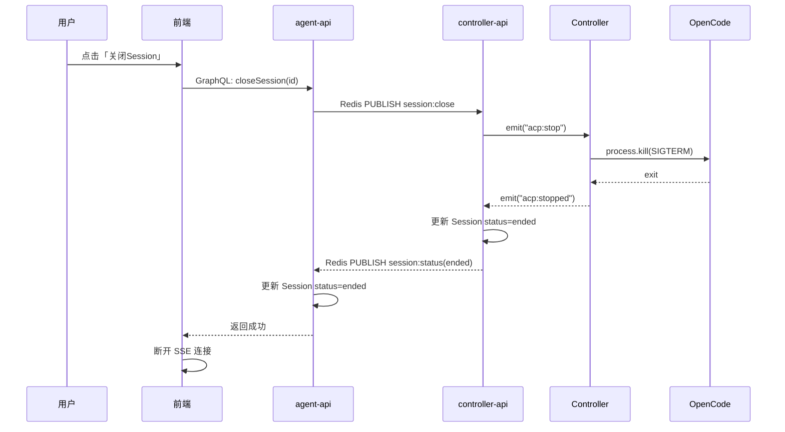

# Agent 拉起与交互 - 技术提案

**功能名称**: Agent 拉起与交互
**关联 PRD**: `agent-session-interaction.md`
**技术提案版本**: v1.0
**创建日期**: 2026-05-18
**作者**: ZeroAsh
**feat-branch**: `feat/agent-session`

## 1. 概述

### 1.1 背景

基于 PRD `agent-session-interaction.md`，需要在 v1 控制器管理基础上实现 Agent Session 管理和 ACP 协议转发能力。用户可以通过 Web 界面创建 Session，选择控制器，拉起 OpenCode ACP 模式，并实时与 Agent 交互。

### 1.2 目标

- 实现 Session 创建、控制器选择、ACP Server 检测流程
- Controller 检测并拉起 OpenCode ACP 模式
- 前端通过 Agent-API 与 Agent 实时交互（输入输出均经 Agent-API 中转）
- ACP 消息持久化存储，支持历史查看和断线重连

### 1.3 范围

- 包含：Session 数据模型、ACP 能力检测、ACP 协议转发、内容持久化、Agent-API SSE 推送、前端 Session 页面
- 不包含：多 ACP Server 类型支持（本期仅 OpenCode）、ACP 协议扩展、远程文件系统访问

## 2. 技术架构

### 2.1 系统架构图



### 2.2 技术栈

| 层级 | 技术选型 | 说明 |
|------|---------|------|
| agent-api | Express v5 + GraphQL-Yoga | 已有，新增 Session GraphQL + SSE |
| controller-api | Express v5 + Socket.IO | 已有，新增 ACP Session Manager |
| 控制器 | Node.js + socket.io-client + child_process | 检测 ACP Server、管理 OpenCode 进程 |
| 前端 | React 19 + TypeScript + Tailwind v4 | 已有，新增 Session 页面和组件 |
| 数据库 | MongoDB + Mongoose | 已有，新增 Session/Message 集合 |
| 缓存 | Redis | 已有，新增 Session 状态缓存 |
| SSE | 原生 EventSource + Redis Pub/Sub | Agent-API 推送 ACP 消息 |

### 2.3 模块划分



| 模块 | 职责 | 关键技术点 |
|------|------|-----------|
| agent-api Session Service | Session CRUD、消息查询 | Mongoose、Redis 缓存 |
| agent-api SSE Handler | 管理 SSE 连接、推送消息 | Redis Pub/Sub 订阅 |
| controller-api ACP Session Manager | 管理 ACP Session 生命周期 | WebSocket 转发、进程管理 |
| controller-api Persistence Service | 消息持久化、通知 Agent-API | MongoDB 写入、Redis Pub/Sub 发布 |
| controller-api ACP Capability Detector | 检测控制器支持的 ACP Server | WebSocket 请求/响应 |
| Controller ACP Detector | 检测本地 ACP Server | child_process 执行命令 |
| Controller ACP Spawner | 拉起 OpenCode ACP 进程 | child_process.spawn、stdio 管理 |
| Controller ACP WebSocket Bridge | ACP stdio 与 WebSocket 桥接 | 双向数据转发 |

## 3. API 设计

### 3.1 GraphQL Schema（agent-api）

新增 `contracts/agent-session.graphql`：

```graphql
enum SessionStatus {
  creating
  connecting
  running
  disconnected
  ended
}

enum AcpServerType {
  opencode
}

type Session {
  id: ID!
  userId: ID!
  controllerId: ID!
  controllerName: String!
  acpServerType: AcpServerType!
  status: SessionStatus!
  createdAt: String!
  updatedAt: String!
  endedAt: String
}

type AcpMessage {
  id: ID!
  sessionId: ID!
  direction: String! # "input" | "output"
  type: String! # "text" | "image" | "tool_call" | "tool_result" | "plan" | "error"
  content: String!
  metadata: String # JSON string for additional data
  createdAt: String!
}

type CreateSessionPayload {
  session: Session!
  controllerId: ID!
}

input CreateSessionInput {
  controllerId: ID!
  acpServerType: AcpServerType! = opencode
}

type Query {
  sessions: [Session!]!
  session(id: ID!): Session
  sessionMessages(sessionId: ID!, limit: Int, offset: Int): [AcpMessage!]!
}

type Mutation {
  createSession(input: CreateSessionInput!): CreateSessionPayload!
  closeSession(id: ID!): Boolean!
  deleteSession(id: ID!): Boolean!
}
```

### 3.2 SSE 端点（agent-api）

```
GET /api/session/:id/stream
```

- 连接时返回该 Session 的最近 100 条历史消息
- 有新消息时实时推送
- 推送格式：`data: {"type": "message", "data": {...}}\n\n`
- 心跳：每 30s 发送 `data: {"type": "heartbeat"}\n\n`

### 3.3 Socket.IO 协议扩展（controller-api <-> 控制器）

新增事件：

| 方向 | 事件名 | Payload | 说明 |
|------|--------|---------|------|
| 服务端 → 控制器 | `acp:check` | `{ requestId }` | 请求检测 ACP 能力 |
| 控制器 → 服务端 | `acp:check:result` | `{ requestId, servers: [{ type, available, version }] }` | 返回检测结果 |
| 服务端 → 控制器 | `acp:start` | `{ requestId, sessionId, serverType, cwd, mcpServers }` | 启动 ACP Session |
| 控制器 → 服务端 | `acp:start:result` | `{ requestId, sessionId, success, error }` | 启动结果 |
| 服务端 → 控制器 | `acp:message` | `{ sessionId, message }` | 转发前端输入到 Controller |
| 控制器 → 服务端 | `acp:message` | `{ sessionId, message }` | Controller 转发 ACP 输出 |
| 服务端 → 控制器 | `acp:stop` | `{ sessionId }` | 停止 ACP Session |
| 控制器 → 服务端 | `acp:stopped` | `{ sessionId, reason }` | ACP Session 已停止 |

### 3.4 跨服务调用（agent-api <-> controller-api）

新增 Redis Pub/Sub 频道：

```
channel: "session:message"
message: { sessionId, message: { type, content, metadata, direction } }

channel: "session:status"
message: { sessionId, status: "creating" | "connecting" | "running" | "disconnected" | "ended" }
```

## 4. 数据模型

### 4.1 Session 集合（MongoDB）

| 字段 | 类型 | 说明 |
|------|------|------|
| _id | ObjectId | 主键 |
| userId | ObjectId, ref: User, required, index | 所属用户 |
| controllerId | ObjectId, ref: Controller, required, index | 关联控制器 |
| controllerName | String, required | 控制器名称（冗余，便于查询） |
| acpServerType | String, enum: opencode, required | ACP Server 类型 |
| status | String, enum: creating/connecting/running/disconnected/ended, default: creating | Session 状态 |
| externalSessionId | String | ACP Session ID（Controller 返回） |
| cwd | String | 工作目录 |
| createdAt | Date | 创建时间 |
| updatedAt | Date | 更新时间 |
| endedAt | Date | 结束时间 |

索引：`{ userId: 1, createdAt: -1 }`, `{ controllerId: 1, status: 1 }`

### 4.2 AcpMessage 集合（MongoDB）

| 字段 | 类型 | 说明 |
|------|------|------|
| _id | ObjectId | 主键 |
| sessionId | ObjectId, ref: Session, required, index | 关联 Session |
| direction | String, enum: input/output, required | 消息方向 |
| type | String, enum: text/image/tool_call/tool_result/plan/error, required | 消息类型 |
| content | String, required | 消息内容 |
| metadata | Schema.Types.Mixed | 额外数据（如 tool name、file path） |
| createdAt | Date | 创建时间，索引 |

索引：`{ sessionId: 1, createdAt: 1 }`

### 4.3 Redis 数据结构

```
# Session 状态缓存（快速查询）
key: "session:{sessionId}:status"
value: status string
TTL: 无（Session 结束时删除）

# SSE 连接订阅
key: "session:{sessionId}:subscribers"
value: subscriber count
TTL: 无

# ACP 能力检测缓存
key: "acp:capability:{controllerId}"
value: JSON string { servers: [...], checkedAt }
TTL: 3600s（1小时）
```

## 5. 技术实现方案

### 5.1 核心流程

#### 新建 Session 流程



#### ACP 消息转发流程



#### Session 关闭流程



### 5.2 关键实现点

#### 实现点 1: Controller ACP 能力检测

- **描述**: Controller 检测本地支持的 ACP Server，本期仅检测 OpenCode
- **技术细节**:
  - 收到 `acp:check` 事件后，依次检测各 ACP Server
  - OpenCode 检测：执行 `opencode -v`，解析版本号
  - 结果缓存到 Redis（`acp:capability:{controllerId}`，TTL 1小时）
  - 支持的 ACP Server 类型通过配置文件扩展

```typescript
// 伪代码
async function detectAcpServers(): Promise<AcpServerInfo[]> {
  const servers: AcpServerInfo[] = [];

  // 检测 OpenCode
  try {
    const { stdout } = await exec('opencode -v');
    const version = parseVersion(stdout);
    servers.push({ type: 'opencode', available: true, version });
  } catch {
    servers.push({ type: 'opencode', available: false });
  }

  return servers;
}
```

#### 实现点 2: Controller ACP 进程管理

- **描述**: Controller 拉起 OpenCode ACP 模式并管理进程生命周期
- **技术细节**:
  - 使用 `child_process.spawn` 启动 `opencode acp`
  - 管理 stdin/stdout 进行 JSON-RPC 通信
  - 监听进程退出事件，通知 Controller-API
  - 支持多个 ACP Session 并行（每个 Session 独立进程）

```typescript
// 伪代码
class AcpProcess {
  private process: ChildProcess;
  private sessionId: string;

  constructor(sessionId: string, cwd: string) {
    this.sessionId = sessionId;
    this.process = spawn('opencode', ['acp'], { cwd, stdio: ['pipe', 'pipe', 'pipe'] });

    this.process.stdout?.on('data', (data) => {
      // 解析 JSON-RPC 消息，转发到 Controller-API
      this.onMessage(parseJsonRpc(data));
    });

    this.process.on('exit', (code) => {
      // 通知 Controller-API Session 已停止
      this.onExit(code);
    });
  }

  send(message: JsonRpcMessage) {
    this.process.stdin?.write(JSON.stringify(message) + '\n');
  }
}
```

#### 实现点 3: Controller-API ACP Session Manager

- **描述**: 管理 ACP Session 的 WebSocket 转发和消息持久化
- **技术细节**:
  - 维护 sessionId -> { controllerSocket, acpProcess } 映射
  - 收到 `acp:message` 时：
    1. 持久化到 MongoDB
    2. 通过 Redis Pub/Sub 通知 Agent-API
  - 收到前端输入（通过 Redis Pub/Sub）时：
    1. 转发到 Controller WebSocket
  - Session 结束时清理资源

#### 实现点 4: Agent-API SSE 推送

- **描述**: 通过 SSE 实时推送 ACP 消息给前端
- **技术细节**:
  - 使用 Redis Pub/Sub 订阅 `session:message` 频道
  - 每个 SSE 连接订阅对应的 Session
  - 连接时返回历史消息（从 MongoDB 查询）
  - 支持自动重连（前端 EventSource 自带）
  - 心跳保活（每 30s）

```typescript
// 伪代码
app.get('/api/session/:id/stream', async (req, res) => {
  const sessionId = req.params.id;

  // 验证用户权限
  await verifySessionAccess(req.user, sessionId);

  // 设置 SSE 头
  res.writeHead(200, {
    'Content-Type': 'text/event-stream',
    'Cache-Control': 'no-cache',
    'Connection': 'keep-alive',
  });

  // 返回历史消息
  const history = await getMessages(sessionId, 100);
  res.write(`data: ${JSON.stringify({ type: 'history', data: history })}\n\n`);

  // 订阅实时消息
  const subscriber = redis.duplicate();
  await subscriber.subscribe(`session:${sessionId}:messages`);
  subscriber.on('message', (channel, message) => {
    res.write(`data: ${message}\n\n`);
  });

  // 心跳
  const heartbeat = setInterval(() => {
    res.write(`data: ${JSON.stringify({ type: 'heartbeat' })}\n\n`);
  }, 30000);

  // 清理
  req.on('close', () => {
    clearInterval(heartbeat);
    subscriber.unsubscribe();
    subscriber.quit();
  });
});
```

#### 实现点 5: 前端 Session 页面

- **描述**: 展示 Session 交互内容和状态
- **技术细节**:
  - Session 页面组件：消息列表、输入框、状态指示器
  - 使用 EventSource 连接 SSE 端点
  - 消息列表支持虚拟滚动（react-window）
  - Markdown 渲染使用 react-markdown + remark-gfm
  - 代码高亮使用 react-syntax-highlighter

```tsx
// 伪代码
function SessionPage({ sessionId }) {
  const [messages, setMessages] = useState([]);
  const [status, setStatus] = useState('connecting');

  useEffect(() => {
    const eventSource = new EventSource(`/api/session/${sessionId}/stream`);

    eventSource.onmessage = (event) => {
      const data = JSON.parse(event.data);
      if (data.type === 'history') {
        setMessages(data.data);
      } else if (data.type === 'message') {
        setMessages(prev => [...prev, data.data]);
      }
    };

    return () => eventSource.close();
  }, [sessionId]);

  return (
    <div className="flex flex-col h-full">
      <SessionHeader status={status} />
      <MessageList messages={messages} />
      <InputBox onSend={handleSend} />
    </div>
  );
}
```

## 6. 技术决策

### 6.1 决策列表

| 决策 | 选项 A | 选项 B | 最终选择 | 原因 |
|------|--------|--------|---------|------|
| 前端通信方式 | GraphQL + SSE | WebSocket | GraphQL + SSE | 输入用 GraphQL mutation，输出用 SSE 推送，职责清晰 |
| 消息持久化位置 | controller-api | agent-api | controller-api | controller-api 直接接收 ACP 消息，就近持久化 |
| 跨服务通知 | Redis Pub/Sub | gRPC | Redis Pub/Sub | 与 v1 保持一致，轻量 |
| ACP 进程管理 | Controller 管理 | agent-api 管理 | Controller 管理 | ACP 进程在用户机器本地运行，由 Controller 管理 |
| Session ID | MongoDB ObjectId | UUID | MongoDB ObjectId | 与 v1 保持一致 |
| 消息存储 | MongoDB | PostgreSQL | MongoDB | 与项目现有存储一致 |
| 前端虚拟滚动 | react-window | react-virtuoso | react-window | 轻量、够用 |

### 6.2 依赖与约束

| 类型 | 内容 | 说明 |
|------|------|------|
| 依赖 | v1 控制器管理 | Controller 注册、绑定、心跳、Socket.IO 连接 |
| 依赖 | MongoDB | Session 和 Message 持久化 |
| 依赖 | Redis | Session 状态缓存、Pub/Sub 通知 |
| 依赖 | OpenCode ACP 模式 | `opencode acp` 命令 |
| 约束 | 前端遵循 `docs/engineering/frontend-rules.md` | |
| 约束 | 后端遵循 `docs/engineering/backend-rules.md` | |
| 约束 | 本期仅支持 OpenCode 作为 ACP Server | |
| 约束 | ACP 通信使用 stdio 传输（本地模式） | |

## 7. 项目结构

```
# agent-api 新增/修改
servers/agent-api/
├── src/
│   ├── graphql/
│   │   ├── schemas/
│   │   │   ├── index.ts                  # 修改：注册 session typeDefs
│   │   │   └── session.ts               # 新增：Session GraphQL schema
│   │   └── resolvers/
│   │       ├── index.ts                  # 修改
│   │       └── session.ts               # 新增：Session resolvers
│   ├── models/
│   │   ├── session.ts                   # 新增
│   │   └── acp-message.ts               # 新增
│   ├── services/
│   │   ├── session.ts                   # 新增：Session CRUD
│   │   └── session-sse.ts               # 新增：SSE 推送服务
│   └── routes/
│       └── session-stream.ts            # 新增：SSE 端点
├── contracts/
│   └── agent-session.graphql            # 新增
└── tests/
    ├── session.test.ts
    └── session-sse.test.ts

# controller-api 新增/修改
servers/controller-api/
├── src/
│   ├── services/
│   │   ├── acp-session-manager.ts       # 新增：ACP Session 管理
│   │   ├── acp-capability-detector.ts   # 新增：ACP 能力检测
│   │   ├── acp-persistence.ts           # 新增：消息持久化
│   │   └── socketio.ts                  # 修改：新增 ACP 事件处理
│   ├── models/
│   │   ├── session.ts                   # 新增（复用 agent-api schema）
│   │   └── acp-message.ts               # 新增
│   └── pubsub/
│       └── session-publisher.ts          # 新增：Redis Pub/Sub 发布
└── tests/
    ├── acp-session-manager.test.ts
    └── acp-capability-detector.test.ts

# 控制器新增/修改
packages/agent-controller/
├── src/
│   ├── index.ts                         # 修改：注册 ACP 事件处理
│   ├── acp/
│   │   ├── detector.ts                  # 新增：ACP 能力检测
│   │   ├── spawner.ts                   # 新增：ACP 进程管理
│   │   └── bridge.ts                    # 新增：stdio-WebSocket 桥接
│   └── socketio-client.ts              # 修改：新增 ACP 事件
└── tests/
    ├── acp-detector.test.ts
    └── acp-spawner.test.ts

# 前端新增/修改
apps/agent-web/
├── src/
│   ├── pages/
│   │   └── SessionPage.tsx              # 新增：Session 页面
│   ├── components/
│   │   └── session/
│   │       ├── SessionHeader.tsx        # 新增
│   │       ├── MessageList.tsx          # 新增
│   │       ├── MessageItem.tsx          # 新增
│   │       ├── InputBox.tsx             # 新增
│   │       └── NewSessionDialog.tsx     # 新增
│   ├── graphql/
│   │   ├── queries.ts                   # 修改：新增 session queries
│   │   └── mutations.ts                 # 修改：新增 session mutations
│   └── hooks/
│       └── useSessionStream.ts          # 新增：SSE 连接 hook
```

## 8. 测试策略

### 8.1 测试覆盖要求

- agent-api Session GraphQL 测试：Session CRUD、消息查询
- agent-api SSE 测试：连接、历史消息、实时推送、心跳
- controller-api ACP Session Manager 测试：Session 生命周期、消息转发
- controller-api ACP Capability Detector 测试：检测逻辑、缓存
- 控制器 ACP Detector 测试：OpenCode 检测
- 控制器 ACP Spawner 测试：进程管理、消息转发
- 前端组件测试：Session 页面渲染、消息展示

### 8.2 测试类型

| 类型 | 工具 | 覆盖范围 |
|------|------|---------|
| agent-api 单元测试 | Vitest | Session Service、SSE Service |
| agent-api 集成测试 | Vitest + supertest | GraphQL mutations/queries、SSE 端点 |
| controller-api 单元测试 | Vitest | ACP Session Manager、Capability Detector |
| controller-api 集成测试 | Vitest + socket.io-client | ACP 事件处理、消息转发 |
| 控制器单元测试 | Vitest | ACP Detector、ACP Spawner |
| 前端组件测试 | Vitest + React Testing Library | Session 页面、消息列表 |

## 9. 部署方案

### 9.1 环境规划

| 环境 | 用途 | 部署方式 |
|------|------|---------|
| 中央服务器 | 运行 agent-api + controller-api + MongoDB + Redis | Aspire 编排 |
| 用户机器 | 运行 agent-controller | 用户自行安装 |

### 9.2 配置管理

#### agent-api 配置（新增）

| 配置项 | 说明 | 是否必填 |
|--------|------|---------|
| `SESSION_SSE_HEARTBEAT_INTERVAL` | SSE 心跳间隔（默认 30s） | 否 |
| `SESSION_HISTORY_LIMIT` | SSE 连接时返回的历史消息数（默认 100） | 否 |

#### controller-api 配置（新增）

| 配置项 | 说明 | 是否必填 |
|--------|------|---------|
| `ACP_CAPABILITY_CACHE_TTL` | ACP 能力检测缓存 TTL（默认 3600s） | 否 |
| `ACP_SESSION_TIMEOUT` | ACP Session 超时时间（默认 0，不超时） | 否 |

#### 控制器配置（新增）

```toml
[acp]
# ACP Server 检测命令
[opencode]
command = "opencode"
args = ["-v"]
```

## 10. 验收标准

- [ ] 技术方案评审通过
- [ ] Contract 评审通过
- [ ] agent-api Session GraphQL 接口实现并测试通过
- [ ] agent-api SSE 端点实现并测试通过
- [ ] controller-api ACP Session Manager 实现并测试通过
- [ ] controller-api ACP Capability Detector 实现并测试通过
- [ ] 控制器 ACP 检测和进程管理实现并测试通过
- [ ] 前端 Session 页面实现并测试通过
- [ ] Aspire 编排启动正常
- [ ] 端到端流程：新建 Session → 选择 Controller → 检测 ACP → 拉起 OpenCode → 交互 → 关闭

## 11. 相关文档

- [关联 PRD](../../product/reviewed/agent-session-interaction.md)
- [Agent 控制器管理 v1 技术提案](./20260517-proposal-agent-controller-v1.md)
- [ACP 协议文档](https://agentclientprotocol.com)
- [OpenCode ACP 支持](https://opencode.ai/docs/acp/)
- [前端规范](../frontend-rules.md)
- [后端规范](../backend-rules.md)
