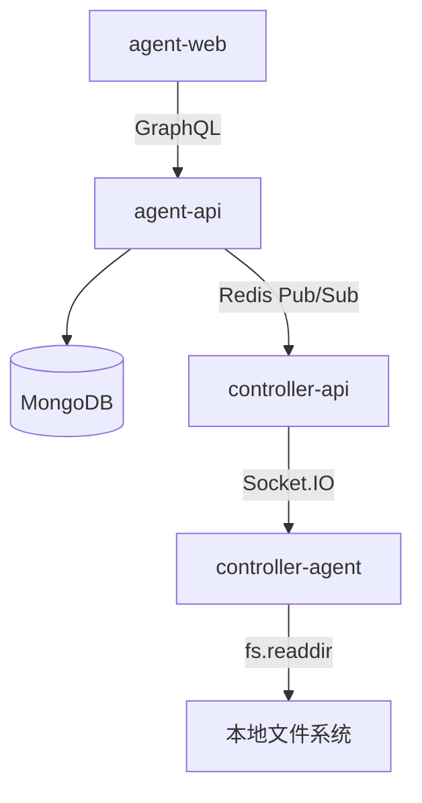
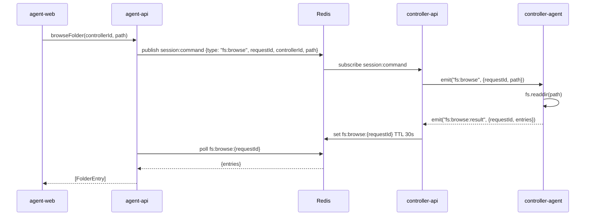
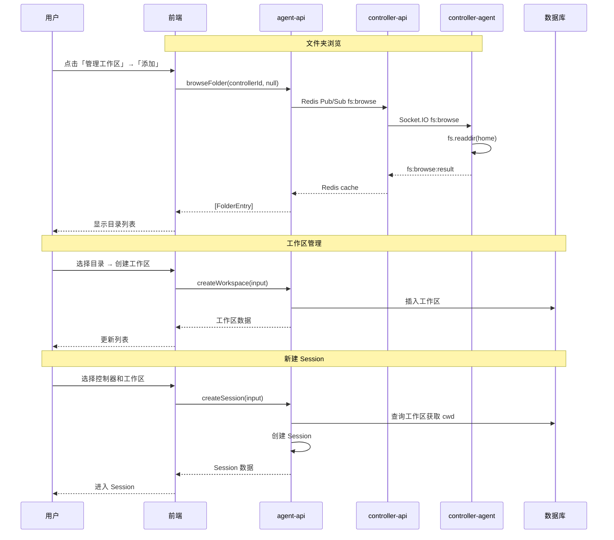

# 本地控制器工作区管理 - 技术提案

**功能名称**: 本地控制器工作区管理
**关联 PRD**: local-controller-workspace-management.md
**技术提案版本**: v1.1
**创建日期**: 2026-05-19
**作者**: ZeroAsh
**feat-branch**: `feat/local-controller-workspace-management`

## 1. 概述

### 1.1 背景

当前 Session 创建需要手动输入 cwd，操作繁琐且不安全。需要为本地控制器增加工作区授权管理，并将左侧导航栏改为三级树状结构。

### 1.2 目标

- 为每个本地控制器管理多个工作区目录
- 创建 Session 时自动加载关联工作区
- 左侧导航栏采用 Controller → 工作区 → Session 三级树状结构
- 支持文件夹浏览器，用户可通过目录树选择工作区路径

### 1.3 范围

**做**:
- ControllerWorkspace Mongoose 模型
- Workspace GraphQL CRUD（查询、新增、更新排序、删除、清空）
- Session 创建时强制使用 workspaceId
- 设置页工作区管理 Dialog
- 新建 Session 弹框改为工作区选择
- 左侧导航栏三级树状结构
- 文件夹浏览器（controller-api 转发到控制器读取文件系统）

**不做**:
- 自定义排序（工作区按名称字母序自动排列）

## 2. 技术架构

### 2.1 系统架构图



### 2.2 技术栈

| 层级 | 技术选型 | 说明 |
|------|---------|------|
| 前端 | React 19 + TypeScript + Tailwind CSS | Apollo Client |
| 后端 | Express v5 + GraphQL-Yoga + Mongoose | Node.js 24+ |
| 数据库 | MongoDB | Mongoose ODM |
| 文件浏览 | Redis Pub/Sub + Socket.IO | 请求-响应模式 |

## 3. API 设计

### 3.1 GraphQL 契约

#### 新增类型

```graphql
type ControllerWorkspace {
  id: ID!
  userId: ID!
  controllerId: ID!
  name: String!
  path: String!
  isEnabled: Boolean!
  createdAt: String!
  updatedAt: String!
}

type FolderEntry {
  name: String!
  path: String!
  isDirectory: Boolean!
}

input CreateWorkspaceInput {
  controllerId: ID!
  path: String!
}
```

#### 新增查询

```graphql
extend type Query {
  controllerWorkspaces(controllerId: ID!): [ControllerWorkspace!]!
  browseFolder(controllerId: ID!, path: String): [FolderEntry!]!
  getHomeDirectory(controllerId: ID!): String
}
```

#### 新增变更

```graphql
extend type Mutation {
  createWorkspace(input: CreateWorkspaceInput!): ControllerWorkspace!
  deleteWorkspace(id: ID!): Boolean!
  clearWorkspaces(controllerId: ID!): Boolean!
  toggleWorkspace(id: ID!): ControllerWorkspace!
}
```

#### 修改 CreateSessionInput

```graphql
input CreateSessionInput {
  controllerId: ID!
  acpServerType: AcpServerType! = opencode
  workspaceId: ID!
}
```

### 3.2 文件夹浏览流程



## 4. 数据模型

### 4.1 数据库设计

#### 集合: controllerworkspaces

| 字段 | 类型 | 说明 |
|------|------|------|
| userId | ObjectId | 用户 ID，索引 |
| controllerId | ObjectId | 控制器 ID，索引 |
| name | String | 工作区名称（目录名） |
| path | String | 工作区完整路径 |
| isEnabled | Boolean | 是否启用（显示/隐藏） |
| createdAt | Date | 创建时间 |
| updatedAt | Date | 更新时间 |

索引: `{ userId, controllerId }`

## 5. 技术实现方案

### 5.1 核心流程



### 5.2 关键实现点

#### 实现点 1: ControllerWorkspace 模型

- 文件: `servers/agent-api/src/models/controller-workspace.ts`
- 字段: userId, controllerId, name, path, sortOrder

#### 实现点 2: Workspace Service

- 文件: `servers/agent-api/src/services/controller-workspace.ts`
- 方法: findAllByController (按 name 升序), create, delete, clear, toggle

#### 实现点 3: GraphQL Schema & Resolver

- Schema: `servers/agent-api/src/graphql/schemas/controller-workspace.ts`
- Resolver: `servers/agent-api/src/graphql/resolvers/controller-workspace.ts`

#### 实现点 4: Session 创建修改

- 修改 `CreateSessionInput` 将 `workspaceId` 设为必填
- Session 创建时从 workspace 查询 cwd

#### 实现点 5: 文件夹浏览 Service

- 文件: `servers/agent-api/src/services/folder-browser.ts`
- 方法: browse(controllerId, path), getHomeDirectory(controllerId)
- 流程: 发布 Redis 命令 → 轮询 Redis 缓存获取结果
- 超时: 30 秒，轮询间隔 500ms

#### 实现点 6: controller-api 命令处理

- 文件: `servers/controller-api/src/services/session-command.ts`
- 新增 `fs:browse` 命令处理
- 转发到 controller-agent via Socket.IO
- 接收 `fs:browse:result` 并缓存到 Redis

#### 实现点 7: controller-agent 文件系统操作

- 文件: `packages/agent-controller/src/handlers/fs-handler.ts` (新建)
- 监听 `fs:browse` 事件
- 执行 `fs.readdir` 读取目录
- 返回 `fs:browse:result`

#### 实现点 8: 前端工作区管理 Dialog

- 文件: `apps/agent-web/src/components/settings/WorkspaceManagerDialog.tsx`
- 功能: 添加、删除、清空、启用/禁用切换
- 列表按名称字母序排列

#### 实现点 9: 前端文件夹选择器

- 文件: `apps/agent-web/src/components/ui/DirectoryPicker.tsx`
- 功能: 显示目录树，支持导航浏览
- 初始路径: 调用 getHomeDirectory 获取
- 选择目录后返回完整路径

#### 实现点 10: 前端新建 Session 弹框修改

- 移除 cwd 输入框
- 选择控制器后加载工作区列表
- 工作区选择为必填项

#### 实现点 11: 左侧导航栏树状结构

- 文件: `apps/agent-web/src/components/Sidebar.tsx`
- 改为 Controller → 工作区 → Session 三级树

## 6. 技术决策

### 6.1 决策列表

| 决策 | 选项 A | 选项 B | 最终选择 | 原因 |
|------|--------|--------|---------|------|
| 工作区存储 | 嵌入 Controller 文档 | 独立集合 | 独立集合 | 独立集合更灵活，支持独立 CRUD |
| 排序方式 | 拖拽排序 | 上下移动按钮 | 上下移动按钮 | 实现简单，无需引入拖拽库 |
| 文件夹浏览 | agent-api 直连 | Redis Pub/Sub 转发 | Redis Pub/Sub 转发 | 文件系统在控制器端，需通过 agent 转发 |
| 文件浏览结果缓存 | 不缓存 | Redis 缓存 30s | Redis 缓存 30s | 减少重复请求，避免频繁读取文件系统 |

### 6.2 依赖与约束

| 类型 | 内容 | 说明 |
|------|------|------|
| 依赖 | Agent 控制器管理 v1 | Controller 注册、绑定 |
| 依赖 | Socket.IO 通信 | 文件浏览命令转发 |
| 约束 | 每个控制器最多 10 个工作区 | 安全限制 |
| 约束 | 文件浏览仅限控制器在线时使用 | 离线时不可浏览 |

## 7. 项目结构

```
servers/agent-api/src/
├── models/
│   └── controller-workspace.ts
├── services/
│   ├── controller-workspace.ts
│   └── folder-browser.ts
├── graphql/
│   ├── schemas/
│   │   └── controller-workspace.ts
│   └── resolvers/
│       └── controller-workspace.ts

servers/controller-api/src/
├── services/
│   └── session-command.ts (修改: 新增 fs:browse 处理)

packages/agent-controller/src/
├── handlers/
│   └── fs-handler.ts (新建)

apps/agent-web/src/
├── components/
│   ├── settings/
│   │   └── WorkspaceManagerDialog.tsx
│   ├── ui/
│   │   └── DirectoryPicker.tsx
│   ├── session/
│   │   └── NewSessionDialog.tsx (修改)
│   └── Sidebar.tsx (修改)
├── graphql/
│   ├── queries.ts (修改)
│   ├── mutations.ts (修改)
│   └── types.ts (修改)
```

## 8. 测试策略

### 8.1 测试覆盖要求

- 单元测试覆盖率: >= 80%
- API 测试覆盖: controllerWorkspaces, createWorkspace, deleteWorkspace, clearWorkspaces, toggleWorkspace, browseFolder, getHomeDirectory

### 8.2 测试类型

| 类型 | 工具 | 覆盖范围 |
|------|------|---------|
| 单元测试 | Vitest | Service 层 |
| API 测试 | Vitest | GraphQL Resolver |
| E2E 测试 | Vitest | 完整流程 |

## 9. 验收标准

- [ ] 技术方案评审通过
- [ ] Contract 评审通过
- [ ] 代码实现完成
- [ ] 单元测试覆盖达标
- [ ] API 测试通过
- [ ] E2E 测试通过

## 10. 相关文档

- [关联 PRD](../../product/reviewed/local-controller-workspace-management.md)
- [关联 Contract](../../../contracts/)
- [开发规范](../common-rules.md)
