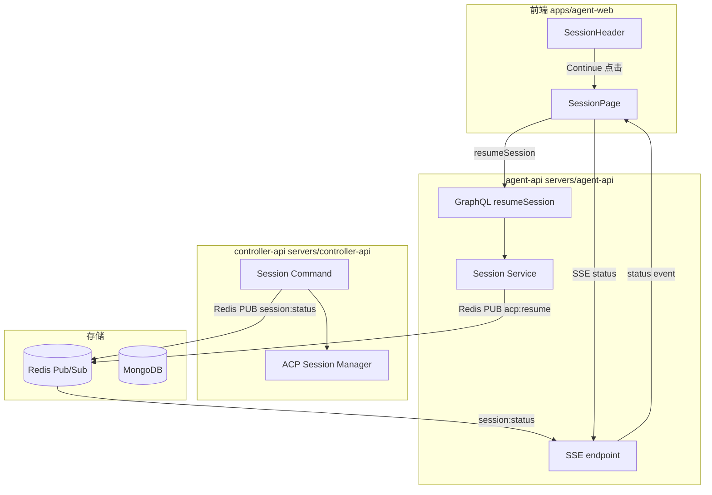
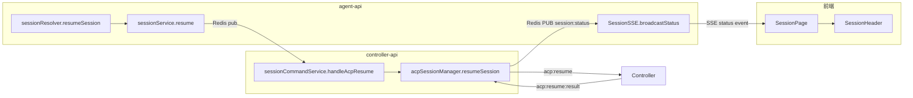
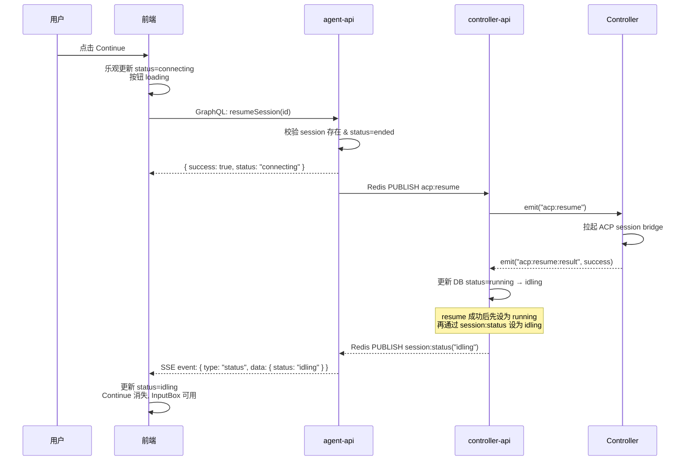
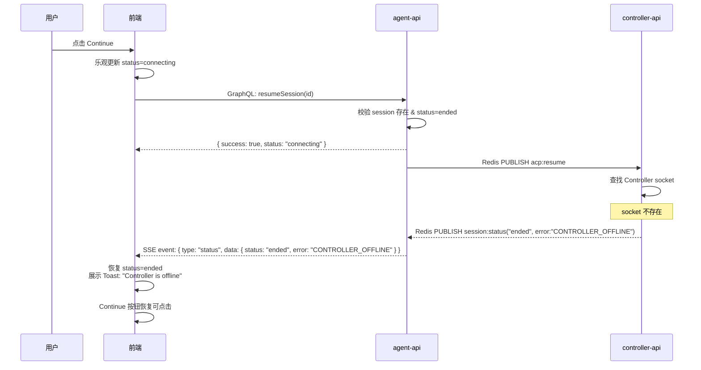

# Session Re-open - 技术提案

**功能名称**: Session Re-open / Continue Session
**关联 PRD**: `session-reopen-prd.md`
**技术提案版本**: v1.0
**创建日期**: 2026-05-20
**作者**: AI Agent
**feat-branch**: `feat/session-reopen`

## 1. 概述

### 1.1 背景

基于 PRD `session-reopen-prd.md`，需要在已结束的会话上提供「Continue」功能，重新拉起对应的 ACP session。同时需要对会话生命周期进行重定义，新增 `idling` 状态将「Agent 就绪空闲」与「Agent 工作中」区分开。

后端 `resumeSession` GraphQL mutation 和 `acp:resume` 流程已存在，但存在以下问题需要解决：
- `resumeSession` 返回 `Boolean!`，无法传递失败原因
- Controller 离线检测只在 controller-api 侧，前端无法预知
- SSE `session:status` 事件不支持传递错误信息
- `idling` 状态尚未在 GraphQL schema 和前端状态机中定义

### 1.2 目标

- 前端 SessionHeader 增加 Continue 按钮，根据 Controller 在线状态控制可点击性
- `resumeSession` 链路完整闭环，失败时返回具体原因并在 UI 展示
- 新增 `idling` 状态，正确管理 InputBox 可用状态
- SSE `session:status` 事件扩展，支持传递错误详情

### 1.3 范围

- **包含**：GraphQL schema 扩展、SSE 协议扩展、controller-api resume 结果回传、前端 SessionHeader/SessionPage 改造、前端 Controller 在线状态感知
- **不包含**：Redis 请求-响应模式改造（复用现有 `session:status` 推送机制）、acp:resume 控制器端逻辑改造（已有）、消息历史清除或迁移

## 2. 技术架构

### 2.1 系统架构图



### 2.2 技术栈

| 层级 | 技术选型 | 说明 |
|------|---------|------|
| agent-api | Express v5 + GraphQL-Yoga | 已有，扩展 resumeSession resolver + SSE status 协议 |
| controller-api | Express v5 + Socket.IO | 已有，扩展 resumeSession 结果回传 |
| 前端 | React 19 + TypeScript + Tailwind v4 + Apollo Client | 已有，新增 RESUME_SESSION mutation + Controller 在线感知 |
| SSE | 原生 EventSource | 已有，增强 status 事件 payload |
| Redis Pub/Sub | ioredis | 已有，复用 session:status 频道传递错误信息 |

### 2.3 模块划分



| 模块 | 职责 | 关键技术点 |
|------|------|-----------|
| sessionResolver | 处理 resumeSession mutation | 返回增强的 ResumeSessionPayload |
| sessionService.resume | 校验 + 发布 Redis 命令 | 取消 session.externalSessionId 必须检查（改为按需） |
| acpSessionManager.resumeSession | 向 Controller 发 acp:resume + 等待结果 | 失败时通过 session:status 传递 error |
| SessionSSE.broadcastStatus | 向前端推送状态变更 | status event payload 增加 error 字段 |
| SessionHeader | 显示 Continue 按钮 | 根据 Controller 在线状态启用/置灰 |
| SessionPage | 管理 resume 生命周期 | loading 态 + 错误 Toast 处理 |

## 3. API 设计

### 3.1 GraphQL 契约更新

#### SessionStatus 枚举增加 `idling`

**contracts/agent-session.graphql**
```graphql
enum SessionStatus {
  creating
  connecting
  idling    # NEW: Agent 就绪空闲
  running
  disconnected
  ended
}
```

#### resumeSession 返回类型改为 Payload

**现状**：`resumeSession(id: ID!): Boolean!`

**变更**：

```graphql
type ResumeSessionPayload {
  success: Boolean!
  status: SessionStatus!
  error: String
}

extend type Mutation {
  resumeSession(id: ID!): ResumeSessionPayload!
}
```

`resumeSession` 同步检查（立即返回）：
- `success: false, status: 'ended', error: 'Session not found'`
- `success: false, status: 'ended', error: 'Session is not ended'`
- 异步结果（通过 SSE status event 传递）

#### 前端 mutation 新增

```graphql
mutation ResumeSession($id: ID!) {
  resumeSession(id: $id) {
    success
    status
    error
  }
}
```

### 3.2 SSE 协议扩展

**现状**：`session:status` 事件仅传递 `{ sessionId, status }`

**变更**：
```json
{
  "type": "status",
  "data": {
    "sessionId": "xxx",
    "status": "ended",
    "error": "CONTROLLER_OFFLINE"
  }
}
```

`error` 字段可选，仅在 resume 失败时携带。前端根据 `error` 字段展示对应的 Toast/Alert。

错误码定义：

| error | 含义 |
|-------|------|
| `CONTROLLER_OFFLINE` | Controller 不在线 |
| `ACP_SERVER_UNAVAILABLE` | ACP Server 不可用 |
| `ACP_SESSION_EXPIRED` | ACP Session 已过期 |
| `WORKSPACE_PATH_INVALID` | 工作目录不存在 |
| `RESUME_TIMEOUT` | 恢复超时 |

### 3.3 Redis Pub/Sub 协议扩展

**`session:status` 频道 payload 扩展**：

```json
{
  "sessionId": "xxx",
  "status": "ended",
  "error": "CONTROLLER_OFFLINE"
}
```

### 3.4 内部接口

#### sessionService.resume 返回值变更

```typescript
interface ResumeResult {
  success: boolean;
  status: string;
  error?: string;
}
```

同步校验失败（如 session 不存在、不是 ended 状态）直接返回；通过校验发布 acp:resume 后返回 `{ success: true, status: 'connecting' }`。

## 4. 数据模型

### 4.1 MongoDB

无变更。Session 和 AcpMessage 集合保持不变，仅状态枚举新增 `idling`。

### 4.2 Redis

无变更。复用现有 key 结构。

### 4.3 SSE status 事件 payload 扩展

| 字段 | 类型 | 必需 | 说明 |
|------|------|------|------|
| sessionId | string | 是 | 会话 ID |
| status | string | 是 | 当前状态 |
| error | string | 否 | 仅在 resume 失败时携带错误码 |

## 5. 技术实现方案

### 5.1 核心流程

#### Resume Session 成功流程



#### Resume Session 失败流程（Controller 离线）



### 5.2 关键实现点

#### 实现点 1: SessionStatus 枚举增加 `idling`

**涉及文件**:
- `contracts/agent-session.graphql`
- `servers/agent-api/src/graphql/schemas/session.ts`
- `servers/agent-api/src/models/session.ts`
- `servers/controller-api/src/models/session.ts`

**变更**:

枚举增加 `idling` 值。注意保持 Mongoose schema 中 enum 数组与 GraphQL enum 一致。

```typescript
// models/session.ts
status: { 
  type: String, 
  enum: ['creating', 'connecting', 'idling', 'running', 'disconnected', 'ended'], 
  default: 'creating' 
}
```

前端 `SessionHeader` 的颜色映射需增加 `idling` 对应的样式（绿色，与 `running` 区分）。

**风险点**：现有数据中 status 为 `running` 的 session 需要语义迁移。迁移策略：前端兼容处理，`running` 即视为可交互（InputBox 可用），逐步过渡到 `idling`。

#### 实现点 2: sessionService.resume 增强

**文件**: `servers/agent-api/src/services/session.ts`

```typescript
async resume(id: string, userId: string): Promise<{ success: boolean; status: string; error?: string }> {
  const session = await Session.findOne({ _id: id, userId }).lean();
  if (!session) {
    return { success: false, status: 'ended', error: 'Session not found' };
  }
  if (session.status !== 'ended') {
    return { success: false, status: session.status, error: 'Session is not ended' };
  }
  // externalSessionId 可能为空（Redis cache 过期但 DB 有值），交由 controller-api 按需获取
  // 不再在此校验 externalSessionId

  const redis = getRedisClient();
  await redis.publish('session:command', JSON.stringify({
    type: 'acp:resume',
    sessionId: id,
    controllerId: session.controllerId.toString(),
    externalSessionId: session.externalSessionId || '',  // controller-api 会 fallback 到 Redis cache
    cwd: session.cwd || '',
  }));
  return { success: true, status: 'connecting' };
}
```

#### 实现点 3: Controller 离线检测 + 错误回传

**文件**: `servers/controller-api/src/services/session-command.ts` `handleAcpResume`

当前 `handleAcpResume` 在 Controller 离线时仅 console.error。需改为发布 `session:status` 事件带错误信息：

```typescript
private async handleAcpResume(command: { ... }): Promise<void> {
  if (!this.io) return;

  const controller = await Controller.findById(command.controllerId).lean();
  if (!controller) {
    await this.publishStatus(command.sessionId, 'ended', 'CONTROLLER_OFFLINE');
    return;
  }

  const keyId = controller.keyId.toString();
  const socketId = await sessionService.getSocketId(keyId);
  if (!socketId) {
    await this.publishStatus(command.sessionId, 'ended', 'CONTROLLER_OFFLINE');
    return;
  }

  const socket = this.io.sockets.sockets.get(socketId);
  if (!socket) {
    await this.publishStatus(command.sessionId, 'ended', 'CONTROLLER_OFFLINE');
    return;
  }

  // ... proceed with resumeSession via acpSessionManager
}
```

同时 `acpSessionManager.resumeSession` 失败时也发布带 error 的 status：

```typescript
// acpSessionManager.resumeSession 失败分支
if (payload.success) {
  // ... success, set status to running → idling
  await Session.findByIdAndUpdate(sessionId, { status: 'idling' });
  await this.publishStatus(sessionId, 'idling');
} else {
  await Session.findByIdAndUpdate(sessionId, { status: 'ended', endedAt: new Date() });
  await this.publishStatus(sessionId, 'ended', payload.error);  // 传递错误
}
```

新增 `publishStatus` 重载支持 error 参数：

```typescript
private async publishStatus(sessionId: string, status: string, error?: string): Promise<void> {
  const redis = getRedisClient();
  const payload: Record<string, unknown> = { sessionId, status };
  if (error) payload.error = error;
  await redis.publish('session:status', JSON.stringify(payload));
}
```

#### 实现点 4: SSE status event 扩展传递 error

**文件**: `servers/agent-api/src/services/session-sse.ts`

```typescript
// subscriber.on('message', ...)
globalStatusSubscriber.on('message', (_channel, message) => {
  try {
    const { sessionId, status, error } = JSON.parse(message) as {
      sessionId: string; status: string; error?: string;
    };
    this.dispatchStatus(sessionId, status, error);
  } catch {
    // ignore
  }
});

// dispatchStatus → broadcastStatus
broadcastStatus(sessionId: string, status: string, error?: string): void {
  const data: Record<string, unknown> = { sessionId, status };
  if (error) data.error = error;
  const payload = JSON.stringify({ type: 'status', data });
  for (const [key, connection] of connections) {
    if (connection.sessionId === sessionId) {
      connection.res.write(`data: ${payload}\n\n`);
    }
  }
}
```

#### 实现点 5: 前端 RESUME_SESSION mutation 新增

**文件**: `apps/agent-web/src/graphql/mutations.ts`

```typescript
export const RESUME_SESSION = gql`
  mutation ResumeSession($id: ID!) {
    resumeSession(id: $id) {
      success
      status
      error
    }
  }
`
```

**文件**: `apps/agent-web/src/graphql/types.ts`

```typescript
export interface ResumeSessionMutation {
  resumeSession: {
    success: boolean;
    status: string;
    error: string | null;
  }
}
```

#### 实现点 6: Frontend SessionPage resume 流程

**文件**: `apps/agent-web/src/pages/SessionPage.tsx`

```typescript
const [resumeSession] = useMutation<ResumeSessionMutation>(RESUME_SESSION);
const [resuming, setResuming] = useState(false);

const handleResumeSession = async () => {
  if (!id) return;
  setResuming(true);
  setStatus('connecting');
  try {
    const { data } = await resumeSession({ variables: { id } });
    if (data?.resumeSession?.success === false) {
      setStatus('ended');
      setResuming(false);
      showErrorToast(data.resumeSession.error);
    }
    // success case: status will be updated via SSE
  } catch (error) {
    setStatus('ended');
    setResuming(false);
    showErrorToast('Network error');
  }
};

// SSE status event handler:
eventSource.onmessage = (event) => {
  const data = JSON.parse(event.data);
  if (data.type === 'status') {
    setStatus(data.data.status);
    if (data.data.status === 'ended' && data.data.error) {
      setResuming(false);
      showErrorToast(getErrorMessage(data.data.error));
    }
    if (data.data.status === 'idling') {
      setResuming(false);
    }
  }
};
```

需要添加超时保护（30s），超时后恢复按钮可点击并提示超时：

```typescript
useEffect(() => {
  if (!resuming) return;
  const timeout = setTimeout(() => {
    setResuming(false);
    setStatus('ended');
    showErrorToast('Resume timed out');
  }, 30000);
  return () => clearTimeout(timeout);
}, [resuming]);
```

#### 实现点 7: SessionHeader Continue 按钮 + Controller 在线感知

**文件**: `apps/agent-web/src/components/session/SessionHeader.tsx`

```typescript
interface SessionHeaderProps {
  session: Session | null;
  status: string;
  onClose: () => void;
  onDelete: () => void;
  onContinue: () => void;
  resuming: boolean;
  controllerOnline: boolean;  // NEW
}
```

渲染逻辑：

```tsx
{status === 'ended' && (
  <button
    type="button"
    onClick={onContinue}
    disabled={resuming || !controllerOnline}
    title={!controllerOnline ? 'Controller is offline' : undefined}
    className={`rounded-md px-3 py-1.5 text-sm text-white ${
      resuming || !controllerOnline
        ? 'bg-gray-400 cursor-not-allowed'
        : 'bg-blue-600 hover:bg-blue-700'
    }`}
  >
    {resuming ? 'Continuing...' : 'Continue'}
  </button>
)}
```

Controller 在线状态由 `SessionPage` 从已有的 `GET_CONTROLLERS` 查询结果中查找匹配的 Controller：

```typescript
const sessionController = controllersData?.controllers.find(
  c => c.id === sessionData?.session?.controllerId
);
const controllerOnline = sessionController?.status === 'online';
```

#### 实现点 8: idling 状态对 InputBox 的影响

**文件**: `apps/agent-web/src/pages/SessionPage.tsx`

InputBox 当前 disabled 条件：

```tsx
disabled={status !== 'running'}
```

变更为：

```tsx
disabled={status !== 'running' && status !== 'idling'}
```

`idling` 和 `running` 状态下 InputBox 均可输入，`running` 时显示 Stop 按钮（取消生成），`idling` 时显示 Send 按钮。

## 6. 技术决策

### 6.1 决策列表

| 决策 | 选项 A | 选项 B | 最终选择 | 原因 |
|------|--------|--------|---------|------|
| resume 结果回传方式 | SSE session:status 扩展 | Redlock + 同步等待 | SSE status 扩展 | 复用现有通道，架构一致，无需新增请求-响应模式 |
| resumeSession 返回值 | `ResumeSessionPayload!` | 保持 `Boolean!` | `ResumeSessionPayload!` | 同步校验错误（如 session 不存在）可立即返回，减少 SSE 依赖 |
| resume 后状态 | `idling` | `running` | `idling` | 符合生命周期定义，Agent 就绪但未工作 |
| Controller 在线检测位置 | 前端（根据 GET_CONTROLLERS） | 后端（agent-api 查 Redis） | 前端 | 前端已有 GET_CONTROLLERS 数据，零额外成本 |
| `externalSessionId` 校验 | agent-api 校验 | controller-api 按需获取 | controller-api 按需获取 | Redis cache 可能过期，DB 仍有值，去中心化更健壮 |

### 6.2 依赖与约束

| 类型 | 内容 | 说明 |
|------|------|------|
| 依赖 | 现有 `acp:resume` Socket.IO 事件 | 控制器端已实现 resume 逻辑 |
| 依赖 | 现有 SSE `session:status` 通道 | 本次扩展 payload，不改变通道机制 |
| 依赖 | `GET_CONTROLLERS` 查询 | 前端已有，用于 Controller 在线检测 |
| 约束 | `idling` 状态仅在前端状态机和 GraphQL enum 中新增 | MongoDB 数据兼容处理 |
| 约束 | 不新增 npm 依赖 | |

## 7. 项目结构

```
# contract 变更
contracts/
└── agent-session.graphql              # SessionStatus 枚举 + idling, resumeSession payload 扩展

# agent-api 变更
servers/agent-api/
├── src/
│   ├── graphql/
│   │   ├── schemas/session.ts         # SessionStatus 枚举 + idling, ResumeSessionPayload type
│   │   └── resolvers/session.ts       # resumeSession 返回 ResumeSessionPayload
│   ├── models/session.ts              # status enum + idling
│   └── services/
│       ├── session.ts                 # resume() 返回 ResumeResult, 取消 externalSessionId 校验
│       └── session-sse.ts             # broadcastStatus/dispatchStatus 支持 error 参数

# controller-api 变更
servers/controller-api/
├── src/
│   ├── models/session.ts              # status enum + idling
│   └── services/
│       ├── session-command.ts         # handleAcpResume 离线时发布 session:status error
│       └── acp-session-manager.ts     # resumeSession 失败时发布 error; publishStatus 支持 error; resume 成功后设为 idling

# 前端变更
apps/agent-web/
├── src/
│   ├── graphql/
│   │   ├── mutations.ts               # 新增 RESUME_SESSION mutation
│   │   └── types.ts                   # ResumeSessionMutation 类型
│   ├── pages/SessionPage.tsx           # resume handler + SSE error 处理 + controller 在线检测 + timeout
│   └── components/session/
│       └── SessionHeader.tsx           # Continue 按钮 + controllerOnline prop
```

## 8. 测试策略

### 8.1 测试覆盖要求

- GraphQL `resumeSession` resolver 单元测试：同步校验场景
- `sessionService.resume` 单元测试：3 种同步失败场景 + 1 种成功 publish 场景
- `acpSessionManager.resumeSession` 单元测试：成功 + 各种失败场景

### 8.2 测试类型

| 类型 | 工具 | 覆盖范围 |
|------|------|---------|
| 单元测试 | Vitest | sessionService.resume, SessionHeader Continue 渲染, SSE status 解析 |
| API 测试 | Vitest + supertest | resumeSession mutation 调用 |
| E2E | Vitest + Playwright | 前端点击 Continue → SSE status 更新 → InputBox 可用 |

## 9. 部署方案

### 9.1 环境规划

无特殊环境要求。与主应用一起部署。

### 9.2 配置管理

无新增配置项。

## 10. 验收标准

- [ ] 技术方案评审通过
- [ ] Contract 评审通过（SessionStatus + idling, ResumeSessionPayload, SSE error 扩展）
- [ ] 前端 Continue 按钮根据 Controller 在线状态启用/置灰
- [ ] resumeSession 同步校验失败返回具体错误信息
- [ ] Controller 离线时 resume 失败，SSE 推送 error 事件
- [ ] ACP Session 过期时 resume 失败，SSE 推送 error 事件
- [ ] resume 成功后状态变为 `idling`，InputBox 可用
- [ ] 前端 30s 超时保护
- [ ] 单元测试覆盖达标
- [ ] API 测试通过
- [ ] E2E 测试通过

## 11. 相关文档

- [PRD: Session Re-open](../../docs/product/draft/session-reopen-prd.md)
- [GraphQL Contract](../../contracts/agent-session.graphql)
- [Session WebSocket Contract](../../contracts/agent-session-websocket.md)
- [Agent Session 提案](./20260518-proposal-agent-session.md)
- [Frontend Rules](../../docs/engineering/frontend-rules.md)
- [Backend Rules](../../docs/engineering/backend-rules.md)
