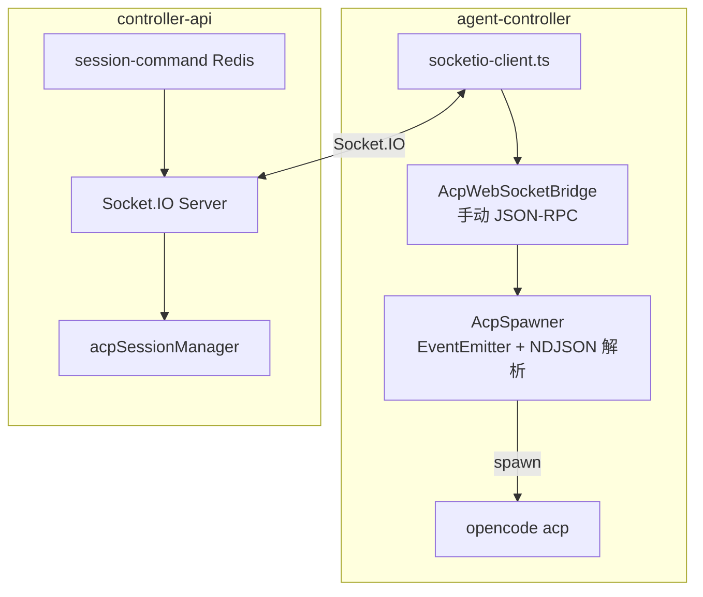
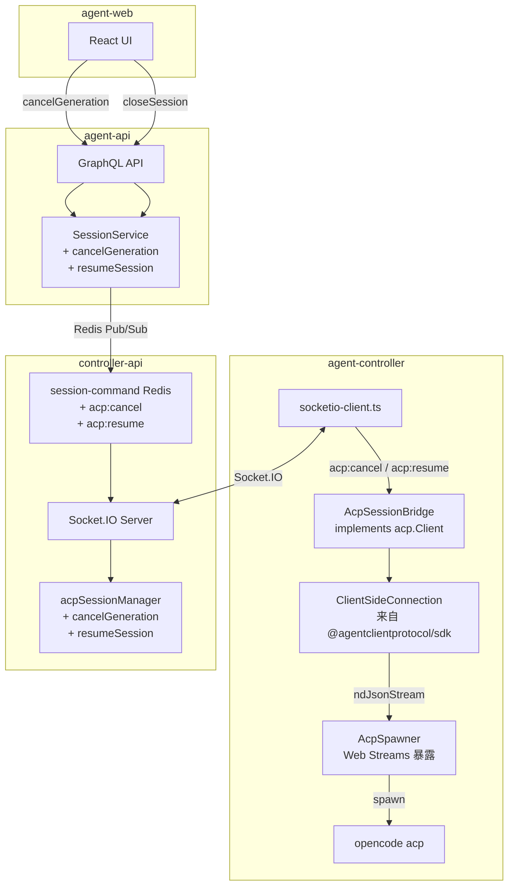
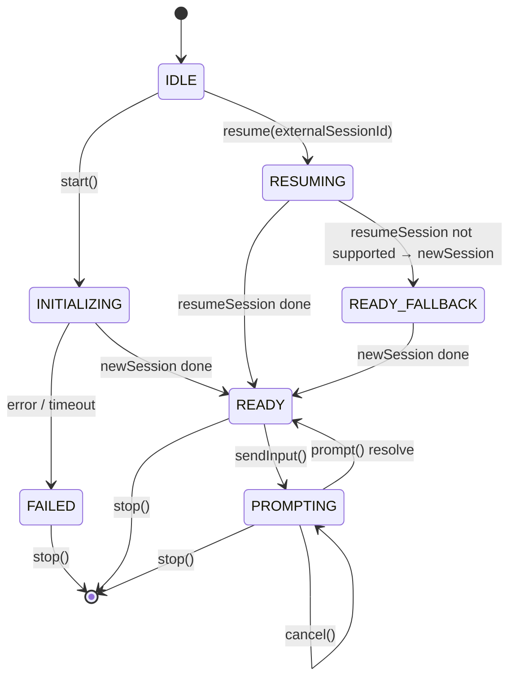
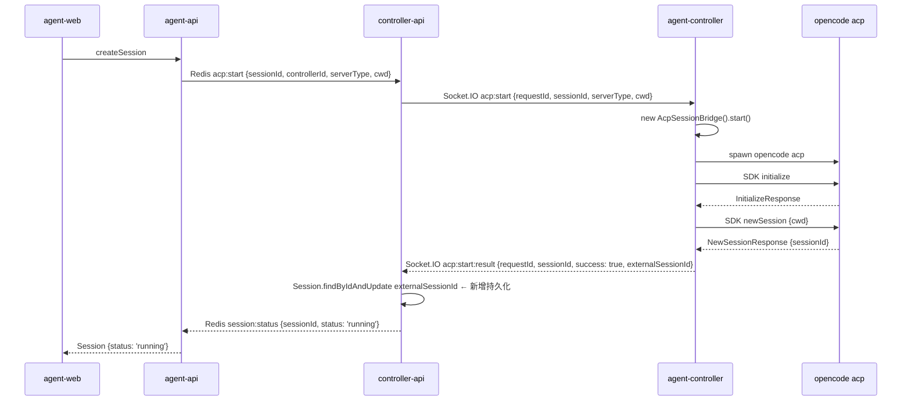
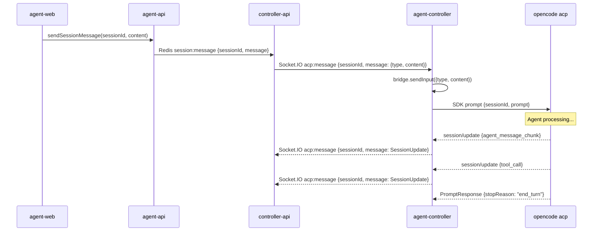
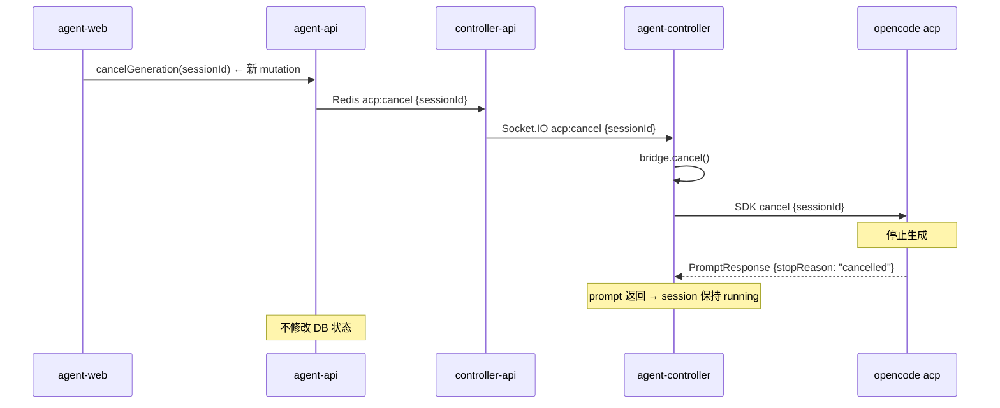
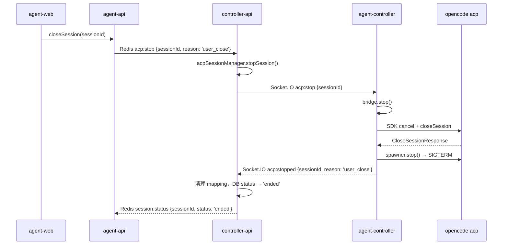
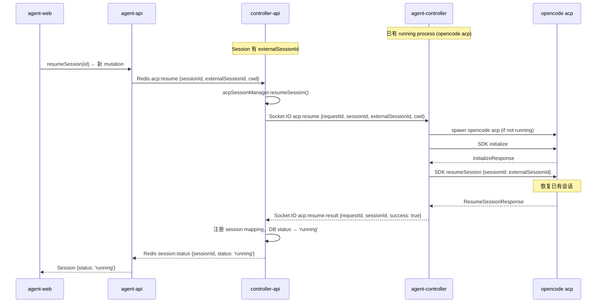

# Controller ACP SDK 重构 - 技术提案

**功能名称**: Controller ACP SDK 重构
**关联 PRD**: `agent-controller-v1.md`
**技术提案版本**: v2.0
**创建日期**: 2026-05-20
**作者**: AI Assistant
**feat-branch**: `feat/controller-acp-sdk-refactor`

## 1. 概述

### 1.1 背景

当前 agent-controller 与 OpenCode（ACP Agent）的通信是通过手动实现的 JSON-RPC 2.0 桥接完成的：

- `AcpSpawner` 负责 spawn `opencode acp` 子进程，自行做 NDJSON 流解析
- `AcpWebSocketBridge` 手动管理 requestId 匹配、超时、pending requests Map
- 手动构造 `initialize` / `session/new` / `session/prompt` 的 JSON-RPC 消息
- 手动解析 `session/update` 通知，自行做 50ms debounce 文本缓冲

`@agentclientprotocol/sdk` 已提供完整的 `ClientSideConnection` 封装了这些协议细节，但当前代码仅将其用作 TypeScript 类型导入，未使用其运行时能力。

### 1.2 目标

- 用 `ClientSideConnection` + `acp.Client` 替换手动 JSON-RPC 实现
- 规范分离「取消生成」（cancel）和「关闭会话」（stop）两个操作
- 支持 ACP session resume（断线重连后恢复已有 session）
- 端到端打通取消生成流程（agent-web → agent-api → controller-api → agent-controller）
- 保持所有 Socket.IO 事件契约向后兼容

### 1.3 范围

**本次包含：**

| 层级 | 组件 | 变更 |
|------|------|------|
| agent-controller | `spawner.ts` | 暴露 Web Streams |
| agent-controller | `bridge.ts` | 完整重写，基于 SDK |
| agent-controller | `socketio-client.ts` | 新增 `acp:cancel` / `acp:resume` handler |
| controller-api | `acp-session-manager.ts` | 新增 `cancelGeneration()` / `resumeSession()` |
| controller-api | `session-command.ts` | 新增 `acp:cancel` / `acp:resume` 路由 |
| controller-api | `socketio.ts` | `acp:start:result` 处理 `externalSessionId` 持久化 |
| controller-api | `index.ts` | 启动时清理孤儿 session |
| agent-api | `graphql/schemas/session.ts` | 新增 `cancelGeneration` / `resumeSession` mutation |
| agent-api | `graphql/resolvers/session.ts` | 新增 resolver |
| agent-api | `services/session.ts` | 新增 `cancelGeneration()` / `resumeSession()` 方法 |
| agent-web | `graphql/mutations.ts` | 新增 `CANCEL_GENERATION` mutation |
| agent-web | `pages/SessionPage.tsx` | Stop 按钮改用 `cancelGeneration` |
| agent-web | `components/session/InputBox.tsx` | 回调名调整 |

**本次不包含：**

- 多 session 共享进程的优化
- controller 端断线后自动重建 bridge（当前依赖手动 `acp:start`/`acp:resume`）

## 2. 技术架构

### 2.1 当前架构



当前 Bridge 自行完成：
- requestId 分配与 pending 匹配
- 超时计时器
- NDJSON 流解析
- 消息序列化/反序列化
- session/update 通知路由

### 2.2 目标架构



SDK 接管：
- JSON-RPC 2.0 握手（initialize）
- 会话生命周期（newSession / resumeSession / closeSession）
- prompt 发送与响应
- session/update 通知分发 → 回调 `Client.sessionUpdate()`
- session/cancel 通知发送

### 2.3 模块划分

| 模块 | 职责 | 关键技术点 | 变更类型 |
|------|------|-----------|---------|
| `AcpSpawner` | 进程生命周期 + Web Streams | `Writable.toWeb(stdin)`, `Readable.toWeb(stdout)` | 修改 |
| `AcpSessionBridge` | ACP 协议桥接 | 实现 `acp.Client`，封装 `ClientSideConnection`，支持 `resume()` | 重写 |
| `socketio-client` | Socket.IO 事件分发 | 新增 `acp:cancel` / `acp:resume` handler | 微调 |
| `acpSessionManager` | Server 侧 session 管理 | 新增 `cancelGeneration()` / `resumeSession()` | 新增 |
| `SessionCommandService` | Redis 命令路由 | 新增 `acp:cancel` / `acp:resume` 路由 | 微调 |
| agent-api SessionService | GraphQL 业务逻辑 | 新增 `cancelGeneration()` / `resumeSession()` | 新增 |
| agent-web SessionPage | UI 交互 | Stop 按钮改调 `cancelGeneration` | 微调 |

## 3. Socket.IO & Redis 事件契约

### 3.1 Socket.IO 事件

#### 不变事件

| 事件 | 方向 | Payload |
|------|------|---------|
| `acp:start` | Server → Controller | `{ requestId, sessionId, serverType, cwd, mcpServers? }` |
| `acp:start:result` | Controller → Server | `{ requestId, sessionId, success, error?, externalSessionId? }` |
| `acp:message` | 双向 | `{ sessionId, message: SessionUpdate }` |
| `acp:stopped` | Controller → Server | `{ sessionId, reason, exitCode? }` |
| `acp:check` | Server → Controller | `{ requestId }` |
| `acp:check:result` | Controller → Server | `{ requestId, servers }` |

#### 新增事件

| 事件 | 方向 | Payload | 说明 |
|------|------|---------|------|
| `acp:cancel` | Server → Controller | `{ sessionId }` | 取消当前生成，session 保持 running |
| `acp:resume` | Server → Controller | `{ requestId, sessionId, externalSessionId, cwd }` | 恢复已有 ACP session |
| `acp:resume:result` | Controller → Server | `{ requestId, sessionId, success, error? }` | 恢复结果 |

### 3.2 Redis Pub/Sub 新增命令

| Redis 频道 | 命令 type | Payload | 说明 |
|---|---|---|---|
| `session:command` | `acp:cancel` | `{ type: 'acp:cancel', sessionId }` | 从 agent-api 触发取消生成 |
| `session:command` | `acp:resume` | `{ type: 'acp:resume', sessionId, externalSessionId, cwd }` | 恢复已有 session |

## 4. 组件设计

### 4.1 `AcpSpawner` — 修改

**当前**：继承 `EventEmitter`，emit `message`/`exit`/`error` 事件，提供 `send()` 写 stdin。

**目标**：移除 EventEmitter，提供 Web Streams 供 SDK 直接使用。

```typescript
export class AcpSpawner {
  start(): void
  stop(): void

  get stdin(): WritableStream          // Writable.toWeb(process.stdin)
  get stdout(): ReadableStream<Uint8Array>  // Readable.toWeb(process.stdout)
  get closed(): Promise<void>          // 进程退出时 resolve

  isRunning(): boolean
}
```

移除：
- `EventEmitter` 继承
- `send()` 方法
- `message` / `exit` / `error` 事件

新增：
- `stdin` getter → `Writable.toWeb(process.stdin!)`
- `stdout` getter → `Readable.toWeb(process.stdout!)`
- `closed` Promise → 进程 `exit` 事件时 resolve

### 4.2 `AcpSessionBridge` — 重写

**当前**（`AcpWebSocketBridge`，341行）：手动 JSON-RPC。

**目标**（`AcpSessionBridge`，约 200 行）：实现 `acp.Client`，包装 `ClientSideConnection`。

```typescript
import * as acp from '@agentclientprotocol/sdk';

export class AcpSessionBridge extends EventEmitter {
  constructor(
    private socket: Socket,
    private sessionId: string,
    spawner?: AcpSpawner,
  )

  // ── 生命周期 ──

  async start(cwd: string, mcpServers?: McpServerConfig[]): Promise<void>
    // 1. spawner.start()
    // 2. stream = ndJsonStream(spawner.stdin, spawner.stdout)
    // 3. connection = new ClientSideConnection(() => this, stream)
    // 4. await connection.initialize({
    //       protocolVersion,
    //       clientCapabilities: {},  // 不声明 fs/terminal — 由 OpenCode 自身处理
    //       clientInfo: { name: 'agent-controller', version: '1.0.0' },
    //     })
    // 5. result = await connection.newSession({cwd, mcpServers})
    // 6. acpSessionId = result.sessionId
    // 7. emit 'acp:initialized' {sessionId, acpSessionId}

  async resume(externalSessionId: string): Promise<void>
    // 1. spawner.start()
    // 2. stream = ndJsonStream(...)
    // 3. connection = new ClientSideConnection(() => this, stream)
    // 4. await connection.initialize({
    //       protocolVersion,
    //       clientCapabilities: {},  // 同 start
    //       clientInfo: { name: 'agent-controller', version: '1.0.0' },
    //     })
    // 5. result = await connection.resumeSession({sessionId: externalSessionId})
    // 6. acpSessionId = result.sessionId
    // 7. emit 'acp:initialized' {sessionId, acpSessionId}
    // 注：resumeSession 需要 agent 支持 session.resume 能力
    //     会在 initialize 时协商, 若不支持则 fallback 到 newSession

  async stop(): Promise<void>
    // 1. connection.cancel({sessionId: acpSessionId})
    // 2. connection.closeSession({sessionId: acpSessionId})
    // 3. spawner.stop()                        — SIGTERM → SIGKILL
    // 4. emit 'acp:stopped' {sessionId, reason: 'user_close'}

  // ── 生成控制 ──

  cancel(): void
    // 1. connection.cancel({sessionId: acpSessionId})
    // 2. reject current active prompt promise
    // 3. 不 kill 进程，不 closeSession

  async sendInput(message: {type: string, content: string}): Promise<void>
    // 1. 如果 activePrompt 存在，入队列
    // 2. 否则调 connection.prompt({sessionId, prompt: [{type, text}]})
    // 3. 完成后处理队列下一条

  // ── acp.Client 实现（SDK 回调） ──

  async sessionUpdate(params: acp.SessionNotification): Promise<void>
    // 50ms debounce text chunks
    // 透传 tool_call / plan / tool_result
    // → socket.emit('acp:message', {sessionId, message: update})

  async requestPermission(params: acp.RequestPermissionRequest): Promise<acp.RequestPermissionResponse>
    // auto-allow
}
```

**状态机**（新增 `RESUMING` 状态）：



#### 文本缓冲

保留当前 50ms debounce 策略，在 `sessionUpdate()` 中实现：

```typescript
sessionUpdate(params): Promise<void> {
  const update = params.update;
  switch (update.sessionUpdate) {
    case 'agent_message_chunk':
      buffer += update.content.text;
      schedule flush in 50ms;
      break;
    case 'tool_call':
    case 'tool_call_update':
    case 'tool_result':
    case 'plan':
      flush buffer then forward;
      forward update directly;
      break;
    case 'user_message_chunk':
      ignore;  // echo suppression
      break;
  }
}
```

#### 输入队列

```typescript
private activePrompt: Promise<PromptResponse> | null = null;
private inputQueue: Array<{type, content}> = [];

sendInput(message): Promise<void> {
  if (this.activePrompt) {
    this.inputQueue.push(message);
    return;
  }
  return this.processPrompt(message);
}

private async processPrompt(message): Promise<void> {
  this.activePrompt = this.connection.prompt({
    sessionId: this.acpSessionId!,
    prompt: [{type: message.type, text: message.content}],
  });

  try {
    await this.activePrompt;
  } finally {
    this.activePrompt = null;
    if (this.inputQueue.length > 0) {
      this.processPrompt(this.inputQueue.shift()!);
    }
  }
}
```

### 4.3 agent-controller socketio-client.ts — 微调

```typescript
// 新增类型
interface AcpCancelPayload { sessionId: string }
interface AcpResumePayload {
  requestId: string;
  sessionId: string;
  externalSessionId: string;
  cwd: string;
}

// 新增 handler
socket.on('acp:cancel', (data: AcpCancelPayload) => {
  const bridge = acpBridges.get(data.sessionId);
  if (bridge) bridge.cancel();
});

socket.on('acp:resume', async (data: AcpResumePayload) => {
  try {
    const bridge = new AcpSessionBridge(socket, {
      sessionId: data.sessionId,
      cwd: data.cwd,
    });
    acpBridges.set(data.sessionId, bridge);

    bridge.on('acp:initialized', () => {
      socket.emit('acp:resume:result', {
        requestId: data.requestId,
        sessionId: data.sessionId,
        success: true,
      });
    });
    bridge.on('acp:stopped', (payload) => {
      acpBridges.delete(data.sessionId);
      socket.emit('acp:resume:result', {
        requestId: data.requestId,
        sessionId: data.sessionId,
        success: false,
        error: payload.error,
      });
    });

    await bridge.resume(data.externalSessionId);
  } catch (error) {
    socket.emit('acp:resume:result', {
      requestId: data.requestId,
      sessionId: data.sessionId,
      success: false,
      error: (error as Error).message,
    });
  }
});
```

### 4.4 Server 侧 — controller-api

**acp-session-manager.ts** — 新增两个方法：

```typescript
cancelGeneration(sessionId: string): boolean {
  const session = this.sessions.get(sessionId);
  if (!session) return false;
  session.controllerSocket.emit('acp:cancel', { sessionId });
  return true;
  // 不清理 session mapping，不修改 DB 状态
}

async resumeSession(
  controllerSocket: Socket,
  sessionId: string,
  externalSessionId: string,
  cwd: string,
): Promise<{ success: boolean; error?: string }> {
  const session = await Session.findById(sessionId).lean();
  if (!session) return { success: false, error: 'Session not found' };

  await Session.findByIdAndUpdate(sessionId, { status: 'connecting' });
  await this.publishStatus(sessionId, 'connecting');

  const requestId = `req_${Date.now()}_${Math.random().toString(36).slice(2)}`;

  return new Promise((resolve) => {
    const timeout = setTimeout(() => {
      resolve({ success: false, error: 'ACP resume timeout' });
    }, 30000);

    controllerSocket.once('acp:resume:result', async (payload) => {
      clearTimeout(timeout);
      if (payload.requestId !== requestId) return;

      if (payload.success) {
        this.sessions.set(sessionId, {
          controllerSocket, sessionId,
          controllerId: session.controllerId.toString(),
          userId: session.userId.toString(),
        });

        const socketSessions = this.socketToSessions.get(controllerSocket.id) || new Set();
        socketSessions.add(sessionId);
        this.socketToSessions.set(controllerSocket.id, socketSessions);

        await Session.findByIdAndUpdate(sessionId, { status: 'running' });
        await this.publishStatus(sessionId, 'running');
        resolve({ success: true });
      } else {
        // Resume failed, fallback: create a fresh ACP session
        // Publish acp:start instead
        resolve({ success: false, error: payload.error });
      }
    });

    controllerSocket.emit('acp:resume', {
      requestId, sessionId, externalSessionId, cwd,
    });
  });
}
```

**session-command.ts** — 新增路由：

```typescript
} else if (command.type === 'acp:cancel' && command.sessionId) {
  await this.handleAcpCancel(command.sessionId);
} else if (command.type === 'acp:resume' && command.sessionId) {
  await this.handleAcpResume(command);
}

private async handleAcpCancel(sessionId: string): Promise<void> {
  acpSessionManager.cancelGeneration(sessionId);
}

private async handleAcpResume(command: {
  sessionId: string;
  externalSessionId: string;
  cwd: string;
}): Promise<void> {
  // Find controller socket
  const controller = await Controller.findById(command.controllerId).lean();
  const keyId = controller.keyId.toString();
  const socketId = await sessionService.getSocketId(keyId);
  const socket = this.io!.sockets.sockets.get(socketId!);
  if (!socket) return;

  await acpSessionManager.resumeSession(
    socket, command.sessionId, command.externalSessionId, command.cwd,
  );
}
```

**socketio.ts** — 持久化 `externalSessionId`：

当前 `acp:start:result` 处理只打印日志，需要保存 `externalSessionId`：

```typescript
socket.on('acp:start:result', async (payload) => {
  if (!authenticated) return;
  if (payload.success && payload.externalSessionId) {
    // 持久化 externalSessionId 到 Session 文档
    await Session.findByIdAndUpdate(payload.sessionId, {
      externalSessionId: payload.externalSessionId,
    });
    // Redis 缓存映射（TTL 24h，用于快速查重/重连）
    const redis = getRedisClient();
    await redis.set(
      `session:${payload.sessionId}:acpSessionId`,
      payload.externalSessionId,
      'EX', 86400,
    );
  }
});
```

**sessionId ↔ acpSessionId 映射存储汇总：**

| 存储层 | Key/Path | 值 | 用途 |
|--------|----------|-----|------|
| MongoDB Session 文档 | `Session.externalSessionId` | ACP session ID | 持久化存储，controller-api 重启后不丢失 |
| Redis 缓存 | `session:{sessionId}:acpSessionId` | ACP session ID | 快速查询，TTL 24h |
| acpSessionManager 内存 | `Map<sessionId, ACPSession>` | socket + controllerId + userId | 活跃 session 路由，重启后重建 |

**使用场景：**

| 场景 | 从哪读取 | 写入时机 |
|------|---------|---------|
| `acp:start:result` 收到后 | — | MongoDB + Redis |
| `resumeSession` 请求 | MongoDB | — |
| 启动时清理孤儿 session | MongoDB | — |

**index.ts** — 启动时清理孤儿 session：

```typescript
import { Session } from './models/session.js';

// 启动时清理残留的 running/connecting session
await Session.updateMany(
  { status: { $in: ['running', 'connecting'] } },
  { status: 'disconnected', endedAt: new Date() }
);
```

### 4.5 agent-api — GraphQL & Service

**Schema** (`graphql/schemas/session.ts`) — 新增 mutation：

```graphql
extend type Mutation {
  createSession(input: CreateSessionInput!): CreateSessionPayload!
  closeSession(id: ID!): Boolean!
  deleteSession(id: ID!): Boolean!
  sendSessionMessage(sessionId: ID!, content: String!, type: AcpMessageType = text): AcpMessage!
  cancelGeneration(sessionId: ID!): Boolean!
  resumeSession(id: ID!): Boolean!
}
```

**Service** (`services/session.ts`) — 新增方法：

```typescript
async cancelGeneration(sessionId: string, userId: string): Promise<boolean> {
  const session = await Session.findOne({ _id: sessionId, userId }).lean();
  if (!session) return false;

  const redis = getRedisClient();
  await redis.publish('session:command', JSON.stringify({
    type: 'acp:cancel',
    sessionId,
  }));
  return true;
  // 不修改 DB 状态，不清理 mapping
}

async resumeSession(id: string, userId: string): Promise<boolean> {
  const session = await Session.findOne({ _id: id, userId }).lean();
  if (!session) return false;

  if (session.status !== 'disconnected') return false;
  if (!session.externalSessionId) return false;

  const redis = getRedisClient();
  await redis.publish('session:command', JSON.stringify({
    type: 'acp:resume',
    sessionId: id,
    externalSessionId: session.externalSessionId,
    cwd: session.cwd,
  }));
  return true;
}
```

**Resolver** (`graphql/resolvers/session.ts`) — 新增：

```typescript
Mutation: {
  // ... 现有 ...

  cancelGeneration: async (_, args, context) => {
    if (!context.currentUser) throw new GraphQLError('Not authenticated');
    return sessionService.cancelGeneration(args.sessionId, context.currentUser.id);
  },

  resumeSession: async (_, args, context) => {
    if (!context.currentUser) throw new GraphQLError('Not authenticated');
    return sessionService.resumeSession(args.id, context.currentUser.id);
  },
}
```

### 4.6 agent-web — 前端改动

**GraphQL mutations** (`graphql/mutations.ts`) — 新增：

```typescript
export const CANCEL_GENERATION = gql`
  mutation CancelGeneration($sessionId: ID!) {
    cancelGeneration(sessionId: $sessionId)
  }
`
```

**SessionPage.tsx** — Stop 按钮改调 `cancelGeneration`：

```typescript
// 新增 useMutation
const [cancelGeneration] = useMutation(CANCEL_GENERATION);

// 新增 handleCancelGeneration — 与 closeSession 分离
const handleCancelGeneration = async () => {
  if (!id) return;
  try {
    await cancelGeneration({ variables: { sessionId: id } });
    // 不改变 status，session 保持 running
  } catch (error) {
    console.error('Failed to cancel generation:', error);
  }
};

// Stop 按钮 → cancelGeneration
<InputBox
  onSend={handleSendMessage}
  onStop={handleCancelGeneration}       // ← 改这里
  disabled={status !== 'running'}
  sending={sending}
/>

// Close 按钮 → closeSession (不变)
<SessionHeader
  session={sessionData?.session ?? null}
  status={status}
  onClose={handleCloseSession}          // ← 还是 closeSession
  onDelete={handleDeleteSession}
/>
```

## 5. 核心流程

### 5.1 启动 ACP Session（new）



### 5.2 发送消息



### 5.3 取消生成



### 5.4 关闭会话



### 5.5 恢复 ACP Session



## 6. 技术决策

### 6.1 决策列表

| 决策 | 选项 A | 选项 B | 最终选择 | 原因 |
|------|--------|--------|---------|------|
| 桥接方式 | 手动 JSON-RPC | **SDK ClientSideConnection** | B | SDK 内置协议处理，消除大量样板代码 |
| 取消生成 | 无独立操作 | **新增 acp:cancel** | B | 分离 Cancel/Stop |
| 关闭会话 | 仅 kill 进程 | **先 cancel + closeSession 再 kill** | 协议关闭 | 让 agent 收到干净的通知 |
| Session resume | 不支持 | **支持 resumeSession** | 支持 | 复用已有 ACP session，避免上下文丢失 |
| Resume fallback | 直接失败 | **fallback 到 newSession** | fallback | 提高兼容性，agent 可能不支持 resume |
| Session 模型 | 1 进程 : N session | **1 进程 : 1 session** | 1:1 | 隔离性好，实现简单，后续可演进 |
| `externalSessionId` 持久化 | 仅在 Redis | **MongoDB + Redis** | MongoDB | controller-api 重启后不丢失 |
| 文本缓冲 | 移除 | **保留 50ms debounce** | 保留 | 减少 Socket.IO 消息量 |
| 权限处理 | 报错 | **auto-allow** | auto-allow | 当前无权限 UI |
| 文件/终端能力 | 在 initialize 声明 fs+terminal | **不声明 fs/terminal** | 不声明 | controller 仅作桥接，fs/terminal 由 OpenCode 自身处理 |

### 6.2 依赖与约束

| 类型 | 内容 | 说明 |
|------|------|------|
| 依赖 | `@agentclientprotocol/sdk@^0.22.1` | 已存在，无需新增依赖 |
| 依赖 | `zod` peer dependency | SDK 的 peer dep，需确认已安装 |
| 约束 | Web Streams API | Node.js 18+ 内置，当前 Node.js 24 满足 |
| 约束 | Socket.IO 事件名 | `acp:cancel` / `acp:resume` 新增，与现有事件不冲突 |
| 约束 | Resume 需 agent 支持 `session.resume` | 通过 `initialize` 协商，不支持则 fallback |

## 7. 项目结构（变更部分）

### packages/agent-controller/src/acp/

```
acp/
├── bridge.ts      ← 重写：AcpSessionBridge + resume()
├── spawner.ts     ← 修改：暴露 Web Streams，移除 EventEmitter
├── detector.ts    ← 不变
```

### servers/controller-api/src/services/

```
services/
├── acp-session-manager.ts    ← 新增 cancelGeneration() / resumeSession()
├── session-command.ts        ← 新增 acp:cancel / acp:resume 路由
├── socketio.ts               ← 持久化 externalSessionId
├── session.ts                ← 不变
├── heartbeat.ts              ← 不变
```

### servers/controller-api/src/

```
src/
├── index.ts     ← 新增：启动时清理孤儿 session (running→disconnected)
```

### servers/agent-api/src/

```
graphql/schemas/session.ts     ← 新增 cancelGeneration / resumeSession mutation
graphql/resolvers/session.ts   ← 新增 resolver 委托
services/session.ts            ← 新增 cancelGeneration() / resumeSession()
```

### apps/agent-web/src/

```
graphql/mutations.ts           ← 新增 CANCEL_GENERATION
pages/SessionPage.tsx          ← Stop 按钮改调 cancelGeneration
```

## 8. 测试策略

### 8.1 单元测试

| 文件 | 覆盖内容 | 测试类型 |
|------|---------|---------|
| `tests/acp-spawner.test.ts` | spawn/stop/stdin/stdout/closed/isRunning | 修改现有 |
| `tests/acp-bridge.test.ts` | 完整重写：start/resume/stop/cancel/sendInput/sessionUpdate | 重写 |
| `tests/acp-session-manager.test.ts` | cancelGeneration / resumeSession 新增 | 新增 |
| `tests/session-command.test.ts` | acp:cancel / acp:resume 路由 | 新增 |
| agent-api session tests | cancelGeneration / resumeSession | 新增 |
| agent-web SessionPage tests | Stop 按钮调 cancelGeneration | 修改 |

### 8.2 测试重点

- Bridge `cancel()` → SDK cancel，不 kill 进程
- Bridge `stop()` → cancel + closeSession + kill
- Bridge `resume()` → SDK resumeSession，若失败 fallback newSession
- `sendInput()` 排队 + 顺序执行
- `sessionUpdate()` 文本缓冲逻辑
- init/stopp 失败 → `acp:stopped`
- 进程意外退出 → `acp:stopped`
- `externalSessionId` 持久化到 MongoDB
- 孤儿 session 启动时清理

## 9. 部署方案

### 9.1 环境

无部署架构变更。三个包独立发布：

- `packages/agent-controller` — CLI daemon，用户本地运行
- `servers/controller-api` + `servers/agent-api` — 服务端，在中央服务器运行
- `apps/agent-web` — 前端，静态部署

### 9.2 发布顺序

1. 先部署 `controller-api` + `agent-api` + `agent-web`（新增 `acp:cancel`/`acp:resume` 路由 + `cancelGeneration`/`resumeSession` mutation）
2. 再部署 `agent-controller`（新 Bridge 实现，向前兼容——旧 server 不发送新事件，不影响已有功能）

## 10. 验收标准

- [x] 技术方案评审通过
- [ ] `AcpSpawner` 改为 Web Streams 暴露，移除 EventEmitter
- [ ] `AcpSessionBridge` 基于 SDK 实现，取消手动 JSON-RPC
- [ ] `cancel()` 调用 SDK `connection.cancel()`，不 kill 进程
- [ ] `stop()` 调用 SDK `cancel()` + `closeSession()` 后 kill 进程
- [ ] `resume(externalSessionId)` 调用 SDK `connection.resumeSession()`，失败 fallback newSession
- [ ] `sendInput()` 排队调用 `connection.prompt()`，流式输出在 `sessionUpdate()` 转发
- [ ] 文本缓冲 50ms debounce 保留
- [ ] Server 侧 `cancelGeneration()` 不修改 session 状态
- [ ] Server 侧 `resumeSession()` 按 requestId 匹配结果
- [ ] `externalSessionId` 在 `acp:start:result` 时持久化到 MongoDB
- [ ] Server 启动时清理孤儿 session（`running`/`connecting` → `disconnected`）
- [ ] agent-web Stop 按钮调用 `cancelGeneration`，保持 session running
- [ ] agent-web Close 按钮调用 `closeSession`，结束会话
- [ ] agent-api 新增 `cancelGeneration` / `resumeSession` mutation
- [ ] 所有现有测试通过 + 新增测试覆盖新增逻辑
- [ ] Socket.IO 事件契约向前兼容

## 11. 相关文档

- [[20260517-proposal-agent-controller-v1.md]] — 控制器原始设计
- [ACP 协议文档](https://agentclientprotocol.com)
- [ACP TypeScript SDK](https://agentclientprotocol.github.io/typescript-sdk/classes/ClientSideConnection.html)
- `packages/agent-controller/AGENTS.md`
- `servers/controller-api/AGENTS.md`
- `servers/agent-api/AGENTS.md`
- `apps/agent-web/AGENTS.md`
