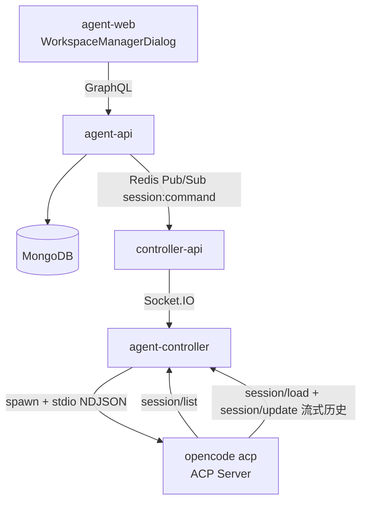
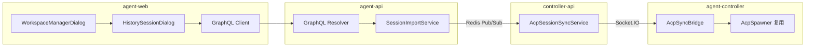
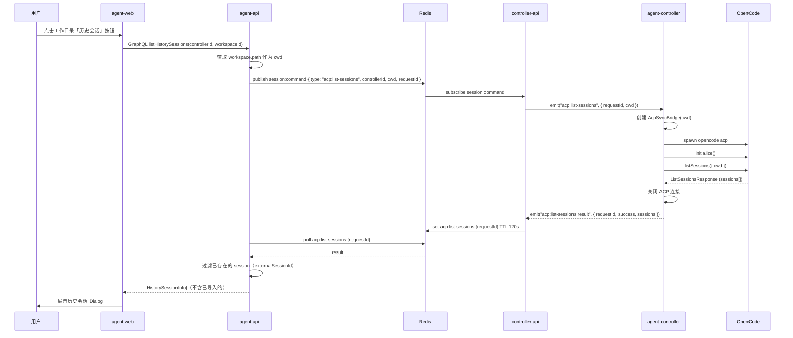
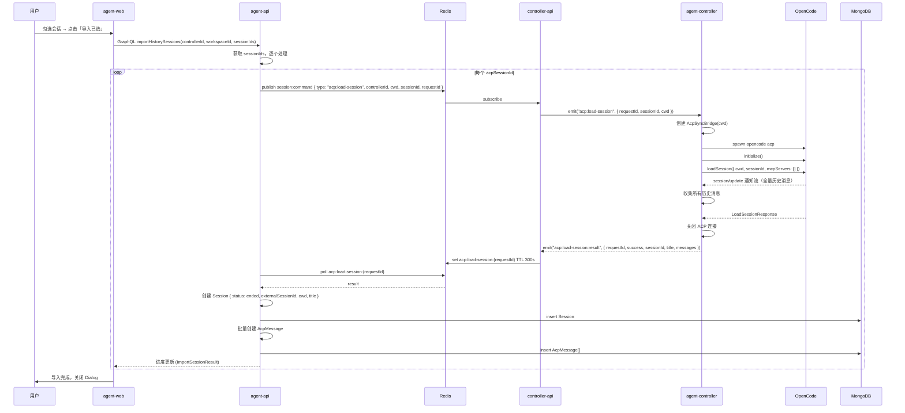

# 工作目录历史会话同步 - 技术提案

**功能名称**: 工作目录历史会话同步
**关联 PRD**: `draft/20260521-acp-session-sync-history.md`
**技术提案版本**: v1.0
**创建日期**: 2026-05-21
**作者**: ZeroAsh
**feat-branch**: `feat/acp-session-sync`

## 1. 概述

### 1.1 背景

用户在 Controller 工作目录管理中可以预先配置多个本地目录，并在这些目录下已经通过 OpenCode（或其他 ACP 兼容 Agent）产生过大量历史会话。当前系统只能从「新建会话」入口开启新对话，无法发现或导入现有的历史会话。

ACP SDK `@agentclientprotocol/sdk@^0.22.1` 已标准支持 `session/list` 和 `session/load` 两个 JSON-RPC 方法，但 z-agent-gear 项目中尚未使用。

### 1.2 目标

- 用户在 Web 端工作目录列表项中可一键拉取该目录下的 ACP 历史会话列表
- 系统自动过滤已导入的会话（`externalSessionId` 比对），用户多选未导入的会话批量导入
- 每个会话通过 `session/load` 获取全量历史记录，在系统中创建 `ended` 状态的 Session 并持久化消息
- 已删除的会话可重新导入为新 session
- Controller 必须在线才能操作

### 1.3 范围

**做**:
- 新增 WebSocket 事件 `acp:list-sessions` / `acp:list-sessions:result`
- 新增 WebSocket 事件 `acp:load-session` / `acp:load-session:result`
- 新增 GraphQL 查询 `listHistorySessions` 和变更 `importHistorySessions`
- agent-controller 侧实现 `AcpSyncBridge`（临时 ACP 连接，用于 list/load 操作）
- controller-api 侧新增 `AcpSessionSyncService`
- agent-api 侧历史会话列表获取 Service + 导入 Service
- 前端 WorkspaceManagerDialog 增加「历史会话」按钮 + 历史会话 Dialog

**不做**:
- `session/list` 分页（初期不处理分页，依赖 OpenCode 端支持 cursor）
- 多 Controller 批量导入
- 导入进度条的真实百分比（仅用 `已导入 x/N` 文本进度）
- 自定义排序历史会话列表

## 2. 技术架构

### 2.1 系统架构图



### 2.2 技术栈

| 层级 | 技术选型 | 说明 |
|------|---------|------|
| 前端 | React 19 + TypeScript + Tailwind CSS | shadcn/ui Dialog, Checkbox |
| 后端 | Express v5 + GraphQL-Yoga + Mongoose | Node.js 24+ |
| 数据库 | MongoDB | Session + AcpMessage 集合 |
| 通信 | Redis Pub/Sub + Socket.IO | 命令下发 + 结果回传 |
| ACP | `@agentclientprotocol/sdk@^0.22.1` | `listSessions`, `loadSession` API |
| 进程管理 | `node:child_process` spawn | 临时 `opencode acp` 进程 |

### 2.3 模块划分



| 模块 | 职责 | 关键技术点 |
|------|------|-----------|
| `AcpSyncBridge` | 临时 ACP 连接，调用 listSessions / loadSession | 复用 AcpSpawner，不持有 session 状态，一次性使用 |
| `AcpSessionSyncService` | controller-api 侧协调 list/load 请求 | 类似 acp:check 的 request-response 模式 |
| `SessionImportService` | agent-api 侧获取列表 + 过滤 + 导入 | 比对 externalSessionId，批量创建 Session + AcpMessage |
| `HistorySessionDialog` | 前端 UI：列表展示、多选、导入进度 | shadcn/ui Dialog + Checkbox 多选 |

## 3. 协议设计

### 3.1 新增 Socket.IO 事件

#### `acp:list-sessions`（Server → Controller）

请求获取指定工作目录下的历史会话列表。

**Payload:**

| 字段 | 类型 | 必填 | 说明 |
|------|------|------|------|
| `requestId` | `string` | 是 | 请求 ID，用于匹配结果 |
| `cwd` | `string` | 是 | 工作目录绝对路径 |

**客户端行为:**

1. 实例化临时 `AcpSyncBridge`，以 `cwd` 为参数
2. 连接 ACP Server（spawn `opencode acp`）
3. 调用 `connection.initialize()`
4. 调用 `connection.listSessions({ cwd })`
5. 返回会话列表 → 关闭 ACP 连接
6. 回复 `acp:list-sessions:result`

#### `acp:list-sessions:result`（Controller → Server）

返回历史会话列表。

**Payload:**

| 字段 | 类型 | 必填 | 说明 |
|------|------|------|------|
| `requestId` | `string` | 是 | 对应的请求 ID |
| `success` | `boolean` | 是 | 是否成功 |
| `sessions` | `SessionInfo[]` | 否 | 会话列表（成功时） |
| `error` | `string` | 否 | 失败原因 |

**`SessionInfo` 结构:**

| 字段 | 类型 | 说明 |
|------|------|------|
| `sessionId` | `string` | ACP 侧唯一标识 |
| `title` | `string \| null` | 会话标题 |
| `cwd` | `string` | 工作目录 |
| `updatedAt` | `string \| null` | ISO 8601 最后活动时间 |

#### `acp:load-session`（Server → Controller）

请求加载指定历史会话的全量消息。

**Payload:**

| 字段 | 类型 | 必填 | 说明 |
|------|------|------|------|
| `requestId` | `string` | 是 | 请求 ID |
| `sessionId` | `string` | 是 | ACP 侧 session ID |
| `cwd` | `string` | 是 | 工作目录 |

**客户端行为:**

1. 实例化临时 `AcpSyncBridge`，以 `cwd` 为参数
2. 连接 ACP Server
3. 调用 `connection.initialize()`
4. 调用 `connection.loadSession({ cwd, sessionId, mcpServers: [] })`
5. `loadSession` 会通过 `session/update` 通知流式返回全量历史消息
6. 收集所有历史消息通知
7. 回复 `acp:load-session:result`（含所有消息）

#### `acp:load-session:result`（Controller → Server）

返回历史会话全量消息。

**Payload:**

| 字段 | 类型 | 必填 | 说明 |
|------|------|------|------|
| `requestId` | `string` | 是 | 对应的请求 ID |
| `success` | `boolean` | 是 | 是否成功 |
| `sessionId` | `string` | 是 | ACP 侧 session ID |
| `title` | `string \| null` | 否 | 会话标题 |
| `messages` | `HistoryMessage[]` | 否 | 历史消息列表（成功时） |
| `error` | `string` | 否 | 失败原因 |

**`HistoryMessage` 结构:**

| 字段 | 类型 | 说明 |
|------|------|------|
| `direction` | `"input" \| "output"` | 消息方向 |
| `type` | `string` | 消息类型（同 AcpMessage.type） |
| `content` | `string` | JSON 序列化的消息内容 |

### 3.2 新增 Redis Pub/Sub 命令

#### `session:command` 新增命令类型

| 命令类型 | Payload | 说明 |
|---------|---------|------|
| `acp:list-sessions` | `{ controllerId, cwd }` | 获取历史会话列表 |
| `acp:load-session` | `{ controllerId, sessionId, cwd }` | 加载单个历史会话 |

#### 新增 Redis 结果缓存

| Key | TTL | 说明 |
|-----|-----|------|
| `acp:list-sessions:{requestId}` | 120s | list 结果缓存 |
| `acp:load-session:{requestId}` | 300s | load 结果缓存（消息量大，给更长时间消费） |

同现有 `folder-browser` 模式的请求-响应模式（发布 Redis 命令 → 轮询 Redis 缓存）。

## 4. GraphQL 设计

### 4.1 新类型

```graphql
type HistorySessionInfo {
  sessionId: String!       # ACP 侧唯一标识
  title: String
  cwd: String!
  updatedAt: String
}

type ImportSessionResult {
  sessionId: ID!           # 系统侧新创建 Session 的 ID
  acpSessionId: String!    # ACP 侧 session ID
  title: String
  success: Boolean!
  error: String
  messageCount: Int        # 导入的消息数量
}
```

### 4.2 新查询

```graphql
extend type Query {
  """
  获取指定 controller 工作目录下的历史会话列表（已过滤系统中已存在的）
  Controller 必须在线
  """
  listHistorySessions(
    controllerId: ID!
    workspaceId: ID!
  ): [HistorySessionInfo!]!
}
```

### 4.3 新变更

```graphql
extend type Mutation {
  """
  批量导入选中的历史会话到系统中
  每个 session 创建为 ended 状态，完整保留历史消息
  """
  importHistorySessions(
    controllerId: ID!
    workspaceId: ID!
    sessionIds: [String!]!    # ACP 侧 sessionId 数组
  ): [ImportSessionResult!]!
}
```

## 5. 数据模型

### 5.1 无新集合（复用现有模型）

现有 `Session` 模型已包含所有所需字段：

| 字段 | 类型 | 说明 |
|------|------|------|
| `externalSessionId` | `String` | 存储 ACP `sessionId`，用于去重（unique 不强制，因已删除的可重新导入） |
| `cwd` | `String` | 工作目录路径 |
| `title` | `String` | 会话标题（从 ACP 返回的 title 同步） |
| `status` | `"ended"` | 导入的会话统一为 ended |
| `endedAt` | `Date` | 设为导入时间 |

现有 `AcpMessage` 模型复用，`direction`、`type`、`content` 字段与 ACP 返回的消息结构兼容。

## 6. 技术实现方案

### 6.1 核心流程

#### 列表获取流程



#### 导入流程



### 6.2 关键实现点

#### 实现点 1: AcpSyncBridge（agent-controller 新增）

**文件**: `packages/agent-controller/src/acp/sync-bridge.ts`（新建）

类似 `AcpSessionBridge`，但设计为一次性使用、不持有 session 状态：

```typescript
export class AcpSyncBridge {
  private spawner: AcpSpawner;
  private connection: acp.ClientSideConnection | null = null;

  constructor(options: { cwd: string }) {
    this.spawner = new AcpSpawner({
      sessionId: `sync_${Date.now()}`,
      cwd: options.cwd,
    });
  }

  async connect(): Promise<void> {
    this.spawner.start();
    const stream = acp.ndJsonStream(this.spawner.stdin, this.spawner.stdout);
    this.connection = new acp.ClientSideConnection(() => this, stream);
    await this.connection.initialize({
      protocolVersion: 1,
      clientCapabilities: {},
      clientInfo: { name: 'agent-controller', version: '1.0.0' },
    });
  }

  async listSessions(cwd: string): Promise<acp.ListSessionsResponse> {
    return this.connection!.listSessions({ cwd });
  }

  async loadSession(sessionId: string, cwd: string): Promise<{
    config?: acp.LoadSessionResponse;
    updates: acp.SessionNotification[];
  }> {
    const updates: acp.SessionNotification[] = [];
    // Collect all session/update notifications during load
    // ... needs to intercept sessionUpdate callbacks
    const config = await this.connection!.loadSession({
      cwd,
      sessionId,
      mcpServers: [],
    });
    return { config, updates };
  }

  async disconnect(): Promise<void> {
    await this.connection?.closeSession({ sessionId: '' });
    this.spawner.stop();
  }
}
```

**Client 实现（用于接收 session/update 通知）:**

`AcpSyncBridge` 实现 `acp.Client` 接口，只需要实现 `sessionUpdate()` 来收集历史消息通知，`requestPermission()` 和可选的 `writeTextFile`/`readTextFile` 不需要实现（返回拒绝或空实现）：

```typescript
// acp.Client implementation
async sessionUpdate(params: acp.SessionNotification): Promise<void> {
  this.updates.push(params);
}

async requestPermission(): Promise<acp.RequestPermissionResponse> {
  return { outcome: { outcome: 'rejected' } };
}
```

#### 实现点 2: controller-api AcpSessionSyncService

**文件**: `servers/controller-api/src/services/acp-session-sync.ts`（新建）

类似 `ACPCapabilityDetector` 的请求-响应模式：

```typescript
export class AcpSessionSyncService {
  private pendingLists = new Map<string, {
    resolve: (result: ListResult) => void;
    timeout: NodeJS.Timeout;
  }>();
  private pendingLoads = new Map<string, {
    resolve: (result: LoadResult) => void;
    timeout: NodeJS.Timeout;
  }>();

  async listSessions(
    controllerSocket: Socket,
    cwd: string,
  ): Promise<ListResult> {
    // 发送 acp:list-sessions → 等待 acp:list-sessions:result
  }

  async loadSession(
    controllerSocket: Socket,
    acpSessionId: string,
    cwd: string,
  ): Promise<LoadResult> {
    // 发送 acp:load-session → 等待 acp:load-session:result
  }

  handleListResult(requestId: string, result: ListResult): void { /* ... */ }
  handleLoadResult(requestId: string, result: LoadResult): void { /* ... */ }
}
```

#### 实现点 3: agent-controller socketio-client 新增事件处理

**文件**: `packages/agent-controller/src/socketio-client.ts`

新增两个事件监听，与现有 `acp:check` 模式一致：

```typescript
socket.on('acp:list-sessions', async (data: { requestId: string; cwd: string }) => {
  const bridge = new AcpSyncBridge({ cwd: data.cwd });
  try {
    await bridge.connect();
    const result = await bridge.listSessions(data.cwd);
    await bridge.disconnect();
    socket.emit('acp:list-sessions:result', {
      requestId: data.requestId,
      success: true,
      sessions: result.sessions.map(s => ({
        sessionId: s.sessionId,
        title: s.title ?? null,
        cwd: s.cwd,
        updatedAt: s.updatedAt ?? null,
      })),
    });
  } catch (error) {
    await bridge.disconnect().catch(() => {});
    socket.emit('acp:list-sessions:result', {
      requestId: data.requestId,
      success: false,
      error: (error as Error).message,
    });
  }
});

socket.on('acp:load-session', async (data: { requestId: string; sessionId: string; cwd: string }) => {
  const bridge = new AcpSyncBridge({ cwd: data.cwd });
  try {
    await bridge.connect();
    const { config, updates } = await bridge.loadSession(data.sessionId, data.cwd);
    await bridge.disconnect();
    socket.emit('acp:load-session:result', {
      requestId: data.requestId,
      success: true,
      sessionId: data.sessionId,
      title: null, // title 可能来自 config 或 update，具体看 SDK 行为
      messages: updates.map(u => ({ /* ... */ })),
    });
  } catch (error) {
    // ...
  }
});
```

#### 实现点 4: agent-api SessionImportService

**文件**: `servers/agent-api/src/services/session-import.ts`（新建）

```typescript
export class SessionImportService {
  async listHistorySessions(
    userId: string,
    controllerId: string,
    cwd: string,
  ): Promise<HistorySessionInfo[]> {
    // 1. 调用 controller-api 通过 Redis Pub/Sub 获取列表
    // 2. 查询系统已有 Sessions，按 externalSessionId 过滤
    // 3. 只返回未导入的会话
    const existingIds = await Session.find({
      userId,
      externalSessionId: { $exists: true, $ne: null },
      status: { $ne: null }, // 所有未物理删除的
    }).distinct('externalSessionId');

    return rawSessions.filter(s => !existingIds.includes(s.sessionId));
  }

  async importSessions(
    userId: string,
    controllerId: string,
    controllerName: string,
    cwd: string,
    acpSessionIds: string[],
  ): Promise<ImportSessionResult[]> {
    const results: ImportSessionResult[] = [];
    for (const acpSessionId of acpSessionIds) {
      try {
        // 1. 通过 Redis Pub/Sub 调用 load
        const loadResult = await this.loadFromController(controllerId, acpSessionId, cwd);

        // 2. 创建 Session
        const session = await Session.create({
          userId,
          controllerId,
          controllerName,
          acpServerType: 'opencode',
          status: 'ended',
          title: loadResult.title || `历史会话 - ${acpSessionId.slice(0, 8)}`,
          externalSessionId: acpSessionId,
          cwd,
          endedAt: new Date(),
        });

        // 3. 批量创建消息
        const messages = loadResult.messages.map(msg => ({
          sessionId: session._id,
          direction: msg.direction,
          type: msg.type,
          content: msg.content,
        }));
        await AcpMessage.insertMany(messages);

        results.push({
          sessionId: session._id.toString(),
          acpSessionId,
          title: loadResult.title,
          success: true,
          messageCount: messages.length,
        });
      } catch (error) {
        results.push({
          sessionId: '',
          acpSessionId,
          title: null,
          success: false,
          error: (error as Error).message,
          messageCount: 0,
        });
      }
    }
    return results;
  }
}
```

#### 实现点 5: 前端 HistorySessionDialog

**文件**: `apps/agent-web/src/components/settings/HistorySessionDialog.tsx`（新建）

```tsx
interface HistorySessionDialogProps {
  open: boolean;
  onOpenChange: (open: boolean) => void;
  controllerId: string;
  workspaceId: string;
  workspaceName: string;
}

// 内部状态：
// - sessions: HistorySessionInfo[] (从 listHistorySessions 查询获得)
// - selectedIds: Set<string> (用户勾选的 sessionId)
// - importing: boolean
// - progress: { total: number; completed: number }
//
// 交互：
// 1. 打开 Dialog 时自动调用 listHistorySessions
// 2. 列表为空时显示「该工作目录下没有未导入的历史会话」
// 3. 用户勾选后点击「导入所选」
// 4. 逐个导入，更新进度
// 5. 导入完成后显示结果，关闭 Dialog
```

#### 实现点 6: WorkspaceManagerDialog 修改

**文件**: `apps/agent-web/src/components/settings/WorkspaceManagerDialog.tsx`

在每个工作目录列表项的启用开关和删除按钮之间增加「历史会话」按钮：

```tsx
<li key={ws.id} className="flex items-center gap-2 rounded-lg border p-3">
  <button /* 启用开关 */ />
  <div /* 名称 & 路径 */ />
  <Button /* 新增：历史会话按钮 */
    variant="outline"
    size="sm"
    disabled={!controllerOnline || !ws.isEnabled}
    onClick={() => setHistoryWorkspace(ws)}
  >
    历史会话
  </Button>
  <Button /* 删除按钮 */ />
</li>

<HistorySessionDialog
  open={!!historyWorkspace}
  onOpenChange={() => setHistoryWorkspace(null)}
  controllerId={controllerId}
  workspaceId={historyWorkspace?.id}
  workspaceName={historyWorkspace?.name}
/>
```

### 6.3 关键设计决策

| 决策 | 选项 A | 选项 B | 最终选择 | 原因 |
|------|--------|--------|---------|------|
| 临时 ACP 连接 vs 长连接 | 每次 list/load 新建 `AcpSyncBridge` + spawn | 持有一个长连接 ACP Server | 新建 | list/load 是低频操作，不需要常驻进程 |
| 导入是否串行 | 串行逐个导入 | 并行批量导入 | 串行，允许 `maxConcurrency: 3` | 避免给控制器和 OpenCode 造成过大压力 |
| title 来源 | 从 ACP 返回的 title 字段 | 自动生成「历史会话 - {id}」 | 优先使用 title，为空时自动生成 | 保留原始会话命名 |
| session/update 通知收集 | 在 AcpSyncBridge.client 回调中 Buffer | 直接转发给 controller-api | Buffer 在 AcpSyncBridge 中 | 简化协议，一次性返回所有消息 |
| 去重判断 | 查 `externalSessionId` 在已导入且 status 不为 ended 物理删除的 | 查 deletedAt 标记 | `externalSessionId` 匹配且未物理删除 | 系统目前使用物理删除，未使用软删除标记 |

## 7. 新增与修改文件清单

```
packages/agent-controller/src/
├── acp/
│   └── sync-bridge.ts          # 新增：临时 ACP 连接，list/load
└── socketio-client.ts          # 修改：新增 acp:list-sessions / acp:load-session 事件处理

servers/controller-api/src/
├── services/
│   ├── acp-session-sync.ts     # 新增：list/load 请求-响应协调
│   └── session-command.ts      # 修改：新增 acp:list-sessions / acp:load-session 命令处理
├── socket/
│   └── index.ts                # 修改：注册 acp-session-sync 事件处理

servers/agent-api/src/
├── services/
│   └── session-import.ts       # 新增：列表获取 + 过滤 + 导入逻辑
├── graphql/
│   ├── schemas/
│   │   └── session.ts          # 修改：新增 listHistorySessions / importHistorySessions
│   └── resolvers/
│       └── session.ts          # 修改：新增 resolver
├── middleware/
│   └── redis.ts                # 无改动

contracts/
├── agent-session-websocket.md  # 修改：新增 2 组 Socket.IO 事件定义
└── agent-session.graphql       # 修改：新增查询和变更

apps/agent-web/src/
├── components/
│   ├── settings/
│   │   ├── WorkspaceManagerDialog.tsx  # 修改：新增「历史会话」按钮
│   │   └── HistorySessionDialog.tsx    # 新增：历史会话列表 + 多选 + 导入
├── graphql/
│   ├── queries.ts              # 修改：新增 LIST_HISTORY_SESSIONS
│   ├── mutations.ts            # 修改：新增 IMPORT_HISTORY_SESSIONS
│   └── types.ts                # 修改：新增 HistorySessionInfo / ImportSessionResult 类型
```

## 8. 测试策略

### 8.1 测试覆盖要求

- 单元测试覆盖率: >= 80%（新增代码）
- API 测试覆盖: `listHistorySessions`, `importHistorySessions`

### 8.2 测试类型

| 类型 | 工具 | 覆盖范围 |
|------|------|---------|
| 单元测试 | Vitest | `AcpSyncBridge`, `SessionImportService`, `AcpSessionSyncService` |
| ACP 协议测试 | Vitest | `acp:list-sessions` / `acp:load-session` 事件收发 |
| GraphQL API 测试 | Vitest | `listHistorySessions` / `importHistorySessions` resolver |
| 前端组件测试 | Vitest | `HistorySessionDialog` 渲染与交互 |
| E2E 测试 | Vitest | 完整流程：打开 Dialog → 勾选 → 导入 → 验证 |

### 8.3 测试重点

1. AcpSyncBridge 正常连接/断开不泄漏进程
2. session/list 返回空列表时的处理
3. 过滤逻辑：`externalSessionId` 已存在且未被销毁（status 不为 ended 或不存在）不进列表
4. 导入时创建 Session + AcpMessage 的事务一致性
5. Controller 离线时按钮置灰
6. 导入过程中异常中断的恢复处理

## 9. 验收标准

- [ ] 技术方案评审通过
- [ ] Contract 评审通过（WebSocket + GraphQL）
- [ ] AcpSyncBridge 可正常调用 session/list 和 session/load
- [ ] listHistorySessions 返回过滤后的可导入列表
- [ ] importHistorySessions 正确创建 Session + 消息
- [ ] 重复导入同一 ACP session 被正确过滤
- [ ] 已删除的 session 可重新导入为新 session
- [ ] Controller 离线时按钮置灰
- [ ] ACP 协议契约文档更新
- [ ] GraphQL 契约文档更新

## 10. 相关文档

- [关联 PRD](../../product/draft/20260521-acp-session-sync-history.md)
- [ACP SDK session/list & session/load 文档](https://github.com/agentclientprotocol/typescript-sdk)
- [现有 ACP WebSocket 契约](../../contracts/agent-session-websocket.md)
- [现有 Session GraphQL 契约](../../contracts/agent-session.graphql)
- [开发规范](../common-rules.md)
