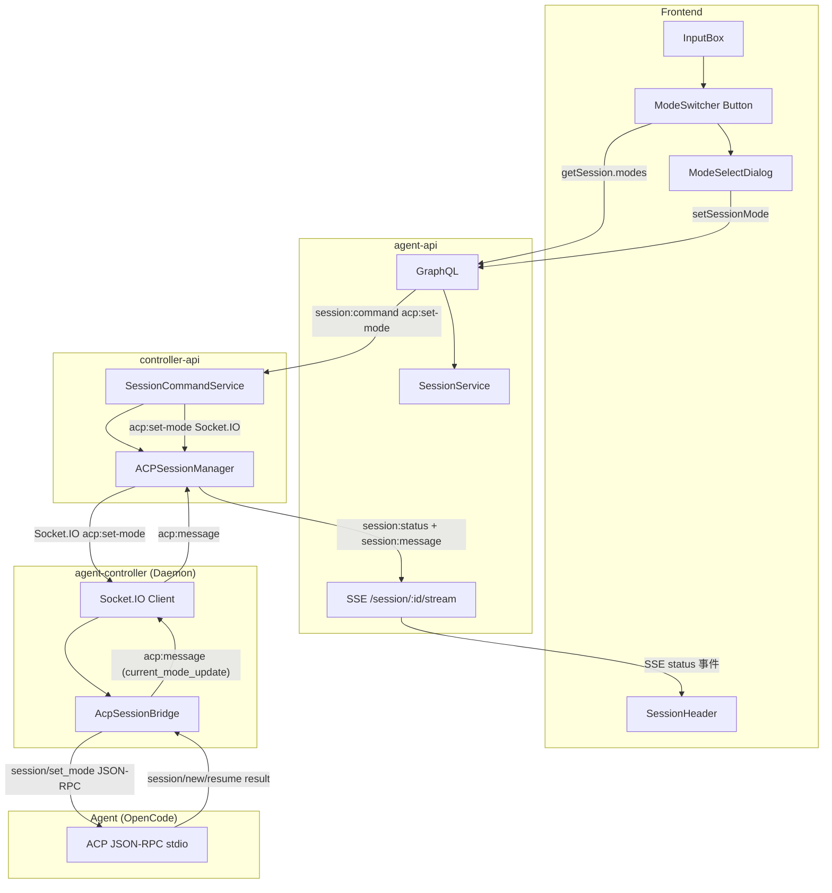
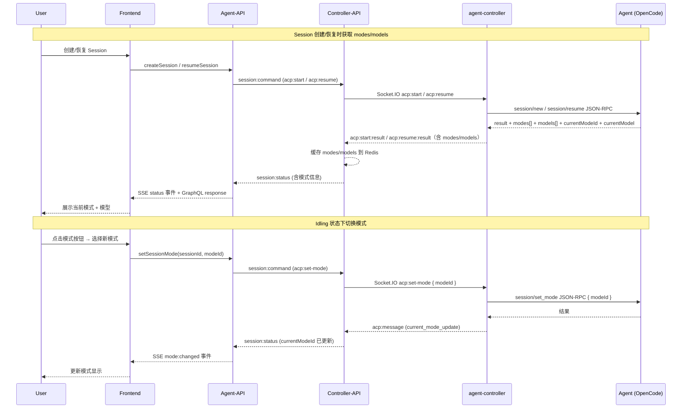
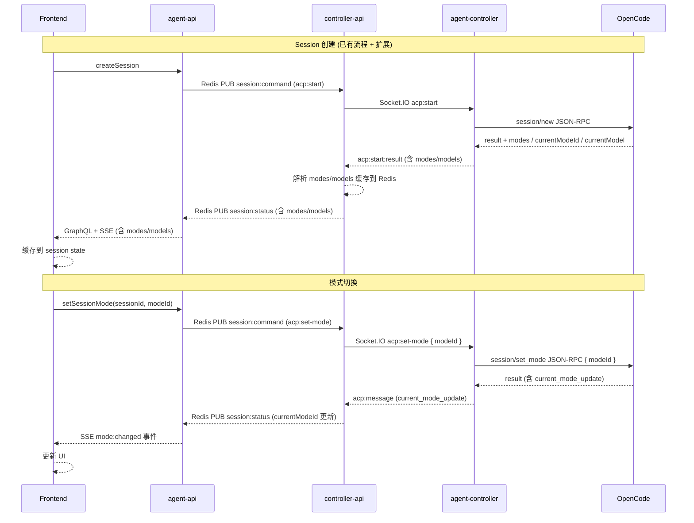

# 可用模型展示与 Agent 模式切换 - 技术提案

**功能名称**: 可用模型展示与 Agent 模式切换
**关联 PRD**: `20260522-available-models-and-mode-switch.md`
**技术提案版本**: v1.0
**创建日期**: 2026-05-22
**作者**: ZeroAsh

## 1. 概述

### 1.1 背景

当前 Session 建立后，用户无法看到 Agent 支持的工作模式和当前使用的 LLM 模型。模式切换只能在启动时通过环境变量预设，运行中无法调整。PRD 要求新增：Session 创建/恢复时获取 modes/models 并缓存、输入框左侧模式切换入口、仅 idling 允许切换、当前模型只读展示。

### 1.2 目标

- 前端：输入框左侧展示当前模式按钮，点击弹出模式选择 Dialog；Session 头部或输入区附近展示当前模型（只读）
- agent-api：扩展 Session GraphQL 类型（modes / currentModeId / currentModelId），新增 `setSessionMode`  mutation
- controller-api：新增 `acp:set-mode` 命令处理，转发到 Agent；透传 Agent `session/new` / `session/resume` 返回的 modes/models 数据
- 仅 idling 状态允许切换，running/connecting/ended 等状态禁用

### 1.3 范围

- **包含**：GraphQL schema 扩展、SSE 事件扩展、Session 数据模型扩展、controller-api ACP 协议扩展（set_mode）、前端 ModeSwitcher 组件、InputBox 改造、SessionHeader 模型展示
- **不包含**：模型切换功能（ACP 协议未稳定）、Agent 端 `session/set_mode` 的具体实现（仅转发）

## 2. 技术架构

### 2.1 系统架构图



### 2.2 数据流



### 2.3 模块划分

| 模块 | 职责 | 关键技术点 |
|------|------|-----------|
| Contract (GraphQL) | 定义 `AgentMode` 类型，扩展 `Session`，新增 `setSessionMode` | GraphQL schema 扩展 |
| Contract (WebSocket) | 扩展 ACP 事件和 `session:status` Payload | `session/set_mode` RPC |
| agent-api (model) | Session 模型增加 modes/currentModeId/currentModelId 字段 | Mongoose schema |
| agent-api (resolver) | `setSessionMode` resolver | Redis Pub/Command |
| agent-api (SSE) | `session:status` 事件携带 mode/model 信息 | SSE 协议扩展 |
| controller-api (ACM) | 处理 `acp:set-mode`，调用 `session/set_mode` | ACP JSON-RPC |
| frontend (ModeSwitcher) | 模式切换按钮 + Dialog + 模型展示 | React + Tailwind |

## 3. API 设计

### 3.1 GraphQL 契约

扩展 `contracts/agent-session.graphql`：

```graphql
type AgentMode {
  id: String!
  name: String!
  description: String
}

type AgentModelInfo {
  id: String!
  name: String!
  provider: String
}

type Session {
  # ... existing fields
  modes: [AgentMode!]
  currentModeId: String
  currentModel: AgentModelInfo
}

type Mutation {
  # ... existing mutations
  setSessionMode(sessionId: ID!, modeId: String!): Boolean!
}
```

### 3.2 SSE 协议扩展

`session:status` 事件 payload 扩展：

```json
{
  "sessionId": "sess_xxx",
  "status": "idling",
  "modes": [
    { "id": "code", "name": "Code", "description": "Write and edit code" },
    { "id": "architect", "name": "Architect", "description": "Design architecture" },
    { "id": "ask", "name": "Ask", "description": "Ask questions" },
    { "id": "debug", "name": "Debug", "description": "Debug issues" }
  ],
  "currentModeId": "code",
  "currentModel": {
    "id": "claude-sonnet-4-20250514",
    "name": "Claude Sonnet 4",
    "provider": "anthropic"
  }
}
```

新增 SSE 事件类型 `mode:changed`：

```json
{
  "type": "mode:changed",
  "data": {
    "sessionId": "sess_xxx",
    "modeId": "architect"
  }
}
```

### 3.3 ACP 协议扩展

新增 RPC 方法 `session/set_mode`：

```json
{
  "jsonrpc": "2.0",
  "id": 5,
  "method": "session/set_mode",
  "params": {
    "sessionId": "sess_abc123",
    "modeId": "architect"
  }
}
```

`session/new` 和 `session/resume` 返回结果扩展：

```json
{
  "jsonrpc": "2.0",
  "id": 2,
  "result": {
    "sessionId": "sess_abc123",
    "modes": [
      { "id": "code", "name": "Code", "description": "..." },
      { "id": "architect", "name": "Architect", "description": "..." }
    ],
    "currentModeId": "code",
    "currentModel": {
      "id": "claude-sonnet-4-20250514",
      "name": "Claude Sonnet 4",
      "provider": "anthropic"
    }
  }
}
```

### 3.4 Redis Pub/Sub 扩展

`session:command` 新增命令类型 `acp:set-mode`：

```json
{
  "type": "acp:set-mode",
  "sessionId": "sess_xxx",
  "modeId": "architect"
}
```

## 4. 数据模型

### 4.1 MongoDB Session 模型扩展

```typescript
// Session 新增字段
modes: [{ id: String, name: String, description: String }],
currentModeId: String,
currentModel: { id: String, name: String, provider: String }
```

### 4.2 Redis 缓存扩展

| Key | Value | TTL | 说明 |
|-----|-------|-----|------|
| `session:{id}:modes` | JSON array | Session 活跃期 | 可用模式列表 |
| `session:{id}:currentModeId` | string | Session 活跃期 | 当前模式 ID |
| `session:{id}:currentModel` | JSON object | Session 活跃期 | 当前模型信息 |

## 5. 技术实现方案

### 5.1 核心流程



### 5.2 关键实现点

#### 实现点 1: Session 模式/模型信息缓存（agent-controller → controller-api → agent-api）

**描述**: 在 Session 创建和恢复时，从 ACP SDK 的 `session/new` / `session/resume` 结果中提取 modes/models 信息，逐层上传并缓存。

**步骤**:
1. `AcpSessionBridge`（bridge.ts）调用 `connection.newSession()` / `connection.resumeSession()` 后，从 result 中获取 `modes`、`currentModeId`、`currentModel`（ACP SDK 的 `SessionNewResult` / `SessionResumeResult` 已支持这些字段）
2. agent-controller 通过 `acp:start:result` 或 `acp:resume:result` 将 modes/models 数据带回 controller-api
3. controller-api `acp-session-manager.ts` 解析 payload，缓存到 Redis `session:{id}:modes` / `session:{id}:currentModeId` / `session:{id}:currentModel`
4. 通过 `session:status` PUB 携带这些信息到 agent-api
5. agent-api 收到后更新 MongoDB Session 文档 + 推送到 SSE
6. 前端通过 GraphQL `getSession` 查询或 SSE `status` 事件获取

**风险点**: Agent 可能不支持返回 modes/models（旧版本），需要优雅降级（返回空列表/null，前端隐藏模式切换入口）

#### 实现点 2: `setSessionMode` GraphQL Mutation（agent-api）

**描述**: 前端调用此 mutation 发起模式切换。

**步骤**:
1. 验证 session 属于当前用户且 status === 'idling'
2. 发布 `acp:set-mode` 到 Redis `session:command` channel
3. 返回 `true`（异步通知，结果通过 SSE 推送）

**技术细节**:
- Redis 命令 payload: `{ type: 'acp:set-mode', sessionId, modeId }`
- 切换结果通过 `session:status` 事件（含 `currentModeId`）通知前端

#### 实现点 3: `acp:set-mode` 命令处理（controller-api → agent-controller）

**描述**: controller-api 订阅到 `acp:set-mode` 命令后，经 agent-controller 转发 JSON-RPC 到 Agent。

**步骤**:
1. `session-command.ts` 添加 `acp:set-mode` case，查找 controller socket
2. 发送 `acp:set-mode { sessionId, modeId }` Socket.IO 事件到 agent-controller
3. agent-controller `socketio-client.ts` 添加 `acp:set-mode` 事件处理，找到对应 `AcpSessionBridge`
4. bridge 调用 `connection.setMode({ sessionId, modeId })`（ACP SDK 方法）或发送原始 JSON-RPC `session/set_mode`
5. Agent 切换模式后，通过 `session/update`（`current_mode_update` 类型）通知变更
6. bridge 将 `current_mode_update` 作为 `acp:message` 转发回 controller-api
7. controller-api 收到后更新 Redis currentModeId，发布 `session:status`

**技术细节**:
- ACP SDK 的 `ClientSideConnection` 已声明 `setMode` 方法的 JSDoc，但 SDK 尚未导出实际方法；bridge 需手动发送 `session/set_mode` JSON-RPC 或调用底层 JSON-RPC 方法
- 切换结果通过 `current_mode_update` session update 异步通知

#### 实现点 4: 模式切换 UI（前端）

**描述**: 在 InputBox 左侧添加模式切换按钮 + 弹出 Dialog。

**组件结构**:

```
InputBox (改造)
├── ModeSwitcher (新组件)
│   ├── 当前模式按钮 [Code ▾]
│   └── ModeSelectDialog (新组件)
│       ├── Dialog 标题: "切换工作模式"
│       ├── 模式列表 (名称 + 描述 + 选中态 ✓)
│       ├── 加载状态
│       └── 确认/取消按钮
├── textarea
└── Send/Stop 按钮
```

**实现细节**:
- 模式按钮内容: `<icon> <当前模式名称> ▾`
- 按钮 disabled 条件: `status !== 'idling'`
- Dialog 中当前模式高亮标记
- 切换时显示加载状态
- 切换成功更新按钮文本，失败 Toast 提示

#### 实现点 5: 当前模型展示（前端）

**描述**: 在 SessionHeader 或 InputBox 附近展示当前模型（只读）。

**步骤**:
1. 从 `session.currentModel` 或 SSE `status` 事件获取模型信息
2. 在 SessionHeader 中 acpServerType badge 旁边添加模型名称 badge
3. 模型信息不可点击

**技术细节**: `SessionHeader` 使用灰色 badge 展示 `model.name` 或 `model.id`

### 5.3 状态管理

Frontend session state 扩展：

```typescript
// SessionPage 新增状态
const [modes, setModes] = useState<AgentMode[]>([]);
const [currentModeId, setCurrentModeId] = useState<string | null>(null);
const [currentModel, setCurrentModel] = useState<{ id: string; name: string } | null>(null);
```

SSE `status` 事件处理扩展 - 当收到 status 事件时，如果 payload 包含 `modes`/`currentModeId`/`currentModel`，同步更新 state。

## 6. 技术决策

### 6.1 决策列表

| 决策 | 选项 A | 选项 B | 最终选择 | 原因 |
|------|--------|--------|---------|------|
| 模式信息传输方式 | 通过 SSE status 事件携带 | 单独 SSE 事件 | 选项 A + 额外 `mode:changed` 事件 | status 事件适合初始加载，`mode:changed` 适合切换通知 |
| 模式切换入口位置 | InputBox 左侧新按钮 | SessionHeader 下拉 | InputBox 左侧 | 贴近输入区域，操作路径短 |
| 后端模式切换模式 | 同步请求-响应 | 异步通知 + SSE | 异步通知 + SSE | 与现有 ACP cancel 模式一致，无需等待 Agent |
| 模式列表缓存 | Redis + MongoDB | 仅 MongoDB | Redis + MongoDB | 高频读取场景，减少 DB 查询 |

### 6.2 依赖与约束

| 类型 | 内容 | 说明 |
|------|------|------|
| 依赖 | Agent (OpenCode) 需在 `session/new` / `session/resume` 返回 modes/models | 若缺失则显示空/隐藏 |
| 依赖 | Agent 需支持 `session/set_mode` RPC 方法 | 若缺失则按钮置灰 |
| 约束 | 仅 idling 状态允许切换 | 前端和后端双重校验 |
| 约束 | 模型切换本期不做 | 仅展示，无可交互元素 |

## 7. 项目结构变更

```
servers/agent-api/src/
├── models/session.ts                  # +modes, +currentModeId, +currentModel (Mongoose)
├── services/session.ts                # +setMode(), mapSession 扩展
├── graphql/
│   ├── schemas/session.ts             # +AgentMode type, +setSessionMode mutation
│   └── resolvers/session.ts           # +setSessionMode resolver
└── services/session-sse.ts            # SSE status 事件扩展

servers/controller-api/src/
├── services/acp-session-manager.ts    # +setMode(), start/result 解析 modes/models
└── services/session-command.ts        # +acp:set-mode handler

packages/agent-controller/src/
├── acp/bridge.ts                     # +setMode(), modes/models 回调
└── socketio-client.ts                # +acp:set-mode 事件处理

apps/agent-web/src/
├── components/session/
│   ├── InputBox.tsx                   # 左侧增加 ModeSwitcher
│   ├── ModeSwitcher.tsx              # [NEW] 模式切换按钮
│   ├── ModeSelectDialog.tsx          # [NEW] 模式选择 Dialog
│   └── SessionHeader.tsx             # 增加模型 badge
├── pages/SessionPage.tsx             # +modes/currentModeId/currentModel 状态管理
├── graphql/
│   ├── mutations.ts                  # +SET_SESSION_MODE
│   ├── queries.ts                    # GET_SESSION 扩展 modes/currentModeId/currentModel
│   └── types.ts                      # +AgentModeData, +AgentModelInfoData

contracts/
├── agent-session.graphql             # 扩展 Session type
└── agent-session-websocket.md        # 更新 session:status payload + set_mode

docs/engineering/
└── proposals/
    └── 20260522-feat-available-models-and-mode-switch.md   # 本文件
```

## 8. 测试策略

### 8.1 单元测试

| 模块 | 测试项 |
|------|--------|
| agent-api session.service | setMode 权限校验、Redis PUB、session 状态校验 |
| controller-api session.command | acp:set-mode 命令路由 |
| controller-api acp-session-manager | setMode Socket.IO 事件发送 |
| agent-controller socketio-client | acp:set-mode 事件分发 |
| agent-controller bridge | setMode JSON-RPC 调用 |
| frontend ModeSwitcher | 按钮 disabled 状态、Dialog 打开/关闭、模式选择 |
| frontend SessionPage | SSE status 事件中 modes/models 解析 |

### 8.2 集成测试

- `setSessionMode` GraphQL mutation 端到端测试
- SSE `status` 事件携带 modes/models 测试
- 模式切换后 UI 更新验证

## 9. 验收标准

- [x] 技术方案评审通过
- [ ] Contract 评审通过
- [ ] Session 创建/恢复后，前端展示当前模式和可用模型
- [ ] 输入框左侧模式切换按钮在 idling 时可点击
- [ ] 模式切换 Dialog 正确列出可用模式
- [ ] 选择新模式后按钮更新，SSE 推送模式变更
- [ ] running/connecting/ended 状态下按钮置灰
- [ ] 模型信息只读展示
- [ ] Agent 不支持 modes/models 时优雅降级

## 10. 相关文档

- [PRD: 可用模型展示与 Agent 模式切换](../../product/shipping/20260522-available-models-and-mode-switch.md)
- [Contract: agent-session.graphql](../../../contracts/agent-session.graphql)
- [Contract: agent-session-websocket.md](../../../contracts/agent-session-websocket.md)
- [Agent 拉起与交互 Proposal](./20260518-feat-agent-session.md)
- [Session Re-open Proposal](./20260520-feat-session-reopen.md)
